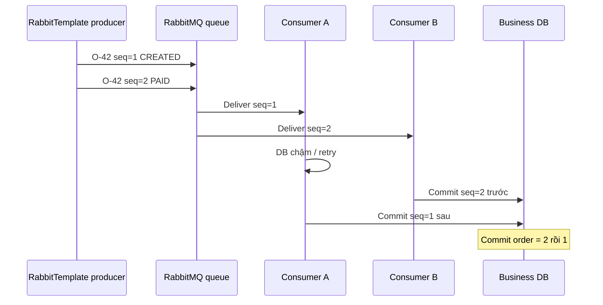
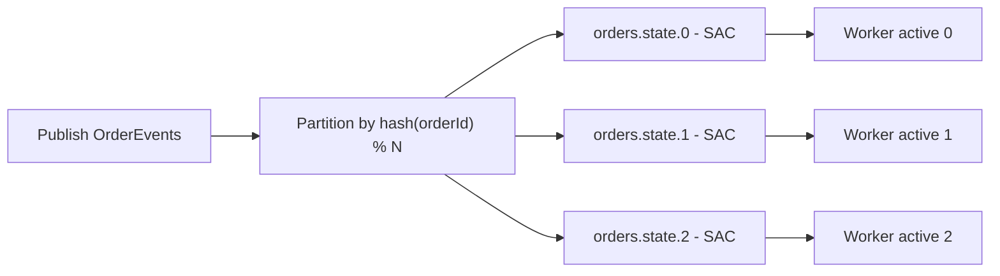
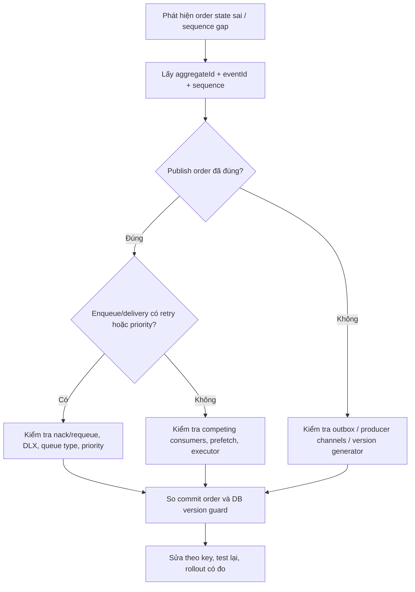

# Lệch thứ tự khi tăng consumer, dùng retry hoặc ưu tiên

> **Chương:** Chẩn đoán sự cố  
> **Công nghệ:** Spring AMQP, RabbitMQ, Spring Boot, `RabbitTemplate`, `@RabbitListener`, exchange, queue, binding, ACK/NACK, retry và dead-letter  
> **Trọng tâm:** Phân biệt thứ tự **publish → enqueue → delivery → xử lý/commit**; giải thích vì sao tăng concurrency, thay đổi prefetch, requeue/retry hoặc bật priority có thể làm người dùng nhìn thấy sự kiện sai thứ tự. Xây biện pháp giữ thứ tự theo khóa nghiệp vụ và quy trình điều tra có thể lặp lại.

## 1. Tình huống: sự kiện `PAID` được xử lý trước `CREATED`

Hệ thống đơn hàng phát ba sự kiện cho cùng `orderId=O-42`:

| Thứ tự dự kiến | Event | Sequence của đơn hàng | Ý nghĩa |
| ---: | --- | ---: | --- |
| 1 | `OrderCreated` | 1 | Tạo bản ghi đơn |
| 2 | `OrderPaid` | 2 | Đánh dấu thanh toán |
| 3 | `OrderShipped` | 3 | Ghi nhận giao vận |

Một publisher dùng `RabbitTemplate` gửi vào direct exchange `orders.events`; binding với routing key `order.state` đưa tất cả sự kiện vào queue `orders.state`. Ban đầu chỉ có một consumer, kết quả dường như luôn đúng. Khi tăng `@RabbitListener` từ một lên bốn consumer để giảm backlog, ứng dụng bắt đầu báo `OrderPaid cannot find order` hoặc trạng thái cuối cùng bị ghi đè.

Điều này **không nhất thiết có nghĩa RabbitMQ đã làm sai FIFO**. Có thể broker đã giao đúng thứ tự, nhưng consumer xử lý/commit **khác thời điểm**:



**Câu hỏi chẩn đoán đúng:** thứ tự nào đã bị vi phạm, ở ranh giới nào, đối với **toàn queue** hay chỉ đối với **cùng một khóa nghiệp vụ**? Không nên quy kết “RabbitMQ đảo message” chỉ từ thứ tự xuất hiện trong log của hai thread.

### Mục tiêu học tập

Sau bài học, bạn có thể:

1. Nêu điều kiện để RabbitMQ duy trì thứ tự FIFO và phân biệt **delivery order** với **completion/commit order**.
2. Giải thích ảnh hưởng của nhiều publisher, competing consumers, prefetch, retry, requeue, DLX và priority.
3. Cấu hình `SimpleRabbitListenerContainerFactory` và Single Active Consumer (SAC) cho luồng có yêu cầu tuần tự.
4. Thiết kế **per-key ordering** bằng partition queues và kiểm soát `sequence/version` ở cơ sở dữ liệu.
5. Phân biệt **message priority** với **consumer priority**, kể cả sự khác nhau giữa classic/quorum queue theo phiên bản RabbitMQ.
6. Xây test tái hiện lỗi có chủ đích, log bằng chứng và lập runbook xử lý an toàn khi production lệch thứ tự.

## 2. Bốn loại “thứ tự” không được đánh đồng

Một queue RabbitMQ có đặc tính FIFO trong các điều kiện nhất định, nhưng ứng dụng quan sát nhiều thời điểm khác nhau:

| Lớp thứ tự | Dữ liệu quan sát | Có thể thay đổi vì |
| --- | --- | --- |
| **Publish order** | Thứ tự các lời gọi/AMQP frames được gửi tới broker | Nhiều publisher, nhiều connection/channel, application thread scheduling, republish |
| **Enqueue order** | Thứ tự message được đưa vào **một queue cụ thể** | Routing từ nhiều channel/connection; exchange fanout ra nhiều queue không tạo một thứ tự toàn cục |
| **Delivery order** | Thứ tự broker giao delivery đến một/một nhóm consumer | Message priority, redelivery/requeue, nhiều consumer và giao thức |
| **Processing/commit order** | Thứ tự handler hoàn tất, database commit hoặc API ngoài thực hiện side effect | Độ trễ DB, concurrency, async executors, retry/backoff, lock và timeout |

RabbitMQ mô tả queue như một tập hợp message có thứ tự: khi publish trên **một channel**, các message được enqueue theo thứ tự publish trong từng queue mà chúng được route tới. Khi có **nhiều channel hoặc connection**, những chuỗi riêng có thể bị xen kẽ. Broker không cung cấp **total order toàn hệ thống** giữa mọi publisher, exchange, queue và transaction.

Ngay cả khi broker lấy message từ queue theo FIFO, **một delivery đến consumer A sớm hơn** không bảo đảm **A commit trước consumer B**. Đây là khác biệt quan trọng nhất khi dùng `SimpleRabbitListenerContainerFactory.setConcurrentConsumers(...)` hoặc chạy nhiều replica cùng đọc một queue.

### 2.1. Xác định mức thứ tự nghiệp vụ thật sự cần

- **Không yêu cầu thứ tự:** notification độc lập, jobs có idempotency. Cho nhiều consumer, retry/DLQ linh hoạt.
- **Yêu cầu thứ tự theo một entity/khóa:** `OrderCreated → OrderPaid` cho cùng `orderId`; nhưng `O-42` và `O-43` có thể chạy song song. Đây là yêu cầu phổ biến nhất.
- **Yêu cầu tuần tự tuyệt đối trên một queue:** tất cả message phải xử lý lần lượt. Dễ kiểm soát hơn nhưng giảm throughput và khả năng scale.
- **Yêu cầu audit/replay có thứ tự bền vững:** cân nhắc RabbitMQ Stream, offset/partition và xử lý tuần tự theo key; một queue truyền thống không phải log replay bất biến.

Không nên hạ toàn hệ thống xuống một consumer chỉ vì **một số** sự kiện có quan hệ nhân quả. Phân vùng theo khóa thường đạt cân bằng tốt hơn.

## 3. Ba thí nghiệm cho thấy FIFO không đồng nghĩa commit theo FIFO

### 3.1. Thí nghiệm A: một channel publish, hai consumer xử lý chậm khác nhau

```text
Enqueue:       M1 -> M2 -> M3 -> M4
Delivery:      C1:M1, C2:M2, C1:M3, C2:M4  (minh họa)
Finish/commit: C2:M2, C2:M4, C1:M1, C1:M3
```

Consumer A mất 500 ms cho M1, consumer B mất 10 ms cho M2. Dù ban đầu queue giao M1 trước M2, kết quả DB và log của B xuất hiện sớm hơn. Việc đổi `concurrency=1` thành `concurrency=4`, hoặc tăng số pod từ 1 lên 4, **không phải cùng một cam kết** với “giữ thứ tự”.

### 3.2. Thí nghiệm B: retry/requeue làm một message cũ xuất hiện lại

```text
Queue:       [M1, M2, M3]
Deliver:     M1 -> consumer A (lỗi)
             M2 -> consumer B (thành công)
NACK/requeue M1 -> được trả về queue theo cơ chế RabbitMQ
Process:     M2 hoàn tất trước M1 retry
```

Khi delivery bị `basic.nack(requeue=true)` hoặc consumer/channel mất connection với delivery **unacked**, RabbitMQ có thể requeue. Broker thường cố gắng giữ vị trí ban đầu khi có thể, nhưng dưới **concurrent deliveries và ACKs**, message có thể được đặt gần đầu queue hơn là đúng vị trí tuyệt đối; **không nên dựa vào một quy tắc “luôn về cuối” hoặc “luôn lên đầu” cho mọi phiên bản/queue type**.

Nếu thay vì requeue trực tiếp, ứng dụng chuyển M1 sang **retry queue có TTL** rồi dead-letter lại queue chính, M2/M3 có cơ hội tiếp tục xử lý trong lúc M1 đợi. Về nghiệp vụ, M1 đã bị **overtake** dù flow retry được thiết kế đúng cho throughput.

### 3.3. Thí nghiệm C: message priority chủ động bỏ FIFO

```text
Queue đang chờ: [A priority=1, B priority=3, C priority=2]
Dispatch khi có consumer khả dụng: B -> C -> A
```

Priority queue **được thiết kế** để ưu tiên message, nên đương nhiên không còn FIFO giữa các priority khác nhau. Nếu A và B thuộc **cùng một đơn hàng** nhưng B được gán priority cao hơn, A có thể bị vượt. Priority không phải cơ chế sửa ordering; nó là một **yêu cầu sắp lịch khác**, đôi khi xung đột trực tiếp với ordering.

**Lưu ý thực tế:** nếu các message priority thấp đã được giao vào vùng **prefetch/unacked** của consumer trước khi priority cao tới, broker không thể đơn giản rút message đang xử lý về để “chèn” message mới. Vì vậy priority cũng không cam kết thời gian hoàn tất tuyệt đối.

## 4. Tăng consumer và prefetch: chỗ cần kiểm tra đầu tiên

Trong Spring AMQP (AMQP 0-9-1), `SimpleMessageListenerContainer` có thể chạy nhiều consumer. Các thuộc tính chính:

| Thuộc tính | Ý nghĩa | Ảnh hưởng thứ tự |
| --- | --- | --- |
| `concurrentConsumers` | Số consumer ban đầu trên một container | Nhiều consumer có thể hoàn tất message khác thứ tự giao |
| `maxConcurrentConsumers` | Trần scale động consumer ở container Simple | Có thể tăng số consumer trong giờ cao điểm mà không thay code |
| `prefetchCount` | Số delivery **chưa ACK** broker có thể cấp trước cho mỗi consumer, theo QoS hiện hành | Prefetch cao làm nhiều message rời trạng thái ready trước khi xử lý |
| `AcknowledgeMode.AUTO` | Container ACK sau listener hoàn tất thành công (đồng bộ) | Không bảo đảm commit theo FIFO khi có nhiều consumer |
| `AcknowledgeMode.MANUAL` | Application chủ động ACK/NACK đúng delivery/channel | Có thể kiểm soát thời điểm ACK, nhưng cũng dễ ACK sớm hoặc lệch |
| `AcknowledgeMode.NONE` | Broker tự coi delivery đã được nhận thành công | Có thể mất việc khi worker chết; không nên dùng để “sửa thứ tự” |

Spring AMQP đã nâng prefetch mặc định của listener container từ 1 lên **250** từ phiên bản 2.0 để tăng throughput, và tài liệu khuyến nghị **giảm về 1 khi cần thứ tự chặt**. Tuy nhiên, `prefetch=1` **không** tự bảo toàn thứ tự nếu queue có nhiều consumer hoặc business logic đưa sang thread pool rồi trả về ngay. Điều kiện tối thiểu thường là **một consumer đang thực sự nhận message cho một phân vùng**, prefetch nhỏ, xử lý/ACK tuần tự.

**Quy tắc tính tải minh họa:** 4 consumer với prefetch 20 có thể giữ tới khoảng 80 delivery unacked từ queue, dù ứng dụng không chạy 80 business transaction cùng lúc. Đây là **giới hạn in-flight delivery**, không phải số thread hoặc số transaction.

### 4.1. Cấu hình một consumer, prefetch 1 cho queue bắt buộc tuần tự

```java
import org.springframework.amqp.core.AcknowledgeMode;
import org.springframework.amqp.rabbit.config.SimpleRabbitListenerContainerFactory;
import org.springframework.amqp.rabbit.connection.ConnectionFactory;
import org.springframework.context.annotation.Bean;
import org.springframework.context.annotation.Configuration;

@Configuration(proxyBeanMethods = false)
public class OrderedListenerConfig {
    @Bean("orderedListenerFactory")
    SimpleRabbitListenerContainerFactory orderedListenerFactory(
            ConnectionFactory connectionFactory) {
        var factory = new SimpleRabbitListenerContainerFactory();
        factory.setConnectionFactory(connectionFactory);
        factory.setConcurrentConsumers(1);
        factory.setMaxConcurrentConsumers(1);
        factory.setPrefetchCount(1);
        factory.setAcknowledgeMode(AcknowledgeMode.AUTO);
        // Lỗi không tự requeue mãi: cần DLX và retry policy đã thiết kế.
        factory.setDefaultRequeueRejected(false);
        return factory;
    }
}
```

Ví dụ trên chỉ ràng buộc **một container tại một instance**. Nếu chạy **ba pod** cùng dùng `orderedListenerFactory` vào cùng queue, vẫn có **ba consumer competing**. Muốn có nhiều instance standby nhưng chỉ **một consumer active cho cả queue**, cần Single Active Consumer hoặc điều phối khác ở **broker**.

### 4.2. Đừng nhầm thứ tự callback và thứ tự database commit

Nếu `@RabbitListener` nhận message rồi gọi `@Async`/`Executor` để xử lý và return ngay, với ACK AUTO của listener đồng bộ, container có thể ACK trước khi task nền commit. Thao tác này vừa gây nguy cơ mất message vừa phá thứ tự:

```java
@RabbitListener(queues = "orders.state")
public void unsafeHandler(String body) {
    // Không dùng cách này khi cần ACK sau commit và thứ tự theo orderId.
    executor.execute(() -> orderService.apply(body));
}
```

Muốn tận dụng concurrency, dùng partition queues, hoặc gửi vào **durable handoff** rồi ACK sau commit phần bàn giao. Với listener có return type bất đồng bộ được Spring AMQP hỗ trợ, phải kiểm tra đúng lifecycle/ack mode theo phiên bản; không mặc định mọi thread khác đều được container theo dõi.

## 5. Single Active Consumer: một worker active, nhiều worker standby

RabbitMQ có cơ chế **Single Active Consumer (SAC)**: nhiều consumer có thể đăng ký cùng queue nhưng **một consumer active** nhận delivery tại một thời điểm; khi active consumer biến mất, broker chuyển sang một consumer đang chờ. Đây là lựa chọn hữu ích khi rollout/HA mà vẫn cần giới hạn cạnh tranh.

### 5.1. Khai báo queue có SAC bằng Spring AMQP

```java
import org.springframework.amqp.core.Binding;
import org.springframework.amqp.core.BindingBuilder;
import org.springframework.amqp.core.DirectExchange;
import org.springframework.amqp.core.Queue;
import org.springframework.amqp.core.QueueBuilder;
import org.springframework.context.annotation.Bean;
import org.springframework.context.annotation.Configuration;

@Configuration(proxyBeanMethods = false)
public class OrderedQueueTopology {
    static final String EXCHANGE = "orders.events";
    static final String QUEUE = "orders.state.0";

    @Bean
    DirectExchange ordersEventsExchange() {
        return new DirectExchange(EXCHANGE);
    }

    @Bean
    Queue orderedStateQueue() {
        return QueueBuilder.durable(QUEUE)
                .withArgument("x-single-active-consumer", true)
                .build();
    }

    @Bean
    Binding orderedStateBinding(DirectExchange ordersEventsExchange,
                                Queue orderedStateQueue) {
        return BindingBuilder.bind(orderedStateQueue)
                .to(ordersEventsExchange)
                .with("state.0");
    }
}
```

`x-single-active-consumer=true` phải có khi **declare queue**. Không thể an toàn “bật thêm” bằng cách redeclare một queue đã tồn tại với arguments khác: RabbitMQ có thể trả `PRECONDITION_FAILED`. Cần kế hoạch tạo queue mới/chuyển consumer/đổi routing khi migration. SAC không mặc nhiên cung cấp khi chỉ dùng `@RabbitListener(concurrency="1")` trên mỗi replica.

Listener dùng factory ở mục 4:

```java
import org.springframework.amqp.rabbit.annotation.RabbitListener;
import org.springframework.stereotype.Component;

@Component
public class OrderedStateListener {
    private final OrderSequenceService service;

    public OrderedStateListener(OrderSequenceService service) {
        this.service = service;
    }

    @RabbitListener(id = "order-state-partition-0",
            queues = OrderedQueueTopology.QUEUE,
            containerFactory = "orderedListenerFactory")
    public void consume(String payload) {
        // Mẫu payload lab: "O-42|2|PAID".
        String[] parts = payload.split("\\|", 3);
        if (parts.length != 3) {
            throw new IllegalArgumentException("Malformed order event");
        }
        service.applyInSequence(parts[0],
                Long.parseLong(parts[1]), parts[2]);
    }
}
```

`OrderSequenceService` là service nghiệp vụ do ứng dụng tự cung cấp; xem mục 9 để bảo vệ sequence. **Không chạy song song** một listener khác cùng queue trong bài test strict ordering, trừ khi bạn cố ý kiểm tra SAC standby/failover. Ví dụ topology chỉ có một partition `state.0`; production nhiều khóa cần partition phù hợp ở mục 8.

### 5.2. SAC giúp gì và không giúp gì?

| SAC hỗ trợ | SAC **không** tự bảo đảm |
| --- | --- |
| Chỉ một consumer đang nhận delivery của queue tại một thời điểm. | Thứ tự publish toàn cục từ nhiều channel/producer. |
| Standby consumer thay khi active bị hủy/mất kết nối. | Không redeliver khi message đã commit DB nhưng chưa ACK. |
| Dễ duy trì one-consumer-per-queue khi có nhiều pod. | Không bị ảnh hưởng bởi priority, requeue, async handoff hoặc lỗi business. |
| Quản lý failover ở broker. | Chỉ có một lần thực hiện business side effect. |

Trong một số trường hợp **quorum SAC**, consumer có priority cao hơn có thể được bầu thay consumer đang active. Trạng thái chuyển giao vẫn có delivery unacked và có thể redelivery. Không ghép consumer priority vào SAC chỉ để “tăng ưu tiên message”.

Khi đòi hỏi ordering rất nghiêm ngặt, kiểm tra thủ tục dừng: `basic.cancel` ngừng cấp delivery mới nhưng không làm biến mất phần đã được cấp; cần đợi handler/ACK hoặc **đóng channel** để RabbitMQ xử lý unacked trước khi consumer mới tiếp tục. Tài liệu RabbitMQ có hướng dẫn riêng về cách bảo vệ ordering lúc stop/cancel và failure. Đừng kết luận chỉ cần đặt SAC là **mọi trường hợp crash/requeue** vẫn đạt hoàn toàn một thứ tự.

## 6. Retry và requeue: điểm khiến sự kiện cũ bị vượt

Cần phân biệt **retry cục bộ trong JVM**, **requeue trên queue chính**, **retry queue/DLX** và **republish**:

| Cơ chế | Đường đi | Tác động đến thứ tự |
| --- | --- | --- |
| Retry cục bộ với Spring Retry | Cùng delivery, handler thử lại trước khi quyết định ACK/NACK | Với **một consumer đồng bộ**, các message sau thường phải chờ; với nhiều consumer, chúng vẫn có thể chạy trước |
| `basic.nack(requeue=true)` | Trả delivery về RabbitMQ để giao lại | Có thể thay thứ tự giao/commit, tạo vòng retry nóng |
| Channel/connection đóng khi còn unacked | Broker requeue các delivery chưa ACK | Có thể thay thứ tự và gây duplicate business effect |
| `basic.reject(requeue=false)` / `AmqpRejectAndDontRequeueException` | Không requeue trực tiếp; broker có thể dead-letter nếu có DLX | Event sau có thể tiếp tục qua, phá tính liên tục theo khóa nếu event trước chưa được giải quyết |
| Retry queue + TTL + DLX | Gửi tạm sang queue chờ, quay lại queue chính | Event mới có thể vượt event cũ trong thời gian chờ |
| Republish sang queue khác | Tạo delivery mới theo routing mới | Không có cam kết giữ vị trí ban đầu trong queue gốc |
| Quorum queue delayed retry (RabbitMQ 4.3+) | Broker trì hoãn các returned messages theo policy/arguments | Giảm loop nóng nhưng **không** bảo toàn thứ tự business cho key khi event mới vẫn được cấp |

Với workflow có phụ thuộc nhân quả, quyết định **cho phép vượt event cũ hay phải chặn partition** quan trọng hơn chọn kiểu retry nào.

### 6.1. Ví dụ lỗi được phân loại trong `@RabbitListener`

```java
import org.springframework.amqp.AmqpRejectAndDontRequeueException;
import org.springframework.amqp.ImmediateRequeueAmqpException;
import org.springframework.amqp.rabbit.annotation.RabbitListener;

@RabbitListener(queues = "orders.state.0",
        containerFactory = "orderedListenerFactory")
public void applyState(String message) {
    try {
        orderService.apply(message);
    }
    catch (InvalidEventException bad) {
        // Chỉ hợp lý nếu đã có DLX/quarantine và repair/reconciliation.
        throw new AmqpRejectAndDontRequeueException("Invalid order event", bad);
    }
    catch (TemporaryDatabaseException transientError) {
        // Minh họa chính sách requeue; không lặp vô hạn trong production.
        throw new ImmediateRequeueAmqpException("Temporary DB outage",
                transientError);
    }
}
```

Đây là **mẫu logic**, không phải class Java hoàn chỉnh; `orderService`, `InvalidEventException` và `TemporaryDatabaseException` thuộc ứng dụng. Không đăng ký thêm listener này cùng `OrderedStateListener` trên queue thật nếu mong test tuần tự: chúng sẽ trở thành competing handlers nếu không được SAC kiểm soát. `AmqpRejectAndDontRequeueException` ngăn requeue mặc định; `ImmediateRequeueAmqpException` yêu cầu requeue bất chấp `defaultRequeueRejected`. Nếu RabbitMQ không cấu hình DLX, message bị reject với `requeue=false` có thể bị loại bỏ.

### 6.2. Retry tại container: giới hạn attempts và backoff

```java
import org.springframework.amqp.rabbit.config.RetryInterceptorBuilder;
import org.springframework.amqp.rabbit.retry.RejectAndDontRequeueRecoverer;
import org.springframework.amqp.rabbit.config.SimpleRabbitListenerContainerFactory;
import org.springframework.amqp.rabbit.connection.ConnectionFactory;

// Trích đoạn bean factory, dùng khi error policy cần bounded local retry.
var factory = new SimpleRabbitListenerContainerFactory();
factory.setConnectionFactory(connectionFactory);
factory.setConcurrentConsumers(1);
factory.setPrefetchCount(1);
factory.setAdviceChain(RetryInterceptorBuilder.stateless()
        .maxAttempts(3)
        .backOffOptions(500, 2.0, 2_000)
        .recoverer(new RejectAndDontRequeueRecoverer())
        .build());
```

`stateless()` ở đây giữ retry **trong lượt gọi listener** trước khi reject, thích hợp với handler đồng bộ có thể thử lại. `maxAttempts(3)` tính tổng lần thử (bao gồm lần đầu) theo semantics Spring Retry; các số timeout chỉ là lab. Khi retry cạn, `RejectAndDontRequeueRecoverer` khiến delivery bị reject mà không requeue trực tiếp, nên **phải** có DLQ/quarantine và cơ chế xử lý gap nếu sự kiện này là tiền đề của sự kiện sau.

Stateful retry, transaction, các handler bất đồng bộ và batch có semantics khác: **không hoán đổi stateless/stateful retry chỉ để “giữ thứ tự”** mà chưa kiểm tra message ID, transaction boundaries và nhận lại message qua broker.

### 6.3. Requeue và poison messages trên quorum queue: khác biệt RabbitMQ 4.3

Ở RabbitMQ 4.0+, quorum queue mặc định có `delivery-limit=20`, dùng để giới hạn những lần delivery **thất bại** và có thể dead-letter khi đạt ngưỡng. Nhưng **RabbitMQ 4.3 thay đổi cách đếm**:

- Trước 4.3, `basic.nack(requeue=true)` có thể làm tăng bộ đếm liên quan đến delivery limit.
- Từ 4.3, một **explicit `basic.nack` requeue** được coi là *returned delivery* và **không tăng `delivery-count` dùng cho delivery limit**; `basic.reject` được dùng để đánh dấu thất bại tương ứng theo quy tắc mới.
- `x-delivery-count` và `x-acquired-count` giúp phân biệt lần thất bại với lần delivery được gán cho consumer; `x-acquired-count` có thể tăng cả khi application chưa thực sự chạy handler.
- Nếu dựa vào delivery limit để ngăn poison loop, **không dùng `basic.nack(requeue=true)` vô hạn trên RabbitMQ 4.3** rồi nghĩ broker tự đưa sang DLQ sau 20 lần. Thiết kế retry budget rõ ràng hoặc dùng cơ chế fail/reject/delayed retry phù hợp.

RabbitMQ 4.3 cũng hỗ trợ quorum delayed retry bằng `x-delayed-retry-type`, `x-delayed-retry-min` và `x-delayed-retry-max` hoặc policy. Đây là **tính năng mới theo phiên bản và queue type**, không phải hành vi tự có của mọi queue. Đặt backoff có thể giảm tải nhưng vẫn làm các event đến sau được xử lý trước event đang chờ retry. Tham khảo tài liệu quorum queue đúng **phiên bản broker đang chạy**, đặc biệt khi nâng từ 4.2 lên 4.3.

## 7. Message priority khác consumer priority

Hai tính năng cùng có tên “priority” nhưng nằm ở **hai tầng khác nhau**:

| | **Message priority** | **Consumer priority** |
| --- | --- | --- |
| Đặt ở đâu? | `MessageProperties.priority` khi publish | `x-priority` trong `basic.consume` / consumer arguments |
| Đối tượng được ưu tiên | Một message đang chờ trong queue | Một consumer trong nhóm competing consumers |
| Giá trị lớn hơn | Message có thể được dispatch sớm hơn | Consumer được ưu tiên nhận delivery khi chưa bị blocked |
| Tác động FIFO | **Có chủ đích thay đổi** thứ tự message khác priority | Không đặt lại thứ tự message theo nghiệp vụ; thay nơi nhận và có thể ảnh hưởng completion order |
| Thích hợp khi | Job khẩn cấp có thể xử lý độc lập | Ưu tiên nhóm worker mạnh/standby theo kế hoạch |

### 7.1. Classic priority queue

Với **classic queue**, cần đặt `x-max-priority` khi khai báo queue. RabbitMQ hỗ trợ nhiều mức, nhưng thường nên dùng **ít mức** (ví dụ 2–4) để giảm overhead:

```java
import org.springframework.amqp.core.Queue;
import org.springframework.amqp.core.QueueBuilder;
import org.springframework.context.annotation.Bean;

@Bean
Queue alertsPriorityQueue() {
    return QueueBuilder.durable("alerts.priority")
            .withArgument("x-max-priority", 4)
            .build(); // Ví dụ dành cho classic queue.
}
```

Producer:

```java
// RabbitTemplate đã được inject, exchange và binding tồn tại trước.
rabbitTemplate.convertAndSend("alerts.events", "alerts", "urgent-alert",
        message -> {
            message.getMessageProperties().setPriority(4);
            return message;
        });
```

`setPriority(4)` là **message priority**, không phải consumer priority. Nếu queue không hỗ trợ/configure message priority như mong muốn, việc gắn property chưa đủ để broker sắp xếp. Đổi `x-max-priority` cho queue đã tồn tại bằng redeclare có thể gặp `PRECONDITION_FAILED`; lập kế hoạch migration.

### 7.2. Quorum message priorities theo phiên bản

Không áp dụng quy tắc classic `x-max-priority` cho quorum queue:

| RabbitMQ | Quorum queue message priority | Hệ quả |
| --- | --- | --- |
| Trước 4.0 | Không có hỗ trợ message priorities như 4.x | Không thiết kế priority workflow dựa vào giả định 4.x |
| **4.0–4.2** | Hai lớp **normal/high** với tỷ lệ dispatch tương đối, không phải 32 mức strict | Không kiểm thử giả định priority 9 luôn đi trước priority 5 tuyệt đối |
| **4.3+** | **32 mức strict 0–31**, `x-max-priority` bị bỏ qua; message thiếu priority mặc định **4** | Kiểm tra số level, prefetch và returned-message exception theo docs 4.3+ |

Ở classic queue, message không có priority thường được xem là **0**; ở quorum 4.3+ mặc định **4**. Khi cùng ứng dụng chuyển classic → quorum, thứ tự tương đối của message có/không đặt priority có thể khác. Dù quorum 4.3 có strict priority, message đã được cấp vào prefetch hoặc đang retry/return vẫn là ngoại lệ cần thiết kế riêng.

### 7.3. Consumer priority

RabbitMQ cho đặt `x-priority` ở **consumer arguments**; consumer có priority cao được ưu tiên nhận message đến khi bị blocked, ví dụ do prefetch. Nếu nhiều consumer cùng priority cao, broker có thể dispatch theo kiểu round-robin giữa họ.

```java
import java.util.Map;
import org.springframework.amqp.rabbit.listener.SimpleMessageListenerContainer;

// Trong bean config hoặc setup; không dùng chung queue strict-ordering demo.
SimpleMessageListenerContainer container =
        new SimpleMessageListenerContainer(connectionFactory);
container.setQueueNames("batch.background");
container.setConsumerArguments(Map.of("x-priority", 10));
container.setPrefetchCount(10);
container.setConcurrentConsumers(1);
```

Consumer priority **không làm message `seq=1` xử lý trước `seq=2`** nếu hai consumer khác nhau đã nhận message và có thời gian xử lý khác nhau. Với SAC, priority của consumer còn có thể ảnh hưởng tới việc chọn/failover active consumer theo queue type. Không dùng `x-priority` thay `x-single-active-consumer`.

### 7.4. Nếu vừa cần ưu tiên, vừa cần đúng thứ tự cho từng đơn?

Đây là **xung đột thiết kế** nếu priority được áp ngay trong cùng một chuỗi nhân quả: muốn `OrderPaid` urgent vượt `OrderCreated` thì không còn đảm bảo quan hệ `Created trước Paid`. Các cách hợp lý:

- Tách **queue khẩn cấp** cho các sự kiện **độc lập về nghiệp vụ**, không phân ưu tiên giữa các event cùng một entity có phụ thuộc thứ tự.
- Ưu tiên **chọn partition/công việc** ở mức scheduler sau khi đã đảm bảo prerequisite của từng entity, thay vì priority từng event trong cùng chuỗi.
- Chỉ tăng priority **giữa các entity độc lập** nếu có lớp bảo đảm rằng những event cùng entity vẫn có thứ tự được áp dụng.
- Dùng chính sách age/fairness phù hợp để không bỏ đói các message priority thấp.

## 8. Muốn scale mà vẫn có thứ tự theo khóa: partition queues

Một queue với SAC thường chỉ có một consumer active nên có giới hạn throughput. Nếu đơn hàng khác nhau độc lập, hãy định tuyến **theo khóa ổn định**:



Nếu `O-42` luôn vào partition 0, mọi event của nó chờ cùng hàng đợi/consumer tuần tự. Các entity khác có thể đồng thời xử lý trên partition 1 hoặc 2. Đây là **per-key order**, không phải total order giữa các đơn hàng.

### 8.1. Publisher route theo hash ổn định

```java
import java.nio.charset.StandardCharsets;
import java.util.zip.CRC32;
import org.springframework.amqp.rabbit.core.RabbitTemplate;

public final class PartitionedOrderPublisher {
    private static final int PARTITIONS = 4;
    private final RabbitTemplate template;

    public PartitionedOrderPublisher(RabbitTemplate template) {
        this.template = template;
    }

    public void publish(String orderId, String payload) {
        // CRC32 minh họa: producer của cùng service phải dùng chung thuật toán.
        CRC32 crc = new CRC32();
        byte[] bytes = orderId.getBytes(StandardCharsets.UTF_8);
        crc.update(bytes, 0, bytes.length);
        int partition = (int) (crc.getValue() % PARTITIONS);
        template.convertAndSend("orders.events",
                "state." + partition, payload);
    }
}
```

Topology phải có **bốn queue `orders.state.0...3`** và tương ứng bốn binding keys `state.0...3` tới exchange direct `orders.events`. Mỗi queue có SAC hoặc một active consumer, với `prefetch` thích hợp. **Ví dụ mục 5 chỉ khai báo partition 0** để tập trung vào API; production phải declare đủ các partition thực sự được route.

Lưu ý:

1. `hash(orderId)%N` phải dùng **cùng encoding, thuật toán, phiên bản và N** tại mọi publisher; `String.hashCode()%N` kiểu tự ghép nhiều ngôn ngữ dễ sai nếu không có spec.
2. **Đổi N làm đổi partition của một số entity**. Không thay 4 → 8 trực tiếp khi còn event cũ ở queue cũ; cần **drain/migrate/version routing** hoặc quy trình fence theo key.
3. Một entity “nóng” có thể làm nghẽn một partition; cần công cụ phân tích skew, backlog và throughput, không tự phân tán các event cùng entity ra nhiều queue.
4. Routing hash bằng **plugin exchange** (như consistent-hash/modulus-hash theo plugin được broker hỗ trợ) là lựa chọn khác, nhưng phải xác minh plugin/version và bảo đảm topology không chuyển khóa giữa chừng khi thay binding weight/partition count.
5. Tách queue per-customer có thể tạo quá nhiều resource và metric cardinality; partition hữu hạn giúp kiểm soát vận hành tốt hơn.

### 8.2. Scale workers khác scale thứ tự

Với bốn partition/SAC queues, có thể chạy nhiều pod cùng đăng ký cả bốn queue; broker bảo đảm mỗi queue chỉ có **một consumer active**. Như vậy tổng số đường xử lý song song tối đa thường gắn với **số partition**, không phải số pod. Thêm pod chỉ tăng standby/HA nếu tất cả partition đã có active worker và chưa thay routing.

**Tối ưu throughput** phải đo cùng:

- Số partition và độ phân bố key.
- Handler duration p95/p99 theo partition/loại nghiệp vụ.
- Backlog và oldest message age mỗi queue.
- Độ trễ DB lock, transaction retries và tác động khi một partition bị poison message chặn.

## 9. Lớp bảo vệ nghiệp vụ: sequence/version check và idempotency

SAC, prefetch 1 và partition giúp **giảm xác suất** xử lý lệch, nhưng **không thể kiểm soát** việc producer phát sai thứ tự, redelivery sau lỗi hoặc tác động từ workflow ngoài RabbitMQ. Consumer cần bảo vệ bằng dữ liệu:

- `eventId` để phân biệt **delivery trùng**.
- `aggregateId/orderId` để xác định **chuỗi nhân quả**.
- `sequence` tăng đơn điệu **theo aggregate**; nên được cấp khi ghi event/outbox trong cùng transaction business.
- `lastAppliedSequence` lưu cùng với state tại DB.

### 9.1. Trình tự khi nhận một event

```text
Incoming: (orderId=O-42, sequence=3)
DB lastAppliedSequence:
    == 2 : áp dụng event 3 và lưu last=3 trong transaction
    >= 3 : duplicate/stale event; skip nếu business policy cho phép
    <  2 : thiếu event trước (gap); không áp dụng event 3 vội
```

Đừng chỉ kiểm tra `incoming > lastAppliedSequence`: nếu DB đang ở 1 và event 3 tới trước event 2, điều kiện đó vẫn cho event 3 ghi đè. Với chuỗi **phải liên tục**, điều kiện áp dụng an toàn là `incoming == last + 1`, trừ khi domain định nghĩa các bước có thể bỏ qua.

### 9.2. Mã nghiệp vụ minh họa

```java
import org.springframework.stereotype.Service;
import org.springframework.transaction.annotation.Transactional;

@Service
public class OrderSequenceService {
    private final OrderStateRepository repository;

    public OrderSequenceService(OrderStateRepository repository) {
        this.repository = repository;
    }

    @Transactional
    public void applyInSequence(String orderId, long sequence,
                                String newState) {
        // findAndLockForUpdate dùng row lock hoặc optimistic version control.
        OrderState row = repository.findAndLockForUpdate(orderId);
        long last = row.lastAppliedSequence();

        if (sequence <= last) {
            return; // Đã áp dụng hoặc stale: kiểm tra eventId/contract nếu cần.
        }
        if (sequence != last + 1) {
            throw new MissingPrerequisiteEventException(
                    "Gap for " + orderId + ": expected " + (last + 1)
                    + ", got " + sequence);
        }

        row.apply(newState, sequence);
        repository.save(row);
        // Transaction commit trước khi listener AUTO ACK.
    }
}
```

`OrderStateRepository`, `OrderState` và `MissingPrerequisiteEventException` là **các kiểu nghiệp vụ minh họa**, không phải API sẵn có của Spring AMQP. Việc `@Transactional` có hiệu lực phụ thuộc bean/proxy và transaction manager. `findAndLockForUpdate`/optimistic CAS phải chặn **hai consumer áp dụng cùng sequence đồng thời**; nếu không, cả hai cùng đọc `last=1` và cùng cập nhật `sequence=2`, gây race.

Với event đầu tiên, phải có record/order placeholder hoặc logic tạo state bằng transaction an toàn. Cần phân biệt:

- **Duplicate cùng `eventId`:** có thể skip và ACK nếu side effect đã commit.
- **Stale sequence khác eventId:** có thể là producer sai/late event, cần cảnh báo hoặc quarantine chứ không nhất thiết “thành công”.
- **Gap `incoming > last+1`:** không **ACK rồi bỏ** nếu nghiệp vụ cần tiền đề; có thể lưu vào **durable pending-events store** hoặc tạm dừng partition, điều tra thiếu event và replay đúng thứ tự.

Không dùng `basic.nack(requeue=true)` vô hạn cho gap khi event còn thiếu sẽ không bao giờ tới: nó tạo vòng nóng và làm nghẽn partition. Để đúng thứ tự, cần cơ chế chờ/repair có thời hạn và phản hồi vận hành, không chỉ loop.

### 9.3. Dedupe không đồng nghĩa ordering

Một inbox có unique constraint `(consumer_name, event_id)` ngăn cùng event gây side effect hai lần. Nhưng nó không ngăn event `sequence=3` xử lý trước `sequence=2`. Cần **cả hai**:

```sql
CREATE TABLE consumed_events (
    consumer_name VARCHAR(80) NOT NULL,
    event_id VARCHAR(128) NOT NULL,
    PRIMARY KEY (consumer_name, event_id)
);

-- Ví dụ bảng aggregate cần giữ last_applied_sequence.
CREATE TABLE order_projection (
    order_id VARCHAR(128) PRIMARY KEY,
    last_applied_sequence BIGINT NOT NULL,
    state VARCHAR(40) NOT NULL
);
```

Trong cùng transaction áp dụng event, insert dedupe marker + cập nhật projection theo sequence. Nếu có API ngoài DB (thanh toán, gửi email), cần idempotency key ở hệ thống đích hoặc cơ chế saga/reconciliation vì transaction DB không rollback được HTTP call đã thực thi.

## 10. Đường retry quyết định có giữ được thứ tự nhân quả hay không

Không có một retry policy đúng cho mọi queue. Chọn theo **độ phụ thuộc của sự kiện**:

| Loại công việc | Chiến lược gợi ý | Trade-off |
| --- | --- | --- |
| Notification độc lập | Bounded local retry → DLQ hoặc delayed retry queue | Ưu tiên throughput; không hứa thứ tự |
| Event có chuỗi trạng thái theo `orderId` | Partition theo key + SAC + sequence guard | Nếu event trước lỗi, partition/key có thể bị chặn |
| DB tạm lỗi và thời gian phục hồi rất ngắn | Local retry có giới hạn trong handler | Giữ thứ tự của consumer đồng bộ, nhưng tiêu thụ slot lâu |
| Lỗi dài (IdP/DB ngoài chết vài phút) | Durable retry/pending + pause partition/flow control | Khó hơn nhưng tránh nóng CPU và ngăn event sau vượt trái phép |
| Priority jobs độc lập | Queue ưu tiên riêng, prefetch thấp nếu cần | Chấp nhận ưu tiên cao vượt thấp |
| Event history cần replay | Stream có offsets/partitioning + version guard | Mô hình lưu trữ và consumer APIs khác queue 0-9-1 |

**Quy tắc điều tra:** nếu nghiệp vụ yêu cầu `seq=1` phải hoàn thành trước `seq=2`, thì chỉ gửi `seq=1` qua DLX và cho `seq=2` ACK thành công là **thay đổi hợp đồng nghiệp vụ**, không phải “sửa retry”. Có thể chấp nhận điều đó nếu có một quy trình durable pending/compensation, nhưng cần ghi rõ và kiểm thử.

### 10.1. Head-of-line blocking là hệ quả có chủ đích

Một consumer tuần tự gặp event độc (poison message) sẽ chặn mọi event đằng sau nếu giữ thứ tự tuyệt đối. Đây là **head-of-line blocking**, không nhất thiết là lỗi framework. Phải quyết định:

1. Có thể sửa/replay event độc để thông luồng không?
2. Có thể cô lập **chỉ một khóa** thay vì chặn mọi khóa trong partition?
3. Sự kiện sau có thể được lưu tạm bền vững và replay khi prerequisite có mặt?
4. Sau deadline, nghiệp vụ chấp nhận compensation/skip hay buộc cảnh báo vận hành?

Thứ tự mạnh và throughput cao thường phải trả giá bằng kiến trúc phân vùng, bộ đệm bền vững hoặc bảo vệ sequence ở DB.

## 11. Chẩn đoán production: tìm ra ranh giới nơi thứ tự bị thay đổi

Không bắt đầu bằng cách vội giảm `concurrency` trên tất cả service. Thu thập bằng chứng theo **một khóa cụ thể**:



### 11.1. Log tối thiểu để tái dựng chuỗi

Ghi **một record trên mỗi phase quan trọng**, ví dụ:

```text
2026-11-26T09:00:00Z publish  order=O-42 seq=1 event=E1 channel=pub-A
2026-11-26T09:00:01Z publish  order=O-42 seq=2 event=E2 channel=pub-A
2026-11-26T09:00:02Z receive  order=O-42 seq=1 event=E1 consumer=worker-A redelivered=false
2026-11-26T09:00:02Z receive  order=O-42 seq=2 event=E2 consumer=worker-B redelivered=false
2026-11-26T09:00:03Z commit   order=O-42 seq=2 event=E2 consumer=worker-B
2026-11-26T09:00:05Z commit   order=O-42 seq=1 event=E1 consumer=worker-A
```

Các mốc thời gian **chỉ minh họa**. Muốn đối soát thật cần đồng hồ/trace context tin cậy, phân biệt:

- `eventId`, `aggregateId`, `sequence` và phiên bản schema.
- Queue/exchange/routing key, producer instance, publisher channel nếu kiểm soát được.
- Consumer tag/instance/listenerId; `redelivered`, `x-death`, `x-delivery-count`, `x-acquired-count` nếu có.
- Event receive/start, business commit, ACK/NACK và retry/republish.
- Thread/concurrency/prefetch, active consumers, queue type (classic/quorum/stream) và **phiên bản RabbitMQ**.

**Không dùng thời gian log của hai máy khác nhau như bằng chứng duy nhất về thứ tự publish/enqueue**, vì clock skew, buffering và async logging có thể đảo thứ tự xuất hiện trên dashboard. Sequence cấp từ transaction/outbox là bằng chứng nghiệp vụ mạnh hơn.

### 11.2. Kiểm tra RabbitMQ mà không làm gián đoạn queue

Từ Management UI hoặc exporter, xem **từng queue liên quan**:

| Chỉ số | Diễn giải hữu ích |
| --- | --- |
| Consumer count / SAC active | Có thật đang có một active consumer hay nhiều competing consumers? |
| `messages_ready` | Có backlog chờ broker dispatch? |
| `messages_unacknowledged` | Prefetch/inflight đang giữ bao nhiêu delivery? |
| Deliver rate và redeliver rate | Lỗi requeue/reconnect có xảy ra đúng thời điểm lệch thứ tự? |
| Publish/confirm/return | Có publish lặp hoặc route sai exchange/binding? |
| DLQ depth / `x-death` | Event trước đã bị dead-letter và event sau chạy trước chưa? |
| Priority levels (nếu queue/version hỗ trợ) | Message ưu tiên cao có vượt thấp? |
| Handler duration và DB lock wait | Xử lý lâu làm commit out-of-order dù delivery ban đầu đúng? |

Một số lệnh CLI **chỉ dành cho operator có quyền**, và cú pháp/field hỗ trợ phụ thuộc phiên bản broker:

```bash
# Chạy trên node RabbitMQ trong môi trường được cấp quyền.
rabbitmq-diagnostics listeners
rabbitmqctl list_queues -p / name type consumers messages_ready messages_unacknowledged
rabbitmqctl list_consumers -p /
```

Không tự `purge_queue`, `delete_queue` hoặc kill connection production chỉ để tái hiện lỗi. Nếu cần xem payload, dùng queue test/mirror/event audit theo quy trình có quyền và kiểm soát PII; lệnh `rabbitmqadmin get` trên queue production có thể thay trạng thái delivery nếu cấu hình acknowledgment sai.

### 11.3. Phân biệt ba nhóm log symptom

| Dấu hiệu | Nguyên nhân nên kiểm tra trước |
| --- | --- |
| `receive(seq=1)` trước `receive(seq=2)`, nhưng `commit(seq=2)` trước `commit(seq=1)` | Nhiều consumer, async handler, DB contention, lock wait |
| `receive(seq=2)` trước khi thấy `receive(seq=1)` | Nhiều publisher/channel, priority, retry queue, enqueue/route khác, log thiếu hoặc event 1 chưa được publish |
| `receive(seq=1)` xuất hiện hai lần, có `redelivered=true` | ACK không đến broker, requeue, channel close, crash/recovery |
| Event 1 xuất hiện trong DLQ, event 2 được commit | Retry/dlq làm vượt prerequisite; thiếu sequence guard |
| Chỉ lỗi ở giờ cao điểm | Container auto-scale concurrency, prefetch, priority queue backlog, DB latency |
| Chỉ lỗi sau rollout | Consumer mới + cũ cạnh tranh, routing/partition hash đổi, schema migration hoặc SAC failover |

## 12. Kiểm thử có kiểm soát để tái hiện lỗi

Một test đúng phải phân biệt **cố ý tạo lệch** và **đòi hỏi không lệch**. Dùng RabbitMQ thật (Testcontainers hoặc test broker cô lập) cho ordering/requeue; unit test mock `RabbitTemplate` không chứng minh broker dispatch.

### 12.1. Case A — hai consumer làm commit đảo thứ tự

1. Tạo queue test không priority, một producer channel; publish `E1(seq=1)` rồi `E2(seq=2)` cho cùng order.
2. Chạy **hai consumer**. Dùng latch chặn handler nhận E1 trước DB commit, cho handler E2 commit khi đến lượt.
3. Quan sát `receive` theo thứ tự, `commit` có thể ngược; nếu chưa tái hiện, điều phối latches thay vì `Thread.sleep(100)`.
4. Bật sequence guard: E2 phải bị phát hiện `gap` thay vì ghi đè state. Test business effect cuối cùng chỉ được commit sau khi E1 hoàn tất và E2 được retry/replay có chủ đích.

### 12.2. Case B — SAC + prefetch 1: đường thành công và failover

1. Khai báo queue test với `x-single-active-consumer=true`, không priority; chạy hai pods/consumers.
2. Xác minh chỉ một active consumer; publish `E1, E2, E3` trên **một channel**, tất cả cùng key.
3. Với listener đồng bộ và `prefetch=1`, assert DB áp dụng sequence `1,2,3` trong **đường không lỗi**.
4. Chặn ACK hoặc đóng channel của active sau commit E1; đợi standby takeover, kiểm tra redelivery E1 và xử lý E2/E3 bằng idempotency + sequence guard.
5. Không kết luận SAC một mình chặn duplicate; assertion chính là **lastAppliedSequence=3** và mỗi event business effect một lần.

### 12.3. Case C — retry khiến event sau vượt event trước

1. Đặt E1 bị lỗi giả lập; route qua retry queue TTL/DLX hoặc cấu hình delayed retry tương ứng.
2. Đưa E2, E3 vào queue chính. Xác nhận consumer có thể nhận E2/E3 khi E1 đang chờ retry (nếu policy cho phép).
3. Nếu business yêu cầu ordering, sequence guard phải giữ E2/E3 ở trạng thái pending/gap; không commit chúng trước E1.
4. Khi E1 được repair/replay, phát lại pending E2/E3 đúng sequence và assert state cuối cùng.

### 12.4. Case D — priority có tác dụng khi message còn chờ

1. Tạo **classic priority queue** mới với `x-max-priority=4`. **Chưa bật consumer**.
2. Publish message A(priority 1), B(priority 4), C(priority 2) từ cùng publisher.
3. Bật một consumer với `prefetch=1`; khi cả ba đã chờ trong queue, kỳ vọng order dispatch **B, C, A** ở đường không requeue.
4. Lặp lại với consumer hoạt động từ trước khi message đến; có thể thấy A nhận trước B vì A đã được dispatch ngay. Đây không phải lỗi priority.
5. Nếu dùng **quorum**, xác minh chính xác phiên bản broker trước khi đặt expected result, đặc biệt 4.0–4.2 so với 4.3+.

### 12.5. Case E — đổi số partition làm key chuyển queue

1. Publish chuỗi cho `O-42` với `N=4`, giữ E1 chưa commit.
2. Đổi cấu hình publisher sang `N=8` trong khi queue cũ còn backlog.
3. Tính `partition(old)` và `partition(new)`. Nếu khác, E2 có thể xử lý trước E1 ở queue mới.
4. Dùng routing version/drain protocol để ngăn crossing; test rollback và dữ liệu tồn đọng.

### 12.6. Mẫu assertion cho test bất đồng bộ

```java
// Trích đoạn trong @SpringBootTest + RabbitMQ Testcontainers + DB test.
// orderRepository và publish/await test fixture do ứng dụng định nghĩa.
publishEvent("O-42", 1, "CREATED");
publishEvent("O-42", 2, "PAID");
publishEvent("O-42", 3, "SHIPPED");

await().atMost(java.time.Duration.ofSeconds(20))
        .untilAsserted(() ->
            assertThat(orderRepository.lastAppliedSequence("O-42"))
                    .isEqualTo(3L));

assertThat(orderRepository.committedSequences("O-42"))
        .containsExactly(1L, 2L, 3L);
assertThat(orderRepository.distinctEventEffectCount("O-42"))
        .isEqualTo(3L);
```

Các hàm repository là **test fixture minh họa**, không phải API Spring AMQP. Nếu dùng một bảng audit append, `committedSequences` phải phản ánh **thứ tự transaction commit thực**, không chỉ `ORDER BY sequence` (cách đó sẽ che lỗi ordering). Điều kiện `lastAppliedSequence=3` một mình cũng chưa đủ: code lỗi có thể bỏ qua E2 rồi ghi E3. Đòi cả **chuỗi commit** và **số side effect duy nhất**.

## 13. Runbook khi production đã lệch thứ tự

### Bước 1 — Khoanh mức ảnh hưởng trước khi can thiệp

Xác định queue, vhost, consumer group, thời gian, số entity bị ảnh hưởng, các sequence gap và dữ liệu đã commit. Phân biệt lỗi chỉ ở dashboard/log với **sai trạng thái thật trong DB**. Bảo toàn trace/log, outbox, `eventId`, `sequence` và DLQ trước khi retry.

### Bước 2 — Chặn phát sinh thêm sai dữ liệu

- Nếu nguyên nhân là xử lý parallel của **cùng key**, tạm giảm concurrency, bật/điều phối SAC hoặc pause partition theo khả năng rollout.
- Nếu nguyên nhân là retry queue làm vượt prerequisite, tạm dừng apply event sau và **lưu pending bền vững**; không purge DLQ.
- Nếu là priority conflict, tách independent urgent events ra queue riêng hoặc sửa policy priorities. Không sửa arguments trên queue đang tồn tại mà không có migration.
- Nếu mới đổi số partition, rollback routing có kiểm soát và chặn producer mới tạo dữ liệu đi hai partition cho cùng key.

### Bước 3 — Đối soát và sửa state

Lấy nguồn sự thật về `sequence`/event contract từ outbox/event audit; phân loại đã commit, duplicate, gap, stale, sự kiện bị DLQ và cần replay. Việc replay phải **idempotent** và được điều phối theo từng entity. Nếu business có API side effect bên ngoài DB, thêm bước reconciliation tránh gửi lại thanh toán/email không an toàn.

### Bước 4 — Chọn một kiến trúc lâu dài

| Ràng buộc | Lựa chọn thường hợp lý |
| --- | --- |
| Độc lập, throughput là chính | Competing consumers + bounded retry + DLQ + idempotency |
| Ít traffic nhưng mọi event phải tuần tự | Một queue + SAC + prefetch nhỏ + sequence validation |
| Nhiều entity độc lập, cần per-key order | Hash partition queues + SAC mỗi partition + sequence guard |
| Cần urgent jobs độc lập | Priority queue hoặc lane riêng, không đặt ưu tiên giữa event cùng chuỗi phụ thuộc |
| Muốn replay, audit offset và parallel partitions | RabbitMQ Stream/super stream + checkpoint/version guard |

### Bước 5 — Kiểm thử và đo trước khi tăng consumer trở lại

Chạy các test phần 12 bằng **cùng queue type và broker major/minor version như production**, gồm failover, requeue, DLX, priority và partition migration. Triển khai canary, tăng dần consumer/partition count và theo dõi lỗi `sequence_gap`, duplicate suppression, commit latency, redelivery rate, DLQ và oldest message age.

## 14. Những hiểu lầm thường gặp

| Hiểu lầm | Thực tế |
| --- | --- |
| “RabbitMQ FIFO thì DB luôn commit theo FIFO.” | FIFO ở queue/delivery không kiểm soát tốc độ handler và transaction. |
| “`concurrency=1` ở mỗi pod là chỉ một consumer toàn hệ thống.” | Mỗi pod có thể đăng ký một consumer, gây competing consumers. |
| “`prefetch=1` đảm bảo ordering bất kể có bao nhiêu consumer.” | Prefetch giới hạn unacked **mỗi consumer**; nhiều consumer vẫn hoàn tất khác thứ tự. |
| “Requeue luôn trở lại cuối queue.” | Vị trí phụ thuộc queue/concurrency; không dựa vào giả định này. |
| “Dùng retry queue có TTL là vừa giữ nguyên thứ tự vừa tránh chặn.” | Event mới có thể vượt event cũ đang chờ retry. |
| “`defaultRequeueRejected=false` sửa được thứ tự.” | Nó bỏ/đưa lỗi vào DLX, có thể để event sau vượt prerequisite. |
| “Single Active Consumer = exactly-once.” | SAC quản lý consumer active, không làm DB/ACK nguyên tử và không ngăn producer duplicate. |
| “Priority cao bảo đảm được xử lý ngay.” | Message đã prefetched/đang chạy, consumer bận và lỗi/requeue có thể khiến ưu tiên chậm. |
| “`x-priority` trên consumer giống `MessageProperties.priority`.” | Một cái ưu tiên **consumer**, một cái ưu tiên **message**. |
| “Quorum queue dùng `x-max-priority` như classic.” | Quorum 4.3+ luôn có 32 mức 0–31; `x-max-priority` bị bỏ qua. |
| “Quorum `basic.nack(requeue=true)` tự chạm delivery limit trên 4.3.” | Từ 4.3 explicit nack return không tăng `delivery-count` dùng cho limit. |
| “Dedupe theo eventId bảo đảm xử lý đúng thứ tự.” | Dedupe ngăn event trùng, **không** xử lý sequence gap/out-of-order. |
| “Đổi số partition từ 4 lên 8 không ảnh hưởng khóa cũ.” | Hash modulus thay đổi vị trí cho nhiều key; phải drain/migrate. |
| “Message log xuất hiện sau nghĩa broker publish sau.” | Clock skew, thread scheduling và buffering log làm mất khả năng suy từ timestamp đơn lẻ. |

## 15. Checklist quyết định cuối cùng

Trước khi gọi lỗi ordering là đã được xử lý, hãy xác minh:

1. **Định nghĩa thứ tự:** hệ thống cần total order, per-entity order hay chỉ ngăn stale update?
2. **Nguồn sequence:** ai cấp `eventId`/`sequence`, có ở cùng transaction outbox không, các publisher có chung hợp đồng không?
3. **Broker dispatch:** queue type, số active consumers, SAC, prefetch, publish channels và priority đang thế nào?
4. **Retry/requeue:** có `basic.nack`, `basic.reject`, channel close, TTL/DLX hay quorum delayed retry? Có vô tình cho event sau vượt event trước không?
5. **Phiên bản:** classic/quorum, RabbitMQ 4.0–4.2 hay 4.3+; khác biệt priority và delivery-limit đã được kiểm thử chưa?
6. **Consumer code:** có `@Async`/executor không được container chờ, DB transaction cạnh tranh hoặc manual ACK sai channel/tag không?
7. **Bảo vệ dữ liệu:** có sequence guard **`next == last + 1`**, dedupe, durable pending và reconciliation chưa?
8. **Scale:** partition key và hash version có ổn định? Tăng pod chỉ tăng standby hay thực sự tăng số partition song song?
9. **Quan sát:** log cho một aggregate có đủ publish/receive/commit/ACK/DLQ evidence, metric gap/duplicate/oldest age có ngưỡng cảnh báo chưa?
10. **Chứng cứ cuối cùng:** test với broker thật đã tái hiện lỗi cũ, xác minh **chuỗi commit DB đúng** và không phát sinh duplicate side effects chưa?

**Kết luận:** Khi tăng consumer, RabbitMQ có thể vẫn dequeue theo FIFO nhưng **Spring AMQP listeners commit ngoài thứ tự** do xử lý song song. Retry/requeue/DLX có thể khiến delivery cũ trở lại sau; message priority cố ý thay đổi thứ tự dispatch, còn consumer priority chỉ chọn worker nhận việc. Muốn giữ thứ tự một luồng, dùng **một active consumer/SAC, prefetch nhỏ và xử lý đồng bộ**; muốn scale theo nhiều entity, **phân vùng theo khóa ổn định và tuần tự trong từng partition**. Dù dùng cách nào, hãy bảo vệ dữ liệu bằng **event ID, sequence/version guard, idempotency, outbox và quy trình xử lý gap**. Chỉ dựa vào FIFO của broker là chưa đủ để đảm bảo trạng thái nghiệp vụ đúng.

### Tài liệu tham khảo

- [RabbitMQ — Queues: Message Ordering](https://www.rabbitmq.com/docs/queues): FIFO, multiple publishers, redelivery và cách bảo vệ ordering.
- [RabbitMQ — Consumers](https://www.rabbitmq.com/docs/consumers): competing consumers, Single Active Consumer và failover.
- [RabbitMQ — Consumer Prefetch](https://www.rabbitmq.com/docs/consumer-prefetch): per-consumer QoS và giới hạn unacked.
- [RabbitMQ — Priority Support in Queues](https://www.rabbitmq.com/docs/priority): classic/quorum message priorities và ảnh hưởng của prefetch.
- [RabbitMQ — Consumer Priorities](https://www.rabbitmq.com/docs/consumer-priority): `x-priority` tại `basic.consume`.
- [RabbitMQ — Quorum Queues](https://www.rabbitmq.com/docs/quorum-queues): strict priority 4.3+, delayed retry, `x-delivery-count`/`x-acquired-count` và poison handling.
- [RabbitMQ — Consumer Acknowledgements and Publisher Confirms](https://www.rabbitmq.com/docs/confirms): ACK/NACK, channel close và delivery safety.
- [RabbitMQ — Dead Letter Exchanges](https://www.rabbitmq.com/docs/dlx): dead-letter routing, `x-death` và retry queue.
- [Spring AMQP — Asynchronous Consumer](https://docs.spring.io/spring-amqp/reference/amqp/receiving-messages/async-consumer.html): `SimpleMessageListenerContainer`, concurrency, prefetch và consumer priority.
- [Spring AMQP — Resilience and Error Recovery](https://docs.spring.io/spring-amqp/reference/amqp/resilience-recovering-from-errors-and-broker-failures.html): `defaultRequeueRejected`, `AmqpRejectAndDontRequeueException` và recoverers.
- [Spring AMQP — Message Listener Containers](https://docs.spring.io/spring-amqp/reference/amqp/receiving-messages/async-consumer.html): container factory, ACK, error/retry lifecycle.
