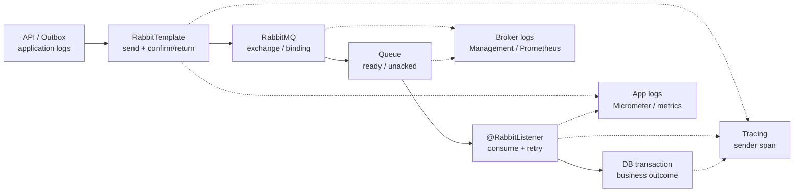
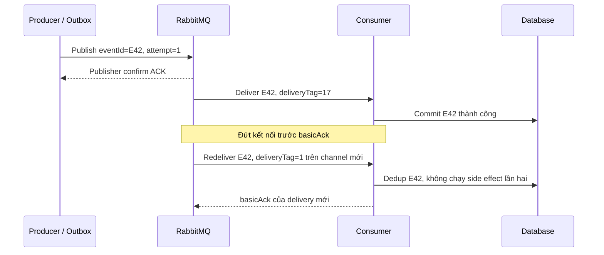
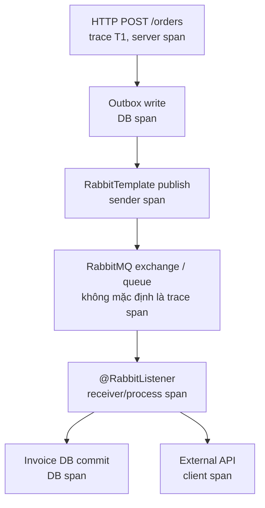

# Thu thập bằng chứng từ log ứng dụng, broker, metrics và tracing

Ứng dụng **Spring AMQP** báo “đã publish thành công”, RabbitMQ vẫn có connection và consumer, nhưng người dùng chưa nhận được kết quả xử lý đơn hàng. Điều gì thực sự đã xảy ra? Message có được route đúng queue không? Consumer đã nhận nhưng transaction rollback? Message bị đưa sang DLQ? Hay một worker đã xử lý thành công nhưng mất kết nối trước khi ACK nên broker giao lại?

Một dòng log, một biểu đồ queue depth hoặc một trace riêng lẻ thường **không đủ trả lời**. Chẩn đoán hiệu quả đòi hỏi **ghép bằng chứng từ bốn nguồn**: log ứng dụng, log/trạng thái RabbitMQ broker, metrics đo xu hướng, và distributed tracing nối các bước xử lý. Cần thêm một nguồn chân lý nghiệp vụ như database/outbox để xác nhận kết quả cuối cùng. Việc ghép bằng chứng phải có **cùng khoảng thời gian, cùng vhost/queue và một định danh event ổn định**.

Bài thuộc chương **Chẩn đoán sự cố** trong module **SPRING_AMQP**: tích hợp RabbitMQ qua `RabbitTemplate`, `@RabbitListener`, exchange, queue, binding; xử lý publisher confirm/return, consumer ACK, retry, dead-letter và transaction sao cho hệ thống bất đồng bộ đáng tin cậy. Trọng tâm là *thu thập bằng chứng có thể kiểm chứng*, không chỉ bật thêm thật nhiều log.

**Sau bài học, bạn có thể:**

- Phân biệt vai trò, độ hạt và giới hạn của **application logs**, **broker logs/Management**, **Prometheus metrics** và **tracing**.
- Thiết kế định danh `eventId`, `correlationId`, `traceId` và cách nối chúng qua producer, exchange, queue, consumer, retry và database.
- Thu thập bằng chứng publisher confirms/returns, consumer delivery/ACK, subscription, connection/channel và retry/DLQ.
- Bật Micrometer Observation cho `RabbitTemplate`/`@RabbitListener` và hiểu vì sao trace **không thay thế** xác nhận nghiệp vụ.
- Đọc RabbitMQ Prometheus metrics `ready`, `unacked`, `consumers`, `acked`, `redelivered` theo đúng phạm vi và thời gian.
- Lập timeline, xác nhận hoặc bác bỏ giả thuyết, ghi nhận mức độ chắc chắn và bảo vệ secret/PII trong quá trình điều tra.

## 1. Bốn nguồn bằng chứng trả lời bốn nhóm câu hỏi

| Nguồn | Trả lời tốt nhất | Ví dụ dữ liệu | Điều **không** tự chứng minh |
| --- | --- | --- | --- |
| **Log ứng dụng** | Code nào chạy, input ID nào, exception gì, transaction ở giai đoạn nào? | `eventId`, `listenerId`, stack trace, publish attempt, DB outcome | Không thể chỉ từ log “sent” kết luận broker đã route thành công |
| **Broker logs / Management** | Broker có chấp nhận connection, đóng channel, có consumer, binding, alarm hay không? | Login refused, `PRECONDITION_FAILED`, queue depth, consumer tag, TLS failure | Broker thường không biết transaction database của ứng dụng |
| **Metrics** | Khi nào lỗi bắt đầu, ảnh hưởng bao rộng, diễn biến tăng/giảm thế nào? | Error rate, queue `ready/unacked`, `redelivered_total`, p99 latency | Metric tổng hợp thường không chỉ ra **event cụ thể** |
| **Distributed tracing** | Những span nào liên quan trong đường đi của một request/event? | Trace/span ID, publish/receive spans, DB/HTTP child span | Trace lấy mẫu có thể vắng; span thành công không mặc định có nghĩa business commit hoặc broker ACK |
| **Nguồn chân lý nghiệp vụ** | Event đã tạo kết quả hợp lệ chưa, có trùng hay thiếu không? | Outbox/inbox, unique event ID, order status, DB commit | Không thay thế được thông tin broker đã route/ack như thế nào |

Nên thu thập **đồng thời** các nguồn trên, nhưng **không cần bật DEBUG toàn hệ thống** để làm được điều đó. Mục tiêu là một tập bằng chứng đủ giải thích chuỗi nguyên nhân và hậu quả, có timestamp, định danh, owner, khoảng quan sát và giới hạn tin cậy.



**Không diễn giải sơ đồ thành một transaction duy nhất.** AMQP publish, broker routing, listener processing, database transaction và consumer ACK là những bước có ranh giới lỗi riêng; không có distributed transaction tự động nối chúng.

## 2. Xác định câu hỏi điều tra trước khi chọn công cụ

Với một incident, hãy ghi vấn đề theo mẫu:

> Trong khoảng thời gian T, tại môi trường/vhost V, nhóm event E không đạt kết quả nghiệp vụ R theo SLA S. Cần xác định ranh giới đầu tiên nơi tiến độ ngừng hoặc trạng thái trở nên bất định.

Ví dụ: “Từ 09:20 đến 09:35, 2% sự kiện `InvoiceRequested` trong `orders-prod` không có hóa đơn sau 30 giây; publisher báo send hoàn tất, queue `invoice.jobs` có consumer.”

Từ câu hỏi đó, tách thành các **giả thuyết có thể bác bỏ**:

1. Producer chưa publish hoặc publisher confirm chưa đến.
2. Broker nhận publish nhưng message unroutable vì exchange/binding/routing key.
3. Broker route đúng nhưng consumer không subscribe hoặc bị block.
4. Listener nhận rồi lỗi conversion, validation, DB hoặc API ngoài.
5. Listener xử lý thành công nhưng chưa ACK, nên có redelivery.
6. Event bị retry/TTL/DLX/DLQ, tồn tại ngoài queue chính.
7. Dữ liệu đã commit nhưng query/notification downstream chậm.

**Mỗi giả thuyết cần ít nhất một bằng chứng ủng hộ và một phép thử có thể phủ định.** Ví dụ, `RabbitTemplate.convertAndSend` trả về bình thường chỉ loại trừ một số lỗi đồng bộ phía client; không đủ bác bỏ các giả thuyết 1–7.

## 3. Xây khóa tương quan: event ID khác trace ID và delivery tag

Một lỗi rất thường gặp là coi `correlationId`, `messageId`, `traceId` và `deliveryTag` như một ID có thể thay thế lẫn nhau.

| Định danh | Nguồn/tầm hiệu lực | Mục đích tốt nhất | Cảnh báo |
| --- | --- | --- | --- |
| **`eventId`** (nghiệp vụ) | Do producer tạo khi event được ghi outbox; ổn định qua retry | Đối soát event end-to-end và idempotency | Không dùng làm Prometheus label vì cardinality quá cao |
| **`messageId`** (AMQP property) | Do ứng dụng đặt; broker không mặc định bảo đảm toàn cục duy nhất | Nối log publisher/consumer khi truyền đúng | Nếu không được đặt, có thể là `null` |
| **`correlationId`** (AMQP property) | Do application/protocol workflow đặt | Ghép request–reply hoặc một workflow | Có thể khác `eventId`; cần quy ước rõ |
| **`traceId`** | Tracing context; một trace có nhiều spans | Xem quan hệ nhân quả/phân tán trong backend tracing | Trace có thể bị sampling, mất context, split qua retry |
| **`spanId`** | Một span trong trace | Xác định bước cụ thể | Không phải định danh message |
| **`deliveryTag`** | AMQP 0-9-1 **channel-scoped**, gán cho delivery | Chẩn đoán ACK/NACK trên đúng channel | Không duy nhất toàn cluster, thay đổi khi redelivery/reconnect |
| **Consumer tag** | Một subscription trên broker | Ghép logs broker và listener lifecycle | Có thể thay đổi khi consumer restart |
| **Outbox record ID** | DB của producer | Xác định lần publish và trạng thái retry | Một event có thể có nhiều publish attempts |

### 3.1. Quy ước đề xuất cho hệ thống đặt hàng

```text
eventId:          evt-7f93       // Ổn định qua retry/redelivery
eventType:        InvoiceRequested
aggregateId:      order-1042
aggregateVersion: 6
schemaVersion:    2
correlationId:    req-81a0       // Request/workflow; có thể khác eventId
publishAttempt:   3              // Counter trong outbox/log, không nhất thiết là AMQP header
traceId:          4fe2...        // Được tracing backend cấp; không gán bằng eventId
source:           orders-api
```

Trong log/tracing có thể giữ `eventId` và `aggregateId` theo chính sách dữ liệu; trong **metric tags** ưu tiên `eventType`, `queue`, `listenerId`, `outcome`, `environment` có số giá trị hữu hạn.

**Đừng dùng message body làm khóa tương quan**: body có thể chứa thông tin nhạy cảm, thay đổi schema, hoặc hai event khác nhau có payload tương tự. Với payload không có ID, bổ sung ID ở tầng hợp đồng thông điệp (và cân nhắc backward compatibility), không “hash body rồi coi như business event ID”.

### 3.2. Retry tạo nhiều lần delivery cho một event



Cùng **`eventId=E42`** xuất hiện hai lần delivery, hai delivery tags và có thể nhiều spans. Vì vậy, đừng suy “hai log RECEIVED nghĩa là hai đơn hàng đã được tạo”; cần đối soát **unique business commits**.

## 4. Log ứng dụng: ít nhưng có cấu trúc và đủ ranh giới

Một dòng log tốt cần cho biết **ai**, **đang thao tác ở đâu**, **với event nào**, **kết quả gì**, **khi nào** và **lý do lỗi**. Không cần log toàn bộ message.

| Giai đoạn | Log/sự kiện đáng có | Ví dụ trường |
| --- | --- | --- |
| Producer ghi outbox | `EVENT_ACCEPTED` hoặc `OUTBOX_CREATED` | `eventId`, `eventType`, `aggregateId` |
| Publisher bắt đầu gửi | `PUBLISH_ATTEMPT` | `eventId`, `exchange`, `routingKey`, `attempt` |
| Broker confirm | `PUBLISH_CONFIRMED` / `PUBLISH_NACKED` / `PUBLISH_UNKNOWN` | `eventId`, `confirmAck`, `reason` |
| Broker return | `PUBLISH_RETURNED` | `eventId`, `replyCode`, `exchange`, `routingKey` |
| Consumer nhận | `DELIVERY_RECEIVED` | `eventId`, `listenerId`, `queue`, `redelivered` |
| Bắt đầu/kết thúc nghiệp vụ | `BUSINESS_STARTED` / `BUSINESS_COMMITTED` | `eventId`, `durationMs`, `result` |
| Consumer lỗi/retry | `PROCESSING_FAILED` / `RETRY_SCHEDULED` | `eventId`, `errorClass`, `retryClass` |
| Consumer terminal outcome | `REJECTED_TO_DLQ` / `PROCESSED_DUPLICATE` | `eventId`, `outcome` |

**Một log có chữ `SENT` không nên được hiểu là `CONFIRMED`.** Đặt tên event log đúng theo ranh giới sự thật để không tạo bằng chứng giả.

### 4.1. Producer gắn ID và quan sát kết quả gửi

Ví dụ dưới đây minh họa `RabbitTemplate` với `CorrelationData`. Nó giả định Spring Boot AMQP 0-9-1 đã bật correlated publisher confirms và returns; source event được lưu trong outbox.

```yaml
spring:
  rabbitmq:
    publisher-confirm-type: correlated
    publisher-returns: true
    template:
      mandatory: true
```

```java
import java.util.concurrent.CompletableFuture;
import org.slf4j.Logger;
import org.slf4j.LoggerFactory;
import org.springframework.amqp.rabbit.connection.CorrelationData;
import org.springframework.amqp.rabbit.core.RabbitTemplate;

public class ObservedPublisher {
    private static final Logger log =
            LoggerFactory.getLogger(ObservedPublisher.class);
    private final RabbitTemplate template;

    public ObservedPublisher(RabbitTemplate template) {
        this.template = template;
    }

    public CompletableFuture<CorrelationData.Confirm> publish(
            String eventId, String orderId, String payload) {
        CorrelationData cd = new CorrelationData(eventId);
        log.info("event=PUBLISH_ATTEMPT eventId={} exchange={} key={}",
                eventId, "invoices.events", "invoice.create");

        template.convertAndSend(
                "invoices.events", "invoice.create", payload,
                message -> {
                    message.getMessageProperties().setMessageId(eventId);
                    message.getMessageProperties().setCorrelationId(orderId);
                    return message;
                }, cd);

        CompletableFuture<CorrelationData.Confirm> future = cd.getFuture();
        future.whenComplete((confirm, failure) -> {
            if (failure != null) {
                log.warn("event=PUBLISH_UNKNOWN eventId={} cause={}",
                        eventId, failure.getClass().getSimpleName());
                return;
            }
            if (cd.getReturned() != null) {
                var returned = cd.getReturned();
                log.warn("event=PUBLISH_RETURNED eventId={} code={} text={}",
                        eventId, returned.getReplyCode(),
                        returned.getReplyText());
            }
            log.info("event=PUBLISH_CONFIRM eventId={} ack={} reason={}",
                    eventId, confirm.isAck(), confirm.getReason());
        });
        return future;
    }
}
```

**Giới hạn của ví dụ:**

- Nếu `convertAndSend` ném exception đồng bộ, cần catch ở **outbox dispatcher** và ghi nhận attempt thất bại; đoạn trên cố ý để exception truyền lên caller.
- `PUBLISH_CONFIRM ack=true` **không bảo đảm** message được route vào queue; kết hợp `mandatory`/return, alternate exchange và test topology. Spring AMQP đảm bảo returned message được cung cấp cho `CorrelationData` trước khi confirm future tương ứng được hoàn tất theo contract hỗ trợ.
- Khi timeout chờ confirm hoặc kết nối bị mất, trạng thái thường là **UNKNOWN**: broker có thể đã nhận. Không tự xóa outbox; retry cùng `eventId` và có consumer idempotent.
- Callback chạy bất đồng bộ; đừng giả định MDC ở thread HTTP/producer tự đi theo callback nếu không có context propagation.
- Không log `payload`, password hoặc AMQP URI. `eventId` là log field có thể tra cứu, không phải metric label.

### 4.2. Consumer log đúng mốc commit

Một `@RabbitListener` nên ghi ít nhất `RECEIVED`, `BUSINESS_COMMITTED` hoặc `BUSINESS_FAILED`, đồng thời phân biệt case duplicate. Ví dụ:

```java
import org.slf4j.Logger;
import org.slf4j.LoggerFactory;
import org.slf4j.MDC;
import org.springframework.amqp.core.Message;
import org.springframework.amqp.rabbit.annotation.RabbitListener;
import org.springframework.stereotype.Component;

@Component
public class InvoiceEvidenceListener {
    private static final Logger log =
            LoggerFactory.getLogger(InvoiceEvidenceListener.class);
    private final InvoiceService service;

    public InvoiceEvidenceListener(InvoiceService service) {
        this.service = service;
    }

    @RabbitListener(id = "invoice-jobs-listener", queues = "invoice.jobs")
    public void onMessage(Message message) {
        String eventId = message.getMessageProperties().getMessageId();
        if (eventId == null || eventId.isBlank()) {
            throw new IllegalArgumentException("Missing eventId/messageId");
        }
        try (MDC.MDCCloseable ignored =
                     MDC.putCloseable("eventId", eventId)) {
            var props = message.getMessageProperties();
            log.info("event=DELIVERY_RECEIVED queue={} redelivered={}",
                    props.getConsumerQueue(), props.isRedelivered());
            try {
                // Service dùng transaction + unique key theo eventId.
                service.processOnce(eventId, message.getBody());
                // Chỉ log ở đây nếu processOnce TRẢ VỀ sau commit thực tế.
                log.info("event=BUSINESS_COMMITTED");
            }
            catch (RuntimeException ex) {
                log.error("event=BUSINESS_FAILED errorClass={}",
                        ex.getClass().getSimpleName(), ex);
                throw ex; // Để container/retry handler áp dụng policy.
            }
        }
    }
}
```

Trong ví dụ, `InvoiceService.processOnce` là code nghiệp vụ do ứng dụng triển khai. Nếu service chỉ **enqueue một tác vụ async** rồi trả về, log `BUSINESS_COMMITTED` ở listener là sai: khi đó phải ghi log/metric **ở nơi commit thực sự**. Nếu dùng `AcknowledgeMode.AUTO`, container ACK khi handler trả về bình thường; log `BUSINESS_COMMITTED` không chứng minh broker đã **nhận** ACK. Nếu dùng manual ack, thêm log cho **ý định gửi ACK** nhưng không tự gọi đó là bằng chứng cuối cùng của broker.

**Bảo vệ MDC:** `MDC.putCloseable` tự dọn field trong `try-with-resources`. Thread của listener có thể được tái sử dụng; nếu không xóa MDC, log của event sau có thể bị gán nhầm ID. Với xử lý chuyển sang `@Async`/`CompletableFuture`, cần cơ chế **context propagation** được cấu hình rõ; MDC là thread-local, không tự bảo đảm lan sang mọi executor.

## 5. Thêm cấu trúc cho log mà không tăng cardinality của metrics

Ví dụ một record log JSON có cấu trúc:

```json
{
  "timestamp": "2026-11-26T09:24:11.653Z",
  "level": "ERROR",
  "service": "invoices-worker",
  "environment": "staging",
  "event": "BUSINESS_FAILED",
  "eventId": "evt-7f93",
  "traceId": "2c6fe42b1c9f4a84b4d18a3d12f3ad17",
  "listenerId": "invoice-jobs-listener",
  "queue": "invoice.jobs",
  "errorClass": "TransientDataAccessException",
  "retryClass": "TRANSIENT"
}
```

Đây là **mẫu schema gợi ý**, không phải schema mặc định mà Spring tự xuất ra. Mỗi log shipper/tracing integration có cách biểu diễn riêng. Trường `traceId` có thể không hiện khi trace bị sampling hoặc context không được truyền; **`eventId` nghiệp vụ vẫn phải quan sát được**.

Một schema log tốt có:

- Timestamp UTC với timezone/offset rõ ràng, đồng bộ clock giữa app/broker.
- `service`, `environment`, `instance`, `listenerId`/producer component.
- `eventId`, `correlationId`, `traceId/spanId` khi có.
- `operation`, `outcome`, `errorClass`, `durationMs`; các giá trị thuộc **tập từ vựng có kiểm soát**.
- Không đưa toàn bộ `Message` vào log bằng `toString()` nếu có thể chứa payload/headers nhạy cảm.

**Mức log nên có ngân sách.** Ghi mỗi lần delivery ở INFO với hàng trăm nghìn message/giây sẽ quá tải logging pipeline và làm tăng latency. Chọn log sự kiện quan trọng (error, terminal outcome, sample), metrics tổng hợp cho throughput, và tracing có sampling; dùng debug theo phạm vi hẹp trong cửa sổ incident.

## 6. Log lifecycle Spring AMQP: lỗi trước khi handler chạy

Một listener không nhận message đôi khi chưa hề gọi method `@RabbitListener`. Vì vậy, log bên trong handler **không ghi được** lỗi subscription, queue thiếu, channel closed hoặc consumer restart.

Spring AMQP phát nhiều application events ở lớp listener container:

| Event | Điều có thể chứng minh | Giới hạn |
| --- | --- | --- |
| `ConsumeOkEvent` | Broker chấp thuận đăng ký consumer với queue/tag | Chưa chứng minh xử lý message thành công |
| `ListenerContainerConsumerFailedEvent` | Consumer lỗi, có reason, fatal flag và throwable | Một sự cố broker có thể phát nhiều events trên nhiều consumer |
| `MissingQueueEvent` | Queue cần nghe bị thiếu ở thời điểm kiểm tra | Chưa kết luận message cũ có thể được phục hồi |
| `AsyncConsumerRestartedEvent` | SMLC đã khởi động lại consumer | Không tự chứng minh business throughput đã phục hồi |
| `ListenerContainerIdleEvent` | Không nhận delivery trong khoảng idle đã cấu hình | Queue không có message thì idle là bình thường |

Ví dụ thêm log chẩn đoán **không phụ thuộc vào business handler**:

```java
import org.slf4j.Logger;
import org.slf4j.LoggerFactory;
import org.springframework.amqp.rabbit.listener.ConsumeOkEvent;
import org.springframework.amqp.rabbit.listener.ListenerContainerConsumerFailedEvent;
import org.springframework.amqp.rabbit.listener.MissingQueueEvent;
import org.springframework.context.event.EventListener;
import org.springframework.stereotype.Component;

@Component
public class ConsumerLifecycleEvidence {
    private static final Logger log =
            LoggerFactory.getLogger(ConsumerLifecycleEvidence.class);

    @EventListener
    public void subscribed(ConsumeOkEvent event) {
        log.info("event=CONSUMER_SUBSCRIBED queue={} consumerTag={}",
                event.getQueue(), event.getConsumerTag());
    }

    @EventListener
    public void failed(ListenerContainerConsumerFailedEvent event) {
        log.warn("event=CONSUMER_FAILED fatal={} reason={}",
                event.isFatal(), event.getReason(), event.getThrowable());
    }

    @EventListener
    public void missing(MissingQueueEvent event) {
        log.error("event=QUEUE_MISSING queue={}", event.getQueue());
    }
}
```

**Không thêm consumer tag làm Prometheus label** vì tag có thể đổi sau reconnect. Trong log nó là dấu mốc hữu ích để đối chiếu broker, nhưng phải ghép cùng connection/timestamp để tránh nhầm với subscription khác.

### 6.1. Bật debug tạm thời, đúng package

Khi cần xác định Spring tự khai báo resource hay listener recovery:

```yaml
# Chỉ bật ở môi trường test hoặc trong cửa sổ incident được cho phép.
logging:
  level:
    org.springframework.amqp.rabbit.connection: DEBUG
    org.springframework.amqp.rabbit.listener: DEBUG
    org.springframework.amqp.rabbit.core.RabbitTemplate: DEBUG
```

Với một số phiên bản, log ở `com.rabbitmq.client` hoặc package khác cũng hữu ích nhưng có thể rất nhiều. **Bật DEBUG không có nghĩa bật wire-level payload dump hay log secret**. Khi đã thu đủ bằng chứng, trả về INFO/WARN; theo dõi chi phí CPU, I/O, log ingest và thông tin nhạy cảm.

**Nếu lỗi chỉ xảy ra ở production:** ưu tiên các log trạng thái có cấu trúc, management counters và trace đã được thu sẵn; việc thay logging config thường yêu cầu reload/restart và bản thân thao tác có thể làm incident thay đổi.

## 7. RabbitMQ broker logs: nguồn chân lý của protocol errors

App log thường cho thấy `AmqpIOException` hoặc `ShutdownSignalException`; broker log có thể chỉ ra **nguyên nhân cụ thể**: authentication refused, vhost access denied, channel exception `404 NOT_FOUND`, `406 PRECONDITION_FAILED`, TLS handshake failure, heartbeat timeout, resource alarm hoặc node restart.

| Broker event | Nghi vấn | Ghép với app thế nào |
| --- | --- | --- |
| Connection accepted/closed, heartbeat timeout | Network, load balancer, node restart, client recovery | Timestamp, peer address, connection name, instance |
| Login refused / vhost access refused | Credential/auth backend/permission vhost | Username không nhạy cảm, vhost, app config version |
| Channel `404 NOT_FOUND` | Queue/exchange thiếu ở vhost đích | Resource name, `RabbitAdmin` declarations, deployment |
| Channel `406 PRECONDITION_FAILED` | Queue/exchange arguments khác định nghĩa đang có | Diff topology version và broker effective arguments |
| `ACCESS_REFUSED` khi consume/publish/declare | Quyền `read/write/configure` không đủ | Chính xác operation, queue/exchange, principal |
| Disk/memory alarm và blocked connection | Broker hạn chế publish để tự bảo vệ | Publisher confirm latency, connection block events, broker metrics |
| Queue/consumer deleted/cancelled | Topology/operator action, recovery | Consumer lifecycle events, Management API |
| TLS handshake failure | CA, SAN, mTLS, cipher, protocol mismatch | Client `SSLHandshakeException`, certificate metadata |

**RabbitMQ không biết** transaction SQL/HTTP side effect cuối đã thành công. Muốn chứng minh hiệu ứng nghiệp vụ, phải dùng database/outbox/inbox, không dựa duy nhất vào broker ACK.

### 7.1. Lệnh chẩn đoán chỉ đọc

Chạy trong môi trường operator được cấp quyền; tránh copy log có secret hoặc payload vào nơi công khai.

```bash
# Broker có hoạt động và có alarm nào?
rabbitmq-diagnostics status
rabbitmq-diagnostics alarms
rabbitmq-diagnostics listeners

# Queue và subscription ở vhost cần điều tra:
rabbitmqctl list_queues -p orders-prod \
  name type messages_ready messages_unacknowledged consumers

# Connection/channel đang mở (tên trường tùy phiên bản broker):
rabbitmqctl list_connections name user vhost state channels
rabbitmqctl list_channels connection number consumer_count messages_unacknowledged
```

Log broker có thể được thu từ journald, container stdout, Kubernetes logging hoặc đường dẫn log cấu hình bởi RabbitMQ. **Đường dẫn không được giả định giống nhau ở mọi deployment.** Nếu dùng `kubectl logs`, cần chọn đúng pod/node/container và khoảng thời gian để tránh đọc nhầm replica.

### 7.2. Management UI/API không phải một distributed trace

RabbitMQ Management cung cấp các snapshot connection, channel, queue, consumer, binding và rate. Nó có thể cho biết “queue `invoice.jobs` có 0 consumer” hoặc “channel bị đóng”, nhưng **không** liên kết từng message với một business transaction hoặc tự cho biết DB commit.

Đừng dùng thao tác `Get messages` trong UI trên queue production như một phép đọc vô hại: tùy ack mode và requeue option, nó có thể tác động delivery hoặc order. Ưu tiên **read-only API/metrics**, không consume thử trên queue đang phục vụ nghiệp vụ.

## 8. RabbitMQ Prometheus: metrics có giá trị theo thời gian

RabbitMQ cung cấp plugin `rabbitmq_prometheus`. Endpoint thường là port **15692** với đường dẫn `/metrics` khi chưa đổi cấu hình. Management HTTP (`15672`) là cơ chế khác. **Không mở các endpoint này công khai ra Internet**; áp dụng network policy, TLS/proxy/auth hoặc môi trường scraping riêng.

### 8.1. Chọn endpoint phù hợp

| Endpoint | Mục đích | Trade-off |
| --- | --- | --- |
| `/metrics` | Các số liệu tổng hợp ở mức node/cluster theo exporter | Nhẹ, nhưng có thể thiếu label queue cụ thể |
| `/metrics/per-object` | Per-object metrics mở rộng | Dễ tăng cardinality/chi phí trên broker có nhiều queue/channel |
| `/metrics/detailed?family=...` | Lấy đúng nhóm metric cần điều tra | Hiệu quả hơn khi chọn family có mục tiêu, phải biết tên family |
| Management API/UI | Snapshot tài nguyên tại một thời điểm | Không thay time-series Prometheus lâu dài |

Ví dụ ba nhóm per-queue thường hữu ích:

```text
GET /metrics/detailed?family=queue_coarse_metrics
GET /metrics/detailed?family=queue_consumer_count
GET /metrics/detailed?family=queue_delivery_metrics
```

Theo tài liệu RabbitMQ, metric tên `rabbitmq_detailed_queue_consumers` nằm trong nhóm `queue_consumer_count` (và các nhóm lớn hơn); `rabbitmq_detailed_queue_messages_ready`, `..._unacked` nằm trong `queue_coarse_metrics`. **Tên series thực tế cần được kiểm tra trên exporter của phiên bản đang vận hành**, không đoán từ hình dashboard.

### 8.2. Tối thiểu cần quan sát gì?

| Metric / tín hiệu | Ý nghĩa | Bẫy diễn giải |
| --- | --- | --- |
| `rabbitmq_detailed_queue_messages_ready` | Message đang chờ giao | `ready=0` có thể vẫn nhiều unacked |
| `rabbitmq_detailed_queue_messages_unacked` | Delivery đã giao nhưng chưa được ACK | Không phải tất cả đều đang chạy trên CPU |
| `rabbitmq_detailed_queue_consumers` | Subscription trên queue | Có consumer không đồng nghĩa business success |
| `rabbitmq_detailed_queue_messages_acked_total` | Tổng ACK trên queue theo metric family | Không đếm unique business commit |
| `rabbitmq_detailed_queue_messages_redelivered_total` | Tổng redelivery | Một event có thể được giao nhiều lần |
| Publisher confirms/returns, connection blocked | Producer/broker giao tiếp ra sao | Confirm ACK không chứng minh end-to-end completion |
| Spring listener duration/errors | Handler thực thi nhanh hay lỗi | Không gồm toàn bộ thời gian chờ queue |
| Outbox pending age, DB commit rate | Công việc nghiệp vụ chưa hoàn tất | Phải cùng phạm vi event/workflow |

### 8.3. PromQL minh họa

Các truy vấn sau **giả định** Prometheus scrape đúng `/metrics/detailed` families và các series có label `vhost`, `queue`; chúng cần sửa theo hệ thống thực tế:

```promql
# Đang chờ giao trên queue mục tiêu.
rabbitmq_detailed_queue_messages_ready{
  vhost="orders-prod", queue="invoice.jobs"
}

# Đã giao nhưng chưa ACK.
rabbitmq_detailed_queue_messages_unacked{
  vhost="orders-prod", queue="invoice.jobs"
}

# Số consumer thực tế.
rabbitmq_detailed_queue_consumers{
  vhost="orders-prod", queue="invoice.jobs"
}

# Tốc độ redelivery trong 5 phút.
rate(rabbitmq_detailed_queue_messages_redelivered_total{
  vhost="orders-prod", queue="invoice.jobs"
}[5m])

# Khi queue bị xóa/không xuất metric:
absent(rabbitmq_detailed_queue_consumers{
  vhost="orders-prod", queue="invoice.jobs"
})
```

**Cẩn thận với `absent()`:** series có thể biến mất vì exporter down, scrape thất bại, label thay đổi hoặc queue thật sự bị xóa. Kiểm tra `up`, target health, topology inventory và vị trí queue trên các node. Đặc biệt với cluster/quorum queue, phải xác minh metrics phát ở node nào và tránh cộng đếm đôi.

### 8.4. Số đo tức thời khác với số đo theo cửa sổ

Một snapshot `consumers=0` trong một giây khi rolling deploy có thể bình thường. Một giá trị `redelivered_total` tăng không đủ chứng minh retry storm nếu không xét cửa sổ thời gian và publish/business success rate. Nên chú ý:

- `rate()` cho counters trên khoảng 5–15 phút; kiểm tra metric resets do exporter/broker restart.
- `max_over_time()` hoặc `avg_over_time()` cho gauges để thấy spike và mức bình thường.
- Baseline cùng giờ/loại tải, không chỉ so với một ngưỡng tùy ý.
- Kết hợp **số lượng** (`ready/unacked`) với **tốc độ** (publish/ack) và **tuổi công việc** (outbox/business pending).
- Nếu retry làm deliver rate cao nhưng unique success rate thấp, đừng gọi đó là hệ thống khỏe.

**Cardinality là một giới hạn vận hành:** tránh per-message series theo `eventId`, `orderId`, `traceId`, `deliveryTag`, consumer tag, raw exception text hoặc AMQP dynamic queue tên thay đổi liên tục. Dữ liệu chi tiết cấp event nên tìm bằng log/trace.

## 9. Spring Boot Actuator và Micrometer: liên hệ với handler

Với ứng dụng Spring Boot hỗ trợ Micrometer, có thể dùng `spring-boot-starter-actuator` và `micrometer-registry-prometheus`:

```xml
<dependency>
    <groupId>org.springframework.boot</groupId>
    <artifactId>spring-boot-starter-actuator</artifactId>
</dependency>
<dependency>
    <groupId>io.micrometer</groupId>
    <artifactId>micrometer-registry-prometheus</artifactId>
</dependency>
```

```yaml
management:
  endpoints:
    web:
      exposure:
        include: "health,info,metrics,prometheus"
  metrics:
    tags:
      application: "invoices-worker"
      environment: "staging"
```

`/actuator/prometheus` chỉ hoạt động khi đã có registry, actuator web endpoint được expose và mạng/quyền cho phép. **Bảo vệ endpoint**: có thể tiết lộ tên service, queue, operation và tình trạng nội bộ. Không bật public internet access để tiện xem dashboard.

### 9.1. Legacy timer và Observation không phải một tên metric

| Cách đo | Nguồn | Metric điển hình | Ghi chú |
| --- | --- | --- | --- |
| Timer Micrometer listener truyền thống | Container + meter registry khi chưa bật Observation | `spring.rabbitmq.listener` | Có thể có tag result/exception/listener tùy phiên bản |
| Micrometer **Observation** listener | `observationEnabled=true` | `spring.rabbit.listener`, `spring.rabbit.listener.active` | Có timer/long-task timer theo convention; hỗ trợ trace |
| Micrometer **Observation** publisher | `RabbitTemplate` bật observation | `spring.rabbit.template`, `spring.rabbit.template.active` | Đo send operation, không thay publisher confirm |
| Business metrics tự định nghĩa | Service sau commit | `app.invoice.completed`, `app.invoice.failed` | Cần kiểm soát tags và nghĩa của “completed” |

Spring AMQP **3.0+** hỗ trợ Micrometer Observation cho `RabbitTemplate` và listener containers. Khi bật `observationEnabled`, cơ chế timer truyền thống của component được thay bởi metrics thông qua Observation; dashboard cũ truy vấn `spring.rabbitmq.listener` có thể “mất dữ liệu” dù listener vẫn chạy.

**Lưu ý batch listener:** Spring AMQP không tạo Observation theo cơ chế thông thường cho batch listener containers vì ngữ nghĩa span/trace của batch không rõ. Khi dùng batch, cần đo custom business metrics và kiểm chứng thực tế thay vì giả định mỗi message có một span listener.

### 9.2. Bật Observation trên factory và template được sử dụng

```java
import org.springframework.amqp.rabbit.config.SimpleRabbitListenerContainerFactory;
import org.springframework.amqp.rabbit.connection.ConnectionFactory;
import org.springframework.amqp.rabbit.core.RabbitTemplate;
import org.springframework.context.annotation.Bean;
import org.springframework.context.annotation.Configuration;

@Configuration
public class AmqpObservationConfig {
    @Bean("observedListenerFactory")
    SimpleRabbitListenerContainerFactory observedListenerFactory(
            ConnectionFactory connectionFactory) {
        SimpleRabbitListenerContainerFactory factory =
                new SimpleRabbitListenerContainerFactory();
        factory.setConnectionFactory(connectionFactory);
        factory.setObservationEnabled(true);
        return factory;
    }

    @Bean("observedRabbitTemplate")
    RabbitTemplate observedRabbitTemplate(
            ConnectionFactory connectionFactory) {
        RabbitTemplate template = new RabbitTemplate(connectionFactory);
        template.setObservationEnabled(true);
        return template;
    }
}
```

Listener phải **chọn đúng bean factory**:

```java
@RabbitListener(
    id = "invoice-jobs-listener",
    queues = "invoice.jobs",
    containerFactory = "observedListenerFactory")
public void handleInvoice(String payload) {
    // Bản thân method chỉ đo span xử lý của listener.
}
```

Đây là hai đoạn **minh họa wiring**, không cần dán vào class trùng tên với cấu hình cũ. Nếu Spring Boot đang auto-configure `RabbitTemplate`, tạo thêm bean có thể thay đổi injection; dùng `@Qualifier("observedRabbitTemplate")` hoặc cấu hình/customization đã được project thống nhất. Với Spring Boot các version khác nhau, cách auto-enable observation và dependency tracing có thể khác: **kiểm tra ứng dụng thực tế đã có trace exporter/context propagation chưa**, không chỉ nhìn `setObservationEnabled(true)`.

### 9.3. Tên span/metric quan trọng

Trong Spring AMQP Observation, tên theo convention thường là:

- `spring.rabbit.template` — hoạt động send của `RabbitTemplate`.
- `spring.rabbit.listener` — hoạt động receive/handle của listener.
- `spring.rabbit.template.active`, `spring.rabbit.listener.active` — long-task metrics trong convention tương ứng.

Các low-cardinality keys bao gồm `spring.rabbit.listener.id`, `spring.rabbit.template.name` và các key destination/routing theo phiên bản. Prometheus đổi dấu chấm thành dấu gạch dưới và thêm hậu tố cho meter type; **đừng copy một tên Prometheus series từ ví dụ khác rồi mặc định nó tồn tại**. Hãy xem `/actuator/metrics` và `/actuator/prometheus` trên đúng build đã deploy.

## 10. Distributed tracing: ghép publish và consume qua mạng

Tracing giúp giải thích một request HTTP tạo event, producer gửi vào RabbitMQ, consumer nhận và gọi database/API. Nhưng **broker không phải một span Java của Spring**; queue waiting, persistence và routing có thể không được biểu diễn đầy đủ trong một trace nếu không có instrumentation cụ thể.



### 10.1. Điều kiện để trace nối được

1. Có Micrometer Tracing và một bridge/exporter tương thích (ví dụ OpenTelemetry) được cấu hình trong Spring Boot.
2. `RabbitTemplate` và listener container **đang dùng** đã bật Observation theo version.
3. Trace context được **inject vào message headers** khi publish và **extract** khi consume theo propagator tương ứng.
4. Tracing backend thu/hiển thị các spans đã được sampled; tên service và resource được gắn nhất quán.
5. Đường retry, DLQ và replay giữ thông tin tương quan phù hợp; không tự làm mất headers khi biến đổi message.

Khi dùng W3C Trace Context, bạn có thể thấy các header như `traceparent`/`tracestate` tùy propagator. **Không hard-code trace ID bằng event ID và không tự giả định mọi môi trường dùng đúng một header.** Để instrumentation quản lý propagation; business `eventId` vẫn do ứng dụng kiểm soát riêng.

### 10.2. Sự khác biệt giữa trace và event

| Tình huống | Điều có thể xảy ra với tracing | Điều cần dùng để đối soát |
| --- | --- | --- |
| Producer ghi outbox, dispatcher publish sau vài phút | Trace HTTP ban đầu đã kết thúc; publish có thể là trace khác hoặc được liên kết | `eventId` + outbox ID + timestamps |
| Consumer retry nhiều lần trong cùng callback | Có một hoặc nhiều spans tùy instrumentation/retry | Attempt counter + exception logs |
| Broker redeliver sau connection loss | Có lần consumer span mới, cùng message business ID | `eventId` + `redelivered` + DB idempotency |
| DLQ replay do operator | Trace của replay có thể hoàn toàn khác trace gốc | Event ID/schema version + replay audit |
| Sampling 10% | 90% trace có thể không được lưu theo chính sách | Logs nghiệp vụ và metrics tổng hợp |
| Consumer commit DB rồi mất ACK | Trace DB thành công, broker có thể redeliver | DB unique key + broker redelivery + ACK timeline |

**Cấm kết luận “không có trace nghĩa là không có message”.** Tracing có sampling, exporter có thể mất dữ liệu, propagation không được bật, hoặc consumer xử lý theo luồng khác. Kiểm tra sampling probability, exporter health và coverage trước.

### 10.3. Độ trễ giữa publish và listener

Sender span có thể kết thúc khi `RabbitTemplate` hoàn thành thao tác gửi phía client, trong khi receiver span bắt đầu **sau thời gian message nằm trong queue**. Tracing cho phép nhìn khoảng cách hai mốc trong cùng trace khi propagation thành công, nhưng muốn tính **queue wait chính xác** phải xác định timestamp nguồn, clock skew và nghĩa của từng span.

Không đồng nhất `spring.rabbit.template` duration với “broker đã persist và consumer đã commit”, hoặc `spring.rabbit.listener` duration với “end-to-end order completion”. Dùng metric nghiệp vụ với event creation time và completion time nếu SLA yêu cầu.

## 11. Cách nối bốn nguồn trên một timeline

Giả sử event `evt-7f93` đến lúc 09:24:10 nhưng order status vẫn `PENDING`.

| UTC | Nguồn | Bằng chứng | Ý nghĩa có điều kiện |
| --- | --- | --- | --- |
| 09:24:10.010 | API/DB log | `OUTBOX_CREATED eventId=evt-7f93` | Event đã được chấp nhận theo transaction producer |
| 09:24:10.060 | Publisher log | `PUBLISH_ATTEMPT ... routingKey=invoice.create` | Client bắt đầu gửi |
| 09:24:10.081 | Publisher confirm | `PUBLISH_CONFIRM ack=true` và không return | Broker báo xử lý publish; chưa là business completion |
| 09:24:10.090 | Broker metric | `invoice.jobs ready` tăng ngắn hạn | Queue có công việc chờ, **không chứng minh riêng** event này đã vào nếu không có event-level evidence |
| 09:24:10.400 | Listener log | `DELIVERY_RECEIVED eventId=evt-7f93` | Consumer đã nhận đúng event |
| 09:24:11.300 | App log/trace | `BUSINESS_FAILED TransientDataAccessException` | Nghi vấn DB/transaction rollback |
| 09:24:11.350 | Broker metric | Redeliveries bắt đầu tăng | Có phát lại trong queue, cần ghép với event-specific attempts |
| 09:24:13.100 | Listener/DB log | `BUSINESS_COMMITTED eventId=evt-7f93` | Service ghi nhận commit sau retry |
| 09:24:13.130 | Business DB | Invoice tồn tại duy nhất cho `evt-7f93` | Bằng chứng mạnh nhất về kết quả nghiệp vụ |

Từ timeline này, giả thuyết “message bị mất giữa exchange và queue” không phù hợp vì có `DELIVERY_RECEIVED`. Vấn đề có khả năng nằm ở **DB transient failure** và retry. Tuy nhiên, số liệu broker aggregate **không tự gắn được tới event ID**; event-level reasoning cần app logs/DB/audit.

### 11.1. Đồng bộ thời gian là điều kiện quan trọng

Nếu clock ở node RabbitMQ nhanh hơn pod 12 giây, ghép log bằng timestamp có thể đảo thứ tự sự kiện. Nên:

- Dùng timestamp UTC có offset, đồng bộ NTP/time service.
- Khi so chéo máy, ghi rõ sai số clock/sampling/export delay.
- Dựa thêm vào quan hệ nhân quả (publisher confirm không thể xác nhận trước lần publish của nó) thay vì tin tuyệt đối vào timestamp.
- Phân biệt timestamp **event được tạo**, **log được ghi**, **được collector nhận** và **trace được export**.

Khi cần giám sát dưới mili giây, ưu tiên cùng một clock nguồn cho duration nội bộ (monotonic timer), không lấy chênh lệch hai clock máy khác nhau rồi gọi là latency chính xác.

## 12. Log và tracing không thể chứng minh ACK theo cách đơn giản

Trong AMQP 0-9-1, consumer `basicAck`, `basicNack` và `basicReject` là những frame gửi từ client. Một listener return bình thường trong chế độ `AUTO` khiến container **cố gắng** ACK theo semantics cấu hình; log “handler done” không chứng minh broker đã nhận frame.

Ví dụ:

```text
DB COMMIT thành công
      |
      v
Ứng dụng log BUSINESS_COMMITTED
      |
      X  TCP connection mất trước khi broker nhận ACK
      |
Broker giữ delivery chưa được xác nhận
      |
Redelivery cùng eventId cho consumer khác
```

**Bằng chứng cần thu:** DB unique event ID/transaction marker; log listener attempts; broker `messages_unacked`/`redelivered`; connection/channel closure; consumer restart event. Với chế độ `MANUAL`, thêm trạng thái “ACK requested” để chẩn đoán, nhưng không nên gọi nó là “broker ACK received”.

### 12.1. Nơi khác cũng có trạng thái bất định

Publisher có thể gửi message, broker nhận rồi **confirm bị mất** khi connection đứt. Producer không thể suy từ timeout rằng message chưa tồn tại. Sử dụng **transactional outbox**, retry có event ID ổn định và **idempotent consumer**. Tách số:

- `publish_attempts` — số lần client thử gửi.
- `publish_confirmed` — lần broker xác nhận.
- `publish_unknown` — chưa thể kết luận.
- `message_deliveries` — số lần broker giao.
- `business_commits_unique` — số event nghiệp vụ được commit duy nhất.

Các số **khác nhau một cách hợp lệ** trong hệ thống at-least-once. Kết luận mất/nhân đôi nghiệp vụ dựa trên quan hệ event IDs và outcomes chứ không lấy hiệu hai counters không cùng phạm vi.

## 13. Ba nhóm incident minh họa cách thu thập bằng chứng

### Case A — Publisher confirm ACK nhưng queue không nhận

**Triệu chứng:** producer log `PUBLISH_CONFIRM ack=true`; `invoice.jobs` không tăng, listener không nhận.

**Bằng chứng cần lấy:**

1. App: exchange, routing key, vhost, `eventId`; có `PUBLISH_RETURNED` không?
2. Broker: exchange tồn tại, binding routing key đang hiệu lực, queue đúng vhost, alternate exchange nếu có.
3. Metrics: publish và queue ready/unacked rates; xác định thay đổi topology gần thời điểm lỗi.
4. Trace: sender span có phát sinh không; **không dùng sender span làm bằng chứng route thành công**.
5. Outbox: event đã được mark sent dựa trên điều kiện nào?

**Root cause thường gặp:** thiếu binding, routing key đổi mà queue chưa được bind, publish sang vhost khác hoặc alternate exchange chuyển message sang nơi không mong đợi. **Không sửa bằng cách purge queue hay tăng concurrency**; xác minh đường route và cơ chế returns trước.

### Case B — Consumer vẫn online nhưng backlog và redelivery tăng

**Triệu chứng:** queue `consumers>0`, `messages_unacked` cao, `redelivered_total` tăng, business success giảm.

**Bằng chứng cần lấy:**

1. Broker: `ready`, `unacked`, prefetch, consumer count và redelivery theo cùng cửa sổ.
2. App: `BUSINESS_FAILED` error classes, attempt count, listener latency, container recovery.
3. Tracing: DB/HTTP downstream spans chậm hoặc lỗi; xem timeout/retry path.
4. DB: locks, connection pool saturation, transaction rollback, unique-constraint violations.
5. DLQ/retry: message có bị requeue nóng, hoặc retry queue đang chuẩn bị trả về đợt lớn?

**Diễn giải:** có thể listener chậm, quên ACK trong MANUAL mode, poison message, hoặc DB không sẵn sàng. Tăng `prefetch` không chữa DB lock; cần phân loại transient/permanent, backoff, DLQ và idempotency.

### Case C — Connection chập chờn sau rotation TLS/credential

**Triệu chứng:** một số pods log `SSLHandshakeException` hoặc `Login was refused`, consumer count giảm, publisher confirm timeout.

**Bằng chứng cần lấy:**

1. Effective config của **từng pod**: host, port, vhost, TLS bundle name, secret version; không in secret.
2. App logs: `PKIX`/SAN vs SASL authentication error; connection lifecycle/restart.
3. Broker logs: TLS handshake errors, authentication/vhost denied, certificate expiry/trust.
4. Metrics: connection churn, consumer count, queue backlog và outbox age quanh thời điểm rotation.
5. Tracing: xuất hiện khoảng trống trong receive spans? Nhớ sampling không đủ để kết luận mất message.

**Cách khắc phục:** sửa đúng CA/SAN/credential và thực hiện rolling reconnect có kiểm soát. Không tắt hostname verification hoặc cấp `configure/write/read = .*` để “hết lỗi”. Sau đó kiểm tra publisher UNKNOWN và consumer redelivery.

### Case D — Queue không còn consumer sau deployment

**Triệu chứng:** broker connection vẫn mở, `invoice.jobs consumers=0`, ready backlog tăng.

**Bằng chứng cần lấy:** `ConsumeOkEvent`/`MissingQueueEvent`/`ListenerContainerConsumerFailedEvent`; listener registry running; channel `404 NOT_FOUND` hoặc `ACCESS_REFUSED`; RabbitAdmin declarations; topology version; executor/thread pool; broker consumer count per queue. Một app có connection khỏe **không chứng minh** listener đã đăng ký.

**Cách khắc phục:** khôi phục queue/permission/listener; đừng xóa queue để ép redeclare khi còn backlog. Kiểm tra business processing đã phục hồi chứ không chỉ consumer count tăng.

## 14. Incident evidence bundle: những gì phải lưu lại

Trong một incident thực, cần một **bộ bằng chứng có thể trao cho người khác kiểm tra** mà không phải xem lại toàn bộ log hệ thống.

```text
incidentId: INC-2026-1126-04
service: invoices-worker
environment: staging
vhost: orders-staging
queue: invoice.jobs
timeWindowUtc: [09:20:00Z, 09:40:00Z]
symptom: "InvoicePendingAge > 30s for 2% of events"
knownEventIds: ["evt-7f93", "evt-8b21"]  # hạn chế theo nhu cầu
changesNearIncident:
  - deployment revision
  - RabbitMQ topology change
  - credential/certificate rotation
evidence:
  - application log excerpt with trace/event ID
  - broker log excerpt at same UTC window
  - Prometheus dashboard/query and scrape targets
  - tracing link or sanitized span export
  - DB/outbox/inbox outcome for sampled event IDs
hypotheses:
  - statement + supporting evidence + contradicting evidence
conclusion:
  - confirmed / probable / unconfirmed
followUp:
  - owner / action / due date / verification signal
```

Đây là **mẫu minh họa cho hồ sơ incident**, không phải nội dung phải tạo thành file riêng trong bài thực hành. Từng nguồn phải ghi lại **thời điểm lấy dữ liệu**, quyền truy cập và chính sách lưu giữ. Nếu nguyên nhân chưa xác nhận, để `probable/unconfirmed` thay vì ép đưa ra một root cause duy nhất.

### 14.1. Chuỗi kiểm chứng và giới hạn dữ liệu

- Lưu timestamp, query, dashboard version, log source, RabbitMQ node và build/revision liên quan.
- Không chỉ gửi screenshot cắt mất trục thời gian/nhãn; giữ query và cửa sổ thời gian có thể chạy lại.
- Chụp cả **baseline trước incident** và **khoảng hồi phục**, không chỉ đỉnh lỗi.
- Redact password, tokens, private keys, cookie, toàn bộ message body/PII nếu không có lý do cụ thể.
- Kiểm soát quyền đọc evidence bundle, thời hạn giữ và nơi chia sẻ; log/trace cũng có thể chứa thông tin khách hàng.
- Nếu cần giữ mẫu payload để tái hiện, dùng dữ liệu **giả lập/tối thiểu hóa**, không copy message production nguyên văn sang môi trường phát triển.

## 15. Runbook: Thu thập có mục đích từ diện rộng đến event cụ thể

Một runbook ngắn gọn khi chuông cảnh báo vang lên:

1. **Chốt phạm vi:** environment, service, queue/vhost, time window UTC, loại event và business SLO đang vi phạm.
2. **Kiểm tra hệ thống đang nhìn thấy dữ liệu không:** exporter `up`, log ingestion delay, tracing sampling/exporter health; tránh kết luận “không có lỗi” vì telemetry bị mất.
3. **Lấy broker snapshot:** connections/channels, queues ready/unacked, consumers, alarms, bindings, retry/DLQ; chỉ đọc.
4. **Lấy metrics theo cửa sổ:** publish/ack/redelivery rates, latency p95/p99, retry/DLQ, outbox age, CPU/DB/executor saturation.
5. **Chọn một số `eventId` đại diện:** event thành công, thất bại, retry, chậm; tránh chỉ chọn event dễ tìm trace.
6. **Ghép app logs và broker events:** timeline của producer attempt, confirm/return, consumer receive, exception, DB transaction và ACK-related state.
7. **Dùng tracing để tìm dependency chậm:** DB/HTTP spans, context propagation và các khoảng thời gian không có span.
8. **Thử bác bỏ giả thuyết:** ví dụ thấy consumer nhận E42 thì loại bỏ giả thuyết E42 không route; thấy DB commit trước disconnect thì nghi duplicate redelivery.
9. **Khôi phục ít rủi ro:** xử lý đúng nguyên nhân (topology, credential, DB, retry/backoff), không purge queue hay mở toàn quyền.
10. **Đối soát và theo dõi sau sửa:** unique business outcomes, outbox unknown, DLQ, pending age, connection churn và SLO trở lại bình thường.

### 15.1. Phân biệt “sự kiện chưa xảy ra” với “chưa thu được bằng chứng”

| Phát biểu | Có đủ chứng minh không? | Cần bổ sung |
| --- | --- | --- |
| “Không thấy log `RECEIVED`, vậy consumer không nhận” | **Chưa** | Log coverage, sampling, container events, broker delivery |
| “Không thấy trace nên message đã mất” | **Chưa** | Tracing sampling/export health, business event ID, broker |
| “Queue ready=0 nên không còn việc” | **Chưa** | Unacked, retry/DLQ, outbox, downstream processing |
| “Confirm ACK nên khách hàng đã có hóa đơn” | **Chưa** | Routing result và DB commit |
| “DB có record cùng eventId sau retry” | Bằng chứng tốt về side effect | Kiểm unique constraint và trạng thái nghiệp vụ đúng |
| “Hai delivery logs cho cùng eventId nghĩa là duplicate bug” | **Chưa** | Xem at-least-once/redelivery và số business side effects |

Phân loại bằng chứng thành **quan sát trực tiếp**, **suy luận** và **giả thuyết**. Điều này giúp tránh việc dashboard của một nhóm bị coi là sự thật tuyệt đối ở tầng khác.

## 16. Thực hành tái hiện và kiểm chứng trong môi trường test

Chuẩn bị Spring Boot có `RabbitTemplate`, `@RabbitListener`, RabbitMQ test (có thể dùng Testcontainers), một database test hoặc in-memory repository có idempotency hợp lệ, Micrometer/Prometheus và tracing backend theo khả năng hạ tầng. Tất cả kịch bản dưới đây **chỉ thực hiện trên tài nguyên thử nghiệm**.

### Bài A — Tìm event từ publish đến commit

1. Tạo `eventId` duy nhất; ghi outbox và publish vào exchange có binding đúng.
2. Bật correlated confirms/returns; ghi `PUBLISH_ATTEMPT`/`PUBLISH_CONFIRM`.
3. `@RabbitListener` ghi `DELIVERY_RECEIVED` và gọi service transactional.
4. Chờ DB ghi kết quả, ghi `BUSINESS_COMMITTED`.
5. Tìm event ID trong app logs; xem sender/receiver spans nếu được sampled; đối chiếu broker `ready/unacked/ack`.
6. Viết timeline và chỉ rõ bước nào có **bằng chứng trực tiếp**, bước nào chỉ là suy luận từ metric.

### Bài B — Publish unroutable nhưng confirm ACK

1. Trong exchange test, dùng routing key **không có binding**.
2. Bật `mandatory=true` và publisher returns.
3. Quan sát producer confirm ACK nhưng cũng nhận return `NO_ROUTE` theo cấu hình broker.
4. So sánh với queue ready=0 và absence của listener log.
5. Viết kết luận: **broker đã xử lý publish nhưng không giao tới queue đích**; confirm một mình không phải business delivery guarantee.

### Bài C — Lỗi transient + redelivery

1. Cho listener test ném exception transient ở lần nhận đầu, rồi thành công lần sau.
2. Chọn retry theo broker redelivery hoặc Spring retry có chủ đích; ghi rõ loại.
3. Đo `redelivered_total`, app attempt count và unique DB commit.
4. Kiểm tra cùng `eventId` nhưng có thể nhiều delivery tags/spans.
5. Nêu vì sao retry nội bộ Spring **không nhất thiết** tăng broker redelivery counter.

### Bài D — Commit trước ACK, connection đứt

1. Trong môi trường test, buộc consumer commit DB rồi mất connection trước khi broker nhận ACK.
2. Quan sát DB đã có kết quả, broker redelivery và listener nhận lại cùng event ID.
3. Xác minh unique constraint/idempotency ngăn side effect thứ hai.
4. Đối chiếu log và trace của hai lần nhận; mô tả ranh giới ACK bất định.

### Bài E — Listener mất subscription, connection còn mở

1. Tạo lỗi queue missing hoặc permission `read` trên vhost test.
2. Thu `MissingQueueEvent`/`ListenerContainerConsumerFailedEvent`.
3. So sánh broker consumer count, connection count, queue ready.
4. Sửa permission/topology; đợi listener subscribe lại và kiểm business completion.
5. Viết một rule alert consumer count 0 kéo dài nhưng có phân biệt exporter/scrape mất dữ liệu.

**Bài nộp thực hành nên có:** symptom, time window, event IDs giả, bảng bốn nguồn bằng chứng, PromQL dùng, span graph, root-cause hypothesis, kiểm chứng/rollback và bài học ngăn tái diễn. Không dùng dữ liệu production hoặc secret thật.

## 17. Những sai lầm cần tránh khi thu thập telemetry

| Sai lầm | Vì sao nguy hiểm hoặc sai | Thay bằng |
| --- | --- | --- |
| Log toàn bộ `Message`/payload khi DEBUG | Rò PII/secret, log volume rất lớn | Log metadata đã lọc và event ID |
| Gắn `eventId`/`traceId` làm metric label | Cardinality tăng không giới hạn | Đưa ID vào log/trace; metric tags có tập giá trị nhỏ |
| Dùng `deliveryTag` như ID toàn cục | Tag chỉ thuộc channel và có thể dùng lại | Stable `eventId` |
| Chỉ thu app logs | Bỏ sót channel 404/406, auth/vhost denial, broker alarms | Broker log và queue/connection metrics |
| Chỉ thu broker metrics | Không biết exception/transaction của handler | App logs, tracing, DB |
| Dựa vào trace vắng mặt để kết luận message mất | Sampling/propagation/exporter có thể thiếu | Outbox, broker, listener/DB evidence |
| Bật TRACE/wire logging toàn production | Tăng tải và có thể lộ message | Bật có thời hạn, đúng package và có redaction |
| Chỉ chụp queue depth một thời điểm | Không biết chiều tăng/giảm hay lúc queue bị xóa | Time series, `up`, baseline, ready/unacked |
| Dùng `RabbitTemplate.send` không exception để coi là confirmed | Publish có thể chưa confirm hoặc unroutable | Confirms, returns, outbox |
| Gọi `BUSINESS_COMMITTED` trước DB commit | Tạo bằng chứng giả | Log sau commit thực sự |
| Giữ MDC qua thread pool mà không dọn | Event sau bị gán nhầm ID | try-with-resources/propagation đúng |
| Chỉ xem log “ACK sent” | Không chứng minh broker nhận ACK | DB idempotency + redelivery/context |
| Dùng Management “Get messages” trên queue live | Có thể consume/requeue message ngoài ý muốn | Read-only metrics/API và queue test |
| Tăng retry hoặc purge queue khi chưa rõ nguyên nhân | Tạo storm hoặc phá hủy dữ liệu | Hypothesis, kiểm chứng và thao tác có kiểm soát |

## 18. Checklist cho một hệ thống sẵn sàng điều tra

| Câu hỏi | Tiêu chí đạt |
| --- | --- |
| Mọi business event quan trọng có stable ID? | Có `eventId` trong outbox/message/DB/log |
| Producer phân biệt attempted, confirmed, returned, unknown? | Có, từng trạng thái có semantics và retry policy |
| Listener phân biệt received, failed, committed, duplicate? | Có, không log commit trước transaction |
| Có lifecycle events của consumer? | Có subscription/failure/missing queue theo listener |
| Broker logs và metrics có retention đủ dùng? | Có time window, vhost/queue/node phù hợp |
| RabbitMQ Prometheus đã scrape đúng family? | Có `ready/unacked/consumers` và rates theo nhu cầu |
| Spring metrics/tracing đã bật ở đúng bean? | Observation/timer names đã kiểm chứng |
| Tracing có sampling và propagation được hiểu đúng? | Có, không lấy absence of trace làm absence of event |
| App/broker/collector có cùng hệ thời gian? | Có UTC, clock sync và hiểu export delay |
| Có nguồn chân lý để đối soát? | Có DB/outbox/inbox và idempotency |
| Telemetry có rò secret/PII/cardinality quá cao? | Đã kiểm tra, redact, RBAC và retention |
| Incident có timeline, query, kết luận theo mức độ chắc chắn? | Có owner, bằng chứng và follow-up xác minh |

**Kết luận:** log cho biết **đường code và lỗi cụ thể**, broker cho biết **trạng thái protocol/topology**, metrics cho biết **xu hướng và phạm vi ảnh hưởng**, tracing giúp **nối các bước qua dịch vụ**. Chỉ khi ghép với **event ID ổn định và nguồn chân lý nghiệp vụ**, bạn mới có cơ sở xác định message đang chờ, bị route sai, bị retry, đã commit hay bị xử lý trùng. Thu thập bằng chứng tốt là tạo một chuỗi giải thích có thể kiểm chứng — không phải tạo càng nhiều log càng tốt.

## 19. Câu hỏi tự kiểm tra

1. Vì sao một dòng `RabbitTemplate.convertAndSend` không ném exception chưa chứng minh message đã vào đúng queue?
2. `eventId` khác `traceId`, `correlationId` và AMQP `deliveryTag` ở điểm nào?
3. Khi consumer bị redeliver sau mất ACK, định danh nào nên giữ nguyên và định danh nào có thể thay đổi?
4. Vì sao `BUSINESS_COMMITTED` chỉ nên được ghi sau ranh giới commit thật sự?
5. Spring `ConsumeOkEvent` cho biết gì, và điều gì nó **không** chứng minh?
6. Các lỗi `404 NOT_FOUND`, `406 PRECONDITION_FAILED` và `ACCESS_REFUSED` cần lấy bằng chứng nào từ broker?
7. Vì sao nên phân biệt `messages_ready` và `messages_unacked` khi backlog tăng?
8. Nếu queue metric biến mất, có thể kết luận queue đã bị xóa ngay không? Cần kiểm tra thêm gì?
9. Bật `observationEnabled` trên `@RabbitListener` factory làm thay đổi metric names so với timer truyền thống như thế nào?
10. Vì sao trace span `spring.rabbit.template` thành công không tự đồng nghĩa consumer đã commit DB?
11. Tracing sampling và propagation ảnh hưởng đến việc tìm một event cụ thể ra sao?
12. Khi publisher confirm ACK nhưng queue không nhận, bạn sẽ đối chiếu bốn nguồn bằng chứng như thế nào?
13. Vì sao retry trong Spring interceptor có thể tăng attempt count mà không tăng broker redelivery counter?
14. Khi hai lần `DELIVERY_RECEIVED` cùng `eventId`, làm sao xác nhận có hoặc không có duplicate business side effect?
15. Nêu năm trường tối thiểu một evidence bundle nên có để một đồng nghiệp có thể kiểm tra lại kết luận.
16. Điều gì khác nhau giữa **không có bằng chứng** và **bằng chứng rằng sự kiện không xảy ra** trong một hệ thống async?

## Tài liệu tham khảo

- [Spring AMQP — Micrometer Observation](https://docs.spring.io/spring-amqp/reference/amqp/receiving-messages/micrometer-observation.html): `observationEnabled` trên `RabbitTemplate`/listener, ảnh hưởng đến timer truyền thống và tracing.
- [Spring AMQP — Micrometer Observation Documentation](https://docs.spring.io/spring-amqp/reference/appendix/micrometer.html): metric/span names và low-cardinality keys như `spring.rabbit.listener` và `spring.rabbit.template`.
- [Spring AMQP — Consumer Events](https://docs.spring.io/spring-amqp/reference/amqp/receiving-messages/consumer-events.html): `ListenerContainerConsumerFailedEvent` và các sự kiện lifecycle.
- [Spring AMQP — Publisher Confirms and Returns](https://docs.spring.io/spring-amqp/reference/amqp/publisher-confirms-returns.html): `CorrelationData`, publisher confirms, returns và những kết quả bất định.
- [Spring AMQP — Receiving Messages](https://docs.spring.io/spring-amqp/reference/amqp/receiving-messages.html): `@RabbitListener`, container/ack và xử lý lỗi.
- [Spring Boot — Metrics](https://docs.spring.io/spring-boot/reference/actuator/metrics.html): Actuator, Micrometer, Prometheus registry và custom metrics.
- [Spring Boot — Tracing](https://docs.spring.io/spring-boot/reference/actuator/tracing.html): Micrometer Tracing, sampling, exporters, log correlation.
- [RabbitMQ — Monitoring with Prometheus and Grafana](https://www.rabbitmq.com/docs/prometheus): `/metrics`, `/metrics/detailed`, queue metrics, metric families và cardinality.
- [RabbitMQ — Management Plugin](https://www.rabbitmq.com/docs/management): connections, channels, consumers, queues, UI/API và quyền truy cập.
- [RabbitMQ — Logging](https://www.rabbitmq.com/docs/logging): broker log levels, collection, message/error logs.
- [RabbitMQ — Consumers](https://www.rabbitmq.com/docs/consumers): consumer lifecycle, cancel, concurrency và delivery.
- [RabbitMQ — Consumer Acknowledgements and Publisher Confirms](https://www.rabbitmq.com/docs/confirms): ACK/NACK, publisher confirms, delivery acknowledgement và redelivery.
- [RabbitMQ — Dead Letter Exchanges](https://www.rabbitmq.com/docs/dlx): DLQ/DLX, dead-lettering và điều tra message lỗi.
