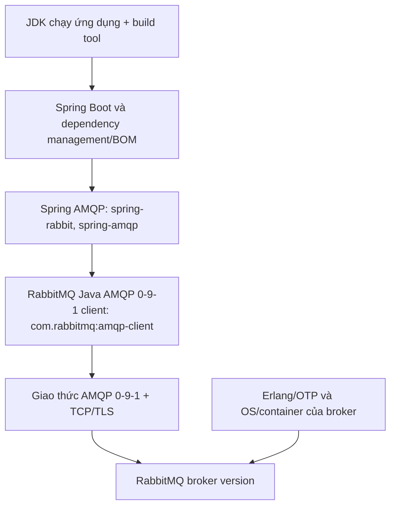

# Đối chiếu Spring Boot, Spring AMQP, Java client và RabbitMQ broker khi nâng cấp

Một ứng dụng dùng `RabbitTemplate`, `@RabbitListener`, exchange, queue và binding có thể hoạt động ổn định trong nhiều năm rồi bất ngờ lỗi sau một đợt nâng cấp: ứng dụng không khởi động do `NoSuchMethodError`, message converter đọc JSON khác trước, listener retry sai, hoặc broker từ chối khai báo queue. Đôi khi bốn lỗi này bị gọi chung là **“Spring AMQP không tương thích với RabbitMQ mới”**, trong khi chúng thuộc **những tầng hoàn toàn khác nhau**.

Trong chương **Nâng cấp và tương thích** của **SPRING_AMQP**, bài học này cung cấp một phương pháp đối chiếu đồng thời **Spring Boot, Spring AMQP, RabbitMQ Java client và RabbitMQ broker**. Mục tiêu là chọn bộ dependency nhất quán, nhận diện khác biệt AMQP 0-9-1/AMQP 1.0, lập kế hoạch nâng cấp an toàn, giữ nguyên các bảo đảm publisher confirms, consumer acknowledgements, retry, dead-letter và quan sát hệ thống.

**Phạm vi bài:** tập trung vào tích hợp RabbitMQ bằng `RabbitTemplate` và `@RabbitListener` (đường AMQP 0-9-1 quen thuộc), đồng thời chỉ rõ các nhánh AMQP 1.0 và RabbitMQ Streams khi so sánh. Các ví dụ phiên bản mang tính **mốc đối chiếu theo tài liệu chính thức ngày 26/11/2026**, không phải quy tắc ghép phiên bản tùy ý trong tương lai; luôn kiểm tra lại tài liệu được ghim theo **chính xác bản release sẽ triển khai**.

## 1. Bốn tầng cần kiểm tra riêng



| Tầng | Ai quản lý? | Vai trò | Lỗi tương thích thường gặp |
|---|---|---|---|
| **Java/JDK** | Build và runtime của ứng dụng | Chạy Spring Boot/Spring AMQP | `UnsupportedClassVersionError`, thiếu module/JDK API |
| **Spring Boot** | Plugin/parent/BOM và auto-configuration | Quản lý bộ thư viện, configuration properties, Actuator | Auto-config thay đổi, dependency bị lệch, starter đổi tên |
| **Spring AMQP** | `org.springframework.amqp` | `RabbitTemplate`, `RabbitAdmin`, listener container, converters, retry | API bị đổi/bỏ, listener behavior khác |
| **RabbitMQ Java client** | `com.rabbitmq:amqp-client` | Connection/channel, `basic.publish`, `basic.consume`, protocol AMQP 0-9-1 | `NoSuchMethodError`, timeout/recovery/confirm behavior |
| **RabbitMQ broker** | Đội hạ tầng/Operator | Exchange, queue, binding, routing, confirms, policies, DLX | Queue type/feature flag đổi, topology bị từ chối |
| **Erlang/OTP** | Đội vận hành broker | Nền runtime của RabbitMQ server | Broker không khởi động hoặc cluster upgrade không hợp lệ |

**Điểm quan trọng:** Java client ở đây là **thư viện chạy trong JVM ứng dụng**, còn Erlang/OTP là runtime của **RabbitMQ broker**. Việc đổi JDK của service không tự đổi Erlang và ngược lại.

Không có một “version RabbitMQ” duy nhất cho toàn bộ stack. Một ứng dụng Spring Boot 3.x có thể kết nối broker thế hệ mới qua AMQP 0-9-1 nếu các chức năng nó dùng còn được broker hỗ trợ. Nhưng **kết nối TCP thành công không chứng minh mọi queue type, retry, binding, topology migration và chính sách xử lý lỗi đều tương thích**.

## 2. Chọn đúng thế hệ Spring Boot – Spring AMQP

Spring Boot quản lý các phiên bản dependency được kiểm thử đồng bộ thông qua BOM. Trước tiên cần biết **Boot version đang dùng**, sau đó đọc **bảng Managed Dependency Coordinates** của chính phiên bản ấy.

### Mốc đối chiếu từ tài liệu được ghim

| Nhánh Spring Boot | Spring AMQP trong BOM mẫu | Spring Framework tương ứng | Starter RabbitMQ AMQP 0-9-1 | Ghi chú |
|---|---|---|---|---|
| **3.5.x** (ví dụ docs 3.5.16) | **3.2.x** (docs 3.2.12) | **6.2.x** | `spring-boot-starter-amqp` | Hệ Boot 3, API Jackson 2 vẫn quen thuộc |
| **4.0.x** (ví dụ docs 4.0.10) | **4.0.x** (docs 4.0.7) | **7.0.x** | `spring-boot-starter-amqp` trong docs 4.0 | Boot 4 bước sang Spring Framework 7 |
| **4.2.x** (docs 4.2.0) | **4.2.x** (docs 4.2.0) | **7.1.x** | **`spring-boot-starter-rabbitmq`** | Phân tách các starter AMQP 1.0 và RabbitMQ 0-9-1 |

Các giá trị cụ thể trong bảng là **ví dụ một bộ release đã được công bố**, không ngụ ý tất cả patch của Boot 3.5 chỉ tương thích với đúng một patch Spring AMQP. Khi cần nâng cấp, kiểm tra **BOM của patch Boot đích**, không ghép thủ công hai ô trong bảng.

Nguồn đối chiếu:

- [Spring Boot 3.5 — Managed Dependency Coordinates](https://docs.spring.io/spring-boot/3.5/appendix/dependency-versions/coordinates.html)
- [Spring Boot 4.0 — Managed Dependency Coordinates](https://docs.spring.io/spring-boot/4.0/appendix/dependency-versions/coordinates.html)
- [Spring Boot 4.2 — Managed Dependency Coordinates](https://docs.spring.io/spring-boot/appendix/dependency-versions/coordinates.html)
- [Spring AMQP 4.0 — What’s New](https://docs.spring.io/spring-amqp/reference/4.0/whats-new.html)

### Tránh nhầm tên starter ở Boot 4.2

Trong tài liệu **Spring Boot 4.2**, ba lựa chọn được tách rõ:

| Starter | Giao thức | Loại API/định hướng |
|---|---|---|
| `spring-boot-starter-amqp` | **AMQP 1.0 tổng quát** | `AmqpClient` / `@AmqpListener` với hỗ trợ không phụ thuộc riêng RabbitMQ |
| `spring-boot-starter-amqp-rabbitmq` | **AMQP 1.0 dành riêng RabbitMQ** | RabbitMQ AMQP 1.0 client |
| **`spring-boot-starter-rabbitmq`** | **AMQP 0-9-1** | `RabbitTemplate`, `@RabbitListener`, classic Spring Rabbit integration |

**Cảnh báo nâng cấp:** không sao chép nguyên dependency `spring-boot-starter-amqp` từ project Boot 3.5 sang Boot 4.2 rồi mặc nhiên mong nó cung cấp đúng AMQP 0-9-1 stack. Tên starter có thể tồn tại nhưng **ý nghĩa đã khác**. Khi chuyển lên Boot 4.2, xác minh starter dành cho `RabbitTemplate` là `spring-boot-starter-rabbitmq` theo tài liệu bản đích.

Tài liệu:

- [Spring Boot 3.5 — AMQP](https://docs.spring.io/spring-boot/3.5/reference/messaging/amqp.html)
- [Spring Boot 4.0 — AMQP](https://docs.spring.io/spring-boot/4.0/reference/messaging/amqp.html)
- [Spring Boot hiện hành — AMQP](https://docs.spring.io/spring-boot/reference/messaging/amqp.html)

**Ghi nhớ:** vấn đề tên starter là vấn đề **Spring Boot auto-configuration và packaging**, không phải bằng chứng RabbitMQ broker ngừng hiểu giao thức cũ.

## 3. Phân biệt ba “Java client” dễ nhầm khi đọc dependency

Tên “RabbitMQ Java client” có thể nói đến những thư viện và giao thức rất khác nhau.

| Tình huống | Thư viện/nhóm API | Giao thức | Khi sử dụng |
|---|---|---|---|
| Spring `RabbitTemplate` và `@RabbitListener` truyền thống | `org.springframework.amqp:spring-rabbit` + `com.rabbitmq:amqp-client` | **AMQP 0-9-1** | Exchange, queue, binding, publish/consume với Spring Rabbit |
| RabbitMQ AMQP 1.0 client chuyên dụng | `com.rabbitmq.client:amqp-client` và Spring module phù hợp | **AMQP 1.0** | Tính năng RabbitMQ AMQP 1.0 |
| RabbitMQ Streams native protocol | `com.rabbitmq:stream-client` và tích hợp `spring-rabbit-stream` khi dùng | **Stream protocol** | Stream/super stream, offset và throughput đặc thù |

Đặc biệt, **`com.rabbitmq:amqp-client` không phải cùng Maven coordinate với `com.rabbitmq.client:amqp-client`**. Chúng thuộc hai protocol khác nhau dù tên artifact trông gần giống.

AMQP 1.0 **không phải một minor-version “nâng cấp dây mạng” của AMQP 0-9-1**. Nếu đổi sang 1.0, phải đánh giá lại API, message encoding, settlement/ack semantics và khả năng tương tác; không chỉ thay số phiên bản client.

RabbitMQ broker thế hệ 4 vẫn có hỗ trợ AMQP 0-9-1, bên cạnh AMQP 1.0. Do đó **nâng broker lên 4.x không tự bắt buộc phải chuyển ứng dụng `RabbitTemplate` sang AMQP 1.0**. Việc quyết định chuyển protocol là một dự án migration khác với việc nâng patch server.

Nguồn:

- [RabbitMQ — Java Client Libraries](https://www.rabbitmq.com/client-libraries/java-versions)
- [RabbitMQ — Supported Protocols](https://www.rabbitmq.com/docs/protocols)
- [RabbitMQ — Java Client API Guide](https://www.rabbitmq.com/client-libraries/java-api-guide)

## 4. Dependency management: để Boot BOM chọn trước

Nguyên tắc ít rủi ro nhất cho ứng dụng Spring Boot là:

1. Chọn release Spring Boot **được tổ chức hỗ trợ**.
2. Dùng plugin/parent/BOM tương ứng để quản lý Spring Framework và Spring AMQP.
3. Thêm starter đúng chức năng, **không tự pin phiên bản `spring-rabbit` hoặc `amqp-client`** trừ khi có lý do đặc biệt.
4. Kiểm tra **dependency graph thực tế** trước khi build/deploy; không chỉ đọc `build.gradle` hoặc `pom.xml`.
5. Nếu cần override một thư viện vì CVE, kiểm tra compatibility, điều kiện support và integration test trước khi phê duyệt.

### 4.1. Gradle cho Boot 3.5.x (minh họa)

```groovy
plugins {
    id 'java'
    id 'org.springframework.boot' version '3.5.16'
    id 'io.spring.dependency-management' version '1.1.7'
}

java {
    toolchain {
        languageVersion = JavaLanguageVersion.of(17)
    }
}

repositories {
    mavenCentral()
}

dependencies {
    implementation 'org.springframework.boot:spring-boot-starter-amqp'
    implementation 'org.springframework.boot:spring-boot-starter-actuator'
    testImplementation 'org.springframework.boot:spring-boot-starter-test'
    testImplementation 'org.springframework.amqp:spring-rabbit-test'
}
```

Không đặt `implementation 'org.springframework.amqp:spring-rabbit:4.0.x'` đè lên bộ Boot 3.5 chỉ để dùng một API mới. Spring AMQP 4.x thuộc thế hệ Spring Framework 7, còn Boot 3.5 quản lý thế hệ Framework 6.2; trộn chúng có nguy cơ lỗi bytecode, API và auto-config.

### 4.2. Gradle cho Boot 4.2.x, vẫn dùng `RabbitTemplate`

```groovy
plugins {
    id 'java'
    id 'org.springframework.boot' version '4.2.0'
    id 'io.spring.dependency-management' version '1.1.7'
}

java {
    toolchain {
        languageVersion = JavaLanguageVersion.of(21)
    }
}

repositories {
    mavenCentral()
}

dependencies {
    // AMQP 0-9-1, dành cho RabbitTemplate / @RabbitListener.
    implementation 'org.springframework.boot:spring-boot-starter-rabbitmq'
    implementation 'org.springframework.boot:spring-boot-starter-actuator'
    testImplementation 'org.springframework.boot:spring-boot-starter-test'
    testImplementation 'org.springframework.amqp:spring-rabbit-test'
}
```

`Java 21` là **lựa chọn JDK LTS của ví dụ**, không phải yêu cầu tối thiểu của mọi ứng dụng Boot 4.2; Boot 4.2 công bố mức Java tối thiểu **17**. Phải kiểm tra thêm Gradle/Maven version, JDK của CI, container runtime và thư viện bên thứ ba.

**Các snippet là ví dụ về quản lý phiên bản, chưa chạy build trong bài.** Đối với một dự án thật, nên dùng Spring Initializr/build setup đã được phê duyệt cho chính patch Boot đích; đừng mặc nhiên dùng một phiên bản plugin dependency-management cũ cho mọi tương lai.

### 4.3. Maven với Spring Boot parent

Ví dụ minh họa cho nhánh Boot 3.5:

```xml
<parent>
    <groupId>org.springframework.boot</groupId>
    <artifactId>spring-boot-starter-parent</artifactId>
    <version>3.5.16</version>
    <relativePath/>
</parent>

<dependencies>
    <dependency>
        <groupId>org.springframework.boot</groupId>
        <artifactId>spring-boot-starter-amqp</artifactId>
    </dependency>
    <dependency>
        <groupId>org.springframework.amqp</groupId>
        <artifactId>spring-rabbit-test</artifactId>
        <scope>test</scope>
    </dependency>
</dependencies>
```

Nếu chuyển parent lên Boot 4.2, đồng thời đổi starter AMQP 0-9-1 sang `spring-boot-starter-rabbitmq`. Đừng pin version con một cách tùy ý vì làm vậy có thể vô hiệu hóa lợi ích BOM.

## 5. Kiểm tra dependency graph đã được resolve

Code có thể biên dịch trên máy này nhưng fail ở CI nếu có nhiều version của cùng library bị kéo bởi dependencies khác nhau. Một số triệu chứng:

- `NoSuchMethodError`, `NoClassDefFoundError` khi Spring khởi tạo `RabbitTemplate` hoặc container.
- Một module dùng `spring-rabbit` mới trong khi `spring-amqp`/`spring-core` cũ.
- `amqp-client` bị override sang version chưa được kiểm chứng với Spring AMQP đang dùng.
- Có cả Jackson 2 và Jackson 3, nhưng converter/import/chính sách polymorphic không đúng nhánh.
- Plugin retry hoặc tracing không còn áp dụng do API thay đổi.

### Lệnh Gradle (chạy trong project thực)

```bash
./gradlew dependencies --configuration runtimeClasspath

./gradlew dependencyInsight \
  --dependency spring-rabbit \
  --configuration runtimeClasspath

./gradlew dependencyInsight \
  --dependency amqp-client \
  --configuration runtimeClasspath

./gradlew dependencyInsight \
  --dependency spring-core \
  --configuration runtimeClasspath
```

### Lệnh Maven

```bash
mvn dependency:tree -Dincludes=org.springframework.amqp
mvn dependency:tree -Dincludes=com.rabbitmq
mvn dependency:tree -Dincludes=org.springframework
```

Không cần xem **mọi dependency** khi đang giải một sự cố cụ thể. Ưu tiên xác định chính xác các tọa độ:

```text
org.springframework.boot:...
org.springframework:spring-core, spring-context, ...
org.springframework.amqp:spring-amqp
org.springframework.amqp:spring-rabbit
com.rabbitmq:amqp-client                   # AMQP 0-9-1
com.rabbitmq:stream-client                 # nếu dùng Streams
com.rabbitmq.client:amqp-client            # nếu dùng AMQP 1.0 client riêng
```

**Kiểm tra runtimeClasspath, không chỉ compileClasspath.** Một `dependencyInsight` in ra một version khác trong runtime có thể lý giải lỗi chỉ xuất hiện khi container start.

## 6. Java runtime, Spring Framework và Jakarta

Nâng Spring Boot không chỉ cập nhật AMQP. Nó kéo theo hệ sinh thái Spring Framework, Jackson, Micrometer, retry và các thư viện giao tiếp dữ liệu.

### Mốc liên quan

- **Spring Boot 3.x:** dùng nền tảng Spring Framework 6 và Jakarta EE APIs; bản 3.5.x sử dụng Spring Framework 6.2.x. Java baseline của Boot 3 thuộc thế hệ **17+**.
- **Spring Boot 4.x:** dựa trên Spring Framework 7; tài liệu Boot 4.2 yêu cầu Java **17 trở lên**, nhưng cần kiểm tra thêm chính sách support của vendor JDK và các thư viện chạy kèm.
- **Spring AMQP 4.x:** thuộc thế hệ Spring Framework 7, có thay đổi về API null-safety, converters và cơ chế retry so với 3.x.

Đừng đổi Spring AMQP major trước rồi mới kiểm tra JDK ở cuối. Khi nâng dự án từ Boot 2/Java 8–11, đây có thể là một migration **nhiều bước**: JDK → Boot 3/Jakarta → ổn định → Boot 4/Spring Framework 7. Cố “nhảy nhiều bậc” làm việc khoanh vùng regression khó hơn.

### Checklist JDK thực tế

```text
Developer machine Java version:        ?
Gradle/Maven runtime Java version:      ?
Java toolchain / --release:            ?
CI build image Java version:           ?
Production container Java version:     ?
GraalVM/native-image runtime (nếu có): ?
```

**JDK chạy Gradle/Maven không nhất thiết giống Java toolchain dùng để biên dịch.** Phải kiểm tra cả hai. Nếu build bằng JDK mới nhưng production chạy JVM thấp hơn class file target, ứng dụng vẫn có thể fail khi khởi động.

## 7. Thay đổi ở Spring AMQP 4.x cần rà soát kỹ

Khi chuyển từ thế hệ Spring AMQP 3.2 sang 4.x, không nên mặc định mọi module hoặc API extension của hệ thống vẫn hoạt động như cũ.

| Chủ đề | Điều cần đối chiếu | Rủi ro nếu bỏ qua |
|---|---|---|
| Spring Framework | Spring AMQP 4.x dựa trên **Framework 7** | Lệch classpath, API không tồn tại |
| Jackson | Các lớp converter mới cho **Jackson 3**; Jackson 2 được deprecate cho lộ trình loại bỏ | JSON type headers/DTO, ngày giờ, converter hoạt động khác |
| Retry | Spring AMQP 4.0 chuyển sử dụng **Spring Core Retry** thay cho API Spring Retry cũ ở những chỗ tương ứng | Custom retry interceptor, `MessageRecoverer` hoặc config code không compile |
| Null-safety | Dùng JSpecify annotations | IDE/compiler báo kiểu nullability mới |
| Listener shutdown | Thay đổi chi tiết chờ reply trong `SimpleMessageListenerContainer` | Shutdown timeout, in-flight replies |
| Test utilities | Khuyến khích JUnit Jupiter thay cho JUnit 4 utilities cũ | Test compile/chạy không đúng |
| Dependency starter | Boot 4.2 phân tách các starter/protocol | Mất `RabbitTemplate` auto-config nếu chọn sai starter |

Thông tin trên xuất phát từ [Spring AMQP 4.0 — What’s New](https://docs.spring.io/spring-amqp/reference/4.0/whats-new.html). Khi áp dụng, xem cả **migration notes của nhánh 4.x đang chọn**, không chỉ 4.0.

### 7.1. Json converter không chỉ là thay import

Trong dự án Spring AMQP 3.x có thể thấy:

```java
import org.springframework.amqp.support.converter.Jackson2JsonMessageConverter;
```

Khi sang Spring AMQP 4.x và Jackson 3, cần kiểm tra converter tương ứng, `ObjectMapper` liên quan và cấu hình type mapping theo API của nhánh đang dùng. **Không tự thay tên class mà chưa kiểm tra contract thực tế**. Cần test:

- Producer V3.x phát JSON, consumer V4.x nhận và ngược lại.
- `contentType`, headers type-id, list/generic types và Java records.
- `Instant`/timezone, enum, null/missing field và field mới.
- Untrusted type headers, deserialization security và dead-letter cho payload sai.
- Backlog queue chứa message **phiên bản cũ** trong khi deploy consumer mới.

**Thông điệp còn trong queue không tự được viết lại** khi bạn nâng thư viện. Consumer mới phải đọc được định dạng producer cũ đã phát trước đó, hoặc có một kế hoạch schema migration/replay cụ thể.

### 7.2. Retry configuration phải được đánh giá lại

Một listener trước đó có thể dùng advice chain hoặc retry interceptor dựa vào Spring Retry. Sau khi nâng major, hãy đọc API chính thức của nhánh mới và cập nhật các điểm:

- Retry policy và số lần thử thực tế.
- Backoff/timeout và exception classification.
- Chỗ gọi `MessageRecoverer` khi hết lần thử.
- Quyết định `reject/requeue/DLQ`.
- Khả năng side effect bị lặp nếu xử lý trước ack.

**Không suy rằng dependency còn resolve thành công là retry behavior không đổi.** Kiểm thử failure-path cần tạo exception có kiểm soát và quan sát thực tế số attempt, DLQ và ack.

## 8. RabbitMQ broker: protocol compatibility ≠ feature compatibility

`com.rabbitmq:amqp-client` nói chuyện với RabbitMQ broker qua AMQP 0-9-1. Điều này thường cho phép **client và broker không cùng “số version”**, vì giao thức có sự ổn định nhất định.

Nhưng tính năng broker **không chỉ gồm wire protocol**:

| Khả năng | Liên quan phiên bản broker | Cần kiểm tra khi upgrade |
|---|---|---|
| Classic queue | Các thay đổi về loại queue/giới hạn | Queue arguments, policies và durability |
| **Quorum queue** | Cơ chế replicated queue, delivery limit, dead-letter strategies | Raft replica health, ack/retry, DLX, tương thích property |
| **Streams** | Stream protocol/plugin và client riêng | Version stream-client, broker plugin, offset/retention |
| **Classic mirrored queues** | **Đã bị loại bỏ ở RabbitMQ 4.x** | Migration sang quorum queues/streams trước khi nâng |
| Publisher confirms | AMQP 0-9-1 + broker/channel behavior | Confirm ack/nack, timeout, mandatory returns |
| Feature flags | Quy tắc giữa các series broker | Kiểm tra trạng thái trước rolling upgrade |
| Policies/queue arguments | Có thể khác theo release | Topology drift, `PRECONDITION_FAILED` |
| TLS/authentication | Broker config, protocol/cipher | Handshake, certificates, credential/permissions |

Một ví dụ điển hình: `@RabbitListener` vẫn có thể kết nối và subscribe queue **đã tồn tại**, nhưng một `RabbitAdmin` mới lại bị `PRECONDITION_FAILED` khi khai báo queue cùng tên có `x-queue-type` hoặc arguments khác. Đây không nhất thiết là lỗi Java client; đây là **sự không tương thích giữa topology trên broker và khai báo của ứng dụng**.

**Classic mirrored queues** từng được sử dụng để nhân bản classic queue trong các version cũ. Khi nâng RabbitMQ 4.x, cần đánh giá migration sang quorum queues thay vì cho rằng policy mirror cũ vẫn được thực thi.

Nguồn: [RabbitMQ — Quorum Queues](https://www.rabbitmq.com/docs/quorum-queues), [RabbitMQ — Upgrade](https://www.rabbitmq.com/docs/upgrade).

## 9. Nâng RabbitMQ broker là một quy trình riêng

Khi nâng ứng dụng Spring Boot, có thể giữ nguyên broker để giảm số biến thay đổi. Khi nâng broker, cũng nên **giữ nguyên bản client ứng dụng** trong lượt thử đầu nếu không cần đổi ngay. Chỉ sau đó mới nâng tầng kia để có khả năng quy lỗi rõ.

### Quy trình cơ bản khi nâng broker

1. Ghi lại **broker release series**, Erlang/OTP, plugin và topology hiện tại.
2. Đọc **supported upgrade path** chính thức, không nhảy bừa từ 3.x lên 4.x.
3. Kiểm tra **stable feature flags**, queue replica health, alarms, disk/memory headroom.
4. Kiểm tra có **classic mirrored queues** hoặc feature đã bị loại bỏ không.
5. Backup definitions/secrets theo policy và xác định cách bảo vệ message đang còn backlog.
6. Chọn rolling upgrade hay blue–green đúng điều kiện hỗ trợ.
7. Thử trước trên cluster staging có queue types và traffic tương tự production.
8. Trong upgrade, theo dõi connection recovery, publish confirms, consumer ack, queue ready/unacked và DLQ.
9. Chỉ dọn topology/feature cũ khi migration đã hoàn tất và có đối soát dữ liệu.

### Không đoán đường nâng cấp

Theo tài liệu RabbitMQ 4.4, rolling upgrades có **đường đi qua các series trung gian**: ví dụ từ những series cũ hơn 4.2 có thể phải đi qua 4.2 trước khi lên 4.3/4.4. Các quy tắc này **thay đổi theo bản đích**, nên phải mở tài liệu [RabbitMQ — Upgrading](https://www.rabbitmq.com/docs/upgrade) được ghim đúng version để lập kế hoạch.

Nâng RabbitMQ 3.13 lên 4.x cũng đòi hỏi đánh giá các **stable feature flags**. Không được giả định chỉ thay tag image của container là đủ an toàn để giữ dữ liệu và cluster.

### Khác biệt giữa rolling và blue–green

| Phương pháp | Ý tưởng | Lưu ý |
|---|---|---|
| **Rolling** | Thay node lần lượt trong cùng cluster | Chỉ khi release series cho phép cùng tồn tại và capacity còn đủ |
| **Blue–green** | Tạo cluster mới, chuyển metadata/message/traffic rồi cutover | Cần quy trình đồng bộ và tránh duplicate/loss khi chuyển traffic |
| Full stop | Dừng cluster rồi nâng đồng loạt | Có downtime, cần backup/khả năng phục hồi được chứng minh |

Một phương án được broker hỗ trợ không có nghĩa ứng dụng tự giữ exactly-once end-to-end. Trong thời gian chuyển kết nối và redelivery, **idempotent processing** vẫn bắt buộc nếu nghiệp vụ không chấp nhận tác động lặp.

## 10. Ma trận tương thích cần lưu cho mỗi môi trường

Thay vì ghi “stack đã tương thích”, nên điền một bảng cụ thể **cho từng môi trường**:

| Trường | Dev | Staging | Production |
|---|---|---|---|
| JDK runtime | Java 17 | Java 17 | Java 17 |
| Spring Boot | 3.5.x | 3.5.x | 3.5.x |
| Spring Framework (BOM) | 6.2.x | 6.2.x | 6.2.x |
| Spring AMQP (BOM) | 3.2.x | 3.2.x | 3.2.x |
| RabbitMQ AMQP 0-9-1 Java client | Version resolved | Version resolved | Version resolved |
| RabbitMQ broker | Version thực | Version thực | Version thực |
| Erlang/OTP | Version thực | Version thực | Version thực |
| Queue types | Classic/quorum/stream | Tương đương | Tương đương |
| Plugin/feature flags | Đã lưu | Đã lưu | Đã lưu |
| AMQP protocol | 0-9-1 | 0-9-1 | 0-9-1 |

**Các giá trị Dev/Staging/Production ở bảng trên chỉ là mẫu điền**. Không suy rằng môi trường thực của người học hiện đang chạy Java 17 hay Boot 3.5. Cột “Version resolved” phải lấy từ dependency graph thực, không tự chép từ bảng web nếu có dependency overrides.

Thêm các dữ liệu hệ thống như:

```text
Listener container: simple hay direct?
Publisher confirms: correlated/none?
Publisher returns + mandatory: enabled?
Acknowledge mode: AUTO / MANUAL / NONE?
Retry advice / recoverer: phiên bản nào?
Message converter: Jackson 2 / Jackson 3 / custom?
Queue type: classic / quorum / stream?
DLX/DLQ: policy hay queue arguments?
Prefetch/concurrency: giá trị thực tế?
TLS/certificates/auth: cấu hình nào?
Schema version: producer/consumer hỗ trợ phiên bản nào?
```

Đây là **bản kiểm kê**, không phải chỉ số hoạt động. Khi có incident, đối chiếu chúng với log, broker metrics và artifact thực tế đã triển khai.

## 11. Ví dụ Spring AMQP đường AMQP 0-9-1 ổn định

Ví dụ tiếp theo cố ý dùng những API cốt lõi quen thuộc và không phụ thuộc tính năng broker mới. Dù vậy, cần kiểm tra compilation và behavior trên từng phiên bản đích; **đoạn mã minh họa không thay thế build/test của dự án thực**.

### 11.1. Exchange, queue và binding

```java
import org.springframework.amqp.core.Binding;
import org.springframework.amqp.core.BindingBuilder;
import org.springframework.amqp.core.DirectExchange;
import org.springframework.amqp.core.Queue;
import org.springframework.amqp.core.QueueBuilder;
import org.springframework.context.annotation.Bean;
import org.springframework.context.annotation.Configuration;

@Configuration
public class UpgradeSafeTopology {
    public static final String EXCHANGE = "orders.events";
    public static final String QUEUE = "orders.created.v1";
    public static final String ROUTING_KEY = "order.created.v1";

    @Bean
    public DirectExchange ordersExchange() {
        return new DirectExchange(EXCHANGE, true, false);
    }

    @Bean
    public Queue ordersQueue() {
        return QueueBuilder.durable(QUEUE).build();
    }

    @Bean
    public Binding ordersBinding() {
        return BindingBuilder.bind(ordersQueue())
                .to(ordersExchange()).with(ROUTING_KEY);
    }
}
```

### 11.2. Producer và consumer

```java
import org.springframework.amqp.rabbit.annotation.RabbitListener;
import org.springframework.amqp.rabbit.core.RabbitTemplate;
import org.springframework.stereotype.Component;
import org.springframework.stereotype.Service;

@Service
public class EventProducer {
    private final RabbitTemplate rabbitTemplate;

    public EventProducer(RabbitTemplate rabbitTemplate) {
        this.rabbitTemplate = rabbitTemplate;
    }

    public void publish(String eventId) {
        if (eventId == null || eventId.isBlank()) {
            throw new IllegalArgumentException("eventId trống");
        }
        rabbitTemplate.convertAndSend(
                UpgradeSafeTopology.EXCHANGE,
                UpgradeSafeTopology.ROUTING_KEY,
                eventId);
    }
}

@Component
public class EventConsumer {
    @RabbitListener(
            id = "orders-created-listener",
            queues = UpgradeSafeTopology.QUEUE)
    public void onEvent(String eventId) {
        // Production: dùng inbox/idempotency, không chỉ in ra console.
        System.out.println("Received " + eventId);
    }
}
```

Hai class `public` trong ví dụ cần đặt ở **hai file Java riêng**. Để giữ tên bean/template không mơ hồ, ứng dụng thật phải bảo đảm starter RabbitMQ đúng nhánh và không tạo nhiều `ConnectionFactory`/`RabbitTemplate` mà không dùng `@Qualifier`.

### 11.3. Cấu hình AMQP 0-9-1

```yaml
spring:
  rabbitmq:
    host: localhost
    port: 5672
    virtual-host: /
    username: guest
    password: guest
    publisher-confirm-type: correlated
    publisher-returns: true
    template:
      mandatory: true
    listener:
      simple:
        prefetch: 10
        acknowledge-mode: auto
```

Đây là cấu hình RabbitMQ local **để học**, không phải production credentials. Với môi trường thật, dùng TLS, user/vhost riêng và secret manager. Khi chuyển sang một starter AMQP 1.0 ở Boot 4.2, **không được mặc định tất cả property `spring.rabbitmq.*` này vẫn điều khiển đúng client đã chọn**; phải theo tài liệu protocol/starter tương ứng.

## 12. Những phép kiểm thử bắt buộc trước khi nâng cấp

### 12.1. Test khởi động và dependency resolution

- Ứng dụng start thành công trên JDK/build tool/image đích.
- Không có `ClassNotFoundException`, `NoSuchMethodError`, converter/auto-config lỗi.
- `RabbitTemplate`, `RabbitAdmin`, listener containers và connection factories thực sự được tạo.
- Properties đã được bind đúng; không có cấu hình im lặng bị bỏ qua do đổi starter/tên property.
- Listener chỉ connect vào broker/vhost mong đợi, không dùng tài khoản admin theo mặc định.

### 12.2. Test giao thức với RabbitMQ thật

Không dùng riêng Mockito hoặc `TestRabbitTemplate` để kết luận compatibility broker; hai cách này không kiểm tra routing, confirms, ack/requeue hay DLX từ broker thật.

| Kịch bản | Điều cần kiểm chứng |
|---|---|
| Declare exchange, queue, binding | Topology được broker chấp nhận, không có `PRECONDITION_FAILED` |
| Publish đúng key | Message tới đúng queue |
| Publish sai key với `mandatory=true` | Có returned message hoặc tín hiệu lỗi định tuyến phù hợp |
| Publisher confirm | Confirm ACK/NACK và callback/future đúng theo version |
| Listener `AUTO` ack | Thành công thì ack, lỗi thì áp dụng policy đã cấu hình |
| Listener `MANUAL` ack/nack | Không còn unacked bị giữ do quên ack; delivery tag/channel hợp lệ |
| Retry và recoverer | Số lần retry, backoff và hành vi khi hết retry đúng |
| DLX/DLQ | Message lỗi đi đến DLQ theo topology chính xác |
| JSON V1/V2 | Consumer đọc được event backlog cũ và event mới |
| Connection bị ngắt | Recovery/backoff, redelivery và idempotency an toàn |
| Quorum queue | Queue type/arguments được chấp nhận, dead-letter và redelivery đúng |
| TLS/authentication | Service kết nối bằng account/vhost/certificate thực |
| Metrics/Observation | Meter tên/tags phù hợp, không double-count hoặc mất alert |

### 12.3. Hai hướng triển khai phải cùng tồn tại

Khi rolling deployment từ consumer V1 sang V2 và producer từ V1 sang V2, trong một khoảng thời gian có thể tồn tại đồng thời:

```text
Producer V1 -> Event schema V1 -> Consumer V1 + Consumer V2
Producer V2 -> Event schema V2 -> Consumer V1 + Consumer V2
```

Điều kiện an toàn:

1. Consumer V2 đọc được event V1 đang nằm trong queue.
2. Producer V2 **không phát payload V2 không tương thích** trước khi mọi consumer liên quan đã xử lý được, trừ khi có route/version queue tách biệt.
3. Nếu có breaking change, thêm routing key/queue phù hợp và migration thay vì đổi nghĩa field cũ đột ngột.
4. Idempotency hoạt động xuyên các version; cùng một `eventId` không tạo side effect hai lần.

**Dependency compatibility và message schema compatibility là hai bài toán khác nhau.** Hai service có thể đều compile và kết nối RabbitMQ thành công nhưng lại không deserialize được message của nhau.

## 13. Kịch bản migration thực tế

### Kịch bản A — Chỉ nâng patch Spring Boot

Đề xuất:

1. Nâng patch trong cùng nhánh Boot.
2. Để BOM cập nhật Spring AMQP/client theo bộ được quản lý.
3. So sánh dependency graph và config properties.
4. Chạy unit/integration tests và smoke test trên broker staging.
5. Deploy canary/rolling, quan sát publish confirms, queue ingress/ack và DLQ.

Không nhất thiết cần đổi broker cùng lúc. Nếu production đang dùng một client override đặc biệt, ghi rõ lý do và kiểm tra khả năng bỏ override sau nâng patch.

### Kịch bản B — Boot 3.5 lên Boot 4.x

Nên xử lý thành một thay đổi major có kiểm soát:

1. Đọc [Spring Boot 4.0 Migration Guide](https://github.com/spring-projects/spring-boot/wiki/Spring-Boot-4.0-Migration-Guide) và release notes của bản đích.
2. Xác minh Java/Gradle/Maven và các thư viện bên thứ ba.
3. Đổi starter đúng nhánh; ở Boot 4.2, `RabbitTemplate` dùng `spring-boot-starter-rabbitmq`.
4. Rà soát Spring Framework 7, Jackson 3, retry API, JSpecify và custom auto-configuration.
5. Compile và test consumer đọc dữ liệu V1 đã phát từ trước.
6. Chạy integration test với broker phiên bản đang dùng trước khi đổi broker.
7. Canary/rolling, giám sát lỗi deserialize, DLQ và publisher confirms.

Đừng đổi **Spring Boot major + Jackson converter + RabbitMQ broker major + queue type** trong một lần nếu chưa có test/migration đủ mạnh để tách nguyên nhân.

### Kịch bản C — Broker 3.13 sang 4.x

Trước tiên:

- Xem đường nâng cấp và feature flags theo release chính xác.
- Xác định có classic mirrored queues không; lên kế hoạch migrate nếu có.
- Kiểm tra Erlang/OTP version được broker hỗ trợ.
- Diễn tập rollback/blue–green và bảo vệ backlog.
- Thử với **ứng dụng hiện tại**, không mặc định phải nâng Java client ngay.

Sau khi broker ổn định mới cân nhắc nâng thư viện ứng dụng theo BOM. Trạng thái broker khỏe không đủ nếu một số queue không còn route/replicate như kỳ vọng.

### Kịch bản D — Chuyển AMQP 0-9-1 sang AMQP 1.0

Đây là **đổi giao thức và mô hình API**, không chỉ đổi starter:

- Kiểm tra mapping command, exchange/queue/address semantics và message settlement.
- Viết lại adapter producer/consumer tương ứng thay vì ép `RabbitTemplate` vào client 1.0.
- Xác định header/property/schema compatibility giữa hai phía.
- So sánh confirms/returns, acknowledgement, retry và observability **theo protocol mới**.
- Thử chạy song song hoặc gateway migration nếu cần; không cắt traffic khi chưa chứng minh end-to-end behavior.

Đối với một khóa học `RabbitTemplate`/`@RabbitListener`, chỉ nên giới thiệu nhánh 1.0 như **lựa chọn có migration riêng**. Đường học chính vẫn là Spring Rabbit AMQP 0-9-1.

## 14. Khi lỗi xuất hiện sau nâng cấp, điều tra theo tầng

| Triệu chứng | Tầng nghi ngờ đầu tiên | Kiểm tra |
|---|---|---|
| `UnsupportedClassVersionError` | JDK/build image | Java target và Java runtime |
| `NoSuchMethodError` lúc khởi động | Dependency graph | Spring Framework/AMQP/client bị lệch |
| `RabbitTemplate` bean không tồn tại | Spring Boot starter/auto-config | Sai starter (đặc biệt Boot 4.2), profile, condition |
| JSON không deserialize | Spring AMQP converter/Jackson/schema | Converter, type mapping, payload cũ |
| Retry interceptor không compile | Spring AMQP major | Spring Core Retry vs Spring Retry API |
| `ACCESS_REFUSED` | Broker auth/ACL/vhost | User, quyền configure/write/read, endpoint |
| `PRECONDITION_FAILED` | Broker topology/queue arguments | Durability, queue type, DLX arguments |
| `NOT_FOUND` exchange/queue | Broker topology | Tên resource và vhost, provisioning |
| Publish ACK nhưng subscriber không thấy | Routing/binding | Mandatory returns, exchange type, bindings |
| Unacked tăng khi deploy | Consumer ack/recovery | Prefetch, MANUAL ack, listener exceptions |
| DLQ tăng sau release | Schema/logic/retry | Event version, converter, downstream, recoverer |
| Consumer reconnect liên tục | Broker/client/network | TLS, heartbeat, recovery BackOff, broker logs |
| Dashboard mất metric | Micrometer/Observation | Meter names, tags, exporter, listener mode |

**Không giải lỗi `PRECONDITION_FAILED` bằng cách tự xóa queue production.** Queue có thể chứa message chưa xử lý. Tạo migration/replay/drain có kế hoạch nếu phải đổi loại queue hoặc thuộc tính bất tương thích.

## 15. Observability và rollback sau nâng cấp

Một nâng cấp thành công phải được xác định bằng **business outcomes và tín hiệu giao nhận**, không chỉ một endpoint `/actuator/health` báo `UP`.

Những tín hiệu nên đối chiếu **trước/sau**:

- Tốc độ publish attempts, confirms ACK/NACK và mandatory returns.
- Queue ingress, `messages_ready`, `messages_unacknowledged`, consumer count.
- Listener success/failure rate, latency P95/P99 và redelivery/retry count.
- DLQ depth, số poison messages và phân loại lỗi deserialize.
- Connection recovery, channel exceptions và lỗi TLS/authentication.
- Side effect nghiệp vụ: email gửi thành công, payment processed, search index updated.

Một rollback ứng dụng chỉ an toàn nếu **event contract và topology còn tương thích với bản cũ**. Nếu producer mới đã phát event V2 mà consumer cũ không hiểu, rollback binary V1 có thể làm backlog lỗi tiếp. Nếu broker major hoặc queue type đã thay đổi, **không thể giả định rollback chỉ là đổi tag Docker về cũ**.

### Nguyên tắc rollback

1. Giữ topology và schema **tương thích ngược** trong giai đoạn canary.
2. Chỉ loại resource/version cũ sau khi backlog được drain/đối soát.
3. Giữ manifest versions và dependency graph của bản ứng dụng trước.
4. Định nghĩa **go/no-go metrics** cụ thể, ví dụ returned messages tăng, DLQ tăng, consumer count giảm.
5. Nếu cần replay sau rollback, giữ `eventId` và dùng idempotent consumers/outbox.
6. Với broker upgrade, tuân thủ khả năng downgrade/feature flags của bản RabbitMQ cụ thể; khi downgrade không được hỗ trợ, dùng phương án phục hồi/blue–green đã diễn tập.

## 16. Checklist trước khi phê duyệt nâng cấp

- [ ] Đã ghi lại chính xác phiên bản **JDK build/runtime, Boot, Spring Framework, Spring AMQP, `com.rabbitmq:amqp-client`, broker và Erlang**.
- [ ] Đã xác minh BOM/starter theo **nhánh Spring Boot đích**; không pin lệch major.
- [ ] Đã phân biệt rõ **AMQP 0-9-1, AMQP 1.0 và RabbitMQ Streams**.
- [ ] Đã kiểm tra dependency tree runtime và hết xung đột `spring-rabbit`/`amqp-client`.
- [ ] Đã kiểm tra các breaking changes Jackson converter, retry API, listener shutdown và test utilities.
- [ ] Đã có kế hoạch cho topology/queue types/feature flags và đường nâng cấp broker được hỗ trợ.
- [ ] Đã chạy tests với **RabbitMQ thật**: routing, confirms/returns, ack, retry/DLQ, TLS/ACL.
- [ ] Đã test consumer mới với message cũ và consumer cũ với producer mới trong giai đoạn cùng chạy.
- [ ] Đã kiểm tra idempotency và transactional outbox khi publish/ack không rõ kết quả.
- [ ] Đã đặt tiêu chí canary, metric cảnh báo và phương án rollback dựa trên dữ liệu thực.

### Câu hỏi tự kiểm tra

1. Vì sao nâng Spring Boot không có nghĩa phải đồng thời nâng RabbitMQ broker?
2. Khi dùng `RabbitTemplate` trên Boot 4.2, vì sao phải kiểm tra lại tên starter?
3. `com.rabbitmq:amqp-client` và `com.rabbitmq.client:amqp-client` có cùng giao thức không?
4. Tại sao BOM của Spring Boot thường an toàn hơn việc tự chọn Spring AMQP và Java client version?
5. Spring AMQP 4.x thay đổi gì quanh Jackson và retry; điều đó ảnh hưởng kiểm thử consumer ra sao?
6. Vì sao RabbitMQ broker 4.x vẫn có thể phục vụ ứng dụng AMQP 0-9-1?
7. Tại sao `PRECONDITION_FAILED` sau nâng broker có thể là lỗi topology thay vì lỗi giao thức?
8. Nếu producer V2 đã phát message mới vào queue, rollback consumer V1 cần điều kiện gì?
9. Khi broker nâng cấp rồi message bị redeliver, tại sao ứng dụng vẫn phải idempotent?
10. Vì sao kiểm thử bằng `TestRabbitTemplate` không đủ để kết luận một bản RabbitMQ broker mới tương thích?

## 17. Nguồn tham khảo chính thức

Khi áp dụng trong dự án thật, hãy **mở tài liệu của bản đích**, kiểm tra patch/release notes và lưu lại ngày đối chiếu:

- [Spring Boot 3.5 — AMQP](https://docs.spring.io/spring-boot/3.5/reference/messaging/amqp.html)
- [Spring Boot 4.0 — AMQP](https://docs.spring.io/spring-boot/4.0/reference/messaging/amqp.html)
- [Spring Boot 4.2 — AMQP, tách protocol/starter](https://docs.spring.io/spring-boot/reference/messaging/amqp.html)
- [Spring Boot 3.5 — Managed Dependencies](https://docs.spring.io/spring-boot/3.5/appendix/dependency-versions/coordinates.html)
- [Spring Boot 4.0 — Managed Dependencies](https://docs.spring.io/spring-boot/4.0/appendix/dependency-versions/coordinates.html)
- [Spring Boot hiện hành — Managed Dependencies](https://docs.spring.io/spring-boot/appendix/dependency-versions/coordinates.html)
- [Spring Boot — System Requirements](https://docs.spring.io/spring-boot/system-requirements.html)
- [Spring AMQP 4.0 — What’s New](https://docs.spring.io/spring-amqp/reference/4.0/whats-new.html)
- [Spring AMQP — Reference](https://docs.spring.io/spring-amqp/reference/)
- [RabbitMQ — Java Libraries and Support](https://www.rabbitmq.com/client-libraries/java-versions)
- [RabbitMQ — Protocols](https://www.rabbitmq.com/docs/protocols)
- [RabbitMQ — Upgrade Guides](https://www.rabbitmq.com/docs/upgrade)
- [RabbitMQ — Quorum Queues](https://www.rabbitmq.com/docs/quorum-queues)

**Ghi nhớ:** **Spring Boot/BOM quyết định bộ thư viện ứng dụng; Spring AMQP cung cấp API `RabbitTemplate`/`@RabbitListener`; RabbitMQ Java client vận chuyển AMQP 0-9-1; RabbitMQ broker thực thi topology và giao nhận.** Chúng có thể nâng cấp ở các thời điểm khác nhau, nhưng phải được kiểm chứng như một hệ thống. Trước mỗi lần nâng, cố định dependency graph, chọn đúng starter/giao thức, kiểm tra các API breaking changes, diễn tập broker upgrade path và thử những bảo đảm quan trọng — **routing, confirms, ack, retry, DLQ, idempotency, readiness và khả năng rollback** — trên broker thật.
