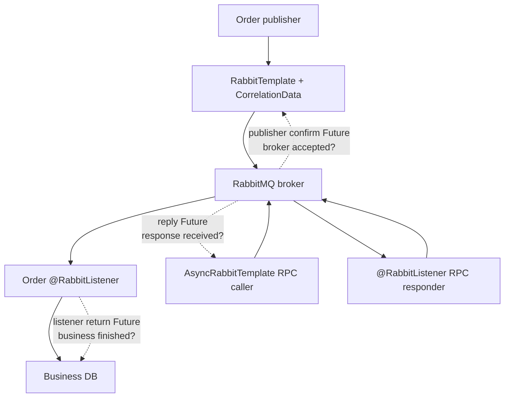
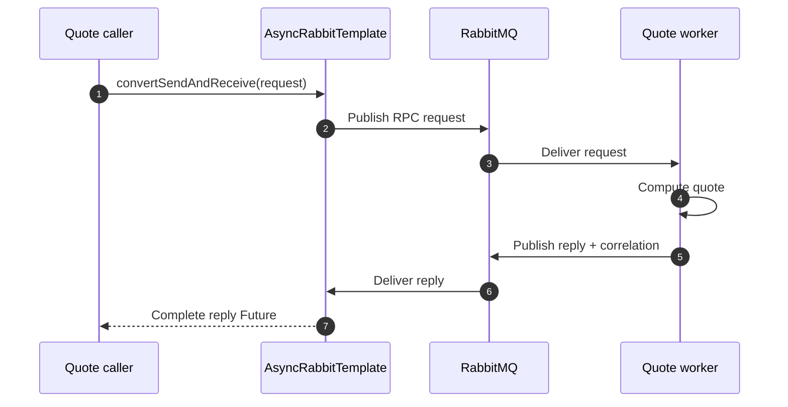
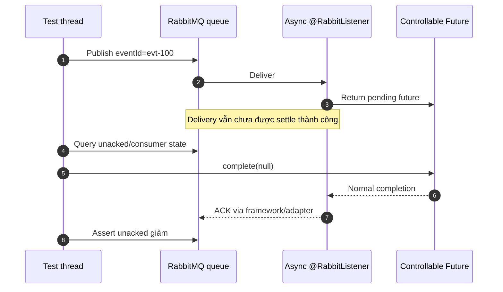

# Chuyển đổi API Future, callback và loại trả về bất đồng bộ

## 1. Vì sao nâng cấp Spring AMQP dễ làm sai hành vi bất đồng bộ?

Trong module **SPRING_AMQP**, ứng dụng dùng `RabbitTemplate` để publish, `@RabbitListener` để consume, exchange/queue/binding để định tuyến, publisher confirm để theo dõi việc broker chấp nhận gửi và consumer ACK để xác nhận đã xử lý delivery. Khi nâng cấp Java, Spring Framework, Spring Boot hoặc Spring AMQP, các đoạn code cũ dựa trên **`Future`, `ListenableFuture` và callback** có thể cần chuyển sang **`CompletableFuture` / `CompletionStage`**, hoặc thay kiểu trả về của listener.

Vấn đề không chỉ là đổi tên interface. Một thay đổi nhỏ có thể làm sai **thời điểm ACK**, **đường xử lý exception**, **timeout** hoặc **ngữ nghĩa thành công**.

Ví dụ producer ghi log:

```text
Order event published successfully
```

nhưng dòng log đó có thể xuất hiện ở ba thời điểm khác nhau:

1. Sau khi phương thức `RabbitTemplate.send(...)` **trả về**.
2. Sau khi broker gửi **publisher confirm ACK**.
3. Sau khi consumer **commit nghiệp vụ** và ACK delivery.

Chỉ (2) là kết quả publisher confirm, còn (3) thuộc luồng consumer; không được thay thế lẫn nhau. Với RPC, một future nhận **reply message** lại là cột mốc thứ tư: có reply không chứng minh các side effect khác đã thành công nếu hợp đồng responder không định nghĩa như vậy.

Bài này thuộc chương **Nâng cấp và tương thích** của module **SPRING_AMQP**, tập trung vào việc **chuyển đổi API Future, callback và loại trả về bất đồng bộ** mà vẫn giữ đúng hợp đồng xử lý đáng tin cậy.

### Mục tiêu học tập

Sau bài, bạn có thể:

1. Phân biệt `java.util.concurrent.Future`, Spring `ListenableFuture`, Java `CompletableFuture`, `CompletionStage` và Reactor `Mono`.
2. Chuyển callback `addCallback` sang `whenComplete`, `handle`, `thenCompose` và `exceptionally` theo đúng ngữ nghĩa.
3. Chuyển đường xác nhận publish sang `CorrelationData.getFuture()` và tách **ACK/NACK/returned/timeout**.
4. Nâng cấp client request/reply sử dụng `AsyncRabbitTemplate` mà không biến xử lý bất đồng bộ thành blocking.
5. Đổi listener đồng bộ hoặc kiểu future cũ sang `@RabbitListener` trả về `CompletableFuture` phù hợp phiên bản Spring AMQP.
6. Giữ an toàn **consumer ACK/NACK, transaction, idempotency, prefetch và retry** khi tương tác hoàn tất ở thread khác.
7. Kiểm thử future có thể điều khiển được, tình huống lỗi/bị timeout/cancel, và kiểm chứng consumer ACK bằng RabbitMQ thật.
8. Xây kế hoạch chuyển đổi dependency, source code, configuration, runtime và rollback từng bước.

## 2. Trước tiên: bạn đang dùng future của luồng nào?

Trong Spring AMQP có **ba luồng bất đồng bộ độc lập** thường cùng xuất hiện trong một ứng dụng:



| Future hoặc callback | Nơi tạo | Khi hoàn tất | **Không** chứng minh |
|---|---|---|---|
| **Publisher confirm future** qua `CorrelationData` | Producer khi gọi RabbitTemplate | Broker confirm ACK/NACK hoặc lỗi/timeout theo cơ chế xử lý | Consumer nhận hay DB commit |
| **Request/reply future** qua `AsyncRabbitTemplate` | RPC caller | Nhận và convert reply, hoặc lỗi/timeout | Mọi side effect của hệ thống đã hoàn thành, nếu responder không cam kết |
| **Async listener return** từ `@RabbitListener` | Consumer listener method | Công việc do listener trả future đã thành công hoặc thất bại | Publisher đã nhận confirm/return; những job fire-and-forget không nằm trong future |

Điểm phân biệt quan trọng nhất: **một `CompletableFuture` chỉ đại diện cho công việc được gắn với nó**. Không được xem tất cả future là bằng chứng “message hoàn tất end-to-end”.

## 3. Các kiểu Java cần hiểu trước khi migrate

### 3.1. Future cơ bản

`java.util.concurrent.Future<T>` có các thao tác:

```java
T get() throws InterruptedException, ExecutionException;
T get(long timeout, TimeUnit unit)
        throws InterruptedException, ExecutionException, TimeoutException;
boolean isDone();
boolean cancel(boolean mayInterruptIfRunning);
```

Hạn chế:

- `get()` **chặn thread**.
- Interface không định nghĩa sẵn một pipeline callback/composition phong phú.
- `isDone()` cho biết future đã ở trạng thái kết thúc, **không phân biệt thành công hay lỗi**.
- `cancel(...)` không đồng nghĩa hủy được network publish hoặc rollback DB transaction.

### 3.2. Spring ListenableFuture

Trong các ứng dụng Spring cũ, `org.springframework.util.concurrent.ListenableFuture<T>` hỗ trợ đăng ký callback:

```java
future.addCallback(
        value -> handleSuccess(value),
        error -> handleFailure(error));
```

Đây là kiểu **Spring-specific** (không phải `com.google.common.util.concurrent.ListenableFuture` của Guava). Spring Framework đã chuyển trọng tâm sang `CompletableFuture`/`CompletionStage`; ở các dòng framework mới, API ListenableFuture có thể bị deprecated hoặc không còn được hỗ trợ ở thư viện tương ứng.

**Không tìm/copy hướng dẫn chỉ theo tên “ListenableFuture” mà bỏ qua package và phiên bản**. Cần kiểm tra xem method hiện tại thật sự trả `ListenableFuture`, `CompletableFuture` hay một subclass của chúng.

### 3.3. CompletableFuture và CompletionStage

`CompletableFuture<T>` là class Java có thể hoàn tất bằng giá trị, hoàn tất lỗi hoặc bị hủy. Nó triển khai `CompletionStage<T>`, cho phép ghép pipeline:

```java
CompletableFuture<String> f = new CompletableFuture<>();

f.thenApply(String::trim)
 .thenCompose(this::loadFromDatabaseAsync)
 .whenComplete((value, error) -> recordOutcome(value, error));
```

Một số điểm khác biệt:

- `thenApply` biến đổi giá trị **đồng bộ trên một stage**.
- `thenCompose` ghép một hàm trả về **stage mới**, tránh `CompletableFuture<CompletableFuture<T>>`.
- `whenComplete` quan sát thành công/lỗi, thường **giữ nguyên** outcome nếu callback không làm phát sinh lỗi mới.
- `handle` nhận cả giá trị và lỗi, **biến đổi** outcome thành một giá trị mới.
- `exceptionally` là fallback cho nhánh lỗi; nếu trả về giá trị hợp lệ, downstream có thể hiểu là **thành công**.
- `thenApplyAsync`/`thenComposeAsync`/`whenCompleteAsync` chỉ định thực thi không đồng bộ, có thể chọn `Executor` riêng.
- `join()` và `get()` vẫn **blocking** dù object là CompletableFuture.

`CompletionStage<T>` thích hợp làm **hợp đồng public API** khi caller chỉ cần composition mà không cần quyền gọi `complete(...)` hoặc `cancel(...)`. Tuy nhiên một số API framework, đặc biệt các adapter listener, có thể yêu cầu **kiểu trả về cụ thể** `CompletableFuture<?>`. Khi dùng annotation, phải ưu tiên hợp đồng thực tế của version đang chạy.

### 3.4. Reactor Mono

`reactor.core.publisher.Mono<T>` là kiểu Publisher thường dùng trong ứng dụng reactive. Với các dòng Spring AMQP hỗ trợ async listener return, `Mono<?>` có thể được sử dụng. Tuy nhiên:

- `Mono` có semantics subscription, lazy/eager và cancellation **khác** một `CompletableFuture` đã khởi chạy.
- Chuyển `CompletableFuture` thành `Mono` không tự biến `RabbitTemplate` blocking thành nonblocking.
- Phải kiểm tra phiên bản Spring AMQP, Reactor dependency và contract của listener adapter trước khi dùng.
- Không thay toàn bộ code bằng Reactor chỉ để đổi kiểu trả về khi hệ thống hiện tại dùng Java CompletableFuture tốt và đủ rõ.

## 4. Lập bản đồ API theo phiên bản, không dựa vào trí nhớ

Một đợt nâng cấp có thể đồng thời thay đổi:

- Java language/runtime;
- Spring Boot BOM;
- Spring Framework core;
- `spring-amqp` / `spring-rabbit`;
- RabbitMQ Java Client;
- Micrometer/Observation, Reactor và thư viện test.

### 4.1. Những dịch chuyển thường gặp

| Khu vực | Kiểu code cũ thường thấy | Hướng chuyển phù hợp |
|---|---|---|
| Callback future Spring | `ListenableFuture.addCallback(success, failure)` | `CompletableFuture.whenComplete(...)` hoặc `handle(...)` |
| Gắn callback chung | `SuccessCallback`/`FailureCallback` | `CompletionStage` composition, outcome mapping có kiểu rõ |
| Publish confirms | `RabbitTemplate.ConfirmCallback` cấp template | `CorrelationData.getFuture()` cho từng publish; có thể giữ callback chung nếu cần |
| Request/reply bất đồng bộ | `AsyncRabbitTemplate` trả RabbitFuture theo phiên bản | Xử lý qua API tương thích `CompletableFuture` và deadline rõ |
| Listener async | `ListenableFuture<?>` ở code Spring AMQP cũ | `CompletableFuture<?>` hoặc kiểu được adapter phiên bản mới hỗ trợ |
| Reactor adaptation | Callback thủ công | `Mono.fromFuture(...)`/`fromCompletionStage(...)` khi đúng semantics |
| Test async | `get()` + `Thread.sleep` | Controllable CompletableFuture + timeout hữu hạn; integration cho broker ACK |
| Failure logging | Callback lỗi chỉ log | Propagate/surface lỗi theo `CompletionStage` và retry/outbox policy |

**Không coi bảng là cam kết mọi API đều tồn tại ở mọi release.** Ví dụ `@RabbitListener` hỗ trợ các kiểu return bất đồng bộ được mở rộng qua các bản Spring AMQP khác nhau; `ListenableFuture` ở code cũ có thể không còn là kiểu hợp lệ khi nâng cấp major version. Dùng **Javadoc của phiên bản được BOM khóa** và một test biên dịch cho từng signature, thay vì đoán rằng một overload của version mới giống 100% bản cũ.

### 4.2. Kiểm tra build trước khi sửa code

Với Maven dự án Spring Boot:

```xml
<dependency>
    <groupId>org.springframework.boot</groupId>
    <artifactId>spring-boot-starter-amqp</artifactId>
</dependency>

<dependency>
    <groupId>org.springframework.boot</groupId>
    <artifactId>spring-boot-starter-test</artifactId>
    <scope>test</scope>
</dependency>
```

Phụ thuộc `spring-amqp` và `spring-rabbit` nên do **một BOM tương thích** quản lý. Khi migrate:

1. Ghi **version hiện tại** của Spring Boot, Framework, Spring AMQP, RabbitMQ Java Client, Java.
2. Tra release notes / migration guide cho đường nâng cấp cụ thể.
3. Kiểm tra dependency tree có **hai phiên bản Spring AMQP** cùng tồn tại qua transitive dependency không.
4. Đối chiếu import của `Future`, `ListenableFuture`, `CompletableFuture`, `CorrelationData`, `AsyncRabbitTemplate`.
5. Chạy compile/tests trên một nhánh nâng cấp riêng theo kế hoạch, không thay production trước khi test.
6. Nếu đi qua nhiều major version, chia upgrade dependency và refactor API thành những bước có thể rollback.

**Ví dụ trong bài** sử dụng phong cách API **Spring AMQP 3.x / Spring Boot 3.x** cho AMQP 0-9-1 với các phương thức ổn định được sử dụng rộng rãi. Với Spring AMQP 4.x, đối chiếu lại Java baseline, dependency và API thực tế trước khi copy.

## 5. Chuyển addCallback sang whenComplete/handle

### 5.1. Đoạn code cũ

Giả sử `ListenableFuture<Quote>` trả kết quả báo giá:

```java
// Code minh họa phong cách API cũ:
ListenableFuture<Quote> future = oldQuoteClient.request(quoteId);

future.addCallback(
        quote -> {
            metrics.success();
            sendToCaller(quote);
        },
        error -> {
            metrics.failure();
            sendErrorToCaller(error);
        });
```

Khi đổi return type thành `CompletableFuture<Quote>`, không còn `addCallback(...)` với signature đó.

### 5.2. Dùng whenComplete để quan sát, không đổi outcome

```java
CompletableFuture<Quote> future =
        newQuoteClient.request(quoteId);

CompletableFuture<Quote> observed =
        future.whenComplete((quote, error) -> {
            if (error == null) {
                metrics.success();
            } else {
                metrics.failure();
            }
        });

return observed;
```

Khác biệt so với một callback chỉ ghi log: `observed` vẫn là một future **thành công hoặc thất bại** theo kết quả upstream (trừ khi observer ném exception mới). Caller vẫn có quyền nhận lỗi. Không làm như sau nếu caller cần biết lỗi:

```java
// Anti-pattern: nuốt lỗi rồi coi message đã thành công.
return future.exceptionally(error -> {
    log.warn("Request failed", error);
    return null;
});
```

Lệnh `exceptionally(... -> null)` có thể chuyển một failure thành **normal completion** với null. Trong listener async, điều này nguy hiểm vì framework có thể cho rằng công việc **đã thành công**, dẫn đến ACK sớm cho message chưa được xử lý.

### 5.3. Dùng handle để biến kết quả thành một kiểu outcome

```java
public record Outcome<T>(
        boolean success, T value, String errorCode) {

    static <T> Outcome<T> ok(T value) {
        return new Outcome<>(true, value, null);
    }

    static <T> Outcome<T> failure(String code) {
        return new Outcome<>(false, null, code);
    }
}

CompletionStage<Outcome<Quote>> outcome =
        quoteFuture.handle((quote, error) -> {
            if (error != null) {
                return Outcome.<Quote>failure("QUOTE_FAILED");
            }
            return Outcome.ok(quote);
        });
```

Cách này phù hợp khi **hợp đồng public** là trả một outcome object thay vì throw. Nhưng nếu callback gắn với consumer ACK, cần xem **outcome.failure** là một response thành công hay phải giữ future **exceptionally completed**; không được đổi lỗi thành giá trị rồi giả định listener vẫn NACK.

### 5.4. thenApply khác thenCompose

```java
CompletableFuture<Order> orderFuture = loadOrderAsync(orderId);

// Map đồng bộ:
CompletableFuture<String> id =
        orderFuture.thenApply(Order::id);

// Compose sang API async khác:
CompletableFuture<Receipt> receipt =
        orderFuture.thenCompose(this::chargeAsync);
```

Sai lầm thường gặp:

```java
CompletableFuture<CompletableFuture<Receipt>> nested =
        orderFuture.thenApply(this::chargeAsync);
```

Nếu listener hoặc service return **outer future** hoàn tất quá sớm mà không flatten, nó có thể xác nhận delivery khi request thanh toán trong future bên trong vẫn đang chạy. Dùng `thenCompose` để trả **một stage phản ánh toàn bộ side effect cần hoàn thành**.

## 6. Publisher confirm: callback chung khác future cho từng publish

### 6.1. RabbitTemplate ConfirmCallback cũ

Nhiều ứng dụng dùng callback chung:

```java
rabbitTemplate.setConfirmCallback(
        (correlationData, ack, cause) -> {
            if (ack) {
                log.info("Broker confirmed publish");
            } else {
                log.warn("Broker NACK: {}", cause);
            }
        });
```

Callback này nhận publisher confirm theo template. Khi nhiều request publish đồng thời, **không thể dùng một biến `lastAck` toàn cục** để xác định kết quả của một event. Muốn correlation phải gắn ID vào `CorrelationData` và lưu trạng thái pending đúng cách.

`RabbitTemplate` cũng có `ReturnsCallback` để nhận message unroutable nếu đã cấu hình đúng `mandatory` và publisher returns. Việc dùng callback hay future không làm **confirm ACK tự đồng nghĩa routing thành công**.

### 6.2. Cấu hình broker confirms và returns

Ví dụ `application.yml`:

```yaml
spring:
  rabbitmq:
    host: localhost
    port: 5672
    username: ${RABBITMQ_USERNAME}
    password: ${RABBITMQ_PASSWORD}
    publisher-confirm-type: correlated
    publisher-returns: true
    template:
      mandatory: true
```

Đây là đường **RabbitMQ AMQP 0-9-1** của `spring.rabbitmq.*`, không phải RabbitMQ Streams hay generic AMQP 1.0. Cấu hình chính xác còn phụ thuộc Spring Boot version và topology.

- `publisher-confirm-type: correlated`: bật correlated confirms.
- `publisher-returns: true`: bật hỗ trợ returned/unroutable messages.
- `template.mandatory: true`: yêu cầu trả message không định tuyến được theo semantics của broker, trừ các đường alternate exchange/route phù hợp.
- Không gán `publisher-confirm-type: simple` rồi kỳ vọng mọi `CorrelationData.getFuture()` hoạt động như correlated confirms.

### 6.3. Lấy CompletableFuture từ CorrelationData

```java
import java.nio.charset.StandardCharsets;
import java.util.UUID;
import java.util.concurrent.CompletableFuture;
import java.util.concurrent.CompletionStage;

import org.springframework.amqp.AmqpException;
import org.springframework.amqp.core.Message;
import org.springframework.amqp.core.MessageDeliveryMode;
import org.springframework.amqp.core.MessageProperties;
import org.springframework.amqp.core.ReturnedMessage;
import org.springframework.amqp.rabbit.connection.CorrelationData;
import org.springframework.amqp.rabbit.core.RabbitTemplate;
import org.springframework.stereotype.Service;

enum PublishOutcome {
    CONFIRMED_NOT_RETURNED,
    UNROUTABLE_RETURNED,
    BROKER_NACK,
    CONFIRM_ERROR,
    SEND_ERROR
}

@Service
public class FutureOrderPublisher {
    private final RabbitTemplate rabbitTemplate;

    public FutureOrderPublisher(RabbitTemplate rabbitTemplate) {
        this.rabbitTemplate = rabbitTemplate;
    }

    public CompletionStage<PublishOutcome> publish(
            String eventId, String payloadJson) {

        String attemptId = eventId + ":" + UUID.randomUUID();
        CorrelationData correlation = new CorrelationData(attemptId);

        CompletableFuture<PublishOutcome> observed =
                correlation.getFuture().handle((confirm, error) -> {
                    if (error != null || confirm == null) {
                        return PublishOutcome.CONFIRM_ERROR;
                    }
                    if (!confirm.isAck()) {
                        return PublishOutcome.BROKER_NACK;
                    }

                    ReturnedMessage returned = correlation.getReturned();
                    if (returned != null) {
                        return PublishOutcome.UNROUTABLE_RETURNED;
                    }

                    return PublishOutcome.CONFIRMED_NOT_RETURNED;
                });

        MessageProperties props = new MessageProperties();
        props.setMessageId(eventId);
        props.setContentType(MessageProperties.CONTENT_TYPE_JSON);
        props.setContentEncoding("UTF-8");
        props.setDeliveryMode(MessageDeliveryMode.PERSISTENT);
        Message message = new Message(
                payloadJson.getBytes(StandardCharsets.UTF_8), props);

        try {
            rabbitTemplate.send(
                    "orders.events", "order.created",
                    message, correlation);
        } catch (AmqpException ex) {
            return CompletableFuture.completedFuture(
                    PublishOutcome.SEND_ERROR);
        }

        return observed;
    }
}
```

**Hợp đồng của ví dụ:**

- `eventId` là ID ổn định của **business event**; `attemptId` phân biệt lần publish để đối chiếu confirm.
- `send(...)` trả `void`, còn `correlation.getFuture()` là tín hiệu **broker confirm**; không dùng việc `send(...)` trả về làm thành công end-to-end.
- `getReturned()` được kiểm tra sau khi confirm future hoàn tất. Với correlated returns trong Spring AMQP, framework có quy tắc phối hợp return/confirm để returned message khả dụng trước khi confirm future hoàn tất theo contract tương ứng.
- `CONFIRMED_NOT_RETURNED` không được gọi là “CONSUMED” hay “DELIVERED”. Broker có thể route tới queue khác hoặc không có consumer.
- Nếu `send` ném exception đồng bộ, ví dụ trả `SEND_ERROR` để code gọi xử lý; **không suy chắc broker chưa bao giờ nhận** nếu sự cố xảy ra tại ranh giới mạng.
- `observed` vẫn chưa có **timeout**; nếu broker/client không hoàn tất confirm, future có thể pending. Production cần deadline, lưu pending state, recovery/outbox và alert.

Trong ứng dụng thật, thay việc trả enum đơn giản bằng một trạng thái có **attempt ID, thời điểm, lỗi và destination**. Không nuốt exception mà không lưu hoặc truyền tình trạng về bên chịu trách nhiệm retry.

### 6.4. Thêm deadline không làm thay đổi kết quả publish trên broker

Một stage được biến đổi có thể có deadline:

```java
CompletableFuture<PublishOutcome> bounded =
        correlation.getFuture()
                .handle((confirm, error) -> mapConfirm(confirm, error))
                .completeOnTimeout(
                        PublishOutcome.CONFIRM_ERROR,
                        5, java.util.concurrent.TimeUnit.SECONDS);
```

Đoạn này chỉ minh họa ý tưởng **timeout trên stage đã map**, với `mapConfirm` là hàm tự định nghĩa. Khi hết hạn, `bounded` có thể hoàn tất với outcome chưa rõ; **nó không hủy lệnh basic.publish đã đến broker**. Trong production, nên có outcome riêng `UNKNOWN_TIMEOUT` và reconcile với outbox/broker/consumer state trước khi gửi lại.

Đặc biệt: `orTimeout(...)` và `completeOnTimeout(...)` **làm biến đổi chính CompletableFuture được gọi**, không phải luôn tạo ra một future mới độc lập. Không gọi chúng tùy ý trực tiếp trên `CorrelationData.getFuture()` khi các thành phần khác vẫn cần quan sát broker confirm nguyên gốc; hãy áp deadline trên **stage dẫn xuất**, hoặc xây wrapper có scheduler riêng.

### 6.5. Confirm ACK có thể cùng tồn tại với return

```text
Exchange tồn tại.
Routing key không khớp binding.
Publisher mandatory=true.
Broker basic.return: NO_ROUTE.
Broker publisher confirm: ACK.
```

Hai tín hiệu **không mâu thuẫn**: broker đã xử lý publish nhưng không có route đích phù hợp. Nếu chỉ migrate `ConfirmCallback` thành `whenComplete(confirm)` mà **bỏ quên ReturnsCallback/getReturned()**, code mới có thể đánh dấu event là “đã gửi tới queue” sai sự thật.

### 6.6. Những điều không nên làm khi migrate confirms

- Không cài `setConfirmCallback(...)` **trong từng HTTP request**; callback là cấu hình ở cấp `RabbitTemplate`, có thể bị ghi đè giữa các request.
- Không tạo một `CompletableFuture<Boolean>` rồi gọi `complete(true)` ngay sau `convertAndSend`; đó chỉ đo call thành công đồng bộ.
- Không dùng `confirm.isAck()` làm bằng chứng consumer ACK hoặc DB commit.
- Không dùng `exceptionally(error -> null)` để biến confirm thất bại thành success.
- Không giữ hàng triệu pending futures trong RAM mà không timeout/backpressure.
- Không retry với event ID mới sau timeout; consumer phải idempotent theo **business eventId**.

## 7. Chuyển callback/observer mà không làm mất lỗi

`CompletableFuture` có nhiều phương thức nghe tương tự, nhưng semantics không giống nhau:

| Phương thức | Chạy khi nào? | Stage kết quả | Thích hợp |
|---|---|---|---|
| `thenApply` | Upstream thành công | Giá trị đã map; lỗi upstream đi tiếp | Convert reply, enrich result |
| `thenCompose` | Upstream thành công | Stage async được flatten | Chain DB/API async theo đúng completion |
| `thenAccept` | Upstream thành công | `CompletionStage<Void>` | Side effect là bước cần hoàn tất |
| `whenComplete` | Thành công **hoặc** lỗi | Giữ kết quả/lỗi gốc trừ observer throw | Metrics, logging |
| `handle` | Thành công **hoặc** lỗi | Có thể đổi cả lỗi thành giá trị | Chuẩn hóa outcome |
| `exceptionally` | Khi lỗi | Fallback success hoặc throw mới | Recover có chủ đích |
| `whenCompleteAsync` | Thành công/lỗi, observer chạy qua executor | Giữ outcome/lỗi theo semantics | Observer chậm cần tách thread |
| `allOf` | Khi tất cả futures hoàn tất | `CompletableFuture<Void>`, có thể lỗi nếu một future lỗi | Fan-out rồi đợi tất cả |
| `anyOf` | Khi một future hoàn tất | Future của kết quả bất kỳ | Hedge/winner khi business cho phép |

### 7.1. Observer có thể vô tình làm hỏng pipeline

```java
CompletableFuture<Receipt> observed =
        chargeFuture.whenComplete((receipt, error) -> {
            metrics.counter("charge.completed").increment();
            auditLogger.write(receipt, error); // Có thể ném exception.
        });
```

Nếu `auditLogger.write(...)` ném lỗi, stage `observed` có thể hoàn tất exceptionally dù charge đã thành công. Điều đó **có thể dẫn tới retry charge không cần thiết** nếu adapter dựa vào `observed` để quyết định ACK.

Giải pháp: những observer không được phép ảnh hưởng outcome nên có exception boundary riêng, hoặc gửi log/metric qua API nonblocking được kiểm soát:

```java
CompletableFuture<Receipt> observed =
        chargeFuture.whenComplete((receipt, error) -> {
            try {
                metrics.counter("charge.completed").increment();
                auditLogger.writeSafe(receipt, error);
            } catch (RuntimeException observerError) {
                // Log observer error riêng, không đổi business outcome.
            }
        });
```

Đây là ví dụ về **isolation policy** cho observability, không phải gợi ý bỏ qua lỗi audit pháp lý. Nếu audit **là một phần bắt buộc của transaction**, nó phải nằm trong business future/transaction và failure phải đi theo đường nghiệp vụ, không phải observer “best effort”.

### 7.2. Một chain đúng ranh giới

```java
CompletionStage<Receipt> result =
        validateAsync(command)
            .thenCompose(this::reserveStockAsync)
            .thenCompose(this::chargeAsync)
            .thenCompose(this::commitOrderAsync);
```

Future này chỉ hoàn tất khi **cả chain** hoàn tất. Đừng viết:

```java
CompletableFuture<Void> wrong =
        CompletableFuture.runAsync(() -> {
            reserveStockAsync(command); // Tạo future nhưng bỏ quên.
            chargeAsync(command);       // Tạo future nhưng bỏ quên.
        }, executor);
```

`wrong` có thể hoàn tất ngay sau khi khởi chạy hai call, khiến listener ACK trước side effects. Với Spring AMQP, thiết kế async return **bắt buộc** gắn đúng toàn bộ công việc quyết định message đã xử lý hay chưa.

## 8. AsyncRabbitTemplate: Future của request/reply khác Future của publisher confirm

### 8.1. Tình huống request/reply

Một ứng dụng gửi yêu cầu báo giá tới `quotes.requests` và đợi bên xử lý trả về reply:



`AsyncRabbitTemplate` quản lý correlation/request-reply và trả future cho **reply**. Đừng nhầm nó với `CorrelationData.getFuture()` dùng xác nhận broker **đã nhận publish**.

### 8.2. Cách dùng CompletableFuture-style

Giả sử đã có bean `AsyncRabbitTemplate` được cấu hình đầy đủ theo phiên bản Spring AMQP và reply mechanism của dự án:

```java
import java.util.concurrent.CompletableFuture;

import org.springframework.amqp.rabbit.AsyncRabbitTemplate;
import org.springframework.stereotype.Service;

@Service
public class AsyncQuoteClient {
    private final AsyncRabbitTemplate asyncTemplate;

    public AsyncQuoteClient(AsyncRabbitTemplate asyncTemplate) {
        this.asyncTemplate = asyncTemplate;
    }

    public CompletableFuture<String> requestQuote(
            String productId) {

        // Converter và responder của ví dụ này được quy định
        // trả String cho tương thích với cast bên dưới.
        var rpcFuture = asyncTemplate.convertSendAndReceive(
                "quotes.exchange",
                "quote.request",
                productId);

        return rpcFuture.thenApply(reply -> (String) reply);
    }
}
```

Đây là **mẫu sử dụng**: `var` giúp dùng return subtype thực tế (ví dụ `RabbitConverterFuture`) trong một phiên bản có API CompletableFuture-compatible. Nếu converter trả Map/DTO thay vì String, cast này sẽ lỗi; cần cấu hình converter, reply DTO và API type conversion phù hợp phiên bản.

Để chạy thật, ứng dụng phải:

- Cấu hình bean `AsyncRabbitTemplate`, reply container/direct-reply-to theo cơ chế được hỗ trợ.
- Đảm bảo RPC responder gửi reply theo `replyTo`/correlationId`.
- Chọn converter tương thích hai phía.
- Đặt reply timeout và giới hạn outstanding requests.
- Có queue/exchange/binding và permissions phù hợp.

**Không tự tạo bean `AsyncRabbitTemplate` bằng cách đoán constructor từ ví dụ của major version khác**. Xem Javadoc của BOM đang dùng; request/reply container, direct reply-to và lifecycle của template phải tương thích.

### 8.3. Chuyển ListenableFuture callback của RPC

Phong cách cũ:

```java
// Min hoạ API cũ đã có ListenableFuture-compatible reply.
var future = asyncTemplate.convertSendAndReceive(
        "quotes.exchange", "quote.request", request);

future.addCallback(
        reply -> onReply(reply),
        error -> onTimeoutOrFailure(error));
```

Phong cách mới:

```java
var future = asyncTemplate.convertSendAndReceive(
        "quotes.exchange", "quote.request", request);

future.whenComplete((reply, error) -> {
    if (error != null) {
        onTimeoutOrFailure(error);
    } else {
        onReply(reply);
    }
});
```

Đoạn cũ mô tả **phong cách version có `addCallback`**; một số version mới không còn method đó. Không viết code cùng lúc gọi cả `addCallback` và `whenComplete` trên một kiểu future khi method không tồn tại.

### 8.4. Timeout RPC khác confirm timeout

- **Confirm timeout:** broker chưa xác nhận publish theo ranh giới publisher.
- **RPC reply timeout:** caller chưa nhận được phản hồi từ responder, dù request có thể đã được broker giao và responder đã thực thi side effect.
- **Business deadline:** workflow đã quá hạn theo nghiệp vụ; không luôn đồng nghĩa broker đã loại message.

Nếu RPC timeout sau khi responder đã commit nhưng trước khi reply đến caller, retry request có thể **thực thi lại nghiệp vụ**. Với lệnh có side effect, phải có **idempotency key**/inbox hoặc thiết kế request-reply chỉ cho truy vấn idempotent.

### 8.5. Cancellation không rollback broker side effect

`future.cancel(true)` hoặc client HTTP disconnect **không tự rút lại message đã publish vào RabbitMQ**. Hủy future phía caller có thể ngăn code chờ reply nhưng broker/responder vẫn có thể xử lý. Không dùng cancellation làm guarantee “order không được tạo”.

Nếu caller cần hủy nghiệp vụ, định nghĩa một **CancelCommand** riêng có trạng thái/phiên bản và authorization, rồi xử lý trường hợp race khi original command đã commit.

## 9. @RabbitListener trả CompletableFuture: ACK vào thời điểm nào?

Đây là phần **rủi ro nhất khi nâng cấp**. Với listener đồng bộ, nhiều ứng dụng dùng `AcknowledgeMode.AUTO`:

```java
@RabbitListener(queues = "orders.work")
public void handle(OrderCommand command) {
    orderService.applyOnceAndCommit(command);
    // Container AUTO thường ACK sau khi method trả về thành công.
}
```

Khi đổi thành xử lý bất đồng bộ, code dưới đây **sai**:

```java
@RabbitListener(queues = "orders.work")
public void broken(OrderCommand command) {
    orderService.applyAsync(command); // Không return future.
    // Method void trả về sớm -> có thể ACK khi công việc còn chạy.
}
```

Cách đúng là trả future **đại diện cho toàn bộ công việc**:

```java
@RabbitListener(queues = "orders.work")
public CompletableFuture<Void> handle(OrderCommand command) {
    return orderService.applyAsync(command);
}
```

Với phiên bản Spring AMQP **hỗ trợ async listener return types**, framework có cơ chế defer ACK/NACK đến khi future hoàn tất. Cấu hình, quy tắc auto-setting `MANUAL` và kiểu return được hỗ trợ thay đổi theo release; phải **xem documentation của chính Spring AMQP đang dùng**. Không suy rằng mọi phiên bản Spring AMQP 2.x đều hiểu `CompletableFuture<?>` giống Spring AMQP 3.x.

### 9.1. Manual acknowledge mode và ai là người ACK?

Với asynchronous return, framework cần giữ delivery cho tới khi future hoàn tất. Một cấu hình rõ:

```java
import org.springframework.amqp.core.AcknowledgeMode;
import org.springframework.amqp.rabbit.config.SimpleRabbitListenerContainerFactory;
import org.springframework.amqp.rabbit.connection.ConnectionFactory;
import org.springframework.context.annotation.Bean;
import org.springframework.context.annotation.Configuration;

@Configuration
public class AsyncListenerConfig {

    @Bean("asyncOrderListenerFactory")
    SimpleRabbitListenerContainerFactory asyncOrderListenerFactory(
            ConnectionFactory connectionFactory) {

        SimpleRabbitListenerContainerFactory factory =
                new SimpleRabbitListenerContainerFactory();

        factory.setConnectionFactory(connectionFactory);
        factory.setAcknowledgeMode(AcknowledgeMode.MANUAL);
        factory.setConcurrentConsumers(4);
        factory.setMaxConcurrentConsumers(4);
        factory.setPrefetchCount(10);

        return factory;
    }
}
```

**Lưu ý không mâu thuẫn:** trong code listener async ở bài này, `MANUAL` là **chế độ container để adapter có thể defer ACK**, nhưng **framework xử lý acknowledgment theo kết quả future** đối với return type được hỗ trợ. Không vừa return `CompletableFuture` để framework ACK/NACK, vừa tự `Channel.basicAck` trên cùng delivery trừ khi API/version cho phép và được thiết kế có chủ đích; double ACK có thể khiến channel lỗi.

Với listener tự ACK bằng `Channel`, đó là một hợp đồng **khác**: ứng dụng phải quản lý mọi success/failure branch và thời điểm settlement. Đừng trộn lẫn hai mô hình.

### 9.2. Transaction phải nằm trong luồng được đợi

Nếu xử lý chạy trong executor khác, `@Transactional` trên method listener không có nghĩa transaction tự lan sang thread mới. Spring transaction thường được gắn với thread/context của invocation.

Ví dụ tách đúng hai bean:

```java
public record OrderCommand(
        String eventId, String orderId, String action) {
}
```

```java
import org.springframework.stereotype.Service;
import org.springframework.transaction.annotation.Transactional;

@Service
public class TransactionalOrderWorker {

    @Transactional
    public void applyOnceAndCommit(OrderCommand command) {
        // 1. Kiểm tra idempotency key trong cùng transaction.
        // 2. Validate business state/version.
        // 3. Ghi database hoặc outbox.
        // Khi method kết thúc, transaction proxy commit hoặc throw.
    }
}
```

```java
import java.util.concurrent.CompletableFuture;
import java.util.concurrent.Executor;

import org.springframework.stereotype.Service;

@Service
public class AsyncOrderService {
    private final TransactionalOrderWorker worker;
    private final Executor orderExecutor;

    public AsyncOrderService(
            TransactionalOrderWorker worker,
            Executor orderExecutor) {
        this.worker = worker;
        this.orderExecutor = orderExecutor;
    }

    public CompletableFuture<Void> applyAsync(OrderCommand command) {
        return CompletableFuture.runAsync(
                () -> worker.applyOnceAndCommit(command),
                orderExecutor);
    }
}
```

```java
import java.util.concurrent.CompletableFuture;

import org.springframework.amqp.rabbit.annotation.RabbitListener;
import org.springframework.stereotype.Component;

@Component
public class AsyncOrderListener {
    private final AsyncOrderService service;

    public AsyncOrderListener(AsyncOrderService service) {
        this.service = service;
    }

    @RabbitListener(
            id = "asyncOrderWorker",
            queues = "orders.work",
            containerFactory = "asyncOrderListenerFactory")
    public CompletableFuture<Void> onOrder(OrderCommand command) {
        return service.applyAsync(command);
    }
}
```

Đây là **bộ khung**: `orderExecutor` cần là bean giới hạn concurrency và quản lý lifecycle; `OrderCommand` cần converter/validation đúng với payload. `TransactionalOrderWorker` là bean riêng để `@Transactional` được gọi qua Spring proxy, tránh lỗi self-invocation.

**Không dùng `ForkJoinPool.commonPool()` vô hạn** cho hàng nghìn tác vụ DB/network có thể block. Executor có queue capacity, rejection policy và giới hạn song song tương ứng với DB pool. Khi task submission bị reject, listener phải hoàn tất exceptionally/throw để broker có đường retry thay vì ACK giả.

### 9.3. Khi future thành công

```text
Broker deliver
  -> listener return CompletableFuture chưa done
  -> executor xử lý / DB commit
  -> CompletableFuture completed normally
  -> adapter/container settle delivery theo contract
```

Nếu worker nhận thấy event ID đã được xử lý trước đó, nó có thể kết thúc thành công **sau khi kiểm chứng idempotency**, giúp listener ACK duplicate an toàn. Không cần làm lại side effect.

### 9.4. Khi future thất bại

```text
Broker deliver
  -> listener return CompletableFuture
  -> DB timeout / exception
  -> CompletableFuture exceptionally completed
  -> adapter/container xử lý negative outcome
  -> broker redelivery hoặc DLQ theo error policy
```

Một lỗi transient có thể retry, nhưng poison message không nên requeue vô hạn. Cấu hình `defaultRequeueRejected`, `AmqpRejectAndDontRequeueException`, retry interceptor/recoverer, DLX và listener error handler vẫn quan trọng.

Đừng viết:

```java
@RabbitListener(queues = "orders.work",
        containerFactory = "asyncOrderListenerFactory")
public CompletableFuture<Void> unsafe(OrderCommand command) {
    return service.applyAsync(command)
            .exceptionally(error -> {
                log.error("DB failed", error);
                return null; // LỖI: chuyển thất bại thành hoàn tất bình thường.
            });
}
```

Đây là bug migration nguy hiểm: lỗi DB có thể bị nuốt, listener adapter thấy future thành công và ACK, trong khi transaction thực sự chưa commit.

### 9.5. @SendTo và async reply

Nếu listener còn là **request/reply responder**:

```java
@RabbitListener(queues = "quotes.requests")
@SendTo
public CompletableFuture<QuoteReply> calculate(QuoteRequest request) {
    return quoteService.calculateAsync(request);
}
```

Đây là mẫu có ý tưởng: return future chứa reply; adapter chỉ có thể gửi reply khi future hoàn tất và contract reply-to/`@SendTo` hợp lệ. `@SendTo` import từ Spring Messaging, kiểu return và converter cụ thể phải được xác minh với phiên bản/framework configuration.

Trường hợp lỗi cần trả failure reply hay NACK original request là **quyết định nghiệp vụ**, không mặc nhiên cùng một hành vi. Không tự động chuyển exception thành “null reply” để ACK command khi responder thất bại.

## 10. CompletableFuture đã hoàn tất trước khi listener return

Một listener có thể trả:

```java
return CompletableFuture.completedFuture(null);
```

Điều này phù hợp **chỉ khi** business work thực sự đã hoàn tất đồng bộ trước đó. Nếu trả một completed future để “làm hài lòng kiểu API” rồi chạy background job riêng, container sẽ thấy hoàn tất quá sớm.

Tương tự:

```java
CompletableFuture<Void> future = new CompletableFuture<>();
executor.execute(() -> expensiveBusinessWork(command));

future.complete(null); // Sai: chưa đợi expensiveBusinessWork.
return future;
```

Một cách đúng hơn:

```java
return CompletableFuture.runAsync(
        () -> expensiveBusinessWork(command),
        executor);
```

Hãy trả về **cùng stage thực sự gắn với business completion**. Với các thao tác gồm nhiều bước, dùng `thenCompose` hoặc `allOf` có chủ đích, nhưng chú ý thứ tự/transaction giữa các bước.

## 11. Future, callback và timeout: bốn trạng thái khác nhau

Khi một async call “không có phản hồi”, cần phân loại:

| Trạng thái | Future | Có biết message đã được xử lý? | Hành động |
|---|---|---|---|
| Pending | Chưa complete | Chưa | Theo dõi deadline, pending count, metrics |
| Normal completion | Có giá trị | Chỉ theo hợp đồng future đó | Map outcome và bước kế tiếp |
| Exceptional completion | Có lỗi | Chưa chắc side effect chưa xảy ra | Error classification, retry/reconcile |
| Timeout | Caller hết thời gian đợi | **Không chắc** broker/responder/DB đã hoàn tất | Đánh dấu UNKNOWN, kiểm tra trạng thái |
| Cancellation | Caller hủy chờ | Không rollback publish/side effect | Nếu cần cancel nghiệp vụ, gửi cancel command riêng |

### 11.1. get(timeout) không biến luồng thành async

```java
Quote quote = quoteFuture.get(5, TimeUnit.SECONDS);
```

`get` vẫn chặn **thread hiện tại** trong tối đa 5 giây. Nếu gọi trong request thread hoặc `@RabbitListener` thread, có thể làm giảm throughput, giữ prefetch/unacked và tạo vòng chờ giữa các queue.

Khi API public là bất đồng bộ, ưu tiên trả `CompletionStage`:

```java
public CompletionStage<Quote> request(String productId) {
    return asyncQuoteClient.requestQuote(productId)
            .thenApply(this::validateQuote);
}
```

Nếu một boundary bắt buộc blocking (ví dụ CLI job chạy một lần), hãy dùng timeout hữu hạn, xử lý `InterruptedException` đúng và không khóa thread pool chứa callback của chính future đang đợi.

### 11.2. Timeout không phải definitive publish failure

Với publish confirm, timeout có thể xảy ra **sau khi broker đã ghi message nhưng trước khi ACK đến producer**. Tự động resend có thể tạo duplicate. Giải pháp:

- Sử dụng **eventId** cố định giữa các attempt.
- Lưu outbox row và trạng thái publish attempt.
- Chỉ cập nhật outbox thành done khi có bằng chứng xác nhận phù hợp.
- Với kết quả UNKNOWN, retry idempotently theo thiết kế.
- Consumer phải kiểm tra duplicate trong transaction.
- Đo stale/pending futures để phát hiện connection và broker issue.

### 11.3. Không làm mất nguyên nhân lỗi khi unwrap

`CompletableFuture` có thể bọc lỗi trong `CompletionException`; `Future.get()` có thể bọc trong `ExecutionException`. Khi logging/classifying, đọc cause chain có kiểm soát:

```java
static Throwable rootCause(Throwable error) {
    Throwable current = error;
    while (current.getCause() != null
            && (current instanceof
                    java.util.concurrent.CompletionException
                || current instanceof
                    java.util.concurrent.ExecutionException)) {
        current = current.getCause();
    }
    return current;
}
```

Đừng loại bỏ stack trace/cause rồi thay tất cả thành `IllegalStateException("Failed")`; như vậy khó phân biệt lỗi conversion, timeout, auth, DB hoặc broker. Tuy nhiên không log raw payload/credential nếu exception chứa dữ liệu nhạy cảm.

## 12. Threading: callback chạy ở đâu?

Một điểm thay đổi tinh vi khi chuyển từ callback framework sang Java CompletableFuture là **thread thực thi continuation**.

- `whenComplete(...)` có thể chạy trên thread đang complete future, hoặc ngay trên thread đăng ký nếu future đã completed; không được giả định nó luôn chạy trong HTTP request thread.
- `whenCompleteAsync(...)`/`thenApplyAsync(...)` có thể chạy trong common pool nếu không cung cấp executor. Với tác vụ DB/API, common pool không phải lựa chọn mặc định an toàn.
- `@Transactional`, MDC logging context, security context và tracing scope **không tự động truyền** sang thread khác.
- Một callback dài chạy trên thread confirm của client có thể trì hoãn xử lý confirmations khác nếu bạn chặn/block quá lâu.

### 12.1. Dùng executor rõ ràng cho business continuation

```java
CompletionStage<Receipt> receipt =
        paymentFuture.thenComposeAsync(
                this::writeLedgerAsync, businessExecutor);
```

`businessExecutor` phải là executor được quản lý, có giới hạn workers/queue capacity, graceful shutdown và metrics. Với Reactor, dùng scheduler phù hợp và kiểm tra context propagation tương tự.

**Không gọi `Thread.sleep` hoặc blocking DB query trong publisher confirm callback**. Tối ưu là cập nhật state nhỏ hoặc enqueue một tác vụ có backpressure, để connection/callback thread được trả sớm.

### 12.2. Context propagation không tự xảy ra

Ví dụ:

```text
HTTP thread:
  traceId = abc
  tenant = tenant-1
  SecurityContext initialized

CompletableFuture continuation:
  Thread khác
  traceId có thể missing
  SecurityContext có thể missing
```

Nếu downstream cần tenant/authorization, **không** dựa duy nhất vào thread-local context được kế thừa ngẫu nhiên. Truyền danh tính đáng tin qua parameter/context và dùng Micrometer Context Propagation hoặc framework mechanism đã được kiểm thử để chuyển trace/security context khi thích hợp.

Không tự copy toàn bộ security token vào message header hoặc log chỉ để giữ correlation; áp dụng minimal data và authorization ở consumer.

## 13. Backpressure: chuyển sang async không có nghĩa tải vô hạn

Một cách migrate sai:

```java
for (OrderEvent event : millionsOfEvents) {
    publisher.publish(event.id(), event.json());
    // Không đợi, không giới hạn in-flight futures.
}
```

Producer có thể tạo hàng triệu futures, payload buffers, correlation states và socket writes; broker/DB không xử lý kịp.

### 13.1. Giới hạn pending confirms

Ý tưởng:

```java
Semaphore inFlight = new Semaphore(200);

// Trước khi publish phải reserve capacity.
inFlight.acquire();
try {
    CompletionStage<PublishOutcome> stage =
            publisher.publish(eventId, payloadJson);

    stage.whenComplete((outcome, error) -> {
        try {
            recordPublishOutcome(outcome, error);
        } finally {
            inFlight.release();
        }
    });
} catch (RuntimeException ex) {
    inFlight.release();
    throw ex;
}
```

Đây là **mẫu điều tiết khái niệm**. Với thread bị `InterruptedException` ở `acquire()` phải xử lý interruption theo contract. Trong production, việc timeout, shutdown, callback không bao giờ chạy hoặc `recordPublishOutcome` lỗi phải được thiết kế để permit không bị rò rỉ; có thể dùng một bounded dispatcher/outbox relay, trạng thái pending và scheduler riêng. Đừng sử dụng code này nguyên xi khi chưa phân tích hết các đường completion.

### 13.2. Async listener vẫn bị giới hạn bởi prefetch

Nếu có 4 consumer với prefetch 10, broker có thể cấp một cửa sổ khoảng 40 delivery chưa ACK cho pod đó. Với `@RabbitListener` async, một delivery chưa hoàn tất future vẫn có thể giữ ACK pending.

Nếu future DB treo, `unacked` có thể cao dù listener method đã return. **Không tăng prefetch vô hạn để che handler latency**; giới hạn executor queue, DB pool và số async tasks đang chạy.

### 13.3. Batch và fan-out

Nếu một event tạo hai future publish tới hai exchange:

```java
CompletionStage<PublishOutcome> billing =
        publisher.publish(eventId, billingJson);
CompletionStage<PublishOutcome> risk =
        riskPublisher.publish(eventId, riskJson);
```

Không dùng completion của `billing` để đánh dấu **toàn event** đã phát tới cả hai đích. Dùng kết quả theo **destination**; với `allOf`/`thenCombine` phải kiểm tra outcome từng nhánh, gồm return/NACK/timeout. Hai broker publishes không phải transaction nguyên tử. Khi cần độ tin cậy, dùng **transactional outbox theo destination** và consumer idempotent.

## 14. Tương thích lỗi khi chuyển listener từ sync sang async

| Trước migrate | Sau migrate sai | Hậu quả |
|---|---|---|
| Listener sync throw exception khi DB fail | Future `exceptionally(error -> null)` | Framework có thể ACK lỗi |
| DB commit trong listener thread | Chạy `supplyAsync` nhưng `@Transactional` chỉ đặt trên listener | Transaction không áp vào thread thực thi |
| ACK sau callback sync | Listener `void` gọi async method và return | ACK sớm |
| Consumer prefetch 10 | Async tasks không giới hạn queue executor | Heap/threads/DB pool quá tải |
| Retry interceptor xử lý sync throw | Async future lỗi ở thread khác | Retry/error policy có thể khác, cần test |
| `@SendTo` reply sync | Future completed nhưng reply object không convert được | RPC caller timeout hoặc reply fail |
| One event per transaction | Async fan-out hai DB operations độc lập | Không còn atomicity như trước |
| Callback metrics chỉ log | `whenComplete` ném exception | Future kết quả có thể bị biến thành failure |

### 14.1. Listener exception phân loại thế nào?

Nên phân biệt:

- **Permanent input error:** JSON sai, schema/version không hỗ trợ, business validation không thể sửa; có thể reject không requeue, DLQ.
- **Transient infrastructure error:** DB timeout, API 503, broker reconnect; retry có giới hạn và backoff.
- **Unknown outcome:** remote side effect có thể đã xảy ra trước timeout; cần tra trạng thái theo idempotency key trước khi retry.
- **Duplicate event:** business state đã commit trước đó; coi là xử lý thành công và ACK.
- **Programming error:** bug Java/NPE; alert + DLQ/quarantine sau chính sách retry, không hot-loop vô hạn.

Một future hoàn tất exceptionally cần được adapter/container và error policy xử lý đúng. **Không giả định mọi exception đều requeue hoặc mọi exception đều DLQ theo mặc định**, vì `defaultRequeueRejected`, retry advice/recoverer và DLX có thể thay đổi đường đi.

### 14.2. Retry không phải “lặp lại future cũ”

Nếu một future đã completed exceptionally, gọi `future.get()`/`whenComplete` lại **không khởi chạy công việc từ đầu**. Retry cần tạo **một attempt mới** (theo chính sách) qua hàm gửi/xử lý, sử dụng event ID ổn định và giới hạn attempt.

Tương tự, `CompletableFuture.exceptionallyCompose` (nếu Java version hỗ trợ) giúp compose fallback stage, nhưng không tự biết message có nên được retry không. Một retry policy cần attempt count, timeout/backoff, error classification, idempotency và quan sát.

## 15. Compatibility checklist: từ Spring AMQP cũ tới mới

### 15.1. Audit các call sites

Tìm trong **code dự án của bạn** các pattern:

```text
ListenableFuture
addCallback(
SuccessCallback
FailureCallback
AsyncRabbitTemplate
RabbitConverterFuture
RabbitMessageFuture
CorrelationData.getFuture()
ConfirmCallback
ReturnsCallback
@RabbitListener
CompletableFuture
Mono
Future.get(
Thread.sleep(
@SendTo
AcknowledgeMode.MANUAL
Channel.basicAck(
```

Đây là **danh sách cần tự rà soát trong dự án**, không phải chỉ thị worker mở rộng phạm vi đọc những repository/file khác. Trong pipeline đào tạo, ví dụ giúp người học biết tìm gì khi có quyền truy cập code của mình.

### 15.2. Ma trận thay đổi cần review

| Hạng mục | Câu hỏi migration |
|---|---|
| Dependency | Spring Boot BOM đã khóa các module Spring AMQP tương thích chưa? |
| JDK | Java baseline có hỗ trợ CompletableFuture methods đang dùng không? |
| Import | `ListenableFuture` là Spring hay Guava? Method mới trả kiểu nào? |
| Callback | Success/failure mapping đã giữ nguyên logic nghiệp vụ chưa? |
| Confirm | Có dùng correlated confirm và correlation per publish không? |
| Return | Có giữ mandatory return detection khi đổi callback sang future không? |
| Timeout | Timeout là `UNKNOWN` hay bị biến thành `FAILED_NOT_SENT`? |
| RPC | Future trả **reply** hay publisher confirm? Reply converter có tương thích không? |
| Listener async | Adapter hỗ trợ `CompletableFuture`/`Mono` cho version này chưa? |
| Ack mode | Framework hay application ACK? Có double ACK hoặc ACK sớm không? |
| Exception | Future lỗi có được propagate tới listener error handling không? |
| Transaction | DB commit diễn ra trong đúng thread/proxy/transaction? |
| Executor | Có bounded queue, shutdown và metrics không? |
| Observability | Attempt ID và business event ID được tách biệt chưa? |
| Integration | Đã test broker thật cho confirm/return/reply/consumer ACK chưa? |
| Rollback | Có thể rollback code/DB schema/queue contract trong giai đoạn chuyển đổi không? |

### 15.3. Không đổi tất cả cùng lúc

Một kế hoạch ít rủi ro:

1. **Baseline:** đo producer confirms, consumer ACK, reply timeout, redelivery, DLQ, DB commits và SLO.
2. **Compatibility layer:** gom async API cũ về một interface do ứng dụng sở hữu (ví dụ `CompletionStage<PublishOutcome>`) thay vì để các service phụ thuộc subtype framework.
3. **Adapter implementation:** chuyển riêng code publisher confirm trước, giữ contract/exchange/queue/binding cũ.
4. **RPC migration:** chuyển request/reply future với test timeout, reply conversion và correlation.
5. **Listener migration:** đổi những listener có I/O chậm sang `CompletableFuture` khi version hỗ trợ, bảo vệ ACK và transaction.
6. **Bounded concurrency:** cấu hình executor, prefetch, error policy và DB pool theo năng lực thật.
7. **Integration:** test returned unroutable, broker NACK/connection lost, reply timeout, consumer crash trước ACK và duplicate.
8. **Canary:** triển khai ít instance, so metrics và business state với baseline.
9. **Ramp:** tăng lưu lượng, giám sát DLQ/redo/pending futures và p95/p99.
10. **Rollback readiness:** lưu trước cấu hình và contract; giữ đường quay lại nếu có lỗi.

## 16. Viết abstraction để giảm phụ thuộc vào kiểu Future

Thay vì service nghiệp vụ truyền trực tiếp `CorrelationData` hoặc `RabbitConverterFuture` qua nhiều layer, tạo port riêng:

```java
import java.util.concurrent.CompletionStage;

public interface BusinessEventPublisher {

    CompletionStage<PublishReceipt> publish(
            BusinessEvent event);
}
```

```java
public record PublishReceipt(
        String eventId,
        String destination,
        PublishStatus status,
        String detail) {
}

public enum PublishStatus {
    CONFIRMED,
    UNROUTABLE,
    NACKED,
    UNKNOWN
}

public record BusinessEvent(
        String eventId, String type, String json) {
}
```

Adapter RabbitTemplate implement port:

```text
Application service
   -> BusinessEventPublisher (CompletionStage<PublishReceipt>)
   -> RabbitTemplate adapter
   -> CorrelationData / publisher confirms / returns
```

Khi nâng cấp Spring AMQP, thay adapter và tests tương ứng, không buộc toàn domain xử lý `CorrelationData`, `ReturnedMessage` hoặc `RabbitConverterFuture`. Domain dùng outcome rõ ràng để quyết định outbox retry, còn transport adapter chịu trách nhiệm mapping.

**Không nên giấu tính chất UNKNOWN:** nếu port trả một boolean `true/false`, rất khó phân biệt return, broker NACK, synchronous exception và timeout. Dùng enum + metadata an toàn để hỗ trợ incident reconciliation.

## 17. Kiểm thử migration với CompletableFuture điều khiển được

### 17.1. Unit test publisher confirm không cần broker

Mockito có thể capture `CorrelationData` và **tự hoàn tất future** trong test. Điều này xác minh mapping outcome ở application, không kiểm tra thực tế broker confirm.

Giả định dùng `FutureOrderPublisher` ở mục 6:

```java
import static org.junit.jupiter.api.Assertions.*;
import static org.mockito.ArgumentMatchers.*;
import static org.mockito.Mockito.*;

import org.junit.jupiter.api.Test;
import org.mockito.ArgumentCaptor;
import org.springframework.amqp.core.Message;
import org.springframework.amqp.rabbit.connection.CorrelationData;
import org.springframework.amqp.rabbit.core.RabbitTemplate;

class FutureOrderPublisherTest {

    @Test
    void mapsPublisherAckToConfirmedButNotConsumed() {
        RabbitTemplate template = mock(RabbitTemplate.class);
        FutureOrderPublisher publisher =
                new FutureOrderPublisher(template);

        var stage = publisher.publish("evt-1", "{\"id\":\"evt-1\"}");
        var result = stage.toCompletableFuture();

        ArgumentCaptor<CorrelationData> captor =
                ArgumentCaptor.forClass(CorrelationData.class);

        verify(template).send(
                eq("orders.events"),
                eq("order.created"),
                any(Message.class),
                captor.capture());

        assertFalse(result.isDone());

        CorrelationData correlation = captor.getValue();
        correlation.getFuture().complete(
                new CorrelationData.Confirm(true, null));

        assertEquals(PublishOutcome.CONFIRMED_NOT_RETURNED,
                result.join());
    }

    @Test
    void mapsPublisherNackToFailure() {
        RabbitTemplate template = mock(RabbitTemplate.class);
        FutureOrderPublisher publisher =
                new FutureOrderPublisher(template);

        var result = publisher.publish("evt-2", "{}")
                .toCompletableFuture();

        ArgumentCaptor<CorrelationData> captor =
                ArgumentCaptor.forClass(CorrelationData.class);

        verify(template).send(
                eq("orders.events"),
                eq("order.created"),
                any(Message.class),
                captor.capture());

        captor.getValue().getFuture().complete(
                new CorrelationData.Confirm(false, "test nack"));

        assertEquals(PublishOutcome.BROKER_NACK, result.join());
    }
}
```

Trong unit test, `RabbitTemplate` là mock nên `send` không gửi network; future chỉ hoàn tất khi test chủ động `complete(...)`. Nếu API `CorrelationData.Confirm`/`getFuture()` khác trên version đang migrate, cập nhật theo Javadoc của version đó.

### 17.2. Test callback không làm mất exception

```java
import static org.junit.jupiter.api.Assertions.*;

import java.util.concurrent.CompletableFuture;
import java.util.concurrent.CompletionException;

import org.junit.jupiter.api.Test;

class CallbackMigrationTest {

    @Test
    void whenCompleteDoesNotSwallowError() {
        CompletableFuture<String> source = new CompletableFuture<>();

        CompletableFuture<String> observed =
                source.whenComplete((result, error) -> {
                    // Chỉ ghi metric/log, không recover lỗi.
                });

        source.completeExceptionally(
                new IllegalStateException("db unavailable"));

        assertThrows(CompletionException.class, observed::join);
    }

    @Test
    void exceptionallyCanTurnFailureIntoSuccess() {
        CompletableFuture<Void> failed =
                CompletableFuture.failedFuture(
                        new IllegalStateException("db unavailable"));

        CompletableFuture<Void> mistakenlyRecovered =
                failed.exceptionally(error -> null);

        assertDoesNotThrow(mistakenlyRecovered::join);

        // Đây là minh họa nguy cơ: future đã trở thành normal completion.
    }
}
```

Đây là **unit test cho semantics Java Future**; nó không chứng minh RabbitMQ đã ACK/NACK. Nhưng nó giúp phát hiện sớm một regression quan trọng khi thay callback/error handling.

### 17.3. Test async listener gắn đúng future

Ví dụ service mock trả future có thể điều khiển:

```java
import static org.junit.jupiter.api.Assertions.*;
import static org.mockito.Mockito.*;

import java.util.concurrent.CompletableFuture;

import org.junit.jupiter.api.Test;

class AsyncOrderListenerUnitTest {

    @Test
    void listenerReturnsTheActualBusinessFuture() {
        AsyncOrderService service = mock(AsyncOrderService.class);
        AsyncOrderListener listener = new AsyncOrderListener(service);
        OrderCommand command =
                new OrderCommand("evt-3", "order-1", "CREATE");

        CompletableFuture<Void> pending = new CompletableFuture<>();
        when(service.applyAsync(command)).thenReturn(pending);

        CompletableFuture<Void> returned = listener.onOrder(command);

        assertSame(pending, returned);
        assertFalse(returned.isDone());

        pending.complete(null);
        assertTrue(returned.isDone());
    }
}
```

Unit test chỉ chứng minh listener **trả đúng stage**. Muốn kiểm tra **ACK chờ future hoàn tất** và negative outcome xử lý đúng, bắt buộc dùng integration test với listener container và RabbitMQ thật.

## 18. Integration test: xác minh ACK không đến sớm

Một test RabbitMQ thực nên dùng listener/callback có thể điều khiển completion:



Một plan kiểm thử:

1. Dùng broker test riêng, exchange/queue/binding thật, `prefetch=1` và một consumer để dễ suy luận.
2. Publish event có `eventId` duy nhất.
3. Listener trả `CompletableFuture<Void>` chưa hoàn tất.
4. Chờ điều kiện **delivery đã được giao** bằng latch/metrics, xác minh `unacked=1` và DB chưa commit.
5. Hoàn tất future thành công **sau khi** tạo business result; chờ broker ACK, xác minh `unacked=0`.
6. Lặp lại với `completeExceptionally(...)`; xác minh reject/requeue/DLQ theo chính sách.
7. Kill consumer giữa DB commit và ACK; khởi động lại, xác minh idempotency ngăn side effect trùng.
8. Test shutdown/scale-in khi future pending để kiểm tra redelivery, timeout và cleanup.
9. Test future timeout và mất connection để không đánh đồng UNKNOWN với failed-not-sent.
10. Đối chiếu RabbitMQ metrics/consumer logs và DB để tránh chỉ nhìn một snapshot.

`TestRabbitTemplate` có thể giúp gọi listener trực tiếp mà không có broker, nhưng **không mô phỏng exchange/binding/confirm/consumer ACK thật**. Test về timing ACK và DLQ cần integration.

### 18.1. Không dùng Thread.sleep làm oracle

```java
Thread.sleep(300);
assertEquals(1, queueUnacked);
```

dễ flaky: CI chậm, broker/network/timing khác. Dùng Awaitility hoặc polling có timeout hữu hạn; đồng thời bảo đảm sau test queue được dọn, không ảnh hưởng những suite khác.

### 18.2. Những dữ liệu cần giữ khi so bản cũ và mới

- Số publish attempts, confirmed ACK/NACK, returns, timeout.
- Số RPC requests, replies, reply timeouts và late replies.
- Listener delivery/ACK/requeue/DLQ, duplicate rate.
- DB unique commit count và transaction failures.
- Thời gian từ event creation đến business commit p50/p95/p99.
- Số pending futures, executor queue depth, rejected tasks.
- Connection/channel count, consumer readiness, resource alarms.

Nếu version mới có ít log lỗi hơn nhưng DLQ cao hơn, đó không phải improvement; có thể lỗi bị xử lý khác hoặc bị nuốt ở stage.

## 19. Request/reply, @RabbitListener, publisher confirms: bảng quyết định

| Tình huống | API chính | Kiểu async phù hợp | Điều kiện thành công |
|---|---|---|---|
| Producer chỉ cần gọi gửi | `RabbitTemplate.send` | Không cần future của reply | Không throw đồng bộ, **chưa** đảm bảo broker |
| Producer cần xác nhận broker | `CorrelationData.getFuture()` | `CompletableFuture<Confirm>` và mapping outcome | Confirm ACK, return được kiểm tra |
| Producer cần chắc chắn vào đúng queue | Confirm + mandatory returns + topology contract | `CompletionStage<PublishReceipt>` | ACK và không return **cộng** kiểm tra topology/observability |
| RPC caller chờ kết quả responder | `AsyncRabbitTemplate` | Future reply theo version / CompletableFuture-compatible | Reply nhận đúng correlation và hợp đồng |
| Consumer xử lý đồng bộ | `@RabbitListener void/DTO` | Không cần | Method xong sau DB commit |
| Consumer xử lý bất đồng bộ | `@RabbitListener CompletableFuture<?>` | Future phản ánh toàn bộ business work | Future normal completion sau commit |
| Consumer cần reply bất đồng bộ | `@RabbitListener` + `@SendTo` hoặc reply-to header | Future chứa reply | Business + reply contract hoàn tất phù hợp |
| Consumer tự ACK | `AcknowledgeMode.MANUAL` + `Channel` | App-owned settlement | ACK/NACK đúng delivery; không double ACK |
| Reactive consumer | `Mono<?>` nếu version hỗ trợ | Reactor type | Publisher completion/failure được adapter xử lý |

**Ghi nhớ:** “đã nhận reply” khác “broker đã confirm publish”, và “listener future thành công” khác “consumer ACK đã được broker quan sát” nếu còn một khoảng lỗi giữa hai thời điểm.

## 20. Những anti-pattern cần kiểm tra trong code đã migrate

### Anti-pattern 1 — Blocking để khỏi đổi public API

```java
public Quote quote(String productId) {
    return asyncClient.requestQuote(productId).join();
}
```

Đây là boundary **blocking**. Nó có thể chấp nhận ở một job đồng bộ có timeout/giới hạn concurrency, nhưng không nên được gọi là async migration. Nếu đang ở listener/Netty request thread, có thể giảm throughput hoặc gây deadlock.

### Anti-pattern 2 — whenComplete rồi return stage nguồn sai

```java
CompletableFuture<Void> business = applyAsync(command);

business.whenComplete((v, e) -> updateMandatoryAudit(e));

// Nếu audit là một phần công việc bắt buộc,
// return business không đợi audit stage hoàn tất.
return business;
```

Nếu `updateMandatoryAudit` là bước phải hoàn tất trước ACK, return stage dẫn xuất `business.whenComplete(...)` hoặc một `thenCompose`/transaction outbox thích hợp. Nếu audit chỉ là observability best effort, giữ side effect riêng nhưng chặn exception như mục 7.

### Anti-pattern 3 — complete ngay sau schedule

```java
CompletableFuture<Void> result = new CompletableFuture<>();
executor.execute(() -> process(command));
result.complete(null); // Future success trước khi process xong.
return result;
```

Đây là đường **ACK sớm** với async listener.

### Anti-pattern 4 — exceptional fallback trả null

```java
return process(command).exceptionally(error -> null);
```

Nếu failure cần NACK/retry, code này đã biến lỗi thành success.

### Anti-pattern 5 — retry future object thay vì retry operation

```java
for (int attempt = 0; attempt < 3; attempt++) {
    try { return failedFuture.join(); }
    catch (Exception ex) { /* loop */ }
}
```

Cùng future đã thất bại sẽ không tự khởi chạy lại. Retry cần **gọi tạo operation/future mới** có backoff, deadline và idempotency.

### Anti-pattern 6 — không giới hạn in-flight

```java
events.forEach(e -> templatePublisher.publish(e));
```

Khi publisher đang chậm, futures/payload có thể tăng vô hạn. Dùng bounded dispatcher/outbox relay.

### Anti-pattern 7 — hoàn tất future bằng publisher confirm rồi xóa outbox của cả workflow

Confirm của một publish không chứng minh consumer đã xử lý hoặc các destination còn lại đã nhận. Outbox có thể đánh dấu **đã xác nhận publish tới destination** theo hợp đồng, nhưng business saga còn cần trạng thái riêng.

### Anti-pattern 8 — nhầm ACK của Rabbit với HTTP 202

HTTP API trả `202 Accepted` có thể chỉ nói request đã được chấp nhận vào hàng đợi. Nó không thay thế publisher confirm hoặc consumer DB commit. Định nghĩa SLA rõ và trả correlation ID để truy vấn trạng thái.

## 21. Kế hoạch rollout theo phiên bản và hợp đồng

### 21.1. Baseline trước nâng cấp

Ghi một bảng với các trường:

```text
Runtime:
  Java:
  Spring Boot:
  Spring Framework:
  Spring AMQP:
  RabbitMQ Java Client:
  RabbitMQ Server:
  Reactor (nếu có):

APIs:
  ListenableFuture call sites:
  CompletableFuture call sites:
  AsyncRabbitTemplate usages:
  ConfirmCallback / ReturnsCallback:
  @RabbitListener async methods:
  ack mode / retry policy:
  RPC reply timeout:

Measurements:
  Publish ACK / NACK / returned / timeout rates:
  Listener ACK / requeue / DLQ:
  Unique business commits:
  DB transaction p99:
  Pending future count:
```

Chỉ sau khi có baseline mới đổi dependency và code. Nếu ứng dụng không có observability, đây là lúc bổ sung metrics trong một bước thay đổi **độc lập** để phân biệt regression.

### 21.2. Staging upgrade

- Compile + unit test tất cả future signatures mới.
- Test `CorrelationData.getFuture()` bằng controllable futures và RabbitMQ thật.
- Test returned unroutable khi `mandatory=true`.
- Test một RPC thành công, RPC timeout, late reply và exception tại responder.
- Test async listener success/exception và ACK timing với RabbitMQ thật.
- Test redelivery sau crash giữa DB commit và ACK.
- Test context propagation, executor saturation và graceful shutdown.
- Test route qua exchange/queue/binding hiện tại không thay đổi khi refactor.

### 21.3. Canary production

Giới hạn một phần pod/traffic hoặc một queue riêng nếu kiến trúc hỗ trợ. Quan sát:

- Unexpected publisher returns hoặc confirm timeouts.
- Pending/in-flight futures tăng.
- Listener `unacked` không giảm.
- Retry/DLQ/duplicate rate tăng.
- DB applied event rate giảm.
- RPC replies timeout dù requests vẫn đến.
- CPU/threads/executor queue tăng do callback blocking.

Nếu những metric đó vượt ngưỡng, rollback phiên bản/traffic theo runbook, nhưng không purge queue hoặc tự đổi event IDs. Một rollback có thể khiến event/schema version mới và cũ chạy song song; cần backward/forward compatibility của message schema.

## 22. Bài thực hành

### Bài 1 — Tìm đúng future type

Cho một codebase mẫu có `Future`, Spring `ListenableFuture` và `CompletableFuture`. Lập bảng import, return type và nơi thực sự hoàn tất của từng future. Phân biệt Spring ListenableFuture với Guava ListenableFuture.

**Kết quả:** không migrate chỉ bằng search-and-replace tên method.

### Bài 2 — Từ addCallback sang whenComplete

Viết hai unit test: callback được gọi khi success và khi exception. Đảm bảo future dẫn xuất từ `whenComplete` vẫn lỗi khi upstream fail.

**Kết quả:** không nuốt exception.

### Bài 3 — whenComplete vs handle vs exceptionally

Tạo `CompletableFuture.failedFuture(new IllegalStateException(...))`. Quan sát kết quả của ba operator. Chứng minh `exceptionally(error -> null)` làm failed future thành normal completion.

**Kết quả:** mô tả rủi ro ACK sớm trong listener.

### Bài 4 — thenApply và thenCompose

Dùng hai thao tác giả `loadOrderAsync` và `chargeAsync`. So sánh return type của `thenApply(chargeAsync)` và `thenCompose(chargeAsync)`.

**Kết quả:** future cuối chỉ complete khi charge xong.

### Bài 5 — CorrelationData publisher confirm

Tạo `FutureOrderPublisher`, dùng Mockito capture `CorrelationData`. Hoàn tất future với ACK và NACK, assert outcome từng tình huống.

**Kết quả:** không dùng `RabbitTemplate.send` return làm broker success.

### Bài 6 — Confirm ACK nhưng returned

Provision direct exchange/queue/binding trong RabbitMQ test, bật mandatory/returns. Publish routing key sai. Quan sát confirm ACK và returned message theo `CorrelationData`.

**Kết quả:** phân biệt confirmed với routed.

### Bài 7 — Publish timeout là UNKNOWN

Giả lập confirm bị trì hoãn quá deadline. Đảm bảo trạng thái publish **không bị gắn là chắc chắn chưa gửi**; thử retry cùng event ID và kiểm tra consumer idempotent.

**Kết quả:** không tạo side effect trùng khi mạng lỗi.

### Bài 8 — AsyncRabbitTemplate reply

Tạo RPC responder trả String/DTO với converter thích hợp, dùng `AsyncRabbitTemplate` request/reply future. Thử reply thành công, timeout và responder lỗi.

**Kết quả:** phân biệt reply future với publisher confirm future.

### Bài 9 — Listener void fire-and-forget

Viết listener `void` gọi một phương thức async rồi return. Ghi thời điểm listener return, business commit và broker ACK trong integration test.

**Kết quả:** tái hiện nguy cơ ACK trước commit.

### Bài 10 — Listener trả CompletableFuture

Đổi listener ở bài 9 thành `CompletableFuture<Void>` được adapter version hỗ trợ. Cho future pending trong vài giây, quan sát `unacked`; complete sau DB commit.

**Kết quả:** ACK diễn ra theo hoàn tất future, không theo thời điểm listener method trả về.

### Bài 11 — Future lỗi và retry/DLQ

Cho async listener future hoàn tất exceptionally vì DB timeout, rồi lỗi schema không khôi phục được. Kiểm tra retry giới hạn, backoff, DLQ và không ACK thành công nhầm.

**Kết quả:** lỗi được phân loại đúng, không requeue vô hạn.

### Bài 12 — @Transactional và async thread

Tạo `@Transactional` trên method listener rồi chạy DB update qua `runAsync`; quan sát ranh giới transaction. Chuyển nghiệp vụ sang bean `TransactionalOrderWorker` riêng được Spring proxy.

**Kết quả:** commit xảy ra trong thread thực thi đúng transaction, future không thành công trước commit.

### Bài 13 — Giới hạn executor và pending futures

Giả lập broker confirmations chậm và event burst. So sánh trạng thái heap/pending futures trước và sau khi dùng bounded dispatcher; kiểm thử exception/cancel/timeout để permit không bị rò.

**Kết quả:** async không đồng nghĩa unlimited concurrency.

### Bài 14 — Async RPC cancellation

Hủy future của request/reply ở caller sau khi request đã publish. Quan sát responder vẫn có thể xử lý. Thiết kế idempotency key hoặc cancel command chính thức.

**Kết quả:** cancellation của future không rollback broker.

### Bài 15 — Metrics và thread context

Gắn trace/event ID ở request thread, dùng `thenComposeAsync` trên executor riêng. Xác minh trace context không tự được bảo đảm, áp context propagation đúng cách. Không gắn event ID làm Prometheus label.

**Kết quả:** có trace xuyên thread mà không gây high cardinality.

### Bài 16 — Canaries và rollback

Lập migration checklist từ ListenableFuture/ConfirmCallback sang CompletableFuture/CorrelationData và listener async, xác định ba metric phải theo dõi, một điều kiện rollback và một kiểm thử duplicate bắt buộc.

**Kết quả:** một kế hoạch nâng cấp **có thể kiểm chứng** và **có thể quay lại**, không chỉ compile pass.

## 23. Câu hỏi tự kiểm tra

1. `java.util.concurrent.Future` và `CompletableFuture` khác nhau ở tính năng composition gì?
2. Spring `ListenableFuture` khác Guava `ListenableFuture` ở package nào?
3. Vì sao không thể thay `addCallback` bằng một lệnh `whenComplete` mà không xem cách xử lý exception?
4. `whenComplete`, `handle` và `exceptionally` ảnh hưởng outcome thế nào?
5. `thenApply` và `thenCompose` khác nhau khi callback trả một future mới ra sao?
6. Publisher confirm future của `CorrelationData` hoàn tất ở ranh giới nào?
7. `CorrelationData.getReturned()` khác `confirm.isAck()` ở ý nghĩa nào?
8. Vì sao publisher confirm ACK có thể xuất hiện cùng unroutable return?
9. Timeout chờ confirm có chứng minh message chưa đến broker không?
10. Vì sao `AsyncRabbitTemplate.convertSendAndReceive` future không phải consumer ACK?
11. RPC reply timeout có bảo đảm responder chưa xử lý command không?
12. Hủy một RPC future có tự hủy message đang ở RabbitMQ không?
13. Nếu `@RabbitListener void` gọi method async rồi return, ACK có thể xảy ra lúc nào?
14. Khi listener trả `CompletableFuture<Void>`, đâu là thời điểm adapter biết kết quả nghiệp vụ?
15. Vì sao không nên tự `basicAck` lần nữa khi framework đã quản lý ACK theo async return?
16. `@Transactional` trên listener thread có tự áp cho future chạy trên worker thread không?
17. Vì sao `exceptionally(error -> null)` nguy hiểm cho ACK/NACK?
18. Khi future bị complete exceptionally, gọi `get()` lần nữa có retry operation không?
19. `CompletableFuture.join()` có nonblocking không?
20. Một callback `whenComplete` ném lỗi có thể tác động tới future dẫn xuất thế nào?
21. Tăng async concurrency và prefetch cùng lúc có thể gây vấn đề gì cho DB?
22. Tại sao cần tách business event ID và publish attempt ID?
23. Có thể dùng chỉ Mockito để khẳng định consumer ACK sau khi future hoàn tất không?
24. Test broker thực nào quan trọng nhất trước khi đưa async listener mới vào production?
25. Vì sao không được suy Future completion là exactly-once end-to-end delivery?

## Ghi nhớ

- **Không có một “future RabbitMQ” chung:** publisher confirm, RPC reply và async listener return có **ranh giới thành công khác nhau**.
- Khi chuyển `ListenableFuture.addCallback` sang `CompletableFuture`, chọn `whenComplete`/`handle`/`thenCompose` theo semantics; tránh `exceptionally(error -> null)` biến lỗi thành success.
- Với **RabbitTemplate publisher confirms**, dùng `CorrelationData.getFuture()` và kiểm tra cả `confirm.isAck()` lẫn `getReturned()`; ACK chỉ nói broker đã confirm, không chứng minh queue/consumer/DB hoàn thành.
- Với **AsyncRabbitTemplate**, future thường đại diện cho **RPC reply**; timeout/cancel ở caller không rollback side effect phía responder.
- Với **@RabbitListener trả CompletableFuture**, future phải đại diện cho **toàn bộ công việc đến DB commit**; cấu hình/manual ACK semantics của adapter đúng phiên bản, không double ACK.
- **Executor, transaction, context propagation, timeout và in-flight limits** là một phần của migration, không phải phần “tối ưu sau”.
- **Có thể redeliver ở crash window giữa DB commit và ACK**; event ID ổn định, outbox/inbox, idempotency và retry/DLQ có giới hạn vẫn cần thiết.
- Nâng cấp an toàn cần **compile theo BOM, unit test controlled futures, broker integration, canary metrics và rollback plan**.

## Tài liệu tham khảo

- [Spring AMQP — Reference Documentation](https://docs.spring.io/spring-amqp/reference/)
- [Spring AMQP — RabbitTemplate, Publisher Confirms and Returns](https://docs.spring.io/spring-amqp/reference/amqp/template.html)
- [Spring AMQP — Request/Reply Messaging](https://docs.spring.io/spring-amqp/reference/amqp/request-reply.html)
- [Spring AMQP — Async Consumer and Listener Containers](https://docs.spring.io/spring-amqp/reference/amqp/receiving-messages/async-consumer.html)
- [Spring AMQP — Message Listener Container Configuration](https://docs.spring.io/spring-amqp/reference/amqp/containerAttributes.html)
- [Spring AMQP — Testing Support](https://docs.spring.io/spring-amqp/reference/testing.html)
- [Spring Framework — Asynchronous Execution](https://docs.spring.io/spring-framework/reference/integration/scheduling.html)
- [Java SE — CompletableFuture API](https://docs.oracle.com/en/java/javase/17/docs/api/java.base/java/util/concurrent/CompletableFuture.html)
- [RabbitMQ — Publisher Confirms and Consumer Acknowledgements](https://www.rabbitmq.com/docs/confirms)
- [RabbitMQ — Direct Reply-to](https://www.rabbitmq.com/docs/direct-reply-to)
- [RabbitMQ — Dead Letter Exchanges](https://www.rabbitmq.com/docs/dlx)
