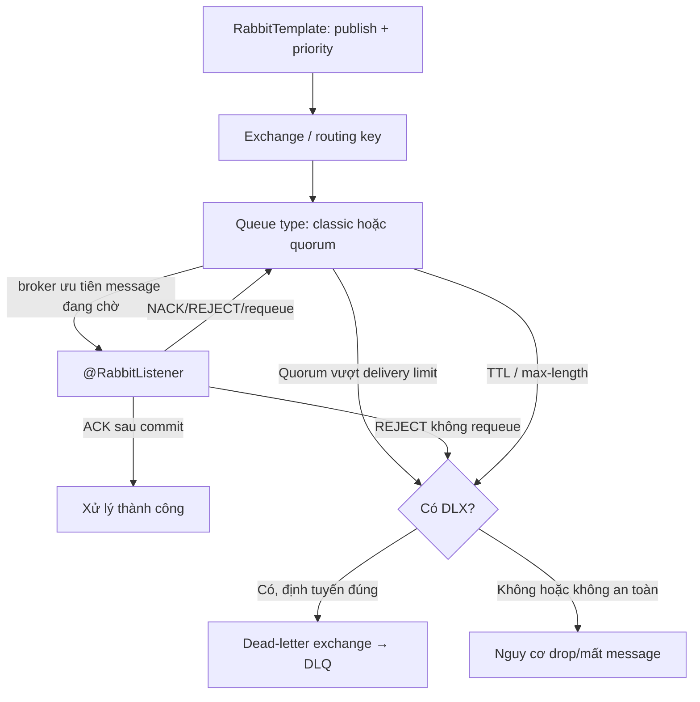
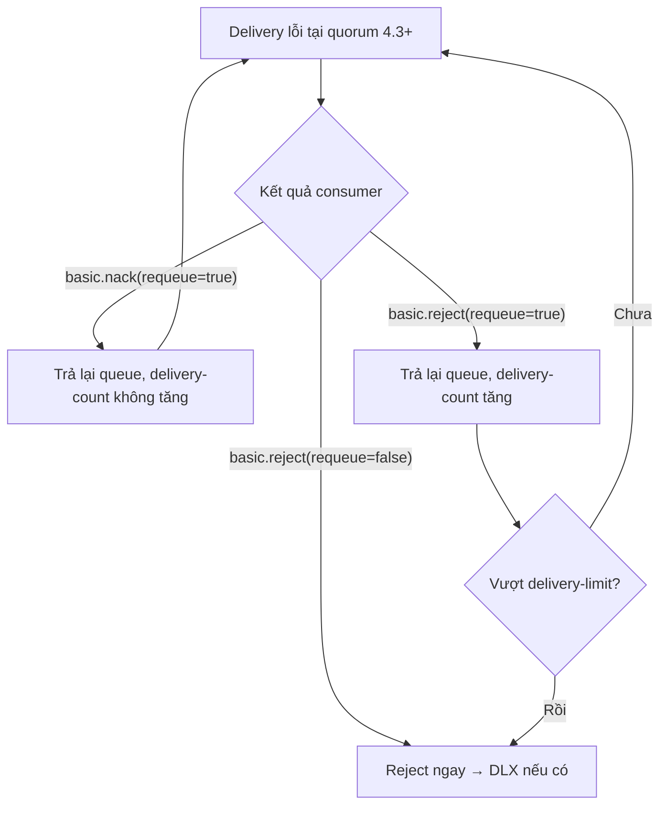
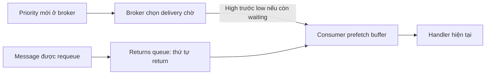

# Đối chiếu delivery limit, priority và dead-letter của từng queue type

## 1. Vì sao nâng cấp RabbitMQ phải kiểm lại từng queue type?

Trong chương **Nâng cấp và tương thích** của **SPRING_AMQP**, một ứng dụng có thể dùng cùng một `RabbitTemplate` để publish, cùng `@RabbitListener` để consume, cùng exchange–queue–binding để định tuyến, nhưng **hành vi của broker phụ thuộc vào queue type và phiên bản RabbitMQ**.

Ví dụ hệ thống đặt hàng dùng:

- `orders.classic.q`: classic queue có ưu tiên cho tác vụ khẩn;
- `orders.quorum.q`: quorum queue lưu giao dịch quan trọng, có retry và dead-letter;
- `orders.audit.stream`: stream lưu event để nhiều consumer đọc lại theo offset.

Nếu nâng RabbitMQ từ **4.2 lên 4.3** mà không chạy regression test, một consumer gọi `basic.nack(tag, false, true)` để trả job về queue có thể không còn bị giới hạn bởi quorum `delivery-limit` như trước. Đồng thời, độ ưu tiên trên quorum queue chuyển từ **hai nhóm** sang **32 mức strict priority**, có thể khiến việc thường bị đói tài nguyên khi có nhiều việc khẩn.

**Câu hỏi chính của bài:** Ba khả năng **delivery limit**, **message priority** và **dead-letter exchange (DLX)** hoạt động thế nào trên **classic**, **quorum** và **stream**, thay đổi ra sao qua các phiên bản, và ứng dụng Spring AMQP phải kiểm chứng gì trước khi triển khai?

Sau bài này, bạn sẽ:

1. Dùng ma trận chính xác theo queue type và phiên bản để lựa chọn thiết kế.
2. Phân biệt giới hạn broker `delivery-limit` với retry trong Java/Spring Retry.
3. Nhận biết việc đổi nghĩa `basic.nack` và `basic.reject` trên quorum từ RabbitMQ 4.3.
4. Cấu hình classic priority, quorum priority và hiểu tại sao stream không có priority queue semantics.
5. Thiết kế DLX an toàn, đặc biệt `at-least-once` dead-lettering từ quorum queue.
6. Lập kế hoạch migrate topology không đổi queue type tại chỗ, kiểm thử bằng broker thật và đối soát message sau nâng cấp.

> **Phạm vi phiên bản:** Bài đối chiếu RabbitMQ **3.13, 4.0–4.2 và 4.3+**; phần ưu tiên nghiêm ngặt và đếm delivery dựa trên tài liệu RabbitMQ 4.3/4.4. Tên API Spring AMQP bên dưới dùng `spring-rabbit` thuộc đường **AMQP 0.9.1**. Luôn đối chiếu version broker, queue type và client thật trước khi áp dụng cấu hình.

## 2. Phân biệt ba cơ chế thường bị nhầm

| Khái niệm | Tác động lên message | Ai quyết định? | Câu hỏi vận hành |
|---|---|---|---|
| **Delivery limit** | Khi một delivery thất bại quá nhiều lần, broker có thể loại hoặc dead-letter message | Với quorum: broker policy/queue argument; với classic: phải bổ sung retry policy riêng | “Poison message có thể quay vòng bao nhiêu lần?” |
| **Message priority** | Chọn thứ tự cấp phát những message **còn ở queue** | Queue type/queue argument cùng priority của publisher | “Việc khẩn có thể vượt việc thường đang chờ không?” |
| **Dead-letter exchange** | Republish message sang exchange khác sau reject, TTL, max-length hoặc delivery-limit | DLX policy/queue argument, binding đích và chính sách broker | “Message không xử lý được sẽ đi đâu và có thể mất ở bước chuyển không?” |

Ba cơ chế **không thay thế nhau**. Một queue có priority cao không làm công việc nhanh hơn khi tất cả consumer đã bận; một queue có DLX không mặc nhiên giới hạn retry; delivery limit hữu hạn nhưng **không khai báo DLX** vẫn có thể dẫn tới message bị loại bỏ.



**Lưu ý:** Sơ đồ rút gọn để thể hiện hướng đi. Một số nguyên nhân dead-letter không phải “retry thất bại”; `basic.reject(requeue=false)` dead-letter ngay nếu có DLX, bất kể `delivery-limit`. Khi DLX chuyển thông điệp, nó cũng có thể thất bại vì target không khả dụng hoặc routing sai.

## 3. Ma trận tổng quan theo queue type

| Tính năng | **Classic queue** | **Quorum queue** | **Stream** |
|---|---|---|---|
| Mô hình | Queue tiêu thụ mang tính hủy sau ack | Queue replicated, dựa trên đồng thuận Raft; ack xóa công việc | Append-only log, đọc theo offset, có thể replay |
| Replica dữ liệu | Classic không được mirror từ RabbitMQ 4.0 | Replicated theo quorum | Replicated và retained theo thời gian/kích thước |
| **Broker delivery limit** | **Không có** poison-message delivery limit tích hợp như quorum | **Có**: mặc định **20 từ RabbitMQ 4.0**; trước đó không mặc định giới hạn | **Không áp dụng** như queue; dùng offset/retention, xử lý lỗi ở consumer |
| **Message priority** | **Có khi bật** `x-max-priority`, thường 2–4 là đủ | **Có**, 4.3+ strict 0–31; trước 4.3 dùng hai nhóm normal/high | **Không hỗ trợ** |
| Priority khi không cấu hình | Không ưu tiên; message thiếu thuộc tính priority được hiểu 0 | 4.3+ luôn có 0–31; message thiếu priority mặc định **4** | Không dùng |
| **DLX khi là source** | **Có**, `at-most-once` | **Có**, `at-most-once` mặc định; có thể bật `at-least-once` | **Không hỗ trợ** |
| Có thể làm đích của DLX? | Có | Có | Có thể làm **đích nhận message** đã được dead-letter qua routing/binding phù hợp; stream không tự thực hiện DLX |
| Poison handling ở broker | Không có delivery limit như quorum; ứng dụng phải quản retry | Có giới hạn và tùy chọn delayed retry (4.3+) | Ứng dụng quản offset, retry, quarantine và retention |
| Phù hợp | Queue tạm/đơn giản; yêu cầu ưu tiên kiểu classic | Job quan trọng cần replication, kiểm soát poison và DLX an toàn hơn | Event log, replay, fan-out nhiều consumer, lưu backlog lớn |

Tài liệu RabbitMQ hiện hành xác nhận classic queue không có poison-message handling tích hợp như quorum; stream không có `message priority` và `dead-letter exchange` ở vai trò queue nguồn (xem mục tài liệu chính thức cuối bài).

### 3.1. Consumer priority khác message priority

**Message priority** là thuộc tính message (ví dụ `priority=9`). **Consumer priority** là mức ưu tiên giữa các consumer đang đăng ký cùng queue, quyết định broker chọn consumer nào khi có khả năng nhận. Classic và quorum hỗ trợ consumer priority; stream không hỗ trợ theo mô hình queue thông thường. Hai tính năng không thể thay cho nhau.

### 3.2. Không mặc định queue là classic

RabbitMQ có **default queue type (DQT)** tại vhost hoặc node. Nếu producer hoặc `RabbitAdmin` khai báo queue mà không chỉ rõ `x-queue-type`, broker sẽ dùng DQT hiện hành. DQT chỉ tác động **queue được tạo mới**, **không đổi type của queue đã tồn tại**.

Trong dự án đang chuyển đổi, nên ghi rõ queue type trong mã hạ tầng/definitions và kiểm loại thực tế trên broker. Không suy luận chỉ từ tên queue hoặc từ việc nó được tạo bằng `QueueBuilder.durable(...)`.

## 4. Ma trận khác biệt theo phiên bản RabbitMQ

| Phiên bản | Quorum `delivery-limit` | Quorum message priority | Dead-letter và ghi chú tương thích |
|---|---|---|---|
| **3.13.x** | Không giới hạn mặc định | Cơ chế cũ, không phải 32 mức strict | Classic mirroring còn thuộc giai đoạn migration; cần chuẩn bị trước 4.0 |
| **4.0–4.2** | **20 mặc định**; những lần requeue như `basic.nack` có thể tăng bộ đếm dùng xét limit | Hai nhóm nội bộ **normal/high**, tỉ lệ cấp phát 2:1 | Classic mirrored queues đã bị loại bỏ; quorum có tùy chọn DLX `at-least-once` |
| **4.3+** | **20 mặc định**, nhưng `delivery-count` chỉ tăng cho failure thật; `basic.nack` trả về queue không tăng count | **32 mức strict 0–31**, tự bật, thiếu priority mặc định 4 | Có quorum delayed retry; không nên dựa vào `basic.nack(requeue=true)` để chạm delivery limit |

Hai thay đổi từ **4.2 → 4.3** có tính tương thích hành vi, không chỉ tương thích cú pháp API:

1. Poison message từng được requeue bằng `basic.nack` và sau đó dead-letter khi đạt limit có thể **quay vòng vô thời hạn** ở 4.3+ nếu không có retry budget khác.
2. Hàng đợi quorum từng chia thời gian cho normal/high nay ưu tiên nghiêm ngặt nhiều mức; nếu message priority cao đến liên tục, message thấp có thể **bị starvation**.

Kế hoạch nâng cấp phải có test cho cả hai thay đổi, và phải đo queue thực tế dưới tải/consumer prefetch tương đương production.

## 5. Delivery limit: classic, quorum và stream khác gì?

### 5.1. Classic queue: không có `x-delivery-limit` bảo vệ poison message

Classic queue có `basic.ack`, `basic.reject`, `basic.nack`, requeue và DLX như thường. Nhưng RabbitMQ **không cung cấp poison message delivery-limit tích hợp cho classic queue** như quorum. Nếu client ném exception rồi requeue liên tục, message có thể lập lại vô hạn:

```text
classic.q -> @RabbitListener throws -> requeue
          -> @RabbitListener throws -> requeue -> ...
```

Hãy giới hạn retry bằng Spring Retry/recoverer, retry queue có TTL/backoff hoặc job state trong database. Khi hết ngân sách, reject **không requeue** và đưa message đến DLQ được khai báo đúng.

### 5.2. Quorum queue: giới hạn theo số failure

Quorum queue theo dõi thông tin delivery, cung cấp header `x-delivery-count` khi redeliver. Từ RabbitMQ **4.0**, nếu không cấu hình riêng, giới hạn mặc định là **20**. Khi message vượt limit, broker có thể dead-letter nếu có DLX; **nếu không có DLX, message có thể bị drop**. Không coi đây là chính sách retry nghiệp vụ đầy đủ.

Các trường dùng để cấu hình:

- `delivery-limit` trong **policy**: có thể áp dụng/sửa mà không redeclare queue.
- `x-delivery-limit` trong **optional queue argument**: chốt vào lúc khai báo, khó thay đổi; nếu cả hai tồn tại phải kiểm quy tắc ưu tiên cấu hình.
- `-1`: có thể tắt limit để tương thích kiểu cũ, **không khuyến nghị** vì poison message có thể tạo vòng lặp nóng.

**Cửa sổ rủi ro:** Nếu nhiều delivery chưa ack được trả về cùng lúc do consumer crash, các message prefetched cũng có thể cùng tăng số lần lỗi và bị loại/dead-letter, dù handler chưa thật sự xử lý từng message. Vì vậy cần chọn prefetch, retry và graceful shutdown cẩn thận.

### 5.3. RabbitMQ 4.3+: `x-delivery-count` khác `x-acquired-count`

Đây là thay đổi cần audit kỹ khi nâng cấp. RabbitMQ 4.3+ tách:

- `x-acquired-count`: số lần message được cấp cho consumer, **không chứng minh handler đã chạy**.
- `x-delivery-count`: số lần delivery được xem là **thất bại thực**, dùng để xét quorum `delivery-limit`.

| Hành động trên **quorum queue 4.3+** | `acquired-count` tăng? | `delivery-count` tăng? |
|---|---|---|
| AMQP 0.9.1 `basic.nack` trả message | Có | **Không** |
| AMQP 0.9.1 `basic.reject` trả message | Có | **Có** |
| AMQP 1.0 `released` | Có | Không |
| AMQP 1.0 `modified(delivery-failed=false)` | Có | Không |
| AMQP 1.0 `modified(delivery-failed=true)` | Có | Có |
| AMQP 1.0 `rejected` | Có | Có |
| Client crash/connection lost khi delivery chưa ack | Có | Có |
| Một số requeue do network partition/consumer timeout | Có thể tăng acquired | **Không nhất thiết** tăng delivery theo bảng broker |

**Tình huống nguy hiểm:** `channel.basicNack(tag, false, true)` trong consumer MANUAL có thể requeue liên tục **mà không tăng `delivery-count` ở 4.3+**. Với 4.2 trở xuống, requeue `basic.nack` có tính vào giới hạn. Nếu thiết kế dựa vào quorum broker để chặn poison message, phải đổi chiến lược: thử `basic.reject(tag, true)` khi thật sự muốn tính là một failure, hoặc ưu tiên xử lý theo **retry có ngân sách, delay và DLQ** ở tầng ứng dụng. Đừng thay hàng loạt `basic.nack` bằng `basic.reject` mà chưa xem trạng thái lỗi, vì `basic.reject` chỉ xử lý **một** message trong khi `basic.nack` có lựa chọn `multiple`.



Sơ đồ giả định một consumer đang cố xử lý cùng một message và đơn giản hóa cơ chế đánh số. **Không dùng vòng `basic.reject(requeue=true)` liên tục trong production**: dù có giới hạn, nó vẫn có thể tạo lượng redelivery tốn tài nguyên. Dùng backoff/late retry và quan sát tuổi message.

### 5.4. Spring Retry không tương đương broker delivery limit

Giả sử listener được bọc bởi `RetryInterceptorBuilder.stateless().maxAttempts(3)`:

```text
Broker gửi delivery M1 một lần
    Spring Retry gọi handler lần 1 -> fail
    Spring Retry gọi handler lần 2 -> fail
    Spring Retry gọi handler lần 3 -> fail
Recoverer trả lỗi terminal -> broker nhận reject/no-requeue
```

Ba invocation Java trên **cùng delivery** không có nghĩa broker `x-delivery-count` tăng ba lần. Bộ đếm broker và số retry của Spring thuộc **hai tầng khác nhau**. Nếu có transaction/stateful retry hoặc requeue xảy ra giữa các attempts, hành vi khác đi và phải đo bằng test thực.

### 5.5. Stream: retention và offset, không phải delivery limit

Stream là append-only log: consumer có thể đọc lại cùng event theo offset mà không xóa nó khỏi stream. Không có poison-message `delivery-limit` như quorum, không tự dead-letter sau N lần đọc lại. Ứng dụng phải quản lý **checkpoint offset**, retry hữu hạn, quarantine/correction và retention. Event sẽ hết hạn theo retention policy (ví dụ `max-age`, `max-length-bytes`), không phải vì listener reject quá N lần.

## 6. Message priority: ma trận hành vi trước và sau RabbitMQ 4.3

### 6.1. Classic priority queue: phải chọn `x-max-priority` từ đầu

Classic queue thường là FIFO, chỉ trở thành priority queue khi khai báo `x-max-priority`. Thuộc tính message `priority` là số nguyên không dấu thuộc phạm vi AMQP 0.9.1 `0–255`; broker giới hạn giá trị lớn hơn max ở max đã khai báo. Giá trị thiếu priority được xem như **0**.

```java
import org.springframework.amqp.core.Queue;
import org.springframework.amqp.core.QueueBuilder;

Queue classic = QueueBuilder
        .durable("upgrade.classic.priority.q")
        .maxPriority(4)  // Classic: x-max-priority = 4.
        .build();
```

Với max=4, mô hình priority 0..4; ví dụ publisher gửi `0`, `2`, `4`. **Không nên chọn 255 chỉ vì API cho phép**: mỗi mức làm tăng chi phí bộ nhớ/CPU/scheduling. Tài liệu RabbitMQ thường khuyến nghị **2–4 mức** cho nhiều workload.

Không thể bật hoặc đổi max-priority hiện hữu chỉ bằng policy: `x-max-priority` là optional argument của classic queue, được quyết định khi khai báo. Nếu queue đã tồn tại với arguments khác, redeclare có thể báo `PRECONDITION_FAILED`.

### 6.2. Quorum 4.0–4.2: hai nhóm, không phải FIFO ưu tiên tuyệt đối

Quorum queue đã có message priority trước 4.3 nhưng broker ánh xạ về **hai nhóm nội bộ** normal và high, với phân phối khoảng **2 high : 1 normal**. Không mô phỏng priority 1, 2, 3, 4 bằng một tập level độc lập như classic queue.

Điều này có thể giúp nhóm thường tiếp tục được cấp phát trong khi nhóm khẩn có tải cao, nhưng thứ tự delivery thực tế vẫn chịu prefetch, consumer cạnh tranh và redelivery.

### 6.3. Quorum 4.3+: strict priority 0–31 luôn bật

Từ RabbitMQ **4.3**, quorum queue có **32 mức priority (0–31)** và **không cần `x-max-priority`**. Mọi value nằm ngoài phạm vi sẽ được clamp; message thiếu trường priority có mức mặc định **4**, **khác classic mặc định 0**.

```text
Trên quorum 4.3+:
  priority=25 -> mức 25
  priority=5  -> mức 5
  priority=0  -> mức 0
  không có priority -> mức 4
  priority=200 -> bị clamp về 31

Trên classic có x-max-priority=4:
  priority=25 -> bị clamp về 4
  không có priority -> mức 0
```

Sự thay đổi mặc định **có thể làm message không đặt priority vượt message được gắn `priority=0`** trên quorum 4.3+. Khi các producer cùng gửi vào queue, phải thống nhất policy đặt priority, không giả định “không đặt” luôn thấp nhất.

**Starvation:** Quorum strict priority liên tục chọn priority cao trước priority thấp còn chờ, nên việc thấp có thể phải đợi lâu vô hạn nếu dòng việc khẩn đủ lớn. Classic queue có cơ chế luân phiên trong quá trình rút từ các subqueue, giảm nguy cơ starvation theo cách khác. Nếu yêu cầu mỗi nhóm công việc được bảo đảm một mức throughput tối thiểu, cân nhắc **queue riêng cho high/normal/low với worker budget riêng**.

### 6.4. Prefetch, trả message và thứ tự thực tế

Priority chỉ được áp dụng khi broker **chọn message để dispatch**. Nếu consumer đã prefetch 100 message priority thấp, một message high mới đến **không thể nhảy lên trước các message đã nằm trong bộ đệm client**.

Quorum 4.3+ còn có **returns queue** cho các message trả lại bằng `reject`/`nack`/`modify`; những message được trả về này có thể được giao theo **thứ tự trả về**, không theo priority gốc. Vì vậy không kiểm thử bằng giả định “mọi delivery toàn hệ thống luôn theo priority giảm dần”.



Khi benchmark priority, hãy publish tất cả message **trước khi bắt đầu consumer**, cấu hình `prefetch=1`, chỉ một consumer để quan sát dispatch order cơ bản. Sau đó bắt buộc bổ sung test concurrency, requeue, timeout và backpressure.

### 6.5. Stream: không hỗ trợ message priority

Stream hướng tới đọc log theo offset và retention. Không có `x-max-priority`, priority-based dispatch, consumer priority hay DLX như classic/quorum. Nếu có SLA cho sự kiện khẩn, hãy thiết kế **stream/partition hoặc pipeline riêng** và cấp tài nguyên consumer tương ứng thay vì gắn `priority` rồi kỳ vọng broker tự sắp xếp lại log.

## 7. Dead-letter: nguyên nhân chung và khác biệt độ an toàn

Dead-lettering xảy ra ở **queue nguồn**, khi RabbitMQ republish message sang **dead-letter exchange**. Những nguyên nhân phổ biến:

1. Consumer `basic.reject` hoặc `basic.nack` với `requeue=false`.
2. Per-message TTL hết hạn.
3. Queue vượt giới hạn chiều dài theo chiến lược có thể dead-letter.
4. **Quorum queue** vượt broker `delivery-limit`.

**Queue hết TTL và bị xóa không làm toàn bộ message được dead-letter**. DLX không phải là một “backup queue” tự động, mà là exchange cần tồn tại, có binding tới queue/stream đích, quyền truy cập và chính sách vận hành.

### 7.1. Classic: DLX at-most-once

Classic queue hỗ trợ dead-letter exchange nhưng **không hỗ trợ at-least-once dead-lettering kiểu quorum**. Theo cách republish mặc định, nguồn có thể loại message ngay sau publish tới DLX **không đợi publisher confirm nội bộ**. Nếu target không khả dụng hoặc routing không thành, message có thể mất trong quá trình chuyển.

Chỉ có DLQ đích là quorum queue **không đủ** để biến DLX từ classic thành at-least-once: tính năng này phải được triển khai bởi **source quorum queue**.

### 7.2. Quorum: at-most-once mặc định, at-least-once là opt-in

Quorum queue cũng mặc định dùng **`at-most-once` dead-letter-strategy**. Muốn bảo vệ chuyển DLX bằng `at-least-once`, nguồn quorum dùng một consumer nội bộ giữ message chờ dead-letter trong queue nguồn, publish sang đích với publisher confirms và chỉ đánh dấu hoàn tất khi các đích xác nhận.

Các điều kiện quan trọng:

| Thuộc tính policy | Giá trị cần thiết | Lý do |
|---|---|---|
| `dead-letter-exchange` | Tên exchange tồn tại | Đích republish |
| `dead-letter-routing-key` | Key phù hợp binding (tùy chọn nhưng nên rõ) | Tránh unroutable |
| `dead-letter-strategy` | **`at-least-once`** | Bật chuyển DLX có xác nhận |
| `overflow` | **`reject-publish`** | Không thể bật at-least-once với `drop-head` |
| `max-length` / `max-length-bytes` | Chọn theo capacity | Giới hạn backlog nguồn khi đích không nhận được |

Tài liệu cho các bản cũ còn nhắc yêu cầu feature flag `stream_queue` được bật; ở các bản mới tính năng có thể đã mặc định, vì vậy kiểm trạng thái feature flags của cluster thật thay vì bật/tắt tùy tiện.

**Đánh đổi:** Khi DLQ down, message đang chờ chuyển được giữ ở source quorum và **tính vào giới hạn dung lượng**. Nguồn có thể đầy và từ chối publish mới. Việc đổi policy từ `at-least-once` về `at-most-once` hoặc đổi overflow sang `drop-head` có thể **xóa các dead letter còn chưa được đích xác nhận**. Đây là một thay đổi rủi ro cao, không làm trong sự cố nếu chưa đối soát.

**Tính bền của DLQ:** Quorum source ghi message lên đĩa, nhưng khi dead-letter sang target, message có thể giữ **delivery mode ban đầu**. Muốn dữ liệu tồn tại sau broker restart tại target queue, target phải durable và message publish ban đầu nên để `PERSISTENT`.

### 7.3. Stream có thể là nơi lưu DLQ, không có DLX làm source

Stream có thể nhận một bản message do classic/quorum **dead-letter** tới nó thông qua exchange/binding, phù hợp để lưu log lỗi theo retention trong một số kiến trúc. Nhưng một **stream tự nó không thực hiện dead-letter từ offset lỗi** như classic/quorum, và không có delivery limit/priority.

Nếu stream consumer gặp event lỗi, hãy tự thiết kế quarantine/DLQ ứng dụng bằng cách publish một event chẩn đoán an toàn tới queue/stream khác, lưu checkpoint hoặc trạng thái lỗi theo `eventId`, sau đó quyết định có tiếp tục offset không. **Không coi việc “ack” trên stream là xóa event khỏi log**.

### 7.4. Các metadata dead-letter cần hiểu

AMQP 0.9.1 dead-lettered message thường có `x-death`: mảng thông tin được broker quản lý, chứa queue, reason, count và thông tin liên quan; những lý do thường gặp là `rejected`, `expired`, `maxlen`, `delivery_limit`.

Không dùng `x-death.count` như số retry Java hoặc thay thế `x-delivery-count`. `x-death` ghi nhận **dead-letter events**, còn `x-delivery-count` là bộ đếm failure/redelivery trong quorum. Header do client có thể tự đặt khi publish không phải nguồn tin đáng tin nếu không có kiểm soát; chỉ dùng kết quả broker thực tế và test.

## 8. Spring AMQP: khai báo queue đúng tính năng

### 8.1. Ba queue type qua `QueueBuilder`

Ví dụ sau dùng **tên khác nhau**, không cố đổi queue type bằng redeclare:

```java
import org.springframework.amqp.core.Queue;
import org.springframework.amqp.core.QueueBuilder;
import org.springframework.context.annotation.Bean;
import org.springframework.context.annotation.Configuration;

@Configuration
public class UpgradeQueues {
    @Bean
    Queue classicPriorityQueue() {
        return QueueBuilder.durable("upgrade.classic.priority.q")
                .maxPriority(4)
                .build();
    }

    @Bean
    Queue quorumOrdersQueue() {
        return QueueBuilder.durable("upgrade.quorum.orders.q")
                .quorum()
                // Không khai báo maxPriority: quorum 4.3+ tự có 0..31.
                // delivery-limit/DLX nên đặt qua policy vận hành.
                .build();
    }

    @Bean
    Queue auditStream() {
        return QueueBuilder.durable("upgrade.audit.stream")
                .stream()
                .build();
    }
}
```

Đây là ví dụ cú pháp QueueBuilder, không phải khuyến nghị khai báo tất cả ba queue type cho một nghiệp vụ. `QueueBuilder.deliveryLimit(5)` tạo queue argument `x-delivery-limit`, **chỉ áp dụng cho quorum**; thích hợp demo riêng nhưng production nên cân nhắc policy để không khóa config vào lần khai báo.

**Cẩn thận với stream:** `QueueBuilder.stream()` mới khai báo kiểu queue, không biến `@RabbitListener` classic thành stream offset consumer hoàn chỉnh. Sử dụng Spring Rabbit Stream/stream container và các API offset/checkpoint đúng khi triển khai nghiệp vụ replay.

### 8.2. Gửi message có priority bằng RabbitTemplate

```java
import java.util.UUID;
import org.springframework.amqp.core.MessageDeliveryMode;
import org.springframework.amqp.rabbit.core.RabbitTemplate;
import org.springframework.stereotype.Service;

@Service
public class PriorityJobPublisher {
    private final RabbitTemplate template;

    public PriorityJobPublisher(RabbitTemplate template) {
        this.template = template;
    }

    public void publish(String exchange, String key,
                        String payload, int priority) {
        String eventId = UUID.randomUUID().toString();
        template.convertAndSend(exchange, key, payload, message -> {
            var properties = message.getMessageProperties();
            properties.setPriority(priority);
            properties.setMessageId(eventId);
            properties.setDeliveryMode(MessageDeliveryMode.PERSISTENT);
            return message;
        });
    }
}
```

**Quan trọng:**

- Với classic `x-max-priority=4`, giá trị cao hơn 4 bị clamp về 4.
- Với quorum 4.3+, `priority=25` là mức 25; 200 bị clamp về 31.
- Không gọi `publish` với priority ngoài hợp đồng domain rồi kỳ vọng mọi loại queue diễn giải giống nhau.
- `RabbitTemplate.convertAndSend` trở về bình thường **không** chứng minh message đã vào đúng queue. Với tuyến quan trọng, cấu hình publisher confirms **và returns/mandatory**, dùng `eventId` ổn định cho retry/outbox (đừng sinh ID mới mỗi attempt).

### 8.3. DLX và delivery-limit nên quản bằng policy

Ví dụ minh họa **chỉ chạy trong môi trường test/staging** có quyền phù hợp, khi đã tạo `upgrade.quorum.orders.q` và exchange `upgrade.orders.dlx` cùng binding đích:

```bash
# Ví dụ: policy cho quorum queue, delivery-limit=5,
# DLX at-least-once và giới hạn khi đích không nhận được.
rabbitmqctl set_policy upgrade-qq \
  "^upgrade\\.quorum\\.orders\\.q$" \
  '{"delivery-limit":5,"dead-letter-exchange":"upgrade.orders.dlx","dead-letter-routing-key":"failed","dead-letter-strategy":"at-least-once","overflow":"reject-publish","max-length":10000}' \
  --apply-to quorum_queues \
  --priority 50
```

**Phải hiểu đầy đủ hệ quả:** Policy làm source giữ dead letter chưa được xác nhận, có thể từ chối publish khi đạt giới hạn; đường DLX cần có binding tới queue/stream đích và quyền thích hợp. Không copy lệnh lên production chưa có capacity plan hoặc quy trình đổi policy.

Với classic priority `x-max-priority=4`, không dùng policy để thay mức priority đã khai báo. Có thể dùng policy `dead-letter-exchange` cho classic/quorum, nhưng hardcoded `x-dead-letter-exchange` trên queue sẽ có thể ưu tiên hơn giá trị policy. Kiểm `effective_policy_definition`/queue arguments thực tế qua Management API.

## 9. Spring @RabbitListener: retry khác gì broker poison handling?

### 9.1. `AUTO` acknowledgement thông thường

```java
import org.springframework.amqp.AmqpRejectAndDontRequeueException;
import org.springframework.amqp.rabbit.annotation.RabbitListener;
import org.springframework.stereotype.Component;

@Component
public class QuorumOrderListener {
    private final OrderProcessor processor;

    public QuorumOrderListener(OrderProcessor processor) {
        this.processor = processor;
    }

    @RabbitListener(queues = "upgrade.quorum.orders.q")
    public void onMessage(String payload) {
        try {
            processor.applyOnce(payload); // DB transaction/idempotency.
        } catch (InvalidOrderEventException invalid) {
            // Permanent: reject không requeue; DLX nếu được cấu hình.
            throw new AmqpRejectAndDontRequeueException("BAD_SCHEMA");
        }
        // Lỗi tạm thời: do retry policy/container quyết định.
    }
}

interface OrderProcessor {
    void applyOnce(String payload);
}

class InvalidOrderEventException extends RuntimeException {}
```

`AcknowledgeMode.AUTO` của Spring AMQP nghĩa là **container ack sau khi method thành công**, không phải broker auto-ack ngay khi deliver. Với `MANUAL`, code phải settle từng delivery trên channel nhận.

`AmqpRejectAndDontRequeueException` xử lý **lỗi terminal** không requeue; nó không tự nói rằng đã thử đủ `delivery-limit`. Nếu không có DLX, message bị reject có thể mất. Đối với lỗi transient, cần retry hữu hạn, backoff và một recoverer/dead-letter path rõ ràng.

### 9.2. Đừng phụ thuộc vào loại lệnh settle mà framework tình cờ gọi

RabbitMQ 4.3 phân biệt `basic.nack` và `basic.reject` khi tính `delivery-count`. Cách Spring AMQP xử lý exception có thể đi qua container, retry advice, requeue flag, stateful/stateless retry và recoverer. **Không suy ra counter tăng bao nhiêu chỉ từ việc listener ném exception**.

Muốn kiểm đúng contract khi nâng cấp:

1. Xác định `acknowledge-mode`, `defaultRequeueRejected`, retry advice/recoverer thực tế.
2. Chạy test gửi một event ID duy nhất, ép handler fail.
3. Quan sát số lần gọi handler, `redelivered` flag, `x-delivery-count` và `x-acquired-count` theo broker version.
4. Xác nhận lý do message vào DLQ (nếu có), không chỉ kiểm exception Java.
5. Nếu code MANUAL dùng `basic.nack(requeue=true)`, bổ sung retry budget ở application hoặc đổi settlement có chủ đích.

### 9.3. Bảo vệ idempotency

Một message đã commit DB nhưng connection chết trước ack có thể redeliver. Delivery limit không ngăn tác dụng phụ lặp trước khi chạm giới hạn. Dùng `eventId` ổn định, unique constraint, transaction và handler `applyOnce`. Với side effects bên ngoài DB, dùng idempotency key do đích hỗ trợ hoặc outbox/đối soát.

## 10. Migration: đổi queue type không phải một lần redeclare

Queue type là **bất biến sau khi tạo**. Chuyển `classic → quorum` hoặc `classic/quorum → stream` không thể chỉ đổi `QueueBuilder.quorum()` rồi chạy `RabbitAdmin` lên cùng tên queue. RabbitMQ có thể đóng channel bằng `PRECONDITION_FAILED` do thuộc tính không tương đương.

### 10.1. Hai thay đổi khác nhau

| Việc cần làm | Cách tiếp cận |
|---|---|
| **Nâng version broker**, giữ queue type | Chạy regression cho delivery count, priority, DLX và consumer behavior; kiểm definitions/policy |
| **Chuyển queue type** | Provision **queue mới** có tên/type đích, chuyển routing/producer/consumer và dữ liệu theo kế hoạch migration |

**Không xóa queue production để “tạo lại đúng type”** trước khi đối soát message Ready, Unacked, DLQ và outbox; thao tác đó có thể phá hủy dữ liệu.

### 10.2. Kế hoạch blue–green khuyến nghị

1. **Inventory:** export definitions và ghi nhận queue type, quorum membership, policy, `x-arguments`, bindings, vhost, DLX và retry queue.
2. **Chọn semantic đích:** So sánh `delivery-limit`, priority default, dead-letter guarantees và SLO, không chỉ số replica.
3. **Provision:** Tạo queue mới, exchange/binding, DLQ và policy theo type đích; kiểm quyền.
4. **Dual-write/bridge có kiểm soát:** Chuyển producer hoặc dùng relay sao chép message, bảo đảm `eventId`/idempotency và checkpoint.
5. **Drain hoặc chuyển backlog:** Theo dõi Ready/Unacked, verify mỗi event đã được xử lý/đưa qua đích; không giả định tự chuyển queue content chỉ nhờ đổi binding.
6. **Canary consumers:** Chạy một phần tải, so dead-letter reason, priority latency, retry rate và outcome business.
7. **Cutover:** Chuyển routing chính, giữ rollback plan và quyết định xử lý message đến muộn ở queue cũ.
8. **Retire:** Chỉ xóa queue cũ sau khi kiểm message, DLQ, outbox, retention và hợp đồng downstream.

Nếu bạn đổi **DQT** của vhost, chỉ các queue **tạo mới** đổi type. Những queue đã tồn tại không thay type, và các client có `x-queue-type` cũ có thể gặp equivalence checks. RabbitMQ có tùy chọn thư giãn kiểm tra type trong một số lộ trình migration, nhưng không phải cơ chế chuyển dữ liệu/type tại chỗ.

### 10.3. Đừng quên classic mirroring và version 4.3

RabbitMQ **4.0 loại bỏ mirrored classic queues**: ứng dụng cần replicated queue nên chuyển sang quorum/stream với migration riêng. RabbitMQ **4.3** còn có một số thay đổi đối với classic non-durable, non-exclusive queue và global QoS; dù bài này tập trung delivery-limit/priority/DLX, hãy kiểm release notes/feature flags khi nâng cấp toàn hệ thống.

## 11. Kiểm thử hồi quy: phép thử nào phải đi qua broker thật?

Không thể dùng Mockito verify `RabbitTemplate.convertAndSend` để kết luận broker đã áp dụng priority hoặc dead-letter đúng. Chạy integration test với **RabbitMQ Testcontainers** hoặc môi trường staging cô lập cho **từng phiên bản cần hỗ trợ**.

### 11.1. Ma trận test đề xuất

| Test ID | Queue/version | Tình huống | Bằng chứng pass |
|---|---|---|---|
| C-01 | Classic, bật priority | Gửi priority 0/2/4 vào queue trước khi subscribe | Dispatch ưu tiên theo cấu hình khi prefetch phù hợp |
| C-02 | Classic, không bật priority | Gửi các priority khác nhau | Không kỳ vọng strict priority; kiểm FIFO khi không requeue |
| C-03 | Classic + DLX | `basic.reject(requeue=false)` | Message vào DLQ; ghi `x-death.reason=rejected` |
| C-04 | Classic + lỗi transient | Requeue nhiều lần | Chỉ dừng bằng policy retry ứng dụng, không kỳ vọng broker delivery limit |
| Q-01 | Quorum 3.13 vs 4.0+ | Cùng poison message lặp | Bắt được thay đổi default 20 trên 4.0+ |
| Q-02 | Quorum 4.2 vs 4.3+ | `basic.nack(requeue=true)` | 4.3+ không tăng `delivery-count` theo cách cũ |
| Q-03 | Quorum 4.3+ | `basic.reject(requeue=true)` | Count tăng; khi vượt limit, tới DLQ nếu cấu hình |
| Q-04 | Quorum 4.3+ | priority thiếu/0/5/25 | Mặc định 4, strict 0–31 khi chưa prefetch |
| Q-05 | Quorum at-most-once | Làm đích DLX unavailable | Nhận diện rủi ro mất message |
| Q-06 | Quorum at-least-once | Tắt DLQ đích rồi phục hồi | Message được source giữ chờ confirm; sau đó chuyển tới đích |
| S-01 | Stream | Publish event và đọc theo offset | Có replay; không đòi broker DLX/priority/delivery-limit |
| M-01 | Migration | Redeclare cùng tên khác type | Phát hiện equivalence failure trước production |

**Lưu ý đo priority:** Nếu consumer subscribe trước khi cả ba message vào queue, broker có thể dispatch message thấp trước và priority cao đến sau **không preempt delivery đã gửi**. Test phải kiểm precondition “message đã enqueued” và có deadline, không dùng `Thread.sleep` cố định.

### 11.2. Ví dụ fault injection cho delivery limit

```text
Given:
  RabbitMQ 4.3+, quorum queue q.it.limit với policy delivery-limit=3
  DLX q.it.dlx -> q.it.dlq đã tồn tại và bind đúng
  Một consumer manual ack, prefetch=1

When:
  Publish eventId=evt-test-001
  Consumer cố ý basic.reject(tag, true) nhiều lần

Then:
  x-delivery-count tăng theo failure
  Message cuối cùng vào DLQ với reason=delivery_limit
  Consumer không tiếp tục xử lý vô hạn

Compare:
  Thay basic.reject(tag, true) bằng basic.nack(tag, false, true)
  RabbitMQ 4.3+ không tăng delivery-count theo cách cũ
  Test phải dừng theo deadline/attempt limit của fixture, không tạo hot loop vô hạn
```

Đây là **kế hoạch kiểm thử**, không phải code đã chạy. Không thực hiện fault injection trên queue production hoặc một broker chia sẻ nhiều test. Khi test xong dừng consumer, xác nhận không còn in-flight rồi cleanup queue/DLQ/definitions do test sở hữu.

### 11.3. Ví dụ đọc header trong Spring AMQP

```java
import org.springframework.amqp.core.Message;
import org.springframework.amqp.rabbit.annotation.RabbitListener;
import org.springframework.stereotype.Component;

@Component
public class DeliveryMetadataObserver {
    @RabbitListener(queues = "upgrade.quorum.orders.q")
    public void observe(Message message) {
        Object failures =
                message.getMessageProperties().getHeaders()
                        .get("x-delivery-count");
        Object acquisitions =
                message.getMessageProperties().getHeaders()
                        .get("x-acquired-count");
        Object deaths =
                message.getMessageProperties().getHeaders()
                        .get("x-death");

        // Ghi metric/event an toàn trong bài test; không dump headers,
        // body hay token thực vào log production.
        // Chỉ một số trường có mặt tùy queue type và broker version.
        handleMetadataSafely(failures, acquisitions, deaths);
    }

    private void handleMetadataSafely(
            Object failures, Object acquisitions, Object deaths) {
        // Triển khai assertion/metric sau khi kiểm tra kiểu dữ liệu.
    }
}
```

Đừng dùng observer này **cạnh tranh cùng queue với listener nghiệp vụ** trong cùng test: nó có thể lấy mất message. Hãy dùng queue/test context riêng hoặc thêm assertion vào listener fixture. `x-death`/`x-delivery-count` có thể không tồn tại ở delivery đầu, trên classic hoặc với những đường protocol khác.

## 12. Giám sát và runbook sau nâng cấp

### 12.1. Metrics nên đặt trên cùng dashboard

| Nhóm | Metric/chi tiết | Triệu chứng |
|---|---|---|
| Quorum delivery | Redelivery, `x-delivery-count`, `x-acquired-count`, delayed retry | `nack` không còn chạm limit, poison vòng lặp |
| DLX | Dead-letter rate theo reason, DLQ ready/age, transfer failures | Mất target, source pending DLX tăng |
| At-least-once DLX | Source quota, retained dead letters, reject-publish | Đích down làm source đầy |
| Priority | Ready theo mức, p95 wait của high/normal/low | Strict priority khiến low starvation |
| Consumer | Ack/nack/reject rate, prefetch, unacked, channel closes | Crash/timeout làm tăng failed deliveries |
| Producer | Confirm ack/nack, mandatory returns | Routing sai trong quá trình cutover |
| Nghiệp vụ | Unique event ID completed, duplicates, outbox backlog | Broker xanh nhưng business thiếu/dư side effect |

### 12.2. Runbook chẩn đoán nhanh

| Dấu hiệu | Cần kiểm | Không làm vội |
|---|---|---|
| Message lỗi biến mất sau nâng 4.0 | Quorum default limit=20; có DLX đúng chưa? | Tắt limit toàn cụm bằng `-1` |
| Sau nâng 4.3 poison message không hết | Consumer dùng `basic.nack(requeue=true)`? Retry budget ở đâu? | Restart mọi worker để “reset” |
| Việc thường bị chậm sau 4.3 | Quorum strict priority và prefetch; priority mặc định 4 | Tăng high priority thêm nữa |
| DLQ trống dù listener đã reject | Source queue có DLX, binding, quyền, strategy? | Coi DLQ trống là mọi việc thành công |
| Source quorum đầy dù consumer đã reject | At-least-once dead-letter pending đích chưa confirm | Đổi `overflow=drop-head` để “giải phóng”, có thể mất message |
| Redeclare lỗi khi deploy | Queue type/arguments khác queue đã tồn tại? | Xóa queue đang có message |
| Event stream không vào DLQ | Stream không hỗ trợ DLX làm nguồn | Thêm `x-dead-letter-exchange` vào stream và kỳ vọng nó hoạt động |

### 12.3. Định nghĩa recovery theo nghiệp vụ

Một đợt nâng cấp chỉ thật sự thành công khi:

- Các producer/consumer dùng topology đúng, không còn `PRECONDITION_FAILED` hoặc publish unroutable bất ngờ.
- Không có job biến mất do default delivery limit mà thiếu DLX.
- Retry có ngân sách, không còn poison hot loop, DLQ và delayed messages được đối soát.
- Việc priority thấp vẫn hoàn tất trong ngưỡng chấp nhận được, không bị bỏ đói sau thay đổi strict priority.
- At-least-once dead-lettering (nếu bật) chuyển được mọi message lỗi tới đích mà không làm source đầy lâu dài.
- Redelivery sau restart không lặp side effect nhờ idempotency, số event ID đã hoàn tất khớp trạng thái nghiệp vụ.

## 13. Những hiểu lầm cần tránh

| Hiểu lầm | Thực tế |
|---|---|
| `delivery-limit` áp dụng cho mọi queue | Chỉ quorum queue có broker poison limit kiểu này |
| Nâng 3.13 lên 4.0 không đổi retry | Quorum mặc định từ unlimited sang 20 |
| `basic.nack` và `basic.reject` luôn giống nhau khi requeue | Quorum **4.3+** không cộng delivery-count cho `basic.nack` |
| Có DLX thì message chắc chắn vào DLQ | DLX cũng là publish; thiếu exchange/binding/target có thể mất hoặc bị giữ tùy strategy |
| Quorum dùng `x-max-priority` như classic | Quorum 4.3+ có 0–31 luôn bật, `x-max-priority` không chi phối |
| Không đặt priority nghĩa là priority 0 trên mọi queue | Quorum 4.3+ mặc định **4**, classic mặc định **0** |
| Priority cao luôn xử lý trước mọi message thấp | Delivery đã prefetch không bị preempt; returned messages có quy tắc riêng |
| Stream tự dead-letter khi xử lý lỗi | Stream dùng offset/retention, không có DLX source |
| Đổi `QueueBuilder.quorum()` sẽ chuyển dữ liệu queue cũ | Queue type bất biến; phải migrate riêng |
| Spring Retry gọi 3 lần bằng broker redelivery count=3 | Spring Retry có thể lặp invocation trên **một** delivery |
| At-least-once DLX nghĩa là exactly-once business processing | Có thể trùng, phải idempotent; còn phụ thuộc target capacity |
| Chỉ kiểm Java unit test đã đủ để phê duyệt nâng cấp | Cần broker version-specific integration/fault tests |

## 14. Checklist trước khi đổi version hoặc queue type

1. Đã ghi nhận version RabbitMQ hiện tại/đích và queue type từng queue?
2. Có queue quorum 3.13 hoặc 4.0–4.2 nào dựa vào hành vi requeue cũ?
3. Trên 4.3+, consumer nào dùng `basic.nack(requeue=true)` để chờ delivery-limit tự chặn?
4. Quorum có policy `delivery-limit` phù hợp; nếu hết limit thì có DLX/retention không?
5. Classic có `x-max-priority` từ lúc khai báo và không đổi bừa bằng policy/redeclare?
6. Quorum priority 4.3+ đã được test default **4**, strict 0–31, starvation và prefetch?
7. Producer có thống nhất priority semantics ở các dịch vụ cùng publish vào queue?
8. DLX policy, exchange, binding, quyền và type của target đã được xác nhận?
9. Với quorum at-least-once DLX: có `reject-publish`, max-length budget và kịch bản target down?
10. DLQ có độ bền phù hợp, dữ liệu nhạy cảm được phân quyền và có runbook replay?
11. Những thay đổi type được triển khai bằng topology mới/blue–green, không redeclare queue cũ?
12. Có testbroker mỗi phiên bản cần hỗ trợ, với NACK/REJECT, priority và dead-letter?
13. Có canary event ID để đối soát DB, outbox, DLQ và duplicate business effects?
14. Có rollback/cutover plan, capacity theo queue type và dashboard cảnh báo sau release?

## 15. Bài tập và câu hỏi ôn tập

1. Vì sao classic queue có DLX nhưng vẫn có thể để poison message requeue mãi?
2. Quorum queue trên RabbitMQ 3.13 và 4.0 khác nhau gì về `delivery-limit` mặc định? Nếu thiếu DLX thì chuyện gì có thể xảy ra?
3. Trên RabbitMQ 4.3, hai lệnh `basicNack(tag,false,true)` và `basicReject(tag,true)` tác động khác nhau lên `x-delivery-count` như thế nào?
4. `x-acquired-count` khác `x-delivery-count` ở đâu? Một lần acquired có luôn nghĩa handler đã chạy không?
5. Spring Retry gọi listener ba lần trên một delivery. Broker có nhất thiết ghi tăng delivery-count ba lần không?
6. Trên classic queue khai báo `x-max-priority=4`, message priority=25 được xử lý ở mức nào?
7. Trên quorum 4.3+, message không có priority được xem là bao nhiêu? Vì sao điều này có thể tạo khác biệt khi upgrade?
8. Quorum 4.2 phân phối normal/high khác quorum 4.3 strict priority ra sao? Đề xuất cách bảo đảm SLA cho low-priority jobs.
9. Vì sao at-least-once dead-lettering trên quorum đòi `overflow=reject-publish`? Điều gì xảy ra khi DLQ down lâu?
10. Source classic gửi DLX tới target quorum có tự đạt at-least-once dead-lettering không? Giải thích.
11. Tại sao stream không dùng `x-max-priority` và không có DLX làm nguồn? Có thể làm nơi lưu lỗi không?
12. Một `RabbitAdmin` redeclare tên queue cũ với `quorum()` mới gây `PRECONDITION_FAILED`. Hãy nêu phương án migration không mất dữ liệu.
13. Thiết kế test thật cho hai phiên bản 4.2 và 4.3 chứng minh thay đổi `basic.nack(requeue=true)`.
14. Với queue priority và prefetch=100, vì sao assertion “priority 31 luôn tới trước priority 0” có thể sai?
15. Nếu broker xanh nhưng business completed thấp, outbox pending tăng và DLQ không giảm, có được kết luận nâng cấp thành công không?

## 16. Nguồn tham khảo

- [RabbitMQ — Quorum Queues](https://www.rabbitmq.com/docs/quorum-queues): delivery-limit, `x-delivery-count`/`x-acquired-count`, priority 4.3+, `at-least-once` DLX, delayed retry.
- [RabbitMQ — Priority Support in Queues](https://www.rabbitmq.com/docs/priority): classic `x-max-priority`, quorum strict 0–31, default priority và starvation.
- [RabbitMQ — Dead Letter Exchanges](https://www.rabbitmq.com/docs/dlx): lý do dead-letter, cấu hình policy, at-most/at-least-once, `x-death`.
- [RabbitMQ — Classic Queues](https://www.rabbitmq.com/docs/classic-queues): tính năng classic, giới hạn poison handling, classic mirroring removal.
- [RabbitMQ — Streams and Superstreams](https://www.rabbitmq.com/docs/streams): retention/offset, feature matrix và giới hạn priority/DLX.
- [RabbitMQ — Virtual Hosts](https://www.rabbitmq.com/docs/vhosts): default queue type, tính bất biến type, property equivalence.
- [RabbitMQ — Consumer Acknowledgements and Publisher Confirms](https://www.rabbitmq.com/docs/confirms): semantics `basic.ack`/`basic.nack`/`basic.reject` và requeue.
- [RabbitMQ — Upgrading](https://www.rabbitmq.com/docs/upgrade): rolling upgrade, availability và quorum-critical nodes.
- [Spring AMQP — QueueBuilder Javadoc](https://docs.spring.io/spring-amqp/docs/3.1.x/api/org/springframework/amqp/core/QueueBuilder.html): `quorum()`, `stream()`, `maxPriority()`, `deliveryLimit()`.
- [Spring AMQP — Broker Configuration](https://docs.spring.io/spring-amqp/reference/amqp/broker-configuration.html): `RabbitAdmin`, queue/exchange/binding và declarables.

**Ghi nhớ:** **Queue type quyết định semantics.** Classic hỗ trợ priority khi bật `x-max-priority` và DLX nhưng không có quorum delivery-limit; quorum có delivery-limit (mặc định 20 từ 4.0), priority **32 mức strict từ 4.3** và tùy chọn DLX `at-least-once`; stream có offset/retention thay cho xử lý hủy khi ack và **không có message priority hoặc DLX làm nguồn**. Khi nâng cấp, đặc biệt từ **4.2 sang 4.3**, phải test lại **`basic.nack`/`basic.reject`, message priority mặc định, retry budget và DLQ**, rồi xác nhận bằng **eventId và kết quả nghiệp vụ**, không chỉ thấy broker hoạt động.
