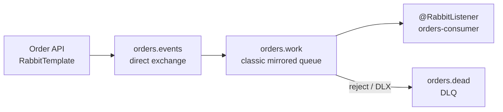
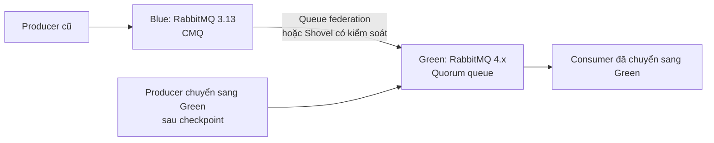
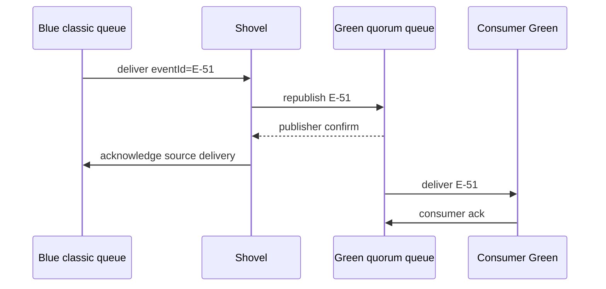

# Di chuyển khỏi cấu hình classic queue mirroring cũ khi broker không còn hỗ trợ

## 1. Vì sao phải di chuyển?

Trong module **SPRING_AMQP**, ứng dụng Java phát message qua `RabbitTemplate`, định tuyến bằng exchange/routing key/binding và nhận bằng `@RabbitListener`. Khi triển khai production, ngoài retry, dead-letter, publisher confirms, consumer acknowledgements và transaction, chúng ta còn phải quan tâm đến **tính sẵn sàng và độ an toàn dữ liệu khi một node RabbitMQ gặp sự cố**.

Hệ thống RabbitMQ cũ có thể sử dụng **classic queue mirroring**, thường gọi **mirrored classic queues (CMQ)**, để sao chép message giữa các node. Ví dụ một policy từng được dùng trong RabbitMQ 3.x:

```json
{
  "ha-mode": "all",
  "ha-sync-mode": "automatic"
}
```

Policy này yêu cầu các classic queue được mirror. Tuy nhiên, classic queue mirroring **đã bị deprecated từ năm 2021 và bị loại bỏ hoàn toàn từ RabbitMQ 4.0**. Việc nâng cấp mà chưa đánh giá loại queue và HA có thể khiến ứng dụng vẫn publish/consume được nhưng **không còn mức replication mà hệ thống trước đó dựa vào**.

Điều cần phân biệt:

| Khái niệm | RabbitMQ 3.13 | RabbitMQ 4.x |
| --- | --- | --- |
| Classic queue (CQ) thông thường | Có hỗ trợ. | **Vẫn được hỗ trợ**, nhưng **không có mirroring**. |
| Classic queue mirroring (CMQ) | Còn được hỗ trợ trong nhánh cũ, đã deprecated. | **Đã bị loại bỏ**. |
| Quorum queue (QQ) | Có hỗ trợ replication dựa trên Raft. | Lựa chọn chủ đạo cho **durable, replicated work queue**. |
| RabbitMQ Streams | Hỗ trợ log/offset và replication theo mô hình stream. | Thích hợp cho một số use case replay, retention, fan-out lớn; semantics khác queue. |

**Chủ đề bài:** di chuyển an toàn khỏi cấu hình `ha-mode`/mirroring cũ, chọn đúng queue type đích, nâng cấp broker và ứng dụng Spring AMQP mà không đánh đổi tính toàn vẹn message.

> **Không phải migration = xóa queue cũ rồi tạo quorum queue cùng tên.** Queue type và cơ chế lưu trữ khác nhau; RabbitMQ không biến queue classic đang có dữ liệu thành quorum queue chỉ bằng redeclare.

### Tình huống xuyên suốt

Giả sử dịch vụ đơn hàng đang chạy:



Cluster **Blue** chạy RabbitMQ 3.13, queue `orders.work` áp policy mirroring, có ba node. Mục tiêu là triển khai **Green** chạy RabbitMQ 4.x, chuyển work queue thành **quorum queue**, cập nhật Spring AMQP, chuyển backlog và giữ nguyên cam kết:

- Event đã được API chấp nhận không mất không giải thích được.
- Message có thể được giao lại, nhưng **không gây side effect nghiệp vụ trùng**.
- Producer phân biệt confirm, return, timeout/unknown outcome.
- DLX/DLQ và retry không làm mất route; worker mới hoạt động ổn định.
- Có rollback, checkpoint và dữ liệu đối soát trước khi dừng Blue.

## 2. Hiểu khác biệt về kiến trúc HA

### 2.1. Mirrored classic queue cũ

```text
RabbitMQ 3.13 cluster (Blue)

Node A                      Node B                Node C
orders.work (leader) -----> orders.work mirror -> orders.work mirror
                            (sync theo policy)
```

Classic mirrored queue có một leader và các mirror/follower. Các thao tác được thực hiện qua leader, sau đó được truyền tới mirror theo cơ chế cũ. Với `ha-mode: all` hoặc `exactly`, policy quy định phạm vi mirror; `ha-sync-mode` và các tùy chọn promotion ảnh hưởng quá trình đồng bộ/failover.

Một số mirror có thể **không đồng bộ** khi node lỗi hoặc đang sync backlog. Do đó không được suy rằng “có ba bản sao” đồng nghĩa **ba bản sao đều đã cập nhật và sẽ không bao giờ mất message**.

### 2.2. Quorum queue mới

```text
RabbitMQ 4.x cluster (Green)

Node A (leader)       Node B (member)       Node C (member)
      |--------------------|---------------------|
      |            Raft replication            |
      +------ majority agreement / quorum -----+
```

Quorum queue là queue replicated dựa trên **Raft**, sử dụng leader và các members. Với replication factor 3, majority là **2/3**; mất một member vẫn có thể tiếp tục khi còn majority và cluster đáp ứng điều kiện. Nếu mất majority, queue không thể tiếp tục cung cấp những thao tác đòi đồng thuận dù các node khác còn chạy.

Khi dùng publisher confirms đúng cách, RabbitMQ xác nhận theo bảo đảm replication của quorum queue. Consumer vẫn cần acknowledgement và idempotent processing; **quorum queue không đồng nghĩa exactly-once end-to-end**.

### 2.3. So sánh nhanh

| Tiêu chí | Mirrored classic queue | Quorum queue |
| --- | --- | --- |
| Tình trạng ở RabbitMQ 4.x | Đã loại bỏ mirroring. | Được hỗ trợ. |
| Nhân bản message | Cơ chế mirror cũ. | Raft consensus/majority. |
| Data safety và failover | Phụ thuộc mirror sync/promotion, hành vi khó dự đoán ở một số lỗi. | Bảo đảm nhất quán/failover được thiết kế rõ hơn. |
| Queue type khi declare | Classic, mirroring thông qua policy. | `x-queue-type=quorum` hoặc DQT phù hợp. |
| Durable/exclusive | Classic hỗ trợ nhiều biến thể queue. | Quorum cần durable và không dùng cho queue tạm/exclusive. |
| Poison-message handling | Dựa trên retry/DLX/app logic. | Có thể dùng delivery limit theo phiên bản/cấu hình. |
| DLX | Có hỗ trợ, nhưng không có chế độ at-least-once DLX của quorum. | Có các chế độ dead-lettering bổ sung nếu cấu hình đủ điều kiện. |
| Disk/replication | Mang chi phí sao chép mirror cũ. | Raft log và replication majority: cần disk I/O, năng lực node và đo throughput. |

**Chú ý compatibility theo phiên bản:** Một số tính năng như priorities, delayed retry và các chính sách quorum có thay đổi giữa RabbitMQ 3.13, 4.0 và các bản 4.x mới hơn. Không lấy bảng tính năng của một bản 4.x mới áp vào mọi bản 4.x cũ; kiểm tra tài liệu **đúng phiên bản broker đích**.

## 3. Chọn quorum, classic không mirror hay stream?

Không phải tất cả queue từng áp `ha-mode` đều nhất thiết phải thành quorum. Một policy regex quá rộng có thể vô tình mirror cả reply queue và queue chỉ dùng tạm.

| Loại workload | Lựa chọn thường phù hợp | Lý do |
| --- | --- | --- |
| Đơn hàng/thanh toán/task dài hạn cần HA, consumer ack và producer confirm | **Quorum queue** | Durable replication và khả năng phục hồi. |
| Request/reply tạm, reply queue sống theo connection, thông điệp không cần lưu bền | **Classic queue không mirror** hoặc **Direct Reply-To** | Quorum không được thiết kế cho exclusive/transient, queue churn cao. |
| Message không cần replication và có thể tái tạo | **Classic queue không mirror** | Ít chi phí hơn; nhưng chấp nhận rủi ro node lưu queue gặp sự cố. |
| Event log dài hạn, nhiều consumer độc lập, replay theo offset/retention | **RabbitMQ Stream** | Semantics log/offset khác queue consume/ack. |

**Quyết định dựa trên SLO/RPO/RTO và hợp đồng dữ liệu**, không chỉ đổi `ha-mode` thành một chuỗi JSON khác. Nếu ứng dụng dùng `RabbitTemplate` và `@RabbitListener` theo AMQP 0-9-1, chuyển một work queue sang quorum có thể giữ phần lớn interface. Chuyển sang Streams cần thiết kế lại offset, routing, retention, consumer group và client/container phù hợp.

### 3.1. Những dấu hiệu quorum không phải lựa chọn đúng

- Queue được tạo và xóa hàng nghìn lần/giờ cho mỗi request.
- Queue exclusive hoặc non-durable phục vụ RPC tạm thời.
- Message không cần được giữ, ứng dụng chấp nhận at-most-once.
- Nhu cầu chủ đạo là log replay/retention rất dài và lượng backlog khổng lồ.
- Cluster không có đủ node, disk hoặc quorum placement cho mục tiêu HA.

Hãy **phân loại từng queue** trước khi tạo migration manifest: `TO_QUORUM`, `KEEP_CLASSIC_NONREPLICATED`, hoặc `REDESIGN_STREAM`.

## 4. Kiểm kê dấu vết mirroring trước khi nâng cấp

Chỉ thực hiện các thao tác kiểm kê trên **broker/vhost được phê duyệt**, lưu output cùng ngày giờ và phiên bản nguồn. Bắt đầu bằng những lệnh đọc-only:

```bash
rabbitmqctl status
rabbitmq-diagnostics cluster_status
rabbitmqctl list_feature_flags

rabbitmqctl list_vhosts
rabbitmqctl list_policies -p /orders

rabbitmqctl list_queues -p /orders \
  name type durable arguments messages messages_ready \
  messages_unacknowledged consumers

rabbitmqctl list_bindings -p /orders
```

### 4.1. Phát hiện các policy `ha-*` cũ

RabbitMQ **3.13** có hai lệnh diagnostics chuyên biệt cho classic queue mirroring:

```bash
# Chỉ dùng khi broker 3.13 còn hỗ trợ các lệnh này.
rabbitmq-diagnostics check_if_cluster_has_classic_queue_mirroring_policy

rabbitmq-diagnostics list_policies_with_classic_queue_mirroring \
  -s --formatter=pretty_table
```

Lệnh kiểm tra đầu trả non-zero nếu cluster còn policy mirroring. Lệnh thứ hai liệt kê policy liên quan. **Đừng chạy trên RabbitMQ 4.x rồi kết luận không có mirror chỉ vì command không tồn tại**: mirroring đã bị loại bỏ khỏi 4.x.

Các khóa legacy cần tìm:

```json
{
  "ha-mode": "exactly",
  "ha-params": 2,
  "ha-sync-mode": "automatic",
  "ha-promote-on-shutdown": "when-synced",
  "ha-promote-on-failure": "when-synced",
  "ha-sync-batch-size": 4096
}
```

Giá trị JSON ở đây chỉ là ví dụ các khóa từng được sử dụng, **không phải policy đề xuất**. Một số hệ thống dùng `ha-mode: all` hoặc `nodes`. Khi migration phải loại những khóa cũ ra khỏi policy/definitions và không đưa chúng vào cấu hình Green; **không có cách bật lại classic mirroring trong RabbitMQ 4.x bằng feature flag**.

### 4.2. Kiểm kê trạng thái replica

Trên broker **3.13** cần ghi:

- Queue nào đang mirrored, leader nằm node nào, mirror có đồng bộ không.
- Queue nào đang có ready/unacked và message lớn/retention dài.
- Cluster có memory/disk alarms, network partition hay node không khỏe.
- Consumer count, số publisher, connection count, ingress và ack rate.
- Policy nào đồng thời chứa **DLX, TTL, max-length, overflow** ngoài khóa `ha-*`.
- DLQ, retry queues, alternate exchanges, queue bindings và người sở hữu.

Khi dừng/restart node cũ, **đồng bộ mirror trước** để giảm rủi ro mất message. RabbitMQ 3.13 hỗ trợ health check:

```bash
# Chỉ hữu ích cho mirrored classic queues trên RabbitMQ 3.13.
rabbitmq-diagnostics check_if_node_is_mirror_sync_critical
```

Kiểm tra này giúp nhận diện node đang là leader của mirror không đồng bộ. Không thực hiện rolling node restart khi trạng thái replication chưa hiểu rõ. Trước migration, cần có snapshot/backup, recovery procedure và kế hoạch rollback đã diễn tập.

### 4.3. Dùng ma trận inventory thay vì chỉnh policy toàn cluster

| Vhost / queue | Có mirroring? | Mục đích | DLX/TTL | Đích | Owner |
| --- | --- | --- | --- | --- | --- |
| `/orders / orders.work` | Có | Xử lý đơn hàng | DLX `orders.dlx` | Quorum | Orders team |
| `/orders / orders.dead` | Có | Poison DLQ | Retention riêng | Quorum hoặc storage theo SLO | SRE |
| `/orders / amq.reply.*` | Có vì regex quá rộng | Reply tạm | Xóa theo lifecycle | Classic/Direct Reply-To | Application team |
| `/logs / audit.events` | Có | Replay/log dài hạn | Retention | Đánh giá Stream | Platform team |

Đừng giả định policy `ha` chỉ tác động một queue. Regex `.*` trong vhost có thể match nhiều loại queue với vòng đời khác nhau.

## 5. Quy tắc tương thích khi nâng RabbitMQ 3.x → 4.x

### 5.1. Tách hai việc: đổi queue type và đổi phiên bản cluster

**Nâng cấp broker** không tự chuyển mọi mirrored classic queue thành quorum. **Đổi queue type** cũng không xảy ra chỉ vì bạn thay Spring bean:

```java
// Broker có queue classic đang tồn tại với tên orders.work.
// Đây KHÔNG phải lệnh convert queue in-place:
QueueBuilder.durable("orders.work").quorum().build();
```

Nếu queue cũ còn tồn tại, redeclare với `x-queue-type=quorum` thường gây `406 PRECONDITION_FAILED` (trừ những trường hợp equivalence được nới lỏng theo cấu hình, nhưng **vẫn không chuyển dữ liệu**). Phải có kế hoạch **tạo queue mới và chuyển message/consumer/publisher**, hoặc tạo **cluster/vhost mới** rồi import topology đích.

### 5.2. Đường nâng cấp phụ thuộc phiên bản nguồn và đích

Theo tài liệu RabbitMQ 4.0, đường in-place lên **4.0** được hỗ trợ trực tiếp từ **3.13**, với các stable feature flags yêu cầu phải bật trước. Nếu hệ thống còn ở 3.10, 3.11 hoặc 3.12, không “nhảy” bản bừa: đọc ma trận hỗ trợ của phiên bản đích và release notes của từng bước.

```bash
# Đọc-only trong giai đoạn planning:
rabbitmqctl list_feature_flags --formatter=pretty_table
```

Việc bật feature flags là **thay đổi không thể vô hiệu hóa ngược**, có ảnh hưởng tương thích phiên bản trong rolling upgrade; chỉ bật tại checkpoint đã phê duyệt. RabbitMQ 3.13 có trường hợp `khepri_db` experimental không thể in-place upgrade lên 4.0; lúc đó nên chọn **blue-green migration**, không ép rolling.

**Quan trọng:** Hướng dẫn upgrade cho `4.0` không tự bảo đảm một đường tắt từ 3.13 sang mọi bản 4.x tương lai. Luôn kiểm tra version upgradability, Erlang/OTP compatibility, plugins, feature flags, disk format, OS và phương án backup theo **phiên bản mục tiêu thực sự**.

### 5.3. Không tiếp tục áp chính sách mirroring sau upgrade

Các key `ha-mode`, `ha-params`, `ha-sync-mode`, `ha-promote-*`, `ha-sync-batch-size` là cấu hình legacy. Chúng **không** biến classic queue ở 4.x thành replicated queue. Nếu definitions chứa chúng, quá trình import hoặc policy setup cần được **transform/làm sạch** theo tài liệu. Không để legacy policy tồn tại như một dấu hiệu HA giả.

Đồng thời lưu ý: Một queue classic ở 4.x vẫn có thể hoạt động bình thường khi mọi node khỏe; **việc test “publish/consume PASS” không chứng minh queue đó đã có replica**.

## 6. Chọn chiến lược migration

| Chiến lược | Phù hợp khi | Ưu điểm | Rủi ro/điểm kiểm soát |
| --- | --- | --- | --- |
| **Blue-green hai cluster** | Muốn an toàn cao, đổi broker version và queue type cùng lúc. | Có nguồn Blue để rollback, Green có thể provision/thử trước. | Cần hạ tầng tạm, đồng bộ topology và chuyển backlog đúng. |
| **Blue-green + Queue Federation** | Muốn ít downtime, có kết nối giữa hai cluster. | Green consumers có thể kéo message từ Blue trong quá trình cutover. | Links/policy/consumer order, lag và cleanup phải được kiểm chứng. |
| **Blue-green + Shovel** | Cần chuyển backlog rõ ràng, có thể chấp nhận giai đoạn chuyển tải. | Shovel có thể chuyển message giữa broker/queue. | Semantics at-least-once, message order, duplicate, credential, rate limit. |
| **Vhost mới trên cùng cluster** | Chưa đổi version, muốn chuyển queue type theo vhost và tương đối dễ đổi connection config. | Cô lập namespace mới. | Không tách rủi ro cluster; phải chuyển message và quyền/binding. |
| **In-place cùng vhost, queue v2** | Có cửa sổ dừng producer/consumer theo queue và rollback tốt. | Ít hạ tầng hơn. | Cần cutover chặt, tránh xóa queue cũ, downtime/order impacts. |
| **Chỉ gỡ mirroring, giữ classic** | Queue thực sự không cần replication. | Ít thay đổi semantics. | Node lưu queue lỗi có thể ảnh hưởng availability/data safety. |

**Khuyến nghị cho queue nghiệp vụ quan trọng:** ưu tiên **blue-green với quorum** và đối soát theo event ID. Với queue tạm không cần HA, chọn classic nonreplicated hoặc Direct Reply-To theo use case thay vì ép tất cả thành quorum.

### 6.1. Phân biệt định nghĩa và dữ liệu

```text
Export/import DEFINITIONS:
  users, vhosts, permissions, policies,
  exchanges, queues, bindings, parameters...
  KHÔNG chứa messages đang chờ

Federation / Shovel / App replay:
  chuyển MESSAGE giữa nguồn và đích
  có semantics delivery/ack và có thể có duplicate
```

Export definitions thành công **không** có nghĩa backlog từ Blue đã xuất hiện ở Green. Đây là lỗi migration rất dễ mắc.

## 7. Blue-green migration theo hướng dẫn RabbitMQ hiện đại

RabbitMQ đã mô tả một luồng cập nhật bằng **`rabbitmqadmin` v2**, kiểm thử thực tế với Blue 3.13.7 và Green 4.1.2. Các lệnh sau minh họa ý tưởng từ hướng dẫn đó; **không chạy nguyên văn trên production** trước khi xác minh đúng version tool, credential, vhost, chính sách SSL, queue feature và kế hoạch rollout của tổ chức.



### Pha 0 — Chuẩn bị và bảo toàn nguồn Blue

1. Xác định target RabbitMQ 4.x được hỗ trợ, Erlang/OTP và plugin tương thích.
2. Kiểm tra cluster 3.13 khỏe, không có alarm nghiêm trọng, mirrors đồng bộ, disk/CPU đủ để chuyển backlog.
3. Lập inventory từng vhost/queue/exchange/policy, consumer group, producer routing, outbox, DLX và retention.
4. Sắp xếp credentials/permissions riêng cho Green, TLS/mTLS trust, network giữa cluster và công cụ transfer.
5. Chuẩn bị backup/restore theo runbook thực tế; **definitions JSON chỉ backup metadata**, không backup messages.
6. Ghi time window, event IDs accepted/processed, ready/unacked, retry/DLQ, số node và queue leader trước khi bắt đầu.
7. Diễn tập đầy đủ trên staging, bao gồm rollback và mất kết nối giữa publish/confirm.

### Pha 1 — Tạo Green đúng capacity

Quorum queue cho work queue quan trọng cần số member phù hợp, **thường 3** trên ít nhất 3 node phù hợp cho HA. Cluster 3 node không tự đồng nghĩa mọi quorum queue đều được đặt đúng 3 member trên 3 node: xác minh thành viên và leader placement cho **từng queue**.

```bash
# Lệnh quan sát, ví dụ trên Green sau khi đã provision:
rabbitmq-diagnostics cluster_status
rabbitmqctl list_queues -p /orders \
  name type durable messages messages_ready \
  messages_unacknowledged consumers
```

Đảm bảo Green có disk IOPS, memory, network, replication bandwidth và năng lực consumer cần thiết; quorum queue ghi Raft log/replicate theo majority nên profile performance khác mirror cũ.

### Pha 2 — Export definitions từ Blue và chuyển đổi chính sách

Trong `rabbitmqadmin` v2 có **transformations** phục vụ CMQ → QQ:

```bash
# Giả định đã cấu hình rabbitmqadmin v2 cho node Blue:
# Bản export là METADATA, KHÔNG kèm message.
rabbitmqadmin --host blue definitions export \
  --file blue.json \
  -t prepare_for_quorum_queue_migration,drop_empty_policies
```

Transform `prepare_for_quorum_queue_migration` có mục đích **chuyển queue được mirroring policy match thành quorum queue trong definitions**, làm sạch mirroring keys không tương thích. `drop_empty_policies` loại những policy rỗng sau khi gỡ legacy keys.

**Trước khi import:**

- Review diff `blue.json` có kiểm soát, xác nhận queue nào sẽ thành `quorum`, queue nào còn `classic`.
- Kiểm tra bindings/exchanges, policy DLX/TTL, queue arguments và queue type theo từng vhost.
- Chú ý policy regex `.*`: nếu mirror policy từng match queue tạm, transformation có thể đánh dấu nó thành quorum **không phù hợp**; cần loại queue không cần replica khỏi mirroring trước khi export hoặc chỉnh manifest theo kế hoạch.
- Không publish/commit `blue.json` có users, permissions hoặc secret-related fields lên repo/chat/log công khai.
- Transformation hỗ trợ một nhóm pattern; kiểm tra compatibility của queue features trước khi coi file là hợp lệ.

### Pha 3 — Import definitions sang Green

```bash
# Giả định Green đã có quyền import và rabbitmqadmin v2:
rabbitmqadmin --host green definitions import --file ./blue.json
```

Xác minh:

- `orders.work` ở Green có **type=quorum** nếu đã chọn migration.
- Không còn `ha-mode`/`ha-sync-mode` trong policy/definition mục tiêu.
- DLX, bindings, TTL, retry queues, users/vhosts và permissions hợp lệ.
- Queue leader/members trải trên node mong muốn; **đừng chỉ nhìn số queue**.
- Ready/unacked trên Green có thể vẫn bằng **0** vì **chưa chuyển messages** — đây là bình thường ở pha import.

Nếu import gặp `PRECONDITION_FAILED inequivalent arg`, Green có thể đã tồn tại resource cùng tên/type/arguments khác. Không xóa queue mù quáng; xác định manifest/owner và sửa conflict trong staging hoặc theo kế hoạch migration.

### Pha 4 — Thiết lập Queue Federation giữa Blue và Green

Với phương án RabbitMQ hướng dẫn, Green liên kết đến Blue qua **queue federation**. Trên Green:

1. Bật/kiểm tra plugin federation và management integration phù hợp.
2. Tạo **federation upstream** trỏ tới Blue với user riêng, TLS và quyền trên đúng vhost.
3. Áp federation policy cho queue đích. Với queue đã có policy, `rabbitmqadmin` v2 hỗ trợ **policy overrides**; với queue chưa match policy, có thể dùng blanket policy riêng.
4. Xác nhận federation links ở trạng thái **running** trước khi đổi ứng dụng.

Lệnh kiểm tra tham khảo:

```bash
rabbitmqadmin --host green federation list_all_links
rabbitmqadmin --host green policies list
```

Ví dụ ý tưởng lệnh áp policy (cần kiểm tra tên chính xác trong vhost, không chạy ngoài migration window):

```bash
# Policy override cho policy "orders" tồn tại trên Green:
rabbitmqadmin --host green policies declare_override \
  --name orders \
  --definition '{"federation-upstream":"cmq-qq-migration"}'

# Policy áp cho queue chưa được policy khác bao phủ:
rabbitmqadmin --host green policies declare_blanket \
  --name cmq-qq-migration_blanket \
  --apply-to queues \
  --definition '{"federation-upstream":"cmq-qq-migration"}'
```

Ở đây upstream `cmq-qq-migration` phải được **tạo trước** và federation plugin phải có sẵn. Vì lệnh tạo upstream chứa URI có credential, bài học không nhúng password vào command; sử dụng **secret manager/cấu hình rabbitmqadmin v2**. Xem tài liệu 2025 để lấy syntax đầy đủ cho tổ chức.

**Ngữ nghĩa cần hiểu:** Queue federation có thể chuyển message từ upstream Blue khi consumer ở Green cần message và queue local trống. Vì vậy liên kết `running` **chưa chứng minh tất cả backlog đã chuyển**. Phải quan sát Blue/Green depths, federation status, consumer ack và business event reconciliation.

### Pha 5 — Chuyển consumer sang Green *trước*

Theo trình tự blue-green có Queue Federation:

1. Cấp đúng credential Green cho nhóm consumer, kiểm tra Spring AMQP compatibility, consumer ack mode và converter.
2. Khởi động canary consumer tại Green, publish/consume canary event có ID riêng.
3. Đo Green `messages_ready/unacknowledged`, ack rate, DB transaction và DLQ.
4. Chuyển tiếp consumer theo từng đợt. Quan sát federation link kéo messages từ Blue, xử lý idempotent.
5. Kiểm tra không còn listener vô tình đồng thời tiêu thụ cả Blue/Green với side effect không được deduplicate.

**Quan trọng:** Federation phù hợp với cutover trên topology và consumer model được chuẩn bị; việc consumer ở Blue và Green cùng hoạt động có thể gây message cạnh tranh/duplicate theo failure window. Nếu ordering quan trọng, cần kế hoạch **pause/drain theo aggregate**.

### Pha 6 — Chuyển producer sang Green *sau*

Khi consumer Green đã khỏe và Blue backlog được drain/transfer theo mục tiêu:

1. Hãm hoặc dừng producer Blue **sau khi đã lưu accepted events bền vững trong outbox**, không mất yêu cầu mới.
2. Ghi checkpoint cuối: attempted/confirmed/returned/unknown publishes, Blue queue ready/unacked, retry/DLQ và event IDs chưa terminal.
3. Chuyển `RabbitTemplate`/outbox dispatcher tới Green, giữ nguyên `eventId` và routing contract hoặc sử dụng versioned routing đã kiểm chứng.
4. Mở producer Green **từng pha**, theo dõi publisher confirms, mandatory returns và consumer business completion.
5. Nếu Blue backlog lớn chưa thể drain nhanh, tài liệu RabbitMQ đề cập dùng **Shovel bổ sung**; không tự bật đồng thời nhiều đường transfer cùng messages mà không đánh giá race, duplicate và order.

**Không coi publish confirm ACK là consumer đã hoàn tất.** Đối soát bằng event ID và DB state, đặc biệt với publish outcome UNKNOWN khi chuyển kết nối.

### Pha 7 — Nghiệm thu, giữ Blue để rollback, rồi dọn dẹp

Chỉ sau khi xác minh:

- Producer và consumer thực tế đang kết nối Green, đúng vhost/user.
- Không còn ingress ngoài ý muốn tới Blue.
- Federation/shovel không còn backlog ngoài phạm vi đã chấp thuận.
- Queue Green replicated với members khỏe, không báo alarm/quorum failure.
- DLQ/retry không tăng bất thường; event IDs đã được đối soát.

Mới dọn các **temporary override/blanket policies**, federation upstream và tài nguyên chuyển tiếp theo change request. Không xóa Blue ngay khi dashboards Green bắt đầu có message; giữ rollback window theo mức độ dữ liệu nhạy cảm và thỏa thuận vận hành.

## 8. Hai phương án khác: chuyển backlog bằng Shovel hoặc dừng có kiểm soát

### 8.1. Shovel dùng khi nào?

**RabbitMQ Shovel** là plugin chuyển message từ một source tới destination, có thể giữa hai cluster/vhost. Nó phù hợp khi cần chuyển backlog theo đường cụ thể mà không dựa hoàn toàn vào hành vi queue federation. Trong migration, một shovel có thể đọc từ classic queue Blue rồi publish sang queue/exchange Green.



Để ưu tiên an toàn, cấu hình shovel với chế độ ack nguồn **sau khi destination publish được confirm**, nếu phiên bản/plugin hỗ trợ cấu hình đó. Điều này giúp hạn chế mất message khi đường đích lỗi, nhưng một crash **sau confirm đích trước ack nguồn** có thể làm cùng message bị chuyển **hai lần**. Vì vậy **Shovel không thay thế idempotent consumer và event ID**.

### 8.2. Không bật đồng thời nhiều đường chuyển cùng backlog

Nếu **Queue Federation đang chuyển message** và bạn thêm Shovel đọc cùng source, hai cơ chế có thể tranh giành message hoặc làm phân tích thứ tự/phạm vi phức tạp. Việc dùng cả hai chỉ nên theo playbook RabbitMQ đã diễn tập, với source/destination, rate, acknowledgement mode và idempotency rõ ràng.

Trong mọi trường hợp:

- Xác minh nguồn là **Blue/vhost/queue đúng**, không nhầm DLQ/retry queue.
- Giới hạn số message in-flight, tốc độ chuyển và memory footprint.
- Theo dõi `source ready/unacked`, `destination ingress/ready`, shovel error/reconnect và consumer commits.
- Không dựa vào `source ready=0` duy nhất; có thể còn `unacked` ở shovel hoặc consumer.
- Chỉ dọn shovel khi hai bên và business state đã được đối soát.

### 8.3. Phương án dừng ứng dụng ngắn hạn

Nếu hệ thống cho phép downtime:

1. Dừng **phát mới vào Blue** nhưng giữ yêu cầu được chấp nhận trong outbox hoặc cho API trả trạng thái bảo trì có chủ đích.
2. Chờ các publisher còn outstanding confirms hoặc ghi outcome **UNKNOWN**.
3. Đóng consumer theo cơ chế graceful shutdown, ghi nhận in-flight và khả năng redelivery.
4. Chuyển message Blue → Green bằng Shovel/công cụ đã kiểm thử, chờ destination confirms.
5. Đối soát source ready/unacked, destination count và event IDs; kiểm tra retries/DLQ.
6. Cho consumer Green khởi động, chạy canary rồi mới mở producer Green.

**Không xóa source queue ngay sau khi chạy transfer tool.** Giữ audit và kế hoạch rollback; làm rõ liệu nguồn còn message đã được ack nhưng chưa có bằng chứng business completion.

## 9. Cập nhật ứng dụng Spring AMQP

Thay đổi broker queue type **không nhất thiết đòi thay toàn bộ producer/consumer Java API**. Với Spring AMQP qua AMQP 0-9-1, các thành phần vẫn có thể là `RabbitTemplate`, `Queue`, `DirectExchange`, `Binding`, `@RabbitListener` và `RabbitAdmin`. Nhưng **quyền sở hữu topology và các ràng buộc của quorum** cần được làm rõ.

### 9.1. Khai báo quorum queue trong Spring

Trên **Green mới** (hoặc namespace queue v2 mới), code provisioner:

```java
package example.orders;

import org.springframework.amqp.core.BindingBuilder;
import org.springframework.amqp.core.Declarables;
import org.springframework.amqp.core.DirectExchange;
import org.springframework.amqp.core.Queue;
import org.springframework.amqp.core.QueueBuilder;
import org.springframework.context.annotation.Bean;
import org.springframework.context.annotation.Configuration;
import org.springframework.context.annotation.Profile;

@Configuration
@Profile("topology")
public class OrdersQuorumTopology {

    @Bean
    Declarables ordersTopology() {
        DirectExchange events =
                new DirectExchange("orders.events", true, false);

        Queue work = QueueBuilder.durable("orders.work")
                .quorum()
                .build();

        DirectExchange deadLetters =
                new DirectExchange("orders.dlx", true, false);
        Queue dead = QueueBuilder.durable("orders.dead")
                .quorum()
                .build();

        return new Declarables(
                events, work, deadLetters, dead,
                BindingBuilder.bind(work)
                        .to(events).with("orders.created"),
                BindingBuilder.bind(dead)
                        .to(deadLetters).with("orders.failed"));
    }
}
```

Đây là **topology minh họa dành cho môi trường mới**. Nó chưa khai báo DLX trên queue `orders.work`; muốn broker dead-letter message, cần cấu hình thêm **policy dead-letter-exchange / routing-key** hoặc queue arguments phù hợp sau khi đánh giá migration. Chỉ khai báo một exchange tên `orders.dlx` và một binding tới DLQ **không** tự động biến nó thành DLX của `orders.work`.

Ví dụ policy đích trên môi trường staging:

```bash
# Policy này chỉ tác động queues match đúng tên orders.work
# và KHÔNG dùng bất kỳ ha-mode/ha-sync-mode nào.
rabbitmqctl set_policy -p /orders \
  orders-work-dlx '^orders\.work$' \
  '{"dead-letter-exchange":"orders.dlx","dead-letter-routing-key":"orders.failed"}' \
  --apply-to queues
```

Nếu broker có policy khác/queue argument override, phải kiểm tra **effective policy**. Xem kỹ chiến lược dead-lettering của quorum queue ở mục tiếp theo.

### 9.2. Tránh `PRECONDITION_FAILED` khi khai báo lại

Nếu Blue và Green dùng **hai cluster riêng**, có thể giữ queue name `orders.work` ở cả hai — mỗi resource thuộc một broker khác nhau và Blue/Green có thể có queue type khác nhau. Nhưng **trong cùng vhost trên cùng cluster**, không thể redeclare `orders.work` classic đang tồn tại thành quorum cùng tên:

```java
// Chỉ hợp lệ khi orders.work mới hoặc đã là quorum phù hợp.
QueueBuilder.durable("orders.work").quorum().build();
```

Nếu migration diễn ra **trong cùng cluster**, dùng tên mới như `orders.work.v2` và binding/routing chuyển theo kế hoạch. Không dùng `RabbitAdmin` vô tình declare trên cả Blue và Green với một bean áp sai type. Với nhiều admin, xem `setExplicitDeclarationsOnly(true)` và `setAdminsThatShouldDeclare(...)`.

### 9.3. Spring Boot runtime không nên tự quản lý topology trong lúc migration

```yaml
spring:
  rabbitmq:
    host: green.rabbitmq.internal
    port: 5671
    virtual-host: /orders
    username: ${RABBITMQ_USERNAME}
    password: ${RABBITMQ_PASSWORD}
    ssl:
      enabled: true
    publisher-confirm-type: correlated
    publisher-returns: true
    template:
      mandatory: true
    dynamic: false
    listener:
      simple:
        acknowledge-mode: auto
        concurrency: 2
        max-concurrency: 4
        prefetch: 32
```

Đây là cấu hình **tham khảo**, không phải recommendation tối ưu. TLS cần CA/hostname verification; không chỉ bật cờ `enabled` rồi coi đã cấu hình production hoàn chỉnh.

`spring.rabbitmq.dynamic=false` ngăn Spring Boot tự tạo `AmqpAdmin` theo auto-configuration. **Nó không xóa bean `RabbitAdmin` do code ứng dụng tự định nghĩa**; cần kiểm tra component scan, profile, multi-broker config và các library beans.

Khi topology được import/provision trước, runtime:

- **Producer** cần `write` trên exchange phù hợp, không cần quyền tạo queue.
- **Consumer** cần `read` trên queue, không cần quyền sửa topology.
- **Topology provisioner** có các quyền `configure/write/read` bổ sung theo operation bind/DLX.

Không cấp `.*` cho runtime chỉ để chữa lỗi khi migration.

### 9.4. Giữ `RabbitTemplate` và định tuyến ổn định

```java
package example.orders;

import org.springframework.amqp.rabbit.connection.CorrelationData;
import org.springframework.amqp.rabbit.core.RabbitTemplate;
import org.springframework.stereotype.Service;

@Service
public class OrderEventPublisher {
    private final RabbitTemplate template;

    public OrderEventPublisher(RabbitTemplate template) {
        this.template = template;
    }

    public CorrelationData publish(String eventId, String payload) {
        CorrelationData correlation = new CorrelationData(eventId);
        template.convertAndSend(
                "orders.events", "orders.created",
                payload, correlation);
        return correlation; // KHÔNG đồng nghĩa broker đã confirm.
    }
}
```

Khi dùng `publisher-confirm-type=correlated`, `CorrelationData` cho phép theo dõi broker confirm; `publisher-returns=true` và `mandatory=true` hỗ trợ phát hiện publish unroutable. Caller phải **đợi hoặc xử lý callback** và ghi trạng thái outbox; không đánh dấu xử lý xong chỉ vì `convertAndSend` trả về.

Một publisher confirm timeout trong cutover có **unknown outcome**: broker có thể đã nhận message nhưng confirm không đến được producer. Retry phải giữ cùng `eventId`, bounded outstanding và idempotency downstream.

### 9.5. `@RabbitListener`, consumer ack và transaction

```java
package example.orders;

import org.springframework.amqp.rabbit.annotation.RabbitListener;
import org.springframework.stereotype.Component;

@Component
public class OrdersListener {
    private final OrderProjectionService service;

    public OrdersListener(OrderProjectionService service) {
        this.service = service;
    }

    @RabbitListener(queues = "orders.work")
    public void handle(String eventId) {
        service.applyIdempotently(eventId);
        // AUTO: container ack sau khi method xử lý thành công.
    }
}
```

`OrderProjectionService` là service do ứng dụng triển khai. Nó nên dùng `@Transactional` ghi marker `processed_events` và thay đổi nghiệp vụ trong **cùng transaction**, sau đó mới trả về để container ack. Nếu Blue→Green migration gây redelivery/duplicate, DB không được tạo side effect lần hai.

**Khác biệt quan trọng:** Spring AMQP `AcknowledgeMode.AUTO` nghĩa là listener container tự ack **sau khi method thành công**; không phải RabbitMQ no-ack. `AcknowledgeMode.NONE` mới tương ứng broker auto-ack và không phù hợp với pipeline cần bảo đảm giao nhận.

### 9.6. Quorum queue và prefetch

Quorum queue hỗ trợ consumer ack và per-consumer prefetch; **không hỗ trợ global QoS prefetch của AMQP 0-9-1 theo cùng cách classic**. Hãy kiểm tra mọi code gọi `basicQos(..., global=true)`, custom container factory và legacy configs. Khi migrate, đo lại prefetch/concurrency và DB load; không copy tùy tiện các giá trị được tune cho mirror cũ.

## 10. Những khác biệt hành vi cần test kỹ

### 10.1. Retry, poison message và delivery limit

Từ RabbitMQ 4.0, quorum queue có **delivery limit mặc định 20** theo phiên bản; nếu message bị giao thất bại quá giới hạn, broker có thể dead-letter theo DLX hoặc loại bỏ nếu không có đường dead-letter phù hợp. RabbitMQ 4.3 thay đổi cách tính `delivery-count`: không phải mọi `basic.nack/requeue` đều tăng bộ đếm lỗi giống các version trước. Vì vậy:

- **Không đoán** số lần thử chỉ từ cờ `redelivered`.
- Xác định `delivery-limit`/`x-delivery-limit` và cách broker version đang chạy tính failed delivery.
- Kiểm tra Spring Retry interceptor và chính sách `defaultRequeueRejected` / `AmqpRejectAndDontRequeueException`.
- Chọn một **terminal DLQ** và kiểm thử message không bị mất do vượt delivery limit.
- Không disable delivery limit vô thời hạn chỉ vì muốn hành vi 3.13 cũ; cần retry budget/backoff theo nghiệp vụ.

Ví dụ policy (chạy ở staging hoặc theo change request):

```bash
rabbitmqctl set_policy -p /orders \
  orders-quorum-retry '^orders\.work$' \
  '{"delivery-limit":20,"dead-letter-exchange":"orders.dlx","dead-letter-routing-key":"orders.failed"}' \
  --apply-to quorum_queues
```

Nếu đã có policy DLX khác match queue, việc đặt policy mới có thể **thay thế policy được áp dụng** do priority, chứ không cộng các object theo ý muốn. Thiết kế **một effective policy** bao gồm các định nghĩa cần thiết, hoặc operator policy cho giới hạn an toàn; kiểm tra precedence và effective configuration.

### 10.2. At-least-once dead-lettering không tự bật

Quorum queues có thể hỗ trợ **at-least-once dead-lettering** để giữ message ở source đến khi target xác nhận. Nhưng mặc định thường là **at-most-once**. Để bật chế độ an toàn hơn cần các điều kiện mà tài liệu RabbitMQ yêu cầu, trong đó có:

- Source queue là **quorum**.
- `dead-letter-strategy = at-least-once`.
- `overflow = reject-publish` (không phải `drop-head`).
- `dead-letter-exchange` hợp lệ và target/bindings tồn tại.
- Feature flags và version tương ứng.

Ngay cả at-least-once DLX vẫn có thể tạo **duplicate** ở target nếu confirm đến muộn hoặc failover; consumer phải idempotent. Nếu chuyển chiến lược từ at-least-once về at-most-once khi còn dead-letter chưa được confirm, có nguy cơ **xóa message đang chờ transfer**. Không thay policy trong sự cố mà chưa đánh giá.

### 10.3. TTL, max-length, queue arguments và policies

Một số metadata từ classic queue không còn phù hợp với quorum, chẳng hạn các lifecycle kiểu exclusive/non-durable. Đánh giá:

| Trường | Câu hỏi trước cutover |
| --- | --- |
| `durable / autoDelete / exclusive` | Queue mới có hợp đồng hợp lệ với quorum không? |
| `x-queue-type` | Type được set đúng `quorum` khi tạo hay dựa vào DQT? |
| `x-message-ttl` / `message-ttl` | Có làm message trong backlog hết hạn nhanh hơn so với Blue không? |
| `x-dead-letter-exchange` / policy DLX | DLX/binding/permission có tồn tại ở Green? |
| `x-max-length` / overflow | Khi Green bị quá tải, có drop-head làm mất message không? |
| `delivery-limit` | Poison message có vào DLQ ở số lần mong đợi không? |
| Queue priorities | Tính năng và semantics có giống bản classic cũ trên target version không? |
| `queue-leader-locator`, members | Replica/leader có phân bố đúng failure domains không? |

Các cấu hình do client gắn dưới `x-arguments` thường có precedence so với user policy; **operator policy** có quyền giới hạn riêng. Không chỉ đọc policy name rồi kết luận effective queue settings.

### 10.4. Thứ tự message và consumer assignment

Khi chuyển qua Queue Federation/Shovel, một message có thể được route, redeliver hoặc xử lý ở cluster khác. Đừng hứa thứ tự xử lý toàn cục khi:

- Nhiều consumer cùng xử lý trên một queue.
- Có retry/requeue hoặc DLQ redrive.
- Có hai cluster và hai đường ingress đang hoạt động.
- Có nhiều queue theo version hoặc partition/key.

Nếu `orderId` phải xử lý tuần tự, lập **fence/cutover theo aggregate** và kiểm tra sequence/version trong DB, thay vì chỉ nhìn RabbitMQ FIFO ở một thời điểm.

## 11. Đối soát dữ liệu để không bỏ sót event

### 11.1. Hai nguồn độc lập nhưng cần ghép

**RabbitMQ** cho biết message sẵn sàng, unacked, forwarded, dead-lettered hoặc được ack ở broker. Nhưng broker không phải nguồn quyết định duy nhất rằng business event đã xử lý đúng. Dùng:

- **Outbox/accepted events:** những event API đã lưu bền vững (phạm vi cần chịu trách nhiệm).
- **Processed event ledger / business DB:** những event đã áp dụng side effect thành công.
- **Broker metrics & transfer records:** message ready/unacked ở Blue và Green, Shovel/Federation, retries/DLQ.

Lưu `eventId` trong message payload/headers theo contract bất biến xuyên migration. Nếu message bị chuyển nhưng consumer không thể decode sau schema upgrade, phải phân loại thay vì bỏ qua.

### 11.2. Schema minh họa

```sql
CREATE TABLE outbox_events (
    event_id UUID PRIMARY KEY,
    event_type VARCHAR(80) NOT NULL,
    aggregate_id VARCHAR(100) NOT NULL,
    payload JSONB NOT NULL,
    created_at TIMESTAMPTZ NOT NULL DEFAULT now(),
    publish_status VARCHAR(20) NOT NULL
);

CREATE TABLE processed_events (
    consumer_group VARCHAR(100) NOT NULL,
    event_id UUID NOT NULL,
    processed_at TIMESTAMPTZ NOT NULL DEFAULT now(),
    PRIMARY KEY (consumer_group, event_id)
);
```

Đây là bảng mẫu, chưa gồm lease, retry metadata, routing target, schema version và audit đầy đủ của outbox production. Outbox row phải được ghi trong **cùng DB transaction** với thao tác nghiệp vụ nguồn; marker xử lý phải nằm trong **cùng transaction** với side effect phía consumer.

### 11.3. Truy vấn tìm event chưa có marker

```sql
-- Khoảng [start, end) chỉ là ví dụ UTC.
SELECT o.event_id, o.event_type, o.created_at, o.publish_status
FROM outbox_events o
LEFT JOIN processed_events p
       ON p.event_id = o.event_id
      AND p.consumer_group = 'orders-projection-v1'
WHERE o.created_at >= TIMESTAMPTZ '2026-11-25 00:00:00+00'
  AND o.created_at <  TIMESTAMPTZ '2026-11-26 00:00:00+00'
  AND p.event_id IS NULL
ORDER BY o.created_at, o.event_id;
```

Kết quả là các **ứng viên cần điều tra**, không mặc định là lost messages. Chúng có thể đang ở Blue ready, Green unacked, federation transfer, retry queue, DLQ, hoặc đang được consumer xử lý. Khi xác nhận cần replay, giữ **eventId cũ**, bảo đảm idempotent và không gửi duplicate side effect.

### 11.4. Không so số lượng tổng một cách máy móc

```text
Blue:
  1000 events đã được chấp nhận

Green:
  1000 lần xử lý được log

Kết luận "không mất event"?
  KHÔNG: có thể 1 event mất, 1 event khác xử lý hai lần.
```

Hãy đối soát **tập hợp ID**, kiểm tra DB state, và có owner/next action cho từng event còn UNKNOWN.

## 12. Kiểm thử trước upgrade bằng broker thật

Kiểm thử nên bao gồm ít nhất **hai môi trường tương thích với Blue/Green**, đặc biệt cho Queue Federation hoặc Shovel. Testcontainers hữu ích cho các integration tests nhanh; staging cluster nhiều node cần cho **quorum failover và soak/performance**, một broker local không chứng minh HA.

### 12.1. Integration test declare quorum + consume

Dependency test tiêu biểu (Maven dùng BOM phù hợp):

```xml
<dependency>
    <groupId>org.springframework.boot</groupId>
    <artifactId>spring-boot-starter-amqp</artifactId>
</dependency>
<dependency>
    <groupId>org.springframework.boot</groupId>
    <artifactId>spring-boot-starter-test</artifactId>
    <scope>test</scope>
</dependency>
<dependency>
    <groupId>org.testcontainers</groupId>
    <artifactId>rabbitmq</artifactId>
    <scope>test</scope>
</dependency>
<dependency>
    <groupId>org.testcontainers</groupId>
    <artifactId>junit-jupiter</artifactId>
    <scope>test</scope>
</dependency>
```

Ví dụ khởi tạo Spring Boot test sử dụng broker container; topology cần được provision bằng bean `QueueBuilder.quorum()` hoặc `RabbitAdmin`:

```java
import org.junit.jupiter.api.Test;
import org.springframework.boot.test.context.SpringBootTest;
import org.springframework.test.context.DynamicPropertyRegistry;
import org.springframework.test.context.DynamicPropertySource;
import org.testcontainers.containers.RabbitMQContainer;
import org.testcontainers.junit.jupiter.Container;
import org.testcontainers.junit.jupiter.Testcontainers;
import org.testcontainers.utility.DockerImageName;

@Testcontainers
@SpringBootTest
class QuorumQueueSmokeIT {
    @Container
    static final RabbitMQContainer rabbit =
            new RabbitMQContainer(
                    DockerImageName.parse("rabbitmq:4.1-management"));

    @DynamicPropertySource
    static void rabbitProps(DynamicPropertyRegistry props) {
        props.add("spring.rabbitmq.host", rabbit::getHost);
        props.add("spring.rabbitmq.port", rabbit::getAmqpPort);
        props.add("spring.rabbitmq.username", rabbit::getAdminUsername);
        props.add("spring.rabbitmq.password", rabbit::getAdminPassword);
    }

    @Test
    void contextStartsAndQuorumTopologyIsProvisioned() {
        // Bổ sung assertions qua RabbitAdmin/Management API:
        // orders.work có x-queue-type=quorum; binding đúng;
        // publish -> consume -> commit -> ack; bad payload -> DLQ.
        // Test này chỉ là skeleton cho test context, CHƯA phải HA test.
    }
}
```

**Giới hạn:** Một container RabbitMQ thường chỉ có **một node** và quorum queue 1-member không chứng minh majority failover. Với failover thực, cần staging multi-node, kill leader theo kịch bản, theo dõi publisher confirms, consumer redelivery và consistency của business DB.

### 12.2. Ma trận regression tối thiểu

| Test | Hành động | Kỳ vọng |
| --- | --- | --- |
| Queue declaration | Tạo quorum queue với type/flags/policy đích. | Không có `406 PRECONDITION_FAILED`. |
| Publish confirmed | Gửi event có correlation ID; await confirms. | Confirm/return được ghi rõ; queue nhận theo binding. |
| Listener success | Consumer xử lý event và DB commit. | Ack sau xử lý; marker business xuất hiện. |
| Consumer crash | Kill channel sau commit trước ack. | Redelivery không gây side effect lần hai. |
| Poison message | Handler thất bại nhiều lần. | Retry budget và DLQ đúng; không silently drop. |
| DLX target down | Làm target tạm không sẵn sàng. | Kết quả đúng theo at-most/at-least-once policy đã chọn. |
| TTL/max-length | Gửi backlog có các message hết hạn/đầy queue. | Không drop ngoài hợp đồng. |
| Federation transfer | Gửi message Blue, consumer Green nhận. | Đúng event IDs, không thất lạc; link/lag được quan sát. |
| Shovel failure window | Đứt kết nối giữa destination confirm và source ack. | Có thể duplicate nhưng DB idempotent. |
| Broker leader failover | Stop leader trong cluster 3 node. | Quorum còn majority có thể phục hồi; không vi phạm business invariants. |
| Migration rollback | Đưa client về Blue ở checkpoint. | Không tạo duplicate side effect, event IDs vẫn theo dõi được. |

### 12.3. Performance và capacity test

Benchmark với **cùng payload size, persistence, confirms, consumer ack, retry/DLX, prefetch và workload**. Quorum queue có disk/replication costs khác mirroring; không lấy kết quả PerfTest “non-persistent/no confirm” làm bằng chứng đủ sức tải production. Đo p50/p95/p99 publish confirm, end-to-end, ready/unacked, memory/disk alarms, leader/member distribution và drain time sau burst.

## 13. Rollback không đơn giản là đổi lại hostname

Blue vẫn có thể giữ các queue cũ. Tuy nhiên, sau khi producer đã chuyển tới Green, đã có event mới mà **Blue chưa từng nhận**. Nếu chỉ đổi DNS/URI về Blue:

- Các event mới ở Green có thể không tới consumer Blue.
- Một số event đã xử lý ở Green có thể bị phát lại ở Blue.
- Thứ tự giữa queue Blue và Green có thể thay đổi.
- Outbox `CONFIRMED`/`UNKNOWN` cần phân biệt broker target và cutover epoch.

### 13.1. Quy tắc rollback

1. Chỉ huy sự cố xác định **cutover checkpoint** (UTC, outbox sequence, event IDs, producer target).
2. Hãm phát mới hoặc giữ outbox bền vững; không mở thêm hai đường publish tùy tiện.
3. Đối soát **Green-only events** và business state; chọn phương án backfill sang Blue hoặc để Green drain trước.
4. Kiểm tra không còn consumer song song tạo side effect ngoài idempotency guard.
5. Di chuyển **event IDs chưa terminal** theo đường transfer có confirms/acks, giữ nguyên keys.
6. Khôi phục producer/consumer Blue theo pha có canary, đo backlog và DLQ.
7. Chỉ rollback khi **chi phí và rủi ro back-transfer** nhỏ hơn tiếp tục khắc phục Green. Có trường hợp forward-fix là lựa chọn an toàn hơn.

**Không biến rollback thành hành động vô điều kiện “revert Helm values”.** Bản rollback code và trạng thái broker/data là hai lớp khác nhau.

## 14. Go/No-Go checklist cho migration

| Cổng quyết định | GO khi | NO-GO khi |
| --- | --- | --- |
| Inventory | Có danh sách queue/vhost/policy, owner và mục đích. | Không rõ policy `ha-mode` đang match queue nào. |
| Queue design | Tất cả queue được phân loại quorum/classic/stream. | Có queue exclusive/transient bị đổi sang quorum không có giải thích. |
| Green capacity | Cluster khỏe, member/quorum placement đúng và disk I/O đủ. | Memory/disk alarm hoặc không đủ majority. |
| Definitions | Transform sạch legacy keys, export/import review thành công. | Import policy không được hỗ trợ hoặc queue type sai. |
| Message transfer | Federation/Shovel links khỏe, source/dest theo dõi được. | Không phân biệt metadata import với backlog transfer. |
| App compatibility | Spring Boot/AMQP config, auth/TLS, publisher confirms và listener ack PASS. | 406, 403, 404, converter/schema errors hoặc global prefetch lỗi. |
| Reliability | Idempotency/transaction test và DLQ/TTL/limit test PASS. | Có message drop hoặc duplicate side effect không giải thích được. |
| Cutover | Canary, cohort event IDs và rollback checkpoint rõ. | Không có người phê duyệt hoặc không thể xác định event đã xử lý. |
| Recovery | Ready/unacked/outbox age/DLQ và p99 ở ngưỡng SLO. | Backlog tăng không kiểm soát sau mở lưu lượng. |

### 14.1. Mẫu kết quả kiểm tra

```text
MIGRATION ID: RMQ-CMQ-TO-QQ-YYYYMMDD
BLUE VERSION / NODES: ...
GREEN VERSION / NODES: ...
VHOST / QUEUES IN SCOPE: ...

LEGACY POLICIES FOUND: ...
LEGACY POLICIES REMOVED/TRANSFORMED: ...
TARGET QUEUE TYPES: ...
GREEN MEMBERS / QUORUM HEALTH: ...

DEFINITIONS IMPORT: PASS/FAIL
TRANSFER LINKS: PASS/FAIL
BLUE READY / UNACKED: ...
GREEN READY / UNACKED: ...
RETRY / DLQ STATE: ...

ACCEPTED EVENT IDS: ...
PROCESSED UNIQUE IDS: ...
UNKNOWN IDS (OWNER/ACTION): ...
CORRELATED CONFIRMS / RETURNS: ...

CANARY PUBLISH -> CONSUME -> DB -> ACK: PASS/FAIL
FAULT/LEADER FAILOVER TEST: PASS/FAIL
ROLLBACK CHECKPOINT: ...
GO/NO-GO APPROVED BY: ...
```

## 15. Những lỗi thường gặp

| Dấu hiệu | Nguyên nhân khả dĩ | Hành động đúng |
| --- | --- | --- |
| RabbitMQ 4.x có queue classic nhưng không replica. | Mirroring đã bị loại bỏ, không tự chuyển queue sang quorum. | Xác định queue cần HA, thực hiện migration. |
| Import definitions thất bại vì `ha-mode`. | Legacy policy chưa được transform. | Dùng `rabbitmqadmin` v2 transformations, review diff. |
| Queue chuyển type gặp `406 inequivalent arg`. | Redeclare queue classic cùng tên thành quorum. | Tạo queue mới/vhost/cluster mới, không delete dữ liệu. |
| Consumer `ACCESS_REFUSED` trên Green. | Thiếu quyền read hoặc sai vhost. | Provision credentials/ACL đúng. |
| Producer confirm ACK nhưng queue không nhận. | Routing key/binding sai hoặc unroutable. | Bật mandatory returns, kiểm tra topology. |
| Federation link healthy nhưng Blue depth còn cao. | Federation chuyển trên nhu cầu consumer hoặc còn backlog. | Đo consumer drain, source/dest, policy và lag. |
| Shovel chuyển message hai lần. | Crash sau destination confirm trước source ack. | Event ID, idempotent consumer; đây là failure window cần chịu được. |
| Queue mới không có DLQ. | Import thiếu DLX policy/route. | Khai báo DLX/binding/limit đúng, test poison. |
| Poison message bỗng biến mất. | Quorum delivery limit hoặc TTL/overflow khác Blue. | Kiểm tra effective policy và terminal DLQ. |
| Queue Green không có quorum thực. | Chỉ có một member hoặc member placement không phù hợp. | Inventory members/leader/failure domains, sửa ở staging. |
| Consumer hiệu năng thấp sau cutover. | Prefetch/DB/replication/disk IOPS khác. | Đo lại bottleneck thay vì tăng concurrency vô hạn. |
| Rollback có missing events. | Event mới chỉ nằm ở Green, Blue không biết. | Theo checkpoint, backfill/reconcile trước rollback. |
| Nhiều ứng dụng cùng khai báo queue khác type. | `RabbitAdmin` không có ownership/scope. | Provisioner riêng, `dynamic=false` runtime, kiểm tra bean admin. |
| Bản mới lỗi global QoS. | Quorum không hỗ trợ global prefetch semantics cũ. | Chuyển về per-consumer prefetch và test. |

## 16. Bài thực hành

### Bài A — Phân loại queue từ policies

Giả sử vhost `/orders` có `orders.work`, `orders.dead` và `reply.temp.*` cùng match policy `ha-mode=all`. Hãy lập bảng nguồn/đích, phân loại quorum/classic, giải thích vì sao reply queue không nên thành quorum chỉ vì policy match.

### Bài B — Blue-green metadata

1. Trên môi trường RabbitMQ 3.13 thử nghiệm, tạo policy `ha-mode` và queue phù hợp.
2. Dùng `rabbitmq-diagnostics` để liệt kê legacy policies.
3. Export definitions bằng `rabbitmqadmin` v2 với hai transformation đã học.
4. Review JSON: queue type, bindings, DLX, không còn legacy keys; không chứa messages.
5. Import vào broker Green 4.x thử nghiệm; kiểm tra queue type và policy.

### Bài C — Chuyển backlog có idempotency

1. Publish 100 event với `eventId` duy nhất vào Blue, lưu accepted list.
2. Thiết lập Queue Federation **hoặc** Shovel trên staging, không dùng cả hai nếu chưa có plan rõ.
3. Chạy consumer Green, kiểm tra số unique processed IDs.
4. Chủ động làm mất connection gần thời điểm transfer confirm/ack.
5. Đối soát missing/duplicates và chứng minh business side effect mỗi event không lặp.

### Bài D — Spring AMQP compatibility

1. Provision queue quorum bằng `QueueBuilder.quorum()` ở Green.
2. Chạy producer với publisher confirms/returns và listener ở `AUTO` ack mode.
3. Gửi payload đúng, payload lỗi để thử DLX; quan sát `ready/unacked`.
4. Dùng một consumer cũ có `globalQos` trong integration test để quan sát lỗi thực, sau đó sửa sang per-consumer.
5. So throughput/latency với Blue trên cùng workload/bảo đảm persistence.

### Bài E — Rollback drill

Chuyển vài event thử sang Green rồi giả lập quyết định rollback. Liệt kê Green-only events, xây script đối soát và chứng minh việc chỉ đổi broker URL về Blue là chưa đủ.

## 17. Câu hỏi tự đánh giá

1. RabbitMQ 4.0 loại bỏ **classic queues** hay chỉ loại bỏ **classic queue mirroring**?
2. Các key policy nào là dấu vết của mirroring cũ?
3. Vì sao đổi `x-queue-type` trên queue classic hiện hữu không chuyển dữ liệu thành quorum?
4. Quorum queue dựa trên cơ chế replication nào và đa số trong 3 members là bao nhiêu?
5. Tại sao không nên convert mọi reply queue sang quorum?
6. Export/import definitions có chuyển cả messages không?
7. RabbitMQ 3.13 có lệnh nào phát hiện legacy mirroring policies?
8. Vì sao Queue Federation trong blue-green thường chuyển consumer trước publisher?
9. Khi nào dùng Shovel, và tại sao nó vẫn có thể làm message duplicate?
10. `spring.rabbitmq.dynamic=false` có bảo đảm không còn `RabbitAdmin` tự định nghĩa không?
11. Vì sao publisher confirm và consumer ack phải được theo dõi riêng?
12. Điều gì có thể thay đổi ở poison message khi chuyển sang quorum queue trong RabbitMQ 4.x?
13. Tại sao không nên tắt `delivery-limit` chỉ để bắt chước 3.13?
14. Nếu DLX ở quorum dùng at-least-once, còn có thể xảy ra duplicate message ở target không?
15. Vì sao quy trình rollback phải xét Green-only events?
16. Tại sao kiểm thử một quorum queue trên 1-node Testcontainers không chứng minh HA?
17. Trong cutover, tại sao đối soát theo `eventId` đáng tin hơn tổng số message?
18. Khi đã chuyển hết sang Green, cần dọn những gì?

**Gợi ý đáp án:** (1) Chỉ mirroring; classic nonreplicated vẫn hỗ trợ. (2) `ha-mode`, `ha-params`, `ha-sync-mode`, `ha-promote-*`, `ha-sync-batch-size`. (3) Queue type bất biến và storage khác. (4) Raft, majority 2/3. (5) Queue tạm/exclusive/high churn không phù hợp. (6) Không, definitions chỉ metadata. (7) `check_if_cluster_has_classic_queue_mirroring_policy` và `list_policies_with_classic_queue_mirroring`. (8) Green consumer kéo backlog Blue qua federation trước khi producer đổi đích. (9) Khi cần chuyển backlog; crash giữa confirm đích và ack nguồn gây transfer lặp. (10) Không. (11) Broker nhận publish khác consumer hoàn tất. (12) Delivery limit, DLX, retry semantics. (13) Tránh poison hot loop/làm mất bảo vệ. (14) Có. (15) Blue chưa nhận event phát sau cutover. (16) Không có majority failover giữa các node. (17) Tổng bằng nhau vẫn có thể mất 1 event và xử lý trùng event khác. (18) Temporary federation/override/blanket policies, links, Shovel và Blue theo checkpoint/approval.

## 18. Kết luận

**Classic queue mirroring không còn được hỗ trợ từ RabbitMQ 4.0**, nhưng classic queue vẫn tồn tại dưới dạng **không replicated**. Với ứng dụng Spring AMQP cần HA và data safety, hướng phổ biến là chuyển work queues sang **quorum queues**; một số workload tạm có thể giữ classic và một số event log nên cân nhắc Streams.

Để nâng cấp an toàn:

1. **Kiểm kê** policies `ha-*`, trạng thái mirrors, vhost/queue/consumer và các tính năng không tương thích.
2. **Phân loại** queue nào cần quorum, queue nào giữ classic, trường hợp nào cần redesign stream.
3. **Chuẩn bị Green** và export/import definitions có transformation, hiểu rằng **metadata không bao gồm messages**.
4. **Chuyển backlog** bằng Queue Federation/Shovel theo kế hoạch; trong luồng federation hiện đại, chuyển **consumer trước producer**.
5. **Cập nhật Spring AMQP**: topology owner rõ ràng, `QueueBuilder.quorum()` ở tài nguyên mới, confirms/returns, ack sau DB commit, idempotency và policy DLX/delivery limit phù hợp.
6. **Đối soát event IDs**, diễn tập failover/rollback và chỉ dọn Blue sau khi mọi điều kiện GO/NO-GO đạt yêu cầu.

Mục tiêu không đơn thuần loại bỏ cảnh báo legacy policy: đó là **giữ nguyên hợp đồng nghiệp vụ và tính toàn vẹn của message** khi thay cả cơ chế replication lẫn phiên bản RabbitMQ.

## Tài liệu tham khảo

- [RabbitMQ — Classic Queue Mirroring (RabbitMQ 3.13, Deprecated)](https://www.rabbitmq.com/docs/3.13/ha): `ha-mode`, mirroring policies và giới hạn cơ chế cũ.
- [RabbitMQ — Deprecated Features List](https://www.rabbitmq.com/release-information/deprecated-features-list): xác nhận classic queue mirroring bị loại khỏi RabbitMQ 4.0.
- [RabbitMQ — Migrating from Classic Mirrored Queues to Quorum Queues in 2025](https://www.rabbitmq.com/blog/2025/07/29/latest-benefits-of-rmq-and-migrating-to-qq-along-the-way): hướng dẫn `rabbitmqadmin` v2, export transformation, Blue/Green, Queue Federation và cleanup.
- [RabbitMQ 3.13 — Migration to Quorum Queues](https://www.rabbitmq.com/docs/3.13/migrate-mcq-to-qq): diagnostics cho mirror policies, compatibility checklist và các migration paths.
- [RabbitMQ — Upgrading RabbitMQ 4.0](https://www.rabbitmq.com/docs/4.0/upgrade): đường upgrade 3.13 → 4.0, stable feature flags, Khepri và blue-green.
- [RabbitMQ — Quorum Queues](https://www.rabbitmq.com/docs/quorum-queues): Raft replication, queue declaration, members, poison handling, DLX, delivery limit và version-specific behavior.
- [RabbitMQ — Blue-Green Upgrade Strategy](https://www.rabbitmq.com/docs/blue-green-upgrade): chuyển topology, queue federation, consumer và producer.
- [RabbitMQ — Shovel Plugin](https://www.rabbitmq.com/docs/shovel): transfer giữa broker và acknowledgement semantics.
- [RabbitMQ — Consumer Acknowledgements and Publisher Confirms](https://www.rabbitmq.com/docs/confirms): publisher confirms, consumer acknowledgements, redelivery và unknown publish outcomes.
- [Spring AMQP — Configuring the Broker](https://docs.spring.io/spring-amqp/reference/amqp/broker-configuration.html): `RabbitAdmin`, bean `Declarables` và conditional declarations.
- [Spring AMQP — RabbitTemplate](https://docs.spring.io/spring-amqp/reference/amqp/template.html): publisher confirms, returns, correlation data và routing.
- [Spring AMQP — Listener Container Attributes](https://docs.spring.io/spring-amqp/reference/amqp/containerAttributes.html): ack mode, prefetch, concurrent consumers và recovery.
- [Testcontainers — RabbitMQ Module](https://java.testcontainers.org/modules/rabbitmq/): broker thật trong integration tests.
