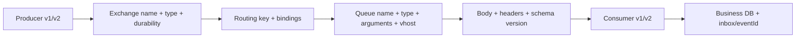
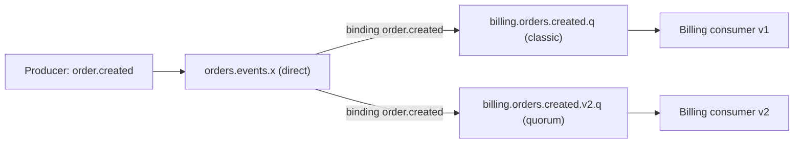
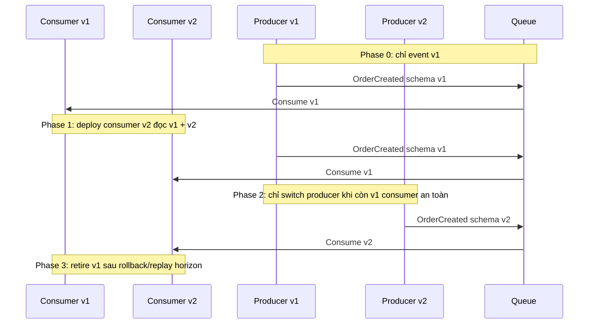
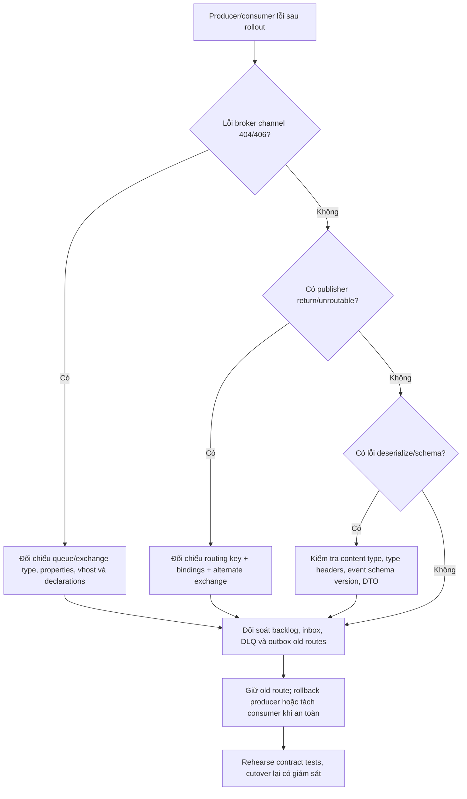

# Giữ tên exchange, queue, routing key và schema sự kiện tương thích

> **Chương:** Nâng cấp và tương thích  
> **Module:** SPRING_AMQP — học tích hợp RabbitMQ bằng `RabbitTemplate`, `@RabbitListener`, exchange, queue và binding; thực hành định tuyến message, xác nhận giao nhận, retry, dead-letter, giao dịch và quan sát hệ thống để xây dựng xử lý bất đồng bộ đáng tin cậy.
>
> **Phạm vi:** Tương thích **hợp đồng RabbitMQ AMQP 0-9-1 và event schema** giữa các phiên bản dịch vụ đang chạy đồng thời. Ví dụ mã minh họa **Spring Boot 3.5.x / Spring AMQP 3.2.x / Java 21**, broker RabbitMQ 4.x. Với Spring AMQP 4.x, đặc biệt là các thành phần Jackson, phải đối chiếu API đúng phiên bản. Không mặc nhiên giả định tất cả service có thể triển khai cùng lúc.

## 1. Vì sao nâng cấp ứng dụng message-driven khó hơn nâng cấp HTTP?

Một hệ thống có thể đang chạy **producer v1**, **producer v2**, **consumer v1**, **consumer v2**, các message cũ còn nằm trong queue, message lỗi ở DLQ và một lịch sử event được replay sau nhiều ngày. Khi triển khai bằng rolling update, các trạng thái này thường tồn tại **đồng thời**.

Một thay đổi nhìn như đổi tên biến trong Java có thể là thay đổi hợp đồng ngoài chương trình:

- Đổi `orders.events.x` thành `orders.v2.x` làm producer mới gửi tới exchange chưa có binding tương thích.
- Đổi queue `orders.created.q` thành `orders.created.v2.q` có thể bỏ lại **ready/unacked messages** ở queue cũ.
- Đổi routing key `order.created` thành `order.created.v2` trước khi thêm binding làm message **unroutable**.
- Đổi JSON field `orderId` thành `id` khiến consumer cũ không giải mã được.
- Đổi `x-queue-type=classic` sang `quorum` trên **cùng một queue name** có thể gây lỗi khai báo `406 PRECONDITION_FAILED`.
- Đổi Java package/class dùng trong header `__TypeId__` có thể làm converter của consumer phiên bản cũ không nhận diện được kiểu.

**Nguyên tắc trung tâm:** Tên exchange, queue, routing key, message headers, JSON field và business semantics là **contract giữa các deployable**, không đơn thuần là chi tiết trong mã nguồn.

### 1.1. Mục tiêu học tập

Sau bài này, bạn có thể:

1. Nhận diện những thành phần topology/schema cần giữ ổn định khi nâng cấp Spring AMQP.
2. Phân biệt thay đổi **tương thích ngược**, **tương thích xuôi** và **breaking change**.
3. Lập ma trận producer v1/v2 × consumer v1/v2, kể cả message tồn đọng và DLQ replay.
4. Áp dụng quy trình **expand → migrate → contract** cho exchange, queue, binding và event schema.
5. Hiểu vì sao khai báo queue/exchange mới với cùng tên nhưng khác thuộc tính có thể thất bại; chọn policy hoặc queue mới đúng mục đích.
6. Dùng `RabbitTemplate` với correlated publisher confirms/mandatory returns để phát hiện rủi ro routing nhưng không đánh đồng ACK với tiêu thụ thành công.
7. Thiết kế JSON envelope với `eventId`, `eventType`, `schemaVersion`, `aggregateId` và mã hóa ổn định, tránh phụ thuộc Java FQCN.
8. Viết test contract/integration, smoke test migration, kế hoạch rollback và runbook khi có `404`/`406`/unroutable hoặc poison messages.

### 1.2. Tình huống xuyên suốt

Hệ thống **Order Service** publish `OrderCreated` tới direct exchange `orders.events.x` với routing key `order.created`. **Billing Projection** consume từ `billing.orders.created.q`; **Analytics Projection** dùng một queue riêng.

Release mới muốn:

1. Bổ sung trường tùy chọn `promotionCode` vào event.
2. Chuyển routing key từ `order.created` thành `order.created.v2`.
3. Di chuyển Billing từ classic queue sang quorum queue vì yêu cầu độ bền.
4. Đổi tên một class Java và nâng Spring AMQP.

Không thể đưa cả bốn thay đổi vào một commit rồi mặc định deploy tuần tự sẽ an toàn. Bài này tách các ranh giới và đưa ra migration có thể rollback.

## 2. Bốn lớp hợp đồng phải tương thích



| Lớp | Điều phải kiểm chứng | Dấu hiệu không tương thích |
|---|---|---|
| **Exchange** | Tên, loại (direct/topic/fanout/headers), durable/auto-delete, arguments, vhost | `406 inequivalent arg` khi redeclare; producer gửi nhầm exchange |
| **Queue** | Tên, type, durable, exclusive/auto-delete, x-arguments, lifecycle | `406 PRECONDITION_FAILED`, consumer đợi queue không tồn tại, backlog kẹt ở queue cũ |
| **Routing** | Routing key, binding destination và exchange-to-exchange route, alternate exchange | Publisher returned/unroutable hoặc message đi vào **queue không mong muốn** |
| **Event contract** | Content type, JSON fields/types, enum, timestamp, event ID, schema/version và headers | Deserialize fail, silent default sai, DLQ tăng, DB áp dụng sai business |

**Vhost là một phần của hợp đồng vận hành**: cùng tên `orders.events.x` ở hai vhost là hai exchange khác nhau. Producer đổi `virtual-host` dù giữ tất cả tên cũng có thể publish sang một topology khác.

### 2.1. Tương thích ngược và tương thích xuôi

Định nghĩa theo phía **consumer**:

- **Backward compatibility:** consumer **mới** đọc và xử lý được message **cũ** đã tồn tại trong queue/DLQ.
- **Forward compatibility:** consumer **cũ** vẫn đọc và xử lý đúng message **mới** do producer mới phát trong thời gian overlap.
- **Full compatibility trong cửa sổ rollout:** cả hai chiều đều an toàn với các phiên bản thực sự cùng tồn tại.

Không chỉ kiểm tra “JSON parse được” mà cần kiểm tra **business outcome**. Một consumer v1 bỏ qua field mới có thể vẫn parse thành công nhưng xử lý sai nếu field mới thay đổi nghĩa của trường cũ.

### 2.2. Ma trận bắt buộc

| Producer tạo message | Consumer v1 | Consumer v2 | Mục đích |
|---|---|---|---|
| **Producer v1 / event v1** | Phải tiếp tục hoạt động | **Phải** hoạt động khi queue còn dữ liệu cũ | Duy trì workload hiện tại và backlog |
| **Producer v2 / event v2** | Phải hoạt động **nếu v1 còn có thể nhận v2** | Phải hoạt động | Kiểm tra forward compatibility trong rolling |
| **DLQ replay từ tháng trước** | Tùy retention/phiên bản hỗ trợ | Phải có migration/upcaster hoặc quarantine phù hợp | Tránh event cũ trở thành poison |
| **Rollback producer về v1 sau deploy** | Hoạt động | Phải tiếp tục nhận v1 | Rollback không phá consumer mới |

Nếu hàng `producer v2 → consumer v1` **không thể** pass, phải **tách route/queue hoặc trì hoãn producer switch** đến khi mọi consumer liên quan đã nâng cấp. Không dùng một nút “deploy all at once” làm bằng chứng rằng không còn instance cũ.

## 3. Giữ tên exchange và loại exchange ổn định

RabbitMQ exchange là bảng định tuyến có tên trong một vhost. Producer gửi tới **exchange** và **routing key**; bản thân exchange không lưu message như queue.

### 3.1. Những thành phần không nên đổi tùy tiện

| Thuộc tính | Ví dụ ban đầu | Thay đổi rủi ro | Cách tiếp cận |
|---|---|---|---|
| Name | `orders.events.x` | `orders.v2.x` | Tạo exchange mới trước, triển khai binding/bridge, chuyển có kế hoạch |
| Type | `direct` | `topic` trên **cùng tên** | Không redeclare khác type; dùng exchange mới với migration |
| Durable | `true` | `false` cùng tên | Không redeclare với property khác; đánh giá restart và persistence |
| Auto-delete | `false` | `true` | Có thể mất exchange khi không còn binding/consumer tùy semantics |
| Alternate exchange | Policy/argument | Đổi route fallback | Cần test mandatory return, destination và hiệu ứng nhân bản |
| Vhost | `/orders-prod` | `/default` | Thực chất chuyển sang topology khác; phải provision/authorize riêng |

Việc một publisher vẫn gọi `RabbitTemplate.convertAndSend()` thành công không chứng minh exchange/binding đích còn phù hợp; nhiều lỗi publish được báo qua **channel exception**, publisher confirm hoặc return bất đồng bộ.

### 3.2. Mẫu cấu hình exchange/binding ổn định

```java
import org.springframework.amqp.core.BindingBuilder;
import org.springframework.amqp.core.Declarables;
import org.springframework.amqp.core.DirectExchange;
import org.springframework.amqp.core.Queue;
import org.springframework.amqp.core.QueueBuilder;
import org.springframework.context.annotation.Bean;
import org.springframework.context.annotation.Configuration;

@Configuration(proxyBeanMethods = false)
public class StableOrderTopology {
    static final String EXCHANGE = "orders.events.x";
    static final String KEY_V1 = "order.created";
    static final String LEGACY_QUEUE = "billing.orders.created.q";

    @Bean
    Declarables stableOrderDeclarations() {
        DirectExchange exchange =
            new DirectExchange(EXCHANGE, true, false);
        Queue billing =
            QueueBuilder.durable(LEGACY_QUEUE).build();

        return new Declarables(
            exchange,
            billing,
            BindingBuilder.bind(billing).to(exchange).with(KEY_V1)
        );
    }
}
```

Đây là ví dụ **topology ban đầu**, không phải code dùng đồng thời với manifest khai báo lại cùng tên queue nhưng khác type. Trong môi trường production, quyết định **ai sở hữu khai báo**: Spring `RabbitAdmin`, definitions/IaC hoặc một controller/operator; tránh nhiều nguồn chân lý cạnh tranh.

### 3.3. Thay exchange name theo expand–contract

Nếu thực sự cần `orders.v2.x`:

1. **Expand:** Khai báo exchange mới và toàn bộ bindings/destination trước khi producer sử dụng.
2. **Prepare consumers:** Đảm bảo queue đích mới có consumer tương thích và downstream idempotency.
3. **Migrate:** Chuyển các producers có kiểm soát; có thể dual publish hoặc dùng bridge trong thời gian ngắn, nhưng phải tính **duplicate physical messages**.
4. **Observe:** Đo message routing/returns, backlog ở queue cũ/mới và business outcomes.
5. **Contract:** Chỉ xóa binding/exchange cũ khi không còn producer cũ, không còn message cần replay theo route cũ và đã hết cửa sổ rollback.

**Không xóa exchange cũ ngay khi code producer v2 chạy:** một process v1 chưa restart, một scheduled job, hoặc outbox relay đã lưu `exchange_name` cũ vẫn có thể publish tới tên cũ.

## 4. Giữ tên queue, loại queue và optional arguments

Queue vừa là **địa chỉ tiêu thụ**, vừa là **kho message**. Đổi queue name khác với đổi tên method listener: queue cũ có thể giữ hàng nghìn messages trong `ready` hoặc `unacked`.

### 4.1. Khai báo lại cùng tên không phải migration

Theo RabbitMQ, khi khai báo một queue đã tồn tại:

- Thuộc tính tương đương → declaration không thay đổi queue.
- Thuộc tính không tương đương → broker thường đóng **channel** với `406 PRECONDITION_FAILED`.
- Một số kiểm tra, đặc biệt `x-queue-type`, có thể được **cấu hình nới lỏng theo broker/default queue type**; không coi trường hợp ngoại lệ đó là cơ chế migration loại queue.

Ví dụ queue đã tồn tại:

```java
Queue work = QueueBuilder.durable("billing.orders.created.q").build();
```

Nếu release khác khai báo:

```java
// PHẢN VÍ DỤ nếu queue cùng tên đã là classic.
Queue work = QueueBuilder.durable("billing.orders.created.q")
    .quorum()
    .build();
```

**Không nên mong RabbitMQ tự chuyển dữ liệu từ classic sang quorum.** `x-queue-type` được ấn định khi tạo queue; giải pháp là tạo tên queue **mới** với type mới và lên kế hoạch đưa consumer/publisher traffic sang đó.

### 4.2. Bảng các thay đổi thường gặp

| Thay đổi | Mức độ rủi ro | Cách nâng cấp |
|---|---|---|
| Thêm consumer replica vào **cùng queue** | Thường không đổi topology | Kiểm tra concurrency, ordering, prefetch và idempotency |
| Thay queue name | **Breaking** nếu publisher/binding/consumer không đồng bộ | Queue mới + binding trước, drain/cutover + rollback |
| Thay classic ↔ quorum/stream | **Breaking**, không chỉnh queue type in-place | Queue v2 đúng type, migration dữ liệu/traffic riêng |
| Thay durable/exclusive/autoDelete cùng tên | Có thể `406` hoặc thay đổi lifecycle không mong muốn | Tạo queue mới nếu thực sự cần, chuyển có kiểm soát |
| Thay `x-max-priority` | Thường là declaration-time immutable | Queue mới và phân tích thứ tự/priorities |
| Thay TTL, DLX, queue length | Tùy optional argument và policy | Ưu tiên RabbitMQ **policy** khi được hỗ trợ; kiểm tra precedence |
| Thay `x-dead-letter-exchange` hardcoded trong app | Có thể xung đột declaration | Dùng policy/queue version migration; thử cả DLQ route |
| Xóa queue cũ sau chuyển consumer | **Mất dữ liệu** nếu còn ready/unacked | Drain hoặc replay/đối soát trước khi xóa |

RabbitMQ khuyến nghị **policies** cho các optional arguments có thể thay đổi lúc chạy. Nhưng **client-provided x-arguments thường có ưu tiên cao hơn user policy**; operator policies có precedence riêng và có thể đặt upper bounds. Do vậy thêm policy chưa chắc override được một TTL hardcoded trong `QueueBuilder` cũ. Không dùng policy để cố đổi `x-queue-type` hoặc `x-max-priority`.

### 4.3. Hai queue khác nhau có thể cùng nhận một event



Nếu **cả hai queue** đều bound với cùng routing key, **một publish có thể tạo delivery vào mỗi queue**. Đây là fan-out **qua nhiều bindings của direct exchange**, không phải “consumer v1 và v2 cạnh tranh trên một queue”. Nếu cả hai consumers có cùng side effect, có nguy cơ **double business processing**.

Chọn một trong các chiến lược:

- **Shadow:** Consumer v2 đọc queue mới nhưng không commit side effect, chỉ đối chiếu/khiến metric so sánh, dùng dữ liệu giả hoặc thiết kế quyền đọc phù hợp.
- **Shared inbox/idempotency:** Hai consumer versions có thể xử lý trùng eventId nhưng cùng business transaction/idempotency key bảo vệ, cần kiểm chứng race.
- **Coordinated cutover:** Chỉ một đường có quyền apply business effect tại một thời điểm; chuyển traffic và drain backlog có quy trình.
- **Independent projections:** Nếu hai queues phục vụ hai use cases độc lập, mỗi logical consumer có inbox marker riêng và side effect riêng.

**Đừng triển khai dual bindings một cách vô thức.** Đó có thể là migration hợp lệ hoặc một lỗi nhân đôi nghiệp vụ tùy architecture.

## 5. Routing key là hợp đồng định tuyến, không chỉ một chuỗi

### 5.1. Direct, topic và default exchange khác nhau

| Exchange type | Cách matching | Tác động khi đổi key |
|---|---|---|
| **Direct** | Routing key bằng binding key | Đổi `order.created` → `order.created.v2` sẽ mất route nếu chưa thêm binding |
| **Topic** | Pattern với `*` (một từ) và `#` (0 hoặc nhiều từ) phân tách bằng dấu `.` | Một key mới có thể khớp nhiều pattern, không chỉ pattern dự định |
| **Fanout** | Bỏ qua routing key để gửi tới bindings | Đổi routing key thường không đổi route, nhưng vẫn có thể ảnh hưởng consumer metadata/contract |
| **Default exchange** | Exchange name rỗng; queue được binding ngầm theo tên | Đổi queue name ảnh hưởng routing key trực tiếp tới queue |

Với topic exchange, pattern `order.*` khớp `order.created` nhưng **không** khớp `order.created.v2` (ba segment); `order.#` có thể khớp cả hai. Vì vậy **đừng nghĩ chỉ đổi suffix và mọi binding wildcard vẫn nhận được**.

### 5.2. Thêm binding mới trước khi đổi producer key

Một cách di chuyển trên **cùng queue và cùng định dạng event**:

```java
import org.springframework.amqp.core.BindingBuilder;
import org.springframework.amqp.core.Declarables;
import org.springframework.amqp.core.DirectExchange;
import org.springframework.amqp.core.Queue;
import org.springframework.context.annotation.Bean;
import org.springframework.context.annotation.Configuration;

@Configuration(proxyBeanMethods = false)
class RoutingCompatibilityConfig {
    @Bean
    Declarables bothRoutingKeys(
        DirectExchange ordersExchange,
        Queue billingQueue
    ) {
        // Các bean này đại diện cùng exchange/queue đã có.
        return new Declarables(
            BindingBuilder.bind(billingQueue).to(ordersExchange)
                .with("order.created"),
            BindingBuilder.bind(billingQueue).to(ordersExchange)
                .with("order.created.v2")
        );
    }
}
```

**Điều kiện cần:** Hai keys phải mang **payload mà cùng consumer có thể xử lý đúng**. Nếu key mới đồng nghĩa event v2 với schema không được consumer cũ hỗ trợ, thêm binding vào queue cũ sẽ biến message thành poison. Khi đó tách queue/consumer theo schema hoặc nâng consumers trước.

Đoạn code chỉ là phần **binding compatibility**, giả định đã có bean `ordersExchange` và `billingQueue` khai báo đúng metadata. Không tạo lại exchange/queue với cấu hình mâu thuẫn trong project.

### 5.3. Ba thời điểm khi đổi routing key

```text
Phase 0:
  Producer v1 --order.created--> [binding old] --> Queue Q

Phase 1: EXPAND routing
  Producer v1 --order.created-->    [binding old] --> Queue Q
  Producer v2 --order.created.v2--> [binding new] --> Queue Q

Phase 2: MIGRATE
  Producer v1 giảm dần về 0; Q vẫn nhận cả hai keys.

Phase 3: CONTRACT
  Chỉ bỏ binding old sau khi không còn v1 publishers,
  outbox pending/retry cũ hoặc nhu cầu replay theo key old.
```

Giữ **cả hai bindings trong giai đoạn rollback**. Nếu release v2 không ổn và producer quay về v1, message với `order.created` vẫn phải tới queue. Thời gian overlap nên được xác định bằng **outbox retention, retry schedule, DLQ replay horizon và số replicas cũ**, không chỉ bằng thời gian deploy.

## 6. Publisher confirms và returns: bảo vệ migration routing

Cấu hình Spring Boot 3.x:

```yaml
spring:
  rabbitmq:
    publisher-confirm-type: correlated
    publisher-returns: true
    template:
      mandatory: true
```

Với `mandatory=true`, RabbitMQ có thể trả message **không route được** qua `basic.return`. Với correlated confirms, Spring `CorrelationData` có future thể hiện ACK/NACK và returned message nếu có.

```java
import java.util.UUID;
import java.util.concurrent.TimeUnit;
import org.springframework.amqp.core.Message;
import org.springframework.amqp.rabbit.connection.CorrelationData;
import org.springframework.amqp.rabbit.core.RabbitTemplate;

public final class ConfirmedPublisher {
    private final RabbitTemplate rabbit;

    public ConfirmedPublisher(RabbitTemplate rabbit) {
        this.rabbit = rabbit;
    }

    public void sendAndCheck(
        String exchange, String routingKey, Message message
    ) throws Exception {
        CorrelationData attempt =
            new CorrelationData(UUID.randomUUID().toString());
        rabbit.send(exchange, routingKey, message, attempt);

        CorrelationData.Confirm confirm =
            attempt.getFuture().get(10, TimeUnit.SECONDS);
        if (!confirm.isAck()) {
            throw new IllegalStateException(
                "Broker did not confirm publish: " + confirm.getReason()
            );
        }
        if (attempt.getReturned() != null) {
            throw new IllegalStateException(
                "Unroutable publish: " +
                attempt.getReturned().getReplyText()
            );
        }
    }
}
```

Đoạn code chờ đồng bộ chỉ để dễ hiểu; production nên quản lý bounded in-flight confirms và trạng thái outcome **UNKNOWN** khi timeout/connection mất. Nếu message có nguồn từ DB transaction, dùng transactional outbox để giữ ý định phát event và retry có kiểm soát, **không tạo eventId mới khi retry**.

**Ba giới hạn cần nhớ:**

1. Broker có thể gửi **basic.return rồi publisher confirm ACK** cho message unroutable; ACK không đủ nếu `getReturned()!=null`.
2. **ACK + không có return** không chứng minh message đã tới **mọi queue mong muốn** khi exchange có nhiều bindings. Nó chỉ xác nhận kết quả publish theo broker/routing đã cấu hình; nếu queue phụ bị mất binding nhưng queue chính vẫn nhận, message có thể **không bị return**. Cần kiểm tra topology và consumer-specific canary/audit.
3. Publisher confirm không chứng minh consumer đã deserialize hoặc commit DB; cần listener/DB observability và idempotency.

Với exchange **không tồn tại**, broker có thể trả channel-level error thay vì `basic.return`; đừng coi mọi lỗi routing đều là returns.

## 7. Schema sự kiện: tương thích ở mức wire và nghiệp vụ

JSON giúp các service khác Java cùng đọc được event, nhưng **JSON tự nó không bảo đảm compatibility**. Hợp đồng phải xác định rõ required fields, optional fields, value types, units, enum policy, timestamp encoding và schema version.

### 7.1. Ví dụ event v1 và v2

**V1 — đã được lưu trong queue:**

```json
{
  "eventId": "1ec1a6d9-33dd-4f6f-a24d-3c64008c96cf",
  "eventType": "OrderCreated",
  "schemaVersion": 1,
  "aggregateId": "order-1001",
  "occurredAt": "2026-11-26T08:00:00Z",
  "payload": {
    "orderId": "order-1001",
    "amountMinor": 125000,
    "currency": "VND"
  }
}
```

**V2 — bổ sung trường tùy chọn, giữ nguyên nghĩa các field cũ:**

```json
{
  "eventId": "d292b48b-e31a-4610-828d-569774e817cf",
  "eventType": "OrderCreated",
  "schemaVersion": 2,
  "aggregateId": "order-1002",
  "occurredAt": "2026-11-26T08:01:00Z",
  "payload": {
    "orderId": "order-1002",
    "amountMinor": 95000,
    "currency": "VND",
    "promotionCode": "NOVEMBER"
  }
}
```

Trong ví dụ, `promotionCode` **phải là optional** về business semantics đối với những consumers cũ. Nếu discount làm thay đổi số tiền thanh toán, `amountMinor` trong v2 vẫn phải là giá trị nghiệp vụ đúng theo hợp đồng cũ; không được âm thầm đổi nghĩa “trước khuyến mại” thành “sau khuyến mại” mà không versioning.

### 7.2. Ma trận thay đổi JSON thường gặp

| Thay đổi | Consumer cũ đọc message mới? | Consumer mới đọc message cũ? | Lời khuyên |
|---|---|---|---|
| **Thêm field optional** | Có **nếu** parser bỏ qua unknown và business semantics không đổi | Có nếu field thiếu có default/nullable hợp lệ | Bước expand tốt |
| Thêm field required mới | Thường không, tùy parser | **Không** nếu backlog cũ thiếu field | Đầu tiên hỗ trợ thiếu/default, sau mới require |
| Đổi tên `orderId` → `id` | **Không** nếu consumer cũ cần `orderId` | Không nếu consumer mới chỉ đọc `id` | Cho consumer mới đọc alias, giữ output cũ trong overlap |
| Xóa field mà consumer cũ cần | **Không** | Có thể | Chỉ sau khi hết consumers cũ và replay horizon |
| `amountMinor` integer → string | Rủi ro convert sai hoặc fail | Rủi ro | Thêm field mới/version contract, không đổi type lén |
| Unit tiền minor → major | Có thể parse nhưng **sai tiền** | Có thể parse nhưng **sai tiền** | Breaking về semantic, dùng field/version mới |
| Enum thêm `PARTIALLY_PAID` | Consumer cũ có thể throw khi deserialize | Consumer mới vẫn đọc values cũ | Unknown enum strategy và test |
| Timestamp local → ISO-8601 UTC | Có thể fail hoặc lệch timezone | Có thể | Định nghĩa instant/offset rõ, hỗ trợ hai format có hạn |
| Event type đổi `OrderCreated` → `OrderPlaced` | Consumer cũ có thể bỏ qua/route sai | Cần mapping rõ | Versioned event type/route hoặc migration |
| Java package/class đổi tên | JSON body có thể giữ nguyên | Header `__TypeId__` có thể hỏng | Dùng stable logical event type, converter mapping |

**Bỏ qua unknown fields không đồng nghĩa luôn an toàn.** Đôi khi consumer v1 không hiểu field v2 làm thay đổi ý nghĩa bắt buộc của giao dịch; khi đó phải tách event type/version và bảo đảm v1 không nhận v2.

### 7.3. Quy tắc cấp phiên bản schema

- `schemaVersion` thuộc **wire contract**, không phải Spring Boot version hoặc Java package version.
- Một version mới có thể hoàn toàn tương thích (thêm optional field) hoặc có breaking change; không suy ra độ an toàn chỉ từ số version.
- Định nghĩa event type và schema contract có chủ sở hữu; lưu ví dụ JSON canonical, rules, fingerprint/schema ID nếu dùng registry.
- Với Avro/Protobuf/schema registry, phải cấu hình compatibility policy phù hợp (backward/forward/full) và kiểm chứng semantic; không coi kiểm tra schema là thay thế integration test.
- Consumer nên biết **version range được hỗ trợ** và xử lý version không hỗ trợ theo quarantine/reject policy, không âm thầm deserialize thành đối tượng sai.
- Khi cần thay nghĩa hoàn toàn, cân nhắc `OrderCreatedV2` hoặc routing key `order.created.v2` kết hợp consumer riêng thay vì “field mới nhưng cùng meaning” gây hiểu sai.

## 8. Spring AMQP và Jackson: đừng để tên class trở thành wire contract

### 8.1. Những gì converter đưa lên wire

Trong Spring AMQP 3.x, `Jackson2JsonMessageConverter` thường được dùng để chuyển Java object sang JSON; nó có thể thêm type metadata như `__TypeId__` qua `MessageProperties`. Khi nhận, conversion có thể dựa trên **inferred listener parameter type** hoặc incoming type headers tùy kiểu tham số và `TypePrecedence`.

Nếu producer v1 phát type header:

```text
__TypeId__: com.example.orders.v1.OrderCreatedEvent
```

nhưng consumer/producer v2 đổi thành `com.example.messaging.events.OrderCreatedEvent`, các consumers phụ thuộc Java FQCN cũ hoặc không cho phép package mới trong trusted packages có thể lỗi, dù JSON body không thay đổi.

**Không dùng default Java class name làm mã loại event ổn định xuyên service/language.** Tốt hơn là hợp đồng `eventType=OrderCreated` và `schemaVersion` trong envelope, kết hợp converter/type mapper có mapping từ logical type ID sang class cục bộ hoặc parse body theo schema rõ ràng.

### 8.2. Ví dụ consumer parse envelope độc lập Java TypeId

```java
import com.fasterxml.jackson.databind.JsonNode;
import com.fasterxml.jackson.databind.ObjectMapper;
import java.io.IOException;
import java.util.UUID;
import org.springframework.amqp.core.Message;
import org.springframework.amqp.rabbit.annotation.RabbitListener;
import org.springframework.amqp.rabbit.support.AmqpRejectAndDontRequeueException;
import org.springframework.stereotype.Component;

@Component
public class CompatibleOrderListener {
    private final ObjectMapper mapper;
    private final OrderProjectionService projection;

    public CompatibleOrderListener(
        ObjectMapper mapper, OrderProjectionService projection
    ) {
        this.mapper = mapper;
        this.projection = projection;
    }

    @RabbitListener(
        id = "billing-order-projection",
        queues = "billing.orders.created.q"
    )
    public void onMessage(Message raw) {
        try {
            JsonNode envelope = mapper.readTree(raw.getBody());
            String type = envelope.path("eventType").asText();
            int version = envelope.path("schemaVersion").asInt(-1);

            if (!"OrderCreated".equals(type) ||
                (version != 1 && version != 2)) {
                throw new IllegalArgumentException("Unsupported contract");
            }
            UUID eventId = UUID.fromString(
                envelope.path("eventId").asText()
            );
            String orderId = envelope.path("payload")
                .path("orderId").asText();
            long amountMinor = envelope.path("payload")
                .path("amountMinor").asLong(-1);

            if (orderId.isBlank() || amountMinor < 0) {
                throw new IllegalArgumentException("Invalid payload");
            }
            // projection.applyOnce() tự validate, dùng DB transaction
            // và inbox(eventId) để tránh duplicate khi replay/dual route.
            projection.applyOnce(eventId, orderId, amountMinor);
        } catch (IOException | IllegalArgumentException malformed) {
            throw new AmqpRejectAndDontRequeueException(
                "OrderCreated schema mismatch", malformed
            );
        }
    }
}
```

`OrderProjectionService` là bean nghiệp vụ cần triển khai riêng: transaction DB + inbox uniqueness, validate domain và xử lý duplicate. Mã trên là ví dụ **consumer v2 đọc được cả envelope v1 và v2**, không chứng minh producer v2 tương thích với consumer v1 trừ khi có thêm contract tests dành cho v1.

Ở ứng dụng thật, đừng chỉ dùng `asLong(-1)` nếu yêu cầu phân biệt type numeric với chuỗi không hợp lệ; dùng JSON schema validation/DTO strict cho các trường quan trọng. Không bắt mọi `RuntimeException` rồi biến lỗi DB transient thành poison schema error — lỗi DB nên đi qua retry policy.

### 8.3. Dùng DTO cũ và DTO mới với Jackson

Nếu các message đã có JSON payload ổn định, Spring AMQP 3.x có thể dùng `Jackson2JsonMessageConverter` với listener argument type được suy ra. Ví dụ DTO nhận thêm field nhưng cho phép thiếu:

```java
import com.fasterxml.jackson.annotation.JsonIgnoreProperties;
import com.fasterxml.jackson.annotation.JsonAlias;

@JsonIgnoreProperties(ignoreUnknown = true)
public record OrderPayloadV2(
    String orderId,
    long amountMinor,
    String currency,
    @JsonAlias({"promoCode"}) String promotionCode
) {}
```

`@JsonIgnoreProperties(ignoreUnknown=true)` chỉ giúp nhận thêm **unknown fields**; `@JsonAlias` cho phép input dùng tên cũ `promoCode`, nhưng **không tự ghi đồng thời hai tên** khi serialize. Nếu old consumer chỉ hiểu `promoCode`, producer mới phải tiếp tục phát field đó trong overlap hoặc đổi route/schema contract có kiểm soát.

Với Spring AMQP 4.x, API Jackson 2 converter được đánh dấu deprecated hướng tới Jackson 3 `JacksonJsonMessageConverter`. **Đây là thay đổi thư viện trong Java**, không phải lý do để đổi JSON wire contract; phải kiểm thử type headers, trusted package rules, ObjectMapper behavior và content type khi nâng version.

### 8.4. Content type, encoding và allowlist

- Gửi `contentType=application/json` (và charset/encoding thống nhất) để consumers chuyển đổi đúng.
- Tránh Java native serialization `application/x-java-serialized-object` khi cần interop/versioning; thay class/package gây rủi ro và mở bề mặt deserialization.
- Cấu hình trusted packages **hẹp** hoặc type mapping tường minh; **không bật `trustedPackages("*")` trong production** chỉ để vượt lỗi type header.
- Lưu test fixtures của raw message `body + headers`; unit test DTO đơn lẻ không bắt được lỗi content type/header.
- Nếu có bên ngoài Java (Node, Go, Python), kiểm thử end-to-end theo wire JSON, không phụ thuộc internal Jackson object shapes.

## 9. Thứ tự triển khai schema: consumer trước producer

Với thay đổi **thêm field optional tương thích**:



**Hai điều kiện:** Consumer v2 đọc được backlog v1, và producer v2 chỉ phát v2 khi *mọi consumer có thể nhận v2* đã được nâng cấp hoặc khi v2 đã đi vào queue tách riêng.

Thứ tự deploy “consumer trước producer” là chiến lược phổ biến, **không phải phép màu**: một instance v1 có thể còn running trong rolling update; xác minh thực tế bằng deployment revisions/consumer tags/queue metrics, không chỉ dựa vào pipeline đánh dấu successful rollout.

### 9.1. Quy trình expand → migrate → contract

| Giai đoạn | Exchange/queue/routing | Message schema | Điều kiện hoàn tất |
|---|---|---|---|
| **EXPAND** | Tạo trước destination/binding mới **mà không xóa old route** | Consumer mới chấp nhận cả v1/v2; producer giữ v1 | Consumer v2 đã khỏe; tests v1→v2 pass |
| **MIGRATE** | Chuyển producers/consumers từng phần; có thể dual-bind/bridge theo thiết kế | Producer phát v2 khi an toàn; eventId ổn định | Return=0 cho route yêu cầu, backlog/side effects đúng |
| **CONTRACT** | Bỏ route/queue cũ sau drain và hết rollback window | Có thể ngừng hỗ trợ v1 sau khi không còn backlog/replay cũ | Có bằng chứng không còn producer v1, DLQ/outbox cũ |

**Contract chỉ là bước cuối.** Nếu remove compatibility code ngay khi producer v2 deploy xong, một message v1 còn trong DLQ sẽ bị đẩy vào DLQ lần nữa khi replay, hoặc consumer mới sẽ reject message cũ.

### 9.2. Nếu muốn đổi tên field bắt buộc

Giả sử `customerId` sẽ thay `buyerId`:

1. Consumer v2 được nâng cấp để **đọc được `buyerId` lẫn `customerId`** và validate nếu cả hai có mặt thì giống nhau.
2. Producer vẫn phát `buyerId` trong thời gian consumer v1 tồn tại; có thể **dual-write hai fields** nhất quán trong một event nếu contract cho phép.
3. Khi consumer v1 không còn và rollback window đã đóng, producer có thể ngừng phát `buyerId`.
4. Chỉ sau khi backlog/DLQ replay horizon phù hợp, consumer v2 mới bỏ code đọc `buyerId`.

**Không diễn giải `@JsonAlias` như một cách phát hai field ra wire.** Alias chủ yếu là cơ chế deserialize. Muốn dual-write field phải chủ động serialize và contract-test.

## 10. Đổi queue type: chiến lược migration cụ thể

**Bài toán:** `billing.orders.created.q` là classic queue. Muốn quorum queue cho Billing nhưng cần tránh mất backlog và nhân đôi business effects.

### 10.1. Thiết kế tên mới

```text
Old:
  orders.events.x --order.created--> billing.orders.created.q (classic)

New:
  orders.events.x --order.created--> billing.orders.created.v2.q (quorum)
```

Không `queueDelete(old)` để tạo queue mới cùng tên khi old đang chứa dữ liệu. Một quy trình có kiểm soát:

1. **Provision** `billing.orders.created.v2.q` là quorum queue, durable, có DLX/retry/DLQ phù hợp và bindings đã test.
2. **Deploy** consumer v2 xử lý được v1/v2 payload, gắn inbox/eventId stable; trước cutover có thể chạy shadow không side effect.
3. **Chọn cutover strategy**: giữ old consumer drain cùng lúc new queue nhận traffic (có idempotency nếu overlap), hoặc tạm pause producers/bridge và chuyển route có checkpoint.
4. **Theo dõi** cả hai queues: ready, unacked, consumer count, DLQ, business events committed.
5. **Đối soát** số event IDs nguồn/outbox với processed inbox; kiểm tra publisher ACK+return và audit.
6. **Retire** old consumer/binding chỉ khi không còn messages cần xử lý trên old path và rollback đã có kế hoạch.

### 10.2. Ba phương án cutover và đánh đổi

| Phương án | Ưu điểm | Rủi ro cần xử lý |
|---|---|---|
| **Quiesce producer → drain old → switch binding → resume** | Dễ kiểm soát thứ tự và duplicate, nhất là job có thể tạm dừng | Cần cửa sổ tạm dừng, xử lý các producer/outbox relay chưa dừng |
| **Overlap dual binding old + new** | Không cần dừng producer | Một publish có thể vào cả hai queues; inbox phải chống duplicate, kiểm soát side effect |
| **Bridge/shovel old → new** | Di chuyển backlog có chủ đích, giữ consumer mới tập trung | Bridge phải ACK old **chỉ sau** khi new publish được xác nhận; retry có thể phát trùng |

Nếu không có cách dừng producer, dual binding/bridge phải được thiết kế với **idempotency, progress tracking và failover**. Không có giải pháp magic “rename queue with messages in place”.

### 10.3. Code tạo queue mới — không đụng queue cũ

```java
import org.springframework.amqp.core.BindingBuilder;
import org.springframework.amqp.core.Declarables;
import org.springframework.amqp.core.DirectExchange;
import org.springframework.amqp.core.Queue;
import org.springframework.amqp.core.QueueBuilder;
import org.springframework.context.annotation.Bean;
import org.springframework.context.annotation.Configuration;

@Configuration(proxyBeanMethods = false)
class QuorumMigrationTopology {
    @Bean
    Declarables billingV2(
        DirectExchange ordersExchange
    ) {
        Queue newQueue = QueueBuilder
            .durable("billing.orders.created.v2.q")
            .quorum()
            .build();
        return new Declarables(
            newQueue,
            BindingBuilder.bind(newQueue).to(ordersExchange)
                .with("order.created")
        );
    }
}
```

Code này chỉ tạo **queue mới và binding mới** (giả định exchange bean hiện hữu tương thích). Đừng áp dụng cấu hình này rồi cho consumer v2 commit side effect đồng thời với v1 nếu chưa có chiến lược duplicate. Với queue quorum, còn cần đánh giá disk/capacity/replica policy và giới hạn delivery/poison message theo broker version.

## 11. RabbitAdmin, definitions và “nguồn chân lý” topology

### 11.1. Vì sao RabbitAdmin hữu ích nhưng phải kiểm soát

Spring AMQP `RabbitAdmin` có thể tự khai báo `Exchange`, `Queue` và `Binding` beans khi connection được thiết lập và khi listener khôi phục resource theo điều kiện. Điều này tiện cho local/integration test; nhưng trong production có thể dẫn tới:

- Mỗi replica tự declare cùng queue với metadata **khác nhau** trong giai đoạn rolling update.
- Version v2 có optional arguments không tương thích v1, gây `406` liên tục khi channel tạo lại.
- App runtime cần `configure` permission rộng hơn mức tối thiểu nếu tự quản lý topology.
- Rollback code v1 vô tình redeclare queue theo assumptions cũ.

Đối với topology sản xuất nhiều dịch vụ, hãy quyết định **một nguồn quản lý**: IaC/definitions/operator hoặc RabbitAdmin có quản lý/chỉ định declaring admins rõ ràng. Đừng để cả hai hệ thống thay đổi properties độc lập.

### 11.2. Phân biệt declaration và migration

`RabbitAdmin.declareQueue()` không phải lệnh **alter queue**: nó khai báo queue, có thể kiểm tra equivalence, và sẽ không tự chuyển queue type/dữ liệu. `ignoreDeclarationExceptions=true` chỉ ảnh hưởng cách Spring xử lý exception khai báo; **không sửa topology sai**. Không bật tùy chọn ignore để “qua deploy” rồi bỏ qua việc consumer không có queue phù hợp.

Nếu có nhiều RabbitAdmin cho nhiều broker/vhost, dùng conditional declarations và `explicitDeclarationsOnly` (khi phù hợp) để đảm bảo một bean topology được tạo đúng broker. Vhost trong RabbitMQ và namespace trong Kubernetes là hai khái niệm khác nhau.

### 11.3. Quản lý definitions/policies theo version

Lưu **versioned declarative topology** trong quy trình hạ tầng được review, gồm:

- Exchange names/types/arguments, queue names/types/properties, bindings và dead-letter routes.
- Users, vhosts, permissions và resource policies theo môi trường.
- Mọi route cũ cần giữ qua rollback window, cùng kế hoạch loại bỏ.
- Công cụ snapshot/diff **trước và sau** deploy; không dùng export definitions như backup message data.

RabbitMQ definitions export/import phản ánh cấu hình/topology; **không chứa toàn bộ queue message backlog** như một backup dữ liệu. Nếu muốn di chuyển dữ liệu, cần replay/bridge/backup khác có cơ chế xác nhận riêng.

## 12. Kế hoạch rollback: nghĩ trước khi deploy

Rollback ứng dụng **không đảo ngược** schema đã ghi lên queue, binding đã xóa, queue type đã thay đổi hay messages đã được broker route theo đường mới.

### 12.1. Ba câu hỏi trước mỗi release

1. Nếu producer v2 phát event mới và phải rollback sang producer v1, **consumer v1 có còn đọc được event v2** đang nằm trong queue không?
2. Nếu đã chuyển binding qua queue v2, producer cũ hoặc outbox relay cũ có còn gửi event tới exchange/key cũ không? Old path còn được provision không?
3. Nếu queue/schema migration tạo side effects, rollback có làm **chạy lại events đã xử lý** không? Inbox retention/idempotency có đủ không?

### 12.2. Rollback theo từng thay đổi

| Thành phần đã thay | Rollback an toàn hơn | Tránh |
|---|---|---|
| Producer code | Roll back image nếu consumers vẫn chấp nhận payload v1 | Gỡ binding cũ quá sớm |
| Consumer code | Giữ consumer v2 chấp nhận v1/v2 hoặc rollback khi không còn v2 messages | Deploy v1 vào queue chứa schema v2 breaking |
| Routing key | Giữ binding old + new qua rollback window | Chỉ giữ key mới vì “deploy đã thành công” |
| Queue name/type | Duy trì old queue cho tới khi drain và cutover có chứng cứ | Xóa/recreate queue đang có ready/unacked |
| JSON field/schema | Tạm giữ dual-read/dual-write compatibility | Xóa old field ngay khi v2 được phát |
| DLX/retry topology | Giữ route cần thiết cho cả old/new attempts | Quên pending retry/DLQ chứa old headers/key |
| Outbox rows | Relay hiểu old exchange/routing key/schema đang lưu | Chỉ sửa code producer mới và quên các rows cũ |

### 12.3. “Contract” chỉ sau khi đủ bằng chứng

Việc tháo binding cũ/đóng queue cũ cần:

- Không còn producer cũ (theo deployment/metrics, kể cả background jobs).
- Không còn outbox rows pending/in-flight/parked dùng exchange hoặc routing key cũ, hoặc đã migrate có ghi nhận.
- Queue cũ không còn ready/unacked messages cần xử lý; DLQ/retry queues cũ đã có chính sách xử lý.
- Consumer v2 đã xử lý business đúng và có thể replay các versions trong phạm vi retention.
- Đã hết rollback window được phê duyệt hoặc có biện pháp rollback khác được chứng minh.

Không dùng mỗi một dấu hiệu **queue depth=0**: message có thể đang unacked, nằm ở DLQ, đã vào queue khác hoặc chưa được producer publish.

## 13. Ma trận kiểm thử compatibility

Các bài thử nên chạy **trước khi triển khai**, bằng JUnit 5/Testcontainers RabbitMQ và một database test khi có business effects. Test schema riêng chưa đủ nếu exchange/binding thực tế sai.

| Test | Thiết lập | Điều phải kiểm chứng |
|---|---|---|
| **T1 — v1 producer → v1 consumer** | Event v1, queue cũ | Giữ nguyên hành vi đã chạy |
| **T2 — v1 producer → v2 consumer** | Backlog v1/đầu vào từ DLQ | Consumer v2 parse và apply đúng |
| **T3 — v2 producer → v1 consumer** | Event có field optional mới | Consumer v1 chấp nhận hoặc migration buộc tách route |
| **T4 — v2 producer → v2 consumer** | Event mới | Schema, headers, business outcome đúng |
| **T5 — Unknown field** | Thêm `promotionCode` | Old parser không fail nếu contract cho phép ignore; không đổi nghĩa tiền |
| **T6 — Missing field** | v1 không có `promotionCode` | New consumer dùng default hợp lệ |
| **T7 — Rename/type change** | `orderId→id`, amount number→string | Test phải **fail** nếu unsupported; không silent wrong result |
| **T8 — Unknown enum** | `PARTIALLY_PAID` tới consumer v1 | Error policy/quarantine rõ, không hot loop |
| **T9 — Legacy headers** | `__TypeId__` từ Java package v1 | Converter/upcaster/map đúng hoặc xử lý raw JSON |
| **T10 — Old routing key** | Publish `order.created` sau consumer v2 deploy | Binding cũ còn route đúng |
| **T11 — New routing key** | Publish `order.created.v2` | Binding mới hoạt động trước producer switch |
| **T12 — Missing binding** | Publish mandatory vào key không route | Có return; không coi confirm ACK là routed |
| **T13 — Một queue destination bị mất binding** | Queue còn lại vẫn nhận | **Không nhất thiết có return**; topology/canary phát hiện |
| **T14 — Queue redeclare mismatch** | v2 đổi `x-queue-type` cùng tên | `406` trong test; migration phải dùng queue mới |
| **T15 — Dual queue overlap** | Cùng event vào Q1/Q2 | Không có **hai business effects** ngoài ý định |
| **T16 — DB commit rồi ACK mất** | Cắt connection trong fault hook | Redelivery không làm side effect trùng |
| **T17 — DLQ replay** | Event v1 cũ và message lỗi v2 | Consumer tương thích hoặc quarantine có audit |
| **T18 — Rollback rehearsal** | Producer v2 → v1; consumer v2 giữ nguyên | Route và schema v1 vẫn được chấp nhận |
| **T19 — Outbox old route** | Outbox row lưu exchange/key v1 trước deploy | Relay còn publish đúng hoặc migration an toàn |
| **T20 — Queue drain** | Ready/unacked/retry/DLQ tồn tại lúc cutover | Không xóa old path trước khi đối soát |

### 13.1. Contract test từ JSON fixtures

Lưu những JSON event mẫu **đã tồn tại ngoài hệ thống** (v1, v2, min/max field set, malformed, unknown enum) trong test suite của dự án, và kiểm tra producer/consumer với cùng fixtures.

```java
import static org.assertj.core.api.Assertions.assertThat;
import com.fasterxml.jackson.databind.JsonNode;
import com.fasterxml.jackson.databind.ObjectMapper;
import org.junit.jupiter.api.Test;

class OrderSchemaCompatibilityTest {
    private final ObjectMapper mapper = new ObjectMapper();

    @Test
    void consumerV2ReadsV1WithoutPromotionCode() throws Exception {
        String oldJson = """
            {
              "eventId":"1ec1a6d9-33dd-4f6f-a24d-3c64008c96cf",
              "eventType":"OrderCreated",
              "schemaVersion":1,
              "aggregateId":"order-1001",
              "payload":{
                "orderId":"order-1001",
                "amountMinor":125000,
                "currency":"VND"
              }
            }
            """;

        JsonNode envelope = mapper.readTree(oldJson);
        JsonNode payload = envelope.path("payload");
        assertThat(envelope.path("schemaVersion").asInt()).isEqualTo(1);
        assertThat(payload.path("amountMinor").asLong())
            .isEqualTo(125000L);
        assertThat(payload.path("promotionCode").isMissingNode())
            .isTrue();
    }
}
```

**Chú ý phạm vi:** Test trên chứng minh một JSON fixture có cấu trúc được mong đợi, **không tự chứng minh production listener** xử lý được nó. Cần kiểm tra tiếp converter, listener contract, validation và DB side effect; đặc biệt phải chạy consumer v1 với message v2 trước khi khẳng định forward compatibility.

### 13.2. Integration test kiểm route cũ và mới

Trong `@SpringBootTest` có RabbitMQ Testcontainers đã provision exchange, queue và hai bindings, dùng eventId riêng để test:

```java
// Fragment trong integration test:
String oldKey = "order.created";
String newKey = "order.created.v2";
String exchange = "orders.events.x";

rabbitTemplate.convertAndSend(exchange, oldKey, oldEnvelopeJson);
rabbitTemplate.convertAndSend(exchange, newKey, newEnvelopeJson);

// Đợi consumer test xử lý được cả hai eventIds bằng Awaitility.
// Assert DB projection đúng và duplicate counters không bất thường.
// Bổ sung publisher confirms/returns (không chỉ convertAndSend).
```

Nếu có nhiều consumers trên **cùng queue**, một event không đảm bảo được phiên bản consumer cụ thể nào nhận. Vì vậy phải dùng **test fixture cho từng phiên bản consumer** hoặc kiểm soát registration/queue để thử từng tổ hợp v1/v2; không chỉ chạy cả hai cùng lúc rồi hy vọng message tới đúng service cần đo.

### 13.3. Kiểm tra broker topology thực tế

Các lệnh tham khảo, chỉ dùng với quyền trên broker/vhost được phép:

```bash
# Kiểm tra exchange names/types/args và queues trong vhost.
rabbitmqctl list_exchanges -p /orders-prod \
  name type durable auto_delete

rabbitmqctl list_queues -p /orders-prod \
  name durable messages_ready messages_unacknowledged consumers

# Liệt kê bindings để đối chiếu old và new routing keys.
rabbitmqctl list_bindings -p /orders-prod

# Kiểm tra policies đang áp dụng.
rabbitmqctl list_policies -p /orders-prod
```

Tên các cột và command options có thể khác theo RabbitMQ version; đối chiếu `rabbitmqctl help`. Danh sách queue chỉ là **snapshot**, không thay thế audit ready/unacked, ingress/delivery và publisher returns theo thời gian.

## 14. Dashboard và alert cho rolling upgrade

| Metric/quan sát | Ý nghĩa khi nâng cấp | Khi nào cảnh báo |
|---|---|---|
| `publisher.return` theo exchange/routing key | Có binding bị bỏ hoặc key bị thay trước | Return > baseline ở route phải có destination |
| Publisher confirm NACK/UNKNOWN | Broker/channel/network không xác nhận rõ outcome | Bất kỳ NACK mới hoặc UNKNOWN backlog tăng |
| Queue ready/unacked theo **old và new names** | Có backlog kẹt trong một path | Old queue không drain, new queue tăng bất thường |
| Consumer count, listener startup errors | v1/v2 consumers có nhận subscription không | Bằng 0 hoặc restart loop ngoài dự kiến |
| `406 inequivalent arg` / `404 NOT_FOUND` | Topology declaration mismatch hoặc resource thiếu | Xuất hiện sau deploy |
| JSON deserialization/unsupported version | Schema không tương thích | Tăng nhanh sau producer switch |
| DLQ ingress/depth/age theo schemaVersion | Poison event và replay gap | Event cũ bị reject bởi consumer mới |
| Duplicate suppression/inbox conflicts | Dual binding/dual publish hoặc redelivery | Tăng vượt dự báo, có dấu hiệu double side effect |
| Business event processing lag | Consumer mới không bắt kịp | Vượt SLO, kể cả broker queue depth thấp |
| Outbox pending/parked theo route | Relay còn giữ exchange/key cũ | Old route bị gỡ khi còn rows pending |
| Deployment revision/instance version | Bao nhiêu producer/consumer v1 còn sống | Trước bước contract vẫn còn instance cũ |

Log/traces nên lưu `eventId`, `eventType`, `schemaVersion`, `exchange`, `routingKey`, `consumerVersion` và `messageId`. Tránh đặt `eventId`/`orderId` làm Prometheus label vì cardinality cao. Nếu message có dữ liệu cá nhân, không log full body.

## 15. Runbook khi nâng cấp gặp sự cố



### 15.1. `406 PRECONDITION_FAILED` sau deploy

**Triệu chứng:** Listener container restart liên tục; broker báo `inequivalent arg 'x-queue-type'` hoặc `durable`.  
**Xử lý:** Ngừng việc tự redeclare với arguments mới trên queue cũ, xác định source of truth, dùng queue v2 + migration. **Không xóa queue đang có message** và không bật `ignoreDeclarationExceptions` như một cách sửa duy nhất.

### 15.2. Producer ACK nhưng Billing không có event

**Triệu chứng:** Confirm ACK cao, Billing projection lag hoặc thiếu event.  
**Xử lý:** Kiểm tra `basic.return`, binding tới Billing queue, vhost, DLQ, consumer readiness và DB audit. Nếu Analytics queue vẫn nhận được event, **không nhất thiết có return**; kiểm tra từng destination.

### 15.3. JSON converter lỗi sau đổi package

**Triệu chứng:** `MessageConversionException`, unknown type ID, class not found, package not trusted.  
**Xử lý:** Kiểm tra raw body+headers, phiên bản `Jackson2JsonMessageConverter`/Jackson, inferred type vs `__TypeId__`, trusted package policy. Dùng logical event type mapping hoặc raw envelope/versioned DTO; **không** mở `trustedPackages("*")` vô điều kiện.

### 15.4. DLQ replay phá phiên bản mới

**Triệu chứng:** Queue chạy bình thường với events mới nhưng replay old DLQ lại tăng `unsupported schemaVersion`.  
**Xử lý:** Chọn consumer/upcaster hỗ trợ v1, hoặc quarantine với audit và migration có kiểm soát. Không xóa/overwrite original event chỉ để parse được; giữ `eventId` để idempotency.

### 15.5. Rollback nhưng route cũ đã bị gỡ

**Triệu chứng:** Producer v1 chạy lại, vẫn publish cùng exchange/key cũ nhưng không còn binding; message bị returned hoặc mất route.  
**Xử lý:** Phục hồi binding cũ **trước** khi rollback producer, kiểm tra mandatory return/consumer processing và outbox pending events; đừng chỉ quay lại image cũ.

## 16. Ví dụ kế hoạch phát hành hoàn chỉnh

Giả định mục tiêu cuối: consumer Billing v2 đọc quorum queue `billing.orders.created.v2.q` và producer dùng schema v2 + key `order.created.v2`. Đề xuất kế hoạch:

| Mốc | Hành động | Đường xử lý phải còn chạy | Điều kiện chuyển tiếp |
|---|---|---|---|
| **R0 — Baseline** | Snapshot topology, schemas, backlog, DLQ, outbox route | P1 key cũ → Q1 → C1 | Test v1 green, biết rollback horizon |
| **R1 — Expand schema** | Deploy C2 hỗ trợ v1+v2; chưa đổi producer | P1/Q1 vẫn xử lý | C2 đọc fixtures/backlog v1 đúng |
| **R2 — Provision** | Tạo Q2 quorum, binding mới và DLQ riêng; smoke test | Q1 vẫn nguyên, Q2 chỉ shadow/test | Không có `406`, topology đúng |
| **R3 — Migrate data path** | Quiesce/bridge hoặc dual binding với inbox/canary | Q1 và Q2 cùng được giám sát | Side effects đúng, no data loss/duplicate |
| **R4 — Switch producer** | Chuyển sang key v2 + event v2 chỉ khi consumers an toàn | New route active; old route giữ để rollback | ACK/no return, canary tới Billing, schema tests |
| **R5 — Stabilize** | Giám sát 24h hoặc theo SLO + replay horizon được phê duyệt | C2 stable, Q1 drain | Không còn pending/old producers, DLQ/age ổn |
| **R6 — Contract** | Gỡ old binding/queue/schema support theo kế hoạch | New path độc lập | Rollback window kết thúc, dữ liệu đã đối soát |

**Thời gian “24h” chỉ là ví dụ**, không phải quy tắc bắt buộc; nếu retry delay tối đa 7 ngày hoặc DLQ replay 30 ngày, compatibility horizon phải dài tương ứng hoặc có bridge/upcaster riêng.

### 16.1. Khi nào cần split release?

Nếu cùng một release thay:

- exchange name,
- queue type,
- routing key,
- và JSON fields,

thì khi có lỗi production khó xác định thay đổi nào gây ra. Thay vì vậy hãy chia thành nhiều release có **điểm đo riêng**, với contract tests rõ cho từng thay đổi. Đừng tạo nhiều breaking changes trên cùng một event path rồi chỉ có một rollback button.

### 16.2. Khi nào cần giao thức versioned route riêng?

Nếu message v2 có semantics khác hẳn — chẳng hạn `amountMinor` từ số tiền cần thanh toán biến thành số tiền trước phí — **không** nên đặt nó vào cùng key/queue mà consumer v1 có thể nhận chỉ vì JSON parse được. Dùng `eventType` hoặc route version mới với consumer biết contract, và có migration/reconciliation dữ liệu. Trong một số hệ thống, giữ nguyên event v1 và phát **event type mới** là an toàn hơn cố duy trì một message vừa backward vừa forward compatible.

## 17. Bài tập tình huống

### Tình huống A — Chỉ thay routing key

Producer v2 chuyển từ `payment.completed` sang `payment.settled` trên direct exchange. Old consumer vẫn bind `payment.completed` và một queue analytics khác chỉ bind `payment.#` trên topic exchange của nó.

Hãy xác định route nào nhận message, route nào có nguy cơ unroutable. Viết kế hoạch thêm binding mới trước producer switch và điều kiện gỡ binding cũ. Giải thích vì sao **publisher confirm ACK có thể xuất hiện dù một destination mong muốn không nhận được**.

### Tình huống B — Classic sang quorum queue

`billing.orders.created.q` có 50.000 ready messages và 300 unacked khi deploy. Version v2 khai báo lại cùng tên với `.quorum()`.

Hãy giải thích lỗi có thể xảy ra, lựa chọn queue name mới, cách drain/bridge, nơi dùng inbox eventId và điều kiện để xóa queue cũ. Nếu rollback giữa cutover, làm sao bảo đảm message không đi vào “dead route”?

### Tình huống C — Enum mới và field bị đổi tên

V1 consumer chỉ hiểu `status=PAID|FAILED`, field `buyerId`. Producer v2 thêm `PARTIALLY_PAID` và đổi thành `customerId`.

Hãy phân biệt vấn đề parse với vấn đề business semantics. Lập ma trận v1/v2; xác định nơi cần alias, fallback, versioned route và xử lý unknown values. Khi nào **không được** phát v2 vào queue cũ?

### Tình huống D — Java package đổi nhưng JSON giữ nguyên

Producer v2 chuyển DTO `com.old.OrderEvent` sang `com.new.OrderEvent`; consumer dùng Spring AMQP `Jackson2JsonMessageConverter` và kiểm tra `__TypeId__`.

Hãy trình bày ba lựa chọn: giữ compatibility type mapping, dùng stable logical type ID, hoặc parse raw versioned envelope. Đề xuất test raw message headers từ v1 và v2, cùng chính sách trusted packages tối thiểu.

### Câu hỏi tự kiểm tra

1. Vì sao queue name là data contract thay vì chỉ một chuỗi trong `@RabbitListener`?
2. RabbitMQ có tự convert classic queue sang quorum queue khi redeclare cùng tên không?
3. `406 PRECONDITION_FAILED` có thể do những thuộc tính nào không tương đương?
4. `order.*` có khớp `order.created.v2` trong topic exchange không?
5. Tại sao phải thêm binding mới trước khi đổi producer routing key?
6. Một direct exchange route tới hai queues có thể làm phát sinh nguy cơ gì về side effect?
7. Vì sao `basic.return` không thể chứng minh mọi queue mong muốn đã nhận message?
8. Consumer v2 đọc được v1 là backward hay forward compatibility?
9. Khi thêm JSON optional field, những điều kiện nào khiến consumer v1 vẫn không an toàn?
10. `@JsonAlias` có tự serialize cả tên field cũ và mới không?
11. Vì sao không nên dùng Java FQCN làm event type ID ổn định?
12. Có nên giữ `__TypeId__` từ message cũ trong test fixtures không?
13. Tại sao rollback producer v1 cần giữ binding old trong khi consumer v2 đã chạy tốt?
14. Khi nào mới được bỏ support schema v1 ở consumer v2?
15. Vì sao outbox pending và DLQ retention ảnh hưởng ngày gỡ route cũ?
16. Khi nào nên tạo event type/version và queue riêng thay vì cố “tương thích bằng cách ignore unknown fields”?

## 18. Ghi nhớ và nguồn tham khảo

Trong Spring AMQP, **exchange, queue, binding/routing key và event schema là một hợp đồng vận hành có vòng đời riêng với code Java**. Một rolling upgrade phải chịu được v1/v2 producers/consumers, message backlog, DLQ replay và khả năng rollback. Phương pháp an toàn thường là **expand trước, migrate có đo lường, contract sau**: giữ tên/route cũ hoạt động, chỉ chuyển producer khi consumers tương thích, và không xóa queue có dữ liệu.

**Đừng đánh đồng declaration với migration**, đừng đổi queue type trên cùng tên, đừng dựa vào publisher ACK để xác minh mọi queue đã nhận, và đừng đổi nghĩa JSON field chỉ vì parser vẫn chạy. Dùng hợp đồng event có `eventId`, `schemaVersion`, content type ổn định, business idempotency/inbox, và bộ test ma trận v1/v2 cho **topology + wire + business effect**.

**Nguồn chính thức (cần đối chiếu đúng version được triển khai):**

- RabbitMQ — Queues, Declaration and Property Equivalence: https://www.rabbitmq.com/docs/queues
- RabbitMQ — Exchanges and Bindings: https://www.rabbitmq.com/docs/exchanges
- RabbitMQ — Publishers, Routing, Mandatory Returns: https://www.rabbitmq.com/docs/publishers
- RabbitMQ — Consumer ACK and Publisher Confirms: https://www.rabbitmq.com/docs/confirms
- RabbitMQ — Policies vs Optional Queue Arguments: https://www.rabbitmq.com/docs/policies
- RabbitMQ — Definitions Import/Export: https://www.rabbitmq.com/docs/definitions
- RabbitMQ — Dead Letter Exchanges: https://www.rabbitmq.com/docs/dlx
- Spring AMQP 3.2 — Configuring the Broker, RabbitAdmin and Declarables: https://docs.spring.io/spring-amqp/reference/3.2/amqp/broker-configuration.html
- Spring AMQP 3.2 — Message Converters and Jackson2JsonMessageConverter: https://docs.spring.io/spring-amqp/reference/3.2/amqp/message-converters.html
- Spring AMQP — RabbitTemplate, Publisher Confirms and Returns: https://docs.spring.io/spring-amqp/reference/amqp/template.html
- Spring AMQP — Error Handling and Retry: https://docs.spring.io/spring-amqp/reference/amqp/resilience-recovering-from-errors-and-broker-failures.html
- Spring AMQP 4.x — Jackson 3 Migration and JacksonJsonMessageConverter API: https://docs.spring.io/spring-amqp/reference/amqp/message-converters.html
- Spring Boot — RabbitMQ and AMQP 0-9-1: https://docs.spring.io/spring-boot/reference/messaging/amqp.html
