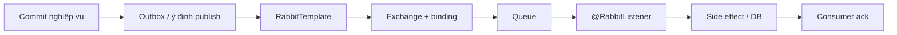
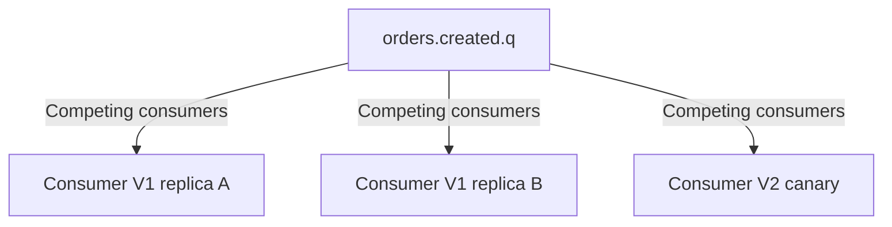
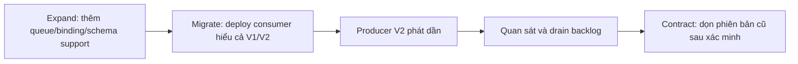

# Kiểm thử hồi quy, phát hành từng phần và kế hoạch khôi phục trong Spring AMQP

Một bản nâng cấp Spring AMQP có thể **khởi động thành công, kết nối RabbitMQ được và vẫn làm mất hiệu quả nghiệp vụ**. Ví dụ: phiên bản consumer mới đọc không được message JSON đã nằm trong queue từ trước; cấu hình retry thay đổi khiến poison message được requeue vô hạn; một lần rolling deployment tạo ra hai phiên bản consumer có xử lý side effect khác nhau; hoặc producer phát event phiên bản mới rồi đội vận hành rollback consumer về mã cũ không còn hiểu schema đó.

Trong chương **Nâng cấp và tương thích** của **SPRING_AMQP**, bài này xây dựng cách **kiểm thử hồi quy (regression testing)** và **phát hành từng phần (progressive delivery)** cho ứng dụng tích hợp RabbitMQ bằng `RabbitTemplate`, `@RabbitListener`, exchange, queue và binding. Mục tiêu không chỉ là “deploy không báo lỗi”, mà là giữ được các bảo đảm về **định tuyến, publisher confirms, acknowledgements, retry, dead-letter, idempotency, thứ tự và kết quả nghiệp vụ**.

Bài học tập trung vào ba câu hỏi:

1. **Trước khi nâng cấp, cần kiểm thử những hành vi nào để phát hiện hồi quy?**
2. **Làm sao cho phiên bản cũ và mới cùng hoạt động trong một khoảng chuyển tiếp mà không mất hoặc xử lý trùng dữ liệu?**
3. **Nếu metric xấu đi, phải dừng, rollback hoặc khôi phục message như thế nào cho an toàn?**

Các ví dụ hướng tới Spring Boot, Java 17+ và Spring AMQP qua **AMQP 0-9-1**. API cụ thể, BOM, cấu hình auto-configuration và broker image phải được điều chỉnh theo phiên bản dự án; bài không giả định một cặp Spring Boot–RabbitMQ duy nhất phù hợp mọi môi trường.

## 1. “Hồi quy” trong hệ thống bất đồng bộ có nghĩa gì?

Trong ứng dụng HTTP, có thể phát hiện hồi quy khi một request trước đây trả 200 nay trả 500. Với RabbitMQ, cùng một event còn có nhiều giai đoạn:



Một hồi quy có thể xuất hiện tại bất kỳ mũi tên nào:

| Hồi quy | Biểu hiện có thể thấy | Hậu quả |
|---|---|---|
| **Serialization** | Consumer mới không đọc được payload/header cũ | Retry, DLQ, backlog |
| **Routing** | Producer đổi routing key nhưng binding chưa đổi | Event không tới queue mong muốn |
| **Publish reliability** | Tắt nhầm correlated confirms/returns | Không phát hiện publish chưa được xác nhận/unroutable |
| **Acknowledgement** | Listener ack sớm hoặc quên ack manual | Mất cơ hội xử lý lại hoặc tăng unacked |
| **Retry/recoverer** | Lỗi vĩnh viễn bị requeue liên tục, hoặc hết retry bị xử lý sai | Retry storm, dead-letter sai |
| **Idempotency** | Sau redelivery tạo lại email/charge/payment | Side effect trùng |
| **Ordering** | Consumer mới thay đổi concurrency/batch | Event cập nhật trạng thái sai thứ tự |
| **Performance** | P95 tăng, prefetch giữ quá nhiều message | Lag, OOM, tăng time-to-recover |
| **Observability** | Meter hoặc tag đổi sau nâng phiên bản | Dashboard/alert báo xanh giả |

**Một phép thử “`convertAndSend` không ném exception” không bảo đảm toàn bộ chuỗi này.** Trong mô hình at-least-once, hệ thống vẫn có khả năng nhận duplicate khi kết quả publish hoặc ack không xác định. Kiểm thử hồi quy phải xác minh **kết quả cuối**, chứ không chỉ một tín hiệu cục bộ.

## 2. Chuẩn bị baseline trước khi đổi code hoặc broker

Trước khi bắt đầu, lưu một **bản chụp cấu hình và hành vi đã biết là đúng**. Nó là cơ sở để so sánh canary và quyết định rollback.

### 2.1. Inventory tối thiểu

| Nhóm | Dữ liệu cần ghi nhận |
|---|---|
| Runtime | Java/JDK, Spring Boot, Spring AMQP, RabbitMQ Java client, RabbitMQ broker version |
| Topology | Virtual host, exchange type, queue type, durability, binding/routing key, DLX/DLQ |
| Producer | `RabbitTemplate` được dùng, converter, confirms, returns, `mandatory`, outbox |
| Consumer | Listener id, container type, `acknowledgeMode`, prefetch, concurrency, retry advice/recoverer |
| Event contract | `eventType`, `schemaVersion`, content type, headers, dữ liệu bắt buộc |
| Data integrity | Idempotency key, inbox/outbox table, trạng thái business transaction |
| Metrics | Publish attempts/confirms/returns, ready/unacked, ack rate, DLQ, listener errors, latency |
| Operations | Rollout strategy, quyền thực hiện rollback, nguồn replay, retention/backlog và điểm dừng |

Đặc biệt cần lưu **dependency graph runtime thực**, không chỉ tên starter trong `build.gradle`, vì Spring Boot BOM và các override có thể chọn phiên bản thư viện khác dự kiến.

### 2.2. Baseline nên được đo bằng tải đại diện

Ví dụ trước upgrade, với queue `orders.email.q`:

```text
Publish attempts:          1.000/min
Publisher confirm NACK:    0
Mandatory returns:         0
Listener business success: 995/min
Retry attempts:            8/min
DLQ ingress:               1/min
Listener p95:              120 ms
Queue ready:               dao động 0–300
Unacked:                   dao động 10–40
```

Những con số trên **chỉ là dữ liệu giả lập để minh họa cách đặt baseline**, không phải ngưỡng tốt cho mọi hệ thống. Trong vận hành thực, cần so sánh theo traffic mix, giờ cao điểm, kích thước payload, số replica và tình trạng downstream. Một canary có request ít hơn chưa chắc chứng minh latency/tỷ lệ lỗi tốt hơn.

## 3. Phân cấp kiểm thử: cái gì cần broker thật?

Một chiến lược hiệu quả dùng nhiều cấp kiểm thử với mục tiêu khác nhau:

| Cấp | Cách thực hiện | Xác minh tốt | Không đủ để khẳng định |
|---|---|---|---|
| **Unit** | JUnit/Mockito gọi service, mock `RabbitTemplate` | Validation, business mapping, retry decision thuần | Routing, ack, confirm từ broker |
| **Component không broker** | `TestRabbitTemplate` gọi listener trong Spring context | Converter/adapter, listener method, reply đơn giản | Exchange/binding, TTL, DLX, network |
| **Contract** | JSON/schema fixtures của producer V1, V2 và consumer | Tương thích message contract | Broker routing/retention thực |
| **Integration broker-backed** | Spring context với RabbitMQ thật/Testcontainers | Routing, confirms, returns, consumer ack, DLQ, ACL | Tải production, sự cố nhiều node |
| **E2E/smoke** | Cả producer, queue, consumer và dữ liệu nghiệp vụ | Tác động cuối cùng theo `eventId` | Mọi failure path/chaos |
| **Load/chaos** | Tải đại diện, ngắt kết nối/pod, restart broker | Backlog, redelivery, recovery, SLO | Không thay thế kiểm thử contract |

**Điểm phân biệt quan trọng:** `TestRabbitTemplate` rất hữu ích để test listener nhanh, nhưng nó định tuyến trực tiếp tới listener theo **tên queue**. Nó không mô phỏng exchange, binding, publisher confirm, consumer ack, DLX hay prefetch thực. Muốn kiểm chứng những cơ chế đó phải dùng **RabbitMQ thật**.

### Tại sao cần nhiều cấp?

- Unit test cho phản hồi nhanh và phát hiện nhiều lỗi nghiệp vụ.
- Contract test giữ producer/consumer tương thích khi deploy lệch phiên bản.
- Integration test bảo đảm topology và giao thức thật.
- Smoke test trả lời câu hỏi: “Event đã tạo kết quả nghiệp vụ đúng chưa?”.
- Fault test giúp xác minh điều không thể thấy khi đường đi luôn thành công.

## 4. Ma trận hồi quy bắt buộc cho `RabbitTemplate` và `@RabbitListener`

Không nên chỉ có “happy-path test”. Một bộ test đủ ý nghĩa cần bao trùm ít nhất các nhóm sau.

### 4.1. Producer và định tuyến

| Tình huống | Assertion cần có |
|---|---|
| Publish exchange/routing key đúng | Queue mong muốn nhận đúng `eventId` |
| Sai routing key với `mandatory=true` | Xem publisher returned message khi không queue nào nhận |
| Exchange không tồn tại | Bắt được channel/protocol error; không nhầm với unroutable |
| Exchange có nhiều queue đích | Kiểm tra **từng queue bắt buộc** có message, không chỉ confirm ACK |
| Confirm ACK | Broker đã xác nhận publish theo chế độ confirm, **không suy ra consumer hoàn tất** |
| Confirm NACK hoặc timeout | Outbox/retry xử lý đúng kết quả chưa rõ; không mất event |
| Publisher crash sau commit DB trước send | Relay outbox phát được event khi hồi phục |
| Publisher crash sau send trước ghi nhận confirm | Replay không tạo side effect trùng |

Đặc biệt, một **mandatory return** thường chỉ báo message không thể route tới **bất kỳ queue nào** theo điều kiện áp dụng. Nếu message đã vào queue A nhưng binding tới queue B thiếu, return có thể **không xảy ra**. Kiểm thử pub/sub phải xác minh từng subscription.

### 4.2. Consumer, ack và xử lý lỗi

| Tình huống | Assertion cần có |
|---|---|
| Payload hợp lệ | Listener xử lý và ack sau khi business commit |
| Payload/schema không hợp lệ | Error classifier/recoverer đưa đến trạng thái đã định, không loop mãi |
| Dependency timeout | Retry/backoff đúng số lần, sau đó chuyển DLQ nếu policy yêu cầu |
| Crash sau commit trước ack | Delivery có thể đến lại; side effect chỉ hoàn tất logic một lần |
| `AcknowledgeMode.MANUAL` | Mọi nhánh xử lý có ack/nack đúng delivery tag |
| Prefetch/concurrency thay đổi | Không vượt resource budget, không tạo race condition sai nghiệp vụ |
| Nhiều consumer cùng queue | Mỗi delivery được phân cho một consumer trong nhóm, không mặc nhiên broadcast |
| Listener async | Kết quả hoàn tất/exception quyết định ack như thiết kế, không ack trước completion |
| DLQ re-drive | Event giữ ID để dedup, không gây vòng lặp vô tận |

**Không đồng nhất “số lần listener được gọi” với “số event logic xử lý thành công”.** Retry/redelivery có thể gọi nhiều lần cùng `eventId`; chính sách đúng phải được đo bằng side effect cuối và trạng thái inbox.

### 4.3. Compatibility matrix giữa release cũ và mới

| Producer | Consumer | Dữ liệu phải thử | Ý nghĩa |
|---|---|---|---|
| V1 | V1 | Event V1 | Baseline |
| V1 | **V2** | Event V1, gồm message đang chờ từ trước | Consumer mới phải đọc backlog cũ |
| **V2** | V1 | Event V2 nếu vẫn có consumer cũ | Không được phát schema phá tương thích sớm |
| **V2** | **V2** | Event V1 và V2 khi có replay | Đúng khi đã hoàn tất rollout |

Không chỉ thử deserialize một JSON tối giản. Nên có **fixture** cho event thiếu trường tùy chọn, giá trị null, enum không biết trước, Java time, headers, routing key, content type và bản schema cũ nhất vẫn còn trong queue.

## 5. Một contract sự kiện làm điểm tựa hồi quy

Ví dụ một event `OrderCreatedV1`:

```json
{
  "eventId": "evt-7c1f",
  "eventType": "OrderCreated",
  "schemaVersion": 1,
  "orderId": "ORD-501",
  "occurredAt": "2026-11-26T06:00:00Z"
}
```

Các nguyên tắc contract:

1. `eventId` là danh tính **sự kiện logic**, không tạo lại khi retry/replay.
2. `schemaVersion` cho consumer biết cách diễn giải payload.
3. `occurredAt` có timezone rõ; không dùng timestamp làm idempotency key.
4. Field mới nên được thêm theo hướng tương thích khi consumer cũ cho phép.
5. Không âm thầm đổi ý nghĩa/kiểu của field cũ.
6. Không gửi nguyên database entity có lazy references hoặc dữ liệu nhạy cảm không cần thiết.

Ví dụ Java record ở **một file riêng**:

```java
import java.time.Instant;

public record OrderCreatedV1(
        String eventId,
        String orderId,
        Instant occurredAt,
        int schemaVersion) {
}
```

Khi dùng JSON converter (ví dụ Jackson-based converter của Spring AMQP), phải kiểm thử cả **body và headers**. Việc nâng Spring AMQP/Jackson có thể thay đổi cách tạo type metadata, target type và ánh xạ `Instant`. **Mã consumer V2 không được giả định chỉ nhận event do producer V2 phát**, vì queue có thể chứa message V1 chưa được ack từ nhiều giờ trước.

### Ví dụ contract test cần ghi rõ

```text
Given: file fixture của OrderCreatedV1 (payload thực đã publish bởi V1)
When: consumer/converter V2 deserialize
Then:
  eventId, orderId, occurredAt, schemaVersion đều đúng
  không tự thực thi side effect trước khi validate xong
  field mới (nếu có) không làm mất dữ liệu cũ
  payload lỗi được xử lý theo failure policy, không loop mãi
```

Nếu phải phát `OrderCreatedV2` không tương thích, cân nhắc **routing key/queue mới**, adapter chuyển đổi hoặc dual-publish có kiểm soát thay vì lén thay schema dưới cùng routing key.

## 6. Integration test với RabbitMQ thật: cơ sở hạ tầng

Đây là ví dụ dùng Spring Boot 3.x, Java 17+, JUnit 5 và Testcontainers. Mục đích là kiểm tra **một publish thật qua direct exchange và binding**, rồi phân biệt key đúng và key sai.

Ví dụ dependencies Gradle:

```groovy
dependencies {
    implementation 'org.springframework.boot:spring-boot-starter-amqp'

    testImplementation 'org.springframework.boot:spring-boot-starter-test'
    testImplementation 'org.springframework.amqp:spring-rabbit-test'
    testImplementation 'org.testcontainers:junit-jupiter'
    testImplementation 'org.testcontainers:rabbitmq'
}
```

Nếu dùng Spring Boot major khác, hãy đối chiếu tên starter và BOM theo release đích. Để kiểm chứng AMQP 0-9-1 của `RabbitTemplate` phải chọn **starter Spring Rabbit phù hợp**, không mặc định mọi starter mang tên AMQP đều có cùng API ở các thế hệ Boot.

### Test mẫu với một queue riêng, không có listener cạnh tranh

```java
import java.util.UUID;
import java.util.concurrent.TimeUnit;

import org.junit.jupiter.api.BeforeEach;
import org.junit.jupiter.api.Test;
import org.springframework.amqp.core.BindingBuilder;
import org.springframework.amqp.core.DirectExchange;
import org.springframework.amqp.core.Queue;
import org.springframework.amqp.rabbit.connection.CorrelationData;
import org.springframework.amqp.rabbit.core.RabbitAdmin;
import org.springframework.amqp.rabbit.core.RabbitTemplate;
import org.springframework.beans.factory.annotation.Autowired;
import org.springframework.boot.test.context.SpringBootTest;
import org.springframework.test.context.DynamicPropertyRegistry;
import org.springframework.test.context.DynamicPropertySource;
import org.testcontainers.containers.RabbitMQContainer;
import org.testcontainers.junit.jupiter.Container;
import org.testcontainers.junit.jupiter.Testcontainers;

import static org.assertj.core.api.Assertions.assertThat;

@Testcontainers
@SpringBootTest
class OrderRoutingRegressionIT {
    private static final String EX = "it.orders.events";
    private static final String Q = "it.orders.created";
    private static final String KEY = "order.created.v1";

    @Container
    static final RabbitMQContainer rabbit =
            new RabbitMQContainer("rabbitmq:4.1-management");

    @DynamicPropertySource
    static void rabbitProperties(DynamicPropertyRegistry properties) {
        properties.add("spring.rabbitmq.host", rabbit::getHost);
        properties.add("spring.rabbitmq.port", rabbit::getAmqpPort);
        properties.add("spring.rabbitmq.username",
                rabbit::getAdminUsername);
        properties.add("spring.rabbitmq.password",
                rabbit::getAdminPassword);
        properties.add("spring.rabbitmq.publisher-confirm-type",
                () -> "correlated");
        properties.add("spring.rabbitmq.publisher-returns",
                () -> "true");
        properties.add("spring.rabbitmq.template.mandatory",
                () -> "true");
    }

    @Autowired RabbitTemplate rabbitTemplate;
    @Autowired RabbitAdmin rabbitAdmin;

    @BeforeEach
    void createTopology() {
        DirectExchange exchange = new DirectExchange(EX);
        Queue queue = new Queue(Q, true);
        rabbitAdmin.declareExchange(exchange);
        rabbitAdmin.declareQueue(queue);
        rabbitAdmin.declareBinding(
                BindingBuilder.bind(queue).to(exchange).with(KEY));
        rabbitAdmin.purgeQueue(Q, false); // Chờ purge hoàn tất trong test.
    }

    @Test
    void expectedRoutingKeyReachesQueue() throws Exception {
        String eventId = "evt-" + UUID.randomUUID();
        CorrelationData correlation = new CorrelationData(eventId);

        rabbitTemplate.convertAndSend(EX, KEY, eventId, correlation);
        var confirm = correlation.getFuture().get(5, TimeUnit.SECONDS);

        assertThat(confirm.isAck()).isTrue();
        assertThat(correlation.getReturned()).isNull();
        assertThat(rabbitTemplate.receiveAndConvert(Q, 5000))
                .isEqualTo(eventId);
    }

    @Test
    void wrongRoutingKeyIsReturned() throws Exception {
        String eventId = "evt-" + UUID.randomUUID();
        CorrelationData correlation = new CorrelationData(eventId);

        rabbitTemplate.convertAndSend(
                EX, "order.creatd.v1", eventId, correlation);
        var confirm = correlation.getFuture().get(5, TimeUnit.SECONDS);

        assertThat(confirm.isAck()).isTrue();
        assertThat(correlation.getReturned()).isNotNull();
        assertThat(correlation.getReturned().getRoutingKey())
                .isEqualTo("order.creatd.v1");
    }
}
```

**Phạm vi và điều kiện:** test trên cần Spring Boot context đã có `RabbitAdmin` auto-configured, broker container, quyền khai báo, correlated confirms/returns, `mandatory=true` và queue không bị consumer khác rút message. Tag `rabbitmq:4.1-management` chỉ là **ví dụ để chạy test**, không đại diện cho bản broker cần triển khai; CI nên pin patch image đã được tổ chức hỗ trợ/kiểm chứng.

Đây là test **routing và confirm/return**, chưa kiểm tra listener business logic. Không dùng queue chung với production hoặc test khác; `purgeQueue` trong ví dụ **chỉ hợp lệ với queue test riêng**. Đối với kiểm thử consumer thật, bỏ cách nhận bằng `receiveAndConvert` và dùng test recorder/inbox/latch để chờ `@RabbitListener` xử lý.

### Thêm test negative path

Với broker test riêng, có thể bổ sung các ca:

- Publish tới exchange không tồn tại, xem channel exception và recovery.
- Bỏ binding rồi thử publish; xác minh returned message.
- Chạy consumer với lỗi validation; xác minh DLQ thực sự nhận event.
- Làm mất connection **sau khi commit database nhưng trước ack**; xác minh redelivery và idempotency.
- Restart broker/consumer giữa xử lý; đo backlog và thời gian phục hồi.

**Không cố tình phá topology hoặc publish message lỗi trên queue production** chỉ để test negative path.

## 7. Test idempotency bằng dữ liệu thật, không chỉ đếm lời gọi

Một lần xử lý có thể hoàn tất DB nhưng consumer chưa kịp gửi ack; RabbitMQ có thể giao lại message. Do đó, khi nâng cấp listener, cần kiểm thử:

```text
eventId = evt-7c1f

Lần 1: ghi dữ liệu nghiệp vụ thành công, crash trước khi ack.
Lần 2: RabbitMQ redeliver cùng event.

Kết quả mong muốn:
  số delivery hoặc listener invocation có thể là 2,
  nhưng trạng thái business chỉ thay đổi đúng một lần.
```

Một thiết kế inbox với khóa duy nhất:

```sql
CREATE TABLE consumer_inbox (
    consumer_group VARCHAR(80) NOT NULL,
    event_id VARCHAR(120) NOT NULL,
    processed_at TIMESTAMPTZ NOT NULL DEFAULT now(),
    PRIMARY KEY (consumer_group, event_id)
);
```

Ví dụ service dùng PostgreSQL và Spring transaction:

```java
import org.springframework.jdbc.core.JdbcTemplate;
import org.springframework.stereotype.Service;
import org.springframework.transaction.annotation.Transactional;

@Service
public class OrderProjectionService {
    private final JdbcTemplate jdbc;

    public OrderProjectionService(JdbcTemplate jdbc) {
        this.jdbc = jdbc;
    }

    @Transactional
    public void apply(OrderCreatedV1 event) {
        int inserted = jdbc.update("""
                INSERT INTO consumer_inbox(consumer_group, event_id)
                VALUES (?, ?)
                ON CONFLICT DO NOTHING
                """, "order-projection", event.eventId());

        if (inserted == 0) {
            return; // Event logic đã được xử lý trong transaction cũ.
        }

        jdbc.update("""
                INSERT INTO order_projection(order_id, last_event_id)
                VALUES (?, ?)
                ON CONFLICT (order_id)
                DO UPDATE SET last_event_id = EXCLUDED.last_event_id
                """, event.orderId(), event.eventId());
    }
}
```

**Điều kiện bắt buộc:** ví dụ cần Spring JDBC và transaction manager phù hợp; table `order_projection` phải tồn tại, `order_id` có unique constraint, và cả inbox + projection được ghi trong **cùng transaction database**. Code này chỉ minh họa projection cho `OrderCreatedV1`, không bao quát ordering/version khi nhiều loại event cùng sửa một aggregate.

Nếu listener gọi **API ngoài** (thanh toán, email), transaction database không tự bao gồm side effect của provider. Cần idempotency key ở provider, outbox cho side effect hoặc reconciliation chuyên biệt. **Inbox không tự tạo exactly-once** cho các hành động ngoài DB.

## 8. Regression test cho retry, reject/requeue và DLQ

Đây là nơi nâng Spring AMQP/framework hoặc đổi listener factory có thể tạo khác biệt lớn dù code nghiệp vụ không thay đổi.

### Các kịch bản cần tạo có chủ đích

| Lỗi | Thiết lập test | Kỳ vọng |
|---|---|---|
| Validation error không thể sửa | Event thiếu field bắt buộc | Reject/quarantine theo policy; không requeue mãi |
| HTTP timeout nhất thời | Stub downstream timeout 2 lần rồi thành công | Đúng số lần thử, không tạo side effect lặp |
| Database luôn unavailable | Stub DB luôn lỗi | Hết retry -> DLQ hoặc parking lot theo policy |
| Poison message trong queue nhiều message | Một payload sai giữa nhiều payload đúng | Không làm toàn bộ consumer group tê liệt vô thời hạn |
| Dead-letter routing sai | DLX thiếu binding hoặc queue bị xóa trong test | Test phát hiện DLQ không nhận; không tuyên bố “không mất” |
| Re-drive từ DLQ | Replay cùng `eventId` | Dedupe đúng và không tạo vòng lặp retry–DLQ |
| Manual ack bị bỏ quên | Không gọi ack/nack một nhánh | Test phát hiện unacked tăng và consumer hết tín dụng QoS |

**Lưu ý:** `AcknowledgeMode.AUTO` là container ack khi listener thành công, không phải RabbitMQ auto-ack ngay khi delivery. Với `MANUAL`, ứng dụng chịu trách nhiệm gọi `basicAck`/`basicNack` đúng trên channel và delivery tag. Cần test các nhánh exception sau khi transaction commit, trước ack, và sau khi retry exhausted.

### Ví dụ cấu hình listener có dead-letter path

```java
import org.springframework.amqp.core.Binding;
import org.springframework.amqp.core.BindingBuilder;
import org.springframework.amqp.core.DirectExchange;
import org.springframework.amqp.core.Queue;
import org.springframework.amqp.core.QueueBuilder;
import org.springframework.context.annotation.Bean;
import org.springframework.context.annotation.Configuration;

@Configuration
public class OrderQueues {
    @Bean
    DirectExchange events() {
        return new DirectExchange("orders.events");
    }

    @Bean
    DirectExchange deadEvents() {
        return new DirectExchange("orders.dead");
    }

    @Bean
    Queue ordersQueue() {
        return QueueBuilder.durable("orders.created.q")
                .deadLetterExchange("orders.dead")
                .deadLetterRoutingKey("created.failed")
                .build();
    }

    @Bean
    Queue ordersDlq() {
        return QueueBuilder.durable("orders.created.dlq").build();
    }

    @Bean
    Binding incoming() {
        return BindingBuilder.bind(ordersQueue())
                .to(events()).with("order.created.v1");
    }

    @Bean
    Binding deadLetterBinding() {
        return BindingBuilder.bind(ordersDlq())
                .to(deadEvents()).with("created.failed");
    }
}
```

Với queue được khai báo đủ DLX/DLQ, test có thể cố ý để listener reject `requeue=false` rồi chờ message xuất hiện tại `orders.created.dlq`. Cấu hình trên **chưa tự đặt retry count hoặc BackOff**; phải tạo retry policy riêng và kiểm chứng theo Spring AMQP version đang dùng.

Không sửa arguments của queue production đã tồn tại chỉ để thêm DLX trong một release mà chưa đánh giá compatibility. Đổi arguments có thể tạo `PRECONDITION_FAILED`; với topology có sẵn, cân nhắc broker policies/migration phù hợp.

## 9. Định nghĩa “phát hành từng phần” cho producer và consumer

Progressive delivery thường gồm **canary**, **rolling update** hoặc **blue–green**. Nhưng các kỹ thuật này hoạt động **không giống HTTP request routing** khi ứng dụng nhận message từ cùng một RabbitMQ queue.

### Với producer

Nếu producer nhận HTTP request, ingress/load balancer có thể hướng một phần request tới phiên bản mới; nhưng cả hai phiên bản có thể publish vào **cùng exchange**. Điều kiện an toàn là **consumer hiện tại phải đọc được cả event cũ lẫn event mới**.

Khi áp dụng canary producer:

- Không đổi routing key hoặc schema phá tương thích cho 1% request nếu 99% consumer còn ở V1.
- Có thể bật code mới bằng feature flag cho một tập business key ổn định.
- Đo riêng publish confirms, returns, outbox lag và kết quả của event do V2 tạo.

### Với consumer

Nếu hai deployment **V1 và V2 cùng consume một queue**, RabbitMQ phân phối các delivery giữa những consumer đang sẵn sàng. Tăng canary lên 1 pod trong 10 pod **không bảo đảm chính xác 10% message** tới V2, vì prefetch, tốc độ xử lý, consumer count và trạng thái ack ảnh hưởng phân phối.



Chỉ dùng canary chung queue khi **V1 và V2 đều có thể xử lý an toàn mọi message của queue**, và side effects có thể dedup/đối soát. Không dùng cùng queue để thử consumer V2 chưa tương thích với message V1 còn tồn tại.

### Shadow consumption qua queue riêng

Một mô hình kiểm thử an toàn hơn cho code xử lý mới:

```text
Topic exchange: orders.events
       |
       +-- orders.created.q        -> Consumer V1 production
       |
       +-- orders.created.shadow.q -> Consumer V2 shadow
```

**Shadow queue nhận bản sao riêng** từ khi binding được tạo; không tự chứa event đã phát trước đó. Phải **tắt hoặc sandbox mọi side effect** của shadow consumer (email, thanh toán, ghi dữ liệu production), đồng thời giới hạn retention và lưu lượng broker. Shadow giúp so sánh parse/validation/logic, **không thay thế canary thật cho side effect cuối**.

Nếu cần đo một phần traffic được quyết định chính xác theo business key, hãy thiết kế routing/feature flag có chủ đích và kiểm thử phân phối; không giả định số replica tương đương tỷ lệ delivery.

## 10. Thiết kế rollout theo expand → migrate → contract

Để phiên bản cũ và mới cùng tồn tại, cần đổi theo thứ tự **mở rộng khả năng nhận trước, thay đổi phát sau, loại bỏ cấu hình cũ cuối cùng**.



### 10.1. Bước Expand

- Provision topology cần thiết **trước khi** producer bắt đầu phát bằng routing key mới.
- Giữ binding cũ còn hiệu lực.
- Chuẩn bị DLQ/parking lot và permission của consumer phiên bản mới.
- Bổ sung consumer code hiểu schema V1 và V2, kể cả message V1 có thể còn trong queue.

### 10.2. Bước Migrate

- Deploy một số consumer V2 hoặc shadow queue theo ràng buộc an toàn.
- Kiểm thử với backlog cũ, duplicate, poison message và sự cố downstream.
- Bật publish V2 theo một feature flag/nhóm traffic nhỏ nếu các consumer đã tương thích.
- Theo dõi business success, retry/DLQ và latency theo version.

### 10.3. Bước Contract

- Chỉ bỏ binding/queue/handler V1 khi biết chắc dữ liệu V1 không còn cần xử lý hoặc đã được migrate/replay.
- Không `purgeQueue` để “dọn đường” trong production nếu backlog còn giá trị.
- Ghi rõ điều kiện khôi phục và thời điểm không còn rollback về V1 được.

**Một queue chứa message là dữ liệu đang tồn tại, không phải cấu hình có thể xóa tùy ý.** Nâng cấp consumer phải tương thích với dữ liệu *đã được ghi vào queue*, không chỉ với producer đang chạy.

## 11. Đặt cổng quyết định (release gates) trước rollout

Mỗi bước tăng tỷ lệ canary nên có **điều kiện vào, điều kiện đạt và ngưỡng dừng** đã thống nhất trước khi deploy.

| Gate | Phải chứng minh | Nếu không đạt |
|---|---|---|
| **G0 — Build & contract** | Dependency phù hợp; các test V1↔V2, fixtures pass | Không phát hành |
| **G1 — Broker integration** | Routing, confirms/returns, ack, retry/DLQ, idempotency pass | Sửa test/config, không canary |
| **G2 — Staging soak/fault** | Tải, reconnect, redelivery, DLQ re-drive hoạt động | Không promote |
| **G3 — Canary** | Không tăng bất thường business failure, DLQ, return, backlog và latency | Pause/rollback canary |
| **G4 — Rolling** | V1/V2 cùng hoạt động; backlog và error budget trong ngưỡng | Dừng tăng rollout |
| **G5 — Hoàn tất** | Drain/đối soát dữ liệu, alarm sạch, rollback window được quyết định | Chưa xóa topology/schema cũ |

### Ví dụ tiêu chí minh họa

```text
Canary observation window: 30 phút
Điều kiện tối thiểu: đủ số event có ý nghĩa thống kê

Stop immediately nếu:
  mandatory returned messages không mong muốn > 0,
  có charge/email trùng phát sinh do V2,
  message lỗi không được DLQ/retry đúng chính sách,
  user-facing business outcome sai.

Hold/pause nếu:
  retry rate hoặc DLQ ingress vượt baseline đã phê duyệt,
  queue lag tăng liên tục dù traffic tương đương,
  listener p95 tăng rõ và không do downstream chung.
```

Các số lượng/thời gian trên là **minh họa phương pháp**. Ngưỡng thực tế phải do team xác định từ SLO và error budget; không so sánh p95 khi sample size quá nhỏ hoặc mix event khác biệt lớn.

### Phân biệt tín hiệu producer và consumer

- `RabbitTemplate` gọi thành công không chứng minh message đã tới queue.
- Publisher confirm ACK không chứng minh consumer đã xử lý.
- `mandatory`/returns không phát hiện **một subscriber bị thiếu** nếu message vẫn được route tới queue khác.
- Queue ready bằng 0 có thể do consumer xử lý rất nhanh, không nhất thiết là mất message.
- Listener count có thể tăng vì retry, không đồng nghĩa business events thành công tăng.

Do đó gate tốt phải kết hợp **broker metrics và business metrics**.

## 12. Giám sát canary và rolling deployment

Theo dõi ít nhất bốn nhóm số liệu sau.

### 12.1. Producer

- Publish attempts/rate và lỗi chuyển đổi message.
- Confirm ACK/NACK/timeout, độ trễ xác nhận.
- `mandatory` returned messages và exchange/routing key ở mức label hữu hạn.
- Outbox backlog/age và số event chưa được đối soát.

### 12.2. Broker

- `messages_ready`, `messages_unacknowledged`, consumer count **theo queue**.
- Deliver/ack/redelivery rate và queue ingress.
- Resource alarms, memory/disk headroom, connection/channel churn.
- Quorum queue/replica health nếu sử dụng.

### 12.3. Consumer

- Listener success/failure và latency P50/P95/P99.
- Retry count, exception category, số message bị chuyển DLQ.
- Số consumer thực tế, prefetch, batch size, thời gian graceful shutdown.
- Trạng thái dedup/inbox và lỗi downstream.

### 12.4. Nghiệp vụ

- Tỷ lệ order được cập nhật, email gửi hoặc index tạo thành công.
- Duplicate side effects theo `eventId`/business key.
- Event age / end-to-end latency từ event được tạo tới khi xử lý hoàn tất.
- Số event cần replay và thời gian khôi phục backlog.

Ví dụ bảng quyết định:

| Tín hiệu | Khả năng | Cách phản ứng |
|---|---|---|
| Producer confirms bình thường, queue ready tăng | Consumer không theo kịp hoặc dừng | Kiểm tra listener/downstream/concurrency |
| Returned publish tăng ngay sau deploy | Routing key/binding sai | Pause producer mới, sửa topology, xác định event cần replay |
| DLQ tăng chỉ ở consumer V2 | Converter/logic V2 hồi quy | Dừng V2, giữ DLQ để điều tra |
| Duplicate business outcomes | Idempotency hoặc ack/replay sai | Dừng đường side effect, đối soát dữ liệu trước replay |
| Unacked cao, consumer count vẫn có | Manual ack quên, xử lý chậm, prefetch lớn | Kiểm tra ack và Thread/DB/API state |
| Metric biến mất sau nâng framework | Meter/tag hoặc Observation thay đổi | Khôi phục instrumentation/alert trước promote |

**Đừng dùng `eventId`, `orderId` hoặc `traceId` làm nhãn Micrometer/Prometheus** vì cardinality có thể rất cao. Lưu chúng trong structured log/tracing và inbox/outbox có kiểm soát.

## 13. Khi nào nên pause, rollback hoặc roll forward?

Không phải lỗi nào cũng nên rollback ngay; đôi khi sửa một binding hoặc feature flag sẽ an toàn hơn. Quyết định phải dựa trên **các thay đổi đã xảy ra với message và dữ liệu**.

| Tình huống | Hướng xử lý thường phù hợp | Điều kiện |
|---|---|---|
| Canary V2 parse event V1 lỗi, producer vẫn phát V1 | **Rollback/pause consumer V2** | Consumer V1 còn đọc được backlog |
| Producer V2 mới phát V2 phá tương thích | **Ngừng phát V2**, cân nhắc adapter/roll forward | Không rollback consumer về V1 khi queue còn V2 chưa xử lý |
| Sai binding mới gây unroutable | **Sửa topology**, đối soát/replay từ outbox | Event có nguồn phục hồi và idempotency |
| Retry policy gây vòng requeue | **Tắt consumer lỗi**, sửa policy, giữ DLQ/backlog | Không xóa dữ liệu đang chờ |
| Schema DB đã migration một chiều | Có thể phải **roll forward** hoặc restore có kiểm soát | Rollback binary không khôi phục schema |
| Broker major upgrade thay đổi feature flags/queue type | Theo **quy trình khôi phục broker** riêng | Không giả định downgrade broker được hỗ trợ |
| Side effect thanh toán/email đã xảy ra sai | Incident response nghiệp vụ + reconciliation | Deploy lại code cũ không đảo ngược side effect |

**Rollback binary không phải là “undo mọi sự kiện”.** Nó chỉ đổi code/config đang chạy, không xóa message đã publish, không hoàn nguyên ack, database transaction hoặc API ngoài.

## 14. Kế hoạch rollback ứng dụng phải được soạn trước release

Một rollback khả thi gồm **người quyết định, điều kiện kích hoạt, thao tác dừng luồng lỗi, phương án phục hồi, tiêu chí xác minh và cửa sổ tương thích**.

### Runbook đề xuất

1. **Phát hiện và xác nhận:** chỉ rõ metric/alert, version bị ảnh hưởng, event ID mẫu, thời điểm bắt đầu.
2. **Ngăn phát sinh tác động sai:** pause canary, tắt feature flag producer V2 hoặc chặn nguồn side effect theo runbook được phê duyệt.
3. **Giữ lại dữ liệu:** bảo vệ outbox, queue ready/unacked và DLQ; không purge queue hay xóa binding khi chưa đánh giá.
4. **Xác định tính tương thích:** consumer V1 có đọc được event đang nằm trong queue không? DB schema có còn tương thích không?
5. **Chọn hành động:** rollback deployment, roll forward hotfix, thay đổi binding/feature flag hoặc cô lập queue.
6. **Thực hiện có kiểm soát:** chỉ định owner và ghi lại timestamp/version/broker/vhost của thay đổi.
7. **Theo dõi redelivery:** khi consumer V2 dừng, message chưa ack có thể được giao lại; inbox/idempotency phải xử lý được.
8. **Đối soát và replay:** xác định event bị thiếu/thừa từ outbox, DLQ, event store và business DB; giữ `eventId`.
9. **Xác minh sau khôi phục:** các message mới route đúng, backlog được drain, DLQ ổn định, không có side effect trùng.
10. **Đóng sự cố:** lưu bằng chứng, bổ sung regression case và cải thiện release gate trước lần thử tiếp.

### Ví dụ thao tác Kubernetes minh họa

```bash
# Chỉ dùng khi rollout policy và quyền vận hành đã cho phép.
kubectl rollout status deployment/orders-consumer -n orders

# Tạm dừng một rollout đang triển khai.
kubectl rollout pause deployment/orders-consumer -n orders

# Xem các revision trước khi chọn hướng rollback.
kubectl rollout history deployment/orders-consumer -n orders

# Thao tác này CHỈ đổi deployment binary/config, không undo message.
kubectl rollout undo deployment/orders-consumer -n orders
```

**Không chạy `rollout undo` một cách mù quáng** nếu producer V2 đã phát payload mới, DB đã đổi schema hoặc topology đã thay thế. Trong các trường hợp ấy, có thể cần deploy một **consumer bridge** hiểu cả V1/V2 rồi mới quyết định co cụm phiên bản.

### Pause rollout khác stop consumer

`kubectl rollout pause` ngừng tiến trình cập nhật Deployment, **không tự dừng các pod đang chạy**. Nếu phiên bản canary đang xử lý message sai, phải có phương án thực sự vô hiệu hóa listener của nó (feature flag, scale/điều phối phù hợp hoặc remove khỏi queue theo kế hoạch). Chỉ pause Deployment rồi giả định V2 không còn consume là sai.

## 15. Khôi phục message: outbox, DLQ và replay

Khi release sai gây mất route hoặc lỗi xử lý, có thể không có cách “undo” đơn giản. Nguồn phục hồi quyết định khả năng replay:

| Nguồn | Dùng được để | Điều phải lưu ý |
|---|---|---|
| **Transactional outbox** | Publish lại ý định phát event đã commit với DB | Relay có thể gửi lặp sau confirm không rõ |
| **DLQ/parking lot** | Điều tra payload lỗi và thử lại sau khi sửa code | Cần giữ metadata, retry policy, tránh vòng lặp |
| **Alternate exchange/fallback queue** | Lưu một số message unroutable theo topology đã cấu hình | Không tự lưu các message phát trước lúc fallback tồn tại |
| **Event store/CDC** | Backfill theo ID hoặc khoảng thời gian | Giữ ordering/version/idempotency |
| **Business DB** | Tái tạo event nếu dữ liệu gốc đủ | Không phải mọi thông tin event đều khôi phục được |
| **Không giữ nguồn** | Chỉ có thể điều tra/phục hồi thủ công khi khả thi | Không được tuyên bố “đã replay đầy đủ” |

### Quy trình re-drive chuẩn

```text
1. Xác định phạm vi: vhost, exchange, routing key, queue, từ T1 đến T2.
2. Truy danh sách eventId bị ảnh hưởng từ outbox/DLQ/event store.
3. Sửa schema/routing/binding/retry và test bằng một event không gây side effect.
4. Đối soát event nào đã tạo business outcome, event nào chưa.
5. Replay với eventId gốc, rate limit và ghi dấu replayAttempt.
6. Giám sát queue ready/unacked, retry/DLQ, confirms và business success.
7. Dừng khi có dấu hiệu duplicate side effect hoặc backlog tăng bất thường.
8. Đối chiếu số lượng và kết quả nghiệp vụ, rồi lưu audit trail.
```

Không dùng “republish mọi message trong DLQ” như thao tác chuẩn không cần kiểm tra. Một số event đã được xử lý thành công ở nơi khác, có thể mang version không còn được hỗ trợ, hoặc sẽ kích hoạt lại payment/email. Cần **xác minh idempotency, phiên bản schema và quyền truy cập** trước khi re-drive.

## 16. Broker upgrade là một change riêng với rollback riêng

Nâng Spring Boot/Spring AMQP và nâng RabbitMQ broker **không nhất thiết phải xảy ra cùng lúc**. Nếu có thể, hãy tách để giảm số biến và dễ xác định nguyên nhân:

```text
Phase A: nâng ứng dụng, giữ broker stable
       -> contract tests, integration, canary, rollback window

Phase B: nâng broker theo supported upgrade path
       -> feature flags, Erlang/OTP, queue types, cluster health
       -> test client cũ/mới và bài kiểm thử giao nhận
```

Khi broker major upgrade, cần đọc **đúng tài liệu release đích** về upgrade path, feature flags, classic/quorum queue, plugins và khả năng downgrade. Một số thay đổi metadata, queue type hoặc feature flags **không thể đảo ngược bằng đổi image tag**.

Kế hoạch khôi phục broker có thể gồm:

- Snapshot/backup definitions theo quy trình, lưu secret/certificate an toàn.
- Phương án blue–green cluster có kiểm soát, chống publish kép và duplicate.
- Lượng disk/memory headroom để duy trì replication/recovery.
- Thứ tự cutover producer/consumer và cách xử lý unacked deliveries.
- Đối soát message backlog trước/sau migration; không giả định definitions backup là backup đầy đủ message.

**Không khuyến nghị downgrade broker không được nhà cung cấp hỗ trợ** chỉ để khắc phục một incident nhanh. Khi quay về cluster cũ, cần xem lại dữ liệu đã nhận trên cluster mới và kế hoạch đồng bộ, tránh vừa mất vừa nhân bản message.

## 17. Thực hành: mô phỏng một release sai và cách quyết định khôi phục

### Bối cảnh

Service `orders-producer` và `orders-search-consumer` dùng:

```text
Exchange: orders.events (topic)
Binding:  order.created.v1 -> orders.search.q
Event:    OrderCreatedV1
Consumer: @RabbitListener(queues="orders.search.q")
```

Phiên bản V2 muốn bổ sung `customerTier` và đổi routing key sang `order.created.v2`.

### Lần triển khai sai

1. Producer V2 bắt đầu phát `order.created.v2`.
2. Binding `order.created.v2` chưa được provision.
3. Producer không bật mandatory returns và không đối soát outbox.
4. Queue `orders.search.q` không nhận event mới, nhưng publish API không ném exception.
5. Đội vận hành thử rollback producer về V1; các event V2 **đã phát sai route** không tự được tạo lại.

### Cách triển khai đúng

1. Provision binding/schema V2 và thử bằng broker thật trước.
2. Deploy consumer V2 biết cả V1/V2; backlog V1 vẫn xử lý được.
3. Bật correlated confirms/returns và đối soát outbox.
4. Canary producer V2 có metric theo event version và business outcome.
5. Nếu metrics không ổn, **dừng phát V2**, không xóa topology V2 ngay.
6. Xác định event thiếu từ outbox/event store và replay có kiểm soát theo `eventId`.
7. Chỉ contract/bỏ V1 sau khi các queue và consumer cũ đã drain/migrate.

### Ba câu hỏi kiểm tra trước khi rollback

1. **Có payload mới đang tồn tại trong queue/DLQ không?** Nếu có, consumer cũ có hiểu không?
2. **Có side effect đã xảy ra ngoài hệ thống không?** Nếu có, undo binary không đảo ngược tác động đó.
3. **Có nguồn khôi phục event không?** Nếu không, rollback chỉ dừng lỗi mới chứ không tự phục hồi dữ liệu đã mất.

## 18. Các lỗi nhận thức thường gặp

**“Canary 1/10 consumer nghĩa là đúng 10% message chạy V2.”** Không. Competing consumers phân phối theo credit, prefetch, consumer count và tốc độ; không cam kết tỷ lệ chính xác.

**“Rollback consumer V2 về V1 là an toàn nếu CI đã xanh.”** Chưa chắc. Producer có thể đã phát V2 schema không tương thích; queue còn backlog V2.

**“Publisher confirm ACK nghĩa là mọi subscriber đã xử lý.”** Sai. Confirm là tín hiệu broker về publish, không phải consumer business completion.

**“`mandatory` phát hiện mọi queue thiếu binding.”** Sai. Nếu message vẫn route vào một queue khác, không có nghĩa mọi subscriber bắt buộc đã nhận.

**“`TestRabbitTemplate` test thành công là không cần test broker.”** Sai. Nó không mô phỏng đầy đủ broker routing, ack, confirms hay DLQ.

**“Retry và redelivery không ảnh hưởng business nếu listener dùng AUTO ack.”** Sai. Nếu side effect hoàn tất trước khi ack tới broker, event có thể bị giao lại.

**“Tăng consumer concurrency là rollback của latency regression.”** Không nhất thiết. Nếu downstream đã quá tải, tăng concurrency còn gây nhiều timeout/retry hơn.

**“Xóa queue/DLQ sẽ giúp deploy sạch.”** Không. Xóa/purge có thể làm mất dữ liệu cần xử lý; cần đánh giá backlog và replay.

**“Rollback Docker tag broker tự đưa dữ liệu về trạng thái cũ.”** Không. Broker metadata, feature flags, queue type và message đã xử lý không tự đảo ngược.

## 19. Checklist phát hành Spring AMQP an toàn

### Trước release

- [ ] Có inventory runtime/BOM, Java client, broker, topology và tài khoản/vhost.
- [ ] Có fixtures V1/V2; producer/consumer chạy được trong giai đoạn cùng tồn tại.
- [ ] Unit, contract, integration trên broker thật, DLQ và idempotency đều pass.
- [ ] Confirm/returns, retry, ack, outbox và inbox đã kiểm chứng bằng failure-path.
- [ ] Có baseline và go/no-go thresholds theo SLO, không chỉ “ứng dụng start”.
- [ ] Có backup/migration plan cho topology và dữ liệu, rollback window rõ ràng.
- [ ] Có người trực, quyền thao tác và runbook phù hợp từng môi trường.

### Trong release

- [ ] Provision topology tương thích trước khi producer phát event mới.
- [ ] Rollout consumer mới **hiểu message cũ trước**, sau đó mới bật producer/schema mới.
- [ ] Canary được quan sát đủ thời gian và mẫu traffic; biết rõ shared queue vs shadow queue.
- [ ] Giám sát confirm, returns, queue ready/unacked, DLQ, business outcomes và duplicate effects.
- [ ] Có khả năng pause/thực sự vô hiệu hóa đường xử lý lỗi; không chỉ pause rollout controller.

### Khi cần khôi phục

- [ ] Xác nhận tính tương thích của consumer cũ với payload đang chờ.
- [ ] Ngăn side effect sai tiếp tục xảy ra mà không làm mất backlog.
- [ ] Chọn rollback, roll forward hoặc bridge dựa trên schema/topology/data state.
- [ ] Outbox, DLQ, event store và audit trail được bảo vệ.
- [ ] Replay có dedup, rate limit và xác minh kết quả cuối.
- [ ] Sau khôi phục, bổ sung regression case để lỗi không lặp lại ở release sau.

### Câu hỏi tự kiểm tra

1. Vì sao một release `RabbitTemplate`/`@RabbitListener` cần kiểm thử cả routing, confirms, retry, ack và DLQ, không chỉ business method?
2. Khi consumer V2 nhận được message V1 còn tồn tại trong queue, điều này kiểm chứng dạng tương thích nào?
3. Vì sao một pod consumer V2 trong chín pod V1 không đảm bảo nhận đúng 10% deliveries?
4. Shadow queue hỗ trợ quan sát điều gì, và tại sao phải tắt side effect thật?
5. Nếu producer V2 đã phát event V2 nhưng consumer V1 không đọc được, rollback consumer về V1 có an toàn không?
6. Publisher confirm ACK và mandatory return khác nhau thế nào? Chúng có chứng minh tất cả subscriber nhận message không?
7. Vì sao crash sau commit DB nhưng trước consumer ack yêu cầu idempotency?
8. `kubectl rollout pause` có làm consumer V2 ngừng đọc queue ngay không?
9. Khi sửa một binding thiếu, các event đã bị unroutable trước đó có tự xuất hiện lại không? Cần nguồn nào để replay?
10. Vì sao nâng broker major có thể cần kế hoạch khôi phục khác với rollback application image?

**Ghi nhớ:** **Phát hành từng phần chỉ an toàn khi phiên bản cũ, phiên bản mới và dữ liệu đang nằm trong RabbitMQ còn tương thích.** Trước release, tạo regression suite trên broker thật cho `RabbitTemplate`, `@RabbitListener`, routing, confirms/returns, ack, retry, DLQ và idempotency. Khi canary/rolling, theo dõi cả tín hiệu giao nhận lẫn business outcomes; với competing consumers, số replica không đảm bảo tỷ lệ message. Khi sự cố xảy ra, **giữ dữ liệu, dừng luồng tạo side effect sai, đối chiếu schema/topology, rồi mới chọn rollback, roll forward hoặc replay có kiểm soát**. Rollback code không có nghĩa rollback message hay business transaction.
