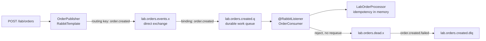
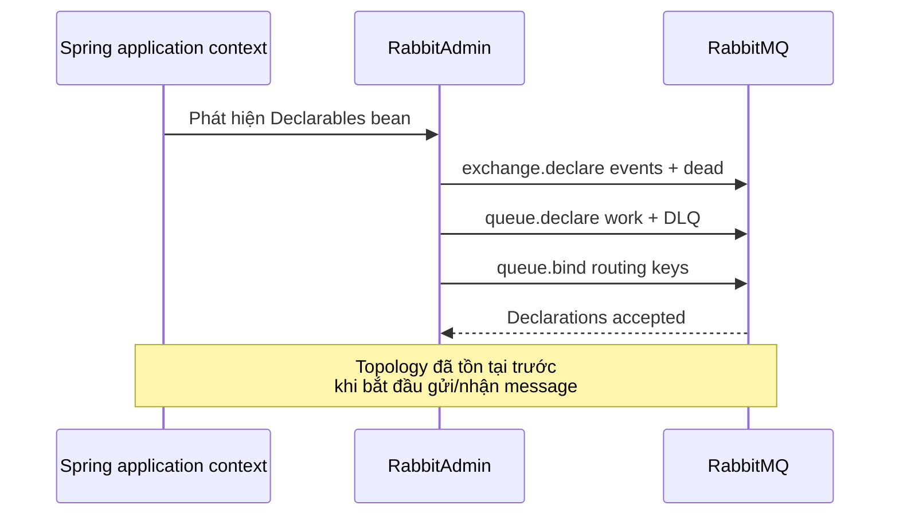
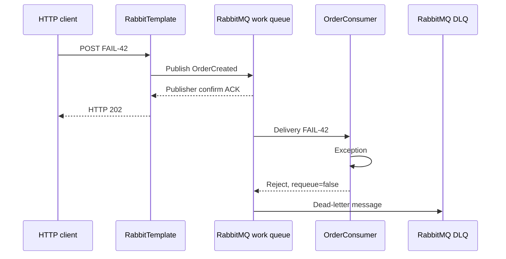

# Dựng producer/consumer với topology khai báo bằng Spring

## 1. Mục tiêu và sản phẩm sau buổi thực hành

Bài **“Dựng producer/consumer với topology khai báo bằng Spring”** thuộc chương **Thực hành tổng hợp** của module **`SPRING_AMQP`**. Chúng ta xây một ứng dụng Spring Boot nhỏ mô phỏng luồng tạo đơn hàng:

1. HTTP client gọi `POST /lab/orders` với `orderId` và tổng tiền.
2. **Producer** chuyển yêu cầu thành sự kiện JSON `OrderCreated`, gắn `eventId`, publish bằng `RabbitTemplate`.
3. **Spring** khai báo direct exchange, durable work queue, dead-letter exchange, DLQ và hai bindings thông qua bean `Declarables`.
4. RabbitMQ định tuyến message dựa trên **exchange + routing key**.
5. **Consumer** dùng `@RabbitListener`, đọc JSON, kiểm tra hợp đồng và thực hiện một tác động nghiệp vụ giả lập.
6. Handler thành công thì listener container ACK; handler lỗi thì broker dead-letter theo cấu hình.
7. Chạy kiểm thử cả luồng bình thường, sai routing key, poison message, duplicate và sự cố kết nối.

Kết quả mong đợi là **một lab có thể khởi động từ project mới**, có mã producer/consumer, cấu hình topology do Spring sở hữu và các bước xác minh trên RabbitMQ Management UI.

> **Phạm vi phiên bản:** Ví dụ dùng **Java 17, Spring Boot 3.5.x và Spring AMQP 3.x**, giao thức **AMQP 0-9-1**. Đối với Spring Boot 4.x/Spring AMQP 4.x, một số dependency và converter APIs thay đổi; cần đối chiếu tài liệu của đúng phiên bản trước khi áp dụng nguyên mẫu. Các ví dụ sau chạy trong **môi trường lab**, không phải cấu hình production.

### Kiến trúc thực hành



**Sản phẩm cần chứng minh:**

| Hạng mục | Khi thành công |
| --- | --- |
| HTTP | Request hợp lệ trả `202 Accepted` và `eventId` sau broker publisher confirm |
| Producer | Message có body JSON UTF-8, `contentType=application/json`, `messageId=eventId` |
| Exchange | Direct exchange `lab.orders.events.x`, durable |
| Work queue | `lab.orders.created.q`, durable, có DLX và binding chính xác |
| Consumer | Có log xử lý event và dữ liệu hiện trong `GET /lab/processed` |
| DLQ | Event có `orderId` bắt đầu `FAIL-` xuất hiện trong `lab.orders.created.dlq` |
| Negative routing | Publish với routing key khác binding được nhận biết qua **publisher return** |
| Duplicate | Cùng `eventId` được giao hai lần nhưng lab processor chỉ đếm **một** tác động |

## 2. Các khái niệm cần hiểu trước khi chạy

| Khái niệm | Vai trò trong lab | Ngộ nhận cần tránh |
| --- | --- | --- |
| **Producer** | Tạo message và publish tới exchange bằng `RabbitTemplate` | Producer không publish thẳng tới mọi consumer |
| **Direct exchange** | So khớp routing key chính xác với binding key | Exchange không lưu message như một queue |
| **Queue** | Giữ delivery cho consumer; queue durable phục hồi metadata qua restart | `durable=true` không tự bảo đảm mọi message đã đến queue |
| **Binding** | Nối exchange với queue bằng routing key | Tạo queue không tự khiến mọi key route vào queue |
| **Consumer** | Lấy delivery từ queue qua `@RabbitListener` | Hai consumer cùng queue **cạnh tranh** delivery, không nhận hai bản copy |
| **Consumer ACK** | Xác nhận message đã được xử lý để broker xóa khỏi queue | Publisher confirm không phải consumer ACK |
| **Publisher confirm** | Broker xác nhận publish đã được xử lý | Confirm ACK không chứng minh side effect database đã commit |
| **Publisher return** | Phản hồi message không route được khi `mandatory=true` | Message không route vẫn có thể được broker confirm ACK |
| **DLX/DLQ** | Chuyển message bị reject/expired tới nơi điều tra | Có DLX nhưng thiếu binding đích vẫn có thể làm mất message |
| **`eventId`** | Danh tính một logical event để kiểm tra duplicate | `deliveryTag` không thay cho idempotency key |

Với **direct exchange**, routing key `order.created` chỉ đến queue có binding key **đúng bằng** `order.created`; key `order.cancelled` **không** đi qua binding đó.

## 3. Chuẩn bị môi trường lab

Cần có:

- JDK 17+ và một Gradle wrapper tương thích với Spring Boot đã chọn.
- Docker Desktop/Engine có quyền chạy container (hoặc RabbitMQ thử nghiệm tương đương).
- Curl hoặc Postman để gọi HTTP API.
- Cổng **5672** cho AMQP, **15672** cho RabbitMQ Management UI và **8080** cho Spring Boot chưa bị chiếm.

### 3.1. Chạy RabbitMQ

Trên terminal có Docker:

```bash
docker run -d \
  --name spring-amqp-lab \
  -p 5672:5672 \
  -p 15672:15672 \
  rabbitmq:4-management
```

Mở Management UI:

```text
URL:      http://localhost:15672
Username: guest
Password: guest
Virtual host: /
```

Đây là tài khoản mặc định cho **kết nối từ localhost trong lab**. RabbitMQ mặc định hạn chế user `guest` truy cập từ xa. **Không** mở các cổng/credential thử nghiệm này ra Internet hoặc dùng trong production.

Kiểm tra container:

```bash
docker ps --filter name=spring-amqp-lab
docker logs spring-amqp-lab
```

**Không tạo exchange/queue bằng tay trước bước khai báo Spring.** Mục tiêu của bài là để `RabbitAdmin` đọc các beans Spring và khai báo topology.

### 3.2. Khởi tạo Spring Boot

Có thể dùng [Spring Initializr](https://start.spring.io/), chọn:

```text
Project:       Gradle - Groovy
Language:      Java
Spring Boot:   3.5.x (bản vá được dự án hỗ trợ)
Java:          17
Group:         com.example
Artifact:      spring-amqp-lab
Dependencies:  Spring for RabbitMQ, Spring Web
```

Nếu tạo từ Spring Initializr, giữ phiên bản plugin/BOM do Initializr cung cấp. Phần dependencies cần có:

```gradle
dependencies {
    implementation 'org.springframework.boot:spring-boot-starter-amqp'
    implementation 'org.springframework.boot:spring-boot-starter-web'

    testImplementation 'org.springframework.boot:spring-boot-starter-test'
    testImplementation 'org.springframework.boot:spring-boot-testcontainers'
    testImplementation 'org.testcontainers:junit-jupiter'
    testImplementation 'org.testcontainers:rabbitmq'
    testImplementation 'org.awaitility:awaitility'
    testRuntimeOnly 'org.junit.platform:junit-platform-launcher'
}
```

Các dependency **không ghi version riêng** để Spring Boot BOM quản lý. Ví dụ Testcontainers phía dưới dùng **Testcontainers 1.x** đi cùng package `org.testcontainers.containers.RabbitMQContainer`; nếu dự án chọn Testcontainers 2.x, đối chiếu tên artifact/package mới ở tài liệu trước khi copy test.

### 3.3. Cấu trúc project

```text
spring-amqp-lab/
  build.gradle
  src/
    main/
      java/com/example/lab/
        AmqpLabApplication.java
        LabTopology.java
        OrderCreated.java
        OrderPublisher.java
        OrderConsumer.java
        LabOrderProcessor.java
        OrderApi.java
      resources/
        application.yml
    test/
      java/com/example/lab/
        OrderMessagingTest.java
```

Tất cả file Java dưới đây dùng cùng package `com.example.lab`, đặt đúng từng file như cấu trúc trên.

## 4. Cấu hình ứng dụng và connection

Trong `src/main/resources/application.yml`:

```yaml
server:
  port: 8080

spring:
  application:
    name: spring-amqp-lab
  rabbitmq:
    host: localhost
    port: 5672
    username: ${RABBIT_USER:guest}
    password: ${RABBIT_PASSWORD:guest}
    virtual-host: /
    publisher-confirm-type: correlated
    publisher-returns: true
    template:
      mandatory: true
    listener:
      simple:
        acknowledge-mode: auto
        concurrency: 1
        max-concurrency: 1
        prefetch: 5
        default-requeue-rejected: false

logging:
  level:
    com.example.lab: INFO
```

Ý nghĩa những cấu hình dễ nhầm:

- `spring.rabbitmq.*` tạo/configure connection tới **RabbitMQ AMQP 0-9-1**. Không dùng cùng tên cho client AMQP 1.0 khác.
- `publisher-confirm-type=correlated` cho phép đợi `CorrelationData.getFuture()` theo từng publish.
- `publisher-returns=true` và `template.mandatory=true` cần cho phát hiện publish **không route được**.
- `acknowledge-mode=auto` là **Spring tự ACK sau khi listener method thành công**; khác với RabbitMQ `autoAck=true` hoặc `AcknowledgeMode.NONE`.
- `default-requeue-rejected=false` trong lab làm listener exception dẫn tới **reject không requeue**, cho phép broker gửi message sang DLX. Đây **không phải retry policy cho lỗi tạm thời**; ta sẽ mở rộng retry sau.
- `prefetch=5` cho phép tối đa vài delivery outstanding trên consumer, không có nghĩa mỗi message chạy trên một thread riêng.

**Lưu ý:** Spring Boot tự cấu hình `ConnectionFactory`, `RabbitTemplate` và `AmqpAdmin` khi AMQP starter cùng các điều kiện auto-configuration tương ứng tồn tại. Nếu tự tạo nhiều `ConnectionFactory`/`RabbitAdmin` hoặc tắt auto declare, cần cấu hình rõ bean nào được phép declare topology; snippet lab giả định **một** broker và **một** cấu hình chính.

## 5. Khởi động Spring Boot application

`AmqpLabApplication.java`:

```java
package com.example.lab;

import org.springframework.amqp.rabbit.annotation.EnableRabbit;
import org.springframework.boot.SpringApplication;
import org.springframework.boot.autoconfigure.SpringBootApplication;

@SpringBootApplication
@EnableRabbit
public class AmqpLabApplication {
    public static void main(String[] args) {
        SpringApplication.run(AmqpLabApplication.class, args);
    }
}
```

`@SpringBootApplication` quét các beans trong package `com.example.lab` và các subpackages; `@EnableRabbit` làm rõ việc đăng ký listener endpoints. Trong ứng dụng Spring Boot hiện đại, phần hỗ trợ listener có thể đã được auto-configuration kích hoạt, nhưng để annotation hiển thị tường minh trong bài thực hành là hữu ích.

## 6. Khai báo exchange, queue và binding **bằng Spring**

Đây là bước cốt lõi. Không khai báo thủ công bằng Management UI: tạo Spring bean `Declarables` gồm các đối tượng `DirectExchange`, `Queue`, `Binding`.

`LabTopology.java`:

```java
package com.example.lab;

import org.springframework.amqp.core.BindingBuilder;
import org.springframework.amqp.core.Declarables;
import org.springframework.amqp.core.DirectExchange;
import org.springframework.amqp.core.Queue;
import org.springframework.amqp.core.QueueBuilder;
import org.springframework.context.annotation.Bean;
import org.springframework.context.annotation.Configuration;

@Configuration
public class LabTopology {

    public static final String EVENTS_EXCHANGE = "lab.orders.events.x";
    public static final String WORK_QUEUE = "lab.orders.created.q";
    public static final String WORK_ROUTING_KEY = "order.created";
    public static final String DEAD_EXCHANGE = "lab.orders.dead.x";
    public static final String DEAD_QUEUE = "lab.orders.created.dlq";
    public static final String DEAD_ROUTING_KEY = "order.created.failed";

    @Bean
    public Declarables orderTopology() {
        DirectExchange events = new DirectExchange(
                EVENTS_EXCHANGE, true, false);
        DirectExchange dead = new DirectExchange(
                DEAD_EXCHANGE, true, false);

        Queue work = QueueBuilder.durable(WORK_QUEUE)
                .deadLetterExchange(DEAD_EXCHANGE)
                .deadLetterRoutingKey(DEAD_ROUTING_KEY)
                .build();
        Queue parking = QueueBuilder.durable(DEAD_QUEUE).build();

        return new Declarables(
                events,
                dead,
                work,
                parking,
                BindingBuilder.bind(work)
                        .to(events).with(WORK_ROUTING_KEY),
                BindingBuilder.bind(parking)
                        .to(dead).with(DEAD_ROUTING_KEY)
        );
    }
}
```

### 6.1. Điều gì xảy ra khi application kết nối broker?

`RabbitAdmin` phát hiện các `Declarable` objects nằm trong `Declarables` bean. Khi kết nối RabbitMQ được thiết lập và auto declaration có hiệu lực, nó gửi các lệnh AMQP để:

1. Declare direct exchange `lab.orders.events.x` với `durable=true`.
2. Declare direct exchange `lab.orders.dead.x`.
3. Declare queue `lab.orders.created.q`, durable, có hai arguments `x-dead-letter-exchange` và `x-dead-letter-routing-key`.
4. Declare queue `lab.orders.created.dlq`, durable.
5. Bind queue công việc vào exchange chính với key `order.created`.
6. Bind DLQ vào dead exchange với key `order.created.failed`.



**Tính lặp lại:** Declare cùng tên với **thuộc tính tương đương** thường an toàn khi restart application. Nhưng nếu queue tồn tại là `classic` mà app khai báo lại là `quorum`, hoặc đổi DLX argument trong queue bean, RabbitMQ có thể trả `406 PRECONDITION_FAILED - inequivalent arg` và đóng channel. **Không xóa queue đang có dữ liệu** để che lỗi cấu hình; cần kế hoạch thay đổi topology.

### 6.2. Cách tự kiểm tra topology trong Management UI

Sau khi application khởi động:

- Vào **Exchanges**: hai exchange `lab.orders.events.x`, `lab.orders.dead.x` đều có type `direct`.
- Vào **Queues and Streams**: có `lab.orders.created.q` và `lab.orders.created.dlq`.
- Mở work queue để kiểm tra arguments `x-dead-letter-exchange=lab.orders.dead.x`, `x-dead-letter-routing-key=order.created.failed`.
- Mở phần **Bindings**: `order.created` nối events exchange → work queue, `order.created.failed` nối dead exchange → DLQ.

Nếu chưa thấy tài nguyên, kiểm tra RabbitMQ connection, vhost, quyền `configure`, RabbitAdmin startup/auto declare và log lỗi khai báo. Chỉ nhìn thấy queue **không đủ** chứng minh binding đúng; cần test publish thật.

## 7. Xác định message contract độc lập transport

Ta dùng JSON UTF-8 với ID ổn định để Spring AMQP và các consumer khác ngôn ngữ đều có thể đọc.

`OrderCreated.java`:

```java
package com.example.lab;

public record OrderCreated(
        String eventId,
        String orderId,
        long totalMinorUnits,
        int schemaVersion,
        String occurredAt
) {}
```

Ví dụ message:

```json
{
  "eventId": "evt-703ba7b1",
  "orderId": "ORD-42",
  "totalMinorUnits": 150000,
  "schemaVersion": 1,
  "occurredAt": "2026-11-26T10:30:00Z"
}
```

`totalMinorUnits` là **đơn vị tiền nhỏ nhất** theo hợp đồng của bài lab, không phải số thực double; khi dùng VND, cần xác định cách ứng dụng mô hình hóa đơn vị tiền. `occurredAt` là ISO-8601 UTC. Mỗi logical event có một `eventId`; nếu publish lại cùng sự kiện sau timeout, **không tạo eventId mới**.

Ta dùng `ObjectMapper.writeValueAsBytes` để tạo body JSON thay vì phụ thuộc Java serialization hoặc header `__TypeId__`. Metadata `contentType`, encoding và `messageId` được đặt riêng qua `MessageProperties`.

## 8. Viết producer với RabbitTemplate và publisher confirm

`OrderPublisher.java`:

```java
package com.example.lab;

import java.time.Instant;
import java.util.UUID;
import java.util.concurrent.TimeUnit;

import com.fasterxml.jackson.databind.ObjectMapper;
import org.springframework.amqp.core.Message;
import org.springframework.amqp.core.MessageDeliveryMode;
import org.springframework.amqp.core.MessageProperties;
import org.springframework.amqp.rabbit.connection.CorrelationData;
import org.springframework.amqp.rabbit.core.RabbitTemplate;
import org.springframework.stereotype.Service;

@Service
public class OrderPublisher {

    private final RabbitTemplate rabbitTemplate;
    private final ObjectMapper objectMapper;

    public OrderPublisher(
            RabbitTemplate rabbitTemplate,
            ObjectMapper objectMapper) {
        this.rabbitTemplate = rabbitTemplate;
        this.objectMapper = objectMapper;
    }

    public String publish(String orderId, long totalMinorUnits)
            throws Exception {
        String eventId = UUID.randomUUID().toString();
        OrderCreated event = new OrderCreated(
                eventId,
                orderId,
                totalMinorUnits,
                1,
                Instant.now().toString()
        );

        byte[] body = objectMapper.writeValueAsBytes(event);
        MessageProperties props = new MessageProperties();
        props.setContentType("application/json");
        props.setContentEncoding("UTF-8");
        props.setDeliveryMode(MessageDeliveryMode.PERSISTENT);
        props.setMessageId(eventId);
        props.setCorrelationId(orderId);
        props.setHeader("x-event-type", "OrderCreated");

        Message message = new Message(body, props);
        CorrelationData attempt =
                new CorrelationData("publish-" + eventId);

        rabbitTemplate.send(
                LabTopology.EVENTS_EXCHANGE,
                LabTopology.WORK_ROUTING_KEY,
                message,
                attempt
        );

        // Lab chọn đợi confirm để học ranh giới broker acceptance.
        // Production nên xử lý async confirms/bounded in-flight.
        CorrelationData.Confirm confirm =
                attempt.getFuture().get(10, TimeUnit.SECONDS);
        if (!confirm.isAck()) {
            throw new IllegalStateException(
                    "Publisher NACK: " + confirm.getReason());
        }
        if (attempt.getReturned() != null) {
            throw new IllegalStateException(
                    "Message unroutable: "
                    + attempt.getReturned().getReplyText());
        }
        return eventId;
    }
}
```

### Vì sao không chỉ gọi `rabbitTemplate.convertAndSend(...)`?

`convertAndSend(...)` rất hữu ích khi dùng `MessageConverter`, ví dụ Jackson JSON converter. Nhưng trong lab, ta cố tình làm rõ:

```text
business event
    ↓ ObjectMapper.writeValueAsBytes
byte[] body + MessageProperties
    ↓ RabbitTemplate.send(exchange, routingKey, message, correlationData)
RabbitMQ exchange → queue theo binding
```

Nhờ vậy người học tự nhìn thấy body, charset, delivery mode, `messageId` và correlation cho publisher confirm. `CorrelationData.id` **định danh publish attempt**, không phải AMQP `MessageProperties.correlationId`.

**Chú ý quan trọng:** `RabbitTemplate.send(...)` có thể return trước khi publisher confirm tới. Producer ở trên chủ động đợi `CorrelationData.getFuture()` và kiểm tra `getReturned()`. `confirm.isAck()` nghĩa là broker đã xử lý publish theo semantics publisher confirms, **không** có nghĩa consumer đã commit nghiệp vụ. Timeout là **kết quả chưa xác định**, vì broker có thể đã nhận event nhưng phản hồi bị mất.

### Một giới hạn chủ đích của ví dụ

Mỗi lần HTTP gọi `publish(...)` sẽ sinh `eventId` mới. Đây là cách dễ hiểu cho **lab**, nhưng **chưa an toàn cho HTTP retry**: người dùng có thể gửi lại cùng đơn hàng sau timeout và tạo event mới. Trong production nên có `requestId`/idempotency key ổn định, database transaction ghi **order + outbox event**, relay publish lại **cùng eventId** cho đến khi confirm được đối soát.

## 9. Thêm HTTP API để kích hoạt producer

`OrderApi.java`:

```java
package com.example.lab;

import java.util.Map;
import java.util.Set;

import org.springframework.http.HttpStatus;
import org.springframework.http.ResponseEntity;
import org.springframework.web.bind.annotation.GetMapping;
import org.springframework.web.bind.annotation.PostMapping;
import org.springframework.web.bind.annotation.RequestBody;
import org.springframework.web.bind.annotation.RequestMapping;
import org.springframework.web.bind.annotation.RestController;
import org.springframework.web.server.ResponseStatusException;

@RestController
@RequestMapping("/lab")
public class OrderApi {
    private final OrderPublisher publisher;
    private final LabOrderProcessor processor;

    public OrderApi(
            OrderPublisher publisher,
            LabOrderProcessor processor) {
        this.publisher = publisher;
        this.processor = processor;
    }

    public record NewOrderRequest(
            String orderId,
            long totalMinorUnits) {}

    @PostMapping("/orders")
    public ResponseEntity<Map<String, String>> create(
            @RequestBody NewOrderRequest request) {
        if (request.orderId() == null
                || request.orderId().isBlank()
                || request.totalMinorUnits() < 0) {
            throw new ResponseStatusException(
                    HttpStatus.BAD_REQUEST, "Invalid order input");
        }

        try {
            String eventId = publisher.publish(
                    request.orderId(), request.totalMinorUnits());
            return ResponseEntity.accepted().body(
                    Map.of(
                        "eventId", eventId,
                        "publishStatus", "broker-confirmed"
                    )
            );
        } catch (Exception failure) {
            // Kết quả publish có thể chưa xác định nếu timeout.
            // Không tự retry bằng eventId khác trong handler này.
            throw new ResponseStatusException(
                    HttpStatus.SERVICE_UNAVAILABLE,
                    "Publish not confirmed; investigate event outcome",
                    failure);
        }
    }

    @GetMapping("/processed")
    public Set<String> processedIds() {
        return processor.processedIds();
    }
}
```

`202 Accepted` ở đây chỉ nói producer **nhận publisher confirm và không thấy unroutable return** trong thời hạn chờ. Nó **không** nói fulfillment đã xử lý xong. API `/lab/processed` chỉ phục vụ quan sát trong lab; một hệ thống thật dùng database, metrics, audit trail và phân quyền.

Nếu API trả `503`, đừng suy chắc broker không nhận message. Đó là lý do production cần **idempotency key từ client** và transactional outbox, không tạo một event mới sau mỗi HTTP retry.

## 10. Tạo consumer xử lý message từ queue

Ta tách phần **tiếp nhận AMQP** khỏi **tác động nghiệp vụ**. Phần processor chỉ dùng bộ nhớ để người học có thể kiểm tra nhanh; phần production sẽ dùng database.

### 10.1. Processor giả lập idempotency

`LabOrderProcessor.java`:

```java
package com.example.lab;

import java.util.Set;
import java.util.concurrent.ConcurrentHashMap;

import org.slf4j.Logger;
import org.slf4j.LoggerFactory;
import org.springframework.stereotype.Service;

@Service
public class LabOrderProcessor {
    private static final Logger log =
            LoggerFactory.getLogger(LabOrderProcessor.class);

    private final Set<String> processed =
            ConcurrentHashMap.newKeySet();

    public void process(OrderCreated event) {
        if (event.orderId().startsWith("FAIL-")) {
            throw new IllegalStateException(
                    "Simulated permanent failure for lab");
        }

        boolean firstTime = processed.add(event.eventId());
        if (!firstTime) {
            log.warn("Duplicate ignored eventId={}", event.eventId());
            return;
        }

        // Tác động nghiệp vụ giả lập chỉ là log.
        log.info("Order processed eventId={} orderId={} amount={}",
                event.eventId(),
                event.orderId(),
                event.totalMinorUnits());
    }

    public Set<String> processedIds() {
        return Set.copyOf(processed);
    }
}
```

Đây **không phải cơ chế exactly-once production**: `processed` là state trong RAM, biến mất khi restart; nhiều replica không chia sẻ set; nếu thêm database side effect sau `processed.add(...)` rồi fail, event sẽ bị đánh dấu sai là đã xử lý. Nó chỉ là mô hình minh họa việc **cùng `eventId` không tạo hai log effect** trong một tiến trình.

### 10.2. `@RabbitListener` nhận message và kiểm tra contract

`OrderConsumer.java`:

```java
package com.example.lab;

import com.fasterxml.jackson.databind.ObjectMapper;
import org.slf4j.Logger;
import org.slf4j.LoggerFactory;
import org.springframework.amqp.core.Message;
import org.springframework.amqp.rabbit.annotation.RabbitListener;
import org.springframework.stereotype.Component;

@Component
public class OrderConsumer {
    private static final Logger log =
            LoggerFactory.getLogger(OrderConsumer.class);

    private final ObjectMapper mapper;
    private final LabOrderProcessor processor;

    public OrderConsumer(
            ObjectMapper mapper,
            LabOrderProcessor processor) {
        this.mapper = mapper;
        this.processor = processor;
    }

    @RabbitListener(queues = LabTopology.WORK_QUEUE)
    public void receive(Message incoming) throws Exception {
        if (!"application/json".equalsIgnoreCase(
                incoming.getMessageProperties().getContentType())) {
            throw new IllegalArgumentException(
                    "Message must be application/json");
        }

        OrderCreated event = mapper.readValue(
                incoming.getBody(), OrderCreated.class);
        if (event.eventId() == null
                || event.eventId().isBlank()
                || event.orderId() == null
                || event.orderId().isBlank()
                || event.schemaVersion() != 1
                || event.totalMinorUnits() < 0) {
            throw new IllegalArgumentException(
                    "Invalid OrderCreated schema");
        }

        String propertyId =
                incoming.getMessageProperties().getMessageId();
        if (!event.eventId().equals(propertyId)) {
            throw new IllegalArgumentException(
                    "messageId must match eventId");
        }

        log.info("Received eventId={} redelivered={}",
                event.eventId(),
                incoming.getMessageProperties().isRedelivered());

        processor.process(event);
        // Khi method trả thành công: container AUTO ACK.
        // Khi có exception: container reject không requeue theo YAML.
    }
}
```

Chúng ta nhận `org.springframework.amqp.core.Message` và tự parse JSON. Cách này thể hiện rõ **body bytes + properties** và không phụ thuộc Java header `__TypeId__`. Trong ứng dụng thực, có thể cấu hình `Jackson2JsonMessageConverter` (Spring AMQP 3.x) để `@RabbitListener` nhận DTO trực tiếp; vẫn phải test body, content type và trusted packages.

### 10.3. Vì sao `AUTO ACK` không phải ACK trước khi xử lý?

Với `spring.rabbitmq.listener.simple.acknowledge-mode=auto`:

```text
Broker deliver
   ↓
Spring gọi OrderConsumer.receive(message)
   ↓
ObjectMapper deserialize + validate
   ↓
LabOrderProcessor.process(...)
   ├─ return thành công  → container basicAck
   └─ throw exception    → container basicReject/basicNack
                             theo cấu hình lỗi
```

Lab đặt `default-requeue-rejected=false`; message lỗi bị reject không requeue và được broker chuyển đến DLQ nếu DLX binding đúng. Nếu không có DLX hoặc binding sai, message có thể bị **drop**.

Một số lỗi deserialize có thể xảy ra **trước** khi handler được gọi nếu dùng converter tự động; `ConditionalRejectingErrorHandler` có thể xử lý lỗi loại này khác lỗi nghiệp vụ. Vì thế không chỉ unit test method mà cần **integration test trên broker thật**.

## 11. Chạy ứng dụng và kiểm tra happy path

Trong terminal tại project đã tạo:

```bash
./gradlew bootRun
```

Trên Windows PowerShell/cmd dùng wrapper phù hợp:

```powershell
.\gradlew.bat bootRun
```

Sau khi app báo started và RabbitMQ connection hoạt động, thử:

```bash
curl -i -X POST http://localhost:8080/lab/orders \
  -H 'Content-Type: application/json' \
  -d '{"orderId":"ORD-42","totalMinorUnits":150000}'
```

**Kỳ vọng** (eventId là giá trị phát sinh, mỗi lần gọi khác nhau):

```http
HTTP/1.1 202 Accepted
Content-Type: application/json

{"eventId":"<uuid sinh ra>","publishStatus":"broker-confirmed"}
```

Trong application logs:

```text
Received eventId=<uuid> redelivered=false
Order processed eventId=<uuid> orderId=ORD-42 amount=150000
```

Lấy danh sách event đã xử lý:

```bash
curl http://localhost:8080/lab/processed
```

Kết quả ví dụ:

```json
["<uuid sinh ra>"]
```

**Nếu response HTTP là `202` nhưng ngay lập tức `/lab/processed` còn trống**: hệ thống là bất đồng bộ; consumer có thể chưa kịp xử lý. Poll lại có **deadline**, đừng coi đây là lỗi tức thì. Nếu mãi không có kết quả, kiểm tra connection, binding, consumer count, application exceptions và DLQ.

### 11.1. Xem queue trong Management UI

Vào `http://localhost:15672`, mở `lab.orders.created.q`:

- `Consumers` dự kiến có **1** khi app chạy.
- `Ready` thường về **0** sau khi listener ACK thành công.
- `Unacked` có thể tăng thoáng qua trong lúc listener đang xử lý.
- DLQ vẫn **0** nếu không có lỗi.

Nếu không có consumer, Spring có thể chưa tạo được listener do queue khai báo lỗi, thiếu quyền hoặc sai vhost. Nếu queue có `Ready` tăng mãi, kiểm tra handler có chạy hay không và kết nối consumer.

## 12. Thử lỗi cố ý: message đi vào DLQ

Trong `LabOrderProcessor`, `orderId` bắt đầu bằng `FAIL-` làm handler ném exception.

```bash
curl -i -X POST http://localhost:8080/lab/orders \
  -H 'Content-Type: application/json' \
  -d '{"orderId":"FAIL-42","totalMinorUnits":150000}'
```

HTTP có thể vẫn trả **`202 Accepted`** vì publisher chỉ đợi broker confirm, **không đợi consumer commit**.

Nhờ `default-requeue-rejected=false`, message lỗi được reject **không requeue**. RabbitMQ dùng DLX và routing key đã cấu hình để chuyển tới `lab.orders.created.dlq`:



Mở queue `lab.orders.created.dlq` trong Management UI, dùng tính năng **Get messages** của môi trường lab để xem body/properties và `x-death` metadata. Chỉ chọn thao tác lấy message phù hợp (ví dụ requeue để giữ message trong DLQ) nếu muốn tiếp tục điều tra; việc lấy bằng `ack` sẽ **loại message khỏi DLQ**.

**Tự trả lời:** Vì sao HTTP có thể trả 202 dù message ở DLQ? Vì publisher confirm và consumer ACK là **hai quá trình độc lập**, và lỗi nghiệp vụ xảy ra sau khi message đã được broker tiếp nhận.

## 13. Thử negative routing và publisher returns

Direct exchange chỉ route những routing keys có binding tương ứng. Trong lab, key `order.created` là hợp lệ còn `order.unknown` **không** match.

Một đoạn test đơn giản bên trong Spring context:

```java
import java.nio.charset.StandardCharsets;
import java.util.UUID;
import java.util.concurrent.TimeUnit;

import org.springframework.amqp.core.Message;
import org.springframework.amqp.core.MessageProperties;
import org.springframework.amqp.rabbit.connection.CorrelationData;
import org.springframework.amqp.rabbit.core.RabbitTemplate;

String attemptId = UUID.randomUUID().toString();
MessageProperties props = new MessageProperties();
props.setContentType("application/json");

Message message = new Message(
        "{}".getBytes(StandardCharsets.UTF_8), props);
CorrelationData correlation = new CorrelationData(attemptId);

rabbitTemplate.send(
        LabTopology.EVENTS_EXCHANGE,
        "order.unknown",
        message,
        correlation);

var confirm = correlation.getFuture().get(10, TimeUnit.SECONDS);
System.out.println("Publisher ACK? " + confirm.isAck());
System.out.println("Returned? " + (correlation.getReturned() != null));
```

**Kỳ vọng:** Publish đến **exchange tồn tại** có thể được broker confirm ACK dù không queue nào nhận. Vì đã bật `mandatory=true` và `publisher-returns=true`, `correlation.getReturned()` sẽ chứa thông tin `NO_ROUTE` cho message này. `CorrelationData.getReturned()` được populate trước khi confirm future hoàn tất (với kết hợp confirms/returns được cấu hình).

Không nhầm với publish tới **exchange không tồn tại**: trường hợp đó broker có thể đóng channel vì lỗi protocol, **không** nhất thiết có return. Nếu sự kiện quan trọng mà không thể route, producer phải xử lý như publish thất bại, không âm thầm đánh dấu “đã giao”.

## 14. Bài kiểm thử tự động với RabbitMQ thật

Để chứng minh **exchange, queue, binding thực sự hoạt động**, dùng RabbitMQ Testcontainers. Mock `RabbitTemplate` hoặc `TestRabbitTemplate` chỉ thích hợp kiểm tra phần Java/listener, **không chứng minh RabbitMQ đã route theo binding**.

> **Giả định của ví dụ:** Spring Boot 3.5.x và Testcontainers 1.x, Docker hoạt động, mỗi test suite có broker container riêng. Không chạy bộ test trên queue production; các test dùng `eventId` riêng để tránh nhầm.

`OrderMessagingTest.java`:

```java
package com.example.lab;

import static org.awaitility.Awaitility.await;
import static org.junit.jupiter.api.Assertions.*;

import java.time.Duration;
import java.util.UUID;
import java.util.concurrent.TimeUnit;

import org.junit.jupiter.api.Test;
import org.springframework.amqp.core.AmqpAdmin;
import org.springframework.amqp.core.Message;
import org.springframework.amqp.core.MessageProperties;
import org.springframework.amqp.rabbit.connection.CorrelationData;
import org.springframework.amqp.rabbit.core.RabbitTemplate;
import org.springframework.beans.factory.annotation.Autowired;
import org.springframework.boot.test.context.SpringBootTest;
import org.springframework.test.context.DynamicPropertyRegistry;
import org.springframework.test.context.DynamicPropertySource;
import org.testcontainers.containers.RabbitMQContainer;
import org.testcontainers.junit.jupiter.Container;
import org.testcontainers.junit.jupiter.Testcontainers;
import org.testcontainers.utility.DockerImageName;

@SpringBootTest
@Testcontainers
class OrderMessagingTest {

    @Container
    static RabbitMQContainer rabbit = new RabbitMQContainer(
            DockerImageName.parse("rabbitmq:4-management"));

    @DynamicPropertySource
    static void rabbitProperties(DynamicPropertyRegistry registry) {
        registry.add("spring.rabbitmq.host", rabbit::getHost);
        registry.add("spring.rabbitmq.port", rabbit::getAmqpPort);
        registry.add("spring.rabbitmq.username", rabbit::getAdminUsername);
        registry.add("spring.rabbitmq.password", rabbit::getAdminPassword);
    }

    @Autowired OrderPublisher publisher;
    @Autowired LabOrderProcessor processor;
    @Autowired RabbitTemplate template;
    @Autowired AmqpAdmin admin;

    @Test
    void springDeclaresTopologyAndConsumerProcessesEvent()
            throws Exception {
        assertNotNull(admin.getQueueProperties(
                LabTopology.WORK_QUEUE));
        assertNotNull(admin.getQueueProperties(
                LabTopology.DEAD_QUEUE));

        String eventId = publisher.publish(
                "ORD-" + UUID.randomUUID(), 150000L);

        await().atMost(Duration.ofSeconds(10))
                .untilAsserted(() -> assertTrue(
                        processor.processedIds().contains(eventId)));
    }

    @Test
    void unroutableKeyMustBeReturned() throws Exception {
        MessageProperties props = new MessageProperties();
        props.setContentType("application/json");
        Message message = new Message("{}".getBytes(), props);
        CorrelationData result = new CorrelationData(
                UUID.randomUUID().toString());

        template.send(LabTopology.EVENTS_EXCHANGE,
                "order.not-bound", message, result);

        var confirm = result.getFuture().get(10, TimeUnit.SECONDS);
        assertTrue(confirm.isAck());
        assertNotNull(result.getReturned(),
                "mandatory return must reveal NO_ROUTE");
    }

    @Test
    void failedBusinessEventMustArriveInDlq()
            throws Exception {
        String eventId = publisher.publish(
                "FAIL-" + UUID.randomUUID(), 150000L);

        Message dead = template.receive(
                LabTopology.DEAD_QUEUE, 10_000L);
        assertNotNull(dead);
        assertEquals(eventId,
                dead.getMessageProperties().getMessageId());
        assertTrue(dead.getMessageProperties().getHeaders()
                .containsKey("x-death"));
    }
}
```

Chạy integration tests trong project lab đã tạo:

```bash
./gradlew test --tests com.example.lab.OrderMessagingTest
```

Chỉ dùng tên `OrderMessagingTest` để bài kiểm thử được JUnit Platform/Gradle phát hiện theo quy tắc tên mặc định. Nếu muốn đặt tên hậu tố `IT` và chạy trong task `integrationTest` riêng, cần cấu hình test task và test discovery thích hợp.

### 14.1. Tại sao bộ test trên cần broker thật?

- `AmqpAdmin.getQueueProperties(...)` kiểm tra work queue và DLQ có tồn tại; **không so sánh toàn bộ queue arguments**. Muốn kiểm tra DLX, type, binding details cần thêm Management API hoặc kiểm tra behavior.
- `publisher.publish(...)` dùng `CorrelationData` để nhận confirm và return trên broker thật.
- `processor.processedIds()` chứng minh listener chạy trong application context, không chỉ publisher gửi message đi.
- `template.receive(DLQ, timeout)` lấy message từ DLQ và xác nhận đã có đường dead-letter phù hợp. Đây là **consumer polling test**, không phải công cụ giám sát production.
- Các test cần chạy **không song song** nếu chia sẻ cùng queue và cùng singleton processor. Khi CI chạy parallel tests, dùng container/vhost/queue names riêng theo suite.

Lưu ý `RabbitMQContainer` từ Testcontainers 2.x có thể đổi module/package; ví dụ trên cố ý dùng dependency **Testcontainers 1.x**. Với Spring Boot 4.x, cũng cần điều chỉnh imports và dependencies tương ứng. **Bài này không yêu cầu chạy Gradle tại repository tài liệu**, các câu lệnh là hướng dẫn để người học thực hành trong project riêng.

### 14.2. Thử duplicate bằng cùng `eventId`

Không gọi `OrderPublisher.publish` hai lần vì method này **sinh hai ID khác nhau**. Muốn test idempotency, tạo **một** event JSON và publish **hai lần** giữ nguyên `eventId`/`messageId`:

```java
String eventId = "dup-" + UUID.randomUUID();
OrderCreated event = new OrderCreated(
        eventId, "ORD-DUP", 150000L, 1,
        "2026-11-26T10:30:00Z");

byte[] bytes = objectMapper.writeValueAsBytes(event);
MessageProperties props = new MessageProperties();
props.setContentType("application/json");
props.setMessageId(eventId);

template.send(LabTopology.EVENTS_EXCHANGE,
        LabTopology.WORK_ROUTING_KEY,
        new Message(bytes, props));
template.send(LabTopology.EVENTS_EXCHANGE,
        LabTopology.WORK_ROUTING_KEY,
        new Message(bytes, props));
```

Giả sử đoạn trên chạy trong một test được inject `ObjectMapper`/`RabbitTemplate` và có cùng broker context. `LabOrderProcessor` ghi một log `Order processed` cho event ID, lần sau ghi `Duplicate ignored`. Đây vẫn **chưa** kiểm tra idempotency database đa instance; phần nâng cấp cần kiểm tra với bảng inbox thật.

## 15. Nâng lab từ in-memory sang xử lý bất đồng bộ đáng tin cậy

Lab hiện chứng minh producer, consumer, topology và các đường thành công/thất bại. Với một ứng dụng thực tế có `OrderPaid`, `ShipmentRequested` hoặc tác động tài chính, cần thêm các lớp bảo vệ sau.

### 15.1. Consumer inbox trong database transaction

Ví dụ PostgreSQL:

```sql
CREATE TABLE processed_events (
    event_id VARCHAR(128) PRIMARY KEY,
    processed_at TIMESTAMPTZ NOT NULL DEFAULT now()
);
```

Trong **một database transaction**:

```text
BEGIN
  inserted = INSERT processed_events(event_id)
               VALUES (:eventId)
               ON CONFLICT DO NOTHING
  IF inserted:
      validate aggregateVersion
      apply business update
COMMIT
Spring listener returns -> container sends ACK
```

Nếu database commit xong nhưng connection RabbitMQ bị ngắt trước ACK, broker có thể **redeliver** cùng event. Unique constraint + transaction ngăn side effect lần hai. Đừng dùng `if(!exists(eventId)) insert` như hai bước không atomic: hai consumers có thể cùng thấy event chưa tồn tại.

### 15.2. Producer transactional outbox

Trong ứng dụng HTTP/database:

```text
BEGIN
  INSERT orders(...)
  INSERT outbox_events(eventId, exchange, routingKey, payload, status='NEW')
COMMIT

Relay:
  read unsent events
  publish with same eventId
  await broker confirm, inspect returned
  mark PUBLISHED
```

Một confirm timeout có thể xảy ra **sau khi broker đã nhận** message; relay gửi lại vẫn giữ `eventId`, còn consumer inbox chặn duplicate. `@Transactional` bao cả `repository.save` và `RabbitTemplate.send` **không tự tạo một XA transaction nguyên tử** giữa database và RabbitMQ.

### 15.3. Retry có giới hạn, rồi DLQ

Trong lab ban đầu, mọi exception đi DLQ ngay. Để thử transient errors, Spring Boot 3.x có thể bật Spring Retry cho **simple listener container**:

```yaml
spring:
  rabbitmq:
    listener:
      simple:
        retry:
          enabled: true
          max-attempts: 3
          initial-interval: 1s
          multiplier: 2
          max-interval: 5s
        default-requeue-rejected: false
```

Khi bật retry trong listener container, các lần thử có thể xảy ra **trong cùng một broker delivery** trước khi cuối cùng reject/dead-letter. Không suy `max-attempts=3` nghĩa RabbitMQ đã giao lại message ba lần; `x-delivery-count` không nhất thiết tăng theo những lần retry nội bộ.

Với lỗi schema vĩnh viễn, không nên retry vô ích; trong production cần phân loại lỗi và một recoverer phù hợp. Với lỗi downstream kéo dài, tránh giữ thread/connection trong thời gian backoff quá lớn; có thể dùng retry queues TTL/DLX, delayed retry hoặc lịch xử lý riêng.

### 15.4. Observability

Theo dõi:

| Layer | Tín hiệu quan trọng |
| --- | --- |
| Producer | `eventId`, publisher ACK/NACK, returned unroutable, confirm timeout |
| Broker | Exchange/binding, queue `ready`, `unacked`, consumer count, disk/memory alarms |
| Consumer | Listener success/failure, validation errors, retry attempts, DB latency |
| DLQ | Queue depth, `x-death.reason`, tuổi event và số lần replay |
| Business | Event ID đã commit, duplicate prevented, order state |
| Trace/log | `traceId`, `correlationId`, `messageId`, queue, event type (không log PII) |

Khi mở rộng, có thể bật Micrometer Observation trên `RabbitTemplate` và listener container để truyền trace context. `traceId` phục vụ quan sát, còn `eventId`/`messageId` phục vụ tra cứu và dedup; **không dùng trace ID làm khóa business**.

## 16. Bảng lỗi thường gặp và cách sửa

| Triệu chứng | Nguyên nhân hay gặp | Cách kiểm tra |
| --- | --- | --- |
| `Connection refused` tới `localhost:5672` | RabbitMQ chưa chạy, Docker port chưa map, app ở container khác | `docker ps`, broker logs, host/container network |
| `ACCESS_REFUSED - Login was refused` | Sai username/password, user guest bị giới hạn localhost | Credentials, vhost và log auth broker |
| `NOT_FOUND - no exchange` | Exchange chưa được RabbitAdmin tạo, sai vhost/name | Management UI, `RabbitAdmin` startup |
| `PRECONDITION_FAILED - inequivalent arg` | Queue/exchange cùng tên nhưng type/arguments khác | So sánh durable, DLX, queue type, policy |
| HTTP 202 nhưng không có log consumer | Producer ACK không phải consumer ACK; binding sai hoặc consumer chưa start | Queue Ready/Consumers/Unacked, publisher return |
| `messageId` null/mismatch | Producer không đặt property ID hoặc body eventId khác | Inspect message properties và payload |
| DLQ không nhận message lỗi | Chưa cấu hình DLX/route, listener requeue, worker queue sai | Queue arguments, DLX bindings, exception logs |
| DLQ tăng liên tục | Schema lỗi, handler crash, cấu hình retry không phù hợp | `x-death`, event ID, log stack trace |
| Message bị xử lý hai lần | Consumer crash sau commit trước ACK hoặc producer retry | Inbox/idempotency và log correlation |
| JSON decode lỗi | `contentType`, charset, DTO/schema thay đổi | Raw bytes, `ObjectMapper`, version contract |
| Consumer chạy nhưng queue không giảm | DB chậm, handler block, unacked tăng | DB metrics, prefetch, listener logs |
| `guest` chỉ hoạt động từ local | RabbitMQ mặc định hạn chế remote guest | Tạo user/vhost có quyền phù hợp cho môi trường test |

**Không chữa lỗi bằng cách xóa queue production.** Khi queue có dữ liệu, cần bảo toàn backlog và có phương án migration/restore.

## 17. Bài tập mở rộng có tiêu chí chấm

### Bài tập A — Thay đổi routing một cách có kiểm soát

Tạo thêm queue `lab.orders.audit.q` và bind nó vào `lab.orders.events.x` cùng key `order.created`. Gửi một event và chứng minh **hai queue** đều nhận bản copy của cùng publish, trong khi hai consumers cùng đọc **một** queue chỉ cạnh tranh delivery.

**Đạt:** Topology có hai bindings; event xuất hiện trong cả hai queue khi không có competing consumer làm mất dấu phép đo.

### Bài tập B — Quorum queue

Chuyển lab sang **một queue tên mới** dùng:

```java
Queue quorum = QueueBuilder.durable("lab.orders.created.qq")
        .quorum()
        .build();
```

Không redeclare `lab.orders.created.q` đang là classic thành quorum cùng tên. Đo publisher confirm latency và so với classic trên cùng payload, nhưng hiểu rằng quorum 1 member trên broker Docker đơn node **không chứng minh HA/replication ba node**.

**Đạt:** Queue mới có type quorum, producer/consumer route đúng, có ghi nhận khác biệt storage/replication và giới hạn benchmark.

### Bài tập C — Manual ACK

Tạo `SimpleRabbitListenerContainerFactory` có `AcknowledgeMode.MANUAL` và listener method nhận `Channel` + `Message`:

```java
@RabbitListener(
        queues = "lab.orders.created.manual.q",
        containerFactory = "manualListenerFactory")
public void receive(Message message,
                    com.rabbitmq.client.Channel channel)
        throws java.io.IOException {
    long tag = message.getMessageProperties().getDeliveryTag();
    // Commit DB trước khi gọi basicAck...
    channel.basicAck(tag, false);
}
```

Đây là **khung minh họa**, chưa có factory, queue hay error handling tương ứng; người học phải bổ sung. **Không** manual ACK trên factory `AUTO` rồi cho container ACK thêm lần nữa: broker sẽ báo lỗi `unknown delivery tag` và đóng channel.

**Đạt:** Handler success → ACK, exception → đúng nack/reject/requeue, không double ACK, stop app với unacked → redelivery có idempotency.

### Bài tập D — Phát hiện event không route được

Thay routing key của producer thành `order.missing` trong một **test riêng**, giữ exchange. Yêu cầu `getReturned()` khác null. Khôi phục key đúng rồi xác minh `getReturned()==null`.

**Đạt:** Phân biệt publisher confirm ACK với publisher return `NO_ROUTE`.

### Bài tập E — Retry và DLQ

Chỉ bật retry trên lab, gửi `FAIL-42`, đếm tối đa các lần handler được gọi rồi theo dõi event vào DLQ. So sánh lần lỗi `IllegalStateException` với lỗi JSON không parse được.

**Đạt:** Không có vòng lặp nóng vô hạn, DLQ giữ đúng `messageId`, người học lý giải được retry nội bộ khác broker redelivery.

### Bài tập F — Chạy hai consumer cùng queue

Khởi động hai instance ứng dụng trên **cổng HTTP khác nhau** nhưng cùng work queue, rồi gửi nhiều event. Quan sát số consumer tăng và message được chia giữa hai instances.

**Đạt:** Không suy rằng mỗi instance nhận mọi message; chứng minh idempotency in-memory **không chia sẻ state giữa các instance**, cần database inbox.

## 18. Checklist nghiệm thu

| Tiêu chí | Hoàn tất |
| --- | --- |
| RabbitMQ container chạy và Management UI truy cập được | [ ] |
| Spring Boot project dùng dependencies AMQP và Web đúng phiên bản | [ ] |
| `@SpringBootApplication` và listener activation hoạt động | [ ] |
| Spring `Declarables` khai báo đủ hai exchanges, hai queues, hai bindings | [ ] |
| Direct exchange route đúng key `order.created` | [ ] |
| `OrderCreated` có eventId, schema version và JSON UTF-8 | [ ] |
| Producer đặt messageId, content type, delivery mode persistent | [ ] |
| Publisher confirms và mandatory returns được xử lý phân biệt | [ ] |
| Consumer đọc body, validate schema, chỉ ACK sau xử lý thành công | [ ] |
| `POST /lab/orders` → event xuất hiện trong `/lab/processed` | [ ] |
| `FAIL-` event được dead-letter vào DLQ | [ ] |
| Sai routing key phát hiện qua returned/unroutable | [ ] |
| Testcontainers integration tests dùng broker thật | [ ] |
| Duplicate logical event không sinh hai tác động trong lab | [ ] |
| Có ghi chú về giới hạn in-memory idempotency và HTTP retry | [ ] |
| Đề xuất outbox/inbox, retry/backoff và monitoring cho production | [ ] |

## 19. Câu hỏi tự kiểm tra

1. Vì sao khai báo một queue durable chưa đủ để producer publish event đúng nơi? Cần thêm đối tượng Spring nào?
2. `Declarables` và `RabbitAdmin` có vai trò khác nhau như thế nào?
3. Trong direct exchange, `order.created` và `order.cancelled` có route vào cùng binding không? Vì sao?
4. Khi producer đặt `contentType=application/json`, consumer nên kiểm tra điều gì nữa trước khi xử lý nghiệp vụ?
5. `MessageProperties.messageId`, `MessageProperties.correlationId` và `CorrelationData.id` khác nhau ra sao?
6. Vì sao HTTP `202 Accepted` trong lab chưa chứng minh order đã được fulfillment xử lý?
7. `RabbitTemplate.send(...)` return có phải publisher confirm không? Nếu confirm timeout, trạng thái event có chắc thất bại?
8. `default-requeue-rejected=false` ảnh hưởng gì đến listener exception khi queue có DLX?
9. Nếu đổi work queue từ classic sang quorum nhưng giữ nguyên tên queue đang tồn tại, broker có thể phản hồi gì?
10. Vì sao hai `@RabbitListener` cùng subscribe một work queue không nhận được hai bản copy của event?
11. Viết một integration test chứng minh publish tới key sai sinh publisher return nhưng broker vẫn có thể ACK publish.
12. Tại sao bộ `Set<String>` trong lab không phải phương án idempotency cho production?
13. Nếu database commit xong nhưng consumer mất connection trước ACK, những gì có thể xảy ra sau restart?
14. Khi cần retry lâu, vì sao phải có backoff và DLQ thay vì `basicNack(requeue=true)` lặp nóng?
15. Phân biệt kiểm thử bằng mock RabbitTemplate, `TestRabbitTemplate` và Testcontainers RabbitMQ.

**Ghi nhớ:** Trong Spring AMQP, **producer publish tới exchange bằng routing key**, RabbitMQ định tuyến qua **binding vào queue**, còn `@RabbitListener` tiêu thụ delivery từ queue. `Declarables` + `RabbitAdmin` giúp Spring sở hữu topology một cách tường minh, có thể kiểm tra ngay trên broker. Publisher confirms/returns, consumer ACK, retry và DLQ là những cơ chế **khác nhau** và phải thử cả đường lỗi. Lab minh họa đường đi message; ứng dụng bất đồng bộ đáng tin cậy cần thêm **transactional outbox, idempotent inbox, schema contract, retry/backoff, quan sát và kế hoạch phục hồi**.

### Tài liệu tham khảo chính thức

- [Spring AMQP — Configuring the Broker](https://docs.spring.io/spring-amqp/reference/amqp/broker-configuration.html): `AmqpAdmin`, `RabbitAdmin`, `Declarables`, exchange/queue/binding auto declaration.
- [Spring AMQP — AmqpTemplate](https://docs.spring.io/spring-amqp/reference/amqp/template.html): `RabbitTemplate`, `CorrelationData`, confirms/returns và unroutable messages.
- [Spring AMQP — Sending Messages](https://docs.spring.io/spring-amqp/reference/amqp/sending-messages.html): `Message`, `MessageProperties` và conversion.
- [Spring AMQP — Annotation-driven Listener](https://docs.spring.io/spring-amqp/reference/amqp/receiving-messages/async-annotation-driven.html): `@RabbitListener`, container và binding annotation.
- [Spring AMQP — Resilience and Error Handling](https://docs.spring.io/spring-amqp/reference/amqp/resilience-recovering-from-errors-and-broker-failures.html): listener exceptions, requeue, reject/recoverers.
- [Spring Boot — AMQP](https://docs.spring.io/spring-boot/3.5/reference/messaging/amqp.html): Boot 3.5 auto-configuration, listener và RabbitTemplate.
- [Spring Boot — Application Properties](https://docs.spring.io/spring-boot/3.5/appendix/application-properties/): RabbitMQ connection, publisher confirms, listener retries và ACK mode.
- [Testcontainers — RabbitMQ](https://java.testcontainers.org/modules/rabbitmq/): RabbitMQ container cho integration tests.
- [RabbitMQ — AMQP 0-9-1 Concepts](https://www.rabbitmq.com/tutorials/amqp-concepts): exchange, queue, binding và routing.
- [RabbitMQ — Consumer Acknowledgements and Publisher Confirms](https://www.rabbitmq.com/docs/confirms): khác biệt publisher confirms/returns và consumer ACK.
