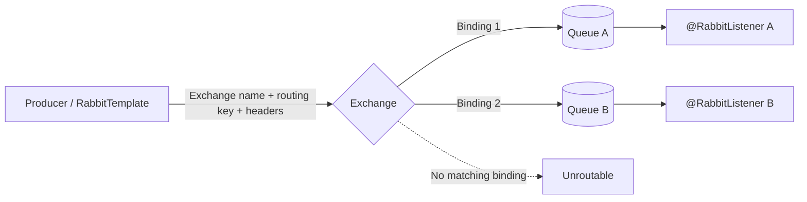
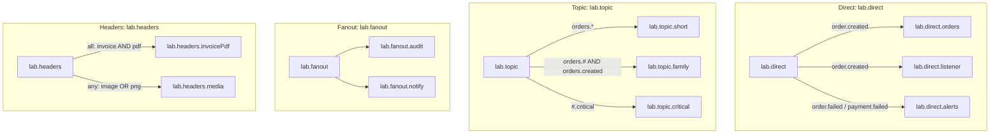
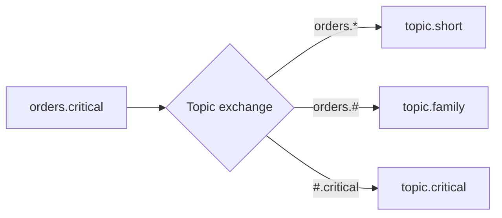
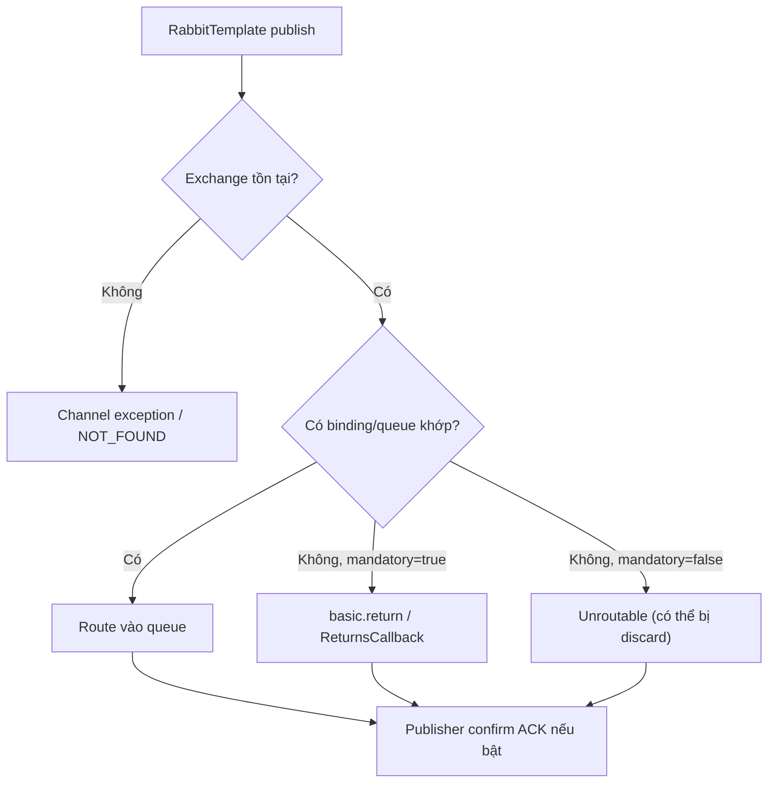

# So sánh direct, topic, fanout và headers exchange

> **Chương:** Thực hành tổng hợp  
> **Nền tảng:** Spring AMQP, RabbitMQ AMQP 0-9-1, Spring Boot, `RabbitTemplate`, `@RabbitListener`, exchange, queue và binding.  
> **Hình thức:** Phòng lab có ví dụ Java chạy với broker, dự đoán routing trước khi publish, viết integration test và chẩn đoán các tình huống không có queue nhận.

## 1. Bài toán và kết quả cần đạt

Bạn đang phát triển dịch vụ xử lý đơn hàng, thông báo và tài liệu. Một producer sử dụng `RabbitTemplate` để phát message vào RabbitMQ; nhiều ứng dụng khác dùng `@RabbitListener` để xử lý. Cùng một lời gọi `convertAndSend(exchange, routingKey, payload)` có thể tạo **không bản sao nào, một bản sao hoặc nhiều bản sao nằm ở các queue khác nhau**. Điều này do **loại exchange và các binding** quyết định, không phải tên method Java của producer.

Trong bài, ta tự cấu hình và so sánh bốn loại exchange:

| Loại exchange | Điều kiện khớp để đưa message vào queue | Ứng dụng minh họa |
| --- | --- | --- |
| **Direct** | Routing key **bằng chính xác** binding key | `order.created`, `payment.failed` |
| **Topic** | Routing key khớp pattern nhiều phân đoạn (`*` / `#`) | `orders.eu.created`, `orders.critical` |
| **Fanout** | Bất kỳ queue nào bind vào exchange đều nhận copy; routing key bị bỏ qua | Audit + email notification cùng nhận một event |
| **Headers** | Headers của message thỏa điều kiện `x-match=all` hoặc `x-match=any` | `docType=invoice` và `format=pdf` |

**Sau bài này, bạn cần tự làm được:** vẽ đường đi của message, khai báo đủ `Exchange`/`Queue`/`Binding`, viết producer cho từng loại, dự đoán danh sách queue nhận, chạy test bằng RabbitMQ thật, xử lý `mandatory` return/confirm và phân biệt unroutable với consumer retry/DLQ.

### 1.1. Quy tắc nền tảng



- **Exchange** nhận publish và quyết định tuyến dựa vào loại của nó.
- **Binding** nối exchange với queue cùng một quy tắc lọc. Một exchange có thể bind với nhiều queue; một queue có thể bind nhiều exchange hoặc nhiều routing keys.
- **Queue** giữ delivery cho consumer. **Nhiều consumer của cùng queue** thường là competing consumers: không có broadcast tới từng consumer.
- **Fanout tới hai queue** cho hai bản sao trong hai queue. Nếu **một queue có nhiều binding cùng khớp**, RabbitMQ vẫn chỉ route **một bản sao của mỗi publish tới queue đó**.
- **Publisher confirm**, **consumer acknowledgement** và **database commit** là những ranh giới khác nhau; exchange type không tự tạo exactly-once.

## 2. Chuẩn bị môi trường

### 2.1. Phạm vi phiên bản và dependency

Ví dụ dùng **Java 21, Spring Boot 4.x, Spring AMQP trên giao thức AMQP 0-9-1**. Với Spring Boot 4.x, dependency cho RabbitMQ 0-9-1 là `spring-boot-starter-rabbitmq`. Nếu dự án đang dùng Spring Boot 3.x, chọn `spring-boot-starter-amqp`; không nhầm starter `spring-boot-starter-amqp` của Boot 4.x (generic AMQP 1.0) với các API trong bài.

Trong project Gradle đã cấu hình plugin/BOM Spring Boot 4.x:

```groovy
dependencies {
    implementation 'org.springframework.boot:spring-boot-starter-rabbitmq'
    testImplementation 'org.springframework.boot:spring-boot-starter-test'
    // Với Testcontainers 2.x do BOM quản lý.
    testImplementation 'org.testcontainers:testcontainers-junit-jupiter'
    testImplementation 'org.testcontainers:testcontainers-rabbitmq'
}

tasks.named('test') {
    useJUnitPlatform()
}
```

Nếu project Boot 3.x sử dụng Testcontainers 1.x theo BOM, dùng đúng artifacts và imports của Testcontainers 1.x thay vì trộn với ví dụ 2.x dưới đây. Không cần tạo mọi dependency từ đầu nếu Spring Initializr đã cấu hình build.

### 2.2. RabbitMQ local (chỉ trong lab)

```bash
docker run --rm --name rabbit-routing-lab \
  -p 5672:5672 -p 15672:15672 \
  -e RABBITMQ_DEFAULT_USER=lab \
  -e RABBITMQ_DEFAULT_PASS=lab-only \
  rabbitmq:4.1-management
```

Đăng nhập Management UI tại `http://localhost:15672` với tài khoản `lab` / `lab-only`. Port `5672` cho AMQP 0-9-1; port `15672` cho HTTP management. Mật khẩu này **chỉ dành cho lab**: không mở cổng management ra Internet, không dùng user admin chung trong production. Với Kubernetes/cloud, sử dụng vhost, secret, TLS/mTLS và ACL thích hợp.

`application.yml` cho chạy local:

```yaml
spring:
  rabbitmq:
    host: localhost
    port: 5672
    username: lab
    password: lab-only
    virtual-host: /
  main:
    web-application-type: none
```

`web-application-type: none` không tắt RabbitMQ listener; ứng dụng trong lab không cần HTTP server. Testcontainers sẽ ghi đè `spring.rabbitmq.host/port` bằng host và mapped port.

### 2.3. Lớp main

Đặt các lớp ví dụ trong cùng package hoặc package con của lớp `RoutingLabApplication` để Spring component scan tìm thấy:

```java
import org.springframework.boot.SpringApplication;
import org.springframework.boot.autoconfigure.SpringBootApplication;

@SpringBootApplication
public class RoutingLabApplication {
    public static void main(String[] args) {
        SpringApplication.run(RoutingLabApplication.class, args);
    }
}
```

## 3. Định nghĩa một topology đo được cả bốn exchange

Để test deterministic, bài này tách **queue thăm dò** do test dùng `RabbitTemplate.receiveAndConvert()` khỏi **queue listener demo** (do `@RabbitListener` nhận). Không dùng một queue vừa có listener chạy liên tục vừa bị test polling tranh message.

### 3.1. Sơ đồ topology



### 3.2. Khai báo Java với `Declarables`

`Declarables` chứa exchanges, queues và bindings. Khi có `RabbitAdmin`, Spring AMQP sẽ khai báo topology vào broker khi kết nối nếu runtime user có quyền. Các queue/exchange lab sử dụng tên cố định và durable để thuận tiện xem bằng UI; không dùng chung namespace với ứng dụng thật.

```java
import java.util.Map;
import org.springframework.amqp.core.BindingBuilder;
import org.springframework.amqp.core.Declarables;
import org.springframework.amqp.core.DirectExchange;
import org.springframework.amqp.core.FanoutExchange;
import org.springframework.amqp.core.HeadersExchange;
import org.springframework.amqp.core.Queue;
import org.springframework.amqp.core.QueueBuilder;
import org.springframework.amqp.core.TopicExchange;
import org.springframework.context.annotation.Bean;
import org.springframework.context.annotation.Configuration;

@Configuration(proxyBeanMethods = false)
public class RoutingLabTopology {
    public static final String DIRECT = "lab.direct";
    public static final String TOPIC = "lab.topic";
    public static final String FANOUT = "lab.fanout";
    public static final String HEADERS = "lab.headers";

    public static final String D_ORDERS = "lab.direct.orders";
    public static final String D_ALERTS = "lab.direct.alerts";
    public static final String D_LISTENER = "lab.direct.listener";
    public static final String T_SHORT = "lab.topic.short";
    public static final String T_FAMILY = "lab.topic.family";
    public static final String T_CRITICAL = "lab.topic.critical";
    public static final String F_AUDIT = "lab.fanout.audit";
    public static final String F_NOTIFY = "lab.fanout.notify";
    public static final String H_INVOICE_PDF = "lab.headers.invoicePdf";
    public static final String H_MEDIA = "lab.headers.media";

    @Bean
    Declarables routingLabDeclarables() {
        var direct = new DirectExchange(DIRECT);
        var topic = new TopicExchange(TOPIC);
        var fanout = new FanoutExchange(FANOUT);
        var headers = new HeadersExchange(HEADERS);

        Queue dOrders = QueueBuilder.durable(D_ORDERS).build();
        Queue dAlerts = QueueBuilder.durable(D_ALERTS).build();
        Queue dListener = QueueBuilder.durable(D_LISTENER).build();
        Queue tShort = QueueBuilder.durable(T_SHORT).build();
        Queue tFamily = QueueBuilder.durable(T_FAMILY).build();
        Queue tCritical = QueueBuilder.durable(T_CRITICAL).build();
        Queue fAudit = QueueBuilder.durable(F_AUDIT).build();
        Queue fNotify = QueueBuilder.durable(F_NOTIFY).build();
        Queue hInvoicePdf = QueueBuilder.durable(H_INVOICE_PDF).build();
        Queue hMedia = QueueBuilder.durable(H_MEDIA).build();

        return new Declarables(
                direct, topic, fanout, headers,
                dOrders, dAlerts, dListener,
                tShort, tFamily, tCritical,
                fAudit, fNotify, hInvoicePdf, hMedia,

                // DIRECT: exact routing key; một queue có thể nhiều keys.
                BindingBuilder.bind(dOrders).to(direct).with("order.created"),
                BindingBuilder.bind(dListener).to(direct).with("order.created"),
                BindingBuilder.bind(dAlerts).to(direct).with("order.failed"),
                BindingBuilder.bind(dAlerts).to(direct).with("payment.failed"),

                // TOPIC: '*' một segment; '#' không hoặc nhiều segments.
                BindingBuilder.bind(tShort).to(topic).with("orders.*"),
                BindingBuilder.bind(tFamily).to(topic).with("orders.#"),
                BindingBuilder.bind(tFamily).to(topic).with("orders.created"),
                BindingBuilder.bind(tCritical).to(topic).with("#.critical"),

                // FANOUT: không cần binding key.
                BindingBuilder.bind(fAudit).to(fanout),
                BindingBuilder.bind(fNotify).to(fanout),

                // HEADERS: x-match=all và x-match=any.
                BindingBuilder.bind(hInvoicePdf).to(headers)
                        .whereAll(Map.of(
                                "docType", "invoice",
                                "format", "pdf")).match(),
                BindingBuilder.bind(hMedia).to(headers)
                        .whereAny(Map.of(
                                "docType", "image",
                                "format", "png")).match()
        );
    }
}
```

**Các khái niệm đáng quan sát:**

- `DirectExchange`, `TopicExchange`, `FanoutExchange` và `HeadersExchange` chỉ đổi **quy tắc định tuyến**, không đổi cách gửi bằng `RabbitTemplate`.
- Queue `lab.topic.family` có **hai binding** khớp message `orders.created`: `orders.#` và `orders.created`. RabbitMQ **không nhân đôi message trong cùng queue** chỉ vì hai binding khớp.
- `whereAll(Map...).match()` và `whereAny(Map...).match()` tạo **binding arguments** có `x-match=all|any`; không yêu cầu publisher tự thêm header `x-match`.
- Khi chạy thật với `RabbitAdmin`, cần quyền `configure` hoặc để đội platform **pre-provision topology**. Queue/exchange đã tồn tại với type/arguments khác có thể gây `PRECONDITION_FAILED`; không tự redeclare để đổi loại trong production.

### 3.3. Xác minh trên Management UI

Mở **Exchanges**, tìm `lab.direct`, `lab.topic`, `lab.fanout`, `lab.headers`; mở từng exchange và xem danh sách bindings. Trong **Queues and Streams**, tìm `lab.*` và quan sát `Ready`/`Unacked`. Nếu không có resource, kiểm tra đúng broker, vhost, user, quyền `configure` và RabbitAdmin declaration trước khi gửi message.

## 4. Viết một producer cho bốn exchange

```java
import org.springframework.amqp.rabbit.core.RabbitTemplate;
import org.springframework.stereotype.Component;

@Component
public class RoutingLabPublisher {
    private final RabbitTemplate template;

    public RoutingLabPublisher(RabbitTemplate template) {
        this.template = template;
    }

    public void direct(String routingKey, String payload) {
        template.convertAndSend(RoutingLabTopology.DIRECT,
                routingKey, payload);
    }

    public void topic(String routingKey, String payload) {
        template.convertAndSend(RoutingLabTopology.TOPIC,
                routingKey, payload);
    }

    public void fanout(String ignoredRoutingKey, String payload) {
        template.convertAndSend(RoutingLabTopology.FANOUT,
                ignoredRoutingKey, payload);
    }

    public void headers(String ignoredRoutingKey, String payload,
                        String docType, String format) {
        template.convertAndSend(RoutingLabTopology.HEADERS,
                ignoredRoutingKey, payload,
                message -> {
                    message.getMessageProperties()
                            .setHeader("docType", docType);
                    message.getMessageProperties()
                            .setHeader("format", format);
                    return message;
                });
    }
}
```

Với `headers(...)`, `docType` và `format` là **message headers thực**. Việc gắn hai chuỗi này vào payload nhưng không dùng `MessagePostProcessor` sẽ **không** làm headers exchange route đúng.

### 4.1. Phát một lượt để quan sát thủ công

Chỉ cho runner chạy khi bật profile `demo`, tránh mỗi lần chạy test tự phát thêm message:

```java
import org.springframework.boot.ApplicationArguments;
import org.springframework.boot.ApplicationRunner;
import org.springframework.context.annotation.Profile;
import org.springframework.stereotype.Component;

@Component
@Profile("demo")
public class RoutingScenarioRunner implements ApplicationRunner {
    private final RoutingLabPublisher publisher;

    public RoutingScenarioRunner(RoutingLabPublisher publisher) {
        this.publisher = publisher;
    }

    @Override
    public void run(ApplicationArguments args) {
        publisher.direct("order.created", "D-demo-created");
        publisher.direct("payment.failed", "D-demo-failed");
        publisher.topic("orders.created", "T-demo-created");
        publisher.topic("orders.eu.critical", "T-demo-critical");
        publisher.fanout("ignored", "F-demo-broadcast");
        publisher.headers("ignored", "H-demo-invoice", "invoice", "pdf");
        publisher.headers("ignored", "H-demo-image", "image", "png");
    }
}
```

Chạy ứng dụng bằng profile `demo` (ví dụ `./gradlew bootRun --args='--spring.profiles.active=demo'` trên shell hỗ trợ) và xem message counts trên RabbitMQ UI. Mỗi lần khởi chạy sẽ **thêm** message vào queue durable, nên phải phân biệt dữ liệu cũ và mới; không purge queue ngoài phạm vi lab.

## 5. Direct exchange — khớp đúng từng ký tự

Trong `lab.direct`, binding keys:

- `lab.direct.orders` → `order.created`.
- `lab.direct.listener` → `order.created`.
- `lab.direct.alerts` → `order.failed` **hoặc** `payment.failed`.

| Publish routing key | Payload | Queue nhận |
| --- | --- | --- |
| `order.created` | D1 | `lab.direct.orders`, `lab.direct.listener` |
| `order.failed` | D2 | `lab.direct.alerts` |
| `payment.failed` | D3 | `lab.direct.alerts` |
| `order.paid` | D4 | **Không queue nào**, vì chưa có binding |
| `ORDER.CREATED` | D5 | **Không queue nào**, khác chữ hoa/thường |

```java
publisher.direct("order.created", "D1");
publisher.direct("order.failed", "D2");
publisher.direct("payment.failed", "D3");
publisher.direct("order.paid", "D4"); // Unroutable trong topology này.
```

**Direct không đồng nghĩa một queue duy nhất.** Nếu hai queue cùng có binding key `order.created`, cả hai đều nhận một bản sao. Nếu một queue có nhiều bindings (`order.failed` và `payment.failed`), mỗi key khớp đều có thể route vào **cùng một queue**. Dấu chấm trong `order.created` ở direct **không** biểu diễn wildcard hoặc hierarchy; đó là một chuỗi so khớp chính xác.

**Default exchange:** RabbitMQ có exchange direct đặc biệt tên `""` (chuỗi rỗng). Mỗi queue mới được broker bind tự động vào default exchange với routing key là **tên queue**. Lệnh `rabbitTemplate.convertAndSend("", "lab.direct.orders", "message")` có thể gửi tới queue đó mà **không đi qua** exchange `lab.direct` và không kiểm tra binding do ta tự tạo. Không dùng default exchange để thay các bài test routing trong lab.

## 6. Topic exchange — phân biệt `*` và `#`

Routing key topic gồm các phân đoạn tách bởi dấu `.`:

- `*` khớp **đúng một phân đoạn**. `orders.*` khớp `orders.created` nhưng không khớp `orders.eu.created`.
- `#` khớp **không hoặc nhiều phân đoạn**. `orders.#` khớp `orders`, `orders.created`, `orders.eu.created`.
- Các phần chữ như `orders`, `created`, `critical` phải khớp chính xác, phân biệt hoa/thường.

Binding:

- `lab.topic.short` ← `orders.*`.
- `lab.topic.family` ← `orders.#` **và** `orders.created`.
- `lab.topic.critical` ← `#.critical`.

| Routing key | `orders.*` | `orders.#` | `#.critical` | Queue nhận |
| --- | :---: | :---: | :---: | --- |
| `orders.created` | ✓ | ✓ | ✗ | short, family |
| `orders.eu.created` | ✗ | ✓ | ✗ | family |
| `payments.critical` | ✗ | ✗ | ✓ | critical |
| `orders.eu.critical` | ✗ | ✓ | ✓ | family, critical |
| `orders` | ✗ | ✓ | ✗ | family |
| `orders.critical` | ✓ | ✓ | ✓ | short, family, critical |
| `created` | ✗ | ✗ | ✗ | Không queue nào |

Các tên `short/family/critical` viết tắt cho queue có tiền tố `lab.topic.`. Message `orders.created` khớp **hai bindings của family** nhưng queue `lab.topic.family` vẫn nhận **một copy**. Điều này khác với ba queue khác nhau cùng khớp `orders.critical`: trong trường hợp đó cả ba queue nhận copy.



### 6.1. Các key thường gây nhầm

1. **`orders.*` có khớp `orders.eu.created`?** Không, vì sau `orders.` có **hai** phân đoạn.
2. **`orders.#` có khớp `orders`?** Có, vì `#` cho phép **0 phân đoạn**.
3. **`#.critical` có khớp `critical`?** Có, vì `#` có thể khớp **0 phân đoạn** ở đầu.
4. **`orders*` có thay được `orders.#`?** Không; `*` trong topic là wildcard cho một **từ nguyên vẹn**, không phải regex/glob trên phần ký tự của từ `orders`.

### 6.2. Publish để đối chiếu bảng

```java
publisher.topic("orders.created", "T1");
publisher.topic("orders.eu.created", "T2");
publisher.topic("payments.critical", "T3");
publisher.topic("orders.eu.critical", "T4");
publisher.topic("orders", "T5");
publisher.topic("orders.critical", "T6");
```

Khi bắt đầu với các queue rỗng và chưa có consumer:

- `lab.topic.short`: **T1, T6** (2 message).
- `lab.topic.family`: **T1, T2, T4, T5, T6** (5 message).
- `lab.topic.critical`: **T3, T4, T6** (3 message).

Nếu muốn mọi routing key từ topic exchange đều match, dùng binding `#`; tuy nhiên fanout thường diễn đạt mục đích **broadcast** rõ ràng và đơn giản hơn.

## 7. Fanout exchange — broadcast không dùng routing key

`lab.fanout` bind với **hai queue độc lập** là `lab.fanout.audit` và `lab.fanout.notify`:

```java
publisher.fanout("", "F1");
publisher.fanout("routing.key.is.ignored", "F2");
```

| Queue | Message sẽ có |
| --- | --- |
| `lab.fanout.audit` | F1, F2 |
| `lab.fanout.notify` | F1, F2 |

Trong cả hai lần publish, routing key thay đổi nhưng **không thay kết quả routing**. Nếu thêm queue thứ ba với binding fanout, queue đó nhận message **từ thời điểm binding có hiệu lực trở đi**; fanout không tự replay các message đã phát trước khi queue được bind.

```text
                           +--> queue audit  --> consumer audit
fanout exchange -- copies -|
                           +--> queue notify --> consumer notify
```

**Fanout không phải round-robin.** Nếu bạn có hai `@RabbitListener` cùng consume **một queue audit**, hai listener là competing consumers; broker không gửi một message audit cho **cả hai**. Nếu cần hai nghiệp vụ nhận độc lập, hãy tạo **hai queue**, mỗi queue bind vào fanout.

Fanout phù hợp cho audit, notifications, cache invalidation hoặc event broadcast. Không phù hợp nếu chỉ cần một worker trong một pool nhận job (một queue + competing consumers sẽ hợp lý hơn).

## 8. Headers exchange — khớp điều kiện `all` và `any`

Headers exchange **bỏ qua routing key**. RabbitMQ đánh giá các thuộc tính trong `MessageProperties.headers` so với **binding arguments**:

| Queue | Cấu hình binding |
| --- | --- |
| `lab.headers.invoicePdf` | `x-match=all`, `docType=invoice`, `format=pdf` |
| `lab.headers.media` | `x-match=any`, `docType=image`, `format=png` |

`all` nghĩa là **mọi cặp** phải khớp (AND); `any` nghĩa là **ít nhất một cặp** phải khớp (OR). Đây là tham số trên **binding** (do `whereAll(...).match()`/`whereAny(...).match()` tạo), **không phải** header mà publisher tự gắn cho từng message để chọn chế độ.

| Headers publish | Routing key | Invoice PDF (`all`) | Media (`any`) |
| --- | --- | :---: | :---: |
| `invoice`, `pdf` | `ignored` | ✓ | ✗ |
| `image`, `pdf` | `anything` | ✗ | ✓ |
| `invoice`, `png` | `ignored.again` | ✗ | ✓ |
| `image`, `png` | `whatever` | ✗ | ✓ |
| `invoice`, `PDF` | `ignored` | ✗ | ✗ |
| `invoice`, thiếu `format` | `ignored` | ✗ | ✗ |

```java
publisher.headers("ignored", "H1", "invoice", "pdf");
publisher.headers("anything", "H2", "image", "pdf");
publisher.headers("ignored.again", "H3", "invoice", "png");
publisher.headers("whatever", "H4", "image", "png");
publisher.headers("ignored", "H5", "invoice", "PDF");
```

Dự kiến `lab.headers.invoicePdf` chứa **H1**; `lab.headers.media` chứa **H2, H3, H4**; H5 không vào queue nào. H4 khớp **hai điều kiện** `any` của **cùng queue** nhưng vẫn chỉ có **một copy**.

### 8.1. Sai lầm thường gặp

- **Đổi routing key nhưng không đổi headers**: sẽ không thay đổi tuyến trên headers exchange.
- **Header bị đưa vào payload JSON thay vì message properties**: exchange không tự đọc JSON body để tìm `docType`.
- **Sai chữ hoa/thường**: `PDF` khác `pdf`; `doctype` khác `docType`.
- **Sai kiểu giá trị**: header kiểu integer `1` không nhất thiết tương đương String `"1"` trong AMQP field table.
- **Bỏ một header trong `all`**: thiếu bất kỳ điều kiện nào cũng không match.
- **Tưởng `x-match` phải có trong message headers**: thực tế đó là **binding argument**, không phải property điều khiển trên message.

Với RabbitMQ, chế độ `x-match=all|any` không dùng các header đặc biệt bắt đầu bằng `x-` để đánh giá điều kiện; biến thể `all-with-x`/`any-with-x` có thể xét cả chúng. Trong lab này chỉ dùng keys nghiệp vụ `docType` và `format`, không dùng các header `x-...` làm điều kiện.

### 8.2. Có nên dùng headers thay topic?

**Topic** phù hợp phân cấp như `orders.eu.created` và subscription theo `orders.#`. **Headers** phù hợp trường hợp phải kết hợp **nhiều chiều metadata độc lập** (ví dụ `docType=invoice AND format=pdf`). Đừng chọn headers chỉ vì muốn “linh hoạt”: binding arguments, kiểu dữ liệu và phân quyền/validation trở nên khó kiểm soát hơn. Message headers do publisher đưa vào **không thể thay thế authentication/authorization**.

## 9. Dùng `@RabbitListener` sau khi broker đã route

Một điểm dễ nhầm ở Spring AMQP: `@RabbitListener` thường đăng ký một consumer trên **queue**, nó không tự trở thành “direct listener”, “topic listener” hay “headers listener”. Exchange đã route message **vào queue** trước khi listener xử lý.

Ta tạo listener chỉ consume `lab.direct.listener` — queue **khác** `lab.direct.orders` nhưng có cùng binding key `order.created`. Để tránh làm lệch test polling ở mục 10, bean chỉ bật trong profile `demo-listener`:

```java
import org.slf4j.Logger;
import org.slf4j.LoggerFactory;
import org.springframework.amqp.rabbit.annotation.RabbitListener;
import org.springframework.context.annotation.Profile;
import org.springframework.stereotype.Component;

@Component
@Profile("demo-listener")
public class OrderCreatedDemoListener {
    private static final Logger LOG =
            LoggerFactory.getLogger(OrderCreatedDemoListener.class);

    @RabbitListener(id = "lab-order-created",
            queues = RoutingLabTopology.D_LISTENER)
    public void onCreated(String payload) {
        LOG.info("Received demo order event: {}", payload);
    }
}
```

Khi chạy cả hai profiles `demo,demo-listener`, runner phát `D-demo-created`; listener in ra dòng log và RabbitMQ có thể xóa delivery khỏi **queue listener** sau khi container ACK. **Queue `lab.direct.orders` vẫn giữ bản sao riêng** nếu không có consumer nào lấy nó. Điều này cho thấy:

1. Exchange route đến nhiều queue; mỗi queue có lifecycle riêng.
2. Listener ACK chỉ ảnh hưởng delivery của queue đang consume.
3. Nếu một `@RabbitListener` khác cùng consume **chính `lab.direct.listener`**, hai listener là **competing consumers**; họ không cùng nhận mọi message.
4. Listener ném exception có thể tạo redelivery/requeue theo container retry policy; **redelivery** không có nghĩa exchange định tuyến lại một publish mới.

Đừng log toàn bộ message body/headers nhạy cảm trong production. Ở lab payload chỉ là chuỗi giả lập.

## 10. Integration test: chứng minh routing trên RabbitMQ thật

**Mock `RabbitTemplate` không đủ** cho bài này: nó chỉ xác nhận Java đã gọi đúng exchange/key, không chạy thuật toán routing của broker. `TestRabbitTemplate` trong `spring-rabbit-test` cũng giúp kiểm tra listener **không cần broker**, nên không thể thay thế phép thử direct/topic/fanout/headers **trên một RabbitMQ thật**.

Ta dùng JUnit 5 và Testcontainers 2.x. Bài test tạo RabbitMQ cô lập, Spring Boot tự khai báo topology từ `Declarables`, rồi test dùng `RabbitTemplate.receiveAndConvert(queueName, timeoutMillis)` để kiểm tra message trong **mỗi queue thăm dò**.

### 10.1. Tính cô lập và điều kiện chạy

- Các test giả định **không bật** profile `demo` hoặc `demo-listener`: runner không tự phát message và listener không tranh queue.
- Tất cả queue `lab.*` chỉ nằm trong **broker Testcontainers riêng cho suite**. Trước mỗi test, purge các queue lab để xóa backlog test trước. **Không purge queue dùng chung/production**.
- Trong test class này, dùng một publisher, không bật competing consumers, không có priority hoặc retry để assertion thứ tự payload trong **từng queue** trở nên ổn định.
- Trong CI, Testcontainers cần Docker/Podman runtime; nếu không có runtime, test phải báo **environment failure**, không đánh dấu test messaging pass vì bị skip.
- Khi chuyển Testcontainers 1.x sang 2.x, package `RabbitMQContainer` thay đổi. Đoạn dưới dùng `org.testcontainers.rabbitmq.RabbitMQContainer` của **2.x**.

### 10.2. Lớp integration test hoàn chỉnh

```java
import static org.assertj.core.api.Assertions.assertThat;

import java.util.ArrayList;
import java.util.List;
import org.junit.jupiter.api.BeforeEach;
import org.junit.jupiter.api.Test;
import org.springframework.amqp.core.AmqpAdmin;
import org.springframework.amqp.rabbit.core.RabbitTemplate;
import org.springframework.beans.factory.annotation.Autowired;
import org.springframework.boot.test.context.SpringBootTest;
import org.springframework.test.context.DynamicPropertyRegistry;
import org.springframework.test.context.DynamicPropertySource;
import org.testcontainers.junit.jupiter.Container;
import org.testcontainers.junit.jupiter.Testcontainers;
import org.testcontainers.rabbitmq.RabbitMQContainer;
import org.testcontainers.utility.DockerImageName;

@Testcontainers
@SpringBootTest
class FourExchangeRoutingIT {

    @Container
    static final RabbitMQContainer BROKER = new RabbitMQContainer(
            DockerImageName.parse("rabbitmq:4.1-management"))
            .withEnv("RABBITMQ_DEFAULT_USER", "lab")
            .withEnv("RABBITMQ_DEFAULT_PASS", "lab-only");

    @DynamicPropertySource
    static void rabbitProperties(DynamicPropertyRegistry registry) {
        registry.add("spring.rabbitmq.host", BROKER::getHost);
        registry.add("spring.rabbitmq.port", BROKER::getAmqpPort);
        registry.add("spring.rabbitmq.username", () -> "lab");
        registry.add("spring.rabbitmq.password", () -> "lab-only");
    }

    @Autowired
    RabbitTemplate template;

    @Autowired
    RoutingLabPublisher publisher;

    @Autowired
    AmqpAdmin admin;

    @BeforeEach
    void resetLabQueues() {
        // CHỈ an toàn vì broker là container test cô lập.
        for (String queue : List.of(
                RoutingLabTopology.D_ORDERS,
                RoutingLabTopology.D_ALERTS,
                RoutingLabTopology.D_LISTENER,
                RoutingLabTopology.T_SHORT,
                RoutingLabTopology.T_FAMILY,
                RoutingLabTopology.T_CRITICAL,
                RoutingLabTopology.F_AUDIT,
                RoutingLabTopology.F_NOTIFY,
                RoutingLabTopology.H_INVOICE_PDF,
                RoutingLabTopology.H_MEDIA)) {
            admin.purgeQueue(queue, false);
        }
    }

    private List<String> receiveExactly(String queueName, int count) {
        List<String> received = new ArrayList<>();
        for (int i = 0; i < count; i++) {
            Object value = template.receiveAndConvert(queueName, 3_000L);
            assertThat(value)
                    .as("Missing message %s on queue %s", i, queueName)
                    .isNotNull();
            received.add(value.toString());
        }
        // Trong lab có một producer và không có consumer cạnh tranh,
        // phép kiểm tra này đủ quan sát queue rỗng sau số message kỳ vọng.
        assertThat(template.receiveAndConvert(queueName, 200L))
                .as("Unexpected extra message on %s", queueName)
                .isNull();
        return received;
    }

    @Test
    void directUsesExactRoutingKeys() {
        publisher.direct("order.created", "D1");
        publisher.direct("order.failed", "D2");
        publisher.direct("payment.failed", "D3");
        publisher.direct("order.paid", "D4");  // Không có binding.

        assertThat(receiveExactly(RoutingLabTopology.D_ORDERS, 1))
                .containsExactly("D1");
        assertThat(receiveExactly(RoutingLabTopology.D_ALERTS, 2))
                .containsExactly("D2", "D3");
        // Hai queue khác nhau cùng bind order.created.
        assertThat(receiveExactly(RoutingLabTopology.D_LISTENER, 1))
                .containsExactly("D1");
    }

    @Test
    void topicUsesOneSegmentAndZeroToManySegments() {
        publisher.topic("orders.created", "T1");
        publisher.topic("orders.eu.created", "T2");
        publisher.topic("payments.critical", "T3");
        publisher.topic("orders.eu.critical", "T4");
        publisher.topic("orders", "T5");
        publisher.topic("orders.critical", "T6");

        assertThat(receiveExactly(RoutingLabTopology.T_SHORT, 2))
                .containsExactly("T1", "T6");
        // T1 match 2 bindings của family, nhưng chỉ 1 copy.
        assertThat(receiveExactly(RoutingLabTopology.T_FAMILY, 5))
                .containsExactly("T1", "T2", "T4", "T5", "T6");
        assertThat(receiveExactly(RoutingLabTopology.T_CRITICAL, 3))
                .containsExactly("T3", "T4", "T6");
    }

    @Test
    void fanoutIgnoresRoutingKey() {
        publisher.fanout("", "F1");
        publisher.fanout("any.routing.key", "F2");

        assertThat(receiveExactly(RoutingLabTopology.F_AUDIT, 2))
                .containsExactly("F1", "F2");
        assertThat(receiveExactly(RoutingLabTopology.F_NOTIFY, 2))
                .containsExactly("F1", "F2");
    }

    @Test
    void headersUsesAllOrAny() {
        publisher.headers("ignored", "H1", "invoice", "pdf");
        publisher.headers("ignored", "H2", "image", "pdf");
        publisher.headers("ignored", "H3", "invoice", "png");
        publisher.headers("ignored", "H4", "image", "png");
        publisher.headers("ignored", "H5", "invoice", "PDF");

        assertThat(receiveExactly(RoutingLabTopology.H_INVOICE_PDF, 1))
                .containsExactly("H1");
        assertThat(receiveExactly(RoutingLabTopology.H_MEDIA, 3))
                .containsExactly("H2", "H3", "H4");
        // H5 không match do format=PDF khác format=pdf và png.
    }
}
```

**Đọc kết quả:** với `direct`, một publish D1 dẫn đến hai queues; với `topic`, `orders.critical` tới ba queues; với `fanout`, hai queues luôn nhận; với `headers`, H4 thỏa cả hai điều kiện của `any` nhưng queue media chỉ có **một** copy.

| Phép thử | Dữ liệu nhận mong đợi |
| --- | --- |
| Direct | orders: D1; alerts: D2,D3; listener: D1; D4 không match |
| Topic | short: T1,T6; family: T1,T2,T4,T5,T6; critical: T3,T4,T6 |
| Fanout | audit: F1,F2; notify: F1,F2 |
| Headers | invoicePdf: H1; media: H2,H3,H4; H5 không match |

Các test trên không khẳng định **publisher confirm** đã về hoặc **DB transaction** đã commit; chúng chỉ xác nhận route vào queue broker. Khi test âm tính (không có message), nên có deadline hữu hạn và có thể thêm confirm barrier để tránh false positive nếu publish chưa được broker xử lý. Không chữa flaky test bằng `Thread.sleep(100)` hoặc bỏ assertion queue phải rỗng.

### 10.3. Thử thủ công không dùng Testcontainers

Trong broker local chỉ dành cho lab, bật profile `demo`, quan sát `Messages ready` trong Management UI và so sánh với bảng ở mục 5–8. Nếu dùng nút **Get messages** để kiểm tra body, biết rằng thao tác đó có thể thay đổi queue state tùy ACK mode được chọn; không thực hiện trên hàng đợi production.

Bạn cũng có thể viết test nhỏ bằng `AmqpAdmin.declareExchange`, `declareQueue`, `declareBinding`, rồi publish và dùng `RabbitTemplate.receiveAndConvert(...)` để kiểm chứng. Bằng chứng quan trọng là **broker thật đã định tuyến**, không phải method Java được mock đúng.

## 11. Message không đến queue: phân biệt publisher returns và confirms

Trường hợp `D4` ở direct hoặc `H5` ở headers **không có queue khớp**. `RabbitTemplate.convertAndSend()` vẫn có thể trả về bình thường vì gửi thành công đến exchange **không đồng nghĩa có destination queue**.



Nếu exchange có **alternate exchange**, message không route được có thể đi sang exchange dự phòng thay vì bị discard hoặc return theo đường đơn giản trên. Đừng suy mọi publish unroutable luôn bị mất: xem topology thực tế.

### 11.1. Bật publisher returns và confirms

Thêm vào cấu hình RabbitMQ của lab:

```yaml
spring:
  rabbitmq:
    publisher-confirm-type: correlated
    publisher-returns: true
    template:
      mandatory: true
```

Cấu hình này **bổ sung** vào `application.yml` ở mục 2. Để quan sát message không route được, có thể gắn một `ReturnsCallback` cho template lab:

```java
import org.springframework.amqp.rabbit.core.RabbitTemplate;
import org.springframework.context.annotation.Configuration;

@Configuration(proxyBeanMethods = false)
public class RoutingReturnDiagnostics {
    public RoutingReturnDiagnostics(RabbitTemplate template) {
        template.setReturnsCallback(returned -> {
            System.out.printf(
                    "UNROUTABLE exchange=%s, key=%s, code=%d, reason=%s%n",
                    returned.getExchange(),
                    returned.getRoutingKey(),
                    returned.getReplyCode(),
                    returned.getReplyText());
        });
    }
}
```

**Chỉ dùng một callback được điều phối trên một `RabbitTemplate`.** Trong ứng dụng thật, nếu thư viện khác đã cài returns callback, không ghi đè tùy tiện; có thể tạo dedicated template hoặc cấu hình return/error pipeline tập trung. Không log toàn bộ message body/headers chứa dữ liệu nhạy cảm.

### 11.2. Correlated confirm và returned message

```java
import java.util.UUID;
import java.util.concurrent.TimeUnit;
import org.springframework.amqp.rabbit.connection.CorrelationData;

// Đoạn trong một method đã được inject RabbitTemplate template.
CorrelationData correlation =
        new CorrelationData(UUID.randomUUID().toString());
template.convertAndSend(
        RoutingLabTopology.DIRECT,
        "order.created",
        "D-confirm",
        correlation);

CorrelationData.Confirm confirm = correlation.getFuture()
        .get(10, TimeUnit.SECONDS);

if (!confirm.isAck() || correlation.getReturned() != null) {
    throw new IllegalStateException("Publish nack or unroutable");
}
```

Điều kiện: connection factory cần bật **correlated publisher confirms**, `mandatory` và `publisher-returns` như trên; `RabbitTemplate` phải hỗ trợ callback/correlation đúng phiên bản Spring AMQP. Ví dụ này **không phải một Java class độc lập** mà là đoạn code chèn vào service/test.

**Quan trọng:** publisher **confirm ACK** và publisher **return** trả lời hai câu hỏi khác nhau:

- Confirm ACK: broker đã chấp nhận/xử lý publish theo semantics confirm.
- Return: message `mandatory` không tìm thấy queue phù hợp sau exchange routing.

Một publish không route được **vẫn có thể nhận confirm ACK**. Vì vậy muốn biết publish có đến queue phù hợp không, không được chỉ kiểm tra `confirm.isAck()`. Nếu mạng đứt trước confirm, kết quả publish có thể **UNKNOWN**, và retry có thể tạo duplicate; dùng `eventId`/outbox/idempotency thay vì hứa exactly-once.

### 11.3. Alternate exchange, DLX và retry không thay thế nhau

| Cơ chế | Khi nào được áp dụng? | Kết quả mong đợi |
| --- | --- | --- |
| **Alternate exchange** | Exchange gốc không route được message | Broker có thể chuyển tiếp sang exchange/queue fallback |
| **Mandatory return** | Publish không có queue route phù hợp (không bị alternate routing xử lý) | Producer có thể quan sát và quyết định sửa/retry |
| **Dead-letter exchange (DLX)** | Message **đã ở queue** nhưng bị reject không requeue, TTL hết, delivery limit hoặc tình huống dead-letter khác | Message có thể được route sang queue lỗi |
| **Consumer retry/requeue** | Listener đã nhận delivery nhưng xử lý lỗi | Delivery được thử lại hoặc chuyển sang DLX theo chính sách |

Không kỳ vọng `D4` hay `H5` tự động xuất hiện trong DLQ nếu chúng **chưa từng vào queue nguồn**. Đây là lỗi topology/unroutable, không phải consumer đã reject.

## 12. Những lỗi chẩn đoán dễ nhầm

| Triệu chứng | Khả năng cao | Cách xác minh/sửa |
| --- | --- | --- |
| Direct `order.paid` không vào queue | Binding key không khớp | Kiểm tra exchange `lab.direct`, thêm đúng binding hoặc sửa publisher |
| Topic `orders.eu.created` không vào `orders.*` | `*` chỉ một segment | Dùng `orders.#` hoặc `orders.*.*` |
| Topic `orders` vào `orders.#` | `#` cho phép 0 segment | Đây là hành vi đúng; sửa pattern nếu không muốn |
| Fanout chỉ thấy log một listener | Queue thứ hai không có consumer, hoặc consumer đã ACK | Kiểm tra **queue counts + bindings** trước khi nhìn log |
| Headers key đúng nhưng không route | Headers exchange bỏ qua key | Kiểm tra message properties headers và binding args |
| Headers `PDF` không khớp `pdf` | Khác chữ hoa/thường hoặc kiểu AMQP | Chuẩn hóa metadata, kiểm tra header thực |
| Publish trả bình thường nhưng queue rỗng | Unroutable, wrong vhost hoặc consumer đã nhận | Bật returns/confirms, xem queue Ready/Unacked, vhost |
| `PRECONDITION_FAILED` khi startup | Exchange/queue cùng tên khác type/durability/arguments | Kiểm tra resource hiện hữu, dùng migration thay vì redeclare |
| Một publish tạo nhiều copy ở các queue | Nhiều queue khớp binding | Đây là fanout-like routing hợp lệ, không phải lỗi |
| Một queue chỉ có một copy dù hai bindings cùng match | Broker deduplicate route theo queue | Không cần sửa; muốn hai nhánh hãy tạo hai queues |
| Message đã thấy rồi lại mất | Listener đã ACK, polling đã lấy hoặc TTL hết | Kiểm tra ACK/consumer/broker policy, không kết luận routing sai |
| Message xử lý hai lần | Producer duplicate, ACK thất bại, redelivery | Business idempotency theo `operationId`/`eventId` |
| Test không ổn định khi chạy lại | Queue durable còn dữ liệu hoặc test cạnh tranh | Tách vhost/queue test, dọn dữ liệu thuộc quyền sở hữu |

### 12.1. Runbook 6 bước khi message “mất”

1. Xác định **exchange name, type và vhost** mà producer thực sự gửi. Đừng suy từ tên queue của listener.
2. Đối chiếu **routing key và message headers thật**, gồm chữ hoa/thường và kiểu dữ liệu.
3. Mở **Bindings** trong RabbitMQ UI và so theo direct/topic/fanout/headers. Kiểm tra queue có tồn tại không.
4. Nếu queue có `Ready`/`Unacked`, xét consumer đang nhận, prefetch, ACK và retry; đừng sửa exchange khi vấn đề xảy ra **sau routing**.
5. Nếu exchange tồn tại nhưng queue không tăng, bật `mandatory` returns và correlated confirms để phân biệt no-route với các lỗi publish khác.
6. Nếu listener nhận nhưng business DB không cập nhật, kiểm tra message conversion, transaction, ACK/requeue/DLX và idempotency của `@RabbitListener`.

Trong production, **không purge/delete** queue và không dùng nút Get message với chế độ ACK khi chưa được phép. Dùng queue test, audit hoặc trace/log có phân quyền để bảo toàn dữ liệu.

## 13. Mở rộng độ tin cậy: routing chỉ là một bước

### 13.1. Durable queue khác persistent message

Exchange durable và queue durable là **topology bền vững** qua restart broker, nhưng không có nghĩa mọi message publish chắc chắn được lưu an toàn. Cần xem message delivery mode, queue type/policy và publisher confirms; sau khi route vào queue, consumer cần ACK sau khi business transaction **thật sự bền vững**.

### 13.2. Một event có thể đến nhiều lần

Nếu DB commit rồi connection mất trước ACK, RabbitMQ có thể redeliver. Nếu producer mất confirm rồi retry, RabbitMQ có thể nhận hai publish có cùng ý nghĩa nghiệp vụ. Với `OrderCreated`, dùng `eventId`/`operationId` và bảng dedupe/unique constraint để business effect chỉ thực hiện một lần. Khi DB commit và event publish phải đi cùng nhau, cân nhắc **transactional outbox**. Exchange type **không** giải quyết distributed transaction.

### 13.3. Thứ tự không được bảo đảm chỉ nhờ exchange

Một publish vào một queue rồi được hai `@RabbitListener` trên hai pod consume vẫn có thể **commit ngoài thứ tự**, dù broker enqueue theo FIFO. Nếu cần `OrderCreated` trước `OrderPaid` theo `orderId`, phải kiểm soát concurrency/prefetch, phân vùng theo khóa, Single Active Consumer hoặc sequence/version guard. Direct/topic/fanout/headers chỉ quyết định **queue đích**.

### 13.4. Quan sát và bảo mật

Đo publish/confirm/return rate, queue Ready/Unacked, consumer count, redelivery, DLQ và handler latency. Metric labels nên hữu hạn như `exchange_type`, `queue_class`, `outcome`; tránh đặt `customerId`, `orderId`, `messageId` vào tag vô hạn. Headers không phải quyền truy cập: một publisher không đáng tin có thể tự gửi `docType=image` nếu app không validate. Dùng authentication, ACL/vhost, TLS và business authorization phù hợp.

## 14. Bài tập tự làm

### A. Direct: nhiều binding cùng key

Thêm queue `lab.direct.audit` bind `order.created` vào `lab.direct`, sau đó publish D10. **Kỳ vọng:** `lab.direct.orders`, `lab.direct.listener` và `lab.direct.audit` mỗi queue nhận một copy. Tạo thêm một binding giống hệt đến cùng `lab.direct.audit`: queue đó **không** có hai copy chỉ do duplicate binding.

### B. Topic: vùng địa lý

Tạo queue `lab.topic.eu` với binding `orders.eu.*`. Gửi `orders.eu.created`, `orders.eu.critical`, `orders.apac.created`, `orders.eu.fr.created`. **Kỳ vọng:** hai key đầu match, hai key sau không. Đổi pattern sang `orders.eu.#` trong bài lab và giải thích vì sao pattern mới còn khớp `orders.eu`.

### C. Fanout: broadcast so với competing consumers

Cho hai listeners cùng đọc queue `lab.fanout.audit` và một listener đọc `lab.fanout.notify`. Gửi 10 messages. **Kỳ vọng:** mỗi queue nhận 10 deliveries; các audit listeners chia nhau xử lý, không phải mỗi listener đều nhận đủ 10; số lần chia không nhất thiết 5–5.

### D. Headers: thay đổi `all`/`any`

Thử `docType=image` nhưng thiếu `format`, và `docType=invoice`, `format=png`. **Kỳ vọng:** `lab.headers.media` nhận cả hai vì `any`, còn `invoicePdf` không nhận. Thử khai báo **queue lab mới** với `all` cho media để thấy sự khác biệt. Không tự redeclare cùng queue với arguments khác gây `PRECONDITION_FAILED`.

### E. Không có binding: returns

Bật `mandatory=true`, correlated confirms và returns. Gửi `order.unknown` tới direct exchange, quan sát `basic.return`. Sau đó thêm một binding phù hợp và gửi lại. **Kỳ vọng:** lần sau queue nhận message; **confirm ACK có thể xuất hiện ở cả lần unroutable** lẫn lần routed.

### F. Consumer reject và DLQ

Tạo một queue lỗi riêng được bind vào exchange, có DLX và `@RabbitListener` cố tình ném exception. Xác nhận message **đã route vào queue** rồi mới bị reject và có thể dead-letter. So với trường hợp `D4` không có binding: D4 chưa được enqueue nên không phải một rejected delivery.

### 14.1. Thang tự đánh giá

| Mức độ | Chứng cứ đạt |
| --- | --- |
| **Cơ bản** | Dự đoán đúng direct, fanout, vẽ được đường đi exchange → queue → consumer |
| **Khá** | Giải thích và test đúng `*`, `#`, `x-match=all|any`, nhiều binding cùng queue |
| **Tốt** | Tự viết integration test broker thật và cô lập probe queues với listener queues |
| **Nâng cao** | Phân biệt mandatory returns, confirms, DLX, ACK và xử lý duplicate business effect |

## 15. Checklist trước khi áp dụng vào dự án thật

1. **Đã chọn đúng exchange?** Direct exact key, topic theo pattern, fanout broadcast, headers dựa trên metadata.
2. **Biết rõ số queue nhận?** Nhiều queues match → nhiều copies; nhiều bindings của **cùng queue** → một copy cho mỗi publish.
3. **Có tách routing và consumption?** `@RabbitListener` không phải nơi quyết định exchange routes.
4. **Đã khai báo topology nhất quán?** Tên/type/durability/queue arguments, vhost và quyền không bị xung đột khi deploy.
5. **Đã xét unroutable?** `mandatory` returns hoặc alternate exchange; không nhầm no-route với DLX sau enqueue.
6. **Có publisher confirm?** Không đồng nhất broker confirm ACK với consumer ACK hoặc DB commit.
7. **Có retry/DLQ/idempotency?** Có `eventId` và xử lý redelivery an toàn cho nghiệp vụ.
8. **Có bảo mật headers?** Không coi header do client tự gắn là quyền hạn; giới hạn dữ liệu nhạy cảm trong log.
9. **Đã test broker thật?** Có Testcontainers, assertion theo queue, timeout hữu hạn và môi trường cô lập.
10. **Có quan sát vận hành?** Backlog, unacked, returns, confirms, dead-letter và error budget phù hợp.

**Kết luận:** Khi dùng Spring AMQP, API publish có thể giống hệt nhau nhưng loại exchange quyết định routing: **direct = exact key**, **topic = wildcard theo từng phân đoạn**, **fanout = mọi queue đã bind**, **headers = thuộc tính message với `all/any`**. Hãy dự đoán đường đi trước, tạo exchange/queue/binding rõ ràng, kiểm tra trên broker thật, rồi mới bổ sung publisher confirms/returns, consumer ACK, retry, DLX và idempotency để bảo đảm kết quả nghiệp vụ.

### Tài liệu tham khảo

- [RabbitMQ — Exchanges](https://www.rabbitmq.com/docs/exchanges): direct/topic/fanout/headers, default exchange, bindings và alternate exchange.
- [RabbitMQ — AMQP 0-9-1 Model Explained](https://www.rabbitmq.com/tutorials/amqp-concepts): routing, `x-match=all|any` và header types.
- [RabbitMQ — Routing tutorial (Spring AMQP)](https://www.rabbitmq.com/tutorials/tutorial-four-spring-amqp): direct routing, binding keys và multiple queues.
- [RabbitMQ — Topics tutorial (Spring AMQP)](https://www.rabbitmq.com/tutorials/tutorial-five-spring-amqp): `*`, `#` và topic routing.
- [Spring AMQP — Configuring the Broker](https://docs.spring.io/spring-amqp/reference/amqp/broker-configuration.html): `DirectExchange`, `TopicExchange`, `FanoutExchange`, `HeadersExchange` và `BindingBuilder`.
- [Spring AMQP — Polling Consumer](https://docs.spring.io/spring-amqp/reference/amqp/receiving-messages/polling-consumer.html): `RabbitTemplate.receiveAndConvert(queueName, timeoutMillis)`.
- [Spring Boot — AMQP](https://docs.spring.io/spring-boot/reference/messaging/amqp.html): Boot 3/4 starters, `RabbitTemplate` và `RabbitAdmin`.
- [Testcontainers Java — RabbitMQ](https://java.testcontainers.org/modules/rabbitmq/): broker riêng cho integration test.
- [RabbitMQ — Consumer Acknowledgements and Publisher Confirms](https://www.rabbitmq.com/docs/confirms): publisher confirms, consumer ACK và reliability boundaries.
- [RabbitMQ — Dead Letter Exchanges](https://www.rabbitmq.com/docs/dlx): message vào queue rồi mới bị dead-letter.

