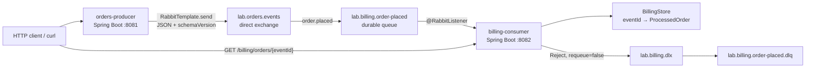
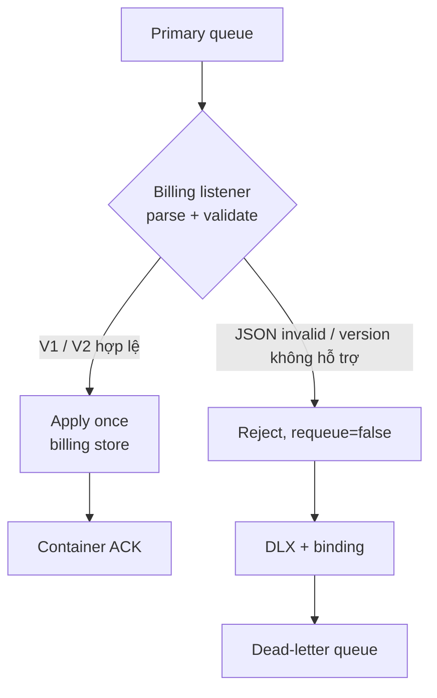
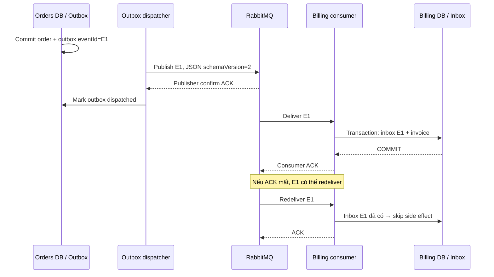

# Gửi JSON có phiên bản schema và nhận từ ứng dụng khác

Trong hệ thống bất đồng bộ, một service Java không thể giả định rằng mọi consumer đều dùng **cùng phiên bản code, cùng class Java hoặc cùng thời điểm triển khai**. Ứng dụng bán hàng có thể đã phát sự kiện `OrderPlaced` phiên bản 2, trong khi ứng dụng lập hóa đơn vẫn đang đọc các message phiên bản 1 nằm trong RabbitMQ. Nếu producer đổi tên trường, đổi đơn vị tiền hoặc dựa vào tên class trong header `__TypeId__`, việc deserialization có thể thất bại dù kết nối, exchange, queue và binding đều đúng.

Bài **thực hành tổng hợp** thuộc module **SPRING_AMQP**: xây dựng **hai ứng dụng Spring Boot độc lập**, dùng `RabbitTemplate` gửi **JSON UTF-8 có `schemaVersion`**, RabbitMQ direct exchange định tuyến, và `@RabbitListener` của ứng dụng khác nhận, kiểm tra, xử lý, ghi nhận kết quả. Chúng ta sẽ quan sát đường thành công, thay đổi schema tương thích, gửi message không hỗ trợ, kiểm tra dead-letter queue (DLQ), rồi bổ sung publisher confirms, idempotency và bài kiểm thử hợp đồng.

**Đầu ra phải chứng minh được:** hai tiến trình Spring Boot chạy riêng, không chia sẻ class DTO tại runtime, vẫn trao đổi một JSON contract chung và consumer biết rõ nó đã xử lý phiên bản nào.

## 1. Kết quả học tập và tiêu chí nghiệm thu

Sau bài thực hành, bạn có thể:

1. Thiết kế **envelope sự kiện có phiên bản schema** độc lập với tên package/class Java.
2. Khởi chạy RabbitMQ cục bộ, khai báo exchange, queue, binding, dead-letter exchange và DLQ.
3. Xây ứng dụng **`orders-producer`** gửi JSON qua `RabbitTemplate` với `contentType=application/json`, `messageId` và publish confirm.
4. Xây ứng dụng **`billing-consumer`** nhận raw `Message` qua `@RabbitListener`, parse JSON, kiểm tra `eventType`/`schemaVersion`, xử lý v1/v2.
5. Phân biệt **JSON/contract hợp lệ**, **message không hỗ trợ**, **lỗi nghiệp vụ tạm thời** và **lỗi giao nhận**.
6. Kiểm chứng message được route từ ứng dụng A sang ứng dụng B, không phải một method call trong cùng JVM.
7. Nêu cách tránh mất/lặp xử lý khi retry, DLQ, consumer redelivery hoặc rollout producer/consumer lệch phiên bản.

| Tiêu chí | Bằng chứng cần có |
| --- | --- |
| Producer và consumer độc lập | Hai ứng dụng/tiến trình, hai port HTTP, hai package/source riêng |
| JSON có schema version | Body chứa `eventType`, `schemaVersion`, `eventId`, `occurredAt`, `payload` |
| Version 1 được hiểu | Consumer ghi nhận payload v1 và kết quả tra cứu theo `eventId` |
| Version 2 được hiểu | Consumer ghi nhận thêm `customerTier` mà không làm hỏng v1 |
| Unsupported schema được kiểm soát | Message bị reject không requeue nóng; đi tới DLQ khi cấu hình đúng |
| Định tuyến rõ ràng | Exchange/binding/queue tồn tại; producer confirms/returns hoạt động |
| Có kiểm chứng end-to-end | Không chỉ nhìn thấy producer `send()` trả về mà còn tra kết quả ở consumer |

## 2. Kiến trúc hai ứng dụng độc lập



**Quy ước topology trong phòng lab:**

| Thành phần | Tên | Vai trò |
| --- | --- | --- |
| Exchange chính | `lab.orders.events` | Direct exchange, durable |
| Routing key | `order.placed` | Sự kiện order được xác nhận |
| Queue chính | `lab.billing.order-placed` | Durable queue do Billing sở hữu |
| Dead-letter exchange | `lab.billing.dlx` | Nhận message bị reject với `requeue=false` |
| Dead-letter routing key | `order.placed.invalid` | Phân biệt tuyến lỗi |
| Dead-letter queue | `lab.billing.order-placed.dlq` | Nơi giữ message không xử lý được |
| Producer API | `localhost:8081` | Gửi sự kiện thử |
| Consumer query API | `localhost:8082` | Quan sát business outcome |

**Phạm vi:** AMQP **0-9-1** với `spring-boot-starter-amqp`, `RabbitTemplate` và container `@RabbitListener` truyền thống. Không nhầm với nhánh RabbitMQ AMQP 1.0 `RabbitAmqpTemplate` hoặc native Stream protocol.

Topology thuộc **ứng dụng Billing**, vì nó sở hữu queue nhận sự kiện; Orders chỉ biết exchange và routing key theo hợp đồng. Trong production, có thể chuyển quyền khai báo topology sang IaC/operator, nhưng cần thống nhất ownership.

## 3. Hợp đồng JSON: version nằm trong body, không nằm trong tên class

Hợp đồng sự kiện `OrderPlaced` có hai phần:

- **Envelope:** metadata đủ để định tuyến về mặt logic, truy vết, định danh và chọn phiên bản.
- **Payload:** dữ liệu nghiệp vụ của phiên bản đó.

### 3.1. Phiên bản v1

```json
{
  "eventType": "OrderPlaced",
  "schemaVersion": 1,
  "eventId": "b8a90f18-c38a-48e5-8570-82c3843f64f1",
  "occurredAt": "2026-11-26T02:00:00Z",
  "payload": {
    "orderId": "order-1042",
    "totalMinor": 259900,
    "currency": "VND"
  }
}
```

Ở đây, `totalMinor` là số nguyên đơn vị nhỏ nhất theo currency/contract đã thống nhất. **Không dùng `double` cho số tiền**: trong Java, cân nhắc `long`, `BigDecimal` và quy tắc scale/rounding được hợp đồng định nghĩa. Với VND, ví dụ hiểu `259900` là 259.900 VND; với đơn vị tiền có phần thập phân, hai bên phải cùng hiểu quy tắc minor units.

### 3.2. Phiên bản v2: thay đổi cộng thêm

```json
{
  "eventType": "OrderPlaced",
  "schemaVersion": 2,
  "eventId": "17f17990-89a3-4163-a676-e3d16726a0ce",
  "occurredAt": "2026-11-26T02:01:00Z",
  "payload": {
    "orderId": "order-1043",
    "totalMinor": 349900,
    "currency": "VND",
    "customerTier": "GOLD"
  }
}
```

**Điều được giữ nguyên:** `eventType`, kiểu dữ liệu của `orderId`, `totalMinor`, `currency`, ý nghĩa `eventId` và đơn vị tiền. **Điều được bổ sung:** `customerTier`. Consumer v2 trong bài sẽ hỗ trợ cả v1 (tự gán tier `STANDARD`) lẫn v2 (đọc tier), cho phép deploy consumer trước producer.

**Tại sao không dùng `__TypeId__=com.shop.orders.dto.OrderPlaced` làm contract?** Vì Billing không nhất thiết có class đó, có thể viết bằng Python/Go và có vòng đời triển khai khác. Tên class Java là chi tiết kỹ thuật nội bộ, **không phải định danh schema liên dịch vụ**.

### 3.3. Hợp đồng cho từng trường

| Trường | Kiểu JSON | Bắt buộc | Quy tắc |
| --- | --- | --- | --- |
| `eventType` | String | Có | Bằng `OrderPlaced` |
| `schemaVersion` | Integer | Có | Chỉ 1 hoặc 2 trong consumer phiên bản hiện tại |
| `eventId` | String | Có | ID duy nhất cho **một event nghiệp vụ**, không đổi khi retry |
| `occurredAt` | String | Có | ISO-8601 UTC, ví dụ `2026-11-26T02:00:00Z` |
| `payload.orderId` | String | Có | ID đơn hàng không rỗng |
| `payload.totalMinor` | Integer | Có | Số nguyên dương, thống nhất quy tắc currency |
| `payload.currency` | String | Có | Mã currency có ba ký tự in hoa |
| `payload.customerTier` | String | V2 có; V1 không có | Giá trị demo `STANDARD`/`GOLD`; production cần enum/policy |

Phiên bản là **một phần của body mà mọi consumer nhìn thấy**. Có thể thêm header `schema-id` cho tracing/schema registry khi hệ thống yêu cầu, nhưng phải tránh **hai nguồn sự thật**: nếu header nói v1 mà body nói v2, consumer phải reject hoặc áp dụng quy tắc lỗi rõ ràng, không đoán.

## 4. Môi trường và cấu trúc hai ứng dụng

**Baseline minh họa:** Java 21, Spring Boot **3.5.x** (Spring AMQP 3.x, Jackson 2) và RabbitMQ **4.1** trong container. Chọn **bản vá 3.5.x được hỗ trợ thực tế** từ Spring Initializr/BOM dự án; không tự ghép version Spring AMQP/Jackson không tương thích. Nếu dùng Spring Boot 4.x, xem lưu ý converter/Jackson 3 ở mục 11.

Tạo **hai Spring Boot projects riêng**:

```text
json-schema-lab/                    # Chỉ là thư mục học tập
  orders-producer/
    pom.xml
    src/main/java/dev/lab/orders/
      OrdersProducerApplication.java
      OrderEventsPublisher.java
      DemoOrdersController.java
    src/main/resources/application.yml

  billing-consumer/
    pom.xml
    src/main/java/dev/lab/billing/
      BillingConsumerApplication.java
      BillingTopology.java
      BillingOrderListener.java
      ProcessedOrder.java
      BillingStore.java
      BillingQueryController.java
    src/main/resources/application.yml
```

Với **cả hai project** từ Spring Initializr, chọn `Spring for RabbitMQ`, `Spring Web` và `Spring Boot Test`. Đoạn dependency cốt lõi do Initializr/BOM quản lý:

```xml
<!-- Cả hai ứng dụng: các dependency đặt trong pom.xml của từng project. -->
<dependency>
    <groupId>org.springframework.boot</groupId>
    <artifactId>spring-boot-starter-amqp</artifactId>
</dependency>
<dependency>
    <groupId>org.springframework.boot</groupId>
    <artifactId>spring-boot-starter-web</artifactId>
</dependency>
<dependency>
    <groupId>org.springframework.boot</groupId>
    <artifactId>spring-boot-starter-test</artifactId>
    <scope>test</scope>
</dependency>
```

Trong Boot 3.x, `spring-boot-starter-web` cung cấp Jackson 2 để dùng `com.fasterxml.jackson.databind.ObjectMapper`. Bài cố ý **không dùng shared Java DTO jar** giữa hai ứng dụng; thứ được chia sẻ là **JSON schema contract** và quy tắc tương thích, không phải code.

### 4.1. Chạy RabbitMQ cục bộ

Ví dụ Docker (chỉ phục vụ local lab, không dùng mật khẩu demo trong production):

```bash
docker run -d --name rabbit-schema-lab \
  -p 5672:5672 -p 15672:15672 \
  -e RABBITMQ_DEFAULT_USER=lab \
  -e RABBITMQ_DEFAULT_PASS=lab-dev-only \
  rabbitmq:4.1-management

# Quan sát broker khởi động. Dùng user/password demo phía trên.
docker logs rabbit-schema-lab
```

Management UI: `http://localhost:15672`, tài khoản `lab` / `lab-dev-only`. Cổng `5672` là AMQP **plaintext** dùng trong local lab; cổng `15672` là HTTP Management, **không** phải cổng để `RabbitTemplate` publish. Mật khẩu mẫu chỉ dùng cho container thử nghiệm. Với staging/production, bắt buộc cấu hình secret ngoài source, phân quyền vhost và TLS theo chính sách tổ chức.

Nếu máy đã có RabbitMQ hoặc port bị chiếm, đổi port mapping và cập nhật cả hai ứng dụng. Trên Docker Desktop, container cần khởi động xong trước khi listener khai báo queue.

## 5. Ứng dụng B: Billing sở hữu exchange, queue, binding và DLQ

Ta tạo **ứng dụng nhận trước** để topology có sẵn khi Orders publish.

### 5.1. Điểm vào ứng dụng

```java
// billing-consumer/src/main/java/dev/lab/billing/BillingConsumerApplication.java
package dev.lab.billing;

import org.springframework.boot.SpringApplication;
import org.springframework.boot.autoconfigure.SpringBootApplication;

@SpringBootApplication
public class BillingConsumerApplication {
    public static void main(String[] args) {
        SpringApplication.run(BillingConsumerApplication.class, args);
    }
}
```

### 5.2. Cấu hình kết nối của Billing

```yaml
# billing-consumer/src/main/resources/application.yml
server:
  port: 8082

spring:
  application:
    name: billing-consumer
  rabbitmq:
    host: localhost
    port: 5672
    username: lab
    password: ${LAB_RABBIT_PASSWORD}
    listener:
      simple:
        acknowledge-mode: auto
        concurrency: 1
        prefetch: 5
        # Trong lab, lỗi không xử lý được đi DLQ thay vì requeue nóng.
        default-requeue-rejected: false
```

Trước khi chạy, đặt biến môi trường `LAB_RABBIT_PASSWORD=lab-dev-only` trong terminal khởi động ứng dụng. Khi triển khai thật, không để mật khẩu trong command history, repository hoặc image; dùng secret manager/secret volume và TLS.

**`acknowledge-mode=auto` trong Spring container không đồng nghĩa broker “auto-ack”**: container ACK khi listener hoàn thành bình thường theo semantics của nó; lỗi gây reject/nack theo error handler và `default-requeue-rejected`. Broker `autoAck=true`/`AcknowledgeMode.NONE` là cơ chế khác, không dùng cho yêu cầu hoàn tất nghiệp vụ đáng tin cậy.

### 5.3. Topology với dead-letter

```java
// billing-consumer/src/main/java/dev/lab/billing/BillingTopology.java
package dev.lab.billing;

import org.springframework.amqp.core.Binding;
import org.springframework.amqp.core.BindingBuilder;
import org.springframework.amqp.core.DirectExchange;
import org.springframework.amqp.core.Queue;
import org.springframework.amqp.core.QueueBuilder;
import org.springframework.beans.factory.annotation.Qualifier;
import org.springframework.context.annotation.Bean;
import org.springframework.context.annotation.Configuration;

@Configuration
public class BillingTopology {
    public static final String EXCHANGE = "lab.orders.events";
    public static final String ROUTING_KEY = "order.placed";
    public static final String QUEUE = "lab.billing.order-placed";
    public static final String DLX = "lab.billing.dlx";
    public static final String DLQ = "lab.billing.order-placed.dlq";
    public static final String DLQ_KEY = "order.placed.invalid";

    @Bean("ordersEventsExchange")
    DirectExchange ordersEventsExchange() {
        return new DirectExchange(EXCHANGE, true, false);
    }

    @Bean("billingDlx")
    DirectExchange billingDlx() {
        return new DirectExchange(DLX, true, false);
    }

    @Bean("billingQueue")
    Queue billingQueue() {
        return QueueBuilder.durable(QUEUE)
                .deadLetterExchange(DLX)
                .deadLetterRoutingKey(DLQ_KEY)
                .build();
    }

    @Bean("billingDlq")
    Queue billingDlq() {
        return QueueBuilder.durable(DLQ).build();
    }

    @Bean
    Binding ordersToBilling(
            @Qualifier("billingQueue") Queue queue,
            @Qualifier("ordersEventsExchange") DirectExchange exchange) {
        return BindingBuilder.bind(queue).to(exchange).with(ROUTING_KEY);
    }

    @Bean
    Binding billingDeadLetterBinding(
            @Qualifier("billingDlq") Queue queue,
            @Qualifier("billingDlx") DirectExchange exchange) {
        return BindingBuilder.bind(queue).to(exchange).with(DLQ_KEY);
    }
}
```

Spring Boot thường tự cấu hình `RabbitAdmin` (khi `spring.rabbitmq.dynamic=true`) và dùng các bean `Exchange`, `Queue`, `Binding` để khai báo topology khi kết nối thích hợp được mở. Nếu broker đã có queue cùng tên với arguments khác, redeclare có thể gây `406 PRECONDITION_FAILED`; không xóa queue đang có backlog để “sửa nhanh”.

**Tại sao chỉ một app quản lý topology?** Hai ứng dụng khai báo cùng một exchange với arguments khác nhau có thể xung đột. Với production, owner có thể là IaC/operator và service account runtime chỉ có `write` exchange hoặc `read` queue theo vai trò.

## 6. Ứng dụng B: nhận JSON và chọn parser bằng schemaVersion

Ứng dụng Billing không cần class `dev.lab.orders.OrderPlaced` của producer. Nó nhận **raw AMQP `Message`** và tự parse JSON bằng Jackson theo contract.

### 6.1. Lưu kết quả cho bài lab

Để quan sát được qua HTTP, ta dùng một store in-memory thread-safe. **Nó chỉ minh họa; không bền vững khi restart và không thay thế idempotency bằng database.**

```java
// billing-consumer/src/main/java/dev/lab/billing/ProcessedOrder.java
package dev.lab.billing;

public record ProcessedOrder(
        String eventId,
        String orderId,
        long totalMinor,
        String currency,
        String customerTier,
        int schemaVersion) {}
```

```java
// billing-consumer/src/main/java/dev/lab/billing/BillingStore.java
package dev.lab.billing;

import java.util.Optional;
import java.util.concurrent.ConcurrentHashMap;
import java.util.concurrent.ConcurrentMap;
import org.springframework.stereotype.Component;

@Component
public class BillingStore {
    private final ConcurrentMap<String, ProcessedOrder> processed =
            new ConcurrentHashMap<>();

    public boolean applyOnce(ProcessedOrder order) {
        // putIfAbsent là atomic trong JVM này; demo cho idempotency.
        return processed.putIfAbsent(order.eventId(), order) == null;
    }

    public Optional<ProcessedOrder> find(String eventId) {
        return Optional.ofNullable(processed.get(eventId));
    }
}
```

**Trong production**, thay `ConcurrentHashMap` bằng bảng `processed_events`/`inbox` có unique constraint theo `(consumer_name, event_id)`, ghi marker và business side effect **trong cùng transaction**. Nếu service chạy nhiều pod, store trong bộ nhớ không đồng bộ giữa các pod và không chống trùng sau restart.

### 6.2. Parser + listener có kiểm tra schema

```java
// billing-consumer/src/main/java/dev/lab/billing/BillingOrderListener.java
package dev.lab.billing;

import java.io.IOException;
import java.time.Instant;
import java.time.format.DateTimeParseException;
import java.util.Locale;

import com.fasterxml.jackson.databind.JsonNode;
import com.fasterxml.jackson.databind.ObjectMapper;
import org.springframework.amqp.AmqpRejectAndDontRequeueException;
import org.springframework.amqp.core.Message;
import org.springframework.amqp.rabbit.annotation.RabbitListener;
import org.springframework.stereotype.Component;

@Component
public class BillingOrderListener {
    private final ObjectMapper mapper;
    private final BillingStore store;

    public BillingOrderListener(ObjectMapper mapper, BillingStore store) {
        this.mapper = mapper;
        this.store = store;
    }

    @RabbitListener(
        id = "billing-order-placed",
        queues = BillingTopology.QUEUE)
    public void onOrderPlaced(Message message) {
        try {
            ProcessedOrder order = parse(message);
            boolean first = store.applyOnce(order);

            System.out.printf(
                "eventId=%s schemaVersion=%d orderId=%s tier=%s outcome=%s%n",
                order.eventId(),
                order.schemaVersion(),
                order.orderId(),
                order.customerTier(),
                first ? "APPLIED" : "DUPLICATE_SKIPPED");
        }
        catch (IOException | IllegalArgumentException
               | DateTimeParseException ex) {
            // Lỗi payload/contract là lỗi vĩnh viễn trong bài lab.
            // Container sẽ reject/nack với requeue=false, có DLX -> DLQ.
            throw new AmqpRejectAndDontRequeueException(
                "Unsupported or invalid OrderPlaced JSON", ex);
        }
    }

    private ProcessedOrder parse(Message message) throws IOException {
        String type = message.getMessageProperties().getContentType();
        if (type == null ||
                !type.split(";", 2)[0].trim()
                     .equalsIgnoreCase("application/json")) {
            throw new IllegalArgumentException("Expected application/json");
        }

        String encoding = message.getMessageProperties().getContentEncoding();
        if (encoding != null &&
                !encoding.toUpperCase(Locale.ROOT).equals("UTF-8")) {
            throw new IllegalArgumentException("Only UTF-8 supported");
        }

        JsonNode root = mapper.readTree(message.getBody());
        if (root == null || !root.isObject()) {
            throw new IllegalArgumentException("Expected JSON object");
        }

        String eventType = requiredText(root, "eventType");
        if (!eventType.equals("OrderPlaced")) {
            throw new IllegalArgumentException("Unexpected eventType");
        }

        JsonNode versionNode = root.path("schemaVersion");
        if (!versionNode.isIntegralNumber() ||
                !versionNode.canConvertToInt()) {
            throw new IllegalArgumentException("schemaVersion must be int");
        }
        int version = versionNode.intValue();
        if (version != 1 && version != 2) {
            throw new IllegalArgumentException(
                "Unsupported schemaVersion: " + version);
        }

        String eventId = requiredText(root, "eventId");
        String messageId =
                message.getMessageProperties().getMessageId();
        if (messageId != null && !messageId.equals(eventId)) {
            throw new IllegalArgumentException(
                "messageId and eventId disagree");
        }

        // Kiểm tra timestamp, không phụ thuộc múi giờ của máy chạy.
        Instant.parse(requiredText(root, "occurredAt"));

        JsonNode payload = root.path("payload");
        if (!payload.isObject()) {
            throw new IllegalArgumentException("payload must be object");
        }
        String orderId = requiredText(payload, "orderId");
        String currency = requiredText(payload, "currency");
        if (!currency.matches("[A-Z]{3}")) {
            throw new IllegalArgumentException("Invalid currency");
        }

        JsonNode total = payload.path("totalMinor");
        if (!total.isIntegralNumber() || !total.canConvertToLong()
                || total.longValue() <= 0) {
            throw new IllegalArgumentException(
                "totalMinor must be a positive integer");
        }

        // V1 không có customerTier; V2 bổ sung trường này.
        String tier = version == 1
                ? "STANDARD"
                : requiredText(payload, "customerTier");

        return new ProcessedOrder(
                eventId, orderId, total.longValue(), currency,
                tier, version);
    }

    private static String requiredText(JsonNode node, String field) {
        JsonNode value = node.path(field);
        if (!value.isTextual() || value.asText().isBlank()) {
            throw new IllegalArgumentException(
                "Required text field missing: " + field);
        }
        return value.asText();
    }
}
```

**Một lưu ý biên dịch:** `Instant.parse(...)` có thể ném `DateTimeParseException` (thuộc nhánh `DateTimeException`, **không phải** `IllegalArgumentException`), nên được catch riêng trong multi-catch. `ObjectMapper.readTree(byte[])` có thể ném `IOException`; mã ví dụ phân loại các lỗi parse/validation này thành message sai schema trong bài lab.

**Lưu ý xử lý lỗi:** `AmqpRejectAndDontRequeueException` yêu cầu không requeue message này; với DLX/DLQ đúng, broker chuyển nó sang tuyến dead-letter. Không phải mọi lỗi đều là “schema sai”: database timeout, downstream unavailable hoặc credential hết hạn cần **retry có backoff/giới hạn** và tách lỗi transient khỏi lỗi permanent. Lab cố tình dùng store in-memory để làm rõ đường đi trước khi thêm DB/retry.

### 6.3. HTTP API đọc kết quả consumer

```java
// billing-consumer/src/main/java/dev/lab/billing/BillingQueryController.java
package dev.lab.billing;

import org.springframework.http.ResponseEntity;
import org.springframework.web.bind.annotation.GetMapping;
import org.springframework.web.bind.annotation.PathVariable;
import org.springframework.web.bind.annotation.RequestMapping;
import org.springframework.web.bind.annotation.RestController;

@RestController
@RequestMapping("/billing/orders")
public class BillingQueryController {
    private final BillingStore store;

    public BillingQueryController(BillingStore store) {
        this.store = store;
    }

    @GetMapping("/{eventId}")
    public ResponseEntity<ProcessedOrder> find(
            @PathVariable String eventId) {
        return store.find(eventId)
                .map(ResponseEntity::ok)
                .orElseGet(() -> ResponseEntity.notFound().build());
    }
}
```

API này chỉ dùng để **xác nhận trạng thái bài thực hành**. Trong production không nên mở endpoint lộ event/order data mà thiếu authentication và authorization. Sau khi consumer xử lý v1 hoặc v2, query theo `eventId` phải trả đúng `schemaVersion`, `customerTier` và số tiền.

## 7. Ứng dụng A: Orders publish JSON đúng hợp đồng

Ứng dụng producer **không import một class DTO của Billing**, và Billing cũng không import class của Orders. Hai bên chia sẻ **cấu trúc JSON** có version rõ ràng.

### 7.1. Điểm vào và cấu hình kết nối

```java
// orders-producer/src/main/java/dev/lab/orders/OrdersProducerApplication.java
package dev.lab.orders;

import org.springframework.boot.SpringApplication;
import org.springframework.boot.autoconfigure.SpringBootApplication;

@SpringBootApplication
public class OrdersProducerApplication {
    public static void main(String[] args) {
        SpringApplication.run(OrdersProducerApplication.class, args);
    }
}
```

```yaml
# orders-producer/src/main/resources/application.yml
server:
  port: 8081

spring:
  application:
    name: orders-producer
  rabbitmq:
    host: localhost
    port: 5672
    username: lab
    password: ${LAB_RABBIT_PASSWORD}
    publisher-confirm-type: correlated
    publisher-returns: true
    template:
      mandatory: true
```

**Ba tín hiệu cần phân biệt:**

- `RabbitTemplate.send(...)` không ném exception: lệnh gửi phía client đã chạy, **chưa chứng minh** consumer nhận.
- Publisher confirm **ACK**: broker đã xử lý lần publish theo semantics của queue, **không chứng minh** message đến queue đích khi unroutable.
- Với `mandatory=true` và publisher returns, có thể nhận `basic.return` khi message không được route tới queue; phải kiểm tra **cả confirm và return**.

### 7.2. Tạo JSON với Jackson, gửi raw AMQP Message

```java
// orders-producer/src/main/java/dev/lab/orders/OrderEventsPublisher.java
package dev.lab.orders;

import java.nio.charset.StandardCharsets;
import java.time.Instant;
import java.util.UUID;
import java.util.concurrent.TimeUnit;

import com.fasterxml.jackson.databind.ObjectMapper;
import com.fasterxml.jackson.databind.node.ObjectNode;
import org.springframework.amqp.core.Message;
import org.springframework.amqp.core.MessageDeliveryMode;
import org.springframework.amqp.core.MessageProperties;
import org.springframework.amqp.rabbit.connection.CorrelationData;
import org.springframework.amqp.rabbit.core.RabbitTemplate;
import org.springframework.stereotype.Service;

@Service
public class OrderEventsPublisher {
    private static final String EXCHANGE = "lab.orders.events";
    private static final String ROUTING_KEY = "order.placed";

    private final RabbitTemplate template;
    private final ObjectMapper mapper;

    public OrderEventsPublisher(RabbitTemplate template,
                                ObjectMapper mapper) {
        this.template = template;
        this.mapper = mapper;
    }

    public String publish(int version, String orderId,
                          long totalMinor, String currency)
            throws Exception {
        if (version != 1 && version != 2) {
            throw new IllegalArgumentException(
                "Producer only supports schema 1 and 2");
        }

        String eventId = UUID.randomUUID().toString();
        ObjectNode payload = mapper.createObjectNode();
        payload.put("orderId", orderId);
        payload.put("totalMinor", totalMinor);
        payload.put("currency", currency);
        if (version == 2) {
            payload.put("customerTier", "GOLD");
        }

        ObjectNode envelope = mapper.createObjectNode();
        envelope.put("eventType", "OrderPlaced");
        envelope.put("schemaVersion", version);
        envelope.put("eventId", eventId);
        envelope.put("occurredAt", Instant.now().toString());
        envelope.set("payload", payload);

        byte[] jsonBytes = mapper.writeValueAsBytes(envelope);
        MessageProperties properties = new MessageProperties();
        properties.setContentType(MessageProperties.CONTENT_TYPE_JSON);
        properties.setContentEncoding(StandardCharsets.UTF_8.name());
        properties.setDeliveryMode(MessageDeliveryMode.PERSISTENT);
        properties.setMessageId(eventId);

        Message message = new Message(jsonBytes, properties);
        CorrelationData correlation = new CorrelationData(eventId);

        // Gửi bytes JSON: không ràng buộc __TypeId__ với class Java.
        template.send(EXCHANGE, ROUTING_KEY, message, correlation);

        CorrelationData.Confirm confirm =
                correlation.getFuture().get(10, TimeUnit.SECONDS);

        if (!confirm.isAck()) {
            throw new IllegalStateException(
                "Broker NACK: " + confirm.getReason());
        }
        if (correlation.getReturned() != null) {
            throw new IllegalStateException(
                "Message unroutable, eventId=" + eventId);
        }
        return eventId;
    }
}
```

**Điểm cần giải thích trong bài demo:**

1. `writeValueAsBytes` tạo JSON UTF-8; Spring không tự gửi Java serialized object.
2. `contentType=application/json` cho biết cách hiểu body; `contentEncoding=UTF-8` tránh giả định encoding.
3. `messageId=eventId` hỗ trợ truy vết, nhưng business `eventId` trong body mới là contract.
4. `PERSISTENT` + durable queue giúp độ bền theo điều kiện broker, **không thay publisher confirms**.
5. `CorrelationData` ghép kết quả confirm/return với lần publish; không cần gửi tên class Java của producer.
6. Lời gọi `get(10, TimeUnit.SECONDS)` chỉ nhằm đơn giản hóa lab. Trong hệ thống throughput cao, dùng async confirms/outbox thay vì chặn một HTTP thread cho mỗi event.

**Nếu timeout confirm:** trạng thái là **UNKNOWN**; broker có thể đã nhận message. Cần transactional outbox và retry **cùng eventId**, không tạo eventId mới khi chỉ gửi lại cùng sự kiện. Nếu muốn triển khai toàn bộ bất đồng bộ, API nên trả `202 Accepted` **sau khi ghi outbox commit**, còn dispatcher theo dõi confirm riêng. Mẫu lab chỉ minh họa publish trực tiếp.

### 7.3. API thử publish từ terminal

```java
// orders-producer/src/main/java/dev/lab/orders/DemoOrdersController.java
package dev.lab.orders;

import java.util.Map;
import java.util.UUID;

import org.springframework.http.ResponseEntity;
import org.springframework.web.bind.annotation.PostMapping;
import org.springframework.web.bind.annotation.RequestMapping;
import org.springframework.web.bind.annotation.RequestParam;
import org.springframework.web.bind.annotation.RestController;

@RestController
@RequestMapping("/demo")
public class DemoOrdersController {
    private final OrderEventsPublisher publisher;

    public DemoOrdersController(OrderEventsPublisher publisher) {
        this.publisher = publisher;
    }

    @PostMapping("/orders")
    public ResponseEntity<Map<String, Object>> publish(
            @RequestParam(defaultValue = "1") int schemaVersion)
            throws Exception {
        String orderId = "order-" + UUID.randomUUID();
        String eventId = publisher.publish(
                schemaVersion, orderId, 259900L, "VND");

        return ResponseEntity.accepted().body(Map.of(
                "eventId", eventId,
                "orderId", orderId,
                "schemaVersion", schemaVersion,
                "publish", "BROKER_CONFIRMED_NOT_BUSINESS_COMPLETED"));
    }
}
```

HTTP `202 Accepted` ở đây **không** có nghĩa Billing đã lập hóa đơn; nó chỉ thông báo producer đã nhận confirm và không quan sát thấy return cho lần publish. Client phải tra `/billing/orders/{eventId}` để biết kết quả của **ứng dụng khác**.

## 8. Chạy end-to-end và quan sát hai tiến trình

Giữ RabbitMQ chạy; sau đó mở **hai terminal** độc lập, mỗi terminal có biến môi trường `LAB_RABBIT_PASSWORD` được cấp cho local lab.

```bash
# Terminal 1: chạy consumer và để nó khai báo topology trước.
cd billing-consumer
export LAB_RABBIT_PASSWORD='lab-dev-only'
./mvnw spring-boot:run
```

```bash
# Terminal 2: chạy producer.
cd orders-producer
export LAB_RABBIT_PASSWORD='lab-dev-only'
./mvnw spring-boot:run
```

Trên Windows PowerShell, có thể đặt `$env:LAB_RABBIT_PASSWORD = 'lab-dev-only'` rồi chạy `.\mvnw.cmd spring-boot:run` trong từng project. Nếu không dùng Maven wrapper, dùng Maven cài sẵn. Các lệnh ở đây là **hướng dẫn người học**, không cần thao tác lên tài nguyên production.

### 8.1. Gửi một sự kiện v1

```bash
curl -X POST "http://localhost:8081/demo/orders?schemaVersion=1"
```

Phản hồi ví dụ:

```json
{
  "eventId": "110b10ee-52db-4d92-8d32-acb8775fe28f",
  "orderId": "order-4c3a35d0-d1a4-4724-b477-b4f86c45b102",
  "schemaVersion": 1,
  "publish": "BROKER_CONFIRMED_NOT_BUSINESS_COMPLETED"
}
```

Trong log Billing cần thấy một dòng tương tự (giá trị thực thay đổi):

```text
eventId=110b10ee-52db-4d92-8d32-acb8775fe28f schemaVersion=1 orderId=order-4c3a35d0-d1a4-4724-b477-b4f86c45b102 tier=STANDARD outcome=APPLIED
```

Sau đó:

```bash
curl "http://localhost:8082/billing/orders/110b10ee-52db-4d92-8d32-acb8775fe28f"
```

Kết quả trả về có `schemaVersion: 1` và `customerTier: "STANDARD"`. Nếu vừa gửi xong nhận HTTP 404 từ Billing, có thể listener **chưa kịp xử lý**; retry request GET theo điều kiện có timeout, **không sleep cố định rồi suy rằng 404 là mất message**.

### 8.2. Gửi một sự kiện v2

```bash
curl -X POST "http://localhost:8081/demo/orders?schemaVersion=2"
```

Lấy `eventId` mới trong response và GET ở Billing tương tự. Kỳ vọng `schemaVersion=2` và `customerTier="GOLD"`. Cả v1 và v2 đều đi **cùng exchange, routing key, queue**, nhưng consumer lựa chọn logic dựa trên **`schemaVersion`**.

| Kịch bản | Producer JSON | Consumer kết quả |
| --- | --- | --- |
| V1 | Không có `customerTier` | `tier=STANDARD` |
| V2 | Có `customerTier=GOLD` | `tier=GOLD` |
| Producer chỉ được gọi với version 3 | API demo từ chối trước publish | Không có message mới |
| Message version 99 tự publish trong **test** | JSON body version 99 | Consumer reject → DLQ theo cấu hình |

### 8.3. Kiểm tra broker

Trong Management UI, xác minh:

- Tab Exchanges có `lab.orders.events` và `lab.billing.dlx`.
- Tab Queues có `lab.billing.order-placed` và `lab.billing.order-placed.dlq`.
- Binding `order.placed` dẫn từ exchange chính đến queue chính.
- Consumer count của queue chính thường bằng 1 (theo cấu hình lab).
- Khi consumer xử lý nhanh, `messages_ready` có thể luôn bằng 0 ở thời điểm quan sát; **đây không phải lỗi**.

Có thể dùng lệnh đọc trạng thái trong container:

```bash
docker exec rabbit-schema-lab \
  rabbitmqctl list_queues -p / \
  name messages_ready messages_unacknowledged consumers
```

Đừng dùng `Get messages` trên queue production như một thao tác quan sát vô hại: nó có thể tác động tới delivery. Đối với lab này có thể thao tác trên dữ liệu giả, nhưng vẫn cần hiểu mode ACK/requeue của công cụ.

## 9. Vì sao dùng raw Message thay vì JSON converter tự động?

Spring AMQP có thể chuyển object Java thành JSON và chuyển ngược qua `MessageConverter`. Tuy nhiên, khi producer và consumer thuộc **hai codebase độc lập**, việc converter sử dụng header `__TypeId__` chứa **fully qualified class name** của producer có thể làm consumer không tìm thấy class hoặc tạo sự phụ thuộc vào chi tiết triển khai.

Trong bài ta dùng:

```text
Producer:
  ObjectMapper -> UTF-8 JSON bytes
  MessageProperties.contentType = application/json
  RabbitTemplate.send(exchange, key, Message, CorrelationData)

RabbitMQ:
  Chỉ route/store bytes và properties theo AMQP.

Consumer:
  @RabbitListener(Message)
  ObjectMapper.readTree(message.getBody())
  switch schemaVersion -> validation/handling.
```

Không cần một Java class `OrderPlacedEvent` giống hệt ở cả hai phía. Đây cũng là cách dễ chuyển consumer sang Go, Python hoặc Node.js: chỉ cần cùng hợp đồng JSON, không cần Spring class metadata.

### 9.1. Khi nào nên dùng JacksonJsonMessageConverter?

Nếu hai bên đã có **mô hình contract rõ và kiểm soát type mapping**, có thể dùng:

- **Spring AMQP 3.x / Spring Boot 3.x:** `Jackson2JsonMessageConverter` (Jackson 2).
- **Spring AMQP 4.x / Spring Boot 4.x:** `JacksonJsonMessageConverter` (Jackson 3); API Jackson 2 đã bị deprecate để dần loại bỏ.

Ví dụ **chỉ cho Spring AMQP 3.x**:

```java
import org.springframework.amqp.support.converter.Jackson2JsonMessageConverter;
import org.springframework.context.annotation.Bean;

@Bean
Jackson2JsonMessageConverter jsonMessageConverter() {
    return new Jackson2JsonMessageConverter();
}
```

Spring Boot có thể gắn bean `MessageConverter` vào `RabbitTemplate`/listener container mặc định theo cấu hình. Với `@RabbitListener` nhận một **concrete DTO**, Spring AMQP có thể suy ra type từ tham số method và ưu tiên type đó so với header type. Nhưng **không nên dựa vào behavior này như hợp đồng cross-service** nếu còn những kiểu abstract/interface, type hierarchy hoặc input không đáng tin.

**Bảo mật deserialization:** không bật “trust tất cả package” vô điều kiện cho message từ nguồn ngoài; giới hạn type mappings/trusted packages theo contract. Không gửi Java serialized object thay cho JSON chỉ để đơn giản hóa. Trong bài này, parser explicit và allowlist `eventType`/`schemaVersion` tránh phụ thuộc class names từ message header.

## 10. Schema evolution: thứ tự rollout quyết định khả năng tương thích

Với các ứng dụng triển khai độc lập, “v2 có thêm trường” không đủ để gọi migration an toàn. Cần trả lời **producer mới → consumer cũ** và **producer cũ → consumer mới** có hoạt động hay không.

| Cặp phiên bản | Khả năng | Điều kiện |
| --- | --- | --- |
| Producer v1 → Consumer v1 | Có | Cùng contract v1 |
| Producer v1 → Consumer v2 | **Có trong bài** | Consumer v2 vẫn parse v1 và gán default tier |
| Producer v2 → Consumer v2 | Có | Consumer hiểu `customerTier` |
| Producer v2 → Consumer v1 | **Phụ thuộc** | Consumer v1 phải bỏ qua trường JSON mới; nếu strict `additionalProperties=false` có thể reject |
| Producer v3 đổi cấu trúc tiền → Consumer v2 | **Không** nếu chưa hỗ trợ | Phải có adapter, route/version mới hoặc rollout có barrier |

### 10.1. Chiến lược expand → migrate → contract

1. **Expand consumer:** deploy Billing mới có thể đọc cả schema 1 và 2, nhưng producer vẫn gửi v1.
2. **Migrate producer:** cho Orders phát v2; đo tỷ lệ v1/v2, lỗi deserialization, backlog và DLQ.
3. **Giữ cửa sổ tương thích:** các event v1 còn trên queue, retry queue, DLQ, outbox hoặc đang được replay vẫn phải đọc được.
4. **Contract:** chỉ bỏ hỗ trợ v1 khi có inventory và bằng chứng không còn nguồn phát/replay v1 hoặc đã có adapter/migration.

**Không xóa code xử lý v1 ngay khi producer mặc định gửi v2.** Một queue durable có thể vẫn chứa message được tạo nhiều ngày trước; DLQ replay trong tương lai cũng có thể mang schema cũ.

### 10.2. Những thay đổi thường tương thích

| Thay đổi | Có thể tương thích không? | Cẩn thận |
| --- | --- | --- |
| Thêm field tùy chọn | Thường có | Consumer cũ phải bỏ qua unknown fields |
| Thêm field mới kèm giá trị default | Có điều kiện | Consumer mới đọc message cũ phải có default đúng nghiệp vụ |
| Thêm enum value | Có điều kiện | Consumer cũ có thể reject giá trị chưa biết |
| Đổi tên field | **Thường breaking** | Có thời kỳ dual-field/adapter hoặc version mới |
| Đổi `totalMinor` thành `total` dạng decimal | **Breaking** | Khác tên, kiểu và đơn vị tiền |
| Đổi `eventType` | **Breaking** với dispatcher cũ | Versioned routing/event type hoặc song song |
| Xóa field bắt buộc | **Breaking** với consumer cũ | Phải deploy consumer hỗ trợ trước |
| Đổi `eventId` mỗi lần retry | Không phải schema change, nhưng **phá idempotency** | Giữ stable event ID |

Độ tương thích thực tế còn phụ thuộc **JSON validator**, strictness khi deserialization, defaults, enum handling và quy tắc business. Nếu dùng JSON Schema, định nghĩa rõ `required`, `additionalProperties`, kiểu `integer` so với `number`, format timestamp và semantic version.

## 11. JSON Schema độc lập với Java DTO

Khi có nhiều team/ngôn ngữ, nên lưu **hợp đồng JSON Schema** trong schema registry/repository hợp đồng do team quản lý, review và test trong CI. Ví dụ rút gọn với **JSON Schema Draft 2020-12**:

```json
{
  "$schema": "https://json-schema.org/draft/2020-12/schema",
  "$id": "https://contracts.example.invalid/order-placed/1",
  "type": "object",
  "required": [
    "eventType", "schemaVersion", "eventId",
    "occurredAt", "payload"
  ],
  "properties": {
    "eventType": { "const": "OrderPlaced" },
    "schemaVersion": { "const": 1 },
    "eventId": { "type": "string", "minLength": 1 },
    "occurredAt": { "type": "string", "format": "date-time" },
    "payload": {
      "type": "object",
      "required": ["orderId", "totalMinor", "currency"],
      "properties": {
        "orderId": { "type": "string", "minLength": 1 },
        "totalMinor": {
          "type": "integer",
          "minimum": 1
        },
        "currency": {
          "type": "string",
          "pattern": "^[A-Z]{3}$"
        }
      },
      "additionalProperties": true
    }
  },
  "additionalProperties": true
}
```

URL `contracts.example.invalid` ở `$id` **chỉ là định danh minh họa, không phải endpoint có thể truy cập**. V1 cho phép payload có các field bổ sung để consumer cũ dung nạp các thay đổi additive, nhưng application code vẫn phải quyết định không tin những trường không được hiểu.

Schema v2 có thể giữ phần lớn định nghĩa và đổi `schemaVersion` thành `const:2`, bổ sung `customerTier` vào `payload.properties` và `required` **cho riêng v2**. Không nên chỉ thay `$id` mà quên tăng `const` của version. Nếu hợp đồng cần chặt chẽ, dùng schema registry và CI test chéo các phiên bản thay vì sửa cấu hình runtime mù.

### 11.1. Version nên được định nghĩa thế nào?

Cách đơn giản trong lab là **số nguyên tăng dần**. Không có quy định rằng tất cả hệ thống phải đặt `schemaVersion=2` cho một field additive; tổ chức có thể chọn semantic version `"1.1.0"`, schema registry ID hoặc một mapping tương đương.

Điểm quan trọng là:

- ID có ý nghĩa ổn định, được document và được kiểm thử.
- Consumer nhận biết **phiên bản nó hỗ trợ**.
- Producer không phát một cấu trúc mới dưới **cùng version nhưng ý nghĩa khác**.
- Có lộ trình xử lý/quan sát message từ version chưa hỗ trợ.

## 12. Xử lý message sai và dead-letter queue

Ở lab, message không đúng JSON/`contentType`, sai `eventType` hoặc `schemaVersion=99` sẽ bị listener ném `AmqpRejectAndDontRequeueException`. Khi queue có DLX và binding đúng, broker chuyển message bị reject với `requeue=false` sang `lab.billing.order-placed.dlq`.



### 12.1. Tự tạo message version không hỗ trợ

Chỉ trong RabbitMQ **Management UI cục bộ**, mở exchange `lab.orders.events` và chọn publish một message:

- Routing key: `order.placed`.
- Content type: `application/json` (trong properties).
- Payload JSON:

```json
{
  "eventType": "OrderPlaced",
  "schemaVersion": 99,
  "eventId": "event-unsupported-lab-99",
  "occurredAt": "2026-11-26T02:02:00Z",
  "payload": {
    "orderId": "order-unsupported",
    "totalMinor": 100,
    "currency": "VND"
  }
}
```

Quan sát message được nhận vào queue chính rồi **chuyển sang DLQ** khi listener reject. Nếu Management UI không đặt được `content_type` đúng, listener cũng có thể reject vì content type; khi đó hãy phân biệt **lỗi content type** với **lỗi schema version** qua log có phân loại và test message properties.

**Không thử việc này trên broker production:** một message test sai contract có thể tạo DLQ noise, alert hoặc tác động pipeline thật. Trong production, dùng queue sandbox/test vhost riêng.

### 12.2. DLQ không phải nơi kết thúc trách nhiệm

Một message vào DLQ không có nghĩa nghiệp vụ được hoàn tất. Cần policy:

1. Ghi nhận `eventId`, `schemaVersion`, lý do lỗi và `x-death` metadata (nếu có), **không log toàn bộ dữ liệu nhạy cảm**.
2. Phân biệt **poison message** (schema/validation vĩnh viễn) với **transient failure** (DB/network).
3. Khi consumer được nâng cấp hỗ trợ version, phát lại message có kiểm soát, giữ `eventId`.
4. Áp dụng idempotency khi replay vì event có thể đã được xử lý ở đường khác.
5. Theo dõi tuổi DLQ, số lượng và kết quả replay; không chỉ để message “nằm mãi”.

RabbitMQ dead-lettering có các điều kiện và mức độ bảo đảm khác nhau theo queue type/configuration. Không coi DLX là “giao dịch end-to-end tuyệt đối không mất message”; với nghiệp vụ quan trọng, duy trì outbox/inbox và đối soát.

## 13. Nếu producer mới gửi trước khi consumer sẵn sàng

Trong bài này, consumer khởi động **trước producer** để khai báo topology. Nếu chạy Orders trước khi exchange `lab.orders.events` tồn tại, publish tới exchange không có có thể dẫn đến **channel exception `404 NOT_FOUND`**. Khi exchange có nhưng **chưa có binding phù hợp**, message có thể unroutable; publisher confirm **ACK** vẫn có thể đến, còn `mandatory=true` kích hoạt return theo protocol.

| Tình huống | Tín hiệu có thể thấy | Hành động phù hợp |
| --- | --- | --- |
| RabbitMQ chưa khởi động | Connection refused/timeout | Kiểm tra broker, host/port/network, không tự tăng retry vô hạn |
| Exchange chưa có | Channel `404 NOT_FOUND` | Provision topology trước producer |
| Exchange có, binding thiếu | `basic.return` khi mandatory + confirm ACK | Sửa binding/routing key; không coi confirm là business success |
| Queue có, consumer chưa chạy | Ready backlog tăng | Khởi động consumer; message có thể chờ nếu queue durable và không bị TTL/overflow |
| Consumer chạy, schema chưa hỗ trợ | Reject/DLQ | Nâng cấp consumer/adapter; replay có kiểm soát |
| Consumer đọc nhưng không có kết quả | Business exception, rollback, retry hoặc store lỗi | Kiểm tra transaction/idempotency, không chỉ queue depth |

**Bài học về thứ tự deployment:** tạo topology và deploy consumer có thể hiểu cả **cũ + mới** trước; sau đó mới cho producer phát schema mới. Đây là quy tắc **consumer-first evolution** thường an toàn cho thay đổi không phá tương thích.

## 14. Kiểm thử tự động: đừng dùng Thread.sleep cố định

Kiểm thử hai ứng dụng độc lập nên có nhiều cấp:

| Cấp kiểm thử | Mục tiêu | Cần RabbitMQ thật? |
| --- | --- | --- |
| Unit test parser | JSON v1/v2/invalid → parse đúng/reject | Không |
| Contract test | JSON Schema v1/v2, tính backward/forward compatibility | Không, nếu chỉ validate schema |
| Integration test consumer | Message bytes qua queue tới `@RabbitListener` và output | Có; RabbitMQ test/Testcontainers |
| End-to-end hai service | REST Orders → RabbitMQ → Billing REST/DB | Có, hai service chạy độc lập |
| Reliability test | Missing binding, reconnect, redelivery, DLQ, idempotency | Có, môi trường cô lập |

### 14.1. Chờ kết quả bằng điều kiện

Trong JUnit test hay tool test riêng có thể dùng Awaitility:

```java
import static org.awaitility.Awaitility.await;
import static org.assertj.core.api.Assertions.assertThat;

import java.time.Duration;

// Khi integration test có access tới store hoặc HTTP client của Billing:
await()
    .atMost(Duration.ofSeconds(15))
    .pollInterval(Duration.ofMillis(150))
    .untilAsserted(() ->
        assertThat(billingClient.getOrder(eventId))
            .extracting(ProcessedOrderView::schemaVersion)
            .isEqualTo(2));
```

`billingClient` và `ProcessedOrderView` là test adapters **do bạn triển khai**, không phải class của framework. Khi viết integration test tách project, gọi HTTP `/billing/orders/{eventId}` và assert JSON response bằng HTTP client của test thay vì import `dev.lab.billing.ProcessedOrder`.

**Không dùng `Thread.sleep(2000)` rồi assert ngay**: CI có thể chậm và message chưa được xử lý. Timeout bounded + điều kiện business outcome giúp test hoàn thành sớm nếu nhanh và thất bại có chẩn đoán nếu chậm.

### 14.2. Ma trận test contract tối thiểu

| Input | Kỳ vọng | Lỗi muốn ngăn |
| --- | --- | --- |
| V1 hợp lệ, thiếu `customerTier` | Xử lý, tier `STANDARD` | Consumer mới làm hỏng dữ liệu cũ |
| V2 hợp lệ, có `customerTier=GOLD` | Xử lý, tier `GOLD` | Bỏ qua field mới |
| Version 99 | Reject → DLQ | Diễn giải nhầm một version chưa hỗ trợ |
| JSON sai cú pháp | Reject → DLQ | Retry vô hạn vì parse lỗi |
| `eventType` không hợp lệ | Reject → DLQ | Consumer xử lý sai loại sự kiện |
| `totalMinor` là string `"259900"` | Reject | Coercion âm thầm đổi contract |
| `totalMinor` âm hoặc bằng 0 | Reject | Phá business invariant |
| AMQP `messageId` khác body `eventId` | Reject | Trace/idempotency không nhất quán |
| Cùng `eventId` hai lần | Chỉ một side effect trong cùng store | Duplicate trong một JVM |
| Producer vào exchange không có binding | Return được phát hiện | “Publish ACK = đúng queue” |
| Consumer restart sau commit trước ACK | Redelivery nhưng business không lặp | Gap giữa transaction và acknowledgement |

Khi dùng store demo trong bộ nhớ, test duplicate **chỉ chứng minh một JVM instance**. Cần DB unique constraint và integration test restart/nhiều instance để xác minh idempotency bền vững.

## 15. Production: outbox, inbox và khả năng giao nhận đáng tin cậy

Bài thực hành gửi trực tiếp từ REST để đơn giản. Hệ thống thật có nguy cơ:

1. Orders ghi DB thành công nhưng crash **trước** khi publish event.
2. Orders publish, broker nhận nhưng **confirm bị mất** → producer retry và tạo bản sao.
3. Billing commit database rồi crash **trước** ACK → RabbitMQ redeliver cùng event.
4. Billing gặp lỗi parsing vĩnh viễn → message đi DLQ, cần xử lý theo contract.
5. Billing xử lý một `eventId` hai lần trên hai pod khác nhau nếu idempotency chỉ trong bộ nhớ.



**Transactional outbox:** ghi event vào bảng outbox **trong cùng transaction** với thay đổi order. Dispatcher gửi RabbitMQ, đánh dấu sau khi có kết quả publish phù hợp; khi UNKNOWN, retry cùng `eventId`.

**Transactional inbox/idempotency:** trong một transaction, insert marker theo `(consumerName, eventId)` có unique constraint, rồi tạo invoice hoặc cập nhật trạng thái. Khi nhận lại event, nếu marker đã tồn tại, không thực hiện side effect lần hai. Cần thiết kế cạnh tranh transaction đúng (không chỉ `SELECT` rồi `INSERT` không khóa).

**ACK:** với Spring listener `AcknowledgeMode.AUTO`, để exception propagate khi transaction thất bại. Với `MANUAL`, ACK **sau commit**, đúng channel/delivery tag; không ACK trước khi xác nhận business outcome. Cả producer confirm lẫn consumer ACK **không tự tạo exactly-once processing** xuyên DB và RabbitMQ.

### 15.1. Tách các lớp retry

| Lỗi | Đối sách hợp lý |
| --- | --- |
| JSON hỏng, version không hỗ trợ | Không requeue nóng; quarantine/DLQ, cập nhật contract |
| Database timeout tạm thời | Retry có giới hạn, exponential backoff/jitter, rồi DLQ/quarantine |
| Publisher confirm unknown | Outbox retry cùng `eventId`, consumer idempotency |
| Queue/exchange thiếu | Sửa topology, permission và routing trước khi phát lại |
| Consumer crash sau commit | Redelivery dự kiến; inbox/unique business key bảo vệ side effect |
| DLQ replay sau deploy consumer mới | Giữ original `eventId` và schemaVersion, audit reprocessing |

**Cảnh báo:** bật `default-requeue-rejected=false` trong demo giúp message lỗi đi DLQ, nhưng trong production **không đồng nghĩa mọi lỗi nên bỏ ngay lần đầu**. Xây retry/backoff có chủ đích trước khi đánh dấu lỗi terminal.

## 16. Quan sát và chẩn đoán khi hai ứng dụng nói chuyện qua broker

Một incident “Orders đã gửi, Billing chưa nhận” cần ít nhất các nguồn:

| Nguồn | Nên thu thập | Giới hạn |
| --- | --- | --- |
| Orders logs/outbox | `eventId`, `schemaVersion`, routing key, confirm ACK/NACK/UNKNOWN, return | Không chứng minh Billing commit |
| RabbitMQ | Exchange/binding, queue ready/unacked, consumers, redelivery, DLQ | Broker không biết kết quả DB ở Billing |
| Billing logs/DB | Listener ID, event ID, schema version, validation/commit/duplicate, exception | “Received” chưa đồng nghĩa ACK |
| Metrics/tracing | Publish/ack rates, listener failures, latency, trace propagation | Sampling không đủ chứng minh event vắng mặt |

Ví dụ mẫu log có cấu trúc:

```text
orders-producer  event=PUBLISH_ATTEMPT eventId=E1 schemaVersion=2
orders-producer  event=PUBLISH_CONFIRMED eventId=E1 ack=true
billing-consumer event=DELIVERY_RECEIVED eventId=E1 schemaVersion=2
billing-consumer event=BUSINESS_APPLIED eventId=E1 orderId=O1
```

Không đưa `eventId`/`orderId` hoặc JSON payload vào Prometheus label; chúng có cardinality rất lớn và có thể chứa thông tin nhạy cảm. Dùng event ID ở log/trace theo chính sách, metric tags ở mức `service`, `queue`, `schemaVersion`, `outcome`.

**Khi consumer không nhận:** kiểm tra queue có consumer không, binding đúng key chưa, `spring.rabbitmq.host/port/virtual-host` cùng broker chưa, có `ACCESS_REFUSED` hoặc `404 NOT_FOUND` không. Đừng tăng concurrency, tắt TLS hoặc purge queue khi chưa xác định nguyên nhân.

## 17. Bài tập mở rộng: nâng từ lab lên hợp đồng có thể vận hành

### Bài 1 — Consumer-first deployment

Giữ Orders chỉ gửi v1; triển khai Billing hỗ trợ v1/v2; chứng minh v1 vẫn được xử lý. Sau đó bật Orders v2. Ghi lại ma trận tương thích và cách rollback producer mà không mất message đang chờ.

### Bài 2 — Bổ sung một field tùy chọn

Thêm `salesChannel` vào v2, không đổi kiểu các field cũ. Cho consumer v2 bỏ qua khi field vắng mặt và sử dụng khi có. Kiểm thử cả hai schema. Đánh giá việc consumer v1 có cấu hình reject unknown fields hay không.

### Bài 3 — Thay đổi breaking

Giả sử v3 thay `totalMinor` bằng `amount: { "value": "259900", "currency": "VND" }`. Không tự decode v3 như v2. Thiết kế v3 parser/adapter hoặc routing key/queue version mới; kiểm tra tác động tới message v1/v2 tồn tại trong queue/DLQ.

### Bài 4 — Đổi ứng dụng nhận sang ngôn ngữ khác

Viết consumer nhỏ bằng Python/Go/Node.js, subscribe cùng queue **trong môi trường test**. Nếu chạy song song với Billing, chúng là **competing consumers**, mỗi message thường được giao cho **một** consumer chứ không fan-out toàn bộ. Nếu muốn mỗi ứng dụng đều nhận event, tạo **mỗi ứng dụng một queue riêng** cùng bind exchange/routing key.

Điều kiện nghiệm thu là consumer mới parse JSON contract và không phụ thuộc `__TypeId__` của Java. Kiểm tra ACK, DLQ, content type và schema version như với Billing.

### Bài 5 — Tạo test pipeline CI

Sử dụng Testcontainers RabbitMQ để:

1. Boot broker sandbox.
2. Provision topology, start consumer test.
3. Publish fixture JSON v1 và v2.
4. Chờ business condition bằng Awaitility thay vì `Thread.sleep`.
5. Inject invalid version để xác minh DLQ có đúng event ID.
6. Gửi duplicate `eventId` và assert chỉ một side effect trong DB.
7. Đóng connection tại ranh giới commit–ACK để kiểm tra redelivery.

**Không tuyên bố “test pass” nếu chưa chạy.** Khi thực hiện bài theo tài liệu, lưu kết quả thực tế/CI log và đối chiếu với tiêu chí ở mục 1.

## 18. Checklist trước khi đưa contract ra nhiều service

| Câu hỏi | Tiêu chí |
| --- | --- |
| JSON có ID/phiên bản rõ ràng không? | `eventType`, `schemaVersion`, stable `eventId` |
| Consumer có thể xử lý phiên bản cũ còn tồn tại không? | Có fixture tests và cửa sổ backward compatibility |
| Có dựa vào Java `__TypeId__` xuyên service không? | Không, hoặc đã map type theo contract được kiểm soát |
| Producer ghi `contentType`/encoding đúng? | `application/json`, UTF-8 |
| Amount/currency có semantics ổn định? | Không đổi unit/type âm thầm, không dùng binary floating point |
| Hợp đồng có test riêng không? | JSON Schema/consumer-driven contract + integration tests |
| Exchange/queue/binding do ai quản lý? | Ownership rõ ràng, không redeclare trái phiên bản |
| Có phân biệt confirm/return và business completion? | Có, dùng outbox/inbox khi cần độ tin cậy cao |
| Lỗi version không hỗ trợ đi đâu? | DLQ/quarantine, owner và replay policy |
| Có tránh requeue poison message vô hạn? | Có phân loại lỗi và backoff |
| Consumer có idempotency bền vững không? | DB unique constraint + transaction, không chỉ in-memory |
| Có theo dõi tỷ lệ schema v1/v2 và DLQ không? | Có log/metrics hợp lệ, không cardinality quá cao |
| Có chiến lược rollout và rollback không? | Consumer-first, giữ khả năng đọc message cũ |
| Có thể thêm ứng dụng nhận thứ ba không? | Có queue/binding riêng nếu cần fan-out |

**Kết luận:** giao tiếp liên ứng dụng bằng RabbitMQ nên dựa vào **contract JSON có phiên bản**, không dựa vào Java class hoặc lịch deploy đồng thời. `RabbitTemplate` và `@RabbitListener` giải quyết việc gửi/nhận, còn **schemaVersion, kiểm tra hợp đồng, publisher confirms/returns, ACK, idempotency, DLQ và quy trình rollout** quyết định tính tương thích và độ tin cậy đầu cuối. Khi có thể chạy hai ứng dụng tách biệt, gửi cả v1 lẫn v2 và kiểm chứng kết quả theo `eventId`, bạn đã hoàn thành cốt lõi bài thực hành.

## 19. Câu hỏi tự kiểm tra

1. Vì sao hai service không nên dùng fully qualified Java class name trong `__TypeId__` làm public event contract?
2. Vai trò riêng của `eventType`, `schemaVersion` và `eventId` trong JSON envelope là gì?
3. Vì sao `totalMinor` nên là số nguyên thay vì `double`? Khi đổi currency cần thống nhất điều gì?
4. Khi Billing v2 nhận event v1 thiếu `customerTier`, nó chọn default ra sao mà không làm sai nghĩa nghiệp vụ?
5. Khi nào thêm một field vào JSON vẫn làm consumer cũ thất bại dù trường cũ không đổi?
6. `RabbitTemplate.send` trả về bình thường và publisher confirm ACK có chứng minh Billing đã tạo invoice không?
7. Nếu exchange tồn tại nhưng binding `order.placed` không tồn tại, `mandatory=true` giúp quan sát gì?
8. Vì sao `@RabbitListener(Message)` với `ObjectMapper.readTree` tránh phụ thuộc trực tiếp package Java của producer?
9. Một message v99 đi DLQ cần chứa những định danh nào để replay sau khi consumer được nâng cấp?
10. Tại sao dùng chung queue cho hai consumer app khác với tạo hai queue bind vào cùng exchange?
11. Cần triển khai producer v2 trước hay consumer v2 trước trong thay đổi schema additive?
12. Vì sao không được bỏ logic đọc v1 ngay khi producer mặc định gửi v2?
13. Khi Billing commit DB rồi mất connection trước ACK, sự kiện nào có thể xảy ra và tại sao cần idempotency?
14. Store bằng `ConcurrentHashMap` bảo vệ được trường hợp duplicate nào? Trường hợp nào nó **không** bảo vệ?
15. Phân biệt lỗi JSON không hợp lệ, schema không hỗ trợ và database timeout về retry/DLQ.
16. Những bài test tối thiểu nào cần chạy trước khi cho hệ thống thứ ba dùng cùng contract?

## Tài liệu tham khảo

- [Spring Boot — AMQP](https://docs.spring.io/spring-boot/3.5/reference/messaging/amqp.html): `RabbitTemplate`, `RabbitAdmin` và cấu hình RabbitMQ trong Boot 3.5.
- [Spring AMQP — Message Converters](https://docs.spring.io/spring-amqp/reference/amqp/message-converters.html): JSON conversion, inferred type, `__TypeId__` và thay đổi converter Jackson 2/3.
- [Spring AMQP — Message Conversion for Annotated Methods](https://docs.spring.io/spring-amqp/reference/amqp/receiving-messages/async-annotation-driven/conversion.html): cách `@RabbitListener` chọn kiểu dữ liệu, method argument conversion.
- [Spring AMQP — Configuring the Broker](https://docs.spring.io/spring-amqp/reference/amqp/broker-configuration.html): khai báo exchange, queue, binding với Spring `RabbitAdmin`.
- [Spring AMQP — Publisher Confirms and Returns](https://docs.spring.io/spring-amqp/reference/amqp/publisher-confirms-returns.html): `CorrelationData`, `mandatory`, confirms và returns.
- [RabbitMQ — Exchanges](https://www.rabbitmq.com/docs/exchanges): routing, direct exchange, queue bindings và unroutable messages.
- [RabbitMQ — Consumer Acknowledgements and Publisher Confirms](https://www.rabbitmq.com/docs/confirms): ranh giới publisher confirm, ACK, redelivery và at-least-once.
- [RabbitMQ — Dead Letter Exchanges](https://www.rabbitmq.com/docs/dlx): dead-letter routing, `requeue=false` và giới hạn độ tin cậy.
- [RabbitMQ — Queues](https://www.rabbitmq.com/docs/queues): queue declarations, durability và quản lý topology.
- [JSON Schema — Specification](https://json-schema.org/specification): khai báo contract độc lập ngôn ngữ và test compatibility.
- [Testcontainers for Java — RabbitMQ Module](https://java.testcontainers.org/modules/rabbitmq/): broker thật cho kiểm thử tích hợp.
- [Awaitility — Usage Guide](https://github.com/awaitility/awaitility/wiki/Usage): assertion có timeout theo điều kiện cho workflow bất đồng bộ.
