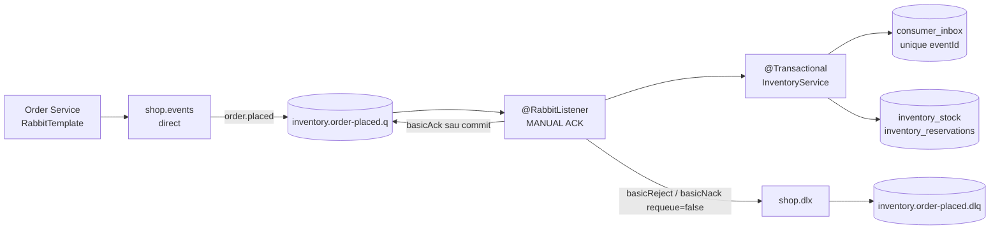
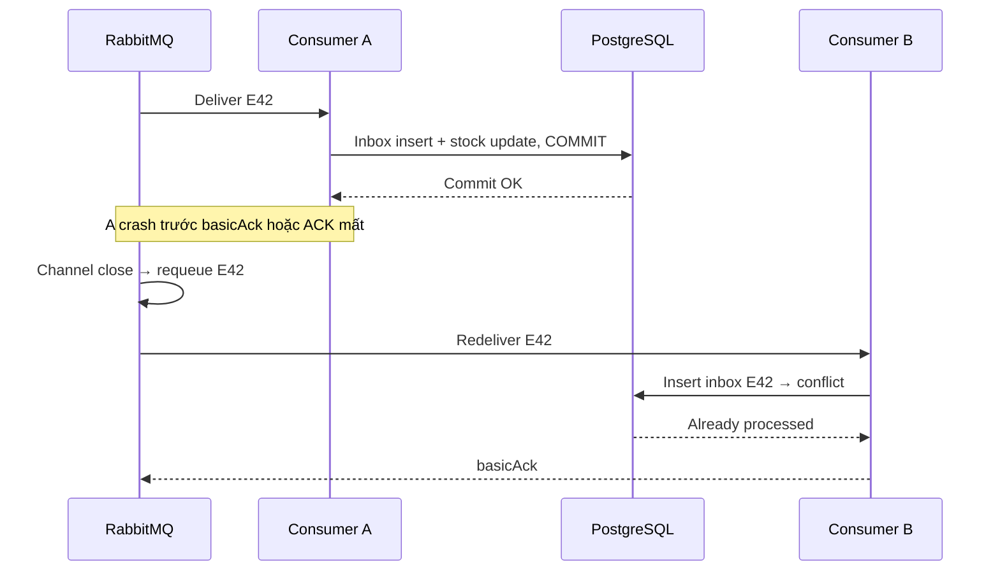
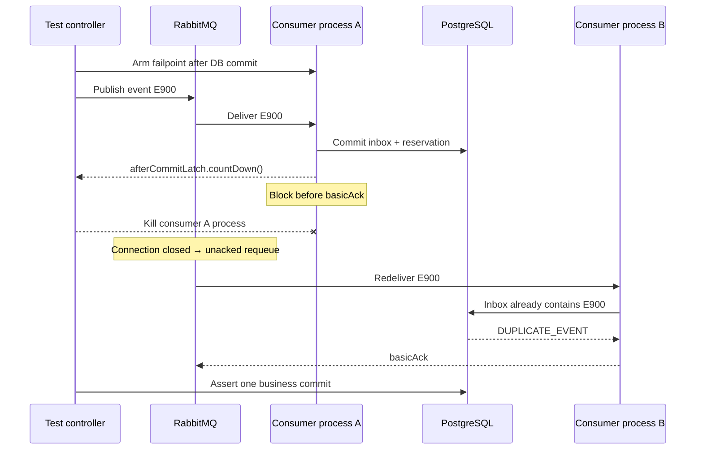

# Thiết kế manual ack theo thời điểm hoàn tất giao dịch nghiệp vụ

> **Chương:** Thực hành tổng hợp. Trong module **SPRING_AMQP**, ta dùng `RabbitTemplate` publish message qua exchange, queue, binding và dùng `@RabbitListener` xử lý bất đồng bộ. Bài thực hành này kết hợp **manual acknowledgement**, **Spring `@Transactional`**, **inbox chống xử lý trùng**, **retry/DLX/DLQ**, **Testcontainers** và quan sát broker. Mục tiêu là chứng minh ACK chỉ được gửi **sau khi giao dịch nghiệp vụ đã commit**, đồng thời hệ thống vẫn đúng nếu consumer crash giữa DB commit và ACK.

## 1. Đầu ra cần đạt

Sau bài lab, người học có thể:

1. Phân biệt **ACK của consumer** với **publisher confirm**, và hiểu vì sao không được ACK trước DB commit.
2. Cấu hình `SimpleRabbitListenerContainerFactory` với `AcknowledgeMode.MANUAL`, `prefetch` hữu hạn và `@RabbitListener` nhận `Channel`.
3. Gửi `basicAck(tag, false)` đúng một lần, trên **channel đã nhận delivery**, sau khi một service `@Transactional` trả về thành công.
4. Phân loại message lỗi: dữ liệu không hợp lệ, lỗi cơ sở dữ liệu tạm thời, ACK thất bại do channel/connection bị ngắt.
5. Dùng **inbox unique key** và transaction DB để tránh trừ tồn kho hai lần khi broker redeliver hoặc producer publish trùng.
6. Đưa message không xử lý được đến DLQ có kiểm soát; không tạo vòng `basicNack(..., requeue=true)` vô hạn.
7. Kiểm thử “**DB commit thành công nhưng ACK chưa tới broker**”, chứng minh redelivery không tạo side effect trùng.
8. Dùng RabbitMQ Management/Prometheus và metric nghiệp vụ để kiểm tra ready, unacked, ACK, DLQ và duplicate.

**Giới hạn của bài:** ví dụ dùng RabbitMQ **AMQP 0-9-1** và Spring AMQP `spring-rabbit`, không phải native AMQP 1.0 hay RabbitMQ Stream protocol. Bài chọn **Spring Boot 3.x** cho các dependency/property minh họa; khi chuyển sang Boot 4.x phải kiểm tra lại starter/namespace, không sao chép cấu hình theo tên cũ.

## 2. Kịch bản: nhận `OrderPlaced` và giữ tồn kho

Dịch vụ bán hàng phát message `OrderPlaced` đến direct exchange `shop.events`, routing key `order.placed`. Queue `inventory.order-placed.q` chuyển cho Inventory Service. Listener sẽ:

- Parse và xác thực payload.
- Gọi service thực hiện **một giao dịch PostgreSQL**: ghi dấu inbox `(consumer_name,event_id)` và giữ tồn kho cho `orderId`/`sku`.
- Chỉ sau khi transaction **commit thành công**, gửi `basicAck` cho RabbitMQ.
- Nếu payload sai hoặc business conflict, **reject không requeue** để dead-letter.
- Nếu DB gặp lỗi tạm thời, trong bài lab **nack không requeue tới DLQ/quarantine** để không tạo hot loop; production có thể bổ sung retry queue có delay và giới hạn lượt.



### 2.1. Ví dụ event payload

```json
{
  "eventId": "9d70f98b-8b45-4bdd-8eaa-32f746c4fc65",
  "orderId": "ORD-2026-0042",
  "sku": "SKU-RED-XL",
  "quantity": 2
}
```

`eventId` do **producer** sinh một lần cho một sự kiện nghiệp vụ, giữ nguyên khi publish retry. `orderId` là định danh đơn hàng; kết hợp `(order_id,sku)` cung cấp thêm rào chắn nghiệp vụ nếu producer vô tình tạo **event ID khác** cho cùng thao tác. Không dùng `deliveryTag`, `consumerTag` hay cờ `redelivered` làm business idempotency key.

### 2.2. Một ACK ở đây bảo đảm điều gì?

**Consumer `basicAck`** nói với broker rằng delivery trên channel này đã được consumer xử lý và có thể loại khỏi queue. ACK **không** phải lệnh commit PostgreSQL.

**Publisher confirm** nói RabbitMQ đã nhận trách nhiệm cho một publish theo queue type/cấu hình. Producer nhận publisher confirm **không** có nghĩa Inventory Service đã cập nhật stock.

**DB commit** xác nhận transaction đã hoàn tất ở PostgreSQL, nhưng **không tự ACK** message trong RabbitMQ.

```mermaid
sequenceDiagram
    participant P as Order Service
    participant B as RabbitMQ
    participant L as @RabbitListener MANUAL
    participant S as InventoryService @Transactional
    participant DB as PostgreSQL
    P->>B: Publish OrderPlaced E42
    B-->>P: Publisher confirm ACK
    B->>L: basic.deliver E42 (tag=7)
    L->>S: reserve(event E42)
    S->>DB: BEGIN; inbox INSERT; reserve stock
    DB-->>S: COMMIT
    S-->>L: APPLIED / DUPLICATE
    L-->>B: basic.ack(7, multiple=false)
```

**Điểm đặt ACK đúng:** sau lời gọi service transaction **đã trả về**, trong listener **không còn một transaction DB bao ngoài** chưa commit. Lý do được giải thích ở mục 5.

## 3. Hai timeline: ACK trước và ACK sau commit

### 3.1. Anti-pattern: ACK trước khi thay đổi DB

```java
// SAI: nếu JVM crash sau ACK, message có thể đã mất khỏi queue.
@RabbitListener(
    queues = "inventory.order-placed.q",
    containerFactory = "manualAckListenerFactory")
public void unsafe(Message message, Channel channel) throws IOException {
    long tag = message.getMessageProperties().getDeliveryTag();
    channel.basicAck(tag, false);  // Quá sớm!
    inventoryService.reserve(parse(message));
}
```

Nếu broker nhận ACK rồi JDBC transaction rollback, queue không còn message để xử lý lại. Đây là **at-most-once processing attempt** tại vùng lỗi đó, có nguy cơ mất nghiệp vụ.

### 3.2. Đặt ACK sau commit tránh mất việc nhưng cho phép duplicate

```text
T0  RabbitMQ giao event E42, giữ trạng thái unacked.
T1  InventoryService bắt đầu DB transaction.
T2  Ghi inbox + cập nhật stock.
T3  PostgreSQL COMMIT thành công.
T4  Listener gửi basicAck(tag,false).
T5  Broker ghi nhận ACK và loại delivery khỏi queue.
```

Nếu consumer crash **trước T3**, DB rollback, broker requeue, lần sau có thể thực thi nghiệp vụ bình thường. Nếu crash **sau T3 nhưng trước T5**, DB **đã commit** và broker vẫn có thể requeue: lần sau **inbox phát hiện duplicate**, bỏ qua mutation và gửi ACK.



**Kết luận:** manual ACK + DB transaction **không tạo exactly-once delivery**. Ta thiết kế **at-least-once delivery + idempotent side effect**. Đó là cam kết thực tế và có thể kiểm chứng.

## 4. Chuẩn bị dự án và môi trường lab

Một cấu trúc dự án Maven/Spring Boot 3.x có thể là:

```text
inventory-service/
├── pom.xml
└── src/
    ├── main/
    │   ├── java/com/example/inventory/
    │   │   ├── InventoryApplication.java
    │   │   ├── MessagingTopology.java
    │   │   ├── ManualAckConfiguration.java
    │   │   ├── OrderPlacedEvent.java
    │   │   ├── OrderPlacedListener.java
    │   │   ├── InventoryService.java
    │   │   └── InventoryExceptions.java
    │   └── resources/
    │       ├── application.yml
    │       └── schema.sql
    └── test/java/com/example/inventory/
        └── InventoryManualAckIT.java
```

Các đường dẫn trên là **cấu trúc tham khảo để người học tự tạo**, không phải các file được worker này tạo trong workspace. Có thể đặt những class không public trong cùng file lab, nhưng với dự án thực, nên tách theo responsibility.

### 4.1. Các dependency Maven

Giả định `pom.xml` đã dùng **Spring Boot 3.x parent/BOM** và Java 17+:

```xml
<dependencies>
    <dependency>
        <groupId>org.springframework.boot</groupId>
        <artifactId>spring-boot-starter-amqp</artifactId>
    </dependency>
    <dependency>
        <groupId>org.springframework.boot</groupId>
        <artifactId>spring-boot-starter-jdbc</artifactId>
    </dependency>
    <dependency>
        <groupId>org.springframework.boot</groupId>
        <artifactId>spring-boot-starter-actuator</artifactId>
    </dependency>
    <dependency>
        <groupId>org.postgresql</groupId>
        <artifactId>postgresql</artifactId>
        <scope>runtime</scope>
    </dependency>

    <dependency>
        <groupId>org.springframework.boot</groupId>
        <artifactId>spring-boot-starter-test</artifactId>
        <scope>test</scope>
    </dependency>
    <dependency>
        <groupId>org.springframework.amqp</groupId>
        <artifactId>spring-rabbit-test</artifactId>
        <scope>test</scope>
    </dependency>
    <dependency>
        <groupId>org.testcontainers</groupId>
        <artifactId>junit-jupiter</artifactId>
        <scope>test</scope>
    </dependency>
    <dependency>
        <groupId>org.testcontainers</groupId>
        <artifactId>rabbitmq</artifactId>
        <scope>test</scope>
    </dependency>
    <dependency>
        <groupId>org.testcontainers</groupId>
        <artifactId>postgresql</artifactId>
        <scope>test</scope>
    </dependency>
</dependencies>
```

Các phiên bản Spring AMQP/Testcontainers/Jackson cần được BOM quản lý tương thích; ví dụ **không** minh họa việc trộn module `spring-rabbit` 3.x với Spring Boot 4.x. `spring-boot-starter-amqp` trong Boot 3.x phục vụ RabbitMQ AMQP 0-9-1; tên starter của Boot 4.x đã thay đổi, cần đối chiếu tài liệu đúng phiên bản.

### 4.2. Cấu hình `application.yml` cho lab

```yaml
spring:
  rabbitmq:
    host: localhost
    port: 5672
    username: guest
    password: guest
    publisher-confirm-type: correlated
    publisher-returns: true
    listener:
      simple:
        acknowledge-mode: manual
  datasource:
    url: jdbc:postgresql://localhost:5432/inventory_lab
    username: inventory
    password: ${DB_PASSWORD:change-me-in-lab}
  sql:
    init:
      mode: always

management:
  endpoints:
    web:
      exposure:
        include: health,info,metrics,prometheus
```

`guest/guest` chỉ phù hợp **localhost/lab** theo giới hạn đăng nhập mặc định của RabbitMQ. Trong production phải tạo user/vhost riêng, cấp quyền tối thiểu, TLS và secret manager. Endpoint `/actuator/prometheus` cần Micrometer Prometheus registry khi muốn scrape; phần lab không phụ thuộc endpoint này.

Nếu dùng Testcontainers, các giá trị host/port/DB connection của `application.yml` sẽ được **ghi đè bằng `@DynamicPropertySource`** trong test (mục 14). Không yêu cầu người học hardcode cổng ngẫu nhiên của container.

### 4.3. Khởi tạo môi trường thử nghiệm thủ công

Người học có thể chạy RabbitMQ và PostgreSQL lab qua Docker, hoặc để Testcontainers tự tạo container khi chạy integration tests. Nếu tự chạy, tạo database `inventory_lab` với user có quyền tạo table, và bật RabbitMQ Management để xem trạng thái delivery:

```bash
# Chỉ dùng trên máy lab có Docker; không chạy trên production.
docker run -d --name rabbit-manual-ack \
  -p 5672:5672 -p 15672:15672 \
  rabbitmq:4.1-management

docker run -d --name postgres-manual-ack \
  -e POSTGRES_DB=inventory_lab \
  -e POSTGRES_USER=inventory \
  -e POSTGRES_PASSWORD=change-me-in-lab \
  -p 5432:5432 postgres:16
```

Hai container trên tạo dữ liệu thử nghiệm không persistent qua việc xóa container. Không để các cổng này lộ Internet. Dùng `http://localhost:15672` trên máy lab để xem queue/consumer/ACK, nhưng **không dùng Management UI “Get messages” để lấy thử message trên production** vì có thể ảnh hưởng trạng thái queue.

## 5. Thiết kế ranh giới transaction/ACK trước khi viết code

Đây là yêu cầu khó nhất của bài. Spring `@Transactional` có thể nằm trên service, listener, repository hoặc outer advice; nếu không hiểu **transaction thực sự kết thúc lúc nào**, bạn có thể gọi ACK trước commit mà tưởng mình đã làm đúng.

### 5.1. Mẫu được chọn: transactional service tách bean

```text
@RabbitListener  (KHÔNG bọc @Transactional bên ngoài)
  |
  |-- parse/validate envelope
  |
  |-- InventoryService.reserve(event)     <-- Spring proxy mở DB transaction
       |-- BEGIN
       |-- INSERT consumer_inbox
       |-- UPDATE inventory_stock
       |-- INSERT inventory_reservations
       |-- COMMIT
       '-- return APPLIED/DUPLICATE
  |
  '-- channel.basicAck(tag, false)         <-- SAU service method return
```

Với một bean `InventoryService` public method có `@Transactional` được gọi qua **Spring proxy** từ bean listener khác, transaction interceptor thực hiện commit **trước khi method call trở về caller**. Do đó lệnh `basicAck` đặt sau `inventoryService.reserve(...)` có quan hệ thứ tự phù hợp.

Điều kiện này **không tự đúng** nếu:

- Listener cũng có `@Transactional` bao quanh toàn bộ method và transaction chỉ commit **sau khi listener return**.
- Bạn bật một transaction advice/`transactionManager` ở listener container bao ngoài callback.
- Bạn gọi `this.reserve(...)` từ cùng bean khiến Spring proxy transaction không chạy như dự định.
- Bạn gọi một tác vụ `@Async` rồi ACK trước khi future hoàn tất.
- Service mở một transaction khác, đăng ký `TransactionSynchronization` chạy bất đồng bộ hoặc chuyển giao side effect ngoài DB.

Với những trường hợp đó phải thiết kế lại thứ tự, chứ không chỉ di chuyển dòng `basicAck` xuống cuối method.

### 5.2. Bảng ranh giới commit

| Vị trí ACK | Trạng thái DB khi ACK được gọi | Đánh giá |
| --- | --- | --- |
| Đầu listener | Chưa bắt đầu nghiệp vụ | **Sai**, mất message nếu crash |
| Giữa transaction DB | DB chưa commit; có thể rollback | **Sai**, broker có thể xóa trước rollback |
| Cuối method listener **có `@Transactional` bao ngoài** | Transaction interceptor có thể chưa commit | **Sai nếu không có bảo đảm về commit order** |
| Sau lời gọi service `@Transactional` **qua proxy đã return** | Transaction đã commit hoặc exception đã được ném | **Đúng cho DB-only transaction như bài lab** |
| Trong callback `afterCommit()` | DB vừa commit | Có thể đúng nhưng cần tránh double ACK, quản lý thread/channel và lỗi callback |
| Sau `future.isDone()` bất kỳ | Có thể future hoàn tất exceptional, DB chưa commit | **Chưa đủ**, phải kiểm tra completion thành công và transaction boundary |

**Thứ tự “DB commit → ACK” là lựa chọn cố ý đánh đổi:** có thể xử lý lặp sau crash, nhưng tránh mất message trước khi DB làm xong. Vì vậy **inbox idempotency là bắt buộc**, không phải tối ưu tùy chọn.

### 5.3. Vì sao không dựa vào hai-phase commit?

RabbitMQ AMQP 0-9-1 transaction và PostgreSQL local transaction **không tự chia sẻ một atomic XA transaction**. Spring transaction synchronization có thể phối hợp các bước, nhưng không xóa được mọi cửa sổ lỗi giữa hai resource. Bài chọn **local DB transaction + manual ACK + duplicate suppression**, dễ kiểm chứng và vận hành. Khi cần phát sự kiện tiếp sau commit DB, có thể dùng **transactional outbox** thay vì publish trong cùng transaction rồi chờ broker.

## 6. Schema PostgreSQL: idempotency và thay đổi nghiệp vụ trong cùng transaction

Tạo `src/main/resources/schema.sql` theo ví dụ:

```sql
CREATE TABLE IF NOT EXISTS inventory_stock (
    sku       VARCHAR(80) PRIMARY KEY,
    available INTEGER NOT NULL CHECK (available >= 0)
);

CREATE TABLE IF NOT EXISTS inventory_reservations (
    order_id    VARCHAR(120) NOT NULL,
    sku         VARCHAR(80) NOT NULL,
    quantity    INTEGER NOT NULL CHECK (quantity > 0),
    reserved_at TIMESTAMPTZ NOT NULL DEFAULT now(),
    PRIMARY KEY (order_id, sku)
);

CREATE TABLE IF NOT EXISTS consumer_inbox (
    consumer_name VARCHAR(120) NOT NULL,
    event_id      VARCHAR(120) NOT NULL,
    processed_at  TIMESTAMPTZ NOT NULL DEFAULT now(),
    PRIMARY KEY (consumer_name, event_id)
);

-- Seed lab; ON CONFLICT cho phép test context chạy lại.
INSERT INTO inventory_stock (sku, available)
VALUES ('SKU-RED-XL', 100)
ON CONFLICT (sku) DO NOTHING;
```

**Hai lớp chống trùng:**

| Rào chắn | Key | Chặn loại duplicate nào? |
| --- | --- | --- |
| `consumer_inbox` | `(consumer_name,event_id)` | **Cùng event** bị RabbitMQ redeliver hoặc producer gửi lại với cùng ID |
| `inventory_reservations` | `(order_id,sku)` | Cùng **tác vụ giữ hàng** được phát lại với **eventId khác** |

Inbox phải dùng **một tên consumer logic ổn định** như `inventory-reservation-v1`, không dùng tên pod/consumerTag thay đổi khi restart. Nếu nhiều consumer business khác nhau xử lý cùng event, thêm `consumer_name` vào khóa để chúng có thể xử lý độc lập.

Ở production, chính sách lưu inbox phải dài hơn mọi cửa sổ redelivery/replay/outbox retry có thể xảy ra. Xóa inbox quá sớm khiến event cũ được xử lý lại như mới. Với dữ liệu quan trọng, giữ thêm audit hoặc business unique key để phát hiện duplicate sau thời gian retention.

## 7. Topology AMQP 0-9-1: request queue và DLQ

```java
package com.example.inventory;

import org.springframework.amqp.core.Binding;
import org.springframework.amqp.core.BindingBuilder;
import org.springframework.amqp.core.DirectExchange;
import org.springframework.amqp.core.Queue;
import org.springframework.amqp.core.QueueBuilder;
import org.springframework.context.annotation.Bean;
import org.springframework.context.annotation.Configuration;

@Configuration(proxyBeanMethods = false)
public class MessagingTopology {
    static final String EVENTS_EXCHANGE = "shop.events";
    static final String EVENTS_ROUTING_KEY = "order.placed";
    static final String MAIN_QUEUE = "inventory.order-placed.q";
    static final String DLX = "shop.dlx";
    static final String DLQ = "inventory.order-placed.dlq";
    static final String DEAD_ROUTING_KEY = "inventory.order-placed.failed";

    @Bean
    DirectExchange shopEventsExchange() {
        return new DirectExchange(EVENTS_EXCHANGE);
    }

    @Bean
    DirectExchange shopDeadLetterExchange() {
        return new DirectExchange(DLX);
    }

    @Bean
    Queue inventoryOrdersQueue() {
        return QueueBuilder.durable(MAIN_QUEUE)
            .deadLetterExchange(DLX)
            .deadLetterRoutingKey(DEAD_ROUTING_KEY)
            .build();
    }

    @Bean
    Queue inventoryDeadLetterQueue() {
        return QueueBuilder.durable(DLQ).build();
    }

    @Bean
    Binding inventoryOrdersBinding(
            Queue inventoryOrdersQueue,
            DirectExchange shopEventsExchange) {
        return BindingBuilder.bind(inventoryOrdersQueue)
            .to(shopEventsExchange).with(EVENTS_ROUTING_KEY);
    }

    @Bean
    Binding inventoryDeadLetterBinding(
            Queue inventoryDeadLetterQueue,
            DirectExchange shopDeadLetterExchange) {
        return BindingBuilder.bind(inventoryDeadLetterQueue)
            .to(shopDeadLetterExchange).with(DEAD_ROUTING_KEY);
    }
}
```

Trong lab, Spring Boot thường auto-config `RabbitAdmin` để declare các bean `Queue`/`Exchange`/`Binding` khi kết nối. Nếu đã tạo queue cùng tên nhưng khác `x-dead-letter-exchange`/arguments, RabbitMQ có thể từ chối redeclare bằng `PRECONDITION_FAILED inequivalent arg`; dùng vhost hoặc broker lab sạch.

**Production:** cân nhắc quản lý DLX qua RabbitMQ **policy** thay vì hardcoded queue arguments, để operator có thể thay đổi quy tắc mà không buộc xóa/recreate queue. DLQ phải có owner, retention, alert, và quy trình replay. Với classic queue và dead-letter mặc định, việc dead-letter không bảo đảm toàn bộ đường đi là atomic/durable trong mọi failure; yêu cầu nghiêm ngặt cần đánh giá cơ chế at-least-once dead-lettering của quorum queue hoặc outbox/quarantine bền vững.

## 8. Container factory: bật manual acknowledgement

```java
package com.example.inventory;

import org.springframework.amqp.core.AcknowledgeMode;
import org.springframework.amqp.rabbit.config.SimpleRabbitListenerContainerFactory;
import org.springframework.amqp.rabbit.connection.ConnectionFactory;
import org.springframework.context.annotation.Bean;
import org.springframework.context.annotation.Configuration;

@Configuration(proxyBeanMethods = false)
public class ManualAckConfiguration {
    @Bean("manualAckListenerFactory")
    SimpleRabbitListenerContainerFactory manualAckListenerFactory(
            ConnectionFactory connectionFactory) {
        SimpleRabbitListenerContainerFactory factory =
            new SimpleRabbitListenerContainerFactory();
        factory.setConnectionFactory(connectionFactory);
        factory.setAcknowledgeMode(AcknowledgeMode.MANUAL);
        factory.setConcurrentConsumers(2);
        factory.setMaxConcurrentConsumers(2);
        factory.setPrefetchCount(10);
        factory.setDefaultRequeueRejected(false);
        return factory;
    }
}
```

**Vì sao cố định concurrency 2 và prefetch 10 trong lab?** Để nhìn rõ tối đa khoảng **20 delivery unacked** ở hai consumer đang hoạt động. Với nhiều replicas, tổng prefetch budget xấp xỉ `replicas × consumersPerReplica × prefetch`. Các số trên chỉ để thực hành, không phải mặc định tối ưu.

**`setDefaultRequeueRejected(false)` không tự thay ACK thủ công.** Trong `MANUAL` mode, listener vẫn phải **settle từng delivery** bằng `basicAck/basicNack/basicReject` trong các đường xử lý được kiểm soát. Nếu code return mà không ACK, delivery vẫn ở trạng thái unacked; khi channel đóng, nó có thể được broker requeue. Đừng chỉ tin vào `defaultRequeueRejected` để xử lý mọi exception của custom manual listener.

### 8.1. Vì sao `AUTO` hoặc `NONE` không đúng yêu cầu bài?

| Chế độ | Thời điểm broker có thể nhận ACK | Có nên dùng cho lab này? |
| --- | --- | --- |
| `MANUAL` | Chính ứng dụng gọi `basicAck` sau DB commit | **Có** |
| `AUTO` | Container ACK khi listener return thành công | Có thể đúng nếu transaction đã commit trước return, nhưng bài muốn **kiểm soát tường minh** |
| `NONE` | RabbitMQ auto-ack khi giao, không đợi business work | **Không**, có nguy cơ mất message nếu xử lý lỗi/crash |

Đặc biệt, Spring `AcknowledgeMode.AUTO` **không phải** protocol `autoAck=true`. Đừng thay `MANUAL` thành `NONE` chỉ để giảm redelivery: bạn sẽ giảm cơ hội phục hồi message khi consumer chết.

### 8.2. `Channel` và delivery tag có phạm vi riêng

AMQP `deliveryTag` chỉ có ý nghĩa trên **channel đã giao message**. Không ACK tag lấy từ một channel trên channel khác, không giữ tag qua restart, và không gửi hai ACK cho cùng delivery. `basicAck(tag, false)` dùng `multiple=false` để chỉ ACK **một delivery**; dùng `true` sẽ ACK mọi unacked tag ≤ tag trên cùng channel, nguy hiểm nếu xử lý song song/out-of-order.

Với listener đồng bộ như bài lab, `Channel` được dùng trong thread xử lý delivery. **Không đưa `Channel` qua executor tùy ý** vì các lời gọi channel không được thiết kế để chia sẻ không kiểm soát giữa nhiều threads; khi cần async listener, dùng API async return/ack mode phù hợp với phiên bản Spring AMQP.

## 9. Định nghĩa event và phân loại exception

```java
package com.example.inventory;

public record OrderPlacedEvent(
    String eventId,
    String orderId,
    String sku,
    int quantity) {
}
```

Hai loại exception nghiệp vụ để người đọc hiểu rõ quyết định settle:

```java
package com.example.inventory;

class InvalidOrderEventException extends RuntimeException {
    InvalidOrderEventException(String message) {
        super(message);
    }
}

class StockUnavailableException extends RuntimeException {
    StockUnavailableException(String message) {
        super(message);
    }
}

class ReservationConflictException extends RuntimeException {
    ReservationConflictException(String message) {
        super(message);
    }
}
```

Trong lab, ba exception trên được coi là **non-retryable với dữ liệu hiện tại**: input thiếu eventId, stock không đủ, hoặc cùng order/sku đã có một reservation. Chúng sẽ vào DLQ để điều tra (nếu broker routing tới DLQ thành công).

Lỗi `DataAccessResourceFailureException`, pool timeout, network hoặc deadlock DB có thể **tạm thời**. Bài demo sẽ chuyển chúng đến DLQ/quarantine thay vì tạo vòng requeue nóng; production cần thêm delayed retry queue/worker, giới hạn attempts và cơ chế replay sau khi DB phục hồi.

**Không mặc định mọi `RuntimeException` đều transient.** NullPointerException, contract violation hoặc programmer bug có thể lặp vĩnh viễn. Phần vận hành phải đo nguyên nhân thực tế trước khi quyết định retry.

## 10. Service nghiệp vụ: transaction inbox + reservation

Đây là **trung tâm bảo đảm tính đúng đắn** của lab. Ba thao tác DB phải cùng commit hoặc cùng rollback:

1. Ghi inbox `(consumer_name,event_id)` bằng unique key.
2. Giảm lượng tồn khả dụng của sản phẩm, không được âm.
3. Ghi reservation `(order_id,sku)` để chống lặp cùng đơn khi event ID bị thay.

```java
package com.example.inventory;

import org.springframework.jdbc.core.JdbcTemplate;
import org.springframework.stereotype.Service;
import org.springframework.transaction.annotation.Transactional;

@Service
public class InventoryService {
    private static final String CONSUMER = "inventory-reservation-v1";

    public enum ApplyResult {
        APPLIED,
        DUPLICATE_EVENT
    }

    private final JdbcTemplate jdbc;

    public InventoryService(JdbcTemplate jdbc) {
        this.jdbc = jdbc;
    }

    @Transactional
    public ApplyResult reserve(OrderPlacedEvent event) {
        validate(event);

        int inboxInserted = jdbc.update(
            "INSERT INTO consumer_inbox (consumer_name, event_id) " +
            "VALUES (?, ?) ON CONFLICT DO NOTHING",
            CONSUMER, event.eventId());

        if (inboxInserted == 0) {
            // Đã commit cùng eventId trước đó:
            // ACK lại lần giao trùng, KHÔNG trừ tồn kho lần nữa.
            return ApplyResult.DUPLICATE_EVENT;
        }

        int stockUpdated = jdbc.update(
            "UPDATE inventory_stock SET available = available - ? " +
            "WHERE sku = ? AND available >= ?",
            event.quantity(), event.sku(), event.quantity());

        if (stockUpdated != 1) {
            // @Transactional rollback inbox insert ở trên.
            throw new StockUnavailableException(
                "Insufficient stock or unknown sku: " + event.sku());
        }

        int reservationInserted = jdbc.update(
            "INSERT INTO inventory_reservations " +
            "(order_id, sku, quantity) VALUES (?, ?, ?) " +
            "ON CONFLICT DO NOTHING",
            event.orderId(), event.sku(), event.quantity());

        if (reservationInserted != 1) {
            // Cùng order/sku nhưng eventId có thể khác:
            // rollback cả inbox insert và stock update.
            throw new ReservationConflictException(
                "Reservation already exists for order/sku");
        }

        return ApplyResult.APPLIED;
    }

    private void validate(OrderPlacedEvent event) {
        if (event == null
                || event.eventId() == null || event.eventId().isBlank()
                || event.orderId() == null || event.orderId().isBlank()
                || event.sku() == null || event.sku().isBlank()
                || event.quantity() <= 0) {
            throw new InvalidOrderEventException(
                "Invalid OrderPlaced event envelope");
        }
    }
}
```

### 10.1. Vì sao `ON CONFLICT DO NOTHING` tốt hơn “SELECT rồi INSERT”?

Hai replicas có thể nhận hai bản cùng `eventId` gần như đồng thời:

```text
Replica A: SELECT inbox E42 -> absent
Replica B: SELECT inbox E42 -> absent
Replica A: apply stock -2
Replica B: apply stock -2
```

Nếu chỉ SELECT rồi quyết định, cả hai có thể thấy absent. **Unique constraint là trọng tài atomic trong database**; một transaction thắng, transaction còn lại chờ hoặc thấy conflict và không làm side effect. Với PostgreSQL `INSERT ... ON CONFLICT DO NOTHING` trả `1` nếu row mới, `0` nếu đã có bản ghi; transaction chỉ làm tiếp khi insert thành công.

**Không tách inbox insert ra khỏi stock update bằng hai transactions.** Nếu đánh dấu `processed` rồi commit riêng, sau đó stock update lỗi, lần redelivery sẽ tưởng event đã xử lý và ACK sai. Mẫu lab bảo đảm **cùng DataSource, cùng transaction**.

### 10.2. Thứ tự query là một phần của bài lab

Việc cập nhật stock trước khi ghi reservation là an toàn trong **một transaction** ở ví dụ này: nếu reservation insert conflict, exception unchecked làm rollback stock decrement và inbox insert. Một hệ thống có nhiều SKU trong một đơn nên cập nhật các row theo thứ tự ổn định để giảm deadlock và dùng transaction bao quanh toàn bộ batch.

Tuy nhiên, một business process thật cần cân nhắc trường hợp duplicate eventId nhưng payload bị sửa. Ở đây `DUPLICATE_EVENT` chỉ xem inbox key; nếu có kẻ gửi cùng ID cho payload khác, nó sẽ được bỏ qua. Khi cần audit hoặc chống event tampering, có thể lưu **payload hash, event type, schema version** trong inbox và cảnh báo khi cùng ID có hash khác.

### 10.3. Đúng điểm COMMIT nhờ Spring AOP

Phương thức `reserve(...)` phải được gọi từ **một bean khác**, ví dụ `OrderPlacedListener`. Với proxy transaction:

```text
OrderPlacedListener
  └── inventoryService proxy.reserve(event)
         ├── BEGIN database transaction
         ├── execute actual InventoryService.reserve
         ├── COMMIT (nếu không lỗi)
         └── return ApplyResult.APPLIED / DUPLICATE_EVENT
      <-- method proxy đã trả về
  └── channel.basicAck(tag,false)
```

Nếu commit thất bại (ví dụ DB connection mất đúng lúc COMMIT), transaction interceptor báo lỗi hoặc trạng thái chưa rõ; listener **không được ACK như thể thành công**. Nếu COMMIT thực sự đã thành công nhưng caller không nhận được tín hiệu, lần redelivery tiếp theo vẫn an toàn nhờ inbox.

### 10.4. Khi nào một transaction không đủ?

Nếu cần gửi tiếp `InventoryReserved` sau khi đã trừ tồn kho, **đừng gọi `RabbitTemplate.convertAndSend(...)` trong cùng DB transaction rồi giả định cả hai cùng atomic**. Nếu publish thành công nhưng DB rollback, consumer downstream đã thấy event sai; nếu DB commit mà publish thất bại, downstream không nhận event.

Thay bằng **transactional outbox**: ghi `InventoryReserved` vào bảng outbox **trong cùng transaction** với stock/inbox, rồi một relay riêng publish với confirms và retry bằng ID ổn định. Đó là vấn đề khác với ACK của message đầu vào, nhưng bổ sung rất tự nhiên trong hệ thống đáng tin cậy.

## 11. Manual ACK listener: mã nguồn theo từng đường lỗi

Mẫu dưới đây cố ý **không có `@Transactional` trên method listener**. Service DB được gọi đồng bộ và trả về sau commit. Ta cũng **không đặt `basicAck` trong `finally`**, không catch lỗi ACK rồi cố NACK delivery đã có thể settle.

```java
package com.example.inventory;

import com.fasterxml.jackson.core.JsonProcessingException;
import com.fasterxml.jackson.databind.ObjectMapper;
import com.rabbitmq.client.Channel;
import io.micrometer.core.instrument.Counter;
import io.micrometer.core.instrument.MeterRegistry;
import java.io.IOException;
import org.slf4j.Logger;
import org.slf4j.LoggerFactory;
import org.springframework.amqp.core.Message;
import org.springframework.amqp.rabbit.annotation.RabbitListener;
import org.springframework.stereotype.Component;

@Component
public class OrderPlacedListener {
    private static final Logger log =
        LoggerFactory.getLogger(OrderPlacedListener.class);

    private final ObjectMapper mapper;
    private final InventoryService inventoryService;
    private final Counter duplicateHandledCounter;

    public OrderPlacedListener(
            ObjectMapper mapper,
            InventoryService inventoryService,
            MeterRegistry meterRegistry) {
        this.mapper = mapper;
        this.inventoryService = inventoryService;
        this.duplicateHandledCounter =
            Counter.builder("inventory.order.duplicate.handled")
                .description("Duplicate deliveries handled without side effects")
                .register(meterRegistry);
    }

    @RabbitListener(
        id = "inventoryOrderPlacedConsumer",
        queues = MessagingTopology.MAIN_QUEUE,
        containerFactory = "manualAckListenerFactory")
    public void onMessage(Message message, Channel channel)
            throws IOException {
        long tag = message.getMessageProperties().getDeliveryTag();
        OrderPlacedEvent event;

        try {
            event = mapper.readValue(
                message.getBody(), OrderPlacedEvent.class);
        } catch (JsonProcessingException malformedJson) {
            log.warn("Reject malformed JSON deliveryTag={}", tag);
            channel.basicReject(tag, false);
            return;
        }

        InventoryService.ApplyResult result;
        try {
            // reserve() trả về SAU DB COMMIT nếu thành công.
            result = inventoryService.reserve(event);
        } catch (InvalidOrderEventException
                 | StockUnavailableException
                 | ReservationConflictException permanent) {
            log.warn(
                "Reject invalid business eventId={} reason={}",
                event.eventId(), permanent.getClass().getSimpleName());
            channel.basicReject(tag, false);
            return;
        } catch (RuntimeException unexpectedFailure) {
            log.error(
                "Quarantine failed eventId={} without hot requeue",
                event.eventId(), unexpectedFailure);
            // LAB: đưa về DLQ để triage/replay, KHÔNG requeue tức thì.
            channel.basicNack(tag, false, false);
            return;
        }

        // Không đưa ACK vào try/catch business ở trên.
        // Nếu ACK lỗi do channel/connection close sau commit:
        // broker có thể redeliver, và inbox chống trừ tồn kho trùng.
        channel.basicAck(tag, false);

        if (result == InventoryService.ApplyResult.DUPLICATE_EVENT) {
            // Chỉ đếm khi đã gọi basicAck thành công ở phía client.
            duplicateHandledCounter.increment();
        }

        log.info(
            "ACK eventId={} result={} redelivered={}",
            event.eventId(), result,
            message.getMessageProperties().isRedelivered());
    }
}
```

### 11.1. Các điểm đúng cần kiểm tra

| Dòng mã | Tác dụng | Vì sao quan trọng |
| --- | --- | --- |
| `getDeliveryTag()` | Lấy tag của delivery hiện tại | Tag thuộc **channel này**, không phải eventId |
| `readValue(...)` | Parse JSON trước transaction | Payload sai được phân loại rõ ràng |
| `inventoryService.reserve(event)` | Tạo transaction, commit/rollback | Phân tách business transaction khỏi RabbitMQ ACK |
| `basicReject(tag,false)` | Reject không requeue | Poison/invalid data có thể vào DLX/DLQ |
| `basicNack(tag,false,false)` | Nack không requeue | Quarantine lỗi ngoài dự kiến; tránh vòng lặp nóng |
| `basicAck(tag,false)` | ACK **sau service trả về thành công** | DB đã commit hoặc event đã được dedup |
| `log.info(...)` sau ACK | Log local đã gọi ACK | **Không** tự chứng minh broker nhận ACK nếu connection hỏng ngay sau |

**Phân loại `RuntimeException` là chính sách lab để đơn giản hóa retry**. Ở production, việc chuyển tất cả lỗi DB tạm thời sang DLQ có thể làm DLQ tăng hàng loạt trong lúc DB downtime; cần delayed retry hữu hạn, circuit breaker/admission và chỉ dead-letter sau khi hết ngân sách thử lại. Với loại nghiệp vụ có yêu cầu không mất message, còn phải đánh giá tính bền vững của **đường DLX**.

Counter `inventory.order.duplicate.handled` có label mặc định do ứng dụng quyết định (ở đây không gắn event ID) và được tăng **sau khi `basicAck` được gọi không ném exception**. Counter giúp test biết delivery thứ hai thực sự đã đi qua nhánh duplicate; nó **không phải giấy chứng nhận broker đã ghi nhận ACK** vì ACK của consumer không có một confirm response riêng như publisher confirm.

### 11.2. Vì sao không dùng `basicNack(tag,false,true)` ở đây?

`requeue=true` có thể giao lại **ngay lập tức** cho cùng consumer hoặc consumer khác. Nếu DB mất kết nối trong 30 phút, hàng nghìn event có thể chạy vòng liên tục, đốt CPU và tăng tải RabbitMQ/DB.

```java
// Không khuyến nghị dùng vô hạn khi DB hỏng:
channel.basicNack(tag, false, true);
// Nếu không có retry budget/delay, đây có thể là hot loop.
```

Trong lab, ta chọn `false` để dead-letter/quarantine. Production có thể dùng retry queue TTL/DLX, republish với confirm và attempt counter, hoặc workflow có lịch retry; **số lần thử và thời gian trì hoãn phải hữu hạn**.

### 11.3. Tại sao ACK phải được xử lý khác exception nghiệp vụ?

Nếu viết:

```java
try {
    inventoryService.reserve(event);
    channel.basicAck(tag, false);
} catch (Exception ex) {
    channel.basicNack(tag, false, true); // NGUY HIỂM!
}
```

thì khi `basicAck` thất bại vì channel đóng hoặc chưa rõ đã đến broker chưa, code lại gửi NACK cho cùng delivery. Điều đó có thể gây **double settlement, unknown delivery tag** và làm RabbitMQ đóng channel. Cách đúng là **tách phạm vi catch business error khỏi lệnh ACK** và để lỗi channel propagates cho container/recovery xử lý.

### 11.4. Nếu đã gửi `basicReject` nhưng chính `basicReject` thất bại?

Đây cũng là lỗi settlement: method có thể ném `IOException` và connection/channel có thể đã đóng. **Không** trả tiếp một ACK hay NACK cho tag ấy. Khi broker chưa nhận settle, nó sẽ requeue sau khi phát hiện channel/connection đóng; khi đã nhận, message đã bị reject. Vì vậy subscriber vẫn phải idempotent dù đã thiết kế nhánh lỗi.

### 11.5. Khi nào có thể ACK event duplicate?

`inventoryService.reserve(event)` trả `DUPLICATE_EVENT` khi inbox đã ghi nhận một transaction **trước đó commit thành công**. Do đó listener có thể ACK delivery lặp mà không làm nghiệp vụ lại. Nếu inbox insert conflict là do transaction khác **đang chạy**, database sẽ phải giải quyết tranh chấp unique key/transaction isolation trước khi trả kết quả; không dùng một cache `HashSet` trong JVM làm nguồn dữ liệu cuối cùng.

## 12. Ba trường hợp không nên sửa bằng cách thay đổi ACK mode

### 12.1. Consumer commit DB rồi crash trước ACK

Hành vi đúng là broker **redeliver**. Phòng vệ là inbox transactional. Không chuyển sang `AcknowledgeMode.NONE` để “hết duplicate”: nếu crash **trước DB commit**, message có thể mất vĩnh viễn.

### 12.2. Consumer đang làm việc chậm và có nhiều unacked

`prefetch=100`, concurrency 8 có thể giữ khoảng 800 deliveries chưa ACK trên một replica. Nếu replica restart, số delivery quay lại có thể rất lớn. Giảm prefetch và phối hợp `shutdownTimeout`/graceful drain, nhưng **không ACK trước completion** để làm metric unacked trông đẹp.

### 12.3. Listener muốn xử lý thật sự bất đồng bộ

```java
// ANTI-PATTERN: gọi executor rồi ACK trước khi công việc kết thúc.
@RabbitListener(queues = "inventory.order-placed.q")
public void unsafeAsync(Message msg, Channel channel) throws IOException {
    executor.execute(() -> process(msg));
    channel.basicAck(msg.getMessageProperties().getDeliveryTag(), false);
}
```

Khi `process(msg)` còn chạy và application crash, broker đã nhận ACK; không có redelivery. Với Spring AMQP có hỗ trợ kiểu trả về `CompletableFuture`/`Mono`, cần thiết kế settlement gắn với **async completion** và cấu hình acknowledgement theo tài liệu version; không tùy tiện truyền `Channel` giữa threads.

## 13. Ma trận lỗi: khi nào ACK, NACK hay reject?

Để review code trước khi chạy, hãy xem **trạng thái database** trước khi quyết định settle. Thao tác RabbitMQ cuối cùng phải được gọi **một lần**, có chủ đích, trên delivery tag hiện tại.

| Tình huống | DB đã commit? | RabbitMQ call trong lab | Ý nghĩa |
| --- | --- | --- | --- |
| Event hợp lệ, lần đầu | **Có** | `basicAck(tag,false)` | Bỏ delivery khỏi queue |
| Event trùng, inbox đã ghi trước đó | **Có ở lần trước**; lần này không thay đổi | `basicAck(tag,false)` | Không làm lại side effect |
| JSON malformed | Không | `basicReject(tag,false)` | Dead-letter nếu DLX configured |
| Event ID / quantity invalid | Transaction rollback hoặc chưa thay đổi | `basicReject(tag,false)` | Không requeue vô hạn |
| Stock không đủ | Rollback cả inbox + stock | `basicReject(tag,false)` | Business conflict → DLQ/triage theo contract |
| Order/sku đã được reserved bằng event ID khác | Rollback transaction hiện tại | `basicReject(tag,false)` | Phát hiện duplicate business command không cùng event ID |
| JDBC connection lỗi trước/during commit | **Chưa rõ hoặc rollback** | `basicNack(tag,false,false)` trong lab | Quarantine, replay sau khi kiểm tra DB |
| DB commit xong, `basicAck` ném `IOException` | **Có** | **Không** gọi NACK thêm | Để channel/connection recovery; redelivery sẽ dedup |
| JVM bị kill sau DB commit nhưng trước ACK | **Có** | Không kịp settle | Broker requeue khi phát hiện connection đóng |
| JVM bị kill trước DB commit | Rollback hoặc transaction chưa hoàn tất | Không kịp settle | Broker requeue, xử lý lần đầu ở lần sau |
| Consumer chỉ submit task async rồi ACK | Chưa chắc | **Không được ACK sớm** | Phải đợi completion/thay kiến trúc |

### 13.1. `basicReject` và `basicNack` khác nhau ở đâu?

`basicReject(tag, requeue)` tác động một delivery. `basicNack(tag, multiple, requeue)` hỗ trợ `multiple=true` để tác động **nhiều delivery tags** trên channel.

Trong lab, cả `basicReject(tag,false)` và `basicNack(tag,false,false)` thường làm message được dead-letter nếu có DLX. Chúng được dùng ở hai nhánh để dễ phân biệt **permanent vs unexpected failure**, nhưng broker **không tự biết** đó là hai tầng lỗi khác nhau. Nếu cần hai hàng chờ lỗi khác nhau, phải thiết kế retry/quarantine topology riêng hoặc republish một cách an toàn.

**Không dùng `multiple=true` theo phản xạ.** Trong consumer xử lý song song/out-of-order, ACK nhiều tag có thể xóa cả delivery chưa commit; NACK nhiều tag có thể gây redelivery bùng nổ. Bài này luôn dùng `false`.

### 13.2. Trường hợp rất khó: DB trả lỗi trong lúc COMMIT

Giả sử PostgreSQL đã commit nhưng TCP connection đến ứng dụng đứt trước khi driver nhận kết quả. `@Transactional` có thể ném exception dù nghiệp vụ đã lưu. Listener theo lab sẽ đưa message sang DLQ/quarantine. Khi replay, unique inbox key bảo vệ side effect: nếu DB thật sự commit, nó sẽ là duplicate; nếu không, xử lý bình thường.

**Không được coi mọi `DataAccessException` là “chắc chắn rollback”.** Một số failure dẫn tới kết quả transaction **không rõ ở phía client**. Mẫu idempotency là cách khôi phục sau đó mà không cần phỏng đoán trạng thái commit.

Nếu yêu cầu nghiệp vụ là **không bao giờ mất message ngay cả khi dead-letter publish thất bại**, phải đánh giá queue type và cơ chế **at-least-once dead-lettering** của RabbitMQ quorum queue, hoặc chọn chiến lược giữ lại message/quarantine bền vững với admission rate có giới hạn. Classic queue với DLX thông thường không phải một transaction nguyên tử bao gồm mọi hệ thống.

### 13.3. ACK thành công ở code chưa phải “đã được broker xác nhận”

AMQP consumer ACK thường là lệnh một chiều (`basic.ack`). Lời gọi `channel.basicAck(...)` return bình thường chứng minh code đã gửi lệnh trên channel theo API, nhưng không có publisher-confirm-style future riêng chứng minh broker đã lưu ACK. Nếu connection mất sát thời điểm này, message vẫn có thể redeliver.

Do đó đừng ghi `ACK_CONFIRMED_BY_BROKER` vào DB chỉ vì method `basicAck` trả về. Dùng idempotency và giám sát broker queue state để vận hành, không xây logic nghiệp vụ phụ thuộc việc ACK chưa bao giờ bị mất.

## 14. Kiểm thử tích hợp với Testcontainers: DB thật + RabbitMQ thật

Kiểm thử unit đơn thuần có thể verify `channel.basicAck` được gọi **sau** mock `inventoryService.reserve`, nhưng **không xác nhận DB transaction đã commit**. Bài lab nên có integration test dùng PostgreSQL và RabbitMQ thật để xác minh luồng end-to-end.

### 14.1. Application bootstrap

```java
package com.example.inventory;

import org.springframework.boot.SpringApplication;
import org.springframework.boot.autoconfigure.SpringBootApplication;

@SpringBootApplication
public class InventoryApplication {
    public static void main(String[] args) {
        SpringApplication.run(InventoryApplication.class, args);
    }
}
```

### 14.2. Testcontainers integration test

Ví dụ dưới đây giả định Spring Boot **3.x** và Testcontainers phiên bản được BOM quản lý. Docker phải chạy. `RabbitMQContainer` phục vụ AMQP listener thật; `PostgreSQLContainer` phục vụ transaction thật.

```java
package com.example.inventory;

import io.micrometer.core.instrument.Counter;
import io.micrometer.core.instrument.MeterRegistry;
import java.nio.charset.StandardCharsets;
import java.time.Duration;
import java.util.UUID;
import org.junit.jupiter.api.Test;
import org.springframework.amqp.core.Message;
import org.springframework.amqp.rabbit.core.RabbitTemplate;
import org.springframework.beans.factory.annotation.Autowired;
import org.springframework.boot.test.context.SpringBootTest;
import org.springframework.jdbc.core.JdbcTemplate;
import org.springframework.test.context.DynamicPropertyRegistry;
import org.springframework.test.context.DynamicPropertySource;
import org.testcontainers.containers.PostgreSQLContainer;
import org.testcontainers.containers.RabbitMQContainer;
import org.testcontainers.junit.jupiter.Container;
import org.testcontainers.junit.jupiter.Testcontainers;
import org.testcontainers.utility.DockerImageName;

import static org.assertj.core.api.Assertions.assertThat;
import static org.awaitility.Awaitility.await;

@Testcontainers
@SpringBootTest(classes = InventoryApplication.class)
class InventoryManualAckIT {
    @Container
    static final RabbitMQContainer rabbit =
        new RabbitMQContainer(
            DockerImageName.parse("rabbitmq:4.1-management"));

    @Container
    static final PostgreSQLContainer<?> postgres =
        new PostgreSQLContainer<>(
            DockerImageName.parse("postgres:16"));

    @DynamicPropertySource
    static void configureInfrastructure(DynamicPropertyRegistry registry) {
        registry.add("spring.rabbitmq.host", rabbit::getHost);
        registry.add("spring.rabbitmq.port", rabbit::getAmqpPort);
        registry.add("spring.rabbitmq.username", () -> "guest");
        registry.add("spring.rabbitmq.password", () -> "guest");

        registry.add(
            "spring.datasource.url", postgres::getJdbcUrl);
        registry.add(
            "spring.datasource.username", postgres::getUsername);
        registry.add(
            "spring.datasource.password", postgres::getPassword);
        registry.add("spring.sql.init.mode", () -> "always");
    }

    @Autowired RabbitTemplate rabbitTemplate;
    @Autowired JdbcTemplate jdbc;
    @Autowired MeterRegistry meters;

    @Test
    void commitsOnceEvenWhenSameEventIsPublishedTwice() {
        String eventId = UUID.randomUUID().toString();
        String orderId = "IT-" + UUID.randomUUID();
        String body = """
            {"eventId":"%s","orderId":"%s",
             "sku":"SKU-RED-XL","quantity":2}
            """.formatted(eventId, orderId);

        Integer stockBefore = stock();
        send(body);

        await().atMost(Duration.ofSeconds(15))
            .untilAsserted(() -> {
                assertThat(inboxCount(eventId)).isEqualTo(1);
                assertThat(reservationCount(orderId)).isEqualTo(1);
                assertThat(stock()).isEqualTo(stockBefore - 2);
            });

        // Counter cho biết listener đã đi qua nhánh duplicate
        // sau lần gửi thứ hai; không chỉ đọc DB ngay lập tức.
        Counter duplicateCounter = meters.find(
            "inventory.order.duplicate.handled").counter();
        assertThat(duplicateCounter).isNotNull();
        double beforeDuplicate = duplicateCounter.count();

        send(body); // Cùng eventId, không được trừ tồn kho thêm.

        await().atMost(Duration.ofSeconds(15))
            .untilAsserted(() ->
                assertThat(duplicateCounter.count())
                    .isGreaterThanOrEqualTo(beforeDuplicate + 1));

        assertThat(inboxCount(eventId)).isEqualTo(1);
        assertThat(reservationCount(orderId)).isEqualTo(1);
        assertThat(stock()).isEqualTo(stockBefore - 2);
    }

    @Test
    void rejectsMalformedJsonToDeadLetterQueue() {
        String malformed = "{invalid-json:";
        send(malformed);

        Message dlqMessage = rabbitTemplate.receive(
            MessagingTopology.DLQ, 10_000);

        assertThat(dlqMessage).isNotNull();
        assertThat(new String(
            dlqMessage.getBody(), StandardCharsets.UTF_8))
            .isEqualTo(malformed);
    }

    private void send(String json) {
        rabbitTemplate.convertAndSend(
            MessagingTopology.EVENTS_EXCHANGE,
            MessagingTopology.EVENTS_ROUTING_KEY,
            json);
    }

    private Integer stock() {
        return jdbc.queryForObject(
            "SELECT available FROM inventory_stock " +
            "WHERE sku='SKU-RED-XL'",
            Integer.class);
    }

    private Integer inboxCount(String eventId) {
        return jdbc.queryForObject(
            "SELECT COUNT(*) FROM consumer_inbox " +
            "WHERE consumer_name=? AND event_id=?",
            Integer.class, "inventory-reservation-v1", eventId);
    }

    private Integer reservationCount(String orderId) {
        return jdbc.queryForObject(
            "SELECT COUNT(*) FROM inventory_reservations WHERE order_id=?",
            Integer.class, orderId);
    }
}
```

**Những điều cần hiểu trước khi chạy:**

- `schema.sql` từ mục 6 phải có trên classpath; `spring.sql.init.mode=always` tạo bảng cho PostgreSQL test.
- Test dùng database và RabbitMQ **riêng** nhưng nếu chạy song song nhiều test methods cùng chia sẻ DLQ, method đọc DLQ có thể lấy message của test khác. Khi CI chạy parallel, dùng queue/vhost riêng cho test suite hoặc tắt parallel execution cho lớp lab.
- `Counter` trong test tồn tại nhờ Actuator/Micrometer trên classpath. Counter tăng sau khi listener gọi `basicAck` của delivery duplicate; nó không phải cơ chế nhận publisher confirms.
- Test này không tự tạo/fetch hai copies bằng `RabbitTemplate.receive` từ main queue, vì làm vậy sẽ **tranh message với listener**. Tín hiệu được assert là DB state và duplicate counter.
- `@SpringBootTest` vẫn cần Spring Boot auto-config `RabbitAdmin` declare topology, trừ khi người học đã provision thủ công. Nếu broker chưa có queue khi producer gửi, test có thể bị unroutable; hãy kiểm tra initial startup và queue declaration.
- `@Testcontainers` cần phiên bản thư viện và Docker runtime tương thích. Đây là **mẫu hướng dẫn**, chưa được worker chạy build/compile/test trong STEP_4.

### 14.3. Tại sao chỉ test service unit chưa đủ?

```java
// Unit test service có giá trị nhưng không kiểm tra broker:
InventoryService.ApplyResult first = service.reserve(event);
InventoryService.ApplyResult second = service.reserve(event);
assertThat(first).isEqualTo(APPLIED);
assertThat(second).isEqualTo(DUPLICATE_EVENT);
```

Unit test trên chứng minh logic idempotency **khi DB transaction chạy thật**, nhưng không cho biết listener có ACK trên đúng channel hay RabbitMQ có redeliver khi connection bị mất. Cần **ít nhất một integration test có broker** cho manual ACK/DLQ, và test fault injection để chứng minh cửa sổ commit-before-ACK.

### 14.4. Cần phân biệt chứng cứ của ba loại test

| Loại test | Điều chứng minh | Chưa chứng minh |
| --- | --- | --- |
| Mockito test listener | `basicAck` được gọi sau khi mocked service return, `basicReject` theo exception | DB commit thật, network/broker semantics |
| PostgreSQL transaction test | Inbox + business mutation commit/rollback atomic | RabbitMQ ACK/NACK và redelivery |
| RabbitMQ + PostgreSQL integration test | Publisher → queue → listener → DB → settle, DLQ và duplicate | Một số failure mode hiếm như TCP mất đúng thời điểm commit/ACK |
| Fault injection commit-before-ACK | Consumer crash sau DB commit vẫn không double side effect | Mọi kiểu network partition/OS/kernel failure |

Một bộ test tốt kết hợp các cấp này thay vì chỉ dùng Mockito `verify(channel).basicAck(...)` rồi tuyên bố toàn hệ thống đã có exactly-once.

## 15. Bài kiểm thử cốt lõi: COMMIT xong nhưng ACK chưa đến broker

Đây là thử nghiệm phân biệt một hệ thống “chỉ chạy được khi không lỗi” với hệ thống **chấp nhận at-least-once**. Mục tiêu là cố tình tạo **redelivery sau khi DB đã commit**, rồi quan sát rằng business mutation chỉ có một lần.

### 15.1. Cách A — Ép requeue một lần, dễ tự động hóa

Trước tiên có thể mô phỏng cùng **trạng thái broker cần xử lý** mà chưa phải kill process. Trong **một listener test riêng trên queue riêng**, sau khi `inventoryService.reserve(event)` commit thành công:

```java
// PSEUDOCODE CHỈ DÙNG TRONG TEST, không phải production listener.
private final AtomicBoolean requeueOnce = new AtomicBoolean(true);

@RabbitListener(
    queues = "inventory.commit-before-ack.lab.q",
    ackMode = "MANUAL")
public void handleLab(Message message, Channel channel) throws IOException {
    long tag = message.getMessageProperties().getDeliveryTag();
    OrderPlacedEvent event = mapper.readValue(
        message.getBody(), OrderPlacedEvent.class);

    // DB commit trước khi xử lý message tiếp tục.
    InventoryService.ApplyResult result = inventoryService.reserve(event);

    if (requeueOnce.compareAndSet(true, false)) {
        // Cố tình yêu cầu broker giao lại SAU KHI DB commit.
        channel.basicNack(tag, false, true);
        return;
    }
    // Lần sau: inbox trả DUPLICATE_EVENT, không trừ tồn kho nữa.
    channel.basicAck(tag, false);
}
```

**Phạm vi test:** ví dụ này cần các imports Spring AMQP/RabbitMQ Java Client/JDK giống listener ở mục 11 và cần declare queue `inventory.commit-before-ack.lab.q` với **một listener duy nhất**. Không copy annotation này lên cùng `inventory.order-placed.q` khi production listener đang chạy.

Đợi bằng Awaitility hoặc một signal `CountDownLatch` trong test để chắc rằng **hai lần invocation** đã hoàn tất, sau đó assert:

```text
Event E900 được broker giao ít nhất 2 lượt.
Inbox key (inventory-reservation-v1, E900) tồn tại đúng 1 row.
Inventory_stock giảm đúng quantity đúng 1 lần.
Inventory_reservations có đúng 1 row theo orderId + sku.
Lần thứ hai InventoryService trả DUPLICATE_EVENT.
Không có poison message trong DLQ.
```

Thử nghiệm này **không chứng minh đã giả lập crash/network loss**; nó chủ động dùng `basicNack(requeue=true)` để ép một re-delivery. Nhưng nó chứng minh **logic nghiệp vụ chịu được delivery lặp sau commit**, chính là điều cần có trước khi thử khởi động lại consumer thật.

### 15.2. Cách B — Kill consumer đúng ranh giới trước ACK

Để chứng minh tình huống thực tế, cần **hai process consumer hoặc một process chính và một process thay thế**, một RabbitMQ broker test, một PostgreSQL test:



**Cách thực hiện kiểm soát failpoint:**

1. Dùng **test-only listener variant** có callback/bộ chặn đặt **sau khi service `@Transactional` return** và **trước `channel.basicAck`**.
2. Test controller giữ `afterCommitLatch` và `allowAckLatch`, để listener chờ cho đến khi controller quyết định tiếp tục.
3. Publish event E900; khi `afterCommitLatch` về 0, query PostgreSQL xác minh **transaction đã commit**.
4. **Kill chỉ process/container consumer A**, không kill RabbitMQ hoặc PostgreSQL; không giải phóng `allowAckLatch`.
5. Consumer B đã chạy hoặc được khởi động sau khi A chết; broker phát hiện connection close và requeue E900.
6. Đợi E900 được consumer B xử lý; kiểm tra unique inbox và inventory chỉ thay đổi một lần.

Một test-only callback minh họa điểm chặn:

```java
// Pseudocode trong lab-only listener, sau service reserve() return:
InventoryService.ApplyResult result = service.reserve(event);
afterCommitLatch.countDown();

// Test controller kill process ở khoảng dừng này.
if (!allowAckLatch.await(30, TimeUnit.SECONDS)) {
    throw new IllegalStateException("Test timeout waiting to ACK");
}
channel.basicAck(tag, false);
```

Code minh họa trên **cần** xử lý `InterruptedException` trong method signature hoặc catch, và cần fixture `CountDownLatch`/`TimeUnit` do test tạo. Không nhúng failpoint này vào production listener rồi bật qua HTTP request không xác thực; nó có thể làm treo consumer và phát sinh ACK timeout thật.

**Điều cần quan sát trong RabbitMQ:** trước kill, E900 thuộc `messages_unacknowledged`; sau khi channel mất, RabbitMQ đưa E900 trở lại queue (có thể chỉ thoáng qua ở `messages_ready` vì B nhận ngay); B nhận với `redelivered=true` trong nhiều trường hợp. Không assert cố định delivery tag vì tag mới thuộc channel khác.

### 15.3. Cách C — Kill trước DB commit

Đặt failpoint **bên trong transaction trước COMMIT** rồi kill process:

- PostgreSQL connection/transaction kết thúc không commit → thay đổi DB phải rollback.
- RabbitMQ connection đóng khi còn unacked → message được requeue.
- Consumer B nhận lại và thực hiện một transaction mới: inbox insert thành công, stock/reservation commit, sau đó ACK.

**Tổng side effect vẫn một lần**, nhưng khác cách B: ở cách B, transaction đầu tiên đã commit; ở cách C, transaction **thứ hai** mới commit.

### 15.4. Nếu ACK đã tới broker trước khi kill?

Khi kiểm thử crash thực tế, đừng dựa vào may rủi để “kill nhanh hơn ACK”. Nếu ACK đã được broker ghi nhận, message sẽ không redeliver và test không kiểm tra đúng cửa sổ lỗi. **Điểm chặn đặt trước ACK** giúp tái hiện deterministically; controller phải xác minh after-commit state trước khi kill.

## 16. Mở rộng lab: commit fail, dữ liệu lỗi và downstream tạm ngưng

### 16.1. Failure injection ngay trong DB transaction

Ví dụ không đủ stock:

```json
{
  "eventId": "E-NO-STOCK-001",
  "orderId": "ORD-NO-STOCK-001",
  "sku": "SKU-RED-XL",
  "quantity": 1000000
}
```

Kỳ vọng:

1. `UPDATE inventory_stock ... available >= ?` không cập nhật hàng nào.
2. Service ném `StockUnavailableException`, Spring rollback cả inbox insert.
3. Listener gọi `basicReject(tag,false)`.
4. Nếu DLX hoạt động, message vào `inventory.order-placed.dlq`.
5. `inventory_stock` không đổi; không có reservation hay inbox row cho E-NO-STOCK-001.

**Quan trọng:** trong ví dụ này, stock không đủ là lỗi **permanent theo contract hiện tại**. Nếu nghiệp vụ cho phép “chờ nhập hàng rồi đặt lại”, đây không còn là permanent failure; nên thiết kế trạng thái backorder hoặc delayed retry có deadline, **không** requeue nóng mọi vài milliseconds.

### 16.2. Lỗi DB tạm thời

Trong lab test, tạm ngừng PostgreSQL container **chỉ khi RabbitMQ vẫn hoạt động**, rồi gửi event. Service sẽ gặp lỗi `DataAccessException` hoặc tương tự; listener ở mục 11 bắt `RuntimeException` và NACK không requeue, nên message đi DLQ nếu broker forward thành công.

Chạy lại PostgreSQL và thực hiện **replay có kiểm soát**:

1. Xác minh event chưa có inbox row/stock reservation.
2. Gửi lại event với **cùng `eventId`** (và `messageId` nếu producer có contract).
3. Quan sát publisher confirm/return của replay publish trước khi quyết định xóa bản DLQ.
4. Kiểm tra DB commit + ACK, tồn kho chỉ thay đổi một lần.

**Không dựa vào việc “NACK thành công” để đảm bảo DLQ durable trong mọi failure**; với yêu cầu phục hồi khắt khe, dùng cơ chế dead-letter an toàn theo queue type và quan sát destination/confirm phù hợp.

### 16.3. Redelivery do producer publish trùng

Ngay cả khi **consumer ACK hoàn toàn đúng**, producer có thể publish lại vì mất publisher confirm:

```text
Outbox relay publish E42 -> broker nhận -> confirm bị mất
Relay retry E42 với cùng eventId -> broker nhận lần 2
Hai message vật lý đều có thể có redelivered=false
Consumer nhận cả hai -> unique inbox khiến mutation chỉ commit 1 lần
```

Vì vậy **không dùng `MessageProperties.isRedelivered()` để quyết định có dedup hay không**. Cờ chỉ mô tả broker delivery của một message vật lý; business identity phải nằm trong event contract.

### 16.4. Manual ACK nhiều lần là lỗi protocol

Một lỗi code thường gặp:

```java
// SAI: sau một successful ACK lại NACK trong finally/catch khác.
channel.basicAck(tag, false);
channel.basicNack(tag, false, true);
```

RabbitMQ có thể báo `PRECONDITION_FAILED - unknown delivery tag` và đóng channel. Khi channel đóng, **các delivery khác chưa ACK trên cùng channel** cũng có thể bị requeue — tạo burst duplicate lớn hơn message gây lỗi.

**Cách phòng ngừa:** mỗi delivery đi qua một **terminal settlement path**, không ACK/NACK lại khi đã settle; không đặt ACK trong `finally`; giữ `multiple=false` nếu không tự quản lý thứ tự tất cả tags.

## 17. Quan sát broker và ứng dụng: đo đúng thời điểm ACK

Một bài lab manual ACK tốt phải cho thấy **trạng thái message trong broker** thay đổi theo thời điểm DB transaction commit. Chỉ nhìn log `"ACK eventId=..."` là chưa đủ, vì log phía client không chứng minh broker nhận ACK.

### 17.1. Management UI trong lúc chạy lab

Truy cập `http://localhost:15672` (khi dùng RabbitMQ Management ở lab) và mở queue `inventory.order-placed.q`:

| Metric | Trước khi listener nhận | Trong khi DB đang xử lý | Sau khi ACK | Nếu crash trước ACK |
| --- | ---: | ---: | ---: | ---: |
| `messages_ready` | Có thể >0 | Có thể giảm | Có thể 0 | Có thể tăng thoáng qua khi requeue |
| `messages_unacknowledged` | 0 hoặc tùy traffic | **Tăng** cho message đã giao | Giảm khi broker xử lý ACK | Giảm khi connection đóng, message được requeue |
| `consumers` | Số consumer đã đăng ký | Không đổi | Không đổi | Giảm khi consumer mất, rồi tăng khi recovery |
| Deliver rate | Có delivery | Không nhất thiết tăng | Không nhất thiết tăng | Tăng lúc message được giao lại |
| ACK rate | Chưa có | **Chưa** ACK delivery đang xử lý | Tăng khi broker nhận ACK | Có thể tăng khi consumer B ACK delivery lặp |
| Redelivery rate | Không nhất thiết có | Không nhất thiết có | Không nhất thiết có | **Có thể tăng** sau requeue |

**Nếu prefetch lớn**, `unacked` có thể bao gồm message đã vào client buffer nhưng chưa chạy method nghiệp vụ. Trong lab nên dùng `prefetch=1` khi muốn quan sát rõ **một message** đang chờ commit; sau đó tăng lên 10/50 để đo tác động đối với burst khi restart.

### 17.2. Đọc JSON qua HTTP API

```bash
# Vhost mặc định "/" phải encode thành "%2F".
# Chỉ đọc với tài khoản có quyền, không dùng get/ack thủ công.
curl -fsS -u monitoring-user \
  'http://localhost:15672/api/queues/%2F/inventory.order-placed.q' \
  | jq '{name, messages_ready, messages_unacknowledged,
          messages, consumers, message_stats}'

curl -fsS -u monitoring-user \
  'http://localhost:15672/api/queues/%2F/inventory.order-placed.dlq' \
  | jq '{name, messages_ready, messages_unacknowledged,
          consumers}'
```

Một số field `message_stats` hoặc `*.rate` có thể vắng khi chưa có hoạt động; không coi field không xuất hiện là bằng chứng “0 message đã ACK”. Với queue có traffic rất lớn, tránh polling HTTP API hàng trăm lần/giây; dùng Prometheus plugin.

### 17.3. Prometheus: ready, unacked, ACK, redelivery, DLQ

Khi bật `rabbitmq_prometheus`, endpoint mặc định `/metrics` trên cổng **15692** là dạng aggregated; để có metric từng queue, scrape **`/metrics/detailed`** với các family như `queue_coarse_metrics`, `queue_consumer_count`, `queue_delivery_metrics`.

```bash
curl -fsS \
  'http://localhost:15692/metrics/detailed?family=queue_coarse_metrics&family=queue_consumer_count&family=queue_delivery_metrics'
```

Ví dụ PromQL sau khi đã cấu hình scrape:

```promql
# Bao nhiêu message đã giao nhưng chưa ACK ở main queue?
rabbitmq_detailed_queue_messages_unacked{
  vhost="/", queue="inventory.order-placed.q"
}
```

```promql
# ACK/s trên main queue.
sum by (vhost, queue) (
  rate(rabbitmq_detailed_queue_messages_acked_total{
    vhost="/", queue="inventory.order-placed.q"
  }[5m])
)
```

```promql
# Redelivery/s sau consumer restart.
sum by (vhost, queue) (
  rate(rabbitmq_detailed_queue_messages_redelivered_total{
    vhost="/", queue="inventory.order-placed.q"
  }[5m])
)
```

```promql
# DLQ depth để biết message lỗi đã được quarantine.
rabbitmq_detailed_queue_messages_ready{
  vhost="/", queue="inventory.order-placed.dlq"
}
```

Chỉ dùng `rate(...)` cho counters `*_total`; `messages_ready` và `messages_unacked` là **gauges**. Nếu cluster có nhiều node/replicas, kiểm tra labels `instance`/`node` để không cộng trùng các giá trị queue.

### 17.4. Đo transaction completion và duplicate skip ở ứng dụng

Ngoài counter `inventory.order.duplicate.handled`, nên có:

| App metric đề xuất | Loại | Định nghĩa |
| --- | --- | --- |
| `inventory_event_received_total` | Counter | Mọi delivery listener nhận, bao gồm redelivery |
| `inventory_event_applied_total` | Counter | DB transaction lần đầu commit thật |
| `inventory_event_duplicate_total` | Counter | Inbox trùng và bỏ qua business mutation |
| `inventory_event_rejected_total{reason}` | Counter | Permanent invalid, stock unavailable, reservation conflict |
| `inventory_event_quarantined_total{reason}` | Counter | NACK không requeue cho lỗi tạm thời/unknown |
| `inventory_business_transaction_seconds` | Timer/Histogram | Từ lúc bắt đầu service đến lúc proxy method return/commit |
| `inventory_ack_send_errors_total` | Counter | `basicAck` ném lỗi |
| `inventory_redelivered_total` | Counter | Listener thấy broker redelivered flag |

Các tên trên **là gợi ý tự định nghĩa trong ứng dụng**, không phải metric Spring AMQP tự phát. Không đưa `eventId`, `orderId`, `messageId` hoặc raw payload thành Prometheus label vì cardinality rất cao; giữ chúng trong structured logs/traces có kiểm soát.

**Đo latency ở đâu?** Nếu Timer chỉ wrap bên **trong method `@Transactional`**, nó có thể đo chưa đủ thời gian commit thực hiện bởi transaction interceptor sau method body. Muốn đo **hoàn thành transaction nhìn từ listener**, đặt Timer quanh lời gọi `inventoryService.reserve(...)` ở listener, rồi record sau khi call return (hoặc lỗi). Đồng thời đo downstream JDBC pool, database locks và commit latency để xác định bottleneck.

## 18. Runbook sự cố thường gặp trong bài lab và production

| Triệu chứng | Nguyên nhân có thể | Bằng chứng | Cách xử lý |
| --- | --- | --- | --- |
| Message nằm mãi ở `unacked` | Quên `basicAck`, listener block, transaction chậm | Queue unacked, thread dump, DB locks | Tìm task kẹt, không ACK bằng tay cho message chưa commit |
| Broker `PRECONDITION_FAILED - unknown delivery tag` | ACK hai lần, ACK sai channel, `multiple=true` sai | RabbitMQ channel logs | Sửa settlement path, không tái sử dụng delivery tag |
| Event xử lý lần hai sau restart | DB commit trước ACK, connection đóng | EventId trong DB, redelivered logs | Inbox unique key + ACK duplicate |
| Stock giảm hai lần dù eventId giống nhau | Inbox không cùng transaction hoặc thiếu unique constraint | DB audit, concurrent traces | Dùng cùng DB transaction/unique key |
| Message JSON lỗi bị requeue liên tục | Handler ném error nhưng policy requeue=true | Redelivery rate, listener errors | Reject không requeue + DLQ, có runbook replay |
| DB mất kết nối làm DLQ đầy | Lab NACK false mọi unexpected error | DLQ count, DB connection errors | Điều tra DB; production dùng retry delay hữu hạn/circuit breaker |
| Không thấy message ở DLQ | DLX/binding sai, queue chưa declare, dead-letter publish lỗi | Management bindings, broker logs | Sửa topology; kiểm tra độ bền theo queue type |
| Queue có `ready=0` nhưng nghiệp vụ chưa xong | Prefetch làm message thành unacked | Queue unacked, handler duration | Không ACK sớm; điều chỉnh prefetch/concurrency |
| Consumer restart nhiều lần | OOM, shutdown timeout, heartbeat, channel error | Pod logs, broker connection logs | Sửa nguyên nhân trước khi tăng replica |
| ACK chạy trước commit dù code ở cuối listener | Listener bị một transaction ngoài bao | Proxy transaction logs, AOP, container config | Tách service transaction; ACK sau khi proxy method return |
| `@Transactional` không chạy | Self-invocation, bean không qua proxy, sai transaction manager | DB rollback test, Spring logs | Tách bean/cấu hình proxy và transaction manager |
| Producer gửi trùng với `redelivered=false` | Outbox retry do mất publisher confirm | EventId giống nhau, publisher attempt logs | Dedup bằng business eventId, không dựa redelivered flag |
| Có inbox row nhưng stock chưa giảm | Inbox và stock update không atomic hoặc manual SQL commit sai | Transaction logs, DB rows | Cùng một DB transaction; rollback toàn bộ khi lỗi |
| DLQ replay vẫn không thành công | Business validation chưa sửa, event đã hết hạn, schema mismatch | x-death, reason, parser logs | Sửa nguyên nhân rồi replay có giới hạn và cùng eventId |

### 18.1. Thứ tự điều tra khi xảy ra mass redelivery

1. **Chụp trạng thái**: main queue ready/unacked/consumers, DLQ depth, database audit và deploy timestamp.
2. **Phân biệt nguồn duplicate**: broker redelivery do channel close hay producer republish cùng eventId.
3. **Tìm ranh giới thất bại**: DB commit thành công trước khi broker ACK, hay transaction đã rollback?
4. **Xác minh inbox**: unique constraint, cùng DataSource/transaction, retention và eventId ổn định.
5. **Kiểm tra ACK**: đúng channel/tag, không double settle, không `multiple=true` sai, container MANUAL thật.
6. **Giải quyết lỗi nền**: pod crash, DB downtime, network partition, ack timeout, retry storm.
7. **Khôi phục có kiểm soát**: tăng consumer theo capacity, replay DLQ với quota, so sánh unique business state.

Nếu phát hiện tồn kho/tiền đã bị cập nhật hai lần, ưu tiên **chặn mutation nguy hiểm và đối soát** thay vì purge queue để làm trống dashboard.

### 18.2. Anti-pattern: “ACK trong `finally` là an toàn”

```java
// SAI: cuối cùng vẫn ACK kể cả khi transaction rollback.
try {
    inventoryService.reserve(event);
} finally {
    channel.basicAck(tag, false);
}
```

Trong trường hợp DB lỗi, `finally` vẫn ACK. Message bị broker loại đi khi business chưa commit, gây **mất dữ liệu nghiệp vụ**. Cách đúng: ACK **chỉ sau** service trả về bình thường (bao gồm duplicate đã được commit trước đó); khi service lỗi, dùng nhánh reject/nack/quarantine phù hợp.

### 18.3. Anti-pattern: “Cứ trả `requeue=true` khi DB lỗi”

```java
// KHÔNG CÓ RETRY BUDGET: có thể hot loop hàng nghìn lần.
channel.basicNack(tag, false, true);
```

Nếu DB down, message có thể quay lại consumer lập tức, tăng CPU, connection churn, logs và áp lực lên DB đang phục hồi. Một pipeline production cần **retry backoff có giới hạn**, phân loại lỗi và dead-letter/quarantine. Với RabbitMQ **4.3+** quorum queue, đừng kỳ vọng delivery-limit tự cắt mọi lần `basic.nack(requeue=true)`.

### 18.4. Anti-pattern: “Đã return từ method body là transaction đã commit”

Trong Spring AOP, transaction thường commit **khi lời gọi qua proxy kết thúc**, không phải ngay khi dòng `return` trong thân `@Transactional` chạy. Nếu một AOP wrapper khác bao listener, ACK có thể được gửi trước khi outer transaction commit. **Kiểm tra proxy boundary và test rollback/commit thực**, không chỉ xem vị trí dòng lệnh trong source code.

## 19. Thực hành mở rộng: publisher confirms, retry và replay

Manual ACK chỉ bảo vệ **consumer → broker** sau khi nhận message. Nếu producer publish `OrderPlaced` rồi gặp network reset hoặc mất publisher confirm, nó có thể publish lại cùng event logic. Vì vậy bài thực hành sẽ đúng hơn khi mô hình producer cũng **dùng eventId bất biến** và quan sát publish outcome.

### 19.1. Publisher dùng correlated confirms

```java
package com.example.inventory;

import com.fasterxml.jackson.core.JsonProcessingException;
import com.fasterxml.jackson.databind.ObjectMapper;
import java.util.concurrent.CompletableFuture;
import org.springframework.amqp.core.MessageDeliveryMode;
import org.springframework.amqp.core.MessageProperties;
import org.springframework.amqp.rabbit.connection.CorrelationData;
import org.springframework.amqp.rabbit.core.RabbitTemplate;
import org.springframework.stereotype.Service;

@Service
public class OrderPlacedPublisher {
    private final RabbitTemplate rabbitTemplate;
    private final ObjectMapper mapper;

    public OrderPlacedPublisher(
            RabbitTemplate rabbitTemplate, ObjectMapper mapper) {
        this.rabbitTemplate = rabbitTemplate;
        this.mapper = mapper;
    }

    public CompletableFuture<CorrelationData.Confirm> publish(
            OrderPlacedEvent event) throws JsonProcessingException {
        String payload = mapper.writeValueAsString(event);
        CorrelationData correlation =
            new CorrelationData(event.eventId());

        rabbitTemplate.convertAndSend(
            MessagingTopology.EVENTS_EXCHANGE,
            MessagingTopology.EVENTS_ROUTING_KEY,
            payload,
            message -> {
                MessageProperties p = message.getMessageProperties();
                p.setMessageId(event.eventId());
                p.setContentType(MessageProperties.CONTENT_TYPE_JSON);
                p.setDeliveryMode(MessageDeliveryMode.PERSISTENT);
                return message;
            },
            correlation);

        return correlation.getFuture();
    }
}
```

**Phải phân biệt hai kết quả:**

1. `confirm.isAck()` cho biết RabbitMQ đã confirm publish theo semantics broker/queue type.
2. `correlation.getReturned()` cho biết message **không được route** nếu `mandatory=true` và publisher returns đã cấu hình.

Nếu confirm ACK nhưng message bị `basic.return`, **không được báo rằng Inventory Service sẽ nhận event**. Tương tự, ACK publish không chứng minh consumer đã ACK sau DB commit.

Khi timeout hoặc không thấy confirm, kết quả publish là **UNCERTAIN**, không chắc chắn thất bại. Production nên lưu `OrderPlaced` trong outbox, retry cùng `eventId` và có inbox dedup tại consumer. Với bài lab, có thể gọi `publish(event)` hai lần trên cùng object để kiểm tra cơ chế inbox.

### 19.2. Replay từ DLQ: làm thế nào để tránh mất message?

Một quá trình replay an toàn nên:

1. Đọc lý do dead-letter từ `x-death`, xác định đó là JSON invalid, stock conflict hay lỗi hạ tầng tạm thời.
2. Chỉ replay khi nguyên nhân đã được sửa hoặc khi kết quả nghiệp vụ được phê duyệt.
3. **Giữ `eventId` cũ**, có thể bổ sung audit attempt/replay time riêng mà không thay business ID.
4. Publish trở lại main exchange/routing key, dùng publisher confirms và mandatory returns.
5. **Chỉ sau khi xác nhận publish thành công/được route**, xử lý bản DLQ nguồn theo một quy trình có thể phục hồi.
6. Nếu tool/process crash giữa republish và xóa DLQ source, có thể tồn tại **duplicate**; inbox phải chấp nhận điều đó.

Không xây chức năng “bulk replay DLQ” chạy full-rate khi database vừa phục hồi: nó có thể tạo retry storm. Thêm quota/tenant fairness/backoff và quan sát `outbox_oldest_age`, DLQ depth, business failures.

## 20. Tiêu chí nghiệm thu bài thực hành

Một bài lab đạt yêu cầu khi người học thực sự thu thập được **bằng chứng**, không chỉ làm cho chương trình in log `"ACK"`.

| ID | Điều kiện | Cách kiểm chứng | Kết quả mong đợi |
| --- | --- | --- | --- |
| AC-01 | Listener thực chạy `MANUAL` | Kiểm tra bean factory và RabbitMQ consumer | Không có auto ACK ở lúc giao |
| AC-02 | Event hợp lệ mới | PostgreSQL rows + stock trước/sau | Inbox 1 row, reservation 1 row, stock giảm đúng |
| AC-03 | ACK sau commit | Log/probe đặt sau method service proxy return | Không ACK trước DB commit |
| AC-04 | Event gửi trùng với cùng ID | Publish lần hai + duplicate counter | Không giảm stock lần hai, ACK delivery trùng |
| AC-05 | JSON malformed | Publish raw invalid JSON, đọc DLQ | Không thay đổi DB, message được reject |
| AC-06 | Không đủ stock | Publish quantity vượt khả dụng | DB rollback hoàn toàn, event vào DLQ |
| AC-07 | Crash trước DB commit | Kill consumer tại failpoint phù hợp | DB rollback, broker requeue, consumer khác commit một lần |
| AC-08 | Crash sau DB commit trước ACK | Kill consumer đúng ranh giới | Broker requeue, inbox skip, stock vẫn chỉ giảm một lần |
| AC-09 | ACK protocol failure | Quan sát channel close hoặc test double ném IOException | Không gửi NACK/ACK lần hai trên tag cũ |
| AC-10 | DB downtime | Tắt DB trên lab, giữ RabbitMQ chạy | Không ACK nhầm; event được quarantine theo policy lab |
| AC-11 | Publisher retry | Publish cùng business eventId hai lần | Inbox dedup, không double business mutation |
| AC-12 | DLQ có quy trình replay | Dùng message test lỗi đã được khắc phục | Replay theo rate limit và xác minh confirm |
| AC-13 | Metrics đầy đủ | Management/Prometheus/Micrometer | Thấy ready, unacked, redelivery, duplicate và DLQ |
| AC-14 | Isolation | Docker/Testcontainers/vhost/test queue riêng | Không đụng dữ liệu production |

**Cảnh báo khi đánh giá:** `basicAck` là thao tác một chiều; AC-03 nên được khẳng định bằng **thứ tự trong code + transaction tests + fault injection**, không suy từ log local như có broker ACK confirm.

### 20.1. Bảng kết quả đo của người học

| Lượt | Số deliveries đã nhận | Inbox unique | Reservation rows | Stock thay đổi | ACK/NACK | DLQ | Nhận xét |
| --- | ---: | ---: | ---: | ---: | --- | ---: | --- |
| Success | Đo | Đo | Đo | Đo | Đo | Đo | Normal path |
| Duplicate | Đo | Đo | Đo | Đo | Đo | Đo | Idempotency |
| JSON lỗi | Đo | Đo | Đo | Đo | Đo | Đo | Reject permanent |
| Stock không đủ | Đo | Đo | Đo | Đo | Đo | Đo | DB rollback |
| Requeue sau commit | Đo | Đo | Đo | Đo | Đo | Đo | DB commit-before-ACK |
| Kill trước commit | Đo | Đo | Đo | Đo | Đo | Đo | Transaction recovery |
| DB down | Đo | Đo | Đo | Đo | Đo | Đo | Quarantine & replay |

Số `deliveries` là số lần **listener nhận**, có thể cao hơn số eventId unique. Với redelivery/producer duplicate, đây là điều mong đợi. Mục tiêu không phải ép `deliveries == unique events`, mà là **side effects hợp lệ chỉ được commit một lần**.

## 21. Checklist khi đưa thiết kế vào production

| Hạng mục | Câu hỏi cần trả lời |
| --- | --- |
| Message identity | `eventId` có bất biến qua publish retry/replay và được validate ở consumer? |
| Business identity | Có additional unique key theo order/sku/operation để chặn eventId bị thay? |
| Inbox | Unique constraint ở DB, cùng transaction với business mutation, retention đủ dài? |
| Spring AOP | Service gọi qua bean proxy, không self-invocation và không có outer transaction quanh ACK? |
| Commit timing | DB method đã commit trước `basicAck` ở mọi path? |
| Ack mode | Listener factory thực sự `MANUAL`, không mix `AUTO`/`NONE`? |
| Settlement | Một terminal ACK/NACK/reject mỗi delivery, đúng channel/tag, `multiple=false`? |
| Error classes | Payload invalid, business conflict, retryable DB errors được phân biệt? |
| Retry | Có max attempts, exponential backoff/jitter, delayed retries hoặc quarantine? |
| DLQ | Queue/error exchange có binding đúng, ownership, retention, alert và replay runbook? |
| DLX reliability | Có đánh giá at-most-once/at-least-once dead-letter theo queue type? |
| Shutdown | `prefetch`, `shutdownTimeout`, `forceStop` và pod termination grace phù hợp? |
| Concurrency | Total consumers × prefetch cân đối DB pool/CPU và số unacked khi crash? |
| Async | Không ACK trước khi future/DB side effect hoàn thành? |
| Producer | Publisher confirms/returns, outbox và ID ổn định qua retry? |
| Monitoring | Ready/unacked/ACK/reject/redelivery, duplicate skips, transaction latency và DLQ age? |
| Testing | Integration RabbitMQ+DB, DB rollback, commit-before-ACK crash, duplicate và DLQ? |
| Security | TLS/permissions, secret manager, không log sensitive payload, lab tách production? |

## 22. Câu hỏi tự kiểm tra

1. Tại sao `channel.basicAck(tag,false)` phải đặt **sau** lời gọi `inventoryService.reserve(...)` trả về, thay vì đặt ngay sau `jdbc.update(...)`?
2. Spring `AcknowledgeMode.MANUAL` khác `AUTO` và `NONE` ở thời điểm settle message ra sao?
3. Vì sao `@Transactional` trên chính listener có thể làm một lệnh ACK ở cuối method vẫn xảy ra **trước** DB commit?
4. Nếu DB COMMIT thành công nhưng TCP connection tới RabbitMQ mất trước ACK, broker có thể làm gì?
5. Nếu broker redeliver E42 nhưng inbox đã có `(inventory-reservation-v1,E42)`, method phải trả kết quả gì và listener làm gì?
6. Vì sao dedup bằng `redelivered` flag hoặc `deliveryTag` không đủ?
7. Trong PostgreSQL, tại sao `INSERT ... ON CONFLICT DO NOTHING` và unique constraint tốt hơn `SELECT` rồi `INSERT` trong hai consumer song song?
8. Nếu inbox insert commit trước còn business update rollback sau, lần redelivery sẽ gặp vấn đề gì?
9. Tại sao phải có thêm business key `(order_id,sku)` ngoài eventId?
10. Lệnh `basicNack(tag,false,false)` có tạo delayed retry không? Nếu không, message đi đâu trong topology lab?
11. Khi `basicAck` ném `IOException`, vì sao không nên gọi `basicNack` tiếp trên cùng tag?
12. `basicAck(tag,true)` có ý nghĩa gì và vì sao nguy hiểm nếu deliveries hoàn tất out-of-order?
13. Một listener gọi `executor.submit(...)` rồi return. Khi nào có thể ACK mà không làm mất công việc?
14. Test integration ở mục 14 đã chứng minh những gì? Vì sao vẫn cần failpoint commit-before-ACK?
15. Khi DB outage làm DLQ tăng, vì sao không nên bulk replay ngay bằng tốc độ tối đa?
16. Khi producer nhận publisher confirm ACK, điều gì chưa chắc đã xảy ra ở consumer?
17. Một event được producer publish lại với cùng eventId nhưng `redelivered=false`. Idempotency guard có còn hoạt động không?
18. Nếu order đã có reservation nhưng eventId mới xuất hiện, transaction trong ví dụ rollback những gì?
19. Thế nào là **effectively-once business side effect** trong phạm vi cùng một DB transaction, và khác gì với exactly-once RabbitMQ delivery?
20. Hãy mô tả test kill consumer **sau commit nhưng trước ACK** và nêu bốn assertion quan trọng nhất.

## 23. Tài liệu tham khảo chính thức

- [Spring AMQP — AcknowledgeMode Javadoc](https://docs.spring.io/spring-amqp/api/org/springframework/amqp/core/AcknowledgeMode.html): `NONE`, `MANUAL`, `AUTO` và điểm khác biệt với protocol auto-ack.
- [Spring AMQP — Message Listener Container Attributes](https://docs.spring.io/spring-amqp/reference/amqp/containerAttributes.html): `acknowledgeMode`, `prefetchCount`, `concurrency`, `shutdownTimeout`, `forceCloseChannel` và các thuộc tính liên quan.
- [Spring AMQP — Receiving Messages via @RabbitListener](https://docs.spring.io/spring-amqp/reference/amqp/receiving-messages/async-annotation-driven.html): listener method nhận `Message`/`Channel` và listener container factory.
- [Spring AMQP — Transactions](https://docs.spring.io/spring-amqp/reference/amqp/transactions.html): local transaction, channel transaction, DB transaction synchronization và giới hạn đảm bảo.
- [Spring AMQP — Handling Exceptions](https://docs.spring.io/spring-amqp/reference/amqp/resilience-recovering-from-errors-and-broker-failures.html): `defaultRequeueRejected`, reject/requeue, retry/recoverer và DLQ.
- [Spring AMQP — Publisher Confirms and Returns](https://docs.spring.io/spring-amqp/reference/amqp/publisher-confirms.html): `CorrelationData`, mandatory returns và publish kết quả chưa rõ.
- [Spring Framework — Transaction Management](https://docs.spring.io/spring-framework/reference/data-access/transaction/declarative.html): `@Transactional`, proxy boundary, rollback semantics và propagation.
- [RabbitMQ — Consumer Acknowledgements and Publisher Confirms](https://www.rabbitmq.com/docs/confirms): `basic.ack`, `basic.nack`, `basic.reject`, requeue/redelivery và sự khác nhau giữa consumer ACK/publisher confirm.
- [RabbitMQ — Channels](https://www.rabbitmq.com/docs/channels): delivery tags, channel-scoped acknowledgements và `PRECONDITION_FAILED`.
- [RabbitMQ — Dead Letter Exchanges](https://www.rabbitmq.com/docs/dlx): reject không requeue, dead-letter routing và các giới hạn về tính bền vững.
- [RabbitMQ — Quorum Queues](https://www.rabbitmq.com/docs/quorum-queues): delivery-limit, at-least-once dead-letter và thay đổi semantics theo phiên bản.
- [RabbitMQ — Monitoring with Prometheus](https://www.rabbitmq.com/docs/prometheus): queue metrics, `/metrics/detailed`, ACK/redelivery và node-local scrape.
- [Spring Boot — Testcontainers](https://docs.spring.io/spring-boot/reference/testing/testcontainers.html): quản lý broker/database thử nghiệm và dynamic connection settings.
- [Testcontainers — RabbitMQ Module](https://java.testcontainers.org/modules/rabbitmq/): `RabbitMQContainer` và môi trường integration test.
- [Testcontainers — PostgreSQL Module](https://java.testcontainers.org/modules/databases/postgres/): `PostgreSQLContainer` cho JDBC transaction test.
- [PostgreSQL — INSERT / ON CONFLICT](https://www.postgresql.org/docs/current/sql-insert.html): atomic conflict handling với unique constraint.

**Điểm cốt lõi:** để thiết kế **manual ACK theo thời điểm hoàn tất giao dịch nghiệp vụ**, hãy gọi **service `@Transactional` qua Spring proxy**, đợi service **commit và trả về thành công**, rồi mới `channel.basicAck(tag,false)`. Khi lỗi nghiệp vụ, **rollback** và reject/NACK theo chính sách có DLQ; khi channel/connection mất sau commit, RabbitMQ có thể **redeliver**, nên **inbox idempotent + business unique constraint trong cùng DB transaction** phải ngăn side effect trùng. Một hệ thống đúng không loại bỏ mọi duplicate delivery; nó làm cho **mỗi event nghiệp vụ chỉ có kết quả hợp lệ đúng một lần**, kể cả sau crash và retry.
