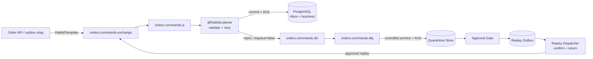
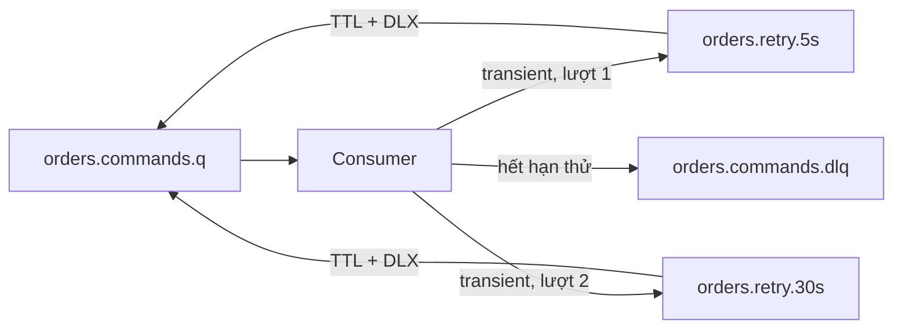
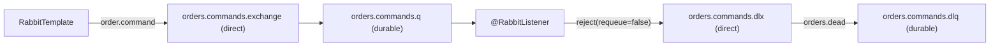
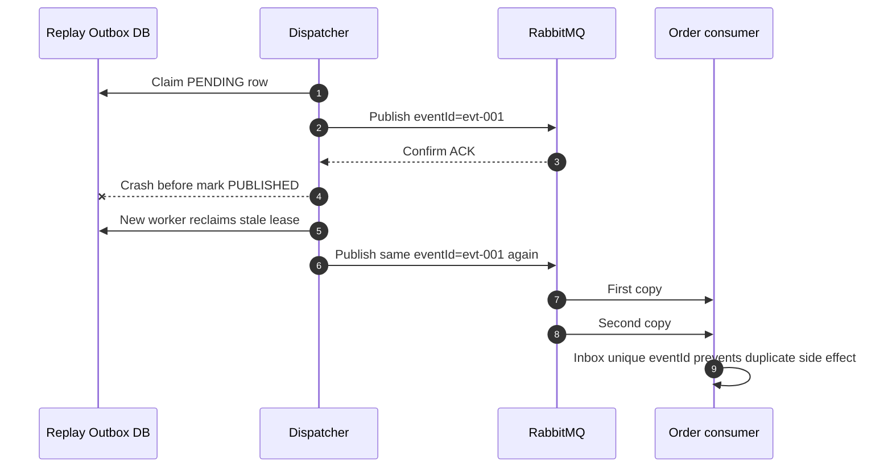

# Xây dựng retry giới hạn, DLQ và quy trình phát lại có kiểm soát

## 1. Bài toán thực hành: xử lý lệnh đơn hàng mà không mất dấu lỗi

Trong module **SPRING_AMQP**, chúng ta dùng `RabbitTemplate` gửi message qua **exchange**, **routing key**, **binding** và **queue**; dùng `@RabbitListener` nhận lệnh, xác nhận **consumer ACK**, xử lý **retry**, **dead-letter**, transaction và quan sát hệ thống. Bài thực hành tổng hợp này đưa các thành phần đó vào một luồng có **quy trình ứng cứu và phát lại** cụ thể.

Giả sử dịch vụ `order-worker` nhận lệnh:

```json
{
  "eventId": "evt-2026-0001",
  "orderId": "ord-1024",
  "action": "CONFIRM",
  "schemaVersion": 1
}
```

Một message có thể gặp ít nhất bốn kết quả:

1. **Thành công:** kiểm tra dữ liệu, cập nhật PostgreSQL trong transaction, trả về bình thường; Spring container ACK.
2. **Lỗi tạm thời:** database deadlock, mất kết nối dịch vụ phụ trợ hoặc timeout có thể hồi phục; thử lại **tối đa một số lần** với backoff.
3. **Lỗi cố định:** JSON sai, schema không hỗ trợ, trạng thái nghiệp vụ không hợp lệ; **không retry vô ích**, chuyển sang DLQ/quarantine.
4. **Lỗi hết số lần thử:** sau các lần retry đã định vẫn thất bại; reject không requeue, để broker dead-letter sang queue lỗi, chờ con người hoặc quy trình đã phê duyệt quyết định tiếp theo.

Phần khó nằm ở **phát lại**: làm thế nào để người vận hành chọn đúng message cần cứu, kiểm tra nguyên nhân đã được sửa, tránh vô tình chạy lại lệnh thanh toán, không làm rơi message giữa bước lấy khỏi DLQ và bước publish lại, và vẫn quan sát được mọi lần replay?

Bài này xây một **mini-project có thể phát triển thành production pattern**:

- Lớp ingress: `RabbitTemplate` → `orders.commands.exchange` → `orders.commands.q`.
- Consumer: validate, idempotent transaction, retry **4 lần tổng cộng trong một lượt delivery** (1 lần đầu + 3 lần thử lại).
- Terminal failure: broker DLX → `orders.commands.dlq`.
- Quarantine: một **tác vụ thủ công có giới hạn tốc độ** chép message DLQ vào kho cách ly bền vững, ACK bản DLQ sau khi lưu thành công.
- Operator gate: chỉ message được điều tra, phê duyệt và kiểm tra điều kiện mới được đưa vào **replay outbox**.
- Replay dispatcher: publish có **correlated confirms + returns**, theo dõi trạng thái không xác định, sử dụng **cùng business event ID** để consumer chống xử lý trùng.
- Observability/test: chứng minh mọi đường success, transient, permanent, exhausted, redelivery và replay bằng integration test với RabbitMQ thật.

**Phạm vi phiên bản minh họa:** Java 17+, Spring Boot 3.x, Spring AMQP 3.x, Spring Retry 2.x, PostgreSQL và RabbitMQ AMQP 0-9-1. Hãy dùng BOM và API phù hợp với bản đang triển khai; không chuyển ví dụ trực tiếp sang RabbitMQ Streams hoặc AMQP 1.0 mà không xét lại semantics.

### Mục tiêu hoàn thành

Người học hoàn thành bài khi có thể chứng minh:

- Message hợp lệ chỉ tạo **một** side effect nghiệp vụ dù bị gửi lại.
- Lỗi transient được retry trong giới hạn, có độ trễ giữa các lần thử.
- Message lỗi cố định **không** chiếm consumer bằng vòng lặp vô hạn.
- Khi hết retry, message nằm ở DLQ **nếu** DLX/binding/broker vận hành đúng.
- Không ai có thể replay một message chưa được phê duyệt.
- Sau phê duyệt, replay dùng một outbox bền vững; mất kết nối giữa publish và cập nhật DB **không được tuyên bố exactly-once**.
- Sau replay, có thể truy vết nguồn gốc, operator, ticket, số lần, outcome và trạng thái nghiệp vụ.
- Khi broker hoặc database lỗi, hệ thống giữ message ở trạng thái cần điều tra, không âm thầm bỏ qua.

## 2. Nhận diện bốn ranh giới giao nhận



Một publish là một yêu cầu đến broker, không phải bảo đảm xử lý thành công end-to-end.

| Mốc | Tín hiệu | Ý nghĩa | Điều chưa được bảo đảm |
|---|---|---|---|
| Publish call hoàn tất | `RabbitTemplate.send/convertAndSend` return | Java call không ném lỗi đồng bộ | Broker đã xác nhận |
| Publisher confirm ACK | `CorrelationData.getFuture()` ACK | Broker xác nhận publish theo cấu hình | Message đến đúng queue/consumer |
| Publisher return | `CorrelationData.getReturned()` khác null | Publish được broker trả vì unroutable trong đường phù hợp | Đã phát đến queue mong đợi |
| Delivery tới listener | Broker `basic.deliver` | Consumer nhận một delivery | DB đã commit |
| Business commit | PostgreSQL transaction commit | Side effect nghiệp vụ đã bền vững | RabbitMQ đã nhận consumer ACK |
| Consumer ACK | Container gửi `basic.ack` | Delivery được consumer xác nhận | Event chưa bao giờ bị redeliver trước đó |
| Broker dead-letter | Reject/NACK không requeue + DLX/binding | Broker cố chuyển message sang dead-letter destination | Quarantine store đã lưu hoặc replay an toàn |
| Replay confirm ACK | Publisher của replay nhận confirm | Broker xử lý publish lại | Consumer xử lý replay và commit xong |

**Đặc biệt:** broker có thể confirm ACK một message không route được tới queue. Với publisher returns và `mandatory=true`, ứng dụng cần xử lý **ACK + returned** như một kết quả không đạt yêu cầu định tuyến.

## 3. Đặt hợp đồng bất biến trước khi code

Một hệ thống retry/DLQ/replay đáng tin cần những **invariant** được kiểm thử.

| ID | Invariant | Cách kiểm chứng |
|---|---|---|
| I01 | Một business event có `eventId` ổn định qua mọi retry/replay | Contract test và log |
| I02 | Một event chỉ áp dụng side effect một lần theo domain key | Unique constraint trong DB |
| I03 | Dữ liệu sai contract không retry như lỗi transient | Đếm số lần handler được gọi |
| I04 | Retry sau một delivery không vượt 4 attempts theo policy lab | Unit/integration test |
| I05 | Exhausted failure không requeue về chính queue mãi | DLQ assertions, metric redelivery |
| I06 | Không xóa DLQ message trước khi quarantine transaction commit | Fault injection giữa lưu và ACK |
| I07 | Replay chỉ được tạo khi có approval và kiểm tra policy | Authorization test |
| I08 | Replay luôn có audit record và generation/attempt ID riêng | SQL constraints và log |
| I09 | Publish replay được đối chiếu confirm/return, không dùng return `void` làm success | Publisher integration test |
| I10 | Timeout confirm tạo trạng thái `UNKNOWN` chứ không chứng minh chưa gửi | Simulated network timeout |
| I11 | Worker crash sau DB commit trước ACK không nhân đôi side effect | Redelivery/idempotency integration |
| I12 | Replay được giới hạn tốc độ, số lần và có kill switch | Operations test |

**Không có cơ chế đơn lẻ nào thực hiện toàn bộ 12 invariant.** Retry chỉ lặp công việc, DLQ chỉ giữ delivery lỗi theo cấu hình, replay chỉ tạo một publish mới. Transaction, outbox, idempotency, ACL và quy trình phê duyệt mới ghép thành hành vi đáng tin.

## 4. Chọn chiến lược retry: ba lựa chọn khác nhau

### 4.1. Retry ngay trong listener

Khi một delivery đang được xử lý, `RetryTemplate` có thể gọi lại nghiệp vụ vài lần trước khi listener kết thúc:

```text
Broker deliver 1 message
  -> attempt #1 -> DB timeout
  -> backoff 200 ms
  -> attempt #2 -> DB timeout
  -> backoff 400 ms
  -> attempt #3 -> success
  -> DB commit
  -> listener return
  -> consumer ACK
```

Ưu điểm: dễ triển khai, không cần queue retry. Nhược điểm: giữ delivery `unacked` và chiếm consumer thread trong thời gian backoff; nếu worker crash hoặc delivery được giao lại từ broker, **bộ đếm trong bộ nhớ sẽ bắt đầu một chu kỳ retry mới**.

### 4.2. Retry qua queue với TTL/DLX

Một thiết kế khác chuyển message sang **retry queue** rồi nhờ TTL/DLX đưa trở lại queue nguồn:



Ưu điểm: không giữ consumer thread trong backoff dài; retry có thể sống qua việc restart ứng dụng. Nhược điểm: cần cấu trúc queue, số lần thử **bền vững**, routing đúng, quan sát việc dead-letter và tránh **cycle vô hạn**. Không có nghĩa RabbitMQ tự sinh “ba lần retry có backoff” chỉ vì bạn khai báo DLQ.

Muốn nâng cấp sang cách này cần thiết kế riêng: retry topology, attempt ledger có độ tin cậy rõ, TTL queues hoặc delayed-message mechanism và terminal DLQ. Không dựa **duy nhất** vào một custom header do publisher tự đặt để quyết định đã thử mấy lần; với `x-death` cũng phải hiểu broker-managed history và giới hạn của từng phiên bản.

### 4.3. Retry bên ngoài qua outbox/job

Khi cần delay hàng phút/giờ, quota nhiều hệ thống hoặc business workflow có trạng thái, có thể lưu **retry job** trong database rồi schedule publish lại. Khi đó cần locking, attempts, idempotency và confirm/return giống replay dispatcher.

**Bài thực hành này chọn retry trong listener cho các lỗi transient ngắn, rồi DLQ và replay thủ công cho lỗi dài hoặc chưa rõ.** Ở mục mở rộng, ta so sánh với queue-based retry và quorum queue delivery limit.

### 4.4. “Tối đa 4 attempts” nghĩa là gì?

`RetryTemplate.maxAttempts(4)` thường tính **cả lần chạy ban đầu**:

| Attempt | Thời điểm so với delivery | Kết quả giả định |
|---|---:|---|
| 1 | 0 ms | DB timeout |
| 2 | sau khoảng 200 ms | DB timeout |
| 3 | sau khoảng 400 ms nữa | DB timeout |
| 4 | sau khoảng 800 ms nữa | DB timeout; exhausted |

Backoff trong ví dụ là 200/400/800 ms, không phải 4 lần ngủ. Những thời gian thực có sai số do scheduling, CPU và latency của callback.

**Giới hạn đặc biệt:** policy 4 attempts áp dụng cho **một invocation/delivery xử lý qua RetryTemplate**. Nếu consumer crash ở attempt #3, broker redeliver và listener tạo RetryContext mới, tổng số lần xử lý vật lý có thể lớn hơn 4. Muốn có giới hạn **toàn cục qua nhiều redelivery**, cần durable attempt ledger, broker delivery-limit (khi phù hợp với quorum queue) hoặc retry workflow có trạng thái.

## 5. Cấu trúc mini-project và dependencies

Một cách chia lớp có thể triển khai:

```text
src/main/java/com/example/orders/
  config/
    OrderTopology.java
    RetryAndListenerConfig.java
    PublisherSettings.java
  contract/
    OrderCommand.java
  ingress/
    OrderCommandListener.java
    OrderPublisher.java
  application/
    OrderCommandService.java
    TransientOrderException.java
    PermanentOrderException.java
  quarantine/
    QuarantinePullJob.java
    QuarantineArchiveService.java
    ReplayApprovalService.java
    ReplayDispatcher.java
  observability/
    OrderMetrics.java

src/main/resources/
  application.yml
  db/migration/V1__orders_and_quarantine.sql

src/test/java/com/example/orders/
  OrderRetryUnitTest.java
  OrderDlqIntegrationTest.java
  ReplayApprovalTest.java
  ReplayFailureWindowIT.java
```

Danh sách là **sơ đồ một dự án mẫu**, không yêu cầu tạo những file thật ngoài bài Markdown đang được giao.

Maven dependencies theo Spring Boot 3.x BOM:

```xml
<dependencies>
    <dependency>
        <groupId>org.springframework.boot</groupId>
        <artifactId>spring-boot-starter-amqp</artifactId>
    </dependency>
    <dependency>
        <groupId>org.springframework.retry</groupId>
        <artifactId>spring-retry</artifactId>
    </dependency>
    <dependency>
        <groupId>org.springframework.boot</groupId>
        <artifactId>spring-boot-starter-jdbc</artifactId>
    </dependency>
    <dependency>
        <groupId>org.postgresql</groupId>
        <artifactId>postgresql</artifactId>
        <scope>runtime</scope>
    </dependency>
    <dependency>
        <groupId>org.springframework.boot</groupId>
        <artifactId>spring-boot-starter-validation</artifactId>
    </dependency>
    <dependency>
        <groupId>org.springframework.boot</groupId>
        <artifactId>spring-boot-starter-actuator</artifactId>
    </dependency>
    <dependency>
        <groupId>io.micrometer</groupId>
        <artifactId>micrometer-registry-prometheus</artifactId>
        <scope>runtime</scope>
    </dependency>
    <dependency>
        <groupId>org.springframework.boot</groupId>
        <artifactId>spring-boot-starter-test</artifactId>
        <scope>test</scope>
    </dependency>
    <dependency>
        <groupId>org.testcontainers</groupId>
        <artifactId>rabbitmq</artifactId>
        <scope>test</scope>
    </dependency>
    <dependency>
        <groupId>org.testcontainers</groupId>
        <artifactId>postgresql</artifactId>
        <scope>test</scope>
    </dependency>
</dependencies>
```

Tùy BOM/Testcontainers version có thể cần thêm `junit-jupiter` module hoặc integration của Testcontainers. Tránh trộn Spring AMQP 3.x với các dependency Spring Framework 7.x chỉ vì copy số phiên bản. Việc chạy integration test cần RabbitMQ và PostgreSQL thật trong môi trường thử nghiệm, không chỉ mock `RabbitTemplate`.

## 6. Khởi tạo môi trường lab

Nếu người học đã có broker và PostgreSQL riêng, chỉ cần tạo vhost/credential, database và queue dành cho bài. Nếu dùng Docker Compose (minh họa):

```yaml
services:
  rabbitmq:
    image: rabbitmq:4-management
    ports:
      - "5672:5672"
      - "15672:15672"
    environment:
      RABBITMQ_DEFAULT_USER: lab_orders
      RABBITMQ_DEFAULT_PASS: ${RABBITMQ_LAB_PASSWORD}
      RABBITMQ_DEFAULT_VHOST: /orders-lab
    volumes:
      - rabbit-data:/var/lib/rabbitmq

  postgres:
    image: postgres:16
    ports:
      - "5432:5432"
    environment:
      POSTGRES_DB: orders_lab
      POSTGRES_USER: lab_orders
      POSTGRES_PASSWORD: ${POSTGRES_LAB_PASSWORD}
    volumes:
      - pg-data:/var/lib/postgresql/data

volumes:
  rabbit-data:
  pg-data:
```

Ví dụ dùng environment substitution của Compose; người học phải tự cung cấp các biến bí mật trong môi trường lab. **Không dùng password production hoặc bind Management UI ra Internet.** Với máy chia sẻ/network công ty, giới hạn host binding và firewall thay vì công khai port.

Cấu hình ứng dụng Spring Boot:

```yaml
spring:
  rabbitmq:
    host: localhost
    port: 5672
    virtual-host: /orders-lab
    username: ${RABBITMQ_USERNAME}
    password: ${RABBITMQ_PASSWORD}
    publisher-confirm-type: correlated
    publisher-returns: true
    template:
      mandatory: true
    listener:
      simple:
        acknowledge-mode: auto
        prefetch: 10
        concurrency: 2
        max-concurrency: 2

  datasource:
    url: jdbc:postgresql://localhost:5432/orders_lab
    username: ${POSTGRES_USER}
    password: ${POSTGRES_PASSWORD}

management:
  endpoints:
    web:
      exposure:
        include: health,info,metrics,prometheus
```

Trong sản phẩm thật nên dùng Kubernetes Secret/secret manager và TLS cho kết nối cần bảo vệ. Các giá trị `max-concurrency`, `prefetch` chỉ là cấu hình bắt đầu thử nghiệm; quan sát DB pool và lượng `unacked` để chỉnh.

## 7. Khai báo topology: queue chính và DLQ tách biệt

Lược đồ:



Code Spring AMQP:

```java
import org.springframework.amqp.core.Binding;
import org.springframework.amqp.core.BindingBuilder;
import org.springframework.amqp.core.DirectExchange;
import org.springframework.amqp.core.Queue;
import org.springframework.amqp.core.QueueBuilder;
import org.springframework.beans.factory.annotation.Qualifier;
import org.springframework.context.annotation.Bean;
import org.springframework.context.annotation.Configuration;

@Configuration
public class OrderTopology {

    public static final String COMMAND_EXCHANGE =
            "orders.commands.exchange";
    public static final String COMMAND_KEY = "order.command";
    public static final String COMMAND_QUEUE =
            "orders.commands.q";

    public static final String DLX = "orders.commands.dlx";
    public static final String DEAD_KEY = "orders.dead";
    public static final String DLQ = "orders.commands.dlq";

    @Bean("orderCommandExchange")
    DirectExchange orderCommandExchange() {
        return new DirectExchange(COMMAND_EXCHANGE, true, false);
    }

    @Bean("orderDeadExchange")
    DirectExchange orderDeadExchange() {
        return new DirectExchange(DLX, true, false);
    }

    @Bean("orderCommandQueue")
    Queue orderCommandQueue() {
        return QueueBuilder.durable(COMMAND_QUEUE)
                .deadLetterExchange(DLX)
                .deadLetterRoutingKey(DEAD_KEY)
                .build();
    }

    @Bean("orderDeadQueue")
    Queue orderDeadQueue() {
        return QueueBuilder.durable(DLQ).build();
    }

    @Bean
    Binding orderCommandBinding(
            @Qualifier("orderCommandQueue") Queue queue,
            @Qualifier("orderCommandExchange") DirectExchange exchange) {
        return BindingBuilder.bind(queue)
                .to(exchange).with(COMMAND_KEY);
    }

    @Bean
    Binding orderDeadBinding(
            @Qualifier("orderDeadQueue") Queue queue,
            @Qualifier("orderDeadExchange") DirectExchange exchange) {
        return BindingBuilder.bind(queue)
                .to(exchange).with(DEAD_KEY);
    }
}
```

**Lưu ý khi đưa vào production:** RabbitMQ khuyến nghị dùng **policies** cho DLX khi cần thay đổi vận hành mà không tái khai báo queue với immutable arguments. Ví dụ hard-coded queue arguments phục vụ lab dễ theo dõi. Với queue đã tồn tại, thay các arguments không tương thích có thể dẫn tới `PRECONDITION_FAILED`. Cần quản lý topology bằng IaC/permissions và kiểm thử thay đổi.

### 7.1. Cái gì khiến message đi vào DLQ?

Với queue chính có DLX và binding trên, các lý do dead-letter có thể gồm:

- Consumer `basic.reject` hoặc `basic.nack` với `requeue=false`.
- Message hết TTL/expiration.
- Queue vượt giới hạn độ dài theo chính sách/overflow.
- Queue type/feature có thêm điều kiện dead-letter, chẳng hạn delivery limit ở quorum queue.

Đó là các **cơ chế broker**, không phải mọi loại exception Java tự động sinh ra DLQ. Java exception cần được listener container ánh xạ thành reject/nack phù hợp.

### 7.2. Giới hạn độ tin cậy của dead-letter

Việc broker cố dead-letter **không tạo giao dịch nguyên tử mặc định giữa source và target** cho mọi queue/phiên bản. Với những yêu cầu mất dữ liệu gần như bằng không, phải xem kỹ RabbitMQ docs về **at-least-once dead lettering của quorum queues**, điều kiện bật và giới hạn theo version, hoặc thiết kế lưu lỗi bền vững ở application layer.

Trong lab, sau mỗi test lỗi phải **xác minh DLQ nhận message thật**, không chỉ dựa vào annotation/queue arguments. Nếu DLX hoặc binding không tồn tại, một message reject không requeue có thể bị mất khỏi luồng mong đợi.

## 8. Contract dữ liệu: business ID và replay metadata

Java record:

```java
import jakarta.validation.constraints.NotBlank;
import jakarta.validation.constraints.NotNull;
import jakarta.validation.constraints.Pattern;
import jakarta.validation.constraints.Size;

public record OrderCommand(
        @NotBlank
        @Pattern(regexp = "[A-Za-z0-9:_-]{1,80}")
        String eventId,

        @NotBlank
        @Size(max = 80)
        String orderId,

        @NotBlank
        @Pattern(regexp = "CONFIRM|CANCEL")
        String action,

        @NotNull
        Integer schemaVersion
) {}
```

Trong service cần xác minh `schemaVersion == 1`, tenant/authorization và trạng thái đơn hàng. `eventId` phải ổn định qua **các lần broker redelivery, retries và replay**. Không tạo event ID mới chỉ để tránh unique constraint; như vậy sẽ mở đường xử lý trùng nghiệp vụ.

### 8.1. Tách ba loại ID

| ID | Vai trò | Có đổi khi replay? |
|---|---|---|
| `eventId` | Danh tính command/event nghiệp vụ dùng cho idempotency | **Không** với phát lại chính event cũ |
| `publishAttemptId` | Correlation publisher confirm cho một lần gửi vào broker | Có |
| `replayRequestId` | Dấu vết quyết định phát lại của operator | Có, cho một quyết định hợp lệ |
| `quarantineId` | Định danh record lưu trữ một dead-letter/error instance | Không đổi |
| `traceId` | Tracing một luồng quan sát | Có thể tạo span/trace mới, phải giữ liên kết |

**Replay** đúng nghĩa là phát lại một business event chưa xử lý thành công. Nếu muốn **thay đổi nội dung command** (ví dụ sửa amount/orderId), thường cần một **command mới có ID mới**, phê duyệt nghiệp vụ và quan hệ `supersedesEventId`, không lén sửa body của event cũ rồi giữ `eventId`.

### 8.2. Header tối thiểu

```text
messageId = eventId
contentType = application/json
contentEncoding = UTF-8
deliveryMode = PERSISTENT
x-app-schema-version = 1
x-app-source = order-api
x-app-replay-request-id = <chỉ có khi replay>
x-app-replay-generation = <số lần replay đã phê duyệt>
```

Custom headers đều là dữ liệu không tin cậy từ publisher; không dùng `x-app-source` hoặc `x-app-replay-generation` để cấp quyền/giới hạn số lần một cách độc lập. **Quyền và replay quota phải nằm ở kho phê duyệt đáng tin**, còn header chỉ giúp correlation. Không sao chép tùy ý `x-death`/retry headers từ DLQ sang publish mới.

## 9. Cấu hình publisher gửi message có confirm/return

Producer dùng JSON bytes đã kiểm soát. Ví dụ:

```java
import com.fasterxml.jackson.core.JsonProcessingException;
import com.fasterxml.jackson.databind.ObjectMapper;
import java.nio.charset.StandardCharsets;
import java.util.UUID;
import org.springframework.amqp.core.Message;
import org.springframework.amqp.core.MessageDeliveryMode;
import org.springframework.amqp.core.MessageProperties;
import org.springframework.amqp.rabbit.connection.CorrelationData;
import org.springframework.amqp.rabbit.core.RabbitTemplate;
import org.springframework.stereotype.Service;

@Service
public class OrderPublisher {
    private final RabbitTemplate template;
    private final ObjectMapper mapper;

    public OrderPublisher(RabbitTemplate template, ObjectMapper mapper) {
        this.template = template;
        this.mapper = mapper;
    }

    public CorrelationData publish(OrderCommand command)
            throws JsonProcessingException {

        byte[] body = mapper.writeValueAsBytes(command);
        MessageProperties props = new MessageProperties();
        props.setMessageId(command.eventId());
        props.setContentType(MessageProperties.CONTENT_TYPE_JSON);
        props.setContentEncoding(StandardCharsets.UTF_8.name());
        props.setDeliveryMode(MessageDeliveryMode.PERSISTENT);
        props.setHeader("x-app-schema-version", 1);

        CorrelationData correlation = new CorrelationData(
                command.eventId() + ":" + UUID.randomUUID());

        template.send(
                OrderTopology.COMMAND_EXCHANGE,
                OrderTopology.COMMAND_KEY,
                new Message(body, props),
                correlation);

        return correlation; // Future của broker confirm, chưa phải business ACK.
    }
}
```

Đây là producer đơn giản để lab. Khi production gọi `publish` rồi mất kết nối, kết quả có thể **unknown** dù message đã đến broker. Muốn đảm bảo event không bị bỏ lỡ sau DB commit, dùng **transactional outbox của producer**, publisher confirms/returns và đối soát. Không đưa side effect publish trực tiếp vào một DB transaction rồi cho rằng RabbitMQ và DB commit nguyên tử.

### 9.1. Xác minh sau publish

```java
CorrelationData correlation = publisher.publish(command);

// Chỉ chờ trong test/job/worker có timeout hữu hạn,
// tránh block HTTP request thread vô giới hạn.
CorrelationData.Confirm confirm =
        correlation.getFuture().get(5, TimeUnit.SECONDS);

if (!confirm.isAck()) {
    throw new IllegalStateException("Broker NACK");
}
if (correlation.getReturned() != null) {
    throw new IllegalStateException("Publish unroutable");
}
```

`TimeUnit` cần import từ `java.util.concurrent`. Mọi exception/timeout phải được phân loại và quản lý outstanding publish. `ACK + no return` không chứng minh consumer đã commit, chỉ là một **điều kiện tối thiểu** để coi publish tới topology hợp lệ theo thiết kế.

## 10. Lớp nghiệp vụ: idempotency và transaction

Một consumer có thể xử lý một delivery nhiều lần vì:

- Producer timeout rồi gửi lại.
- Broker redeliver khi channel/consumer chết trước ACK.
- Operator replay cùng event.
- Một delivery retry sau timeout không biết side effect đã xảy ra chưa.

Do đó transaction phải kiểm tra **đã xử lý command ID chưa** trước khi tạo side effect.

### 10.1. Schema PostgreSQL tối giản

```sql
CREATE TABLE processed_order_commands (
    event_id VARCHAR(80) PRIMARY KEY,
    order_id VARCHAR(80) NOT NULL,
    action VARCHAR(20) NOT NULL,
    processed_at TIMESTAMPTZ NOT NULL DEFAULT now()
);

CREATE TABLE order_projection (
    order_id VARCHAR(80) PRIMARY KEY,
    last_action VARCHAR(20) NOT NULL,
    last_event_id VARCHAR(80) NOT NULL,
    updated_at TIMESTAMPTZ NOT NULL DEFAULT now()
);
```

### 10.2. Transaction đúng

```java
import org.springframework.jdbc.core.JdbcTemplate;
import org.springframework.stereotype.Service;
import org.springframework.transaction.annotation.Transactional;

@Service
public class OrderCommandService {
    private final JdbcTemplate jdbc;

    public OrderCommandService(JdbcTemplate jdbc) {
        this.jdbc = jdbc;
    }

    @Transactional
    public boolean applyOnceAndCommit(OrderCommand cmd) {
        // Với PostgreSQL; unique eventId chống double side effect.
        int inserted = jdbc.update("""
            INSERT INTO processed_order_commands(
                event_id, order_id, action)
            VALUES (?, ?, ?)
            ON CONFLICT (event_id) DO NOTHING
            """,
            cmd.eventId(), cmd.orderId(), cmd.action());

        if (inserted == 0) {
            return false; // Duplicate đã commit trong lần xử lý trước.
        }

        // Demo projection: production cần kiểm tra state/version/authorization.
        jdbc.update("""
            INSERT INTO order_projection(
                order_id, last_action, last_event_id)
            VALUES (?, ?, ?)
            ON CONFLICT (order_id)
            DO UPDATE SET
                last_action = EXCLUDED.last_action,
                last_event_id = EXCLUDED.last_event_id,
                updated_at = now()
            """,
            cmd.orderId(), cmd.action(), cmd.eventId());

        return true;
    }
}
```

Khi method được gọi qua Spring transaction proxy, việc insert vào inbox và cập nhật projection thuộc **cùng database transaction**. Nếu cập nhật projection lỗi, insert `processed_order_commands` phải rollback, không được giữ trạng thái “đã xử lý” giả.

**Chưa hoàn chỉnh cho production:** đây là projection đơn giản, có thể bị đảo thứ tự nếu nhiều event cùng order được xử lý song song. Muốn per-order ordering cần aggregate version, checkpoint/optimistic locking hoặc shard queue. Nếu nghiệp vụ gửi email/payment HTTP sau DB commit, phải dùng **outbox/side-effect idempotency** riêng; DB transaction không bao trùm HTTP call.

### 10.3. Thử nghiệm crash window

```mermaid
sequenceDiagram
    autonumber
    participant Q as RabbitMQ
    participant C as Order consumer
    participant DB as PostgreSQL
    Q->>C: Deliver eventId=evt-001
    C->>DB: BEGIN; INSERT inbox; UPDATE order
    DB-->>C: COMMIT OK
    C--xQ: Process crash before ACK
    Q->>C: Redeliver evt-001
    C->>DB: INSERT inbox ON CONFLICT DO NOTHING
    DB-->>C: Duplicate, no side effect
    C-->>Q: ACK
```

**Đây là at-least-once delivery + idempotent processing**, không phải exactly-once delivery của broker. Message có thể được giao nhiều lần nhưng side effect trong phạm vi transaction trên được áp dụng tối đa một lần theo event ID.

## 11. Phân loại lỗi: cái gì được retry?

Định nghĩa hai nhóm exception do ứng dụng kiểm soát:

```java
public class TransientOrderException extends RuntimeException {
    public TransientOrderException(String message, Throwable cause) {
        super(message, cause);
    }
}

public class PermanentOrderException extends RuntimeException {
    public PermanentOrderException(String message) {
        super(message);
    }
}
```

| Ví dụ | Loại | Retry trong bài? | Giải thích |
|---|---|---|---|
| DB deadlock/lock timeout được phân loại | Transient | Có, tối đa 4 attempts | Có thể hồi phục sau backoff |
| API đối tác 503 ngắn hạn | Transient | Có, nếu operation idempotent | Không retry mù khi outcome remote unknown |
| JSON malformed | Permanent | Không | Body cũ không tự trở thành JSON đúng |
| Thiếu eventId/schema sai | Permanent | Không | Contract không đạt |
| Action không được hỗ trợ | Permanent | Không | Nghiệp vụ không thể tự sửa bằng retry |
| Tenant không được phép | Permanent/security | Không | Không retry cấp quyền |
| Database password sai | Configuration/incident | Thường không retry nhanh | Cần sửa cấu hình và cảnh báo |
| Remote payment timeout sau side effect | Unknown | Không retry trước khi đối soát | Có thể đã trừ tiền |
| Duplicate đã xử lý | Success-idempotent | Không | ACK an toàn, không side effect |
| Programming bug NPE | Unexpected | Không giả định transient | Alert, quarantine/debug |

Một lỗi `DataAccessException` không nên được coi là transient trong mọi trường hợp. Phải phân loại theo **exception cụ thể/driver và ý nghĩa nghiệp vụ**. Với lỗi từ remote API, ngoài status code phải hiểu operation có idempotent hay không.

## 12. RetryTemplate: giới hạn nỗ lực và backoff

### 12.1. Cấu hình riêng để policy dễ kiểm thử

```java
import org.springframework.context.annotation.Bean;
import org.springframework.context.annotation.Configuration;
import org.springframework.retry.support.RetryTemplate;

@Configuration
public class OrderRetryConfig {

    @Bean("orderRetryTemplate")
    RetryTemplate orderRetryTemplate() {
        return RetryTemplate.builder()
                .maxAttempts(4)
                .exponentialBackoff(200, 2.0, 2_000)
                .retryOn(TransientOrderException.class)
                .build();
    }
}
```

Ý nghĩa trong Spring Retry 2.x:

- `maxAttempts(4)`: 1 lượt đầu + tối đa 3 retry.
- `exponentialBackoff(200, 2.0, 2_000)`: khoảng chờ bắt đầu 200 ms, nhân hệ số 2, cap 2 giây.
- `retryOn(TransientOrderException.class)`: **chỉ** loại được phân loại transient mới nên được retry theo policy này.
- Đây là retry **trong một listener invocation**, không giữ durable attempt count qua restart.
- Backoff trong thread tiêu thụ consumer capacity. Nếu cần delay dài, xem retry queue/outbox, không giữ thread ngủ hàng phút.

**Điểm kiểm tra trên dự án thật:** builder API và tên method cần phù hợp với Spring Retry version được BOM quản lý. Một số ứng dụng cũ cấu hình `SimpleRetryPolicy`/`ExponentialBackOffPolicy` thay vì builder; mục tiêu semantics vẫn là giới hạn attempt và retry đúng exception class.

### 12.2. Đo số lần thử

`RetryTemplate.execute` truyền `RetryContext` với `getRetryCount()`, thường bắt đầu từ 0 cho invocation đầu tiên. Ví dụ trong listener:

```java
retryTemplate.execute(context -> {
    int humanAttempt = context.getRetryCount() + 1;
    log.debug("Processing attempt {}", humanAttempt);
    orderService.applyOnceAndCommit(command);
    return null;
});
```

Đừng tự tăng custom header `x-retry-count` **chỉ trong RAM** rồi tuyên bố đã có retry count bền vững. Nếu consumer chết và broker redeliver, RetryContext mới được tạo. Lưu `retryCount` vào metrics với label nhóm lỗi nhưng không gắn `eventId` làm metric label.

## 13. Listener: validate → bounded retry → ACK hoặc DLQ

### 13.1. Listener factory

```java
import org.springframework.amqp.core.AcknowledgeMode;
import org.springframework.amqp.rabbit.config.SimpleRabbitListenerContainerFactory;
import org.springframework.amqp.rabbit.connection.ConnectionFactory;
import org.springframework.context.annotation.Bean;
import org.springframework.context.annotation.Configuration;

@Configuration
public class OrderListenerConfig {

    @Bean("orderCommandListenerFactory")
    SimpleRabbitListenerContainerFactory factory(
            ConnectionFactory connectionFactory) {

        SimpleRabbitListenerContainerFactory factory =
                new SimpleRabbitListenerContainerFactory();

        factory.setConnectionFactory(connectionFactory);
        factory.setAcknowledgeMode(AcknowledgeMode.AUTO);
        factory.setConcurrentConsumers(2);
        factory.setMaxConcurrentConsumers(2);
        factory.setPrefetchCount(10);

        // Sau lỗi không được xử lý, không requeue vô hạn.
        factory.setDefaultRequeueRejected(false);
        return factory;
    }
}
```

**Spring `AcknowledgeMode.AUTO` không phải RabbitMQ auto-ack.** Container gửi ACK sau khi listener hoàn thành bình thường; khi callback ném lỗi, nó dùng error policy để reject/nack. `defaultRequeueRejected(false)` khiến exception chưa được xử lý đi tới reject không requeue, nên **phải có DLX hoạt động** và monitoring rõ. Không dùng setting này để che lỗi mà không xem DLQ.

### 13.2. Listener nhận raw Message để kiểm tra trước Jackson

```java
import com.fasterxml.jackson.core.JsonProcessingException;
import com.fasterxml.jackson.databind.ObjectMapper;
import jakarta.validation.ConstraintViolation;
import jakarta.validation.Validator;
import java.util.Set;

import org.springframework.amqp.AmqpRejectAndDontRequeueException;
import org.springframework.amqp.core.Message;
import org.springframework.amqp.core.MessageProperties;
import org.springframework.amqp.rabbit.annotation.RabbitListener;
import org.springframework.beans.factory.annotation.Qualifier;
import org.springframework.stereotype.Component;
import org.springframework.retry.support.RetryTemplate;

@Component
public class OrderCommandListener {

    private final ObjectMapper mapper;
    private final Validator validator;
    private final RetryTemplate retry;
    private final OrderProcessingPort processingPort;

    public OrderCommandListener(
            ObjectMapper mapper,
            Validator validator,
            @Qualifier("orderRetryTemplate") RetryTemplate retry,
            OrderProcessingPort processingPort) {
        this.mapper = mapper;
        this.validator = validator;
        this.retry = retry;
        this.processingPort = processingPort;
    }

    @RabbitListener(
            id = "orderCommands",
            queues = OrderTopology.COMMAND_QUEUE,
            containerFactory = "orderCommandListenerFactory")
    public void onMessage(Message raw) {
        OrderCommand command = parseAndValidate(raw);

        try {
            retry.execute(context -> {
                processingPort.apply(command);
                return null;
            });
        } catch (TransientOrderException exhausted) {
            // Sau tối đa 4 attempts trong lượt delivery này.
            throw new AmqpRejectAndDontRequeueException(
                    "RETRY_EXHAUSTED", exhausted);
        } catch (PermanentOrderException permanent) {
            throw new AmqpRejectAndDontRequeueException(
                    "BUSINESS_PERMANENT", permanent);
        }
        // Return bình thường -> container ACK sau khi service commit.
    }

    private OrderCommand parseAndValidate(Message raw) {
        byte[] body = raw.getBody();

        if (body == null || body.length == 0
                || body.length > 64 * 1024) {
            throw new AmqpRejectAndDontRequeueException(
                    "INVALID_BODY_SIZE");
        }

        if (!MessageProperties.CONTENT_TYPE_JSON.equals(
                raw.getMessageProperties().getContentType())) {
            throw new AmqpRejectAndDontRequeueException(
                    "UNSUPPORTED_CONTENT_TYPE");
        }

        final OrderCommand command;
        try {
            command = mapper.readValue(body, OrderCommand.class);
        } catch (JsonProcessingException ex) {
            throw new AmqpRejectAndDontRequeueException(
                    "INVALID_JSON", ex);
        }

        Set<ConstraintViolation<OrderCommand>> violations =
                validator.validate(command);

        if (!violations.isEmpty()
                || command.schemaVersion() != 1) {
            throw new AmqpRejectAndDontRequeueException(
                    "INVALID_SCHEMA_OR_VALIDATION");
        }

        return command;
    }
}
```

Các điểm phải hiểu:

- **Validation nằm ngoài retry block**: body/schema sai bị loại ngay, không chạy bốn attempts.
- `RetryTemplate` chỉ retry `TransientOrderException`. `OrderProcessingPort` ở mục 13.4 chuyển lỗi DB transient thành class này **sau khi transaction service rollback**; không “retry mọi RuntimeException”.
- Sau exhausted, `AmqpRejectAndDontRequeueException` khiến container reject không requeue, broker dead-letter nếu queue + DLX/binding đúng.
- Khi `applyOnceAndCommit` trả bình thường, Spring container AUTO ACK. Nếu event duplicate thì service trả không có side effect và listener vẫn ACK.
- `raw Message` giúp kiểm tra body bytes trước khi gọi Jackson, nhưng body/header đã được RabbitMQ client nhận vào JVM; muốn bảo vệ khỏi payload khổng lồ từ sớm cần giới hạn broker/ingress.
- Code không phân loại lỗi `schemaVersion` null ngoài Bean Validation; `@NotNull` làm đảm bảo không unbox null trước khi so sánh.
- `PermanentOrderException` là lỗi nghiệp vụ **sau parse**. Trong trường hợp này retry policy không retry, và listener map nó sang reject không requeue.

**Chú ý:** code snippet ở trên là phần lõi cho lab. Ở production cần parser constraints (JSON depth, string length), UTF-8 strict decode nếu contract yêu cầu, header allowlist, kiểm soát authorization/tenant và audit. Không log nguyên body chứa dữ liệu nhạy cảm vào exception.

### 13.3. Xử lý lỗi DB tạm thời sau transaction

Ví dụ một adapter phân loại một số exception của Spring DataAccess:

```java
import org.springframework.dao.TransientDataAccessException;

public void applyClassified(OrderCommand command) {
    try {
        orderService.applyOnceAndCommit(command);
    } catch (TransientDataAccessException ex) {
        throw new TransientOrderException(
                "TRANSIENT_DATABASE_FAILURE", ex);
    }
}
```

**Đặt đúng ranh giới transaction:** nếu method bọc có `@Transactional` và exception đã khiến transaction rollback-only, retry **trong cùng transaction** sẽ không làm transaction mới có hiệu lực. Trong bài, `OrderCommandService.applyOnceAndCommit` là một method `@Transactional` được gọi qua Spring proxy ở mỗi attempt; exception thoát khỏi proxy thì transaction được rollback trước lần gọi kế tiếp.

Đoạn `applyClassified` ở trên chỉ minh họa **vị trí chuyển exception**, không cần dùng song song với `OrderProcessingPort` ở mục kế tiếp. Listener mục 13.2 đã gọi `processingPort.apply(command)`, nên cần triển khai bean `OrderProcessingPort` như mục 13.4. **Không được mặc định** `TransientDataAccessException` tự được retry khi template chỉ `retryOn(TransientOrderException.class)`; nếu không map, lỗi sẽ đi thẳng theo fallback của container.

### 13.4. Triển khai OrderProcessingPort để retry DB transient

Tách một `OrderProcessingPort` làm nơi phân loại lỗi và inject vào listener thay cho service trực tiếp:

```java
import org.springframework.dao.TransientDataAccessException;
import org.springframework.stereotype.Component;

@Component
public class OrderProcessingPort {
    private final OrderCommandService service;

    public OrderProcessingPort(OrderCommandService service) {
        this.service = service;
    }

    public void apply(OrderCommand command) {
        try {
            service.applyOnceAndCommit(command);
        } catch (TransientDataAccessException ex) {
            throw new TransientOrderException(
                    "TRANSIENT_DB", ex);
        }
    }
}
```

`OrderCommandListener` ở mục 13.2 đã inject `OrderProcessingPort` và gọi `processingPort.apply(command)` trong retry callback. Vì vậy, khi ghép các file Java cho lab, triển khai bean này **trước khi chạy listener**; nó hoàn tất chuỗi `@RabbitListener → RetryTemplate → OrderProcessingPort → @Transactional OrderCommandService`. Phân loại phải được đặt ở nơi transaction proxy đã thoát exception.

## 14. Hành vi cụ thể cho từng loại message

| Test input | Số lần attempt theo logic lab | Listener result | RabbitMQ outcome kỳ vọng |
|---|---:|---|---|
| Hợp lệ, DB thành công | 1 | Return bình thường | ACK |
| Hợp lệ, trùng `eventId` | 1 | No-op transaction | ACK |
| JSON sai | 0 business attempt | Throw reject không requeue | DLQ |
| Schema version = 2 | 0 business attempt | Throw reject không requeue | DLQ |
| DB transient 2 lần rồi thành công | 3 | Return bình thường | ACK |
| DB transient liên tục | 4 | Throw `RETRY_EXHAUSTED` | DLQ |
| Business permanent | 1 | Throw reject không requeue | DLQ |
| App crash giữa retry | Không cố định toàn cục | Channel đóng, delivery redeliver | Có thể nhận lại, tăng physical attempts |
| DB commit rồi crash trước ACK | Tối thiểu một attempt mới | Duplicate no-op | ACK sau redelivery |

**Test phải phân biệt số lần business method được gọi và số delivery từ broker.** Một message có thể được broker giao một lần nhưng code thử DB ba lần. Ngược lại, broker có thể redeliver nhiều lần dù mỗi delivery chỉ có một attempt.

## 15. Quan sát DLQ và metadata lỗi

Sau khi một message bị dead-letter:

- Source queue có thể giảm `ready/unacked`.
- DLQ tăng `ready` nếu nó tồn tại và broker route thành công.
- RabbitMQ có thể gắn `x-death` hoặc metadata dead-letter tương ứng với lý do và nguồn gốc.
- Message body **vẫn là dữ liệu gốc**, có thể chứa PII/token hoặc payload độc hại.

`x-death` không phải là audit log đủ mạnh cho nghiệp vụ; nó phản ánh lịch sử dead-letter theo cấu trúc và phiên bản broker, có thể gộp các sự kiện theo queue/reason. Đừng biến `x-death.count` thành business event ID hay đơn vị “đã retry chính xác N lần trong mọi tình huống”.

### 15.1. DLQ không phải kho lưu trữ đã được kiểm duyệt

Một queue tên `.dlq` chỉ là một queue RabbitMQ bình thường:

- Có thể bị purge/delete theo thao tác quản trị.
- Có thể tăng không giới hạn nếu không có chính sách dung lượng.
- Có thể giữ raw payload nhạy cảm, cần ACL/retention/encryption.
- Có thể không route được nếu DLX/binding sai.
- Nếu có consumer tự động, message có thể bị ACK mất khỏi DLQ.

Với sự cố quan trọng, phải theo dõi DLQ size, oldest message age khi có metric thích hợp, retry exhaustion, storage pressure, và **tách quyền đọc/consume DLQ** khỏi consumer chính.

### 15.2. Không tự bật consumer replay DLQ

Anti-pattern:

```java
@RabbitListener(queues = "orders.commands.dlq")
public void autoReplay(Message deadMessage) {
    rabbitTemplate.send(
            OrderTopology.COMMAND_EXCHANGE,
            OrderTopology.COMMAND_KEY,
            deadMessage);
}
```

Nếu lỗi gốc chưa sửa, message quay ngay về source queue, tiếp tục fail, rồi lại vào DLQ; có thể tạo **vòng lặp nóng**. Đoạn này còn có nguy cơ mất message nếu DLQ consumer ACK nhưng publish mới chưa được broker confirm. Và việc copy nguyên `x-death`/header từ dead-letter không phải chính sách metadata sạch.

**Không dùng code này cho production.** Phần tiếp theo xây một đường replay có phê duyệt và outbox.

## 16. Tại sao phát lại trực tiếp từ DLQ là nguy hiểm?

RabbitMQ queue không có chức năng **random access theo event ID** giống một database có index. Một lệnh “replay eventId=evt-2026-0001” không tự tìm đúng message giữa hàng nghìn message trong DLQ. Nếu dùng `basicGet` theo thứ tự, ứng dụng nhận message kế tiếp trong queue, chưa chắc là message operator phê duyệt.

Ngoài ra, một replay direct điển hình:

```text
basicGet(DLQ, autoAck=true)
  -> message bị xác nhận ngay khỏi DLQ
  -> publish lại
  -> network error
  -> không còn bản gốc trong DLQ
```

Điều này không an toàn. Thậm chí với manual ACK:

```text
basicGet(DLQ, autoAck=false)
  -> publish source
  -> broker confirm ACK
  -> crash before DLQ ACK
```

Sau crash, original DLQ delivery có thể quay lại; cả source publish và DLQ message cùng tồn tại, sinh **duplicate**. Đây là một khoảng lỗi không thể loại bỏ chỉ bằng đổi thứ tự hai thao tác của **hai resource độc lập**.

**Giải pháp trong bài:** không trực tiếp chọn rồi replay ngẫu nhiên trên queue. Ta **lưu DLQ vào quarantine database có khóa tra cứu**, tách quyết định của operator khỏi việc phát message, và dùng **durable replay outbox**. Tính đúng đắn cuối cùng dựa trên idempotency.

## 17. Thiết kế Quarantine Store

Quarantine Store lưu **raw body** và metadata tối thiểu; không ép body phải là JSON hợp lệ vì DLQ có thể chứa message bị lỗi parse.

Một schema tối giản:

```sql
CREATE TABLE quarantine_messages (
    quarantine_id UUID PRIMARY KEY,
    event_id VARCHAR(80),
    message_id VARCHAR(120),
    source_queue VARCHAR(200) NOT NULL,
    original_exchange VARCHAR(200),
    original_routing_key VARCHAR(200),
    raw_body BYTEA NOT NULL,
    body_sha256 CHAR(64) NOT NULL,
    content_type VARCHAR(100),
    error_class VARCHAR(80),
    status VARCHAR(30) NOT NULL DEFAULT 'NEEDS_REVIEW',
    first_seen_at TIMESTAMPTZ NOT NULL DEFAULT now(),
    last_seen_at TIMESTAMPTZ NOT NULL DEFAULT now(),
    archive_delivery_count INTEGER NOT NULL DEFAULT 1,
    reviewed_at TIMESTAMPTZ,
    reviewed_by VARCHAR(120),
    review_ticket VARCHAR(120)
);

CREATE INDEX idx_quarantine_event_id
    ON quarantine_messages(event_id);

CREATE INDEX idx_quarantine_status_created
    ON quarantine_messages(status, first_seen_at);
```

Quarantine body có thể chứa dữ liệu không tin cậy/nhạy cảm. Trong production phải bổ sung:

- Encryption-at-rest, giới hạn kích thước, access control theo vai trò, audit đọc payload.
- Retention, backup, purge theo chính sách dữ liệu cá nhân.
- Tách raw payload khỏi UI list; operator chỉ thấy **metadata sanitize** cho tới khi được cấp quyền xem chi tiết.
- Nếu data không đạt contract an toàn để lưu vào DB, chuyển sang encrypted object storage với pointer, checksum và access policy.
- Không cho người dùng tải raw payload rồi thực thi script/link từ nội dung đó.

### 17.1. Idempotency ở bước archive

Nếu archive thành công nhưng consumer crash trước ACK của DLQ, broker có thể giao lại cùng DLQ message. Quarantine archive cần **dedup theo identity bền vững của lần dead-letter** hoặc dùng một khóa ổn định do hệ thống ingress tạo ra.

Đối với hệ thống của bài, producer yêu cầu **`messageId/eventId` bắt buộc**. Nhưng một message lỗi có thể thiếu ID. Vì vậy **không dùng chỉ mỗi eventId làm khóa chính cho toàn bộ DLQ**, và không tự coi SHA-256 của body là unique business identity: hai message độc lập có body giống nhau vẫn có thể là hai sự kiện riêng.

Một giải pháp production là gắn một **ingressDeliveryId** duy nhất ở ranh giới được kiểm soát trước khi publish; lưu lại trong message và quarantine. Với message legacy không có ID, cần policy riêng để tránh tự động gộp các sự kiện có payload trùng. Ở lab có thể kiểm tra `messageId` hợp lệ và đánh dấu `IDENTITY_MISSING` cần review thủ công thay vì tuyên bố dedup an toàn.

## 18. Quarantine Pull Job: không xóa DLQ trước khi lưu thành công

Ta dùng **maintenance job được operator kích hoạt**, không chạy vô hạn trên mọi DLQ message. Mỗi invocation lấy tối đa **một** message, lưu vào DB, ACK delivery ở DLQ **sau khi transaction commit**.

### 18.1. Mẫu RabbitTemplate.execute + basicGet(false)

```java
import com.rabbitmq.client.GetResponse;
import org.springframework.amqp.rabbit.core.RabbitTemplate;
import org.springframework.stereotype.Component;

@Component
public class QuarantinePullJob {
    private final RabbitTemplate rabbitTemplate;
    private final QuarantineArchiveService archive;

    public QuarantinePullJob(
            RabbitTemplate rabbitTemplate,
            QuarantineArchiveService archive) {
        this.rabbitTemplate = rabbitTemplate;
        this.archive = archive;
    }

    public boolean pullOne() {
        Boolean success = rabbitTemplate.execute(channel -> {
            // autoAck=false: broker giữ delivery unacked.
            GetResponse delivery =
                    channel.basicGet(OrderTopology.DLQ, false);

            if (delivery == null) {
                return false;
            }

            long tag = delivery.getEnvelope().getDeliveryTag();

            try {
                // Service ở bean riêng; @Transactional commit
                // trước khi return.
                archive.storeCommitted(
                        delivery.getBody(),
                        delivery.getProps(),
                        delivery.getEnvelope());

                // Chỉ ACK DLQ sau durable archive.
                channel.basicAck(tag, false);
                return true;
            } catch (RuntimeException ex) {
                // Trả lại DLQ, rồi job kết thúc và báo operator.
                // Không gọi pullOne() trong vòng lặp nóng khi DB lỗi.
                channel.basicNack(tag, false, true);
                throw ex;
            }
        });

        return Boolean.TRUE.equals(success);
    }
}
```

**Điều kiện để mẫu an toàn hơn auto-ACK:** `QuarantineArchiveService.storeCommitted` là Spring bean **khác**, dùng `@Transactional` qua proxy và chỉ return khi DB transaction đã commit. Nếu ACK gặp IOException hoặc process crash sau commit, DLQ message có thể redeliver; archive phải có cơ chế dedup/đối soát. Dùng `RabbitTemplate.execute` trong job giúp lấy message và ACK trên **cùng channel**; không lấy deliveryTag rồi ACK trên một channel khác.

Đây là **mẫu lab**, không phải một công cụ quản trị production hoàn chỉnh. Việc truy xuất `basicGet` khỏi DLQ trong production phải được phê duyệt, rate-limit, có observability, và không chạy đồng thời nhiều maintenance jobs không có ownership/locking. Khi `basicNack(requeue=true)`, việc gọi job lặp lại ngay sẽ tạo hot loop nếu archive database vẫn lỗi; job cần **dừng và cảnh báo**.

### 18.2. Interface và transaction archive

```java
import com.rabbitmq.client.AMQP;
import com.rabbitmq.client.Envelope;

public interface QuarantineArchiveService {
    void storeCommitted(
            byte[] body,
            AMQP.BasicProperties properties,
            Envelope envelope);
}
```

Một implementation cần thực hiện trong **transaction**:

```java
@Service
class JdbcQuarantineArchiveService
        implements QuarantineArchiveService {

    private final QuarantineRepository repository;

    JdbcQuarantineArchiveService(QuarantineRepository repository) {
        this.repository = repository;
    }

    @Override
    @Transactional
    public void storeCommitted(
            byte[] body,
            AMQP.BasicProperties props,
            Envelope envelope) {

        // 1. Giới hạn body và metadata, tính checksum.
        // 2. Xác định archive identity theo policy tin cậy.
        // 3. INSERT hoặc dedup theo khóa ổn định đã thiết kế.
        // 4. Ghi eventId, original exchange/routing,
        //    raw bytes và thông tin cần audit.
        // 5. Return chỉ sau khi transactional proxy commit.
        repository.persistSafely(body, props, envelope);
    }
}
```

Đây là **mảnh kiến trúc Java**, cần import Spring annotations, khai báo `QuarantineRepository` và triển khai repository theo schema thực tế. Chưa thể copy/paste như một service hoàn chỉnh mà bỏ qua việc xác định **archive identity**, encryption, retention và SQL locking.

### 18.3. Archive khác với replay

Thành công `pullOne()` chỉ nghĩa là **một DLQ delivery đã được lưu bền vững vào Quarantine Store rồi ACK**. Nó **không tạo replay**; status mặc định vẫn `NEEDS_REVIEW`. Đây là ranh giới quan trọng giúp ngăn những message chưa được điều tra tự quay về queue nguồn.

## 19. Operator approval: ai được phép quyết định replay?

Một record `NEEDS_REVIEW` cần qua quy trình kiểm tra:

1. Xác định lỗi gốc (schema, DB, quyền, bug, business invariant).
2. Xác minh nguyên nhân đã được sửa hoặc có kế hoạch xử lý an toàn.
3. Xác định event chưa được xử lý trong DB, hoặc nếu đã được xử lý thì replay chỉ tạo **idempotent no-op**.
4. Xác minh raw payload còn đúng contract/version; không giải mã arbitrary type header hoặc Java serialized object.
5. Xem ảnh hưởng tới tiền, đơn hàng, external API hoặc thứ tự event.
6. Chọn destination từ **allowlist do ứng dụng sở hữu**, không từ một arbitrary header.
7. Kiểm tra replay quota và cooldown; chuẩn bị rollback/runbook.
8. Ghi operator identity, approval ticket, lý do và thời điểm.
9. Đưa một replay request đã được phê duyệt vào outbox bằng DB transaction.
10. Chỉ dispatcher mới được publish tới exchange xử lý.

### 19.1. Ma trận quyết định

| Quarantine reason | Điều kiện trước replay | Kết quả |
|---|---|---|
| DB outage, code không đổi | DB đã hồi phục, event chưa commit | Có thể replay |
| JSON bị hỏng | Không thể tự sửa body cũ trong replay | Không replay nguyên bản; cần command mới qua business flow |
| Schema version cũ | Có converter tương thích được test hoặc migration hợp lệ | Có thể replay nếu xác minh contract |
| Unauthorized tenant | Không có bằng chứng cấp quyền mới | **Từ chối replay** |
| Event đã được commit trước đó | Đã đối soát DB | Thường không cần replay; nếu replay để audit, bắt buộc idempotent |
| External payment outcome unknown | Có kết quả tra cứu từ payment provider theo idempotency key | Chỉ replay khi an toàn |
| Bug đã sửa bằng deployment mới | Có integration test chứng minh | Có thể replay theo batch nhỏ |
| Event phụ thuộc event khác | Đã xét thứ tự và aggregate version | Chỉ replay theo thứ tự được duyệt |

**Không cấp quyền replay qua `x-app-approved=true` trên message.** Ai có quyền publish một header như vậy có thể tự vượt kiểm soát. Approval phải ở database/identity provider tin cậy.

### 19.2. Bảo vệ quyền

- Chỉ role `REPLAY_REVIEWER` có thể xem metadata và quyết định approve/reject.
- Với nghiệp vụ nhạy cảm, yêu cầu **hai người phê duyệt** (four-eyes principle).
- Role `REPLAY_DISPATCHER` chỉ được đọc outbox và publish tới exchange allowlist.
- Worker chính chỉ cần consume queue chính, không có quyền browse DLQ/Quarantine Store.
- Audit tất cả thao tác xem raw payload, phê duyệt, hủy, dispatch, retry dispatch và thay đổi quota.

## 20. Replay Store và Outbox: hai bảng cần phân biệt

Schema tham khảo:

```sql
CREATE TABLE replay_requests (
    replay_request_id UUID PRIMARY KEY,
    quarantine_id UUID NOT NULL
        REFERENCES quarantine_messages(quarantine_id),
    requested_by VARCHAR(120) NOT NULL,
    approved_by VARCHAR(120) NOT NULL,
    approval_ticket VARCHAR(120) NOT NULL,
    reason TEXT NOT NULL,
    replay_generation INTEGER NOT NULL,
    status VARCHAR(30) NOT NULL,
    requested_at TIMESTAMPTZ NOT NULL DEFAULT now(),
    approved_at TIMESTAMPTZ NOT NULL DEFAULT now(),
    CONSTRAINT uq_replay_generation
        UNIQUE (quarantine_id, replay_generation)
);

CREATE TABLE replay_outbox (
    outbox_id UUID PRIMARY KEY,
    replay_request_id UUID NOT NULL UNIQUE
        REFERENCES replay_requests(replay_request_id),
    event_id VARCHAR(80) NOT NULL,
    destination_exchange VARCHAR(200) NOT NULL,
    destination_routing_key VARCHAR(200) NOT NULL,
    payload BYTEA NOT NULL,
    content_type VARCHAR(100) NOT NULL,
    status VARCHAR(30) NOT NULL DEFAULT 'PENDING',
    dispatch_attempts INTEGER NOT NULL DEFAULT 0,
    next_attempt_at TIMESTAMPTZ,
    locked_until TIMESTAMPTZ,
    published_at TIMESTAMPTZ,
    last_outcome VARCHAR(60),
    created_at TIMESTAMPTZ NOT NULL DEFAULT now()
);

CREATE INDEX idx_replay_outbox_pending
    ON replay_outbox(status, next_attempt_at);
```

### 20.1. Vì sao phải tạo request và outbox trong cùng transaction?

Một approval không nên chỉ đổi status rồi gọi RabbitTemplate ngay trong transaction:

```text
BEGIN
mark quarantine APPROVED
RabbitTemplate.publish(...)
COMMIT
```

Nếu broker publish thành công nhưng transaction DB rollback, message được replay **không có approval được commit**. Nếu transaction commit rồi JVM crash trước publish, approval tồn tại nhưng message **chưa được gửi**.

Thiết kế an toàn hơn:

```text
BEGIN
SELECT quarantine row FOR UPDATE
validate approval, quota, contract, authorization
INSERT replay_requests (...)
INSERT replay_outbox (..., status=PENDING)
COMMIT

Independent dispatcher:
  read PENDING rows with lease
  publish message
  wait for confirm + return outcome
  mark SENT (with audit)
```

Điều này **không tạo atomicity giữa RabbitMQ và PostgreSQL**, nhưng đảm bảo có record bền vững để tiếp tục dispatch và phát hiện pending/unknown. Duplicate sau crash vẫn có thể xảy ra; consumer phải idempotent.

### 20.2. Pseudocode phê duyệt

```java
@Transactional
public UUID approveReplay(
        UUID quarantineId,
        String operator,
        String ticket) {

    QuarantineRecord q = repository.lockForUpdate(quarantineId);
    authorization.requireRole(operator, "REPLAY_REVIEWER");

    policy.requireReplayedEventIsSafe(q);
    policy.requireReasonResolved(q);
    policy.requireQuotaAvailable(q);
    policy.requireAllowedDestination(
            OrderTopology.COMMAND_EXCHANGE,
            OrderTopology.COMMAND_KEY);

    int generation = repository.nextGeneration(q.id());

    UUID requestId = UUID.randomUUID();

    repository.insertReplayRequest(
            requestId, q.id(), operator, ticket, generation);

    repository.insertReplayOutbox(
            UUID.randomUUID(),
            requestId,
            q.eventId(),
            OrderTopology.COMMAND_EXCHANGE,
            OrderTopology.COMMAND_KEY,
            q.rawBody(),
            "application/json");

    return requestId;
}
```

Đây là **pseudocode theo Java**, không phải class biên dịch độc lập: `QuarantineRecord`, `repository`, `authorization` và `policy` là các abstraction người học cần triển khai. Với hệ thống 2-person approval, phải lưu và xác minh hai danh tính độc lập; không dùng cùng `operator` làm cả requester và approver.

**Quan trọng về race condition:** `nextGeneration` phải được bảo vệ bằng row lock/unique constraint, không lấy `MAX(generation)+1` ở hai transaction song song không khóa. Nếu hai request cạnh tranh, chỉ một request được phép tạo generation đó.

### 20.3. Phân biệt status

| Status | Ý nghĩa |
|---|---|
| `NEEDS_REVIEW` | Quarantine record cần điều tra |
| `REJECTED` | Không được replay |
| `APPROVED` | Đã có quyết định hợp lệ và outbox |
| `PENDING` | Outbox chờ dispatch |
| `IN_PROGRESS` | Dispatcher đang giữ lease, có thể crash |
| `PUBLISHED` | Broker confirm ACK và không có return theo contract |
| `UNKNOWN` | Timeout hoặc outcome chưa thể xác nhận |
| `FAILED_PERMANENT` | Unroutable/config invalid; cần người xử lý |
| `CONSUMED` | Business đã commit (nếu có cơ chế receipt riêng) |

Không gọi outbox `PUBLISHED` là `CONSUMED`. Broker confirm ACK không chứng minh listener đã nhận hoặc xử lý replay.

## 21. Replay Dispatcher: xác nhận cả confirm và return

Dispatcher hoạt động trên các outbox row **đã được commit**. Nó không duyệt DLQ trực tiếp và không dựa vào một HTTP request vẫn còn mở.

### 21.1. Lựa chọn claim/lease

Ở PostgreSQL có thể dùng:

```sql
SELECT outbox_id
FROM replay_outbox
WHERE status IN ('PENDING', 'UNKNOWN')
  AND (next_attempt_at IS NULL OR next_attempt_at <= now())
  AND (locked_until IS NULL OR locked_until <= now())
ORDER BY created_at
FOR UPDATE SKIP LOCKED
LIMIT 10;
```

Đây là **một phần của transaction claim**, chưa đủ để đồng thời set status/lease. Một worker phải update `status=IN_PROGRESS` và `locked_until` trong cùng transaction trước khi release lock, rồi mới publish bên ngoài transaction claim.

Nếu nhiều worker cùng claim, cần atomic claim và fencing/lease owner để tránh dispatcher chậm ghi đè status của một worker mới. Khi lease hết hạn, outcome của publish cũ có thể unknown, vì thế retry vẫn có nguy cơ duplicate. **Không xóa row khi timeout.**

### 21.2. Code publisher cho một outbox record

```java
import java.nio.charset.StandardCharsets;
import java.util.UUID;
import java.util.concurrent.TimeUnit;
import java.util.concurrent.TimeoutException;

import org.springframework.amqp.core.Message;
import org.springframework.amqp.core.MessageDeliveryMode;
import org.springframework.amqp.core.MessageProperties;
import org.springframework.amqp.rabbit.connection.CorrelationData;
import org.springframework.amqp.rabbit.core.RabbitTemplate;
import org.springframework.stereotype.Component;

@Component
public class ReplayPublisher {
    private final RabbitTemplate rabbitTemplate;

    public ReplayPublisher(RabbitTemplate rabbitTemplate) {
        this.rabbitTemplate = rabbitTemplate;
    }

    public ReplayPublishResult send(ReplayOutboxRow row)
            throws Exception {

        // Không chấp nhận exchange/routing key lấy tùy ý từ DLQ header.
        if (!OrderTopology.COMMAND_EXCHANGE.equals(
                row.destinationExchange())
                || !OrderTopology.COMMAND_KEY.equals(
                        row.destinationRoutingKey())) {
            return ReplayPublishResult.FORBIDDEN_DESTINATION;
        }

        MessageProperties props = new MessageProperties();
        props.setMessageId(row.eventId());
        props.setContentType(MessageProperties.CONTENT_TYPE_JSON);
        props.setContentEncoding(StandardCharsets.UTF_8.name());
        props.setDeliveryMode(MessageDeliveryMode.PERSISTENT);
        props.setHeader(
                "x-app-replay-request-id",
                row.replayRequestId().toString());
        props.setHeader(
                "x-app-replay-generation",
                row.replayGeneration());

        CorrelationData correlation = new CorrelationData(
                row.outboxId() + ":" + UUID.randomUUID());

        rabbitTemplate.send(
                row.destinationExchange(),
                row.destinationRoutingKey(),
                new Message(row.payload(), props),
                correlation);

        try {
            var confirm = correlation.getFuture()
                    .get(5, TimeUnit.SECONDS);

            if (!confirm.isAck()) {
                return ReplayPublishResult.BROKER_NACK;
            }
            if (correlation.getReturned() != null) {
                return ReplayPublishResult.UNROUTABLE;
            }

            return ReplayPublishResult.CONFIRMED;
        } catch (TimeoutException ex) {
            return ReplayPublishResult.UNKNOWN;
        }
    }
}

enum ReplayPublishResult {
    CONFIRMED,
    BROKER_NACK,
    UNROUTABLE,
    UNKNOWN,
    FORBIDDEN_DESTINATION
}
```

`ReplayOutboxRow` là immutable DTO của repository cần tự triển khai, tối thiểu gồm `outboxId`, `replayRequestId`, `replayGeneration`, `eventId`, `destinationExchange`, `destinationRoutingKey`, `payload`. Tránh bỏ qua `InterruptedException`; khi thread bị interrupt, cần khôi phục cờ interrupt và bảo tồn trạng thái outbox.

**Đây là adapter phát một message đã approved**, không phải toàn bộ dispatcher. Dispatcher còn cần:

- Transaction claim/lease đúng.
- Timeout, backoff và giới hạn số attempts.
- Lưu outcome vào DB với lease owner để tránh stale update.
- Không retry `FORBIDDEN_DESTINATION` hay `UNROUTABLE` như lỗi tạm thời.
- Với `UNKNOWN`, giữ row để retry/reconcile; cùng business `eventId` để chống duplicate.
- Theo dõi pending, stuck lease và operator approval.
- Chỉ đánh dấu `PUBLISHED` sau confirm ACK và kiểm tra returned.

### 21.3. Vì sao không thể loại bỏ mọi duplicate?

Xét timeline:



Giữa RabbitMQ publish và PostgreSQL outbox update **không có atomic transaction chung**. Do đó hệ thống dùng **at-least-once publication**, chấp nhận trùng delivery và dựa vào **idempotent consumer**. Đây là thiết kế có thể kiểm chứng, không hứa exactly-once delivery.

## 22. Không phát lại một message xấu vào consumer cũ

Một lỗi cố định như payload JSON sai hoặc schema cũ không được giải quyết bằng cách “thử lại nhiều lần hơn”:

```text
Bad payload -> DLQ -> replay -> same parse failure -> DLQ -> replay -> ...
```

Để ngăn vòng lặp:

1. Replay policy phải thấy **root cause đã được giải quyết**.
2. Đặt **maximum replay generation** theo Quarantine Store (ví dụ 2 lần), không dựa vào client header.
3. Lưu **mỗi lần replay** bằng một `replayRequestId` và outbox row riêng.
4. Dùng thời gian chờ tối thiểu giữa các lần replay khi có lỗi transient dài.
5. Dừng nếu DLQ hoặc error rate tăng trở lại sau một batch.
6. Khi schema không tương thích, dùng migration tool có kiểm thử để tạo **command mới** (và approval mới) thay vì lặng lẽ sửa nguyên bản.
7. Nếu phát lại event đã commit, consumer dùng inbox unique constraint và trả success no-op.

### 22.1. Event gốc bị lỗi permission

Nếu ban đầu `tenantId` không hợp lệ, dù operator có quyền replay cũng **không có nghĩa tenant đó được cấp quyền**. Business authorization phải được kiểm tra lại theo nguồn identity đáng tin cậy, không tin custom header replay. Với các command tài chính, thêm bước đối soát trạng thái bên ngoài trước khi replay.

### 22.2. Sửa bug rồi replay: giữ nguyên hay đổi ID?

| Tình huống | Cách làm |
|---|---|
| Consumer bug khiến event hợp lệ không được commit | Replay cùng `eventId` sau fix |
| DB timeout, transaction rollback | Replay cùng `eventId` |
| Consumer commit rồi ACK lỗi | Có thể replay cùng `eventId`; inbox bảo vệ no-op |
| Payload chứa amount sai do producer bug | Tạo **correction command mới** theo business workflow |
| Event schema legacy cần nâng cấp | Migrate theo schema version có audit; quyết định giữ hoặc tạo command mới theo ngữ nghĩa |
| Event đã bị hệ thống khác xử lý theo side effect non-idempotent | Đối soát trước khi làm gì tiếp |

Không dùng “replay” như đường tắt sửa dữ liệu nghiệp vụ ngoài quy trình.

## 23. Giới hạn replay theo tốc độ, số lượng và thời gian

Ngay cả khi approval hợp lệ, một đợt replay 50.000 messages có thể làm consumer/DB quá tải và khiến traffic mới bị chậm.

Một replay batch nên có:

- **Batch ID**, ticket, người phê duyệt, tổng số message, destination.
- Max messages/second và max concurrent publish confirmations.
- Ngưỡng tạm dừng nếu DB pool wait, p99 event-to-commit, consumer DLQ rate vượt giới hạn.
- Retry dispatcher có backoff/limit riêng; không đồng nhất với 4 attempts của listener.
- Cơ chế pause/kill switch và tiếp tục dựa trên outbox PENDING.
- Canary 10–100 message trước khi chạy số lượng lớn.
- Dashboard phân tách traffic **live** và **replay**.
- Kiểm tra queue depth/drain time và downstream capacity sau mỗi đợt.
- Audit outcome từng replay request.

Ví dụ policy giả định:

```yaml
app:
  replay:
    enabled: false
    max-generation: 2
    batch-size: 20
    max-publishes-per-second: 10
    max-in-flight-confirms: 20
    max-dispatch-attempts: 5
    confirm-timeout: 5s
    stop-if-dlq-rate-per-minute-exceeds: 30
```

Đây là **cấu hình ứng dụng tự định nghĩa**, Spring Boot/RabbitMQ không tự hiểu `app.replay.*` nếu bạn chưa khai báo `@ConfigurationProperties` và code enforcement. Tránh copy YAML này rồi mặc định hệ thống đã có rate-limit.

### 23.1. Vì sao max-generation trên header không đủ?

Replay header `x-app-replay-generation=1` có thể bị publisher khác giả mạo hoặc bị thay đổi. Nếu chỉ kiểm tra header, kẻ gửi có thể đặt lại 0. Quota phải được xác thực bằng **replay_requests** trong database với unique constraint và authorization. Header chỉ phục vụ tracing.

## 24. Retry, DLQ và replay: tác động tới ordering

Nếu business yêu cầu lệnh của cùng một đơn hàng đúng thứ tự, retry/replay có thể phá kỳ vọng:

```text
ord-1024 v1 -> lỗi -> DLQ
ord-1024 v2 -> xử lý thành công
operator replay v1 sau vài giờ
```

Nếu consumer áp dụng v1 không kiểm tra version, trạng thái có thể bị **rollback về dữ liệu cũ**.

Các chiến lược:

| Yêu cầu | Cách kiểm soát |
|---|---|
| Không cần strict ordering | Dùng idempotent handler, phù hợp competing consumers |
| Per-order ordering | Route consistent key tới shard queue hoặc một active consumer/shard |
| State đã có version | Validate `version == currentVersion + 1` trong transaction |
| Replay event cũ | So version/checkpoint; không apply event stale |
| Retry giữ chỗ message | Chọn retry in-process hoặc cơ chế ordering khác theo domain |
| Global strict order | Hạn chế concurrency; throughput chịu giới hạn |

**Replay cùng eventId không tự đảm bảo đúng thứ tự.** Idempotency chỉ ngăn lặp **một event**, còn ordering/version check ngăn **event cũ được áp dụng sau event mới**.

## 25. Khi dùng quorum queue delivery-limit

RabbitMQ quorum queues có cơ chế **delivery limit** để xử lý một số kiểu redelivery vượt ngưỡng, có thể dead-letter/drop theo cấu hình. Đây là một công cụ **broker-side** hỗ trợ giới hạn redelivery, nhưng không thay thế Spring RetryTemplate:

- Spring RetryTemplate chạy lại method **bên trong một delivery**; broker không thấy mỗi attempt Java là một delivery mới.
- Broker delivery limit liên quan tới delivery/redelivery semantics của **quorum queue**.
- Khi message bị vượt delivery limit, cần DLX/binding phù hợp để giữ message thay vì drop.
- Hành vi, default, cách tính delivery count và khả năng cấu hình thay đổi theo RabbitMQ version; kiểm tra tài liệu của version bạn vận hành.
- Quorum queue có chi phí replication/I/O khác classic queue; benchmark theo yêu cầu durability.

**Không cộng máy móc “maxAttempts=4 × broker delivery-limit=5 nên chính xác 20 thử”**. Crash, requeue, consumer cancel, exceptions và broker semantics khiến con số thực có thể khác; muốn bảo đảm giới hạn **global business attempts** cần durable ledger với định nghĩa attempt rõ.

## 26. Retry queue với TTL/DLX: bản mở rộng

Nếu muốn backoff 5 giây, 30 giây, 2 phút mà không giữ consumer thread, có thể dùng retry queues:

```text
orders.work
  -> orders.retry.5s  --TTL--> orders.work
  -> orders.retry.30s --TTL--> orders.work
  -> orders.retry.2m  --TTL--> orders.work
  -> orders.dead
```

Để điều này hoạt động, application phải có một **retry router** quyết định đưa message tới đúng retry queue dựa trên attempt state bền vững, publish có confirm và ACK original an toàn. Đừng chỉ thêm ba queue TTL rồi kỳ vọng broker tự biết message nên đi queue nào ở lần thứ hai.

### 26.1. Mẫu queue TTL

```java
@Bean
Queue retryFiveSecondsQueue() {
    return QueueBuilder.durable("orders.retry.5s")
            .ttl(5_000)
            .deadLetterExchange(OrderTopology.COMMAND_EXCHANGE)
            .deadLetterRoutingKey(OrderTopology.COMMAND_KEY)
            .build();
}
```

Muốn dùng thật cần thêm exchange/binding đưa message **vào** retry queue, routing policy cho từng attempt, DLQ terminal và giám sát. TTL là **thời gian hết hạn** chứ không phải scheduler chính xác từng millisecond: message có thể ở queue lâu hơn dự kiến do semantics của queue, độ trễ vận hành và loại queue.

### 26.2. Kiểm soát rủi ro khi retry router republish

Nếu consumer nhận event rồi publish sang retry queue và ACK original:

- Nếu publish thất bại nhưng consumer ACK original → **mất message**.
- Nếu publish thành công nhưng consumer crash trước ACK original → **có thể trùng**.
- Nếu retry header bị giả mạo → vòng lặp/hạn mức có thể bị vượt.

Dùng publisher confirm/return, outbox hoặc at-least-once strategy phù hợp, business event ID ổn định và durable attempt ledger để giảm lỗi. **Không hứa atomic move** giữa hai queue qua hai publish/ACK khác nhau.

## 27. Metrics và tracing phải phân biệt retry/replay

Dashboard tối thiểu:

| Metric | Nguồn | Mục đích |
|---|---|---|
| `orders_consumer_deliveries_total` | Listener | Số delivery callback |
| `orders_consumer_attempts_total` | Retry callback | Số business attempts |
| `orders_business_commits_total` | Service/DB | Sự kiện mới áp dụng thành công |
| `orders_duplicates_total` | Inbox check | Event trùng bị bỏ qua |
| `orders_retry_exhausted_total` | Listener | Hết retry trong một delivery |
| `orders_permanent_rejects_total` | Listener | Dữ liệu lỗi cố định |
| `rabbitmq_queue_messages_ready` | RabbitMQ metrics tương ứng | Queue backlog |
| `orders_dlq_ready` | Dashboard broker | Message còn nằm DLQ |
| `orders_quarantine_archived_total` | Archive job | DLQ message đã lưu DB |
| `orders_replay_approved_total` | Approval service | Số request được duyệt |
| `orders_replay_dispatch_total{outcome=...}` | Dispatcher | Confirmed, returned, NACK, unknown |
| `orders_replay_inflight` | Outbox leases | Chống backlog kẹt |
| `orders_dlq_rate` | Broker/consumer | Phát hiện replay loop |
| `orders_event_to_commit_seconds` | Trace/metrics ứng dụng | SLO tổng thể |

Tên metric RabbitMQ chính xác phụ thuộc phiên bản/exporter và cấu hình per-queue; kiểm tra endpoint scrape trước khi viết cảnh báo. Metric labels phải **cardinality thấp** (`queue`, `outcome`, `error_class`). Không dùng `eventId`, `orderId`, `replayRequestId` làm Prometheus labels; các ID chi tiết nằm trong structured log/tracing với sampling và quyền truy cập phù hợp.

### 27.1. Một log có thể điều tra được

```text
action=ORDER_RETRY_ATTEMPT
eventId=evt-2026-0001
deliveryAttempt=3
queue=orders.commands.q
errorClass=TRANSIENT_DB
elapsedMs=812

action=ORDER_RETRY_EXHAUSTED
eventId=evt-2026-0001
outcome=REJECT_NO_REQUEUE

action=QUARANTINE_ARCHIVED
quarantineId=q-123
eventId=evt-2026-0001
bodySha256=...

action=REPLAY_APPROVED
replayRequestId=r-456
ticket=INC-2026-77
operator=ops-reviewer
generation=1

action=REPLAY_CONFIRMED
replayRequestId=r-456
publishAttemptId=...
outcome=CONFIRMED_NOT_RETURNED
```

Đây là mẫu **trường log**, không phải giá trị thật. Không log raw payload hoặc thông tin nhạy cảm; `operator`/`ticket` phải được bảo vệ theo chính sách audit.

## 28. Chiến lược kiểm thử theo tầng

### 28.1. Unit test cho retry policy

Mockito và JUnit 5 đủ để xác minh một callback transient fail hai lần rồi success:

```java
import static org.junit.jupiter.api.Assertions.assertEquals;
import static org.mockito.Mockito.*;

import java.util.concurrent.atomic.AtomicInteger;

import org.junit.jupiter.api.Test;
import org.springframework.retry.support.RetryTemplate;

class OrderRetryPolicyTest {

    private final RetryTemplate retry = RetryTemplate.builder()
            .maxAttempts(4)
            .fixedBackoff(1)
            .retryOn(TransientOrderException.class)
            .build();

    @Test
    void succeedsAfterTwoTransientFailures() {
        AtomicInteger attempts = new AtomicInteger();

        String result = retry.execute(context -> {
            int attempt = attempts.incrementAndGet();

            if (attempt <= 2) {
                throw new TransientOrderException(
                        "temporary", null);
            }
            return "COMMITTED";
        });

        assertEquals("COMMITTED", result);
        assertEquals(3, attempts.get());
    }

    @Test
    void doesNotRetryPermanentFailure() {
        AtomicInteger attempts = new AtomicInteger();

        org.junit.jupiter.api.Assertions.assertThrows(
                PermanentOrderException.class,
                () -> retry.execute(context -> {
                    attempts.incrementAndGet();
                    throw new PermanentOrderException("invalid");
                }));

        assertEquals(1, attempts.get());
    }

    @Test
    void exhaustsAfterFourTransientAttempts() {
        AtomicInteger attempts = new AtomicInteger();

        org.junit.jupiter.api.Assertions.assertThrows(
                TransientOrderException.class,
                () -> retry.execute(context -> {
                    attempts.incrementAndGet();
                    throw new TransientOrderException(
                            "still unavailable", null);
                }));

        assertEquals(4, attempts.get());
    }
}
```

`fixedBackoff(1)` chỉ dùng để test nhanh, không đại diện production. Unit test này chứng minh RetryTemplate policy, **không** chứng minh RabbitMQ đã dead-letter message.

### 28.2. Unit test listener từ chối invalid JSON

Tạo `Message` có `contentType=application/json` và body `{broken`. Mock service; gọi listener trực tiếp và xác minh:

- `AmqpRejectAndDontRequeueException`.
- `OrderProcessingPort` chưa được gọi.
- Không có attempt business nào.
- Không log body đầy đủ.

Để test xác thực JSON strict hơn, thêm Jackson parser constraints trên mapper riêng.

### 28.3. Integration test DLQ bắt buộc dùng broker thật

Một test Mockito `verify(rabbitTemplate)` không biết queue/binding/consumer ACK thực tế. Dùng RabbitMQ thật hoặc Testcontainers, với namespace/queue riêng:

1. Declare source exchange, queue chính có DLX, DLQ và bindings.
2. Khởi động listener Spring AMQP thật.
3. Publish command hợp lệ, chờ DB commit và queue drain.
4. Publish malformed JSON, chờ DLQ có message.
5. Publish event mà processing port transient fail 4 lần, chờ DLQ.
6. Publish event transient fail 2 lần rồi success, xác minh không vào DLQ.
7. Kiểm tra `x-death` metadata và error metrics theo broker version.
8. Cố ý cấu hình DLX sai trên broker **test** để thấy hệ thống không thể giả định DLQ an toàn khi routing sai.
9. Thử DB commit rồi consumer crash trước ACK; xác minh duplicate no-op.

### 28.4. Testcontainers khung minh họa

```java
import org.junit.jupiter.api.Test;
import org.springframework.boot.test.context.SpringBootTest;
import org.springframework.test.context.DynamicPropertyRegistry;
import org.springframework.test.context.DynamicPropertySource;
import org.testcontainers.containers.RabbitMQContainer;
import org.testcontainers.junit.jupiter.Container;
import org.testcontainers.junit.jupiter.Testcontainers;

@Testcontainers
@SpringBootTest
class OrderDlqIntegrationTest {

    @Container
    static final RabbitMQContainer rabbit =
            new RabbitMQContainer("rabbitmq:4-management");

    @DynamicPropertySource
    static void rabbitConfig(DynamicPropertyRegistry registry) {
        registry.add("spring.rabbitmq.host", rabbit::getHost);
        registry.add("spring.rabbitmq.port", rabbit::getAmqpPort);
        registry.add("spring.rabbitmq.username", rabbit::getAdminUsername);
        registry.add("spring.rabbitmq.password", rabbit::getAdminPassword);
    }

    @Test
    void invalidMessageEventuallyAppearsInDlq() {
        // 1. Dùng RabbitTemplate thật publish malformed JSON.
        // 2. Awaitility/poll bounded để DLQ xuất hiện message.
        // 3. Assert listener không commit DB.
        // 4. Dọn queue test sau khi kiểm tra.
    }
}
```

Đây là **khung kiểm thử**, không phải test đầy đủ; phải bổ sung datasource PostgreSQL/Testcontainers, bean context, topology, assertions và Awaitility. Với Testcontainers version mới có thể khác package/artifact/method; đối chiếu tài liệu và BOM đang dùng. Không chạy integration test trên broker/queue production.

### 28.5. Test phê duyệt và outbox

Các case quan trọng:

| Case | Hành động | Expected |
|---|---|---|
| Không có approval | Dispatcher scan quarantine | Không publish |
| Operator không đủ quyền | Gọi approve | Từ chối, không tạo outbox |
| Quota generation vượt ngưỡng | Gọi approve | Từ chối |
| Schema chưa sửa | Gọi approve | Từ chối |
| Hai operator race cùng generation | Hai transaction approve | Chỉ một record hợp lệ |
| Approved hợp lệ | Gọi approve | Replay request + outbox cùng commit |
| DB crash trước commit approval | Transaction rollback | Không có outbox rời rạc |
| Publish confirm ACK | Dispatcher xử lý | Mark PUBLISHED nếu không return |
| ACK + return | Dispatcher xử lý | UNROUTABLE, không mark PUBLISHED |
| Confirm timeout | Dispatcher xử lý | UNKNOWN/PENDING có retry theo policy |
| Publish ACK rồi crash trước DB update | Restart dispatcher | Có thể duplicate, consumer idempotent |
| Replay cùng eventId đã xử lý | Listener nhận lại | No-op + ACK |
| Replay lỗi cố định trở lại | Listener fail | DLQ, không auto replay tiếp |

### 28.6. Không dùng Thread.sleep làm điều kiện thành công

Đối với asynchronous broker test:

```java
// Không nên:
Thread.sleep(300);
assertEquals(1, dlqSize);
```

Thay bằng polling có timeout hữu hạn hoặc Awaitility, đồng thời chờ **kết quả nghiệp vụ** (DB row, DLQ message) chứ không chỉ method listener đã được gọi. Với broker thật, network/GC/startup có thể làm event tới chậm hơn trên CI.

## 29. Runbook xử lý sự cố và phát lại

### 29.1. Khi DLQ tăng đột ngột

1. **Tạm dừng replay dispatcher** nếu đang chạy.
2. Xác minh queue/vhost/broker, DLQ size, error rate và loại lỗi chính.
3. Kiểm tra consumer vừa được deploy, DB/API health, schema version và recent changes.
4. Không purge queue, không bật auto-ack, không requeue hàng loạt.
5. Đối soát một số event ID với DB inbox/business state.
6. Nếu root cause là code, sửa và kiểm thử trên staging với payload mẫu đã sanitize.
7. Nếu root cause là hạ tầng, xác minh phục hồi bền vững trước khi retry/replay.
8. Tăng giám sát DLQ storage, replication và capacity; không để backlog vượt giới hạn an toàn.
9. Chỉ sau điều tra mới kích hoạt archive/approval/replay batch.
10. Theo dõi sau replay: DLQ mới, DB commits, duplicates, p99, downstream load.

### 29.2. Khi quarantine archive thất bại

- Không ACK DLQ nếu transaction archive chưa commit.
- Nếu đã NACK requeue, **dừng job**, không gọi `pullOne()` lặp vô hạn.
- Cảnh báo lỗi database/storage/permission.
- Nếu commit đã thành công nhưng ACK thất bại, chuẩn bị nhận lại cùng message; archive phải dedup an toàn.
- Không bỏ qua message không có eventId; đưa vào `IDENTITY_MISSING`/quy trình điều tra, tránh tự gộp hai event giống body.
- Đối chiếu số lượng DLQ giảm và số record archive tăng, lưu ý redelivery/duplicate có thể làm hai số không tuyệt đối bằng nhau.

### 29.3. Khi publisher replay trả UNKNOWN

- Giữ replay outbox row, không xóa.
- Phân biệt transport exception, confirm NACK, return unroutable, timeout.
- Nếu timeout, không khẳng định broker chưa nhận; retry cùng `eventId` theo chính sách.
- Kiểm tra event đã có trong `processed_order_commands` chưa.
- Nếu đã commit, đánh dấu outcome nghiệp vụ phù hợp, không tạo command có ID mới.
- Giám sát outbox lease quá hạn và dispatcher restart.
- Nếu có quá nhiều UNKNOWN, dừng batch, điều tra broker/network trước khi tiếp tục.

### 29.4. Khi replay gây DLQ lần nữa

- Dừng batch tương ứng; không tự approve generation tiếp theo.
- Ghi `replayRequestId` và nguyên nhân lỗi mới.
- Đối chiếu code version, payload schema và business state.
- Kiểm tra lỗi đó có cùng root cause hay failure khác.
- Nếu đã tới replay generation quota, khóa manual override theo quy trình phê duyệt đặc biệt.
- Cập nhật postmortem và regression tests để không tái diễn.

## 30. Bảng chọn giải pháp theo mức độ tin cậy

| Mục tiêu | Giải pháp cơ bản | Khi nào cần nâng cấp |
|---|---|---|
| Retry vài trăm ms | Spring RetryTemplate in-process | Delay dài hoặc muốn state qua restart |
| Hạn chế retry trong một delivery | `maxAttempts` + exception classification | Cần global cap qua redelivery |
| Dead-letter message lỗi | Source queue DLX + DLQ | Cần stronger transfer guarantees/archival |
| Replay toàn queue | Không khuyến nghị tự động | Thường cần tách approval/selection |
| Chọn replay theo event ID | Quarantine Store có index | Kho lưu rất lớn → object storage + metadata |
| Không phát unapproved event | RBAC + approval DB + replay outbox | Two-person approval/audit độc lập |
| Không mất replay khi app crash | Durable outbox + dispatcher | Multi-region/HA và replication |
| Không duplicate side effect | DB unique inbox + transaction | External side effects → outbox/provider idempotency |
| Không phá ordering | Aggregate version/shard routing | Hot key/global strict ordering |
| Không làm sập downstream | Rate-limit + batch canary + kill switch | Adaptive controller theo SLO |
| Audit phát lại | Replay request, attempt, outcome, ticket | Compliance/forensic retention |
| Chứng minh end-to-end | RabbitMQ integration + DB state + failure injection | Chaos testing/production SLO |

**Không đồng nhất retry count với replay count**: retry trong listener là một số lần gọi handler ở một delivery, broker redelivery là lần giao lại delivery, còn replay generation là một quyết định vận hành phát lại event.

## 31. Checklist trước khi chạy workshop

### Hạ tầng

- [ ] Có RabbitMQ và PostgreSQL **không phải production**.
- [ ] RabbitMQ vhost, account, exchange và queues đã được tạo đúng.
- [ ] Source queue có DLX và binding tới DLQ.
- [ ] Publisher confirms/returns/mandatory được bật.
- [ ] DB migrations đã chạy; bảng inbox có unique constraint theo event ID.
- [ ] Mỗi handler dùng transaction proxy đúng chỗ.
- [ ] Có dashboard/log xác định event ID và outcomes.

### Chức năng

- [ ] Listener nhận raw Message, giới hạn size và validate schema.
- [ ] Lỗi transient được map thành `TransientOrderException`.
- [ ] RetryTemplate tối đa 4 attempts cho một delivery.
- [ ] Lỗi permanent không retry.
- [ ] Exhausted failure bị reject không requeue.
- [ ] DLQ có message thực sự khi lỗi.
- [ ] Duplicate event không tạo side effect.
- [ ] Quarantine archive chỉ ACK sau DB commit.
- [ ] Không có consumer auto replay DLQ.
- [ ] Approval tạo replay request + outbox atomically.
- [ ] Dispatcher kiểm tra allowlisted route, confirm và returned.
- [ ] Timeout là UNKNOWN, không phải NOT_SENT.
- [ ] Replay có quota/rate-limit/kill switch.
- [ ] Đã kiểm thử crash sau commit trước ACK.

### Vận hành

- [ ] Permission đọc DLQ chỉ dành cho maintenance role.
- [ ] Permission approve/replay không thuộc publisher/consumer thông thường.
- [ ] Audit và retention cho raw body/quarantine đã được thiết kế.
- [ ] Có runbook xử lý DB outage, confirm timeout và DLQ burst.
- [ ] Không log PII/secrets, không dùng event ID làm metric label.
- [ ] Đã chạy canary replay trước khi replay batch lớn.

## 32. Bài thực hành có đáp án kỳ vọng

### Bài 1 — Thành công bình thường

Publish một `OrderCommand` hợp lệ vào `orders.commands.exchange`. Kiểm tra `processed_order_commands` và `order_projection` có dữ liệu, queue trở về trạng thái rỗng.

**Kỳ vọng:** một commit và consumer ACK, không có DLQ.

### Bài 2 — JSON sai không retry

Gửi body `{broken-json` với `contentType=application/json`. Đếm số lần business port được gọi.

**Kỳ vọng:** 0 business attempts, message bị reject không requeue và DLQ nhận message nếu topology đúng.

### Bài 3 — Schema version không hỗ trợ

Gửi command `schemaVersion=2`, listener chỉ hỗ trợ version 1.

**Kỳ vọng:** reject ngay, không chiếm 4 attempts.

### Bài 4 — Transient hai lần rồi thành công

Giả lập `TransientOrderException` ở hai lần đầu, lần thứ ba thành công.

**Kỳ vọng:** 3 attempts trong một delivery, một business commit, consumer ACK, không DLQ.

### Bài 5 — Hết retry

Cho adapter luôn ném `TransientOrderException`.

**Kỳ vọng:** 4 attempts rồi reject không requeue; message xuất hiện trong DLQ.

### Bài 6 — Restart giữa retry

Kill consumer ở lần attempt thứ ba, khởi động lại worker.

**Kỳ vọng:** broker có thể redeliver, RetryContext được tạo lại; tổng attempts có thể vượt 4, nhưng không duplicate business side effect.

### Bài 7 — Crash sau DB commit trước ACK

Dùng integration test hoặc fault injection để dừng consumer ngay sau commit nhưng trước broker ACK.

**Kỳ vọng:** redelivery no-op dựa trên unique eventId, không nhân đôi projection/ledger.

### Bài 8 — DLQ không tồn tại

Trên broker **test**, cố ý xóa/sai DLX binding rồi gửi message lỗi.

**Kỳ vọng:** thấy rằng reject không requeue **không tự bảo đảm** DLQ có message; phục hồi topology và bổ sung monitoring/alert.

### Bài 9 — Archive với manual ACK

Gọi `QuarantinePullJob.pullOne()` trên DLQ có message hợp lệ. Kiểm tra quarantine row được commit rồi DLQ giảm một message.

**Kỳ vọng:** message được lưu bền vững trước khi DLQ ACK.

### Bài 10 — Archive DB lỗi

Tắt PostgreSQL trước `storeCommitted`, chỉ gọi pullOne một lần rồi dừng.

**Kỳ vọng:** job báo lỗi, message được requeue (hoặc trở lại sau channel close); không bị ACK khi archive chưa commit.

### Bài 11 — Archive commit rồi ACK lỗi

Giả lập lỗi tại `basicAck` sau khi DB đã commit. Cho broker giao lại cùng message.

**Kỳ vọng:** archive xử lý idempotently; không tạo hai quarantine records trái chính sách.

### Bài 12 — Không cho replay thiếu approval

Đảm bảo quarantine status `NEEDS_REVIEW`, dispatcher chạy.

**Kỳ vọng:** không có publish nào từ record này.

### Bài 13 — Approval có race

Hai operator cùng approve một quarantine record/generation.

**Kỳ vọng:** transaction locking và unique constraint ngăn tạo hai replay outbox rows cho cùng quyết định.

### Bài 14 — ACK + returned

Publish replay tới exchange đúng nhưng routing key không có binding (chỉ trong lab), với `mandatory=true`.

**Kỳ vọng:** confirm ACK có thể đi cùng returned; dispatcher **không** mark `PUBLISHED`.

### Bài 15 — Publish timeout

Giả lập publisher confirm không đến trong deadline.

**Kỳ vọng:** outbox ở `UNKNOWN/PENDING` để reconcile, không bị xóa; retry dùng cùng eventId.

### Bài 16 — Crash sau replay confirm trước outbox update

Bắt dispatcher crash đúng sau ACK từ broker nhưng trước khi ghi `PUBLISHED`.

**Kỳ vọng:** dispatcher mới có thể publish trùng; consumer inbox unique constraint bảo vệ side effect.

### Bài 17 — Replay lỗi fixed quay lại DLQ

Approve có chủ đích một event lỗi chưa được sửa trong môi trường test. Theo dõi nó quay lại DLQ.

**Kỳ vọng:** alert và stop batch, không có auto-loop tiếp tục replay.

### Bài 18 — Replay thay đổi business state

Lấy một event cũ đã bị vượt qua bởi event mới cùng order. Thử replay và kiểm tra aggregate version.

**Kỳ vọng:** event stale không làm ghi đè state mới; nếu nghiệp vụ cần correction, tạo command mới.

### Bài 19 — Batch canary và rate-limit

Tạo 1.000 replay requests hợp lệ, đặt batch-size 20 và max 10 publish/s.

**Kỳ vọng:** dispatcher không vượt giới hạn, canary nhỏ được xác minh trước khi tiếp tục, business traffic không bị starvation.

### Bài 20 — Postmortem

Viết một báo cáo gồm event ID, publish attempts, retry attempts, DLQ reason, quarantine ID, operator/ticket, replay request, outbox outcome và DB commit status.

**Kỳ vọng:** từ một event ID có thể giải thích **nó đã đi đâu, vì sao lỗi, ai cho phép replay và có tạo side effect hay không**.

## 33. Câu hỏi tự kiểm tra

1. Vì sao `maxAttempts(4)` không bảo đảm một business event chỉ thực thi tối đa bốn lần trong toàn bộ vòng đời?
2. Retry in-process và retry queue khác nhau ở nơi lưu delay và trạng thái delivery như thế nào?
3. Vì sao JSON malformed không nên retry như DB deadlock?
4. `AcknowledgeMode.AUTO` của Spring khác RabbitMQ auto-ack ở điểm nào?
5. Exception nào có thể yêu cầu reject không requeue trong Spring AMQP?
6. Có khai báo DLX trên queue nguồn đã đủ chứng minh DLQ chắc chắn nhận message chưa?
7. Tại sao publisher confirm ACK không chứng minh consumer đã commit?
8. Khi nào ACK + publisher return có thể cùng tồn tại?
9. Vì sao message ID/event ID phải ổn định giữa retry, redelivery và replay?
10. Khi DB commit rồi consumer chết trước ACK, sự kiện gì có thể xảy ra?
11. Unique constraint giải quyết duplicate theo event ID, nhưng có tự giải quyết per-aggregate ordering không?
12. Vì sao không dùng `@RabbitListener(queues="...dlq")` để lập tức publish mọi message trở lại source?
13. `basicGet(queue, autoAck=true)` có nguy cơ gì khi publish lại lỗi?
14. Nếu đã archive DB thành công nhưng ACK DLQ chưa tới broker, điều gì có thể xảy ra?
15. DLQ queue có hỗ trợ truy vấn một event ID ngẫu nhiên như database không?
16. Approval gate cần lưu những thông tin gì để audit?
17. Vì sao header `x-app-approved` không phải bằng chứng phê duyệt đáng tin?
18. Một replay outbox row được mark PUBLISHED ở thời điểm nào?
19. Timeout publisher confirm có chứng minh message chưa đến RabbitMQ không?
20. Vì sao outbox không loại bỏ hoàn toàn khả năng publish duplicate?
21. Replay cùng eventId và tạo correction event với ID mới khác nhau thế nào?
22. Khi replay event cũ, phải kiểm tra những gì về ordering/state version?
23. Những metric nào cho thấy đang có vòng lặp replay → DLQ?
24. Khi nào nên dừng batch replay dù các operator đã approve?
25. Test nào phải chạy trên RabbitMQ thật thay vì chỉ dùng Mockito?
26. Tại sao nên tách retry quota trong listener, redelivery count và replay generation trong audit?
27. Nếu queue đang chứa dữ liệu nhạy cảm, những quyền nào phải hạn chế trên DLQ/quarantine?
28. Khi nào cần quorum queue at-least-once dead lettering hoặc application error store?
29. Vì sao service dùng `@Transactional` phải được gọi qua Spring proxy ở đúng mỗi attempt?
30. Một tiêu chí kỹ thuật nào chứng minh việc replay đã hoàn thành **nghiệp vụ**, không chỉ broker accepted publish?

## Ghi nhớ

- **Retry có giới hạn** cần cả **exception classification** và **backoff**, không chỉ `maxAttempts`. `4 attempts` của Spring RetryTemplate là giới hạn trong một lượt xử lý; restart/redelivery có thể làm tổng attempts tăng.
- **DLQ không phải nơi auto replay**. Reject không requeue chỉ tạo đường dead-letter khi DLX/binding đúng; raw message cần ACL, retention, monitoring và kiểm tra tính bền vững.
- **Lưu DLQ trước khi ACK** bằng một quarantine archive có transaction; nếu lưu/ACK thất bại, phải chịu được redelivery và dedup.
- **Replay có kiểm soát** bắt đầu từ root-cause review, authorization, approval ticket, quota và **durable replay outbox**, không từ một custom header.
- **Publisher confirms + returns** tách broker acceptance khỏi unroutable. Timeout là outcome **chưa xác định**.
- **Outbox không tạo exactly-once publish**. Khi broker publish và DB update không atomic, duplicate là khả năng thực tế; dùng **eventId ổn định + consumer idempotency**.
- **Ordering, schema và authorization vẫn phải được kiểm tra khi replay**. Phát lại event cũ sai thứ tự có thể phá business state dù hệ thống không double-process event ID.
- **Quan sát đủ vòng đời**: publish attempts, listener attempts, rejects, DLQ, quarantine, approvals, replay dispatch, DB commits và duplicates. Dừng replay khi error rate/SLO xấu.

## Tài liệu tham khảo

- [Spring AMQP — Reference Documentation](https://docs.spring.io/spring-amqp/reference/)
- [Spring AMQP — Exception Handling and Retry](https://docs.spring.io/spring-amqp/reference/amqp/resilience-recovering-from-errors-and-broker-failures.html)
- [Spring AMQP — Listener Container Configuration](https://docs.spring.io/spring-amqp/reference/amqp/containerAttributes.html)
- [Spring AMQP — RabbitTemplate / Publisher Confirms and Returns](https://docs.spring.io/spring-amqp/reference/amqp/template.html)
- [Spring Retry — RetryTemplate](https://docs.spring.io/spring-retry/docs/current/apidocs/org/springframework/retry/support/RetryTemplate.html)
- [RabbitMQ — Dead Letter Exchanges](https://www.rabbitmq.com/docs/dlx)
- [RabbitMQ — Consumer Acknowledgements and Publisher Confirms](https://www.rabbitmq.com/docs/confirms)
- [RabbitMQ — Time-to-Live](https://www.rabbitmq.com/docs/ttl)
- [RabbitMQ — Quorum Queues](https://www.rabbitmq.com/docs/quorum-queues)
- [RabbitMQ — Queue Length Limits](https://www.rabbitmq.com/docs/maxlength)
- [RabbitMQ — Reliability Guide](https://www.rabbitmq.com/docs/reliability)
- [RabbitMQ — Monitoring](https://www.rabbitmq.com/docs/monitoring)
- [Testcontainers — RabbitMQ Module](https://java.testcontainers.org/modules/rabbitmq/)
- [Testcontainers — PostgreSQL Module](https://java.testcontainers.org/modules/databases/postgres/)
