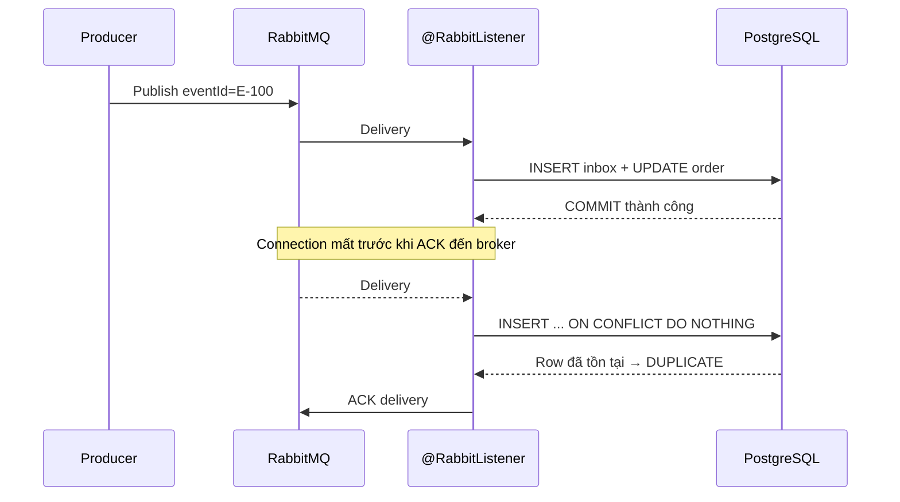
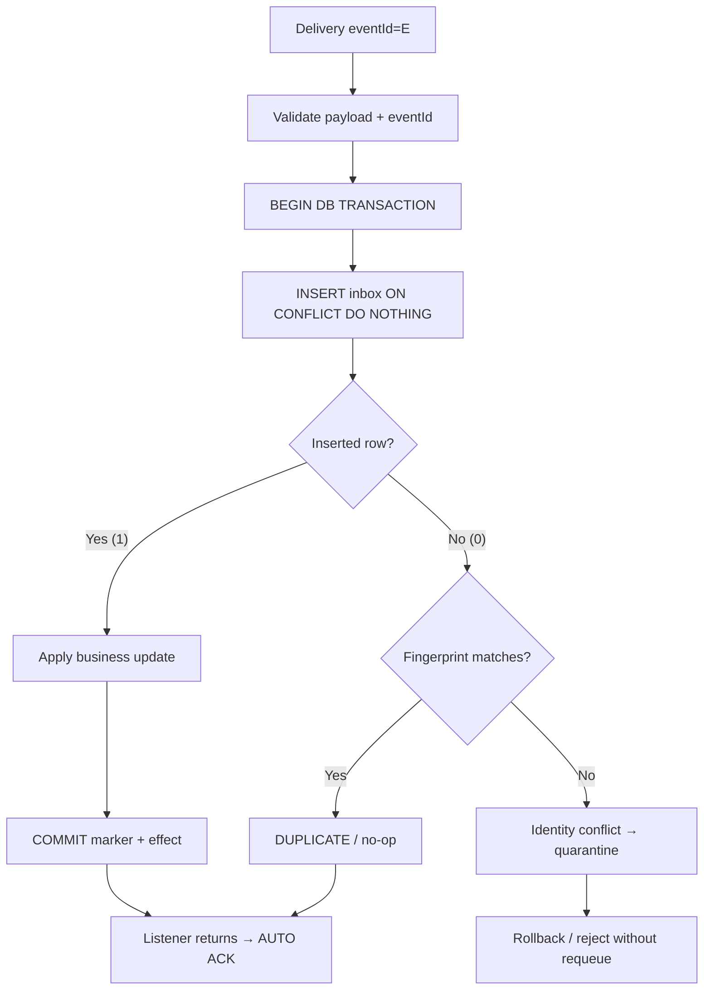

# Triển khai consumer có tính lặp an toàn với inbox hoặc khóa duy nhất

Ứng dụng nhận sự kiện qua `@RabbitListener` thường xử lý một bản ghi rồi cập nhật database. Nhưng cùng một sự kiện có thể xuất hiện **nhiều lần**: producer gửi lại vì không nhận publisher confirm, broker giao lại sau khi consumer mất connection trước ACK, hoặc nhân viên vận hành replay từ dead-letter queue (DLQ). Nếu consumer cộng tiền, trừ tồn kho hay tạo đơn hàng mỗi lần nhận message, chỉ một sự cố mạng cũng có thể dẫn đến **hiệu ứng nghiệp vụ trùng lặp**.

**Idempotent consumer** (consumer có tính lặp an toàn) được thiết kế để xử lý lại **cùng một sự kiện logic** mà không áp dụng **cùng hiệu ứng nghiệp vụ** nhiều lần. Một kỹ thuật hiệu quả với PostgreSQL là dùng **inbox / processed-events table**, đặt ràng buộc duy nhất `(consumer_name, event_id)` và ghi dấu xử lý **trong cùng transaction với business update**. Khi database đã lưu dấu, lần giao lại chỉ xác minh event rồi bỏ qua hiệu ứng đã thực hiện, sau đó ACK bình thường.

Bài thực hành tổng hợp này thuộc module **SPRING_AMQP**, kết hợp `RabbitTemplate`, `@RabbitListener`, exchange, queue, binding, publisher confirms, ACK/NACK, retry, DLQ, JDBC transaction và Testcontainers. Ngoài kỹ thuật inbox, bài còn trình bày **phương án khóa duy nhất ở bảng nghiệp vụ** khi không cần bảng inbox riêng.

> **Phạm vi mã ví dụ:** Java 17+, Spring Boot **3.5.x**, Spring AMQP **3.2.x**, RabbitMQ AMQP **0-9-1** và PostgreSQL 16. Testcontainers **1.21.x** cho integration tests. Với Boot 4.x, starter RabbitMQ và package Testcontainers thay đổi; không trộn các nhánh dependency. Nội dung là bài hướng dẫn triển khai; việc ghi tệp không đồng nghĩa các đoạn code đã được build/chạy trong môi trường dự án.

## 1. Mục tiêu và tiêu chí hoàn thành

Sau bài này, bạn có thể:

1. Phân biệt **delivery**, **event**, **business effect** và **ACK**, giải thích vì sao RabbitMQ thông thường cung cấp *at-least-once processing opportunity* chứ không hứa exactly-once business effect.
2. Thiết kế một **event ID ổn định** qua retry, redelivery, re-publish và replay; biết khi nào `messageId` hoặc `redelivered` không đủ để chống trùng.
3. Tạo bảng `consumer_inbox` với ràng buộc duy nhất `(consumer_name, event_id)` và payload fingerprint để phát hiện dùng lại ID cho dữ liệu khác.
4. Thực hiện `INSERT ... ON CONFLICT DO NOTHING` và cập nhật business state **trong cùng PostgreSQL transaction**.
5. Bật listener `AcknowledgeMode.AUTO` để ACK **sau khi transaction service đã trả về thành công**, không ACK trước khi commit.
6. Viết đầy đủ producer, exchange–queue–binding, listener và DLQ bằng Spring AMQP.
7. Kiểm thử **gửi lặp tuần tự**, **gửi lặp đồng thời**, **rollback** và **eventId trùng nhưng payload khác**.
8. So sánh inbox với dùng khóa duy nhất ở bảng nghiệp vụ; nhận ra giới hạn với HTTP/payment API hoặc publish event thứ hai.
9. Thêm retry, parking lot, outbox và observability mà không phá tính idempotent.
10. Xây checklist vận hành, retention và replay an toàn.

### Tiêu chí chấp nhận của bài thực hành

Giả sử một order có số tiền đã ghi nhận ban đầu bằng 0. Có event thanh toán E-100 với `amountMinor=125000`:

| Tình huống | Message deliveries | Kết quả nghiệp vụ đúng |
| --- | --- | --- |
| Một event lần đầu | 1 | Tổng ghi nhận **125000**, số event áp dụng **1**. |
| Producer publish cùng E-100 hai lần | 2 | Vẫn **125000**, số event áp dụng **1**. |
| Consumer COMMIT rồi mất ACK | 2 hoặc nhiều hơn | Vẫn **125000**. |
| Hai consumers cùng nhận hai bản sao E-100 | Song song | Chỉ **một** transaction áp dụng hiệu ứng. |
| E-100 gửi lại với amount khác | Nhiều lần | **Không** áp dụng event sai; cảnh báo conflict/quarantine. |
| Event lần đầu làm DB transaction rollback | 1 hoặc nhiều | Không tồn tại marker “đã xử lý” từ lần thất bại; retry hợp lệ. |

**Không đặt mục tiêu “listener chỉ được gọi một lần”.** Mục tiêu là **dù listener được gọi nhiều lần, hiệu ứng nghiệp vụ đã commit chỉ xuất hiện một lần theo event ID**.

## 2. Vì sao message bị giao lại dù ứng dụng đã xử lý thành công?

Trong AMQP 0-9-1, broker quản lý **delivery** còn database quản lý **business transaction**. Không có distributed transaction XA tự nhiên bảo đảm cả hai luôn commit đúng một thời điểm.



Những lý do phổ biến:

- **Publisher confirm thất lạc:** broker đã nhận message nhưng producer không nhận confirm, producer gửi lại cùng event.
- **Mất ACK:** consumer đã COMMIT database, nhưng connection bị ngắt trước khi broker nhận ACK.
- **Consumer crash:** message đang unacked được broker tự giao lại sau khi phát hiện connection/channel đóng.
- **Broker/connection recovery:** delivery chưa được settle có thể xuất hiện lại.
- **Operator replay:** message trong DLQ được phát lại để sửa một sự cố cũ.
- **Hai pipeline gửi cùng event:** outbox dispatcher có thể publish lại khi trạng thái `SENT` chưa được ghi.
- **Hệ thống upstream gửi trùng:** cùng giao dịch HTTP được yêu cầu lại hoặc webhook được gửi nhiều lần.

### Những ID nào không thay thế được event ID?

| Giá trị | Vai trò | Có nên làm khóa inbox? |
| --- | --- | --- |
| **`eventId`** trong payload/envelope do producer cấp ổn định | Định danh **sự kiện logic** | **Có**, kết hợp consumer identity. |
| AMQP `messageId` | Metadata do publisher gán; có thể thiếu hoặc đổi khi republish | Chỉ dùng nếu hợp đồng producer đảm bảo nó chính là stable event ID. |
| AMQP `deliveryTag` | Định danh delivery trên một channel cụ thể | **Không**, sẽ khác khi redelivery và giữa channels. |
| AMQP `redelivered` | Gợi ý delivery đã từng được broker giao | **Không**; false không chứng minh chưa có bản sao do producer gửi. |
| Trace ID/span ID | Theo dõi hành trình qua dịch vụ | **Không**; một trace có nhiều events và một event có thể xuất hiện ở nhiều traces. |
| `orderId` | Định danh aggregate/order | Không đủ nếu một order có **nhiều thanh toán** khác nhau. |
| Publisher confirm correlation ID | Theo dõi một publish attempt | **Không**; retry publish thường có correlation mới. |

**Quy ước bài thực hành:** mỗi event có `UUID eventId` không thay đổi khi publish lại cùng sự kiện. `orderId` xác định bản ghi nghiệp vụ, không phải message identity.

## 3. Hai chiến lược idempotency thường dùng

### 3.1 Chiến lược A — bảng inbox riêng

Bảng inbox lưu thông tin **consumer đã áp dụng event nào**, còn bảng domain lưu trạng thái nghiệp vụ:

```text
consumer_inbox
  PK (consumer_name, event_id)
  payload_sha256
  processed_at

payment_orders
  PK order_id
  currency
  applied_amount_minor
  payment_events_applied
```

Trong cùng một DB transaction:

1. Thử **claim event** bằng `INSERT inbox ... ON CONFLICT DO NOTHING`.
2. Nếu insert thành công (1 row), thực hiện business update.
3. Nếu conflict (0 row), xác minh fingerprint rồi return `DUPLICATE`.
4. COMMIT cả inbox marker và business effect, hoặc rollback cả hai.

Đây là lựa chọn tốt khi một consumer có nhiều side effects **trong cùng database** hoặc nhiều bảng cần cập nhật đồng bộ.

### 3.2 Chiến lược B — khóa duy nhất ngay bảng nghiệp vụ

Nếu nghiệp vụ vốn tạo một bản ghi có **natural unique key**:

```sql
CREATE TABLE payment_credits (
    event_id UUID PRIMARY KEY,
    order_id UUID NOT NULL,
    amount_minor BIGINT NOT NULL,
    currency CHAR(3) NOT NULL,
    recorded_at TIMESTAMPTZ NOT NULL DEFAULT now()
);
```

Khi một event chỉ cần tạo một dòng credit, có thể `INSERT ... ON CONFLICT DO NOTHING` ngay bảng `payment_credits`. Không cần bảng inbox thứ hai **nếu** ràng buộc unique đủ để bảo vệ mọi effect liên quan.

Nếu đồng thời cập nhật `payment_orders.applied_amount_minor`, vẫn phải đặt **insert credit + update order trong cùng transaction**, tránh ghi order hai lần khi insert credit bị conflict.

| Tiêu chí | Inbox riêng | Unique key ở bảng nghiệp vụ |
| --- | --- | --- |
| Marker xử lý | Tách khỏi domain | Chính row domain đã là marker |
| Phù hợp | Nhiều bảng/domain effects, consumer độc lập | Một record nghiệp vụ có khóa tự nhiên rõ |
| Key | `(consumer_name, event_id)` | Thường `event_id`, `external_transaction_id` hoặc unique business key |
| Số bảng cần quản lý | Thêm inbox | Có thể không thêm bảng mới |
| Quan sát/retention | Chủ động theo từng consumer | Phụ thuộc retention của domain record |
| Consumer mới | Mỗi consumer có namespace riêng | Cần xem một domain row có được dùng chung không |
| Rủi ro | Marker ghi sai transaction → mất xử lý | Chọn nhầm unique key → bỏ qua event hợp lệ |
| Với external API side effect | Chưa đủ, phải thêm outbox/idempotency từ đích | Cũng chưa đủ |

**Bài chính dùng Inbox A**, sau đó thực hành Chiến lược B riêng.

## 4. Bất biến quan trọng hơn API

Đặt tên consumer logic là `payment-ledger:v1`. Invariant:

> Với mỗi cặp `(consumer_name, event_id)`, có **tối đa một business effect được COMMIT**; nếu event đã được ghi nhận, message tương đương chỉ được ACK/no-op. Nếu cùng ID mà nội dung thay đổi, không được coi là duplicate hợp lệ.

Điều này yêu cầu:

- **Unique constraint do database thực thi**, không chỉ tra `SELECT` trước khi xử lý.
- Inbox insert và business updates **trong cùng transaction**.
- **Transaction rollback** khi bất kỳ business update bắt buộc nào thất bại.
- ACK/return success **sau khi transaction service commit**.
- Cùng consumer identity ổn định qua replicas/restarts; đừng ghép consumer name với hostname hay random instance ID.
- Event ID ổn định qua publish retry/replay; không tự tạo ID mới ở listener.
- Dữ liệu trùng nhưng khác ý nghĩa phải được phân loại là **identity collision**, không bị âm thầm bỏ qua.



**Không lưu một marker `PROCESSED` trước khi chạy nghiệp vụ ở transaction khác.** Nếu app crash giữa hai bước, lần giao lại thấy marker và bỏ qua effect chưa từng được thực hiện. Đây là anti-pattern phổ biến.

## 5. Cấu trúc dự án minh họa

Ta dùng Spring Boot 3.5 / Spring AMQP 3.2 cùng PostgreSQL và RabbitMQ.

```text
src/main/java/com/example/ledger/
  LedgerApplication.java
  LedgerTopology.java
  PaymentSettledEvent.java
  PaymentPublisher.java
  LedgerInboxService.java
  LedgerListener.java
  Sha256.java

src/test/java/com/example/ledger/
  LedgerRabbitIntegrationTest.java

src/test/resources/
  application-test.yml
  schema.sql

build.gradle
```

Các đoạn code ở dưới mô tả **nội dung cho các tệp trong một project mẫu**. Trong quy trình bài học này, ta không tạo các tệp Java/SQL bên ngoài Markdown; người học tự đưa code vào project thực hành.

### 5.1 Gradle dependencies

```gradle
dependencies {
    implementation("org.springframework.boot:spring-boot-starter-amqp")
    implementation("org.springframework.boot:spring-boot-starter-jdbc")
    implementation("org.springframework.boot:spring-boot-starter-json")
    runtimeOnly("org.postgresql:postgresql")

    testImplementation("org.springframework.boot:spring-boot-starter-test")
    testImplementation("org.springframework.boot:spring-boot-testcontainers")
    testImplementation("org.testcontainers:rabbitmq")
    testImplementation("org.testcontainers:postgresql")
    testImplementation("org.testcontainers:junit-jupiter")
    testImplementation("org.awaitility:awaitility")
}

tasks.named("test") {
    useJUnitPlatform()
}
```

- Spring Boot 3.5 BOM quản lý dependency version tương thích của Spring AMQP và Testcontainers 1.x.
- `spring-boot-starter-jdbc` tạo `JdbcTemplate`/transaction manager khi có DataSource.
- `spring-boot-starter-json` cung cấp Jackson/`ObjectMapper` để serialize JSON rõ ràng.
- `spring-boot-testcontainers` giúp `@ServiceConnection` đưa connection details của RabbitMQ và PostgreSQL vào Boot context.
- Không dùng H2 để thay PostgreSQL trong bài có `ON CONFLICT DO NOTHING` và unique/concurrency semantics cụ thể.

**Spring Boot 4.x khác:** starter AMQP 0-9-1 được đổi thành `spring-boot-starter-rabbitmq`; Testcontainers 2.x chuyển RabbitMQContainer tới `org.testcontainers.rabbitmq.RabbitMQContainer` với artifact `org.testcontainers:testcontainers-rabbitmq`. Không trộn imports của nhánh đó với dependencies 1.x ở trên.

### 5.2 Spring Boot application

```java
package com.example.ledger;

import org.springframework.boot.SpringApplication;
import org.springframework.boot.autoconfigure.SpringBootApplication;

@SpringBootApplication
public class LedgerApplication {
    public static void main(String[] args) {
        SpringApplication.run(LedgerApplication.class, args);
    }
}
```

Đặt các class bên dưới cùng package `com.example.ledger` (hoặc package con) để component scan/auto-configuration nhận đúng.

## 6. Khai báo exchange, work queue, binding và DLQ

Một work queue durable có DLX để lưu message lỗi cuối cùng. Đường DLQ này **không tự retry**, chỉ cách ly để kiểm tra và replay có kiểm soát.

```java
package com.example.ledger;

import org.springframework.amqp.core.Binding;
import org.springframework.amqp.core.BindingBuilder;
import org.springframework.amqp.core.DirectExchange;
import org.springframework.amqp.core.Queue;
import org.springframework.amqp.core.QueueBuilder;
import org.springframework.beans.factory.annotation.Qualifier;
import org.springframework.context.annotation.Bean;
import org.springframework.context.annotation.Configuration;

@Configuration
public class LedgerTopology {
    public static final String WORK_X = "demo.ledger.events.x";
    public static final String WORK_KEY = "payment.settled";
    public static final String WORK_Q = "demo.ledger.work.q";

    public static final String DLX = "demo.ledger.dead.x";
    public static final String DL_KEY = "payment.failed";
    public static final String DLQ = "demo.ledger.dead.q";

    @Bean
    DirectExchange ledgerWorkExchange() {
        return new DirectExchange(WORK_X);
    }

    @Bean
    DirectExchange ledgerDeadExchange() {
        return new DirectExchange(DLX);
    }

    @Bean
    Queue ledgerWorkQueue() {
        return QueueBuilder.durable(WORK_Q)
                .deadLetterExchange(DLX)
                .deadLetterRoutingKey(DL_KEY)
                .build();
    }

    @Bean
    Queue ledgerDeadQueue() {
        return QueueBuilder.durable(DLQ).build();
    }

    @Bean
    Binding ledgerWorkBinding(
            @Qualifier("ledgerWorkQueue") Queue queue,
            @Qualifier("ledgerWorkExchange") DirectExchange exchange) {
        return BindingBuilder.bind(queue)
                .to(exchange).with(WORK_KEY);
    }

    @Bean
    Binding ledgerDeadBinding(
            @Qualifier("ledgerDeadQueue") Queue queue,
            @Qualifier("ledgerDeadExchange") DirectExchange exchange) {
        return BindingBuilder.bind(queue)
                .to(exchange).with(DL_KEY);
    }
}
```

Nếu `RabbitAdmin` được Spring Boot cấu hình theo mặc định, các `@Bean` queue/exchange/binding có thể được declare khi app kết nối broker. Trong production, hãy quản lý topology bằng migration/IaC/policy theo tổ chức. Không redeclare một queue đã tồn tại với arguments khác để tự “nâng cấp” mà không có kế hoạch migration.

**Phân biệt:** queue durable và message persistent giúp broker giữ reference/message qua restart, nhưng **không thay thế publisher confirms** và càng không bảo đảm consumer đúng một lần.

### 6.1 application-test.yml

```yaml
spring:
  rabbitmq:
    publisher-confirm-type: correlated
    publisher-returns: true
    template:
      mandatory: true
    listener:
      type: simple
      simple:
        acknowledge-mode: auto
        concurrency: 2
        prefetch: 8
        default-requeue-rejected: false
        retry:
          enabled: false
  sql:
    init:
      mode: always

logging:
  level:
    com.example.ledger: INFO
```

Ở phần thực hành cơ bản, **chưa bật retry** để mỗi exception có kết quả dễ quan sát: lỗi thoát khỏi listener sẽ bị reject không requeue và đi DLQ. Sau khi test idempotency đạt, mục 15 hướng dẫn bật retry có giới hạn cho lỗi transient.

- `AUTO` của Spring listener container là **ACK khi listener hoàn tất bình thường**, không phải AMQP broker no-ack.
- `default-requeue-rejected=false` tránh lỗi poison requeue nóng vô hạn.
- `concurrency=2` cho phép hai consumers nhận **hai bản sao cùng event ID** song song; unique constraint chịu trách nhiệm chống race.
- `prefetch=8` điều tiết số delivery unacked mỗi consumer; không phải số lần retry.
- `spring.sql.init.mode=always` để chạy `schema.sql` cho **PostgreSQL container trong test**. Trong production dùng Flyway/Liquibase hoặc migration chuẩn thay vì tự bật khởi tạo schema mỗi lần deploy.

**Không** đặt địa chỉ RabbitMQ/PostgreSQL cố định trong file test: `@ServiceConnection` sẽ cấp host, port, credentials động.

## 7. PostgreSQL schema: unique constraint thực sự bảo vệ event

Đặt SQL minh họa trong `src/test/resources/schema.sql` của project thực hành:

```sql
CREATE TABLE payment_orders (
    order_id UUID PRIMARY KEY,
    currency VARCHAR(3) NOT NULL,
    applied_amount_minor BIGINT NOT NULL DEFAULT 0,
    payment_events_applied INTEGER NOT NULL DEFAULT 0,
    CHECK (applied_amount_minor >= 0),
    CHECK (payment_events_applied >= 0)
);

CREATE TABLE consumer_inbox (
    consumer_name VARCHAR(100) NOT NULL,
    event_id UUID NOT NULL,
    payload_sha256 CHAR(64) NOT NULL,
    processed_at TIMESTAMPTZ NOT NULL DEFAULT now(),

    PRIMARY KEY (consumer_name, event_id)
);

CREATE INDEX consumer_inbox_processed_at_idx
    ON consumer_inbox (processed_at);
```

Giải thích các lựa chọn:

- **`consumer_name`** là **consumer logic**, ví dụ `payment-ledger:v1`, không phải instance hostname/thread name; các replica cùng chức năng dùng chung giá trị.
- **`event_id`** do producer tạo một lần cho một sự kiện logic. Unique trên **cặp** `(consumer_name, event_id)` giúp consumer A xử lý event mà không làm consumer B bị skip.
- **`payload_sha256`** là fingerprint của body được nhận, để phát hiện producer vô tình dùng một event ID cho payload khác.
- **`processed_at`** chỉ để vận hành/retention; nó không được dùng làm khóa idempotency.
- **`payment_orders.applied_amount_minor`** là hiệu ứng cộng tiền minh họa. Thực tế cần domain rules về thanh toán, hoàn tiền và currency.

> Quan trọng: nếu tạo cùng một event ID nhưng body JSON được serialize khác byte-for-byte (ví dụ thứ tự field, whitespace), SHA-256 trên **raw bytes** có thể khác dù dữ liệu semantically tương đương. Bài học chọn contract **same event → same serialized bytes**. Khi nhiều producer serializer không đồng nhất, hãy chuẩn hóa canonical serialization hoặc tính fingerprint trên các trường nghiệp vụ chuẩn hóa.

**Ràng buộc unique phải ở database**, không phải chỉ một `HashSet` của JVM. Consumer có thể được restart, scale thành 10 replicas hoặc cùng lúc nhận hai bản sao; memory cache không cung cấp đảm bảo liên máy và không bền vững qua crash.

## 8. Event model, checksum và producer

### 8.1 Event record

Trong `PaymentSettledEvent.java`:

```java
package com.example.ledger;

import java.util.UUID;

public record PaymentSettledEvent(
        UUID eventId,
        UUID orderId,
        long amountMinor,
        String currency) {
}
```

**Ví dụ:** `amountMinor=125000` là số tiền theo đơn vị nhỏ nhất của đồng tiền đã chọn. Đây là số nguyên để tránh sai số floating point; domain thật phải định nghĩa chính xác đơn vị với từng currency.

### 8.2 SHA-256 trên bytes

Trong `Sha256.java`:

```java
package com.example.ledger;

import java.security.MessageDigest;
import java.security.NoSuchAlgorithmException;
import java.util.HexFormat;

public final class Sha256 {
    private Sha256() {}

    public static String hex(byte[] data) {
        try {
            return HexFormat.of().formatHex(
                    MessageDigest.getInstance("SHA-256").digest(data));
        }
        catch (NoSuchAlgorithmException ex) {
            throw new IllegalStateException("SHA-256 unavailable", ex);
        }
    }
}
```

Hash ở đây là **công cụ phát hiện event ID bị dùng lại sai payload**, không phải chữ ký xác thực producer. Nếu attacker có quyền thay cả payload và hash, cần authentication/authorization, signing hoặc bảo vệ đường truyền riêng.

### 8.3 Publisher giữ eventId ổn định và chờ confirm

Trong `PaymentPublisher.java`:

```java
package com.example.ledger;

import java.nio.charset.StandardCharsets;
import java.util.UUID;
import java.util.concurrent.TimeUnit;

import com.fasterxml.jackson.databind.ObjectMapper;
import org.springframework.amqp.core.MessageDeliveryMode;
import org.springframework.amqp.rabbit.connection.CorrelationData;
import org.springframework.amqp.rabbit.core.RabbitTemplate;
import org.springframework.stereotype.Service;

@Service
public class PaymentPublisher {
    private final RabbitTemplate rabbit;
    private final ObjectMapper mapper;

    public PaymentPublisher(RabbitTemplate rabbit, ObjectMapper mapper) {
        this.rabbit = rabbit;
        this.mapper = mapper;
    }

    public void publish(PaymentSettledEvent event) throws Exception {
        if (event.eventId() == null) {
            throw new IllegalArgumentException("Missing eventId");
        }

        String json = mapper.writeValueAsString(event);
        CorrelationData cd =
                new CorrelationData(UUID.randomUUID().toString());

        rabbit.convertAndSend(
            LedgerTopology.WORK_X,
            LedgerTopology.WORK_KEY,
            json,
            message -> {
                var properties = message.getMessageProperties();
                properties.setMessageId(event.eventId().toString());
                properties.setContentType("text/plain");
                properties.setContentEncoding(
                    StandardCharsets.UTF_8.name());
                properties.setDeliveryMode(MessageDeliveryMode.PERSISTENT);
                return message;
            },
            cd
        );

        var confirm = cd.getFuture().get(10, TimeUnit.SECONDS);

        if (!confirm.isAck()) {
            throw new IllegalStateException(
                    "Publisher NACK: " + confirm.getReason());
        }
        if (cd.getReturned() != null) {
            throw new IllegalStateException(
                    "Unroutable payment event");
        }
    }
}
```

Với `SimpleMessageConverter` mặc định, publish **String JSON** dùng AMQP content type `text/plain`; listener ở mục sau nhận **raw `org.springframework.amqp.core.Message`** rồi tự Jackson decode. **Trường dữ liệu JSON bên trong body không đòi AMQP header `application/json`** nếu hai bên có contract như vậy. Nếu muốn converter tự biến JSON thành DTO, cần đồng nhất converter ở cả hai phía.

Cấu hình correlated confirms + returns + mandatory ở mục 6 là điều kiện để kiểm tra publish như ví dụ. **Publisher confirm ACK khác consumer ACK**: confirm nói broker đã nhận trách nhiệm publish theo semantics của nó, không nói database của consumer đã commit.

**Rất quan trọng:** khi `getFuture().get(10s)` timeout, kết quả publish là **không chắc chắn**. Broker có thể đã nhận nhưng confirm mất. Để retry, giữ **cùng eventId và cùng payload JSON** từ durable outbox; correlation ID của lần gửi mới có thể khác. Không tạo event ID mới chỉ vì timeout.

**Hiệu năng:** publisher chờ confirm từng message trong ví dụ để dễ học. Production nên dùng asynchronous confirm/outbox dispatcher với số in-flight hữu hạn.

## 9. Giao diện xử lý idempotent bằng @Transactional

Ta đặt transaction trên **một Spring bean riêng**, không viết toàn bộ SQL trực tiếp trong `@RabbitListener`. Điều này giúp:

- Spring AOP proxy gọi method `@Transactional` thật sự (không mắc lỗi self-invocation).
- Database transaction có thể **commit/rollback** trước khi control trở lại listener.
- Code có thể kiểm thử logic inbox mà **không cần broker**.
- Ranh giới nghiệp vụ được tách khỏi retry/ACK/AMQP routing.

### 9.1 ProcessingOutcome và ngoại lệ conflict

Trong hai tệp Java riêng:

```java
package com.example.ledger;

public enum ProcessingOutcome {
    APPLIED,
    DUPLICATE
}
```

```java
package com.example.ledger;

public class EventIdentityConflict extends RuntimeException {
    public EventIdentityConflict(String message) {
        super(message);
    }
}
```

`APPLIED` nghĩa là transaction **của lần xử lý này** ghi effect mới; `DUPLICATE` nghĩa là cùng event đã được xử lý trước đó, không làm lại effect. Một duplicate bình thường **không phải exception**, nên không cần DLQ.

### 9.2 LedgerInboxService: insert trước, effect sau, cùng transaction

Trong `LedgerInboxService.java`:

```java
package com.example.ledger;

import org.springframework.jdbc.core.JdbcTemplate;
import org.springframework.stereotype.Service;
import org.springframework.transaction.annotation.Transactional;

@Service
public class LedgerInboxService {
    private static final String CONSUMER = "payment-ledger:v1";

    private final JdbcTemplate jdbc;

    public LedgerInboxService(JdbcTemplate jdbc) {
        this.jdbc = jdbc;
    }

    @Transactional
    public ProcessingOutcome applyOnce(
            PaymentSettledEvent event, String payloadHash) {

        int claimed = jdbc.update(
            """
            INSERT INTO consumer_inbox (
                consumer_name, event_id, payload_sha256
            ) VALUES (?, ?, ?)
            ON CONFLICT (consumer_name, event_id) DO NOTHING
            """,
            CONSUMER, event.eventId(), payloadHash
        );

        if (claimed == 0) {
            String oldHash = jdbc.queryForObject(
                """
                SELECT payload_sha256
                FROM consumer_inbox
                WHERE consumer_name = ? AND event_id = ?
                """,
                String.class, CONSUMER, event.eventId()
            );

            if (oldHash == null
                    || !payloadHash.equalsIgnoreCase(oldHash.trim())) {
                throw new EventIdentityConflict(
                    "Same eventId but different payload: "
                    + event.eventId());
            }
            return ProcessingOutcome.DUPLICATE;
        }

        int changed = jdbc.update(
            """
            UPDATE payment_orders
            SET applied_amount_minor = applied_amount_minor + ?,
                payment_events_applied = payment_events_applied + 1
            WHERE order_id = ? AND currency = ?
            """,
            event.amountMinor(), event.orderId(), event.currency()
        );

        if (changed != 1) {
            throw new IllegalStateException(
                    "Order missing or currency mismatch: "
                    + event.orderId());
        }

        return ProcessingOutcome.APPLIED;
        // @Transactional COMMIT ở cuối lời gọi qua Spring proxy.
    }
}
```

**Điểm cốt lõi** là thứ tự:

```text
BEGIN TRANSACTION
  INSERT inbox marker ON CONFLICT DO NOTHING
  if inserted = 1:
      UPDATE business state
  else:
      validate existing fingerprint; no-op
COMMIT hoặc ROLLBACK tất cả
```

Nếu `UPDATE payment_orders` thất bại, exception làm **rollback cả dòng inbox mới**. Lần giao lại còn quyền thử lại khi dữ liệu/điều kiện đã được sửa.

Nếu DB crash sau COMMIT nhưng trước RabbitMQ ACK, dòng inbox vẫn tồn tại và lần giao lại trả `DUPLICATE` — business total không được cộng lần nữa.

### 9.3 Vì sao cách này chống được hai consumer cùng lúc?

Hai bản sao có cùng `(CONSUMER, eventId)` chạy trên hai PostgreSQL transactions:

1. Transaction A thử insert inbox, có unique key.
2. Transaction B thử insert đúng key; PostgreSQL unique index ngăn hai transaction cùng commit hai row.
3. Nếu A **COMMIT**, B thấy conflict và `claimed=0`; B không cập nhật business state.
4. Nếu A **ROLLBACK**, B có thể insert thành công và cập nhật nghiệp vụ.
5. Nếu một transaction timeout/deadlock, Spring transaction rollback; retry có giới hạn sẽ thử lại nguyên event.

Không cần synchronized Java hoặc distributed Redis lock để bảo đảm invariant này, miễn **mọi writer business effect đi qua cùng database constraint và transaction**.

> PostgreSQL `INSERT ... ON CONFLICT DO NOTHING` có thể chờ transaction cạnh tranh tại unique index. **Đừng đặt isolation, lock timeout, connection pool quá thấp** rồi hiểu lỗi transaction timeout là duplicate thành công. Lỗi database phải được rollback và xử lý theo retry policy.

### 9.4 Cái gì chưa được bảo vệ?

Method này chỉ bảo vệ các effect **trong PostgreSQL transaction**. Nếu trong `applyOnce` bạn gọi payment API bên ngoài sau khi insert marker, DB transaction **không rollback cuộc gọi HTTP**. Nếu gọi API trước khi ghi marker, hai consumer có thể cùng gọi API. Đó là bài toán khác: cần **idempotency key được đích chấp nhận, transactional outbox hoặc một workflow state machine có recovery**.

## 10. @RabbitListener: parse, validate, transaction, ACK

Trong `LedgerListener.java`:

```java
package com.example.ledger;

import java.io.IOException;
import java.util.Set;

import com.fasterxml.jackson.databind.ObjectMapper;
import org.slf4j.Logger;
import org.slf4j.LoggerFactory;
import org.springframework.amqp.AmqpRejectAndDontRequeueException;
import org.springframework.amqp.core.Message;
import org.springframework.amqp.rabbit.annotation.RabbitListener;
import org.springframework.stereotype.Component;

@Component
public class LedgerListener {
    private static final Logger log =
            LoggerFactory.getLogger(LedgerListener.class);

    private final ObjectMapper mapper;
    private final LedgerInboxService inbox;

    public LedgerListener(
            ObjectMapper mapper,
            LedgerInboxService inbox) {
        this.mapper = mapper;
        this.inbox = inbox;
    }

    @RabbitListener(
        id = "payment-ledger-listener",
        queues = LedgerTopology.WORK_Q)
    public void receive(Message message) {
        PaymentSettledEvent event;

        try {
            event = mapper.readValue(
                message.getBody(), PaymentSettledEvent.class);
            validate(event);
        }
        catch (IOException | IllegalArgumentException ex) {
            throw new AmqpRejectAndDontRequeueException(
                    "Malformed payment event", ex);
        }

        String checksum = Sha256.hex(message.getBody());

        try {
            ProcessingOutcome outcome =
                    inbox.applyOnce(event, checksum);

            log.info("payment event={} outcome={} redelivered={}",
                event.eventId(), outcome,
                message.getMessageProperties().isRedelivered());
        }
        catch (EventIdentityConflict ex) {
            // Không coi cùng ID khác payload là duplicate hợp lệ.
            throw new AmqpRejectAndDontRequeueException(
                    "Event identity collision", ex);
        }
        // AUTO ACK sau khi listener return bình thường.
        // Transaction của inbox.applyOnce đã hoàn tất trước đó.
    }

    private void validate(PaymentSettledEvent e) {
        if (e == null
                || e.eventId() == null
                || e.orderId() == null
                || e.amountMinor() <= 0
                || e.amountMinor() > 10_000_000_000L
                || e.currency() == null
                || !Set.of("VND", "USD").contains(e.currency())) {
            throw new IllegalArgumentException("Invalid payment payload");
        }
    }
}
```

**Giải thích dòng ACK:** Với `AcknowledgeMode.AUTO`, Spring AMQP listener container ACK khi method return bình thường. Vì `inbox.applyOnce(...)` là một bean khác có `@Transactional`, transaction đã commit trước khi trả về listener. Nếu service throw, listener không return thành công và container xử lý reject/requeue theo policy.

Một số điều kiện:

- Nếu schema sai hoặc ID bị dùng lại cho body khác, listener ném `AmqpRejectAndDontRequeueException` → reject không requeue; work queue có DLX nên broker chuyển sang DLQ.
- Nếu PostgreSQL lỗi, `applyOnce` rollback. Với config test đang dùng `default-requeue-rejected=false` và retry disabled, message sẽ vào DLQ; phần sau trình bày retry bounded cho lỗi transient.
- Nếu service đã trả `DUPLICATE`, listener **return bình thường** để ACK bản delivery hiện tại.
- `isRedelivered()` chỉ phục vụ log/diagnostic, **không quyết định xử lý trùng**.
- Mặc định **không dùng `AcknowledgeMode.NONE`**, vì broker sẽ xem delivery là accepted trước khi biết DB commit.

**Tránh nhầm:** Code `@Transactional` trên service **không khiến RabbitMQ ACK và PostgreSQL COMMIT là một giao dịch phân tán**. Vẫn tồn tại cửa sổ DB COMMIT → ACK mất; chính inbox giải quyết duplicate effect trong cửa sổ này.


## 11. Integration test: RabbitMQ + PostgreSQL thật bằng Testcontainers

Ta cần chứng minh **hai lớp khác nhau**:

- **Lớp transport:** hai bản sao event thực sự được publish qua exchange, route đến queue và listener **được gọi hai lần**.
- **Lớp database:** mặc dù có hai lời gọi, chỉ **một** inbox marker và **một** business effect được commit.

Nếu test chỉ publish hai message rồi chờ `applied_amount_minor=125000`, nó có thể **pass giả** khi chỉ bản sao đầu tiên đã xử lý, còn bản sao thứ hai chưa được giao. Vì vậy bài dùng `RabbitListenerTestHarness` của Spring AMQP để chờ **hai lời gọi listener hoàn tất**, sau đó mới assert DB state.

### 11.1 Thêm dependency test harness

Trong khối `dependencies { ... }` của mục 5, thêm:

```gradle
testImplementation("org.springframework.amqp:spring-rabbit-test")
```

`spring-rabbit-test` cung cấp `@RabbitListenerTest` và `RabbitListenerTestHarness`. Chúng **không** thay RabbitMQ: ở đây harness chỉ đo lời gọi listener; message vẫn đi qua **RabbitMQContainer thật**.

### 11.2 Test class với hai containers và @ServiceConnection

Đặt tại `src/test/java/com/example/ledger/LedgerRabbitIntegrationTest.java`:

```java
package com.example.ledger;

import java.time.Duration;
import java.util.UUID;
import java.util.concurrent.TimeUnit;

import com.fasterxml.jackson.databind.ObjectMapper;
import org.junit.jupiter.api.Test;
import org.springframework.amqp.core.Message;
import org.springframework.amqp.rabbit.core.RabbitTemplate;
import org.springframework.amqp.rabbit.test.RabbitListenerTest;
import org.springframework.amqp.rabbit.test.RabbitListenerTestHarness;
import org.springframework.beans.factory.annotation.Autowired;
import org.springframework.boot.test.context.SpringBootTest;
import org.springframework.boot.test.context.TestConfiguration;
import org.springframework.boot.testcontainers.service.connection.ServiceConnection;
import org.springframework.context.annotation.Import;
import org.springframework.jdbc.core.JdbcTemplate;
import org.springframework.test.context.ActiveProfiles;
import org.testcontainers.containers.PostgreSQLContainer;
import org.testcontainers.containers.RabbitMQContainer;
import org.testcontainers.junit.jupiter.Container;
import org.testcontainers.junit.jupiter.Testcontainers;

import static org.assertj.core.api.Assertions.assertThat;

@SpringBootTest(classes = LedgerApplication.class)
@ActiveProfiles("test")
@Testcontainers
@Import(LedgerRabbitIntegrationTest.HarnessConfig.class)
class LedgerRabbitIntegrationTest {

    @Container
    @ServiceConnection
    static final RabbitMQContainer rabbit =
        new RabbitMQContainer("rabbitmq:4.1-management");

    @Container
    @ServiceConnection
    static final PostgreSQLContainer<?> postgres =
        new PostgreSQLContainer<>("postgres:16-alpine");

    @TestConfiguration(proxyBeanMethods = false)
    @RabbitListenerTest(spy = false, capture = true)
    static class HarnessConfig {
        // Thay annotation processor để capture lời gọi listener.
    }

    @Autowired PaymentPublisher publisher;
    @Autowired RabbitTemplate rabbitTemplate;
    @Autowired LedgerInboxService inbox;
    @Autowired RabbitListenerTestHarness harness;
    @Autowired JdbcTemplate jdbc;
    @Autowired ObjectMapper mapper;

    @Test
    void duplicateDeliveriesApplyBusinessEffectOnce() throws Exception {
        UUID orderId = UUID.randomUUID();
        UUID eventId = UUID.randomUUID();

        jdbc.update(
            """
            INSERT INTO payment_orders(order_id, currency)
            VALUES (?, ?)
            """,
            orderId, "VND"
        );

        var event = new PaymentSettledEvent(
                eventId, orderId, 125_000L, "VND");

        // Hai lần publish giống hệt cùng một logical event.
        publisher.publish(event);
        publisher.publish(event);

        // Đợi cả hai listener invocations hoàn thành.
        for (int i = 0; i < 2; i++) {
            var call = harness.getNextInvocationDataFor(
                "payment-ledger-listener", 15, TimeUnit.SECONDS);

            assertThat(call)
                .as("Two actual listener calls must complete")
                .isNotNull();
            assertThat(call.getThrowable()).isNull();

            Message delivered = (Message) call.getArguments()[0];
            var decoded = mapper.readValue(
                delivered.getBody(), PaymentSettledEvent.class);
            assertThat(decoded.eventId()).isEqualTo(eventId);
        }

        Long amount = jdbc.queryForObject(
            """
            SELECT applied_amount_minor
            FROM payment_orders WHERE order_id = ?
            """,
            Long.class, orderId
        );
        Integer appliedCount = jdbc.queryForObject(
            """
            SELECT payment_events_applied
            FROM payment_orders WHERE order_id = ?
            """,
            Integer.class, orderId
        );
        Integer inboxCount = jdbc.queryForObject(
            """
            SELECT count(*)
            FROM consumer_inbox
            WHERE consumer_name = ? AND event_id = ?
            """,
            Integer.class, "payment-ledger:v1", eventId
        );

        assertThat(amount).isEqualTo(125_000L);
        assertThat(appliedCount).isEqualTo(1);
        assertThat(inboxCount).isEqualTo(1);
    }
}
```

**Tại sao cách này không pass giả vì delivery thứ hai chưa chạy?** `getNextInvocationDataFor(...)` đợi một invocation của method đã instrument **hoàn tất hoặc throw**; loop hai lần xác minh cả hai đều chạy với **cùng eventId**, rồi mới kiểm tra database.

Hãy dùng queue riêng cho suite và chạy các test phụ thuộc cùng queue tuần tự, tránh message của một test khác bị harness lấy nhầm. Nếu mở rộng nhiều test cases với cùng harness, kiểm tra eventId trong dữ liệu capture và có cơ chế bỏ qua các sự kiện không thuộc test hiện tại.

**Lifecycle Testcontainers:** `@Container` trên field static giữ container trong một test class. Nếu Spring TestContext cache `ApplicationContext` qua nhiều test class nhưng JUnit đã dừng container trước đó, context có thể trỏ tới broker/DB đã dừng. Với suite lớn, cân nhắc Spring-managed `@Bean @ServiceConnection` container để lifecycle gắn với context, hoặc cô lập các test contexts có chủ đích.

**Tại sao không dùng `@Transactional` trên JUnit test method?** Transaction của JUnit test chạy trên **JUnit thread**; listener chạy trên consumer thread khác và sẽ không tham gia transaction chưa commit của JUnit. Khi đó bản `payment_orders` vừa insert trong test có thể **chưa visible** cho listener, làm test fail khó hiểu. Ví dụ cố ý không đặt `@Transactional` trên test method; `jdbc.update(...)` seed được commit trước publish.

### 11.3 Test concurrent duplicates ở tầng database

Bài test trên kiểm tra message đi qua broker. Bây giờ **tấn công trực tiếp vào unique constraint** bằng 8 threads để chứng minh database transaction bảo vệ race. Phương thức test dưới đây có thể thêm vào cùng class:

```java
@Test
void concurrentClaimsAllowExactlyOneBusinessUpdate()
        throws Exception {

    UUID orderId = UUID.randomUUID();
    UUID eventId = UUID.randomUUID();
    jdbc.update(
        "INSERT INTO payment_orders(order_id, currency) VALUES (?, ?)",
        orderId, "VND"
    );

    var event = new PaymentSettledEvent(
            eventId, orderId, 77_000L, "VND");
    String fingerprint = Sha256.hex(
            mapper.writeValueAsBytes(event));

    int workers = 8;
    var executor = java.util.concurrent.Executors
            .newFixedThreadPool(workers);
    var start = new java.util.concurrent.CountDownLatch(1);
    var futures = new java.util.ArrayList<
            java.util.concurrent.Future<ProcessingOutcome>>();

    try {
        for (int i = 0; i < workers; i++) {
            futures.add(executor.submit(() -> {
                start.await();
                return inbox.applyOnce(event, fingerprint);
            }));
        }

        start.countDown();

        int applied = 0;
        int duplicate = 0;
        for (var future : futures) {
            ProcessingOutcome outcome =
                future.get(20, TimeUnit.SECONDS);
            if (outcome == ProcessingOutcome.APPLIED) {
                applied++;
            }
            else if (outcome == ProcessingOutcome.DUPLICATE) {
                duplicate++;
            }
        }

        assertThat(applied).isEqualTo(1);
        assertThat(duplicate).isEqualTo(workers - 1);

        Long amount = jdbc.queryForObject(
            """
            SELECT applied_amount_minor
            FROM payment_orders WHERE order_id = ?
            """,
            Long.class, orderId
        );
        Integer count = jdbc.queryForObject(
            """
            SELECT payment_events_applied
            FROM payment_orders WHERE order_id = ?
            """,
            Integer.class, orderId
        );

        assertThat(amount).isEqualTo(77_000L);
        assertThat(count).isEqualTo(1);
    }
    finally {
        executor.shutdownNow();
    }
}
```

**Giải thích:** dù cả 8 threads cùng thử insert một khóa inbox, PostgreSQL unique constraint chỉ cho phép **một** transaction claim thành công; các transaction còn lại thấy `ON CONFLICT DO NOTHING` và trả DUPLICATE sau khi transaction thắng commit.

Trong môi trường tải lớn, connection pool có thể giới hạn số thao tác DB đồng thời, nên test còn có thể chịu chờ pool. Chọn timeout và Hikari pool phù hợp với số workers, không coi timeout là lỗi inbox logic nếu DB đã cạn connections.

### 11.4 Test rollback không để lại marker “ma”

Bổ sung một test method khác:

```java
@Test
void failedBusinessUpdateRollsBackInboxMarker()
        throws Exception {

    UUID missingOrder = UUID.randomUUID();
    UUID eventId = UUID.randomUUID();

    var event = new PaymentSettledEvent(
            eventId, missingOrder, 9_000L, "VND");
    String fingerprint = Sha256.hex(
            mapper.writeValueAsBytes(event));

    org.assertj.core.api.Assertions.assertThatThrownBy(
        () -> inbox.applyOnce(event, fingerprint))
        .isInstanceOf(IllegalStateException.class);

    Integer markers = jdbc.queryForObject(
        """
        SELECT count(*) FROM consumer_inbox
        WHERE consumer_name = ? AND event_id = ?
        """,
        Integer.class, "payment-ledger:v1", eventId
    );
    assertThat(markers).isZero();

    // Sửa nguyên nhân: tạo order, retry cùng event ID.
    jdbc.update(
        "INSERT INTO payment_orders(order_id, currency) VALUES (?, ?)",
        missingOrder, "VND"
    );

    assertThat(inbox.applyOnce(event, fingerprint))
        .isEqualTo(ProcessingOutcome.APPLIED);

    Long amount = jdbc.queryForObject(
        "SELECT applied_amount_minor FROM payment_orders WHERE order_id = ?",
        Long.class, missingOrder
    );
    assertThat(amount).isEqualTo(9_000L);
}
```

**Invariant kiểm chứng:** khi business update không thành công, marker inbox mới **không được commit**. Nếu để marker ở transaction riêng rồi service fail, test sẽ phát hiện lần retry bị bỏ qua sai.

### 11.5 Test eventId collision

Một producer lỗi gửi lại cùng ID nhưng amount thay đổi phải bị chặn, không “skip an toàn” một cách giả tạo:

```java
@Test
void reusedEventIdWithDifferentPayloadIsRejected()
        throws Exception {

    UUID orderId = UUID.randomUUID();
    UUID eventId = UUID.randomUUID();

    jdbc.update(
        "INSERT INTO payment_orders(order_id, currency) VALUES (?, ?)",
        orderId, "VND"
    );

    var original = new PaymentSettledEvent(
            eventId, orderId, 50_000L, "VND");
    var changed = new PaymentSettledEvent(
            eventId, orderId, 900_000L, "VND");

    String h1 = Sha256.hex(mapper.writeValueAsBytes(original));
    String h2 = Sha256.hex(mapper.writeValueAsBytes(changed));

    assertThat(inbox.applyOnce(original, h1))
        .isEqualTo(ProcessingOutcome.APPLIED);

    org.assertj.core.api.Assertions.assertThatThrownBy(
        () -> inbox.applyOnce(changed, h2))
        .isInstanceOf(EventIdentityConflict.class);

    Long amount = jdbc.queryForObject(
        "SELECT applied_amount_minor FROM payment_orders WHERE order_id = ?",
        Long.class, orderId
    );
    assertThat(amount).isEqualTo(50_000L);
}
```

Đây là test **service transaction**. Bằng cách publish `changed` qua broker sau `original` và đọc DLQ, bạn còn có thể xác minh `LedgerListener` ánh xạ `EventIdentityConflict` thành `AmqpRejectAndDontRequeueException`; hãy làm trong một test/suite có DLQ riêng, tránh một consumer khác đọc mất message test.

### 11.6 Một kiểm thử poison message qua broker

Để kiểm tra lỗi không bị ACK như thành công:

```java
@Test
void invalidJsonIsDeadLettered() {
    String broken = "{not-valid-json";

    // Gửi body String bằng RabbitTemplate đã inject.
    rabbitTemplate.convertAndSend(
        LedgerTopology.WORK_X,
        LedgerTopology.WORK_KEY,
        broken
    );

    Message deadLetter = rabbitTemplate.receive(
        LedgerTopology.DLQ, 10_000);

    assertThat(deadLetter).isNotNull();
    assertThat(new String(
        deadLetter.getBody(),
        java.nio.charset.StandardCharsets.UTF_8))
        .isEqualTo(broken);
}
```

Test này dùng field `@Autowired RabbitTemplate rabbitTemplate;` đã khai báo trong class ở mục 11.2. Trong suite có nhiều bài thử lỗi hoặc test chạy song song, DLQ có thể chứa message không thuộc test hiện tại. Hãy dùng queue riêng hoặc marker/event ID để ghép đúng message, không mặc định DLQ message đầu tiên là của mình.

**Lưu ý:** `receive(queue, timeout)` **tiêu thụ message khỏi DLQ**. Chỉ dùng với DLQ riêng cho test; đừng kéo message lỗi ra khỏi DLQ production để “kiểm tra xem có ở đó không”.

## 12. Thực hành biến thể: dùng unique key ngay bảng nghiệp vụ

Không phải hệ thống nào cũng cần bảng `consumer_inbox` riêng. Khi business effect là “ghi một credit line” có event ID duy nhất, chính bảng `payment_credits` có thể đóng vai trò inbox.

### 12.1 Schema

```sql
CREATE TABLE payment_credits (
    event_id UUID PRIMARY KEY,
    order_id UUID NOT NULL,
    amount_minor BIGINT NOT NULL,
    currency VARCHAR(3) NOT NULL,
    created_at TIMESTAMPTZ NOT NULL DEFAULT now()
);
```

Với một hệ thống sổ cái thực tế, ledger thường dùng append-only entries. Unique trên `event_id` ngăn tạo **hai credit entries** từ cùng event. Nhưng nếu cùng eventId xuất hiện với amount/currency khác, phải **kiểm tra conflict** chứ không âm thầm coi là duplicate giống nhau.

### 12.2 Service không cần inbox riêng

```java
package com.example.ledger;

import java.util.Map;
import org.springframework.jdbc.core.JdbcTemplate;
import org.springframework.stereotype.Service;
import org.springframework.transaction.annotation.Transactional;

@Service
public class UniqueBusinessKeyService {
    private final JdbcTemplate jdbc;

    public UniqueBusinessKeyService(JdbcTemplate jdbc) {
        this.jdbc = jdbc;
    }

    @Transactional
    public ProcessingOutcome applyOnce(PaymentSettledEvent event) {
        int created = jdbc.update(
            """
            INSERT INTO payment_credits(
                event_id, order_id, amount_minor, currency
            ) VALUES (?, ?, ?, ?)
            ON CONFLICT (event_id) DO NOTHING
            """,
            event.eventId(), event.orderId(),
            event.amountMinor(), event.currency()
        );

        if (created == 0) {
            Map<String, Object> old = jdbc.queryForMap(
                """
                SELECT order_id, amount_minor, currency
                FROM payment_credits
                WHERE event_id = ?
                """,
                event.eventId()
            );

            boolean same =
                event.orderId().equals(old.get("order_id"))
                && ((Number) old.get("amount_minor")).longValue()
                      == event.amountMinor()
                && event.currency().equals(old.get("currency"));

            if (!same) {
                throw new EventIdentityConflict(
                    "Event ID reused with different credit details");
            }

            return ProcessingOutcome.DUPLICATE;
        }

        int changed = jdbc.update(
            """
            UPDATE payment_orders
            SET applied_amount_minor = applied_amount_minor + ?,
                payment_events_applied = payment_events_applied + 1
            WHERE order_id = ? AND currency = ?
            """,
            event.amountMinor(), event.orderId(), event.currency()
        );

        if (changed != 1) {
            throw new IllegalStateException(
                    "Cannot update matching order");
        }

        return ProcessingOutcome.APPLIED;
    }
}
```

**Nhớ:** `payment_credits` và `payment_orders` phải nằm trên **cùng PostgreSQL transaction**. Nếu insert credit commit trước rồi update order fail, lần redelivery thấy credit đã có và bỏ qua update còn thiếu. Đây là lỗi tương tự khi inbox được lưu trong transaction riêng.

Với thiết kế domain mà một payment event ảnh hưởng nhiều ledger entries (debit/credit), hãy đưa **toàn bộ entries cùng unique business constraint và transaction**; chỉ có một row `payment_credits` không bảo vệ được tất cả tác động nếu code có side effect ngoài transaction.

### 12.3 Khi nào chọn cách nào?

Chọn **inbox riêng** khi consumer xử lý nhiều loại event, cập nhật nhiều bảng, cần audit/retention theo consumer hoặc có nhiều downstream subscribers cùng thấy event.

Chọn **unique key ở domain table** khi event effect tự nhiên tạo một row mang stable business ID (như `external_payment_transaction_id`), và unique constraint đã là yêu cầu nghiệp vụ, không cần tạo thêm marker chỉ để chống trùng.

**Không dùng `orderId` làm khóa unique thay `eventId`** nếu một order có thể phát sinh nhiều giao dịch: trả góp, capture nhiều phần, hoàn tiền, điều chỉnh. Việc chọn sai khóa sẽ vô tình loại bỏ những event hợp lệ.

## 13. Những cách “chống trùng” nhìn hợp lý nhưng vẫn sai

### Sai lầm A — SELECT rồi UPDATE, sau đó INSERT

```java
// KHÔNG AN TOÀN KHI HAI CONSUMERS CHẠY ĐỒNG THỜI:
if (!repository.existsByEventId(eventId)) {
    addPayment(amount);
    repository.saveProcessed(eventId);
}
```

Hai consumers có thể cùng thấy `exists=false` trước khi ai ghi marker. Nếu không có unique constraint hoặc transaction bao trùm, cả hai có thể tạo effect.

**Sửa:** bắt đầu bằng câu `INSERT ... ON CONFLICT DO NOTHING` có unique key; chỉ winner được cập nhật nghiệp vụ trong cùng transaction.

### Sai lầm B — Ghi marker rồi COMMIT, sau đó làm nghiệp vụ

```text
Transaction 1: INSERT inbox(E) -> COMMIT
Process crash
Transaction 2: UPDATE payment_orders -> chưa từng chạy

Redelivery E -> inbox đã có -> skip -> mất business effect
```

**Sửa:** marker và business effect phải commit/rollback **cùng transaction** nếu cùng database. Nếu xử lý dài không thể chung transaction, cần state machine và resume logic rõ ràng, không coi marker `PROCESSING` là `DONE`.

### Sai lầm C — Ghi nghiệp vụ trước, marker sau

```text
UPDATE payment_orders -> COMMIT
Crash trước khi INSERT inbox
Redelivery -> chưa có marker -> UPDATE lần nữa
```

**Sửa:** gộp toàn bộ effect với marker trong một transaction hoặc dùng domain unique business key.

### Sai lầm D — ACK ngay sau khi nhận

```java
// Anti-pattern, đừng copy:
channel.basicAck(deliveryTag, false);
doBusinessWorkThatCanFail();
```

Nếu business fail sau ACK, broker đã xóa delivery khỏi queue và không tự redeliver. Với Spring `AUTO` và một service transaction đồng bộ, container xử lý ACK sau khi method thành công.

### Sai lầm E — Dùng redelivered=false để kết luận chưa xử lý

Producer có thể publish **hai message mới** mang cùng event ID; mỗi delivery có thể có `redelivered=false`. Một publisher retry có thể thay AMQP messageId. **Chỉ stable business event ID và durable constraint** mới đáng tin cho idempotency.

### Sai lầm F — Redis SETNX làm marker trước khi ghi DB

```text
Redis SETNX eventId = 1 (thành công)
Crash / DB update thất bại
Redelivery => Redis vẫn báo xử lý rồi
=> business effect bị mất
```

Redis có thể dùng như **cache tăng tốc** nhưng không thay thế transaction + unique constraint trong hệ quản lý effect chính. Nếu muốn distributed claim qua Redis phải có lease, fencing token, recovery state và xử lý race khi lock hết hạn — phức tạp hơn đáng kể so với unique key của PostgreSQL.

## 14. Retry, DLQ và idempotency phải đi cùng nhau

Bài cấu hình `default-requeue-rejected=false`, không retry, để dễ quan sát. Production thường cần **thử lại có giới hạn** khi database/HTTP bị lỗi tạm thời.

### 14.1 Một cấu hình retry bounded để thử trong test profile khác

```yaml
spring:
  rabbitmq:
    listener:
      simple:
        default-requeue-rejected: false
        retry:
          enabled: true
          max-attempts: 3
          initial-interval: 300ms
          multiplier: 2.0
          max-interval: 2s
```

Ở Spring Boot 3.5, retry advice do Boot cấu hình sẽ có retry budget hữu hạn và mặc định dùng recoverer reject không requeue khi retry exhausted. Khi work queue có DLX, broker chuyển message lỗi cuối sang DLQ.

**Cảnh giác:** nếu chỉ bật retry chung cho mọi exception, lỗi dữ liệu/permanent có thể bị retry vô ích. Để loại trừ `JsonProcessingException`, `EventIdentityConflict` hoặc exception validation khỏi retry, cấu hình **classified retry policy** và recoverer phù hợp theo version. Không tự suy rằng `AmqpRejectAndDontRequeueException` luôn được Spring Retry interceptor bỏ qua trong mọi cấu hình.

### 14.2 Có hai kiểu retry khác nhau

| Loại | Cách hoạt động | Phù hợp |
| --- | --- | --- |
| **Spring Retry tại listener** | Gọi lại handler trên cùng delivery trước khi quyết định ACK/NACK. | Lỗi rất ngắn, retry vài trăm mili giây; cần giới hạn vì giữ consumer worker. |
| **RabbitMQ retry queue có TTL/DLX** | Reject không requeue tới retry queue, chờ TTL, dead-letter quay lại work. | Delay vài chục giây/phút; giải phóng consumer worker, có thêm topology và delivery windows. |
| **Application republish/scheduler** | Publish một message retry mới rồi ACK bản cũ sau xác nhận. | Backoff có lịch động; phải có confirms, returns, outbox và stable event ID. |

Dù retry ở đâu, **mỗi lần thử dùng cùng event ID**. Nếu effect đã commit trước ACK loss, retry trở thành `DUPLICATE`; nếu transaction rollback, marker không tồn tại và lần sau có thể apply.

**Không cộng bừa mọi `x-death.count` để suy số attempts** khi dùng nhiều delay queues: `x-death` được gộp theo `(queue, reason)`. Với republish từ ứng dụng, RabbitMQ 4.x không tin `x-death` do client đưa vào; dùng attempt header phù hợp, chẳng hạn `retry_count` của Spring AMQP 3.2+ hoặc `app_retry_attempt` do ứng dụng quản lý.

### 14.3 DLQ không phải nơi “được phép làm lại effect”

Khi một event nằm trong DLQ, có thể vì sai schema hoặc lỗi hạ tầng kéo dài. Trước khi replay:

1. Kiểm tra cùng `eventId` đã xuất hiện trong `consumer_inbox` chưa.
2. Nếu đã có, kiểm tra hash và business state — có thể event **đã commit** rồi thất bại ACK.
3. Nếu chưa có, xác minh payload/schema, order state và quyền xử lý.
4. Sửa lỗi dữ liệu/code/config theo quy trình được duyệt.
5. Republish **cùng eventId** khi vẫn là cùng logical event.
6. Chờ publisher confirm + mandatory returns, theo dõi consumer outcome.
7. Giữ audit trail, owner, thời điểm, case status và số attempts.

**Không xóa inbox marker thủ công để “cho phép replay”** nếu chưa hiểu vì sao event đã được ghi nhận. Hành động đó có thể tạo hiệu ứng nghiệp vụ trùng lặp.

### 14.4 Crash sau COMMIT nhưng trước ACK

Đây là test khó nhất nếu muốn giả lập chính xác với RabbitMQ:

```mermaid
sequenceDiagram
    participant B as RabbitMQ
    participant L as Listener
    participant DB as PostgreSQL
    B->>L: Delivery E-100
    L->>DB: INSERT inbox + UPDATE
    DB-->>L: COMMIT
    Note over L,B: Kill consumer connection trước ACK
    B->>L: Redeliver E-100
    L->>DB: Unique conflict; hash khớp
    DB-->>L: DUPLICATE
    L->>B: ACK redelivery
```

Với `AcknowledgeMode.AUTO`, khung giữa commit và ACK thường rất nhỏ, nên **không dùng `Thread.sleep` để kỳ vọng luôn bắt trúng**. Nếu cần fault-injection deterministic, tạo test seam/hook sau transaction service return nhưng trước listener return, dùng latch để ngắt connection ở đúng điểm, hoặc thử một test riêng với manual ack để kiểm soát thời điểm. Đừng đưa hook ngắt connection vào production code.

## 15. Giới hạn: tác động ngoài PostgreSQL transaction

Một consumer thanh toán thường còn gọi dịch vụ đối tác, gửi email hoặc publish event “PaymentApplied”. Các effect này không tự tham gia DB transaction.

### 15.1 Ví dụ lỗi khi gọi HTTP payment API

```text
BEGIN DB transaction
  INSERT inbox eventId E-100
  gọi payment API -> API đã charge thành công
  local DB bị lỗi và ROLLBACK
Redelivery E-100:
  không có inbox marker
  gọi API lần nữa -> charge trùng
```

**Giải pháp:** API bên ngoài phải nhận **idempotency key ổn định** (nếu hỗ trợ) và bạn phải lưu trạng thái request/result, retry có kiểm soát và reconciliation. Nếu API không hỗ trợ idempotency, cần business workflow/compensation với rủi ro rõ ràng; inbox chỉ bảo vệ database bên bạn.

### 15.2 Transactional outbox khi consumer cần publish event tiếp theo

Khi consumer apply payment rồi phát `OrderPaid`:

```text
Trong cùng PostgreSQL transaction:
  INSERT consumer_inbox
  UPDATE payment_orders
  INSERT event_outbox (OrderPaid, eventId/outboxId)
COMMIT

Dispatcher riêng:
  đọc event_outbox chưa gửi
  RabbitTemplate publish + correlated confirm / mandatory return
  đánh dấu SENT
```

Ví dụ bảng outbox:

```sql
CREATE TABLE event_outbox (
    outbox_id UUID PRIMARY KEY,
    caused_by_event_id UUID NOT NULL,
    destination_exchange TEXT NOT NULL,
    routing_key TEXT NOT NULL,
    payload_json JSONB NOT NULL,
    status TEXT NOT NULL DEFAULT 'PENDING',
    attempts INT NOT NULL DEFAULT 0,
    next_attempt_at TIMESTAMPTZ NOT NULL DEFAULT now(),
    created_at TIMESTAMPTZ NOT NULL DEFAULT now(),
    sent_at TIMESTAMPTZ
);
```

**Ghi outbox cùng transaction** bảo đảm mỗi event được apply chỉ tạo durable intent publish một lần. Nhưng dispatcher có thể publish thành công rồi crash trước khi đánh dấu `SENT`, nên **downstream consumer cũng cần idempotency**. Đây là *effectively-once business processing* thông qua constraints và recovery, **không phải broker exactly-once delivery**.

### 15.3 Inbox trạng thái PROCESSING/DONE khi công việc dài

Nếu handler cần hàng phút/giờ, không nên giữ một database transaction và AMQP delivery unacked quá lâu chỉ để chờ. Có thể dùng state machine:

```text
RECEIVED -> LEASED/PROCESSING -> DONE
          -> FAILED / RETRY_PENDING
```

Phải có owner/lease token, lease expiry, retry scheduling, optimistic lock/fencing và idempotent steps. **Đừng thấy một row PROCESSING rồi ACK message như thể event đã hoàn tất.** Chỉ đánh dấu DONE sau khi effect được ghi bền vững hoặc sau khi công việc đã được bàn giao tới durable work queue/outbox được thiết kế rõ.

Bài chính dùng xử lý database **ngắn, đồng bộ** để dễ bảo đảm marker và effect trong một transaction.

## 16. Throughput, contention và retention của inbox

Inbox không miễn phí:

- Mỗi event hợp lệ cần ít nhất một insert và một update trong PostgreSQL.
- Unique index gây contention khi nhiều bản sao **cùng key** được xử lý đồng thời — đây là sự bảo vệ cần thiết.
- Bảng marker có thể tăng hàng triệu/hàng tỷ row, ảnh hưởng indexes, vacuum và truy vấn thống kê.
- Nếu `consumer_name` và `eventId` là string quá dài, index overhead tăng.
- Consumer DB transaction giữ connection; tăng `@RabbitListener` concurrency mà DB pool nhỏ có thể làm **throughput giảm**.
- Nếu hash trên raw JSON bytes lớn, CPU/memory bị ảnh hưởng; cân nhắc canonical fingerprint từ event envelope hoặc hash streaming khi phù hợp.

### 16.1 Tối ưu trước khi nâng concurrency

1. Đo số event/giây đã **COMMIT nghiệp vụ**, không chỉ số delivery/giây.
2. Đo latency p50/p95 của `INSERT ON CONFLICT`, DB lock wait và Hikari active/waiting connections.
3. Chọn listener concurrency/prefetch phù hợp DB pool; không mở 100 consumers khi chỉ có 10 database connections.
4. Tránh index thừa trên inbox nếu không có truy vấn sử dụng.
5. Dùng batch/partition ở tầng database **chỉ khi** invariant unique được giữ toàn cục theo event ID.
6. Không cache “đã xử lý” trong JVM làm nguồn sự thật duy nhất.
7. Nếu duplicate traffic rất nhiều, có thể kiểm tra một lớp cache trước để giảm DB reads, **nhưng database unique constraint vẫn là thẩm quyền quyết định**.
8. Quản lý connection/channel và retry backoff để tránh làm broker/DB quá tải khi sự cố.

### 16.2 Inbox retention phải dài hơn replay window

Nếu bạn xóa marker sau 7 ngày nhưng DLQ còn lưu event 30 ngày, operator replay ngày 20 sẽ khiến event **được xử lý lần nữa**.

```text
Safe inbox retention >=
    khoảng thời gian event có thể còn ở broker/backlog
    + retry/delay/DLQ/replay window có cam kết
    + backup/recovery và safety margin phù hợp
```

Đây là **tập hợp các thời hạn phải bao phủ**, không nhất thiết cộng tuyến tính nếu các khoảng chồng nhau. Nếu nghiệp vụ chỉ cho phép effect **một lần mãi mãi**, cần giữ business unique record hoặc một marker lâu dài hơn vòng đời của queue.

Khi cần partition và drop partition cũ, bảo đảm unique constraint vẫn áp dụng đúng trên phạm vi active/replay. Không coi một unique index chỉ trong partition hiện tại là đủ nếu event cũ được replay vào partition mới không có marker.

### 16.3 Consumer identity và schema version

`consumer_name="payment-ledger:v1"` ổn định khi scale từ 1 lên 20 replicas. Nếu đổi sang v2 có ý nghĩa nghiệp vụ mới, cần quyết định:

- V2 **là cùng business effect** cần giữ idempotency marker v1, hay
- V2 là consumer logic khác thực hiện một projection khác?

Nếu chỉ đổi version string bừa bãi, v2 có thể coi mọi event trước đây là **chưa xử lý** và ghi hiệu ứng lần nữa. Version consumer phải là **quyết định migration nghiệp vụ**, không phải cách bypass unique constraint.

## 17. Observability và runbook điều tra duplicate

Nên đo ba nhóm riêng:

| Nhóm | Metric/quan sát | Giá trị |
| --- | --- | --- |
| RabbitMQ | Queue ready/unacked, delivery/redelivery, consumer count | Đo transport workload và backlog. |
| Inbox DB | Unique conflict rate, transaction commit/rollback, lock wait | Đo duplicate processing và contention. |
| Business | Applied events/sec, total amount, failed invariants, reconciliation status | Đo effect thực thay vì số delivery. |
| Producer | Confirm ACK/NACK/timeout, unroutable returns, outbox pending age | Phát hiện lý do republish/duplicate. |
| DLQ | Depth, oldest message age, reason category | Quan sát poison và recovery cần can thiệp. |

Các metric nghiệp vụ gợi ý:

```text
payment_event_applied_total{consumer="payment-ledger"}
payment_event_duplicate_skipped_total{consumer="payment-ledger"}
payment_event_identity_conflict_total{consumer="payment-ledger"}
payment_event_processing_failed_total{category="database|schema|unknown"}
payment_inbox_transaction_seconds
payment_outbox_oldest_pending_seconds
```

Đây là **custom metrics**, không phải metric có sẵn của Spring AMQP. Chỉ dùng low-cardinality tags (service, consumer, error category). **Không dùng eventId, orderId, email, payload hash làm Prometheus labels**, vì mỗi event sẽ tạo một time series mới. Muốn điều tra một event cụ thể, dùng structured log/trace với quyền truy cập phù hợp:

```text
timestamp=... eventId=E-100 consumer=payment-ledger
outcome=DUPLICATE redelivered=true
```

### 17.1 Khi người vận hành báo “giao dịch bị xử lý hai lần”

1. **Phân biệt hai deliveries và hai business effects.** RabbitMQ có thể giao 2 lần nhưng database chỉ commit 1 effect; đó không phải incident double charge.
2. Tra `consumer_inbox` theo `(consumer_name,eventId)`, xem hash và processedAt.
3. Tra domain ledger/credit rows theo event ID và external transaction ID.
4. Xem producer outbox/confirm timeout, RabbitMQ redelivery flag, consumer connection restarts.
5. Nếu business effect thật sự xuất hiện hai lần, tìm writer **đi vòng qua inbox** hoặc side effect ngoài transaction.
6. Nếu cùng event ID có hai hash khác nhau, khóa/quarantine, truy ngược producer serializer/hợp đồng event.
7. Nếu inbox marker mất do retention nhưng replay vẫn được phép, khôi phục từ audit/business unique record và sửa retention.
8. Chỉ replay sau khi xác minh state hiện tại, plan rollback/compensation và phê duyệt.

## 18. Ma trận kiểm thử trước production

| Test | Cơ chế kích hoạt | Kết quả đúng |
| --- | --- | --- |
| Happy path | Publish event mới qua RabbitMQContainer. | Một inbox marker và một business update. |
| Producer duplicate | Publish cùng event ID hai lần. | Hai listener calls, **một** effect. |
| Concurrent duplicate | Hai (hoặc 8) transactions claim cùng key. | Một APPLIED, còn lại DUPLICATE. |
| Business rollback | Order chưa tồn tại hoặc DB update fail. | **Không** commit inbox marker. |
| Identity collision | Same ID, khác amount/currency/hash. | Không update, cảnh báo và DLQ/quarantine. |
| Poison JSON | Publish JSON sai. | Không cập nhật DB, reject không requeue vào DLQ. |
| Missing eventId | Payload thiếu UUID. | Quarantine; không dùng random ID do consumer sinh. |
| ACK loss | DB COMMIT rồi ngắt channel trước ACK. | Redelivery trả DUPLICATE, không tăng effect. |
| Publisher confirm timeout | Broker có thể nhận nhưng producer không thấy confirm. | Retry cùng event ID, consumer vẫn an toàn. |
| Retry exhausted | DB/HTTP transient fail nhiều lần. | Limited attempts, DLQ/parking với bằng chứng. |
| Consumer restart | Stop/start pod khi unacked. | Redelivery không tạo thêm side effect. |
| Multi-consumer groups | Hai consumer logic khác nhau cùng event ID. | Mỗi group xử lý effect hợp lệ riêng nếu contract cho phép. |
| Inbox retention/replay | Xóa marker trong sandbox rồi replay cũ. | Test bộc lộ nguy cơ double-effect và sửa retention. |
| DB deadlock/lock timeout | Nhiều concurrent updates hoặc fault injection. | Transaction rollback; retry bounded, invariant giữ nguyên. |
| Outbox downstream publish | COMMIT inbox+outbox; dispatcher fail/retry. | Không mất durable intent, consumer downstream idempotent. |

**Không chạy fault injection gây mất kết nối hoặc xóa dữ liệu trên broker/DB production.** Dùng Testcontainers, môi trường staging cách ly và các record ID được sinh riêng.

## 19. Bài tập mở rộng

### A. Thay inbox bằng unique credit ID

Dùng `UniqueBusinessKeyService` ở mục 12 để xử lý cùng event 10 lần. Chứng minh chỉ có một row `payment_credits` và `applied_amount_minor` tăng đúng một lần. Giải thích khi nào unique business key không đủ nếu một event tác động nhiều systems.

### B. Không cho event ID collision “qua cửa”

Gửi E-200 với amount 100000, sau đó E-200 với amount 150000. Yêu cầu consumer phát hiện `EventIdentityConflict`, DLQ message thứ hai, không tăng amount và không làm thay đổi checksum marker của event đầu.

### C. Thử thiết kế sai trước khi sửa

Tách `INSERT inbox` sang một method `REQUIRES_NEW` rồi cố tình throw khi `UPDATE payment_orders`. Quan sát marker vẫn commit trong khi effect không commit. Chuyển lại một transaction chung, chạy test rollback và chứng minh đã sửa.

### D. Gắn retry trễ và DLQ

Tạo retry queue TTL 5 giây, routing quay về work; dùng `x-death` hoặc application counter để hạn chế số vòng. Xác minh cùng event ID qua mọi lần retry; sau max attempts thì sang DLQ, không hot-loop.

### E. Scale replicas

Chạy hai Spring Boot consumer instances kết nối cùng RabbitMQ/PostgreSQL. Publish hai bản sao E-300, tăng concurrency, thêm artificial delay giữa `INSERT inbox` và `UPDATE` trong transaction test. Chứng minh unique index vẫn đảm bảo một business effect, dù các bản sao được hai pod khác nhau nhận.

### F. Thêm outbox

Trong `LedgerInboxService.applyOnce`, insert thêm một outbox event `PaymentApplied` trong cùng transaction. Viết dispatcher publish với confirms/returns, tạo fault sau publish trước `SENT` và chứng minh downstream inbox vẫn chống duplicate.

### G. Cấu hình migration và retention

Giả định inbox chỉ giữ 14 ngày nhưng DLQ giữ 60 ngày. Thiết kế lại thời gian lưu hoặc tạo business unique record vĩnh viễn. Định nghĩa ai được phép purge marker, audit trail và cách khôi phục khi operator replay.

## 20. Sai lầm phổ biến

| Sai lầm | Tác hại | Cách sửa |
| --- | --- | --- |
| Coi RabbitMQ bảo đảm exactly-once business processing. | DB có thể apply hai lần khi redelivery. | Stable event ID + DB unique constraint + transaction. |
| Dùng `redelivered=false` làm chứng cứ event mới. | Producer duplicate vẫn có thể false. | Dựa trên inbox, không dựa vào delivery flag. |
| Dùng `deliveryTag` hoặc trace ID làm khóa. | Thay đổi qua delivery/retry. | Khóa nghiệp vụ/eventId. |
| Dùng `orderId` làm unique khi nhiều payment events/order. | Bỏ sót giao dịch hợp lệ. | Dùng event/transaction ID đúng domain. |
| SELECT `exists` rồi ghi effect. | Hai consumers cùng qua SELECT trước khi ghi. | Unique INSERT claim atomic. |
| Insert inbox ở transaction riêng trước effect. | Crash tạo marker ma, effect mất. | Cùng DB transaction. |
| Ghi effect rồi marker sau, không transaction. | Crash tạo duplicate effect. | Cùng DB transaction. |
| ACK trước khi DB COMMIT. | Có thể mất nghiệp vụ vĩnh viễn. | `AUTO` sau synchronous transactional service. |
| Nhét tất cả vào method cùng bean, gọi self `@Transactional`. | AOP proxy có thể không tạo transaction như tưởng. | Tách service bean được Spring inject. |
| Cùng eventId nhưng payload khác vẫn skip. | Che lỗi producer hoặc gian lận. | So sánh canonical fingerprint rồi quarantine. |
| Marker ở HashSet/JVM memory. | Restart/replica không chia sẻ state. | Durable unique DB key. |
| Xóa inbox sớm hơn DLQ/replay horizon. | Replay event cũ có thể tạo effect mới. | Retention phù hợp hoặc domain unique. |
| Retry với event ID mới. | Lần retry trở thành event mới, inbox không chống trùng. | Retry đúng logical event ID. |
| Đặt `defaultRequeueRejected=true` cho mọi lỗi. | Poison loop, gây quá tải. | Bounded retry, phân loại lỗi, DLQ. |
| Bật retry interceptor chung rồi giả định permanent không bị retry. | Lãng phí attempts. | Classifier policy/recoverer theo exception. |
| Tưởng @Transactional DB bảo vệ HTTP charge. | Payment bên ngoài vẫn có thể bị gọi hai lần. | External idempotency key + outbox/orchestration. |
| Test publish hai message nhưng không xác minh listener chạy đủ hai lần. | False positive khi delivery thứ hai đang chờ. | Harness/capture và DB assertions. |
| @Transactional trên JUnit test trong khi listener thread khác. | Seed row chưa COMMIT, listener không đọc được. | Commit seed trước publish. |
| Tăng concurrency mà không đo DB connections/locks. | Connection pool cạn, lock wait và latency tăng. | Sizing và backpressure có đo đạc. |
| Đưa eventId làm Prometheus label. | Nổ cardinality. | Event ID trong logs/traces, metric tags hữu hạn. |

## 21. Checklist hoàn thành

1. [ ] Event có stable `eventId` do producer tạo một lần cho logical event.
2. [ ] Producer retry cùng event ID/payload, dùng confirms/returns để biết trạng thái publish, outbox khi cần.
3. [ ] Work queue/exchange/binding tồn tại và có DLQ để cách ly message lỗi.
4. [ ] Listener `AUTO` ACK sau khi synchronous transactional method thành công; không dùng `NONE` cho work cần độ tin cậy.
5. [ ] Inbox có **PRIMARY KEY (consumer_name, event_id)** do PostgreSQL thực thi.
6. [ ] Insert inbox và mọi PostgreSQL business effects **commit/rollback cùng transaction**.
7. [ ] Duplicate cùng nội dung trả `DUPLICATE` và listener return bình thường.
8. [ ] Same ID khác fingerprint được quarantine, không âm thầm coi hợp lệ.
9. [ ] Không dùng SELECT-before-insert hoặc JVM cache làm nguồn sự thật.
10. [ ] Retry/broker redelivery giữ event ID; có limit/backoff và DLQ.
11. [ ] Test **hai listener calls** và một business effect bằng Testcontainers/harness.
12. [ ] Test concurrent claim và rollback không để lại marker.
13. [ ] Test crash sau commit trước ACK, confirm uncertainty và replay trong sandbox.
14. [ ] Không xóa marker trước khi hết retention/replay window; giữ audit và quyền truy cập.
15. [ ] Với external HTTP/publish side effects, thêm external idempotency key / transactional outbox.

## 22. Ghi nhớ cốt lõi

- **Idempotent consumer không ngăn RabbitMQ giao lại message**; nó làm cho **re-delivery không tạo thêm cùng business effect**.
- **Cơ chế chính:** stable event ID + database unique constraint + **marker và effect cùng transaction**.
- **Inbox riêng** phù hợp khi nhiều bảng/consumer; **unique key ngay domain table** phù hợp khi business record tự nhiên có khóa duy nhất.
- **ACK sau COMMIT**, và chấp nhận ACK có thể mất; lần redelivery được phép trở thành no-op rồi ACK.
- **Concurrent consumers an toàn nhờ unique index**, không nhờ `synchronized` trong một JVM.
- **Duplicate với payload khác là lỗi identity**, không phải duplicate bình thường; hash/canonical fingerprint giúp phát hiện.
- **Inbox không bảo vệ các effect ngoài DB**; payment API, email hoặc publish tiếp cần idempotency riêng/outbox.
- **Integration test phải chứng minh cả hai deliveries đã chạy**, không chỉ thấy DB state sau message đầu tiên.

## Tài liệu tham khảo

- [RabbitMQ — Reliability Guide](https://www.rabbitmq.com/docs/reliability): publisher retry, duplicate messages, consumer idempotency và redelivery.
- [RabbitMQ — Consumer Acknowledgements and Publisher Confirms](https://www.rabbitmq.com/docs/confirms): delivery tags, ACK/NACK, redelivery và publisher confirms.
- [Spring AMQP 3.2 — Transactions](https://docs.spring.io/spring-amqp/reference/3.2/amqp/transactions.html): channel transactions, database transaction synchronization và giới hạn của messaging transaction.
- [Spring AMQP — Listener Container Configuration](https://docs.spring.io/spring-amqp/reference/amqp/containerAttributes.html): `AcknowledgeMode.AUTO`, `NONE`, requeue và listener settings.
- [Spring AMQP 3.2 — Error Recovery](https://docs.spring.io/spring-amqp/reference/3.2/amqp/resilience-recovering-from-errors-and-broker-failures.html): `AmqpRejectAndDontRequeueException`, retry, recoverer và DLQ.
- [Spring AMQP 3.2 — RabbitTemplate Confirms and Returns](https://docs.spring.io/spring-amqp/reference/3.2/amqp/template.html): `CorrelationData.getFuture()` và returned message trước confirm.
- [Spring AMQP 3.2 — Testing Support](https://docs.spring.io/spring-amqp/reference/3.2/testing.html): `@RabbitListenerTest`, `RabbitListenerTestHarness` và capture invocation data.
- [Spring Boot 3.5 — Testcontainers](https://docs.spring.io/spring-boot/3.5/reference/testing/testcontainers.html): `@ServiceConnection` với RabbitMQContainer và PostgreSQLContainer.
- [Spring Boot — Database Initialization](https://docs.spring.io/spring-boot/how-to/data-initialization.html): `spring.sql.init.mode=always`, `schema.sql` và điều kiện init DB.
- [PostgreSQL — INSERT ... ON CONFLICT](https://www.postgresql.org/docs/16/sql-insert.html): khóa unique, atomic conflict resolution.
- [PostgreSQL — Transaction Isolation](https://www.postgresql.org/docs/16/transaction-iso.html): concurrent inserts, uniqueness và transaction visibility.
- [Enterprise Integration Patterns — Idempotent Receiver](https://www.enterpriseintegrationpatterns.com/patterns/messaging/IdempotentReceiver.html): mẫu xử lý thông điệp lặp an toàn.
- [RabbitMQ — Dead Letter Exchanges](https://www.rabbitmq.com/docs/dlx): DLX và quy tắc đưa message lỗi vào DLQ.
