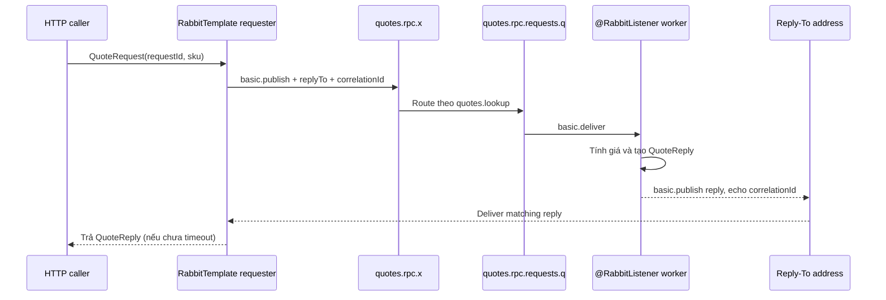
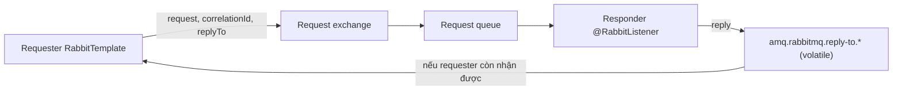
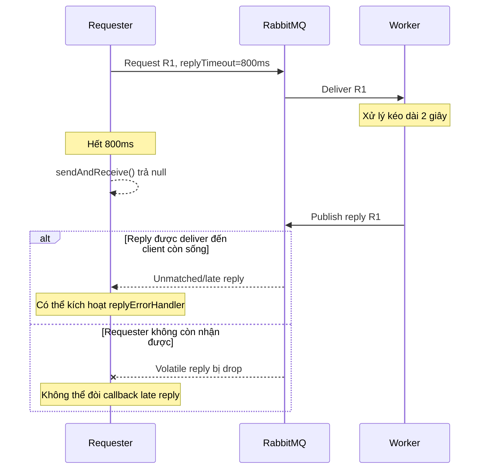
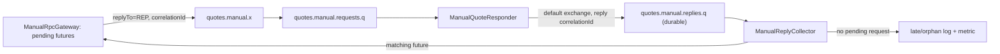
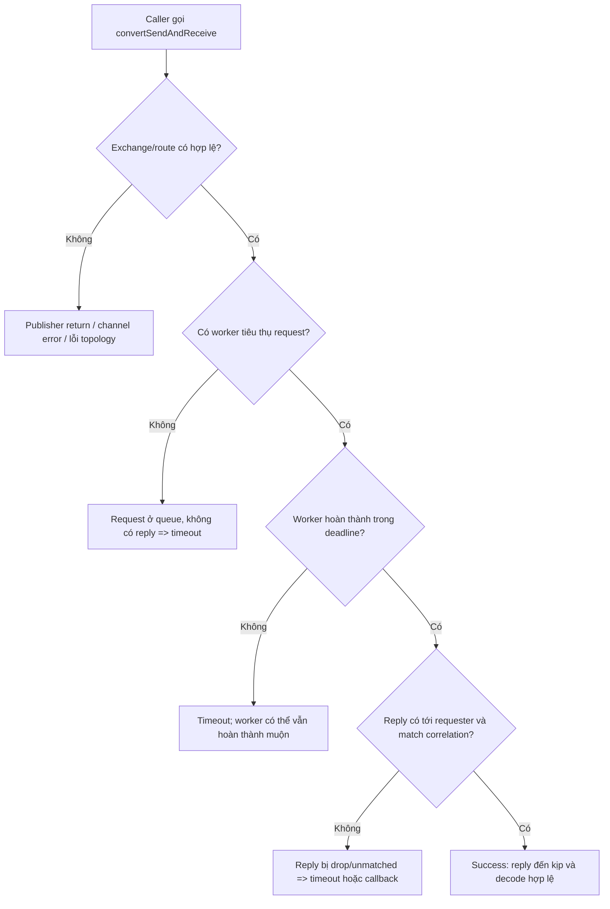
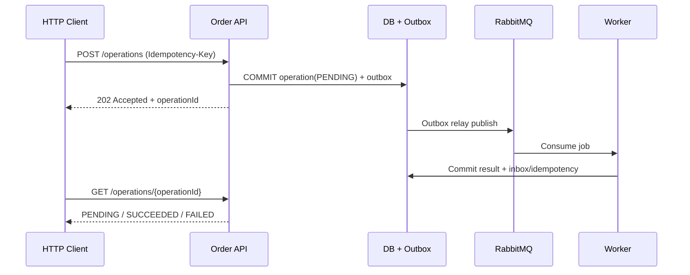

# Xây dựng request–reply và quan sát timeout hoặc phản hồi đến muộn

> **Chương:** Thực hành tổng hợp  
> **Module:** SPRING_AMQP — tích hợp RabbitMQ với Spring AMQP qua `RabbitTemplate`, `@RabbitListener`, exchange, queue và binding; vận dụng định tuyến message, publisher confirms, acknowledgment, retry, dead-letter, giao dịch và observability để xây hệ thống bất đồng bộ đáng tin cậy.
>
> **Phạm vi phiên bản:** Các ví dụ chính theo **Java 21, Spring Boot 3.5.x, Spring AMQP 3.2.x, RabbitMQ AMQP 0-9-1**. Trên Spring Boot/Spring AMQP 4.x cần kiểm tra starter và API chuyển đổi JSON theo phiên bản. Bài tập gồm một luồng RPC dùng **Direct Reply-To** và một luồng nâng cao dùng **reply queue riêng** để quan sát câu trả lời đến muộn.

## 1. Bài toán và sản phẩm cuối

Một HTTP API nhận yêu cầu lấy báo giá `sku`. Để minh họa RPC qua RabbitMQ, API gửi `QuoteRequest` tới `quotes.rpc.x` bằng `RabbitTemplate.convertSendAndReceive()`; một worker khác nhận ở `quotes.rpc.requests.q` với `@RabbitListener` và trả về `QuoteReply`.

Trên đường đi có thể xảy ra:

- Worker trả kết quả nhanh, HTTP trả báo giá.
- Worker đang bận, HTTP/RPC timeout nhưng worker **vẫn tiếp tục xử lý**.
- Reply đến sau timeout: requester không còn chờ; với Direct Reply-To broker **có thể làm rơi reply**.
- Request không route được vì exchange/binding sai: đây là lỗi **routing**, không phải “worker chậm”.
- Client mất kết nối trong lúc chờ; publish có thể đã xảy ra, nhưng outcome ở client **chưa xác định**.
- Client retry một request có side effect (ví dụ giữ chỗ hàng) tạo ra **lệnh trùng** nếu handler không idempotent.

**Kết quả cần đạt:** Một demo có cả happy path, timeout, phản hồi muộn; đo riêng thời gian chờ requester, thời gian thực thi responder, lỗi routing và số response không còn yêu cầu đang chờ.

### 1.1. Bạn sẽ học được gì?

1. Vẽ đúng lifecycle `request → reply-to → responder → correlation → requester`.
2. Dùng `RabbitTemplate.convertSendAndReceive`, `@RabbitListener` trả về giá trị và Jackson JSON converter.
3. Phân biệt `replyTo`, `correlationId`, `messageId`, `businessRequestId`, `deliveryTag` và publisher `CorrelationData`.
4. Thiết lập `replyTimeout` và xử lý `null` một cách minh bạch.
5. Xác định điều gì **có thể và không thể** quan sát được khi late reply dùng Direct Reply-To.
6. Dùng `replyErrorHandler` để thấy unmatched/late replies **khi reply thực sự tới client**.
7. Tạo phương án explicit reply queue để quan sát late replies và chọn cách xử lý orphan reply.
8. Viết JUnit 5 + RabbitMQ Testcontainers + Awaitility tests cho on-time, timeout, late, no route, broker disconnect và duplicate.
9. Thiết kế deadline, idempotency, metrics, tracing và hướng dẫn vận hành.

### 1.2. Request–reply không thay thế async event

| Tiêu chí | RPC qua RabbitMQ | Publish sự kiện một chiều |
|---|---|---|
| Caller có cần kết quả ngay? | Có, caller chờ hoặc quản lý future | Thường không |
| Ràng buộc latency | Độ trễ broker + queue + worker + reply | Có thể chỉ cần publisher confirm |
| Nếu worker chậm | Requester timeout, reply có thể đến muộn | Message có thể tiếp tục nằm trong queue |
| Khi caller chết | Direct reply-to không giữ reply; fixed queue tùy cấu hình | Consumer khác có thể nhận event đã lưu |
| Dùng cho nghiệp vụ dài | Thường **không phù hợp** nếu cần chờ hàng phút | Dùng job ID + event completion/status API |

Nếu nghiệp vụ cần xử lý lâu, ưu tiên `202 Accepted + jobId + status endpoint` hoặc event completion, thay vì đặt RPC timeout rất lớn và giữ HTTP threads/AMQP resources vô hạn.

## 2. Wire protocol: request–reply thực sự diễn ra thế nào?



### 2.1. Sáu khái niệm không được nhầm

| Trường/khái niệm | Ai tạo? | Dùng để làm gì? | Có ổn định qua retry? |
|---|---|---|---|
| `businessRequestId` | Caller khi yêu cầu logic được tạo | Idempotency và đối soát nghiệp vụ | **Có**, với cùng yêu cầu logic |
| `MessageProperties.messageId` | Producer đặt tùy contract | Nhận diện message/application | Nên giữ ổn định cho cùng business request |
| `correlationId` | Thường do `RabbitTemplate` tạo cho RPC | Ghép reply vào đúng request đang đợi | **Không cần** giữ qua RPC attempt mới |
| `replyTo` | `RabbitTemplate` thiết lập khi gửi | Cho worker biết gửi phản hồi về đâu | Có thể đổi theo request/connection |
| `deliveryTag` | Broker gán trên consumer channel | ACK/NACK delivery cụ thể | **Không**, chỉ có nghĩa trên channel |
| `CorrelationData.id` | Producer khi dùng publisher confirms | Ghép broker publisher ACK/NACK với publish attempt | Có thể mới ở mỗi publish attempt; **khác RPC reply correlation** |

**Một phản hồi hợp lệ** phải có correlation phù hợp với request còn đang đợi. Trường `eventId`/`businessRequestId` dùng để nhận diện nghiệp vụ và idempotency; không được thay thế quy trình correlation ở giao thức bằng việc so sánh mỗi SKU hay orderId.

### 2.2. Reply timeout không phải message TTL

- **`replyTimeout`:** Khoảng tối đa mà lời gọi `sendAndReceive` đợi một reply. Hết thời gian sẽ trả `null` (sync API).
- **Request message expiration/TTL:** Thời gian message được phép tồn tại trong queue trước khi broker expire; không phải tự động dừng worker đã nhận message.
- **Business deadline:** Thời hạn nghiệp vụ do caller/worker thống nhất, có thể lưu trong payload/header.
- **Publisher confirm timeout:** Thời gian chờ broker xác nhận publish, **khác** reply timeout.
- **HTTP/gateway timeout:** Caller phía trước cũng có timeout riêng; nên có ngân sách tổng và từng hop.

Một yêu cầu HTTP timeout không gửi một “lệnh cancel” mặc định đến RabbitMQ. Worker có thể tiếp tục commit DB và trả phản hồi muộn dù caller đã nhận HTTP 504.

## 3. Direct Reply-To: tiện lợi nhưng không bảo đảm lưu phản hồi

Spring AMQP 3.x thường sử dụng **RabbitMQ Direct Reply-To** cho `RabbitTemplate.sendAndReceive` khi broker hỗ trợ, không cấu hình fixed reply queue. Client consume qua pseudo-queue `amq.rabbitmq.reply-to`; broker chuyển reply trực tiếp qua cơ chế nội bộ, không tạo một queue truyền thống để lưu message.



RabbitMQ gọi đây là cơ chế **at-most-once cho replies**, không buffering/durability: nếu requester disconnect hoặc không thể nhận, reply có thể bị drop. Pseudo-queue **không xuất hiện** trong `rabbitmqctl list_queues`/Management queue list; đừng cố khai báo hay xóa `amq.rabbitmq.reply-to` như queue thường.

### 3.1. Điều xảy ra khi phản hồi muộn



**Ba điều cần ghi nhớ:**

1. `null` từ sync call là **không nhận được phản hồi trong thời hạn**, không chứng minh worker chưa xử lý.
2. `replyErrorHandler` chỉ quan sát những reply **đã tới** DirectReplyTo listener nhưng không ghép được pending request. Nó không thấy reply bị broker drop khi connection mất.
3. Responder biết lúc **hoàn thành công việc/gửi reply**, nhưng không mặc nhiên biết requester còn sống hoặc đã nhận reply. Đếm “worker completed after deadline” **khác** đếm “late reply delivered”.

## 4. Chuẩn bị dự án thực hành

### 4.1. Cấu trúc ví dụ

```text
spring-rabbit-rpc-lab/
  pom.xml
  compose.yaml
  src/main/java/.../RpcLabApplication.java
  src/main/java/.../RpcTopology.java
  src/main/java/.../RpcConfiguration.java
  src/main/java/.../QuoteRequest.java
  src/main/java/.../QuoteReply.java
  src/main/java/.../QuoteWorker.java
  src/main/java/.../QuoteRpcClient.java
  src/main/java/.../QuoteController.java
  src/test/java/.../RpcIntegrationTest.java
  src/main/resources/application.yml
```

Các code blocks là **mã tham khảo để đưa vào những file Java tương ứng, cùng package**. Không dùng những lớp/stub có cùng tên từ hai phần thay thế đồng thời nếu không tự tách package. Một số fragment thử nghiệm giả định các bean đã có trong project.

### 4.2. Dependencies Maven

```xml
<!-- Spring Boot parent/BOM quản lý phiên bản phù hợp với Java 21. -->
<dependencies>
    <dependency>
        <groupId>org.springframework.boot</groupId>
        <artifactId>spring-boot-starter-amqp</artifactId>
    </dependency>
    <dependency>
        <groupId>org.springframework.boot</groupId>
        <artifactId>spring-boot-starter-web</artifactId>
    </dependency>
    <dependency>
        <groupId>org.springframework.boot</groupId>
        <artifactId>spring-boot-starter-actuator</artifactId>
    </dependency>
    <dependency>
        <groupId>io.micrometer</groupId>
        <artifactId>micrometer-registry-prometheus</artifactId>
    </dependency>

    <dependency>
        <groupId>org.springframework.boot</groupId>
        <artifactId>spring-boot-starter-test</artifactId>
        <scope>test</scope>
    </dependency>
    <dependency>
        <groupId>org.testcontainers</groupId>
        <artifactId>rabbitmq</artifactId>
        <scope>test</scope>
    </dependency>
    <dependency>
        <groupId>org.testcontainers</groupId>
        <artifactId>junit-jupiter</artifactId>
        <scope>test</scope>
    </dependency>
    <dependency>
        <groupId>org.awaitility</groupId>
        <artifactId>awaitility</artifactId>
        <scope>test</scope>
    </dependency>
</dependencies>
```

Đây là cấu hình phổ biến cho **Spring Boot 3.5 + Testcontainers 1.x** do BOM quản lý. Testcontainers 2.x có thay đổi một số module/artifact; dùng đúng BOM của project, không tự lắp các major version rời rạc. Bài này không yêu cầu chạy Maven/Gradle hoặc tạo file phụ trong lúc biên soạn tài liệu.

### 4.3. RabbitMQ local bằng Docker Compose

```yaml
services:
  rabbitmq:
    image: rabbitmq:4.1-management
    hostname: rabbitmq
    environment:
      RABBITMQ_DEFAULT_USER: rpc_dev
      RABBITMQ_DEFAULT_PASS: "${RPC_DEV_PASSWORD:?set_RPC_DEV_PASSWORD}"
      RABBITMQ_DEFAULT_VHOST: /rpc-dev
    ports:
      - "127.0.0.1:5672:5672"
      - "127.0.0.1:15672:15672"
    healthcheck:
      test: ["CMD", "rabbitmq-diagnostics", "-q", "ping"]
      interval: 10s
      timeout: 5s
      retries: 15
```

Ví dụ môi trường local, không dùng port management mở công khai hay `guest/guest` trong staging/production. Mật khẩu được cung cấp qua env/secret local và không commit vào Git. Nếu chạy app **trong cùng Compose network**, `spring.rabbitmq.host=rabbitmq`; nếu app chạy ngoài Compose trên máy dev thì `localhost:5672`.

### 4.4. Spring Boot application và cấu hình

```java
import org.springframework.boot.SpringApplication;
import org.springframework.boot.autoconfigure.SpringBootApplication;

@SpringBootApplication
public class RpcLabApplication {
    public static void main(String[] args) {
        SpringApplication.run(RpcLabApplication.class, args);
    }
}
```

```yaml
# application.yml
spring:
  application:
    name: rabbit-rpc-lab
  rabbitmq:
    host: "${RABBITMQ_HOST:localhost}"
    port: "${RABBITMQ_PORT:5672}"
    username: "${RABBITMQ_USERNAME:rpc_dev}"
    password: "${RABBITMQ_PASSWORD}"
    virtual-host: "${RABBITMQ_VHOST:/rpc-dev}"
    requested-heartbeat: 20s
    publisher-confirm-type: correlated
    publisher-returns: true
    template:
      mandatory: true
      reply-timeout: 800ms
      observation-enabled: true
    listener:
      simple:
        concurrency: 1
        prefetch: 5
        default-requeue-rejected: false
        observation-enabled: true

management:
  endpoints:
    web:
      exposure:
        include: health,info,prometheus
```

Giá trị `800ms` cố tình ngắn **cho demo timeout**, không phải SLA production. `reply-timeout` chỉ áp dụng các thao tác request–reply trên template được auto-configure; ở phần 6 chúng ta tạo bean template có cùng timeout để dễ quan sát error handler.

**Bảo mật:** Bảo vệ `/actuator/prometheus`, credentials và RabbitMQ Management endpoints. Trên staging/prod bật TLS + certificate chain + hostname verification. Không tắt xác minh certificate để sửa lỗi kết nối.

## 5. Exchange, request queue và DLQ

```java
import org.springframework.amqp.core.BindingBuilder;
import org.springframework.amqp.core.Declarables;
import org.springframework.amqp.core.DirectExchange;
import org.springframework.amqp.core.Queue;
import org.springframework.amqp.core.QueueBuilder;
import org.springframework.context.annotation.Bean;
import org.springframework.context.annotation.Configuration;

final class RpcRoutes {
    static final String EXCHANGE = "quotes.rpc.x";
    static final String ROUTING_KEY = "quotes.lookup";
    static final String REQUEST_QUEUE = "quotes.rpc.requests.q";
    static final String DLX = "quotes.rpc.dead.x";
    static final String DLQ = "quotes.rpc.requests.dlq";
    static final String DLQ_KEY = "quotes.invalid";
    private RpcRoutes() {}
}

@Configuration(proxyBeanMethods = false)
public class RpcTopology {
    @Bean
    Declarables rpcDeclarables() {
        var exchange = new DirectExchange(RpcRoutes.EXCHANGE, true, false);
        var dead = new DirectExchange(RpcRoutes.DLX, true, false);
        var requestQueue = QueueBuilder
            .durable(RpcRoutes.REQUEST_QUEUE)
            .deadLetterExchange(RpcRoutes.DLX)
            .deadLetterRoutingKey(RpcRoutes.DLQ_KEY)
            .build();
        var dlq = QueueBuilder.durable(RpcRoutes.DLQ).build();

        return new Declarables(
            exchange, dead, requestQueue, dlq,
            BindingBuilder.bind(requestQueue).to(exchange)
                .with(RpcRoutes.ROUTING_KEY),
            BindingBuilder.bind(dlq).to(dead)
                .with(RpcRoutes.DLQ_KEY)
        );
    }
}
```

Queue chứa **requests**, không chứa replies của Direct Reply-To. Direct Reply-To dùng địa chỉ do broker quản lý; không tạo `QueueBuilder.durable("amq.rabbitmq.reply-to")`. DLQ ở đây nhận **request bị reject/expire theo cấu hình**, không phải một nơi lưu tự động mọi response đến muộn.

Khi triển khai production, dùng RabbitMQ policies cho DLX/TTL khi phù hợp và quản lý topology bằng IaC/definitions hoặc một nguồn khai báo có kiểm soát. Đổi queue arguments cùng tên có thể gây `406 PRECONDITION_FAILED`.

## 6. Request và reply: JSON, timeout, callback quan sát

### 6.1. DTO có định danh nghiệp vụ và deadline

```java
import java.util.UUID;

public record QuoteRequest(
    UUID businessRequestId,
    String sku,
    long deadlineEpochMillis
) {}

public record QuoteReply(
    UUID businessRequestId,
    String sku,
    long unitPriceMinor,
    String currency,
    String status
) {}
```

`unitPriceMinor` là đơn vị tiền nhỏ nhất theo hợp đồng, ví dụ cents. Không dùng float cho tiền. `businessRequestId` giữ nguyên nếu client retry **cùng yêu cầu logic**; RPC correlation ID do template quản lý có thể khác trong mỗi attempt.

Vì client và responder có thể chạy trên những máy khác nhau, `deadlineEpochMillis` phụ thuộc đồng hồ hai phía. Dùng NTP và logging độ lệch; **timeout đo bằng monotonic elapsed time** ở caller là nguồn quyết định cho việc hết thời gian chờ, không suy luận chỉ từ `System.currentTimeMillis()` ở responder.

### 6.2. Message converter và listener factory

```java
import com.fasterxml.jackson.databind.ObjectMapper;
import org.springframework.amqp.core.AcknowledgeMode;
import org.springframework.amqp.rabbit.config.SimpleRabbitListenerContainerFactory;
import org.springframework.amqp.rabbit.connection.ConnectionFactory;
import org.springframework.amqp.support.converter.Jackson2JsonMessageConverter;
import org.springframework.amqp.support.converter.MessageConverter;
import org.springframework.context.annotation.Bean;
import org.springframework.context.annotation.Configuration;

@Configuration(proxyBeanMethods = false)
public class RpcMessagingConfiguration {
    @Bean
    MessageConverter rpcJsonConverter(ObjectMapper objectMapper) {
        return new Jackson2JsonMessageConverter(objectMapper);
    }

    @Bean("rpcListenerFactory")
    SimpleRabbitListenerContainerFactory rpcListenerFactory(
        ConnectionFactory connectionFactory,
        MessageConverter rpcJsonConverter
    ) {
        var factory = new SimpleRabbitListenerContainerFactory();
        factory.setConnectionFactory(connectionFactory);
        factory.setMessageConverter(rpcJsonConverter);
        factory.setAcknowledgeMode(AcknowledgeMode.AUTO);
        factory.setConcurrentConsumers(1);
        factory.setPrefetchCount(5);
        factory.setDefaultRequeueRejected(false);
        factory.setObservationEnabled(true);
        return factory;
    }
}
```

Trong Spring AMQP 3.2, `Jackson2JsonMessageConverter` dùng Jackson 2. Với Spring AMQP 4.x, việc chuyển sang Jackson 3/`JacksonJsonMessageConverter` cần được kiểm tra theo tài liệu phiên bản; **không thay đổi format event trên wire chỉ vì đổi thư viện Java**.

### 6.3. RabbitTemplate với Direct Reply-To và replyErrorHandler

```java
import io.micrometer.core.instrument.MeterRegistry;
import org.slf4j.Logger;
import org.slf4j.LoggerFactory;
import org.springframework.amqp.rabbit.connection.ConnectionFactory;
import org.springframework.amqp.rabbit.core.RabbitTemplate;
import org.springframework.amqp.rabbit.support.ListenerExecutionFailedException;
import org.springframework.amqp.support.converter.MessageConverter;
import org.springframework.context.annotation.Bean;
import org.springframework.context.annotation.Configuration;

@Configuration(proxyBeanMethods = false)
class RpcClientConfiguration {
    private static final Logger log =
        LoggerFactory.getLogger(RpcClientConfiguration.class);

    @Bean("quoteRpcTemplate")
    RabbitTemplate quoteRpcTemplate(
        ConnectionFactory connectionFactory,
        MessageConverter rpcJsonConverter,
        MeterRegistry meters
    ) {
        RabbitTemplate template = new RabbitTemplate(connectionFactory);
        template.setMessageConverter(rpcJsonConverter);
        template.setReplyTimeout(800L); // ms, dành cho thí nghiệm.
        template.setMandatory(true);
        template.setObservationEnabled(true);

        template.setReplyErrorHandler(error -> {
            meters.counter("demo.rpc.reply.unmatched").increment();
            if (error instanceof ListenerExecutionFailedException failed) {
                var reply = failed.getFailedMessage();
                log.warn(
                    "rpc.reply.unmatched correlationId={} messageId={}",
                    reply.getMessageProperties().getCorrelationId(),
                    reply.getMessageProperties().getMessageId()
                );
            } else {
                log.warn("rpc.reply.error", error);
            }
        });
        return template;
    }
}
```

Đây là template riêng cho RPC. Mặc định không cấu hình `replyAddress`/`replyQueue` nên Spring AMQP sẽ dùng Direct Reply-To nếu broker hỗ trợ. **Không tạo listener container riêng cho `amq.rabbitmq.reply-to`**; `RabbitTemplate` quản lý việc đó.

`setReplyErrorHandler` có thể thấy late/unmatched replies **nếu chúng tới DirectReplyToMessageListenerContainer**. Với reply bị broker loại bỏ khi requester disconnect, callback **không** được gọi. Counter `demo.rpc.reply.unmatched` là “replies tới client nhưng không ghép được”, **không phải tổng replies đã quá deadline trên toàn hệ thống**.

**Publisher return với RPC:** Spring AMQP có cơ chế riêng ném `AmqpMessageReturnedException` khi request được gửi mandatory nhưng không route, nếu connection factory bật publisher returns; theo tài liệu, không đăng ký **ReturnsCallback riêng trên cùng RPC template** khi muốn dùng cơ chế này. `publisher-confirm-type=correlated` vẫn là kết quả publish riêng, không thay `replyTimeout`.

## 7. Worker @RabbitListener trả về kết quả tự động

### 7.1. Tách logic tạo báo giá khỏi reply transport

```java
import java.util.UUID;
import org.springframework.stereotype.Service;

@Service
public class QuoteCalculator {
    private final WorkDelayGate delay;

    public QuoteCalculator(WorkDelayGate delay) {
        this.delay = delay;
    }

    public QuoteReply calculate(QuoteRequest request) {
        if (request.businessRequestId() == null ||
            request.sku() == null || request.sku().isBlank()) {
            throw new IllegalArgumentException("Invalid quote request");
        }
        delay.beforeFinish(request.businessRequestId());
        long priceMinor = switch (request.sku()) {
            case "SKU-FAST" -> 1999L;
            case "SKU-SLOW" -> 4599L;
            default -> 2999L;
        };
        return new QuoteReply(
            request.businessRequestId(), request.sku(),
            priceMinor, "USD", "OK"
        );
    }
}
```

`WorkDelayGate` là test seam, production implementation không thêm delay:

```java
import java.util.UUID;
import org.springframework.stereotype.Component;

public interface WorkDelayGate {
    void beforeFinish(UUID businessRequestId);
}

@Component
class NoDelayGate implements WorkDelayGate {
    @Override
    public void beforeFinish(UUID businessRequestId) {
        // Trong production không dùng sleep để mô phỏng mạng chậm.
    }
}
```

Trong test, bean `@Primary` có thể thay `NoDelayGate` để chặn một request tại điểm xác định bằng `CountDownLatch`. Tránh `Thread.sleep(2000)` trong code production và tránh một test phụ thuộc thời gian scheduler may rủi.

### 7.2. Responder tự động gửi reply theo replyTo

```java
import io.micrometer.core.instrument.MeterRegistry;
import java.util.concurrent.TimeUnit;
import org.slf4j.Logger;
import org.slf4j.LoggerFactory;
import org.springframework.amqp.rabbit.annotation.RabbitListener;
import org.springframework.stereotype.Component;

@Component
public class QuoteResponder {
    private static final Logger log =
        LoggerFactory.getLogger(QuoteResponder.class);
    private final QuoteCalculator calculator;
    private final MeterRegistry meters;

    public QuoteResponder(
        QuoteCalculator calculator,
        MeterRegistry meters
    ) {
        this.calculator = calculator;
        this.meters = meters;
    }

    @RabbitListener(
        id = "quote-rpc-responder",
        queues = RpcRoutes.REQUEST_QUEUE,
        containerFactory = "rpcListenerFactory"
    )
    public QuoteReply reply(QuoteRequest request) {
        long started = System.nanoTime();
        QuoteReply result = calculator.calculate(request);
        boolean afterDeadline =
            System.currentTimeMillis() > request.deadlineEpochMillis();
        meters.counter(
            "demo.rpc.worker.completed",
            "after_deadline", Boolean.toString(afterDeadline)
        ).increment();
        meters.timer("demo.rpc.worker.processing")
            .record(System.nanoTime() - started, TimeUnit.NANOSECONDS);
        log.info(
            "rpc.worker.completed businessRequestId={} afterDeadline={}",
            request.businessRequestId(), afterDeadline
        );
        return result; // Spring dùng replyTo có sẵn để gửi reply.
    }
}
```

**Không cần `@SendTo` trong trường hợp này:** `RabbitTemplate.convertSendAndReceive()` đã đặt `replyTo` trên request. `@RabbitListener` trả non-void và listener adapter gửi reply theo địa chỉ đó. `@SendTo` chỉ hữu ích làm default khi inbound message không có `replyTo` hoặc muốn thiết lập địa chỉ trả lời khác theo thiết kế.

**Không tự `rabbitTemplate.send(replyTo, ...)` thêm lần nữa trong cùng listener** nếu đã trả `QuoteReply`, vì như vậy gửi **hai replies**. Reply auto-return phụ thuộc listener conversion cấu hình đúng; lỗi converter/không có replyTo có thể khiến send reply thất bại hoặc routing không như mong đợi.

**Phân biệt mốc log:** `worker.completed` được ghi **trước khi framework gửi reply**, nên nó chứng minh công việc đã hoàn tất, không chứng minh reply đã tới caller. Kể cả `afterDeadline=false`, mạng có thể chậm khiến caller timeout trước khi reply được nhận.

### 7.3. Lỗi worker và ACK request

Ví dụ là tính giá đọc dữ liệu, không có side effect; nếu validate lỗi, `@RabbitListener` ném exception và container xử lý theo policy. Cấu hình `defaultRequeueRejected=false` cùng DLX làm request lỗi có thể đi DLQ, **nhưng requester vẫn timeout** nếu worker không phát một error reply.

Trong RPC nghiệp vụ, nên định nghĩa rõ **error reply** theo contract (`status=NOT_FOUND/VALIDATION_ERROR/DEPENDENCY_UNAVAILABLE`) cho lỗi dự kiến, thay vì ném exception và để caller chỉ nhìn timeout. Lỗi DB/network transient nên retry có giới hạn theo deadline và circuit breaker; không hot-requeue vô hạn.

## 8. Requester: gửi, đợi, nhận kết quả hoặc timeout

### 8.1. Client Spring AMQP

```java
import io.micrometer.core.instrument.MeterRegistry;
import java.util.UUID;
import java.util.concurrent.TimeUnit;
import org.slf4j.Logger;
import org.slf4j.LoggerFactory;
import org.springframework.amqp.AmqpException;
import org.springframework.amqp.rabbit.core.RabbitTemplate;
import org.springframework.beans.factory.annotation.Qualifier;
import org.springframework.stereotype.Service;

@Service
public class QuoteRpcClient {
    private static final Logger log =
        LoggerFactory.getLogger(QuoteRpcClient.class);
    private final RabbitTemplate rabbit;
    private final MeterRegistry meters;

    public QuoteRpcClient(
        @Qualifier("quoteRpcTemplate") RabbitTemplate rabbit,
        MeterRegistry meters
    ) {
        this.rabbit = rabbit;
        this.meters = meters;
    }

    public QuoteReply ask(UUID businessRequestId, String sku) {
        var request = new QuoteRequest(
            businessRequestId, sku, System.currentTimeMillis() + 800L
        );
        long started = System.nanoTime();
        try {
            Object rawReply = rabbit.convertSendAndReceive(
                RpcRoutes.EXCHANGE,
                RpcRoutes.ROUTING_KEY,
                request,
                message -> {
                    message.getMessageProperties()
                        .setMessageId(businessRequestId.toString());
                    message.getMessageProperties().setHeader(
                        "business-request-id", businessRequestId.toString()
                    );
                    return message;
                }
            );

            if (rawReply == null) {
                meters.counter(
                    "demo.rpc.request.result", "outcome", "timeout"
                ).increment();
                log.warn(
                    "rpc.timeout businessRequestId={} sku={}",
                    businessRequestId, sku
                );
                return null;
            }

            QuoteReply reply = (QuoteReply) rawReply;
            if (!businessRequestId.equals(reply.businessRequestId())) {
                throw new IllegalStateException("Business ID mismatch");
            }
            meters.counter(
                "demo.rpc.request.result", "outcome", "success"
            ).increment();
            return reply;
        } catch (AmqpException transportError) {
            meters.counter(
                "demo.rpc.request.result", "outcome", "transport_error"
            ).increment();
            log.error(
                "rpc.transport_error businessRequestId={}",
                businessRequestId, transportError
            );
            throw transportError;
        } finally {
            meters.timer("demo.rpc.request.elapsed")
                .record(
                    System.nanoTime() - started,
                    TimeUnit.NANOSECONDS
                );
        }
    }
}
```

`convertSendAndReceive()` có timeout **5 giây mặc định** trong Spring AMQP, nhưng template ở ví dụ được cấu hình **800ms**. Trong API đồng bộ này, `null` là dấu hiệu hết hạn chờ reply. Đừng ném `NullPointerException` hoặc trả thành công với JSON `null` mà không giải thích.

Các lỗi transport/routing có thể khác `null`. Với mandatory request và publisher returns hợp lệ, request unroutable có thể ném `AmqpMessageReturnedException`; cần phân loại để đội vận hành biết lỗi topology chứ không phải tăng timeout. Nếu không có consumer nhưng queue vẫn tồn tại và nhận request, **request route thành công** và caller có thể timeout vì không có worker trả lời.

**Quan trọng:** `System.currentTimeMillis()+800` trong body chỉ là một dấu mốc deadline gần đúng cho responder; `replyTimeout=800ms` mới là quyết định chờ tại requester. Khi clock hai host lệch, so sánh deadline bên worker cần thận trọng.

### 8.2. HTTP endpoint demo

```java
import java.util.UUID;
import org.springframework.http.HttpStatus;
import org.springframework.http.ResponseEntity;
import org.springframework.web.bind.annotation.PostMapping;
import org.springframework.web.bind.annotation.RequestBody;
import org.springframework.web.bind.annotation.RequestMapping;
import org.springframework.web.bind.annotation.RestController;

record QuoteHttpRequest(UUID requestId, String sku) {}
record PendingQuote(String requestId, String state, String detail) {}

@RestController
@RequestMapping("/rpc")
public class QuoteController {
    private final QuoteRpcClient rpc;

    public QuoteController(QuoteRpcClient rpc) {
        this.rpc = rpc;
    }

    @PostMapping("/quote")
    public ResponseEntity<?> quote(@RequestBody QuoteHttpRequest input) {
        UUID businessId = input.requestId() == null
            ? UUID.randomUUID() : input.requestId();

        QuoteReply reply = rpc.ask(businessId, input.sku());
        if (reply == null) {
            return ResponseEntity.status(HttpStatus.GATEWAY_TIMEOUT)
                .body(new PendingQuote(
                    businessId.toString(), "UNKNOWN",
                    "No reply before deadline; worker may still finish"
                ));
        }
        return ResponseEntity.ok(reply);
    }
}
```

HTTP 504 ở đây là **demo đồng bộ**. Nếu lệnh có side effect quan trọng (thanh toán, đặt chỗ), một API trả **202 + operationId + GET status** thường phù hợp hơn: timeout không được diễn giải là “giao dịch chắc chắn thất bại”. Giữ `requestId` ổn định khi client retry cùng nghiệp vụ và dùng một idempotency store ở responder.

### 8.3. Chạy local và xem kết quả

```bash
# Trong project demo đã có pom.xml, compose.yaml và các file Java tương ứng:
export RPC_DEV_PASSWORD='local-only-secret'
export RABBITMQ_PASSWORD="$RPC_DEV_PASSWORD"
docker compose up -d
./mvnw spring-boot:run

# Happy path:
curl -i -X POST http://localhost:8080/rpc/quote \
  -H 'Content-Type: application/json' \
  -d '{"requestId":"c880e7ca-06ce-41bf-b27e-93da42ed8dc1","sku":"SKU-FAST"}'
```

Kỳ vọng HTTP 200 và `QuoteReply` chứa `businessRequestId` giống input, `unitPriceMinor=1999`. Nếu response timeout hoặc broker thiếu route, kiểm tra đúng RabbitMQ host, port, vhost, queue và listener startup logs trước khi sửa timeout.

## 9. Quan sát timeout và reply muộn trong Direct Reply-To

### 9.1. Ba mốc thời gian

```text
t0  requester gửi request R100
t1  responder bắt đầu xử lý R100
t2  requester hết replyTimeout; log rpc.timeout và trả HTTP 504
t3  responder hoàn tất việc tính giá và bắt đầu gửi reply
t4  reply có thể được client nhận rồi coi là unmatched, hoặc broker drop
```

Không suy luận `t3 == t4`. Timestamp ở worker có thể lệch so với caller; khi cần so sánh end-to-end dùng trace context, đồng bộ NTP và elapsed monotonic timings trên từng process.

### 9.2. Metrics tối thiểu

| Metric | Nguồn | Ý nghĩa chính xác |
|---|---|---|
| `demo.rpc.request.result{outcome="success"}` | Requester | Reply hợp lệ tới **trước deadline** |
| `demo.rpc.request.result{outcome="timeout"}` | Requester | Requester không nhận reply trong `replyTimeout` |
| `demo.rpc.request.result{outcome="transport_error"}` | Requester | Exception transport/routing gửi từ Spring |
| `demo.rpc.request.elapsed` | Requester | Thời gian chờ end-to-end ở API caller |
| `demo.rpc.worker.processing` | Responder | Thời gian thực thi handler, không gồm queue waiting |
| `demo.rpc.worker.completed{after_deadline="true"}` | Responder | Worker hoàn tất **sau business deadline trên đồng hồ worker** |
| `demo.rpc.reply.unmatched` | DirectReplyTo replyErrorHandler | Reply tới container nhưng **không tìm thấy pending correlation** |
| RabbitMQ requests ready/unacked | Broker | Queueing và consumer load phía request |

Nếu `worker.completed_after_deadline > 0` mà `reply.unmatched=0`, **không có gì mâu thuẫn**: late reply có thể bị broker drop hoặc không tới requester; callback không phải đồng hồ đo mọi late replies.

### 9.3. Quan sát bằng logs/traces

Ghi structured fields:

```text
businessRequestId       ID nghiệp vụ; giữ qua retry
rpcAttemptId            ID lần thử RPC, không dùng làm khóa nghiệp vụ
traceId/spanId           Liên kết caller và worker nếu có context propagation
queue/exchange/routingKey  Route của request
requestStartedAt         Thời điểm bắt đầu
replyDeadline            Deadline trong contract
responderCompletedAt     Mốc worker xong việc
rpcOutcome               success/timeout/returned/transport_error
replyCorrelationId       Giao thức ghép reply (có thể ẩn bên trong template)
replyDeliveryOutcome     received_unmatched/unknown/dropped_not_observable
```

Không đặt `businessRequestId`, `traceId`, `replyCorrelationId` hoặc `sku` tùy ý làm Prometheus labels; dùng logs/traces có truy cập phù hợp, metric tags ít giá trị.

### 9.4. Không tự lấy correlationId từ payload để ghép Direct Reply-To

Spring `RabbitTemplate` thường **tạo correlation ID của chính nó** (trừ khi cấu hình `userCorrelationId=true`). Với automatic request–reply, framework chịu trách nhiệm ghép reply. Không tự đặt một `correlationId` tùy tiện rồi cho rằng nó bắt buộc trùng `businessRequestId` hoặc reply sẽ quay về đúng requester.

Trong handler `@RabbitListener` trả object, listener adapter dùng `replyTo` và correlation metadata trên request để gửi reply; nếu bạn tự tạo reply thủ công thì phải copy correlation theo hợp đồng của requester. Phần 11 minh họa mô hình tự quản lý đó trên **queue khác** để không tạo hai replies.

## 10. Integration test Direct Reply-To: timeout có kiểm soát

Không dùng `Thread.sleep(2000)` và hy vọng hệ điều hành lên lịch giống nhau ở laptop và CI. Ta dùng một **test gate** chặn worker tại điểm xác định, rồi chỉ thả sau khi client đã timeout.

### 10.1. Thay NoDelayGate bằng bean kiểm thử

```java
import java.util.UUID;
import java.util.concurrent.ConcurrentHashMap;
import java.util.concurrent.ConcurrentMap;
import java.util.concurrent.CountDownLatch;
import java.util.concurrent.TimeUnit;
import org.springframework.boot.test.context.TestConfiguration;
import org.springframework.context.annotation.Bean;
import org.springframework.context.annotation.Primary;

// Đưa class này vào src/test/java, import vào @SpringBootTest.
@TestConfiguration(proxyBeanMethods = false)
public class RpcDelayTestConfiguration {
    @Bean
    @Primary
    ControlledDelayGate controlledDelayGate() {
        return new ControlledDelayGate();
    }
}

final class ControlledDelayGate implements WorkDelayGate {
    static final class Hold {
        final CountDownLatch entered = new CountDownLatch(1);
        final CountDownLatch release = new CountDownLatch(1);
        final CountDownLatch leftGate = new CountDownLatch(1);
    }

    private final ConcurrentMap<UUID, Hold> holds =
        new ConcurrentHashMap<>();

    Hold arm(UUID requestId) {
        Hold hold = new Hold();
        if (holds.putIfAbsent(requestId, hold) != null) {
            throw new IllegalStateException("Already armed");
        }
        return hold;
    }

    @Override
    public void beforeFinish(UUID requestId) {
        Hold hold = holds.remove(requestId);
        if (hold == null) {
            return;
        }
        hold.entered.countDown();
        try {
            if (!hold.release.await(10, TimeUnit.SECONDS)) {
                throw new IllegalStateException("Test gate timed out");
            }
        } catch (InterruptedException ex) {
            Thread.currentThread().interrupt();
            throw new IllegalStateException("Test gate interrupted", ex);
        } finally {
            hold.leftGate.countDown();
        }
    }
}
```

`NoDelayGate` là bean production, còn `ControlledDelayGate` được khai báo `@Primary` **chỉ trong test context**. Gate theo `businessRequestId`, không giữ channel hoặc delivery tag, và luôn có thời hạn tránh test treo vô hạn.

### 10.2. Testcontainers và DynamicPropertySource

```java
import static org.assertj.core.api.Assertions.assertThat;
import static org.assertj.core.api.Assertions.assertThatThrownBy;
import static org.awaitility.Awaitility.await;

import io.micrometer.core.instrument.MeterRegistry;
import java.time.Duration;
import java.util.UUID;
import java.util.concurrent.ExecutorService;
import java.util.concurrent.Executors;
import java.util.concurrent.Future;
import java.util.concurrent.TimeUnit;
import org.junit.jupiter.api.Test;
import org.springframework.beans.factory.annotation.Autowired;
import org.springframework.boot.test.context.SpringBootTest;
import org.springframework.context.annotation.Import;
import org.springframework.test.context.DynamicPropertyRegistry;
import org.springframework.test.context.DynamicPropertySource;
import org.testcontainers.containers.RabbitMQContainer;
import org.testcontainers.junit.jupiter.Container;
import org.testcontainers.junit.jupiter.Testcontainers;

@Testcontainers
@SpringBootTest(webEnvironment = SpringBootTest.WebEnvironment.NONE)
@Import(RpcDelayTestConfiguration.class)
class QuoteRpcIntegrationTest {
    @Container
    static final RabbitMQContainer BROKER =
        new RabbitMQContainer("rabbitmq:4.1-management")
            .withAdminUser("rpc_test")
            .withAdminPassword("rpc_test_local_only");

    @DynamicPropertySource
    static void rabbitProperties(DynamicPropertyRegistry props) {
        props.add("spring.rabbitmq.host", BROKER::getHost);
        props.add("spring.rabbitmq.port", BROKER::getAmqpPort);
        props.add("spring.rabbitmq.username", BROKER::getAdminUsername);
        props.add("spring.rabbitmq.password", BROKER::getAdminPassword);
        props.add("spring.rabbitmq.virtual-host", () -> "/");
    }

    @Autowired QuoteRpcClient client;
    @Autowired ControlledDelayGate gate;
    @Autowired MeterRegistry meters;

    @Test
    void replyBeforeDeadline() {
        UUID id = UUID.randomUUID();
        QuoteReply reply = client.ask(id, "SKU-FAST");
        assertThat(reply).isNotNull();
        assertThat(reply.businessRequestId()).isEqualTo(id);
        assertThat(reply.unitPriceMinor()).isEqualTo(1999L);
        assertThat(reply.status()).isEqualTo("OK");
    }

    @Test
    void workerCanFinishAfterRequesterTimeout() throws Exception {
        UUID id = UUID.randomUUID();
        ControlledDelayGate.Hold hold = gate.arm(id);
        double completedBefore = meters.counter(
            "demo.rpc.worker.completed", "after_deadline", "true"
        ).count();

        ExecutorService pool = Executors.newSingleThreadExecutor();
        try {
            Future<QuoteReply> pending =
                pool.submit(() -> client.ask(id, "SKU-SLOW"));

            assertThat(hold.entered.await(5, TimeUnit.SECONDS))
                .isTrue(); // Worker đang giữ request.
            assertThat(pending.get(3, TimeUnit.SECONDS))
                .isNull(); // Client timeout ở 800ms.

            hold.release.countDown(); // Worker mới tiếp tục.
            assertThat(hold.leftGate.await(5, TimeUnit.SECONDS))
                .isTrue();

            await().atMost(Duration.ofSeconds(5))
                .untilAsserted(() -> assertThat(
                    meters.counter(
                        "demo.rpc.worker.completed",
                        "after_deadline", "true"
                    ).count()
                ).isGreaterThan(completedBefore));
        } finally {
            hold.release.countDown();
            pool.shutdownNow();
        }
    }
}
```

Trong project học, **không** copy test class này và một class test khác có cùng tên/container rồi chạy cạnh nhau mà không quản lý phạm vi; thêm các test khác dưới đây vào class hoặc fixture test tương ứng.

Test thứ hai chứng minh:

1. Worker **đã nhận request** trước deadline.
2. Caller **đã timeout** trong lúc worker còn bị chặn.
3. Worker **hoàn thành sau deadline** khi ta thả gate.

Test **không khẳng định** late reply đã tới requester; Direct Reply-To có thể drop. `replyErrorHandler` là một nguồn quan sát **best-effort**, không nên là điều kiện bắt buộc để test này PASS. Nếu cần kiểm tra nhận late reply một cách nhất quán, làm bài nâng cao ở phần 11.

### 10.3. Test request không route được

Spring AMQP 3.2 với `mandatory=true`, publisher returns được bật và không đăng ký `ReturnsCallback` riêng trên RPC template có thể ném `AmqpMessageReturnedException`:

```java
import org.springframework.amqp.core.AmqpMessageReturnedException;
import org.springframework.amqp.rabbit.core.RabbitTemplate;

// Fragment trong @SpringBootTest đã inject
// @Qualifier("quoteRpcTemplate") RabbitTemplate rpcTemplate.
UUID id = UUID.randomUUID();
var input = new QuoteRequest(
    id, "SKU-FAST", System.currentTimeMillis() + 800
);

assertThatThrownBy(() ->
    rpcTemplate.convertSendAndReceive(
        RpcRoutes.EXCHANGE, "missing.binding.key", input
    )
).isInstanceOf(AmqpMessageReturnedException.class);
```

`AmqpMessageReturnedException` nằm trong package `org.springframework.amqp.core`; việc **publisher-confirm ACK** có thể đi cùng `basic.return` không có nghĩa request đã đến worker. Nếu loại exception khác xuất hiện, trước tiên xác minh exchange/vhost/callback configuration; không mặc định mọi route lỗi đều phải là timeout.

### 10.4. Test request queue tồn tại nhưng không có consumer

Khi queue đã được khai báo nhưng listener tạm dừng, request vẫn **có thể route thành công**. Do không có worker trả lời, caller hết `replyTimeout`. Với `RabbitListenerEndpointRegistry`:

```java
import java.util.concurrent.CountDownLatch;
import java.util.concurrent.TimeUnit;
import org.springframework.amqp.rabbit.listener.RabbitListenerEndpointRegistry;
import org.springframework.amqp.rabbit.listener.MessageListenerContainer;

// Fragment trong test class. Độc lập với gate test và không chạy song song.
MessageListenerContainer container =
    listenerRegistry.getListenerContainer("quote-rpc-responder");
CountDownLatch stopped = new CountDownLatch(1);
container.stop(stopped::countDown);
assertThat(stopped.await(10, TimeUnit.SECONDS)).isTrue();
try {
    QuoteReply reply = client.ask(UUID.randomUUID(), "SKU-FAST");
    assertThat(reply).isNull(); // No responder, không phải NO_ROUTE.
} finally {
    container.start(); // Khôi phục sau mọi assertion.
}
```

**Sau khi listener start lại**, request đã xếp hàng có thể được xử lý và tạo reply **rất muộn**. Direct Reply-To không lưu reply; log/meter có thể quan sát được responder hoàn thành nhưng không bảo đảm caller nhận. Để tránh các test ảnh hưởng nhau, dùng queue/instance test riêng, không chạy đồng thời với những test đo correlation.

### 10.5. Broker disconnect trong lúc đợi

Khi dùng Toxiproxy hoặc fault hook để ngắt connection trong lúc RPC đang chờ:

- Lời gọi có thể ném `AmqpException` hoặc timeout theo hoàn cảnh; **đừng assert duy nhất một exception cho mọi kiểu outage**.
- Request có thể đã vào work queue trước khi connection mất.
- Reply Direct Reply-To có thể bị drop vì requester biến mất.
- Worker có thể đã commit side effect; retry một request có side effect phải dùng idempotency key.

Test phải lưu `businessRequestId` và kiểm tra **trạng thái nghiệp vụ cuối**, không chỉ so sánh thời gian chờ.

## 11. Bài nâng cao: reply queue riêng để quan sát late reply

Direct Reply-To tối ưu trường hợp caller đang sống và muốn nhận một response nhanh. Nếu **mục tiêu học là chứng minh reply đến muộn đã thực sự vào một queue**, hãy tách một luồng khác:



Điểm khác: reply được publish tới **queue thực** `quotes.manual.replies.q`, có thể quan sát `ready/unacked` trên RabbitMQ, và một `@RabbitListener` của requester quyết định xử lý. Đây là một **mẫu tự quản lý RPC**, **không dùng `RabbitTemplate.convertSendAndReceive()`** cho luồng này.

**Đừng lẫn hai cách cấu hình:** Spring cũng hỗ trợ `RabbitTemplate` sử dụng fixed reply queue, nhưng khi đó phải tự cấu hình reply listener container với **RabbitTemplate làm MessageListener**, đúng `replyAddress`. Phần dưới là phương án khác: **tự quản lý correlation registry + reply consumer**. Không gắn một listener tùy ý lên fixed reply queue rồi kỳ vọng một `RabbitTemplate.sendAndReceive` khác tự nhận các replies ấy.

### 11.1. Topology tách biệt, không nhận reply hai lần

```java
import org.springframework.amqp.core.BindingBuilder;
import org.springframework.amqp.core.Declarables;
import org.springframework.amqp.core.DirectExchange;
import org.springframework.amqp.core.Queue;
import org.springframework.amqp.core.QueueBuilder;
import org.springframework.context.annotation.Bean;
import org.springframework.context.annotation.Configuration;

final class ManualRoutes {
    static final String EXCHANGE = "quotes.manual.x";
    static final String REQUEST_KEY = "quotes.manual.lookup";
    static final String REQUEST_QUEUE = "quotes.manual.requests.q";
    static final String REPLY_QUEUE = "quotes.manual.replies.q";
    private ManualRoutes() {}
}

@Configuration(proxyBeanMethods = false)
class ManualRpcTopology {
    @Bean
    Declarables manualRpcDeclarables() {
        DirectExchange exchange =
            new DirectExchange(ManualRoutes.EXCHANGE, true, false);
        Queue requests = QueueBuilder
            .durable(ManualRoutes.REQUEST_QUEUE).build();
        Queue replies = QueueBuilder
            .durable(ManualRoutes.REPLY_QUEUE).build();
        return new Declarables(
            exchange, requests, replies,
            BindingBuilder.bind(requests).to(exchange)
                .with(ManualRoutes.REQUEST_KEY)
        );
    }
}
```

Default exchange `""` của RabbitMQ có binding ngầm theo **queue name**, nên responder có thể gửi reply tới `ManualRoutes.REPLY_QUEUE` bằng `rabbitTemplate.send("", queueName, replyMessage)`. Bản ví dụ có **một requester instance**. Nếu nhiều replicas dùng chung một reply queue nhưng mỗi replica chỉ giữ pending futures **trong memory**, reply có thể bị instance khác consume và coi là orphan dù request chưa timeout.

### 11.2. Gateway đăng ký correlation **trước khi publish**

```java
import com.fasterxml.jackson.databind.ObjectMapper;
import io.micrometer.core.instrument.MeterRegistry;
import java.util.UUID;
import java.util.concurrent.CompletableFuture;
import java.util.concurrent.ConcurrentHashMap;
import java.util.concurrent.ConcurrentMap;
import java.util.concurrent.TimeUnit;
import java.util.concurrent.TimeoutException;
import org.slf4j.Logger;
import org.slf4j.LoggerFactory;
import org.springframework.amqp.core.Message;
import org.springframework.amqp.core.MessageDeliveryMode;
import org.springframework.amqp.core.MessageProperties;
import org.springframework.amqp.rabbit.core.RabbitTemplate;
import org.springframework.beans.factory.annotation.Qualifier;
import org.springframework.stereotype.Service;

@Service
public class ManualRpcGateway {
    private static final Logger log =
        LoggerFactory.getLogger(ManualRpcGateway.class);

    private record Pending(
        UUID businessRequestId,
        CompletableFuture<QuoteReply> future
    ) {}

    private final ConcurrentMap<String, Pending> pending =
        new ConcurrentHashMap<>();
    private final RabbitTemplate publisher;
    private final ObjectMapper mapper;
    private final MeterRegistry meters;

    public ManualRpcGateway(
        @Qualifier("quoteRpcTemplate") RabbitTemplate publisher,
        ObjectMapper mapper,
        MeterRegistry meters
    ) {
        this.publisher = publisher;
        this.mapper = mapper;
        this.meters = meters;
    }

    public CompletableFuture<QuoteReply> request(
        UUID businessId, String sku
    ) {
        String correlationId = UUID.randomUUID().toString();
        CompletableFuture<QuoteReply> future = new CompletableFuture<>();
        Pending entry = new Pending(businessId, future);
        pending.put(correlationId, entry);

        future.orTimeout(800, TimeUnit.MILLISECONDS)
            .whenComplete((result, failure) -> {
                pending.remove(correlationId, entry);
                if (failure instanceof TimeoutException) {
                    meters.counter("demo.rpc.manual.pending.expired")
                        .increment();
                }
            });

        try {
            var request = new QuoteRequest(
                businessId, sku, System.currentTimeMillis() + 800L
            );
            MessageProperties props = new MessageProperties();
            props.setContentType(MessageProperties.CONTENT_TYPE_JSON);
            props.setDeliveryMode(MessageDeliveryMode.PERSISTENT);
            props.setMessageId(businessId.toString());
            props.setCorrelationId(correlationId);
            props.setReplyTo(ManualRoutes.REPLY_QUEUE);

            Message message = new Message(
                mapper.writeValueAsBytes(request), props
            );
            publisher.send(
                ManualRoutes.EXCHANGE,
                ManualRoutes.REQUEST_KEY,
                message
            );
        } catch (Exception publishFailure) {
            pending.remove(correlationId, entry);
            future.completeExceptionally(publishFailure);
        }
        return future;
    }

    public void onReply(String correlationId, QuoteReply reply) {
        if (correlationId == null || correlationId.isBlank()) {
            meters.counter("demo.rpc.manual.reply.invalid_correlation")
                .increment();
            return;
        }
        Pending entry = pending.remove(correlationId);
        if (entry == null) {
            // Có thể late, request đã timeout, app restart,
            // hoặc reply bị chuyển nhầm sang instance khác.
            meters.counter("demo.rpc.manual.reply.orphan").increment();
            log.warn(
                "rpc.manual.orphan correlationId={} businessRequestId={}",
                correlationId, reply.businessRequestId()
            );
            return;
        }
        if (!entry.businessRequestId().equals(reply.businessRequestId())) {
            entry.future().completeExceptionally(
                new IllegalArgumentException("Reply requestId mismatch")
            );
            return;
        }
        if (!entry.future().complete(reply)) {
            meters.counter("demo.rpc.manual.reply.late").increment();
        }
    }
}
```

**Bảo đảm quan trọng của code:**

- `pending.put()` xảy ra **trước** publish, tránh reply quá nhanh đến khi registry chưa có correlation.
- Mỗi **RPC attempt** có `correlationId` mới; `businessRequestId` giữ nguyên nếu retry cùng nghiệp vụ.
- `CompletableFuture.orTimeout()` của Java làm future **exceptionally completed bằng TimeoutException**, không trả `null` như sync `RabbitTemplate`. Đây là **API khác**, phải xử lý khác.
- `pending.remove(correlationId, entry)` không xóa entry mới nếu cùng key được tái sử dụng sai cách; UUID unique là hợp đồng.
- Nếu không tìm thấy pending, gọi đó là **orphan/unmatched**, không mặc định “late do quá 800ms”: có thể instance khác nhận reply hoặc process đã restart.

**Giới hạn ví dụ:** Bộ nhớ `pending` không bền vững khi JVM crash. Trong production phải giới hạn số pending/in-flight RPC, timeout và memory. Bản demo không chờ publisher confirm cho gửi request và reply; nếu yêu cầu độ tin cậy cao, cần thêm **publisher confirms + mandatory returns**, ghi trạng thái bền vững và idempotency. `RabbitTemplate.send()` trở về bình thường không chứng minh request đã được route tới worker mong đợi.

### 11.3. Responder tự gửi một reply, không trả object

```java
import com.fasterxml.jackson.databind.ObjectMapper;
import java.io.IOException;
import org.springframework.amqp.core.Message;
import org.springframework.amqp.core.MessageDeliveryMode;
import org.springframework.amqp.core.MessageProperties;
import org.springframework.amqp.rabbit.annotation.RabbitListener;
import org.springframework.amqp.rabbit.support.AmqpRejectAndDontRequeueException;
import org.springframework.amqp.rabbit.core.RabbitTemplate;
import org.springframework.beans.factory.annotation.Qualifier;
import org.springframework.stereotype.Component;

@Component
public class ManualQuoteResponder {
    private final ObjectMapper mapper;
    private final QuoteCalculator calculator;
    private final RabbitTemplate publisher;

    public ManualQuoteResponder(
        ObjectMapper mapper,
        QuoteCalculator calculator,
        @Qualifier("quoteRpcTemplate") RabbitTemplate publisher
    ) {
        this.mapper = mapper;
        this.calculator = calculator;
        this.publisher = publisher;
    }

    @RabbitListener(
        id = "manual-quote-worker",
        queues = ManualRoutes.REQUEST_QUEUE,
        containerFactory = "rpcListenerFactory"
    )
    public void handle(Message raw) {
        MessageProperties input = raw.getMessageProperties();
        String replyTo = input.getReplyTo();
        String correlationId = input.getCorrelationId();
        if (!ManualRoutes.REPLY_QUEUE.equals(replyTo) ||
            correlationId == null || correlationId.isBlank()) {
            throw new AmqpRejectAndDontRequeueException(
                "Unapproved replyTo or missing correlation"
            );
        }
        try {
            QuoteRequest request =
                mapper.readValue(raw.getBody(), QuoteRequest.class);
            QuoteReply result = calculator.calculate(request);

            MessageProperties props = new MessageProperties();
            props.setContentType(MessageProperties.CONTENT_TYPE_JSON);
            props.setDeliveryMode(MessageDeliveryMode.PERSISTENT);
            props.setCorrelationId(correlationId); // Echo request correlation.
            props.setMessageId(request.businessRequestId().toString());
            Message reply = new Message(
                mapper.writeValueAsBytes(result), props
            );

            // Default exchange route tới queue có tên replyTo.
            publisher.send("", replyTo, reply);
            // void: KHÔNG gửi thêm automatic @RabbitListener reply.
        } catch (IOException | IllegalArgumentException badPayload) {
            throw new AmqpRejectAndDontRequeueException(
                "Bad manual RPC request", badPayload
            );
        }
    }
}
```

Worker chỉ chấp nhận một `replyTo` được phê duyệt trong lab, không dùng tên exchange/queue bất kỳ do requester không tin cậy gửi lên. Nếu công khai API giữa nhiều tenants, kiểm soát quyền RabbitMQ và đường reply để tránh gửi dữ liệu nhạy cảm sang hàng đợi của tenant khác.

**Điểm yếu của mã minh họa:** Với `AcknowledgeMode.AUTO`, listener có thể ACK request sau khi `publisher.send()` trả về trong khi reply chưa được broker confirm. Nếu reply bị lỗi route/connection, request đã bị ACK nhưng requester không nhận được; đây là lý do thiết kế critical workflows nên dùng **async event completion/outbox**, hoặc xác nhận publish reply và có nơi lưu trạng thái. Không tự cho rằng queue durable đồng nghĩa hệ thống exactly-once.

Nếu muốn thêm xác nhận reply trong phiên bản nâng cao, thay lời gọi `publisher.send("", replyTo, reply)` bằng phiên bản có `CorrelationData` rồi đợi broker confirm **ACK** và kiểm tra `getReturned() == null` khi `mandatory=true` và publisher returns đã bật. Ví dụ **fragment thay thế**, không gọi hai lệnh send liên tiếp:

```java
import java.util.UUID;
import java.util.concurrent.TimeUnit;
import org.springframework.amqp.rabbit.connection.CorrelationData;

CorrelationData attempt =
    new CorrelationData(UUID.randomUUID().toString());
publisher.send("", replyTo, reply, attempt);
CorrelationData.Confirm result =
    attempt.getFuture().get(5, TimeUnit.SECONDS);
if (!result.isAck() || attempt.getReturned() != null) {
    throw new IllegalStateException("RPC reply not confirmed/routed");
}
```

Đoạn trên cần tích hợp xử lý checked exceptions, timeout và quy trình idempotency khi đưa vào method thực tế; `confirm timeout` là **UNKNOWN**, broker vẫn có thể đã nhận reply. Broker confirm cho reply **không** chứng minh requester đã lưu hoặc hiểu reply. Với nhu cầu lưu phản hồi qua node outage, cân nhắc queue/quorum queue và delivery/persistence phù hợp, nhưng còn cần correlation state bền vững — một queue durable không bảo vệ được pending future chỉ lưu trên JVM.

### 11.4. Reply collector là consumer riêng, có thể log orphan

```java
import com.fasterxml.jackson.databind.ObjectMapper;
import java.io.IOException;
import org.springframework.amqp.core.Message;
import org.springframework.amqp.rabbit.annotation.RabbitListener;
import org.springframework.amqp.rabbit.support.AmqpRejectAndDontRequeueException;
import org.springframework.stereotype.Component;

@Component
public class ManualReplyCollector {
    private final ObjectMapper mapper;
    private final ManualRpcGateway gateway;

    public ManualReplyCollector(
        ObjectMapper mapper, ManualRpcGateway gateway
    ) {
        this.mapper = mapper;
        this.gateway = gateway;
    }

    @RabbitListener(
        id = "manual-rpc-reply-collector",
        queues = ManualRoutes.REPLY_QUEUE,
        containerFactory = "rpcListenerFactory"
    )
    public void onReply(Message raw) {
        try {
            QuoteReply reply =
                mapper.readValue(raw.getBody(), QuoteReply.class);
            String correlationId =
                raw.getMessageProperties().getCorrelationId();
            gateway.onReply(correlationId, reply);
            // AUTO ACK sau khi listener return.
        } catch (IOException invalidReply) {
            throw new AmqpRejectAndDontRequeueException(
                "Invalid RPC reply payload", invalidReply
            );
        }
    }
}
```

Ở ví dụ này collector ghi metric/log rồi return, nghĩa là **ACK và loại bỏ** orphan reply. Để đảm bảo bằng chứng không mất khi instance crash sau consume, hãy **ghi audit/quarantine vào DB bền vững trong transaction trước ACK**, hoặc cấu hình DLQ/error workflow phù hợp. Đừng để một listener “quan sát” reply queue vô tình xóa dữ liệu điều tra mà không lưu lại.

### 11.5. Test được late reply đến queue thực

Trong `@SpringBootTest` với `ControlledDelayGate`, inject `ManualRpcGateway` và `MeterRegistry`:

```java
import java.util.UUID;
import java.util.concurrent.ExecutionException;
import java.util.concurrent.TimeUnit;
import java.util.concurrent.TimeoutException;
import java.time.Duration;

// Fragment của @Test; uses gate, manualGateway, meters và Awaitility.
UUID id = UUID.randomUUID();
ControlledDelayGate.Hold hold = gate.arm(id);
double orphanBefore =
    meters.counter("demo.rpc.manual.reply.orphan").count();

try {
    var pending = manualGateway.request(id, "SKU-SLOW");
    assertThat(hold.entered.await(5, TimeUnit.SECONDS)).isTrue();

    assertThatThrownBy(() -> pending.get(3, TimeUnit.SECONDS))
        .isInstanceOf(ExecutionException.class)
        .hasCauseInstanceOf(TimeoutException.class);

    hold.release.countDown();
    assertThat(hold.leftGate.await(5, TimeUnit.SECONDS)).isTrue();

    await().atMost(Duration.ofSeconds(5))
        .untilAsserted(() -> assertThat(
            meters.counter("demo.rpc.manual.reply.orphan").count()
        ).isGreaterThan(orphanBefore));
} finally {
    hold.release.countDown();
}
```

**Vì sao test này mạnh hơn Direct Reply-To test?** Có một queue thực cho reply, collector chạy trên cùng requester instance test, và pending đã timeout trước khi gate được thả. Khi collector thấy reply không còn correlation pending, counter `orphan` tăng. Đây là test có giả định **một requester instance, queue/consumer riêng**, không chứng minh phân phối đúng với nhiều replicas.

### 11.6. Những sự cố của fixed reply queue

| Tình huống | Hậu quả | Cách phòng ngừa |
|---|---|---|
| Nhiều app replicas dùng chung queue, pending map chỉ có trong JVM | Reply có thể vào replica khác → orphan dù chưa timeout | Queue riêng từng requester hoặc registry/correlation store dùng chung |
| Queue durable nhưng pending futures chỉ trong memory | Restart có thể nhận reply cũ → không còn pending | Lưu job/status bền vững hoặc audit/reconciliation |
| Reply invalid/missing correlation | Không thể ghép kết quả | Quarantine/metric `invalid_correlation`, kiểm tra responder contract |
| Worker double-replies | Reply đầu hoàn tất future, reply sau trở thành orphan | Một reply owner, test double-reply |
| Reply queue đầy/consumer chậm | Backlog/age tăng | Capacity, TTL/policy phù hợp và alert |
| Consumer nhận orphan và ACK ngay | Mất bằng chứng điều tra | Ghi audit bền vững trước ACK nếu cần |
| Requester crash trước khi gửi request thực tế | Pending trong memory mất, request có thể chưa publish | Outbox/idempotency khi tính đúng nghiệp vụ là bắt buộc |

Một fixed reply queue **không tự giải quyết RPC reliability**. Nếu cần strict durability, phải cân nhắc queue type/replication, message persistence, publisher confirms và persistent correlation registry, cùng lifecycle xử lý orphan. Khi business workflow kéo dài, mô hình **job state + completion event** thường rõ ràng hơn.

## 12. RequestId, correlationId, deadline và retry an toàn

### 12.1. Một request có thể nhiều attempts

```text
businessRequestId = R-2026-123      // giữ nguyên cho cùng lệnh logic

RPC attempt #1
  correlationId = C-A1
  replyTo = direct-reply-to / queue-A
  result = TIMEOUT (worker có thể đã commit)

RPC attempt #2
  correlationId = C-A2
  replyTo = direct-reply-to / queue-A
  result = SUCCESS

Worker có thể nhận 2 physical request messages cùng businessRequestId.
```

**Không** dùng `correlationId` mới như khóa chống xử lý trùng của nghiệp vụ. Correlation ID thường thay đổi giữa các lần gọi; businessRequestId phải ổn định và được ghi bền vững trong database/inbox khi có side effect.

### 12.2. Ví dụ idempotency cho RPC có side effect

Nếu đổi lab từ `QuoteRequest` chỉ đọc sang `ReserveInventoryRequest` làm giảm tồn kho, bảng đơn giản:

```sql
CREATE TABLE rpc_inbox (
    operation_name VARCHAR(80) NOT NULL,
    business_request_id UUID NOT NULL,
    reply_json JSONB NOT NULL,
    committed_at TIMESTAMPTZ NOT NULL DEFAULT now(),
    PRIMARY KEY (operation_name, business_request_id)
);
```

Service trong một local DB transaction phải:

1. Kiểm tra/insertion unique của `(operation_name, businessRequestId)`.
2. Nếu xử lý lần đầu: thực hiện business effect **trong cùng transaction** rồi lưu reply result.
3. Nếu request trùng: trả **reply result đã commit** thay vì làm side effect lại.
4. Nếu transaction rollback: inbox marker và business effect cùng rollback, request có thể retry.

Với nhiều concurrent consumers, dùng unique constraint + transaction/isolation phù hợp để chống race. Nếu side effect là HTTP/email/payment gateway ngoài DB, cần idempotency key bên đích hoặc transactional outbox/saga; inbox local một mình chưa bảo đảm exactly-once toàn chuỗi.

### 12.3. Deadline cần dùng để đưa ra quyết định nghiệp vụ

Trong một RPC dùng để **đọc giá**, worker có thể tiếp tục làm sau deadline mà không gây hại lớn. Với lệnh **ghi dữ liệu**, worker nên xét deadline **trước khi thực hiện side effect**, nhưng vẫn có race: deadline có thể hết ngay sau lần kiểm tra, và client timeout không có nghĩa worker tự rollback.

**Không dùng** `expiration=800` của message làm “hủy yêu cầu” đã được consumer nhận; TTL chủ yếu áp dụng khi message còn ở queue. Hãy đặt policy cho các trạng thái `PENDING/RUNNING/COMMITTED/FAILED` ở nơi bền vững nếu cần cancellation có ý nghĩa.

### 12.4. Retry và circuit breaker

| Kết quả RPC | Có thể retry? | Điều kiện |
|---|---|---|
| Validation error reply | Thường không | Sửa input trước |
| Routing `NO_ROUTE` | Không retry mù với cùng topology sai | Sửa binding/exchange/vhost |
| Timeout (outcome UNKNOWN) | Có thể với **idempotency** và retry budget | Không giả định nghiệp vụ chưa thực hiện |
| Broker connection lost | Có thể với backoff/jitter | Kiểm tra publish outcome, không tạo requestId mới |
| Worker overloaded | Có thể sau backoff hoặc `202 job accepted` | Chặn retry storm, giới hạn concurrency |
| Duplicate businessRequestId | Không làm side effect lần hai | Trả cached/persisted outcome |

Áp dụng circuit breaker/bulkhead theo workload và downstream SLA. Request–reply làm **đồng bộ hóa độ trễ** giữa các service; chain `HTTP → RPC → RPC → DB` có thể tạo cascading timeouts nếu không có **end-to-end deadline budget**.

## 13. Phân biệt timeout, lỗi routing, lỗi conversion và reply không hợp lệ



| Triệu chứng | Khả năng | Cần kiểm tra |
|---|---|---|
| `convertSendAndReceive() == null` | Không có reply **trước deadline** | Request đã được route? worker queue latency? reply bị drop? |
| `AmqpMessageReturnedException` | Mandatory request không route | Exchange/binding/routing key/vhost; publisherReturns có bật? |
| `NOT_FOUND - no exchange` / channel close | Exchange không tồn tại | Topology declaration + quyền |
| `MessageConversionException` | JSON/contentType/type headers không tương thích | Cùng DTO/schema, Jackson converter, trusted types |
| `replyErrorHandler` được gọi | Reply tới container nhưng thiếu/mismatch correlation hoặc quá hạn | Correlation ID, request timeout, duplicate replies |
| Worker log hoàn tất nhưng caller timeout | Worker chậm, network delay, reply volatile/drop | So sánh deadline, client lifetime, reply routing |
| Manual reply queue có orphan liên tục | Timeout hoặc wrong requester instance | Per-instance queue/distributed registry, TTL, pending retention |
| Reply queue `ready` tăng | Collector không chạy hoặc xử lý chậm | Consumer count, ACK, permissions, queue limits |
| Client retry tạo hai reservation | Không có idempotency | BusinessRequestId + unique DB transaction |
| Caller HTTP trả 504 nhưng payment đã commit | Timeout bị hiểu sai là rollback | Status/reconciliation, outbox/inbox, stable requestId |

### 13.1. Timeout không phải publisher NACK

Publisher confirm ACK cho request nghĩa là broker đã xử lý publish theo điều kiện của queue liên quan, **không** bảo đảm responder đã chạy. `replyTimeout` là thời gian chờ **response**, không phải thời gian gửi request.

Nếu dùng `AsyncRabbitTemplate` thay cho sync API, `receiveTimeout` của async template có mặc định **30 giây** và timeout làm future hoàn tất lỗi `AmqpReplyTimeoutException` theo Spring AMQP 3.2. **Không copy handler `if (reply == null)` từ sync sang async future mà không đổi semantics.**

### 13.2. Câu trả lời bị trả về hai lần

Trong `@RabbitListener`:

```java
// PHẢN VÍ DỤ: không sử dụng trong production.
@RabbitListener(queues = "quotes.rpc.requests.q")
public QuoteReply broken(QuoteRequest request) {
    QuoteReply reply = calculator.calculate(request);
    rabbitTemplate.convertAndSend("some.reply.queue", reply);
    return reply; // Spring còn auto-reply lần nữa!
}
```

Phải chọn **một owner** của reply: hoặc return object và để Spring gửi theo `replyTo`, hoặc listener `void` tự publish một reply và tự copy `correlationId`. Dual reply có thể tạo **reply trùng, orphan**, và metric đo sai.

## 14. Quan sát hệ thống: dashboard và SLO

### 14.1. Dashboard cho request–reply

| Panel | Tín hiệu | Quyết định |
|---|---|---|
| RPC request rate | Requests/s theo operation | Biết tải và burst |
| RPC success/timeout/error | `demo.rpc.request.result`, p95/p99 elapsed | Có đạt latency SLO không |
| Queue request ready/unacked | RabbitMQ queue metrics | Chậm do xếp hàng hay do worker |
| Worker processing p50/p95/p99 | `demo.rpc.worker.processing` | Capacity/DB dependency có đủ không |
| Completed after deadline | `demo.rpc.worker.completed{after_deadline=true}` | Work kéo dài hơn budget caller |
| Unmatched direct replies | `demo.rpc.reply.unmatched` | Correlation đã hết/không hợp lệ khi reply tới |
| Manual orphan reply rate | `demo.rpc.manual.reply.orphan` | Timeout, wrong instance hoặc stale replies |
| Manual replies backlog/age | Broker queue metrics | Reply consumer bị chậm/mất |
| Publish confirms/returns | Producer/broker | Route request/reply có lỗi không |
| DLQ ingress/age | Broker + quarantine audit | Request/response poison nào bị cô lập |
| Business committed/idempotency | DB/inbox/outbox | Timeout có gây duplicate side effect không |

**Không dùng metrics như một “đồng hồ toàn năng”.** Direct Reply-To không có durable reply queue để xem ready messages; một reply bị broker drop có thể không kích hoạt callback ở JVM. Đối soát worker completion, business state và request logs để hiểu unknown outcomes.

### 14.2. Gợi ý PromQL cho custom metrics

Với Micrometer counter `demo.rpc.request.result` trong ví dụ, Prometheus thường đặt tên tương đương `demo_rpc_request_result_total` (kiểm tra series thực tế trên `/actuator/prometheus`):

```promql
# Tỷ lệ timeout của RPC trong 5 phút:
sum(rate(demo_rpc_request_result_total{outcome="timeout"}[5m]))
/
clamp_min(
  sum(rate(demo_rpc_request_result_total[5m])),
  0.000001
)
```

```promql
# Worker xử lý xong sau deadline (không phải số late replies đã deliver):
sum(rate(demo_rpc_worker_completed_total{after_deadline="true"}[5m]))
```

Các tên series là **minh họa** từ custom counters, không phải RabbitMQ/Spring AMQP metrics mặc định. Đừng đặt `businessRequestId`, `sku` tùy ý, payload hoặc correlation ID làm metric labels. Sử dụng percentile từ timers/histograms và theo dõi queue metrics từ `rabbitmq_prometheus` theo khả năng broker version.

### 14.3. Log/trace correlation qua hai phía

Khi Spring AMQP Observation/Micrometer Tracing được bật phù hợp và trace context propagation hoạt động, producer/consumer có thể gắn spans với request/response. Nhưng trace ID và RPC correlation ID **không giống nhau**. Nếu có async worker hoặc retry, phải đảm bảo context propagation qua thread/message boundary và xác định parent/link semantics phù hợp.

Nên log:

```text
rpc.request.started businessRequestId=... attemptId=...
rpc.worker.started businessRequestId=... queue=...
rpc.request.timeout businessRequestId=... elapsedMs=...
rpc.worker.completed businessRequestId=... afterDeadline=true
rpc.reply.unmatched correlationId=...   # nếu reply đã tới mà không match
rpc.manual.orphan correlationId=...      # nếu custom reply queue quan sát được
rpc.business.committed businessRequestId=...  # nếu có side effect
```

Không ghi raw messages chứa thẻ, email, token, mật khẩu hoặc dữ liệu cá nhân vào logs. Dữ liệu correlation cần kiểm soát truy cập theo môi trường.

## 15. Ma trận bài kiểm thử thực hành

| Test | Fault/tình huống | Kỳ vọng |
|---|---|---|
| **T1 — On-time** | Worker trả nhanh | Reply trước 800ms, đúng business ID, HTTP 200 |
| **T2 — Delayed responder** | Chặn worker bằng `CountDownLatch` | Sync API trả `null`, worker hoàn tất sau timeout |
| **T3 — Direct late reply reached** | Worker trả muộn nhưng requester vẫn sống | `replyErrorHandler` **có thể** thấy unmatched; không bắt buộc callback luôn có |
| **T4 — Direct reply dropped** | Disconnect requester trước khi worker reply | Không có durable reply; worker hoàn thành nhưng client không nhận |
| **T5 — No matching route** | Mandatory request với routing key sai | `AmqpMessageReturnedException`/routing failure thay vì normal reply |
| **T6 — Request queue không có consumer** | Stop listener rồi gửi | Request route được; caller timeout; sau start worker có thể reply muộn |
| **T7 — Wrong exchange** | Exchange không tồn tại | Channel/transport error, không mặc định có basic.return |
| **T8 — JSON incompatible** | Unsupported payload/version | Worker error/reject/DLQ theo policy; không coi là slow worker |
| **T9 — Missing correlation** | Manual responder không copy correlation | Reply collector phân loại invalid/orphan, caller timeout |
| **T10 — Two replies** | Worker phát hai replies cho một attempt | Future chỉ hoàn tất một lần; reply thứ hai thành orphan/unmatched |
| **T11 — Manual late** | Gate worker, future orTimeout, thả gate | Durable reply queue nhận, collector đếm orphan |
| **T12 — Multiple instances** | Hai requesters cùng consume một reply queue | Có thể orphan sai instance; yêu cầu per-instance queues/registry |
| **T13 — Duplicate command** | Gửi lại cùng `businessRequestId` | DB side effect đúng một lần nếu idempotent |
| **T14 — Client restarts** | Requester mất pending map, reply vẫn trong queue | Reply orphan trên restart; cần audit/persistent state |
| **T15 — Broker outage** | Cắt network lúc chờ reply | Timeout/error và outcome không chắc chắn; reconcile |
| **T16 — Slow downstream** | DB phụ thuộc quá tải | Worker p99 tăng, queue request ready/unacked và timeout tăng |
| **T17 — Reply queue poison** | JSON reply không hợp lệ | DLQ/quarantine/error metric; không hot requeue |
| **T18 — Deadline expired at worker** | Request chờ queue lâu hơn deadline | Worker có policy bỏ qua/return expired và ghi metrics; không auto-cancel giả |

**PASS không chỉ là nhận 200:** Phải chứng minh các lỗi âm tính được phân loại đúng và không tạo side effect trùng khi caller retry. Đừng chạy test fault injection trên queue/vhost production.

## 16. Runbook khi RPC timeout tăng

### 16.1. Phân loại sự cố trong đúng thứ tự

1. **Routing:** Có `AmqpMessageReturnedException`/`404 NOT_FOUND` không? Exchange, queue, binding, routing key và vhost có tồn tại không?
2. **Consumer availability:** Worker listener có registered/consumer count phù hợp không? Queue `ready/unacked` đang tăng?
3. **Worker latency:** Handler p95/p99, DB/network dependency, CPU/thread pool và prefetch có bị nghẽn?
4. **Reply path:** Direct Reply-To hay fixed reply queue? Có unexpected disconnect, missing correlation, orphan replies hoặc queue backlog?
5. **Budget alignment:** HTTP ingress timeout, `replyTimeout`, business deadline, DB/socket timeout và retry budget có thứ tự hợp lý?
6. **Business state:** Có request nào bị timeout nhưng side effect đã commit? Idempotency có chặn retry trùng không?

### 16.2. Bảng quyết định nhanh

| Dấu hiệu | Cách xử lý | Điều không nên làm |
|---|---|---|
| NO_ROUTE/return nhiều | Sửa binding/routing key, redeploy topology có kiểm soát | Tăng replyTimeout |
| Queue request backlog cao | Scale worker có kiểm soát, tối ưu downstream, tune prefetch | Tăng replicas vô hạn khi DB pool đã nghẽn |
| Worker hoàn thành sau deadline | Rút ngắn/queue job async, điều chỉnh SLO và budget | Chỉ tăng thời gian chờ vô hạn |
| Direct unmatched tăng | Kiểm tra correlation và duplicate replies, response latency | Đánh dấu mọi unmatched là “broker lost data” |
| Manual orphan tăng | Kiểm tra shared reply queue giữa pods, timeout và pending registry | Tự ACK/xóa mọi orphan trước khi audit |
| Requester restart khi in-flight | Đối soát businessRequestId, pending state, reply channel | Retry payment với ID mới |
| Connection mất giữa publish/reply | Phân loại UNKNOWN và retry idempotent | Kết luận worker chắc chắn không chạy |
| DLQ chứa bad requests | Kiểm tra version/schema và re-drive có kiểm soát | Replay all khi worker vẫn lỗi |

### 16.3. Khi nào nên bỏ RPC sang event-driven workflow?

Nếu xử lý nghiệp vụ mất hàng chục giây/phút, phụ thuộc nhiều hệ thống, có hàng nghìn requests đồng thời hoặc yêu cầu kết quả bền vững qua requester restart, thay bằng:



Mô hình này đưa sự chờ đợi ra khỏi RPC, có nơi lưu kết quả bền vững và rõ trạng thái. Nó vẫn cần publisher confirms, DLQ, retries, schema compatibility và idempotency; nhưng không phụ thuộc một reply-to address còn sống để business result tồn tại.

## 17. Bài tập mở rộng

### Bài tập A — Bốn đồng hồ

HTTP gateway timeout 2 giây; `RabbitTemplate.replyTimeout` 3 giây; worker xử lý 1,5 giây nhưng message nằm trong queue 1 giây.

1. Timeout nào sẽ đến trước?
2. Worker có thể hoàn tất sau khi HTTP 504 dù RabbitTemplate vẫn còn đang chờ không?
3. Dựa vào log gì để phân biệt queue waiting và worker processing?
4. Nên phân chia end-to-end deadline budget như thế nào để không làm các tầng chờ vô ích?

**Gợi ý:** Cần ngân sách của tầng trong ngắn hơn thời hạn bên ngoài (có margin), hoặc trả `202/jobId`. Không có một setting `replyTimeout` nào tự đồng bộ mọi timeout trong chuỗi.

### Bài tập B — Một reply đến muộn

Request R200 được worker xử lý và commit DB sau 1,2 giây. Caller đặt `replyTimeout=800ms`. Reply đi qua Direct Reply-To.

1. Caller nhận gì ở 800ms?
2. Worker đã commit thì caller có được phép retry payment với `requestId` mới không?
3. Nếu `replyErrorHandler` không được gọi, có kết luận worker không gửi reply được không?
4. Bạn sẽ thiết kế `GET /operations/{requestId}` và inbox idempotency thế nào?

### Bài tập C — Hai replicas và một fixed reply queue

Requester A gửi request với correlation C1, worker reply vào queue chung. Requester B consume được reply C1; pending map của B không chứa C1.

Hãy dự đoán metric `orphan` ở B, timeout ở A và cách sửa: queue riêng từng instance, sharding/router correlation, hoặc persistent shared registry. Thử viết test hai consumers để thấy RabbitMQ **không chọn consumer theo correlation ID** trên một work queue thông thường.

### Bài tập D — Reply bị mất sau worker commit

Worker đã commit business DB và gọi `rabbitTemplate.send("", replyQueueName, reply)` nhưng connection đứt trước publisher confirm. Requester timeout rồi retry.

Đề xuất thay đổi kiến trúc để bảo vệ business result và khả năng gửi lại: inbox/requestId, outbox cho reply, confirmed publish, durable reply destination và status endpoint. Giải thích tại sao những biện pháp này vẫn có thể tạo **duplicate physical replies** nhưng không được tạo duplicate side effects.

### Câu hỏi tự kiểm tra

1. `RabbitTemplate.convertSendAndReceive` trả gì khi hết reply timeout trong API đồng bộ?
2. Default reply timeout của `RabbitTemplate` là bao lâu? `AsyncRabbitTemplate` khác gì?
3. `replyTo` và `correlationId` có cùng vai trò không?
4. `businessRequestId` nên thay đổi hay giữ nguyên khi retry request đã timeout?
5. Vì sao Direct Reply-To không xuất hiện trong danh sách queues?
6. Khi nào replyErrorHandler có thể không thấy late reply dù worker đã gửi?
7. `@RabbitListener` return non-void có cần `@SendTo` nếu request có replyTo không?
8. Nếu listener vừa tự send reply vừa return object thì điều gì xảy ra?
9. Publisher confirm ACK có chứng minh client đã nhận reply không?
10. Queue tồn tại nhưng không có consumer gây loại timeout nào?
11. `basic.return` có nghĩa worker chậm không?
12. Một fixed reply queue dùng chung nhiều requester instances có vấn đề gì?
13. `CompletableFuture.orTimeout` có trả `null` giống `convertSendAndReceive` không?
14. Vì sao message TTL không hủy worker đã nhận request?
15. Nếu RPC thực hiện side effect ở DB, cần gì để tránh double reservation?
16. Khi nào nên chuyển sang `202 + operationId + completion event/status API`?

## 18. Checklist bàn giao bài thực hành

### Happy path

- [ ] Request exchange/queue/binding tồn tại trên đúng vhost; worker nhận được `QuoteRequest`.
- [ ] JSON converter tương thích với cả sender và responder; content type đúng.
- [ ] Worker return `QuoteReply` **một lần**; auto reply theo `replyTo`.
- [ ] Client ghép đúng reply correlation, xác minh `businessRequestId` và business fields.
- [ ] HTTP 200 cho reply đúng hạn; latency histogram/metrics được ghi.

### Timeout và late reply

- [ ] `replyTimeout` có giá trị có chủ đích; caller xử lý `null` đúng nghĩa **UNKNOWN**.
- [ ] Gate test cho thấy worker có thể hoàn tất **sau** khi requester timeout.
- [ ] Không bắt buộc `replyErrorHandler` quan sát mọi late reply của Direct Reply-To.
- [ ] Với fixed queue, collector phân biệt success, orphan, invalid correlation.
- [ ] Timeout không tự tạo lệnh cancel; side effect được bảo vệ bằng `businessRequestId`/idempotency.

### Vận hành

- [ ] Phân biệt NO_ROUTE/publisher return với queue latency và worker exception.
- [ ] Không phát hai replies bằng cả manual send và `@RabbitListener` return.
- [ ] Không dùng một reply queue chung cho nhiều JVM pending maps mà không có routing/registry.
- [ ] Có alerts cho timeout rate, p99, worker latency, queue backlog, orphan và DLQ.
- [ ] Có chính sách retention/audit reply, retry/backoff và circuit breaker; không tạo retry storm.
- [ ] TLS/permissions/secrets và management/metrics endpoints được bảo vệ.
- [ ] Có kế hoạch dùng async completion/status API nếu business flow dài hoặc cần durable outcome.

## 19. Ghi nhớ và tài liệu tham khảo

**Request–reply qua Spring AMQP** thường bắt đầu bằng `RabbitTemplate.convertSendAndReceive` và `@RabbitListener` trả object. Request mang `replyTo` và correlation metadata; Spring quản lý ghép response. **Hết `replyTimeout` không có nghĩa worker chưa xử lý**: sync API có thể trả `null` trong khi worker tiếp tục làm việc và gửi reply muộn. Direct Reply-To dùng cơ chế volatile **at-most-once reply**, vì vậy late reply không phải lúc nào cũng đến được client để kích hoạt callback.

Muốn quan sát phản hồi muộn chắc chắn hơn trong bài tập, có thể dùng **reply queue riêng và reply consumer** để đếm orphan/unmatched — nhưng đây là lựa chọn có chi phí và rủi ro multi-instance riêng, không tự bảo đảm exactly-once. Với tác vụ có side effect, giữ **businessRequestId ổn định qua retry**, dùng inbox/outbox và một business status bền vững; nếu xử lý lâu, cân nhắc `202 Accepted + operationId` thay RPC blocking.

**Tài liệu chính thức:**

- Spring AMQP 3.2 — Request/Reply Messaging, Reply Timeout, Direct Reply-To, Late Replies và Fixed Reply Queue: https://docs.spring.io/spring-amqp/reference/3.2/amqp/request-reply.html
- Spring AMQP 3.2 — Reply Management for `@RabbitListener` / `@SendTo`: https://docs.spring.io/spring-amqp/reference/3.2/amqp/receiving-messages/async-annotation-driven/reply.html
- Spring AMQP 3.2 — Message Converters: https://docs.spring.io/spring-amqp/reference/3.2/amqp/message-converters.html
- Spring AMQP — Publisher Confirms, Returns và RabbitTemplate: https://docs.spring.io/spring-amqp/reference/amqp/template.html
- Spring AMQP — Asynchronous Listener Return Types: https://docs.spring.io/spring-amqp/reference/amqp/receiving-messages/async-returns.html
- Spring AMQP — Micrometer Observation: https://docs.spring.io/spring-amqp/reference/amqp/receiving-messages/micrometer-observation.html
- Spring Boot 3.5 — Common Application Properties (`spring.rabbitmq.template.reply-timeout`): https://docs.spring.io/spring-boot/3.5/appendix/application-properties/
- RabbitMQ — Direct Reply-To (zero-buffer, at-most-once replies): https://www.rabbitmq.com/docs/direct-reply-to
- RabbitMQ — RPC / Request-Reply tutorial: https://www.rabbitmq.com/tutorials/tutorial-six-java
- RabbitMQ — Publisher Confirms và Consumer Acknowledgements: https://www.rabbitmq.com/docs/confirms
- RabbitMQ — Dead Letter Exchanges: https://www.rabbitmq.com/docs/dlx
- Testcontainers — RabbitMQ module và JUnit 5: https://java.testcontainers.org/modules/rabbitmq/ ; https://java.testcontainers.org/test_framework_integration/junit_5/
- Awaitility — Usage: https://github.com/awaitility/awaitility/wiki/Usage
