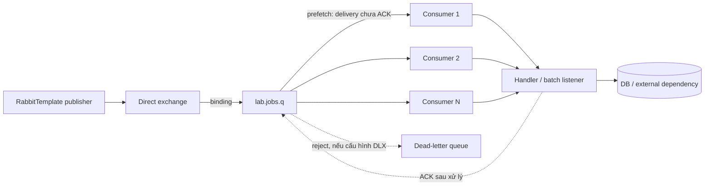

# Đo tác động của prefetch, concurrency và batching

## 1. Tình huống thực hành: worker đã có RabbitMQ nhưng xử lý chậm

Trong chương **Thực hành tổng hợp** của **SPRING_AMQP**, chúng ta triển khai một nhóm worker xử lý sự kiện `OrderExportRequested`. Producer dùng `RabbitTemplate` publish message tới exchange, binding định tuyến vào **một work queue**, còn nhiều `@RabbitListener` consumer cạnh tranh nhận việc. Worker xử lý xong mới ACK; nếu gặp lỗi, hệ thống cần retry và dead-letter có kiểm soát.

Giả sử queue có `Ready=80.000`, `Unacked=250`, nhưng thông lượng chỉ 100 message/giây. Ta có ba nút điều chỉnh thường được đề xuất:

- Tăng **prefetch** để broker đẩy thêm message trước khi nhận ACK.
- Tăng **concurrency** để chạy thêm consumer song song.
- Bật **batching** để gom ACK hoặc cho một listener xử lý danh sách message.

Mỗi cách thay đổi **một phần khác nhau** của pipeline. Tăng số lượng message đang giữ ở JVM không đồng nghĩa tăng số message được xử lý; batch 20 message trong một lời gọi Java không tự khiến 20 transaction database nhanh hơn; và thêm consumer có thể làm nghẽn connection pool.



**Mục tiêu bài lab:** đo một cách có thể tái lập ảnh hưởng của từng tham số, biết lúc nào throughput tăng, lúc nào p95 latency hoặc số Unacked tăng mà không cải thiện kết quả, và không đánh đổi độ tin cậy lấy chỉ số benchmark đẹp.

Sau bài học, bạn có thể:

1. Phân biệt `prefetchCount`, số consumer song song, `batchSize` gom ACK, **consumer-side batching** và **producer-side batching**.
2. Dựng môi trường RabbitMQ cô lập; chạy thí nghiệm theo **ma trận chỉ thay một biến mỗi lượt**.
3. Viết listener một message và listener nhận `List<String>` với `SimpleRabbitListenerContainerFactory`.
4. Đo **messages/s, job completion latency, callback batch size, Ready/Unacked, ack rate, CPU, memory và downstream pool**.
5. Phân tích trade-off throughput–fairness–latency–duplicate delivery.
6. Chọn cấu hình dựa trên workload thật và có kế hoạch hồi quy khi worker/broker gặp lỗi.

## 2. Năm khái niệm phải tách biệt trước khi đo

| Tham số/cơ chế | Điều nó điều khiển | Điều nó **không** trực tiếp điều khiển |
|---|---|---|
| `prefetchCount` | Credit: số delivery chưa ack tối đa tại mỗi consumer theo QoS RabbitMQ thông thường | Số thread Java thực sự xử lý đồng thời |
| `concurrentConsumers` | Số consumer khởi tạo trên **một listener container SMLC** | Số replica; năng lực DB/CPU bên dưới |
| `batchSize` trên SMLC, `AUTO` | Số message có thể xử lý trước một ACK/commit theo batch | Không nhất thiết truyền `List<?>` tới listener |
| `consumerBatchEnabled=true` + `batchListener=true` | Container gom **những message rời** để gọi listener với `List<?>` | Không tự bulk insert DB; không làm 20 lần gọi API thành một request |
| `BatchingRabbitTemplate` | Producer gộp nhiều logical message thành **một physical AMQP message** | Không đồng nghĩa consumer gom các delivery độc lập |

Trong RabbitMQ, `basic.qos(prefetch)` với cách dùng thông thường áp dụng mức giới hạn theo **consumer**; `prefetch=0` có nghĩa **không giới hạn**, không phải “không nhận message”. Với consumer container kiểu Simple, `prefetch` rất lớn làm nhiều delivery nằm ở bộ đệm client và tăng Unacked ngay cả khi chỉ một handler đang chạy.

### 2.1. ACK trong Spring AMQP

Với `AcknowledgeMode.AUTO`, Spring container ACK **sau khi listener xử lý thành công**; nó khác RabbitMQ **auto-ack** (ứng với `AcknowledgeMode.NONE` trong Spring). Bài lab dùng `AUTO` để tránh đánh đổi mất dữ liệu chỉ nhằm tăng thông lượng.

Khi `batchSize > prefetchCount`, Spring AMQP **có thể tự tăng prefetch thực** lên tối thiểu bằng `batchSize`. Vì vậy thí nghiệm so `prefetch=1,batchSize=50` với `prefetch=1,batchSize=1` **không hề giữ nguyên prefetch**. Trong lab, ta sẽ bắt buộc `prefetch >= batchSize` và ghi lại prefetch thực của broker (xem tài liệu *Message Listener Container Configuration* ở cuối bài).

### 2.2. Chọn SMLC thay vì DMLC cho lab này

Spring AMQP có:

- **SimpleMessageListenerContainer (SMLC):** hỗ trợ `batchSize`, `consumerBatchEnabled`, `concurrentConsumers` và auto-scale consumer; phù hợp bài thực hành.
- **DirectMessageListenerContainer (DMLC):** điều khiển concurrency bằng `consumersPerQueue`, có `messagesPerAck` và `ackTimeout` nhưng **không hỗ trợ consumer-side batching** giống SMLC.

Giữ **SMLC** suốt các lượt đo để không thay đổi luôn threading model. Nếu sau này cần so SMLC với DMLC, đó là một **thí nghiệm mới**, không gộp vào phép đo prefetch/concurrency. 

## 3. Thiết kế benchmark: đo cái gì và giữ nguyên cái gì?

Chọn hai nhóm workload, bởi kết luận cho công việc ngắn không nhất thiết đúng với job dài:

| Workload | Hành vi mô phỏng | Mục đích |
|---|---|---|
| **W1: xử lý đơn giản** | Mỗi message có 1–5 ms công việc nhẹ hoặc một phép tính nhỏ | Thấy ảnh hưởng ACK overhead, delivery pipeline và batch |
| **W2: I/O chậm** | Mỗi message đợi 20–50 ms, hoặc gọi DB/test service có delay cố định | Thấy tác động của concurrency, in-flight và downstream capacity |
| **W3: bulk operation** | Một lần ghi DB thực sự cho `List<Job>` thay vì gọi DB N lần | Chỉ dùng sau khi có W1/W2, để đo **bulk API thực**, không đồng nhất với consumer batching |

`Thread.sleep` trong W2 là **mô phỏng chờ I/O**, không phản ánh CPU và không tạo tải trên database. Kết quả từ W2 chỉ chứng minh lợi ích/giới hạn của worker thread trong kịch bản đợi; phải kiểm thêm với DB thật để chọn cấu hình production.

### 3.1. Hai kiểu benchmark không được trộn

**A. Drain benchmark:** đưa sẵn N message vào queue khi listener chưa chạy, xác nhận chúng đã được broker nhận, rồi mới bật consumer và bấm giờ. Kết quả đo **tốc độ dọn backlog**, không đo publisher throughput hoặc thời gian chờ queue từ lúc HTTP request.

**B. Steady-state benchmark:** consumer chạy trước, publisher gửi ở tốc độ xác định (ví dụ 100 msg/s) trong nhiều phút. Đo **end-to-end latency**, Ready/Unacked, tuổi message, ack rate và độ ổn định khi tốc độ đến gần capacity.

Lab sẽ có mã runnable minh họa dạng A để so công bằng. Phần B có hướng dẫn mở rộng và bảng ghi kết quả riêng, vì latency end-to-end cần đồng bộ timestamp, traffic rate và warm-up chặt chẽ hơn.

### 3.2. Những yếu tố phải cố định

Giữ nguyên giữa các lượt: phiên bản RabbitMQ, queue type, durability, routing, kích thước message, tổng N, giả lập latency, JVM heap/CPU, số replica, network, publisher confirm policy, ACK mode, retry policy, quota DB và runtime/CI host.

Không chạy các kịch bản đồng thời trên **cùng queue**. Với mỗi lượt, dùng **một broker/container mới** hoặc queue/exchange/vhost riêng, dừng listener cũ và dọn dữ liệu. Không purge/delete queue dùng chung trong môi trường production.

## 4. Chuẩn bị môi trường thực hành

Đề xuất:

- Java **17+**, Maven, Spring Boot/Spring AMQP tương thích (ví dụ Spring Boot 3.5 + Spring AMQP 3.2; nếu dùng Boot 4.x hãy đối chiếu API/packaging tương ứng).
- `spring-boot-starter-amqp` để dùng `RabbitTemplate`, `@RabbitListener`, `SimpleRabbitListenerContainerFactory`.
- Spring Boot Actuator/Micrometer để đọc metrics; RabbitMQ Management UI/Prometheus để đọc Ready/Unacked/ack rate.
- Docker hoặc Testcontainers để chạy broker **cô lập**. Không cần đọc module khác hoặc cấu hình production để thực hiện bài.

### 4.1. Chạy RabbitMQ lab riêng

Trong một terminal dành cho lab:

```bash
docker run --rm --detach \
  --name amqp-prefetch-lab \
  --publish 5672:5672 \
  --publish 15672:15672 \
  --env RABBITMQ_DEFAULT_USER=lab \
  --env RABBITMQ_DEFAULT_PASS=lab-local-only \
  rabbitmq:4.1-management

# UI: http://localhost:15672
# Chỉ là tài khoản lab local, KHÔNG dùng password này ngoài máy thử.
```

Sau mỗi lượt cần broker thật sự sạch, dừng container và khởi tạo lại (hoặc dùng Testcontainers tạo container mới):

```bash
docker stop amqp-prefetch-lab
```

Tag image ở trên là **ví dụ**; nên pin một patch/digest đã phê duyệt khi so sánh benchmark lâu dài. Nếu môi trường không cho bind cổng 5672/15672, thay port và cấu hình Spring Boot cho đúng. Các câu lệnh minh họa **chưa được chạy** trong bài.

### 4.2. Dependency tối thiểu

Trong Maven project đã dùng Spring Boot dependency management:

```xml
<dependency>
    <groupId>org.springframework.boot</groupId>
    <artifactId>spring-boot-starter-amqp</artifactId>
</dependency>
<dependency>
    <groupId>org.springframework.boot</groupId>
    <artifactId>spring-boot-starter-actuator</artifactId>
</dependency>
<dependency>
    <groupId>org.springframework.boot</groupId>
    <artifactId>spring-boot-starter-test</artifactId>
    <scope>test</scope>
</dependency>
```

Các đoạn Java bên dưới tương ứng **những file class riêng** trong ứng dụng thử nghiệm, không phải một file Java duy nhất. Khi copy vào project cần đưa vào package của ứng dụng và import theo code đang sử dụng. Lab không yêu cầu triển khai giao diện web hay Spring Data.

### 4.3. application-lab.yml

```yaml
spring:
  rabbitmq:
    host: localhost
    port: 5672
    username: lab
    password: lab-local-only
    publisher-confirm-type: correlated
    publisher-returns: true
    template:
      mandatory: true

lab:
  total: 2000
  prefetch: 1
  consumers: 1
  batch-size: 1
  consumer-batch: false
  receive-timeout-ms: 200
  batch-receive-timeout-ms: 200
  work-ms: 20
  timeout-seconds: 180
```

Chạy với profile `lab` **và** đúng một trong hai profile `lab-single` hoặc `lab-batch`. Các property `lab.*` là tùy chọn tự định nghĩa, **không phải** tên property mặc định của Spring Boot; `LabListenerConfig` bên dưới sẽ đọc chúng.

## 5. Khai báo topology cố định cho một lượt đo

Ta dùng một direct exchange, một queue durable và routing key cố định. Vì mỗi lượt chạy trên **broker mới**, không phải dùng queue chung từ lần trước.

```java
import org.springframework.amqp.core.Binding;
import org.springframework.amqp.core.BindingBuilder;
import org.springframework.amqp.core.DirectExchange;
import org.springframework.amqp.core.Queue;
import org.springframework.amqp.core.QueueBuilder;
import org.springframework.beans.factory.annotation.Qualifier;
import org.springframework.context.annotation.Bean;
import org.springframework.context.annotation.Configuration;

@Configuration
public class LabTopology {
    public static final String EXCHANGE = "lab.jobs.exchange";
    public static final String QUEUE = "lab.jobs.q";
    public static final String ROUTING_KEY = "lab.jobs.run";

    @Bean
    DirectExchange labExchange() {
        return new DirectExchange(EXCHANGE, true, false);
    }

    @Bean
    Queue labQueue() {
        return QueueBuilder.durable(QUEUE).build();
    }

    @Bean
    Binding labBinding(@Qualifier("labQueue") Queue labQueue,
            @Qualifier("labExchange") DirectExchange labExchange) {
        return BindingBuilder.bind(labQueue)
                .to(labExchange).with(ROUTING_KEY);
    }
}
```

Trong lab, không tạo producer-created batch và không thêm DLX ở vòng đầu; mục tiêu là loại các biến gây nhiễu khi đo. Ở vòng reliability phía sau, ta sẽ **thêm DLX/retry** trong một topology mới và kiểm tra hành vi sau lỗi. Không nên tắt DLQ của queue nghiệp vụ production chỉ để benchmark.

`RabbitAdmin` auto-declare topology khi kết nối, nếu ứng dụng có quyền; bên dưới ta gọi `RabbitAdmin.initialize()` để bảo đảm exchange/queue/binding được khai báo **trước khi publish**.

## 6. Container factory: điều chỉnh đúng ba biến

`SimpleRabbitListenerContainerFactory` cho phép đặt fixed concurrency, prefetch, ACK mode và chế độ batch. Cấu hình lab cố ý **tắt auto-startup** để prefill queue trước.

```java
import org.springframework.amqp.core.AcknowledgeMode;
import org.springframework.amqp.rabbit.config.SimpleRabbitListenerContainerFactory;
import org.springframework.amqp.rabbit.connection.ConnectionFactory;
import org.springframework.beans.factory.annotation.Value;
import org.springframework.context.annotation.Bean;
import org.springframework.context.annotation.Configuration;

@Configuration
public class LabListenerConfig {

    @Bean("labListenerFactory")
    SimpleRabbitListenerContainerFactory labListenerFactory(
            ConnectionFactory connectionFactory,
            @Value("${lab.prefetch:1}") int prefetch,
            @Value("${lab.consumers:1}") int consumers,
            @Value("${lab.batch-size:1}") int batchSize,
            @Value("${lab.consumer-batch:false}") boolean consumerBatch,
            @Value("${lab.receive-timeout-ms:200}") long receiveMs,
            @Value("${lab.batch-receive-timeout-ms:200}") long batchReceiveMs) {

        if (prefetch < 1 || consumers < 1 || batchSize < 1
                || prefetch < batchSize) {
            throw new IllegalArgumentException(
                    "Require consumers>=1, prefetch>=batchSize>=1");
        }

        var factory = new SimpleRabbitListenerContainerFactory();
        factory.setConnectionFactory(connectionFactory);
        factory.setAcknowledgeMode(AcknowledgeMode.AUTO);
        factory.setAutoStartup(false);
        factory.setConcurrentConsumers(consumers);
        factory.setMaxConcurrentConsumers(consumers); // Fixed, not auto-scale.
        factory.setPrefetchCount(prefetch);
        factory.setBatchSize(batchSize);
        factory.setReceiveTimeout(receiveMs);
        factory.setBatchReceiveTimeout(batchReceiveMs);
        factory.setConsumerBatchEnabled(consumerBatch);
        factory.setBatchListener(consumerBatch);
        return factory;
    }
}
```

**Giải thích những lựa chọn quan trọng:**

- `setMaxConcurrentConsumers(consumers)` khóa số consumer; nếu để dynamic scaling, kết quả giữa hai lượt `prefetch=1` và `prefetch=20` có thể còn đổi cả số consumer.
- `batchSize=1,consumerBatch=false` là baseline: một callback, ACK thông thường.
- `batchSize=10,consumerBatch=false` là thí nghiệm **ACK batching của SMLC**: listener vẫn nhận một `String` mỗi lần; ACK có thể gom.
- `batchSize=10,consumerBatch=true` bật **consumer-side batch**: listener nhận `List<String>`. Cần ≥10 prefetch, và nhận batch không đồng nghĩa DB batch.
- `setBatchReceiveTimeout` giảm thời gian chờ đầy batch trong traffic ít; phải đo chi phí latency của batch không đầy.
- Mọi thí nghiệm dùng `AUTO` ACK. Không dùng `AcknowledgeMode.NONE` để “tăng throughput”: đó là thay đổi độ tin cậy, không phải tối ưu thuần túy.

Lưu ý phiên bản: `batchReceiveTimeout` có trong các dòng Spring AMQP mới; nếu dùng version cũ chưa có API tương ứng, bỏ hoặc kiểm Javadoc rồi thay cơ chế phù hợp, **không tự đổi tùy tiện `receiveTimeout` và cho rằng tương đương hoàn toàn**.

## 7. Đếm kết quả theo từng logical message

Bài lab cần biết **N job duy nhất đã hoàn tất**, không chỉ `N listener invocations`. Với consumer-side batch, một callback có thể chứa 10 message; đếm callback như đếm job sẽ khiến kết luận sai.

### 7.1. Meter một lượt chạy, có chống đếm trùng

```java
import java.time.Duration;
import java.util.Set;
import java.util.UUID;
import java.util.concurrent.ConcurrentHashMap;
import java.util.concurrent.CountDownLatch;
import java.util.concurrent.TimeUnit;
import java.util.concurrent.atomic.AtomicInteger;
import org.springframework.beans.factory.annotation.Value;
import org.springframework.stereotype.Component;

@Component
public class LabMeter {
    private final String runId = UUID.randomUUID().toString();
    private final int total;
    private final CountDownLatch completed;
    private final Set<Integer> seen = ConcurrentHashMap.newKeySet();
    private final AtomicInteger duplicates = new AtomicInteger();
    private final AtomicInteger callbacks = new AtomicInteger();
    private final AtomicInteger maxCallbackSize = new AtomicInteger();

    public LabMeter(@Value("${lab.total:2000}") int total) {
        if (total < 1) throw new IllegalArgumentException("lab.total must be > 0");
        this.total = total;
        this.completed = new CountDownLatch(total);
    }

    public String runId() { return runId; }
    public int total() { return total; }
    public int uniqueCompleted() { return seen.size(); }
    public int duplicateCount() { return duplicates.get(); }
    public int callbacks() { return callbacks.get(); }
    public int maxCallbackSize() { return maxCallbackSize.get(); }

    public void callback(int size) {
        callbacks.incrementAndGet();
        maxCallbackSize.accumulateAndGet(size, Math::max);
    }

    public void jobCompleted(String raw) {
        String[] fields = raw.split("\\|", -1);
        if (fields.length != 2 || !runId.equals(fields[0])) {
            throw new IllegalArgumentException("Unexpected run ID");
        }
        int index = Integer.parseInt(fields[1]);
        if (index < 0 || index >= total) {
            throw new IllegalArgumentException("Out-of-range index");
        }
        if (seen.add(index)) {
            completed.countDown();
        } else {
            duplicates.incrementAndGet();
        }
    }

    public boolean await(Duration timeout) throws InterruptedException {
        return completed.await(timeout.toMillis(), TimeUnit.MILLISECONDS);
    }
}
```

Đây là **meter in-memory cho một JVM**, không phải hệ thống idempotency production. Khi consumer restart, meter mất trạng thái. Khi xử lý message trùng, lab vẫn ghi số duplicate, còn side effect thật phải được bảo vệ bằng database unique constraint/inbox hoặc idempotency key.

### 7.2. Mô phỏng cùng một lượng công việc mỗi logical message

```java
import org.springframework.beans.factory.annotation.Value;
import org.springframework.stereotype.Component;

@Component
public class LabWork {
    private final LabMeter meter;
    private final long workMs;

    public LabWork(LabMeter meter,
                   @Value("${lab.work-ms:20}") long workMs) {
        this.meter = meter;
        this.workMs = workMs;
    }

    public void processOne(String raw) throws InterruptedException {
        // Thực hành W2: mô phỏng I/O chậm, không phải tải CPU thật.
        if (workMs > 0) {
            Thread.sleep(workMs);
        }
        meter.jobCompleted(raw);
    }
}
```

Với `workMs=20`, một consumer tuần tự có trần lý tưởng khoảng `50 job/s` trước chi phí Spring/RabbitMQ. Với `workMs=0`, phép đo nhạy với ACK, scheduler, client buffer, JVM và overhead của framework; nên tăng N và lặp lượt nhiều lần để giảm nhiễu.

## 8. Hai listener thay thế nhau bằng profile

**Chỉ bật một trong hai profile** dưới đây cho mỗi lượt chạy. Cả hai dùng **cùng queue và listener ID** vì được thiết kế thay thế, tuyệt đối không cùng kích hoạt trong một context.

### 8.1. Listener nhận từng message

```java
import org.springframework.amqp.rabbit.annotation.RabbitListener;
import org.springframework.context.annotation.Profile;
import org.springframework.stereotype.Component;

@Component
@Profile("lab-single")
public class LabSingleListener {
    private final LabWork work;
    private final LabMeter meter;

    public LabSingleListener(LabWork work, LabMeter meter) {
        this.work = work;
        this.meter = meter;
    }

    @RabbitListener(
            id = "labConsumer",
            queues = LabTopology.QUEUE,
            containerFactory = "labListenerFactory")
    public void onMessage(String body) throws InterruptedException {
        meter.callback(1);
        work.processOne(body);
    }
}
```

### 8.2. Listener nhận List qua consumer-side batching

```java
import java.util.List;
import org.springframework.amqp.rabbit.annotation.RabbitListener;
import org.springframework.context.annotation.Profile;
import org.springframework.stereotype.Component;

@Component
@Profile("lab-batch")
public class LabBatchListener {
    private final LabWork work;
    private final LabMeter meter;

    public LabBatchListener(LabWork work, LabMeter meter) {
        this.work = work;
        this.meter = meter;
    }

    @RabbitListener(
            id = "labConsumer",
            queues = LabTopology.QUEUE,
            containerFactory = "labListenerFactory")
    public void onMessages(List<String> bodies)
            throws InterruptedException {
        meter.callback(bodies.size());
        for (String raw : bodies) {
            work.processOne(raw);
        }
    }
}
```

Trong lab này, batch listener **vẫn xử lý tuần tự từng logical message** và mỗi message vẫn `sleep(workMs)`. Do đó không kỳ vọng consumer batching biến thời gian xử lý 10 × 20 ms thành 20 ms. Để đo lợi ích của **bulk JDBC insert**, cần thay vòng lặp bằng một thao tác bulk thực và kiểm transaction/idempotency.

Với `consumerBatchEnabled=true`, `batchListener=true`, container gom những message rời thành batch tối đa `batchSize`. Nếu producer đã tạo physical batch từ trước, tổng số **logical message** truyền tới listener có thể **vượt `batchSize`** do việc de-batch; vì vậy bài đo đầu **không dùng producer batching**.

## 9. Runner: nạp sẵn queue, xác nhận publish rồi mới đo drain

Runner sử dụng `RabbitAdmin` để khai báo topology, `RabbitTemplate` để nạp N message, `CorrelationData` để chờ publisher confirms; chỉ khi nạp xong mới khởi chạy listener thông qua `RabbitListenerEndpointRegistry`.

```java
import java.time.Duration;
import java.util.ArrayList;
import java.util.List;
import java.util.Locale;
import java.util.concurrent.TimeUnit;
import org.springframework.amqp.rabbit.connection.CorrelationData;
import org.springframework.amqp.rabbit.core.RabbitAdmin;
import org.springframework.amqp.rabbit.core.RabbitTemplate;
import org.springframework.amqp.rabbit.listener.MessageListenerContainer;
import org.springframework.amqp.rabbit.listener.RabbitListenerEndpointRegistry;
import org.springframework.beans.factory.annotation.Value;
import org.springframework.boot.ApplicationArguments;
import org.springframework.boot.ApplicationRunner;
import org.springframework.context.annotation.Profile;
import org.springframework.stereotype.Component;

@Component
@Profile("lab")
public class LabRunner implements ApplicationRunner {
    private final RabbitAdmin admin;
    private final RabbitTemplate publisher;
    private final RabbitListenerEndpointRegistry registry;
    private final LabMeter meter;
    private final long deadlineSeconds;

    public LabRunner(RabbitAdmin admin, RabbitTemplate publisher,
            RabbitListenerEndpointRegistry registry,
            LabMeter meter,
            @Value("${lab.timeout-seconds:180}") long deadlineSeconds) {
        this.admin = admin;
        this.publisher = publisher;
        this.registry = registry;
        this.meter = meter;
        this.deadlineSeconds = deadlineSeconds;
    }

    @Override
    public void run(ApplicationArguments args) throws Exception {
        admin.initialize(); // Chắc chắn đã declare queue/binding.
        MessageListenerContainer listener =
                registry.getListenerContainer("labConsumer");
        if (listener == null || listener.isRunning()) {
            throw new IllegalStateException(
                    "Enable exactly one lab-single/lab-batch profile");
        }

        List<CorrelationData> pending = new ArrayList<>();
        for (int i = 0; i < meter.total(); i++) {
            String messageId = meter.runId() + "-" + i;
            CorrelationData cd = new CorrelationData(messageId);
            pending.add(cd);
            publisher.convertAndSend(
                    LabTopology.EXCHANGE, LabTopology.ROUTING_KEY,
                    meter.runId() + "|" + i, cd);
        }

        // Bỏ biến thời gian publisher khỏi phép đo consumer.
        for (CorrelationData cd : pending) {
            var confirm = cd.getFuture().get(30, TimeUnit.SECONDS);
            if (!confirm.isAck() || cd.getReturned() != null) {
                throw new IllegalStateException("Publish not confirmed");
            }
        }

        long started = System.nanoTime();
        boolean finished;
        try {
            listener.start();
            finished = meter.await(Duration.ofSeconds(deadlineSeconds));
        } finally {
            listener.stop(); // Stop đúng container do lab sở hữu.
        }
        double seconds = (System.nanoTime() - started) / 1_000_000_000.0;
        System.out.printf(Locale.ROOT,
            "LAB_RESULT runId=%s total=%d completed=%d duplicates=%d " +
            "callbacks=%d maxCallbackSize=%d seconds=%.3f throughput=%.2f%n",
            meter.runId(), meter.total(), meter.uniqueCompleted(),
            meter.duplicateCount(), meter.callbacks(),
            meter.maxCallbackSize(), seconds,
            meter.uniqueCompleted() / Math.max(seconds, 0.000001));

        if (!finished || meter.uniqueCompleted() != meter.total()) {
            throw new IllegalStateException("Test deadline/data mismatch");
        }
    }
}
```

**Diễn giải kết quả:** `LAB_RESULT.throughput` ở ví dụ đo từ khi gọi `start()` đến khi **handler đã hoàn tất N logical message**; nó có tính cả một phần chi phí khởi tạo consumer trong lần chạy đầu. Nó **không phải** “ACK throughput” và không đo thời gian xếp hàng từ lúc producer gửi message. Với batch, `LabMeter.jobCompleted` đếm job trước khi method `onMessages` return, nên ACK cuối batch có thể đến sau mốc tính toán. Để xác nhận delivery đã settle, kiểm tiếp **broker Unacked về 0/ack rate và database effect** trước khi kết luận.

Để so sánh nghiêm ngặt hơn, tách giai đoạn warm-up, đợi consumer `active` rồi mới bắt đầu cửa sổ đo steady-state. Runner này là một **harness học tập** cho drain, không thay tải kiểm thử production.

### 9.1. Định dạng chạy từng lượt

Ví dụ command-line với Maven Spring Boot plugin; đường dẫn project/binary cần điều chỉnh cho môi trường thực:

```bash
# Baseline: một consumer, prefetch 1, không batch, 20 ms/job.
./mvnw spring-boot:run \
  -Dspring-boot.run.arguments="--spring.profiles.active=lab,lab-single --lab.prefetch=1 --lab.consumers=1 --lab.batch-size=1 --lab.consumer-batch=false --lab.work-ms=20"
```

Trên Windows, dùng `mvnw.cmd`/cách truyền arguments phù hợp shell. Sau khi thu kết quả, **dừng ứng dụng, khởi tạo broker sạch và chạy lần kế tiếp**. Nếu dùng Spring TestContext, cẩn trọng cache context: factory/consumer cũ có thể không được khởi tạo lại chỉ vì đổi test parameters.

### 9.2. Kiểm queue bằng Management HTTP API

Với tài khoản lab tạo ở trên:

```bash
curl --user lab:lab-local-only \
  http://localhost:15672/api/queues/%2F/lab.jobs.q
```

Trong dữ liệu JSON, chú ý `messages_ready`, `messages_unacknowledged`, `consumers` và `message_stats.ack_details.rate` (nếu có). Không đưa credentials thực vào terminal history, CI log hay URL; ví dụ này chỉ dùng tài khoản tạm trên broker lab local.

**Tiêu chí chuẩn bị:** trước khi start listener, queue có gần N message Ready, `Unacked=0`, consumer count bằng 0; sau khi start, số consumer đúng `lab.consumers`, `Unacked` tiến tới giới hạn prefetch khi đủ tải.

## 10. Ma trận thí nghiệm: chỉ thay một yếu tố mỗi lượt

Giữ `total=2000`, workload `20 ms/job`, broker/CPU cố định; mỗi tổ hợp dùng broker/queue sạch và ghi kết quả ít nhất **ba lần** (tốt hơn 5 lần) sau một warm-up.

| Lượt | Prefetch | Consumer | batchSize | consumerBatch | Profile | Giả thuyết |
|---|---:|---:|---:|---|---|---|
| B0 baseline | 1 | 1 | 1 | false | lab-single | ~50 job/s khi sleep 20ms và overhead thấp |
| P1 | 10 | 1 | 1 | false | lab-single | Có thể giảm giao tiếp/idle nhưng không thay thread xử lý |
| P2 | 50 | 1 | 1 | false | lab-single | Unacked tăng; throughput không nhất thiết tăng |
| P3 | 250 | 1 | 1 | false | lab-single | Có thể giữ payload lớn trong JVM |
| C1 | 1 | 2 | 1 | false | lab-single | Lý tưởng gần 2× nếu công việc chờ I/O độc lập |
| C2 | 1 | 4 | 1 | false | lab-single | Tăng nếu downstream còn capacity |
| C3 | 1 | 8 | 1 | false | lab-single | Có thể plateau hoặc giảm vì contention |
| A1 | 10 | 1 | 10 | false | lab-single | ACK theo nhóm, listener vẫn 1 message/call |
| A2 | 50 | 1 | 50 | false | lab-single | ACK ít hơn, có thể tăng redelivery sau crash |
| L1 | 10 | 1 | 10 | true | lab-batch | Một callback chứa nhiều logical message |
| L2 | 50 | 1 | 50 | true | lab-batch | Ít callback hơn, nhưng batch lâu hơn trước ACK |
| L3 | 10 | 4 | 10 | true | lab-batch | Gom batch kết hợp parallel consumers; cần đo p95 |

Số **~50 job/s** ở baseline là một **ước tính lý thuyết** (1/0,02s), không phải benchmark đã chạy. Các lượt còn lại **không có kết quả định trước**; học viên phải đo.

Để phân tích công bằng:

- Khi so **prefetch** P1–P3, giữ `concurrency=1, batchSize=1`.
- Khi so **concurrency** C1–C3, giữ `prefetch=1, batchSize=1`.
- Khi so **ACK batching**, giữ `prefetch=10` cho B' và A1, thay **duy nhất** `batchSize=1 → 10`; bảng trên có B0 khác prefetch nên **không** dùng B0 làm đối chứng trực tiếp cho A1.
- Khi so **consumer-side batching**, so A1 với L1: cùng prefetch, consumer, batchSize, chỉ đổi `consumerBatch=false → true` và listener profile (đây là thay đổi bắt buộc của API).
- Khi so **cộng hưởng**, dùng L3 so với các lượt đối chứng thích hợp, không kết luận “batch giúp 4×” khi cũng tăng consumer 4 lần.

## 11. Thí nghiệm A: prefetch làm thay đổi gì?

### 11.1. Bước thực hiện

1. Chạy B0, sau đó P1, P2, P3 trên broker sạch.
2. Trong lúc chạy, lấy mẫu `Ready`, `Unacked`, số consumer, ack rate mỗi 1–5 giây.
3. Chép `LAB_RESULT` sau khi đủ N job, kiểm queue còn Unacked hay không.
4. Giữ lại CPU/RSS heap, GC pause và độ trễ của listener.

### 11.2. Cách suy luận

Với một consumer, `prefetch=1` có thể tạo **nhịp gửi–ACK–gửi**; tăng lên 10 giảm thời gian consumer rảnh do round-trip. Nhưng khi `Thread.sleep(20ms)` chiếm gần hết thời gian, lợi ích có thể nhỏ.

```text
P=1    → thường Unacked ≤ 1
P=10   → thường Unacked ≤ 10
P=250  → có thể Unacked tới 250 nhưng vẫn chỉ một handler đang chạy
```

Các giá trị trên là **mức trần thông thường**, không phải cam kết broker luôn cấp đủ số message. Khi backlog lớn, message lớn hoặc nhiều queue/channels, giới hạn hiệu quả có thể khác.

**Điều cần phát hiện:** Unacked tăng từ 1 lên 250 nhưng throughput giữ nguyên nghĩa là tăng prefetch **không giải quyết bottleneck xử lý**. Khi code bắt đầu giữ nhiều payload ở memory, hiệu suất thực thậm chí có thể tệ hơn do GC.

### 11.3. Công bằng phân phối

Khi có nhiều consumer với tốc độ khác nhau, prefetch lớn có thể khiến consumer chậm “giữ” nhiều message trong buffer và consumer nhanh thiếu việc. Một bài mở rộng: worker A giả lập `sleep(200ms)`, worker B `sleep(5ms)` trên cùng queue; đo số job hoàn tất trên mỗi worker với `prefetch=1` và `prefetch=100`.

RabbitMQ **không cam kết chia job đều 50/50**, nên mục tiêu là so **throughput, thời gian chờ và độ lệch**, không phải assert mỗi consumer nhận đúng N/2.

## 12. Thí nghiệm B: concurrency tăng tới đâu là có ích?

`concurrency` của SMLC tạo thêm consumer đang nghe cùng queue. Với workload mô phỏng chờ 20 ms và không có bottleneck ngoài, throughput lý tưởng có thể tăng gần tuyến tính khi tăng consumer cho tới khi CPU, scheduler, broker hoặc JVM trở thành giới hạn.

```text
1 consumer  × ~50 job/s lý tưởng = ~50 job/s
2 consumers × ~50 job/s lý tưởng = ~100 job/s
4 consumers × ~50 job/s lý tưởng = ~200 job/s
8 consumers × ~50 job/s lý tưởng = ~400 job/s
```

Đây chỉ là **ước lượng cho thời gian chờ giả định**, không phải số đo từ lab. Nếu mô phỏng một database chỉ có bốn connection hoặc CPU-bound workload, thêm 8 consumer có thể không tăng được thông lượng.

### 12.1. Bảng để ghi kết quả

| Consumers | Throughput đo (job/s) | Speedup so C1 | CPU (%) | DB pool pending | Ack rate | Nhận xét |
|---:|---:|---:|---:|---:|---:|---|
| 1 | _điền sau khi đo_ | 1.00× | — | — | — | |
| 2 | — | — | — | — | — | |
| 4 | — | — | — | — | — | |
| 8 | — | — | — | — | — | |

Một cấu hình có throughput cao hơn 5% nhưng CPU/DB pool saturation tăng đột biến có thể **không đáng chọn** cho production. Đặt budget cho resource, p95 latency và retry, không tối đa hóa messages/s bằng mọi giá.

### 12.2. Horizontal scaling khác số consumer mỗi pod

Ví dụ `3 replica × concurrency=4 = 12 consumer`. Nếu quay trở lại cấu hình 1 replica nhưng concurrency=12, tổng consumer như nhau nhưng khác số pod, CPU limit, connection/channel, locality và failover. Trong benchmark phải **ghi đồng thời số replica và số consumer mỗi replica**. Đừng âm thầm bật auto-scaling SMLC giữa các lượt.

## 13. Thí nghiệm C: ba kiểu batching và phép so đúng

### 13.1. ACK batching: không đổi chữ ký listener

Với SMLC, `batchSize=10,consumerBatchEnabled=false` vẫn có thể gọi:

```java
@RabbitListener(queues = LabTopology.QUEUE,
        containerFactory = "labListenerFactory")
public void onMessage(String body) {
    // Một logical message mỗi invocation.
}
```

Container cố xử lý tới 10 message rồi mới ACK theo nhóm (hoặc ít hơn khi timeout); nó **không** tự truyền `List<String>` cho listener. Mục tiêu của thí nghiệm A1/A2 là đo việc giảm số ACK gửi tới broker, không phải đo bulk processing.

**Đánh đổi:** nếu một consumer chết khi đang giữ nhiều message đã xử lý nhưng chưa ACK, broker có thể redeliver **nhiều message hơn** sau reconnect. Bắt buộc có `eventId` và idempotent business effects.

### 13.2. Consumer-side batching: callback nhận List

Khi bật `consumerBatchEnabled=true` trong factory:

```java
@RabbitListener(queues = LabTopology.QUEUE,
        containerFactory = "labListenerFactory")
public void onMessages(List<String> items) {
    // List có thể là partial batch.
}
```

Container gom message đến `batchSize` hoặc hết thời gian chờ. Với lưu lượng ít, một batch 10 có thể được giao chỉ với 2–3 message, và người dùng phải chịu **thời gian chờ gom batch**. Đo cả:

- `callbacks` và `maxCallbackSize`;
- **phân phối kích thước batch** (cần thêm histogram, không chỉ max);
- thời gian từ enqueue đến khi handler bắt đầu;
- thời gian từ handler bắt đầu đến lúc tất cả logical message trong batch hoàn tất.

**Rủi ro lỗi:** nếu listener xử lý 9 message rồi ném exception ở message thứ 10, các message trước đó có thể đã có side effect nhưng ACK của cả delivery/batch chưa hoàn tất. Trường hợp này **không được coi là xử lý từng message độc lập**. Dùng idempotent handling, transaction phù hợp, hoặc thiết kế chia batch và error policy rõ ràng.

### 13.3. Producer-side batching: một physical message chứa nhiều logical message

Spring AMQP có `BatchingRabbitTemplate` và `SimpleBatchingStrategy`. Producer gom nhiều payload và chỉ gửi khi đầy batch, vượt giới hạn buffer hoặc hết timeout:

```java
// Mẫu ý tưởng, cần cấu hình scheduler/connection factory phù hợp:
var strategy = new SimpleBatchingStrategy(
        100,        // batchSize: tối đa 100 logical messages
        1024 * 1024, // bufferLimit: 1 MiB
        1000L);      // timeout: 1 giây
// new BatchingRabbitTemplate(connectionFactory, strategy, taskScheduler);
```

Batch này được biểu diễn thành **một physical AMQP message**, có header `springBatchFormat=lengthHeader4`; listener container Spring AMQP có thể de-batch theo format. Nó khác hoàn toàn consumer-side batching (gom N physical deliveries).

**Tác động quan trọng:**

1. Message còn ở bộ đệm producer **chưa được gửi broker** có thể mất khi process crash. Publisher confirms chỉ áp dụng khi physical batch thực sự được publish.
2. `prefetch=1` lúc này có thể giữ **một physical batch chứa nhiều logical message**; không so trực tiếp với prefetch=1 khi gửi từng message.
3. Một message không hợp lệ trong producer-created batch có thể khiến **toàn bộ physical batch bị reject/redeliver**, tăng chi phí duplicate.
4. Nếu consumer-side batching cùng bật, số logical message ở `List<?>` **có thể vượt `batchSize`**; phải đếm physical và logical riêng.

Vì vậy **không bật publisher batching trong baseline**. Chỉ thêm vòng P-batch sau khi đã có kết quả P/C/L và định nghĩa tiêu chí về mất dữ liệu, độ trễ publish và message size.

### 13.4. Bảng so sánh để tránh đọc sai kết quả

| Cơ chế | Số physical AMQP messages | Listener method được gọi bao lần | Rủi ro chính |
|---|---|---|---|
| Không batch | N | ~N lần với một-message listener | N callbacks/ACK tùy cấu hình |
| ACK batching `batchSize=10` | N | ~N lần | ACK trễ, có thể redeliver nhiều |
| Consumer-side batching `batchSize=10` | N | ~N/10 lần khi đủ batch | Chờ gom, lỗi một phần batch |
| Producer-side batch 10 | ~N/10 | Tùy listener de-batch và mode | Buffer producer, reject cả physical batch |

Con số ở bảng là **xấp xỉ**, chưa tính partial batches, timeout, recovery, retries và việc một physical batch chứa nhiều logical messages.

## 14. Thống kê đúng: throughput, latency và resource

### 14.1. Công thức throughput

Với drain benchmark:

\[
\text{throughput} = \frac{\text{số logical job hoàn tất duy nhất}}{\text{elapsedSeconds}}
\]

Ví dụ **giả định**, nếu hoàn tất 2000 job trong 20 giây thì throughput là 100 job/s. Không coi đây là số đo của lượt lab.

### 14.2. Speedup và efficiency

\[
\text{speedup}(N) = \frac{T_1}{T_N}
\]

\[
\text{efficiency}(N) = \frac{\text{speedup}(N)}{N}
\]

Trong đó `N` là số consumer, `T_1` là thời gian baseline với một consumer và `T_N` là thời gian với N consumer **cùng workload**. Nếu 4 consumer chỉ nhanh hơn 2 lần, efficiency là 50%; cần xem saturation hoặc overhead.

### 14.3. Latency không thể suy từ throughput

Có ít nhất ba loại latency cần tách:

- **Queue wait:** từ khi broker nhận message đến khi listener bắt đầu xử lý.
- **Handler duration:** từ khi handler bắt đầu đến khi nghiệp vụ hoàn tất.
- **End-to-end completion latency:** từ khi request/job được chấp nhận cho đến khi có trạng thái `COMPLETED` bền.

Trong drain benchmark, message cuối có queue wait lớn do đã nạp toàn bộ backlog; p95 completion latency phản ánh chính workload đó. Trong steady-state benchmark, gửi với arrival rate cố định để đánh giá latency khi hệ thống gần tải bình thường.

Nếu so timestamp của **nhiều JVM**, cần đồng bộ đồng hồ hoặc dùng nguồn thời gian chung. `System.nanoTime()` chỉ thích hợp đo **duration trong cùng JVM**, không so trực tiếp giữa producer JVM và consumer JVM.

### 14.4. Percentile: hãy thu thập phân phối

Không báo chỉ giá trị trung bình. Hãy ghi:

| Metric | Vì sao quan trọng |
|---|---|
| `completed/s` | Năng lực hoàn tất thực, không phải nhận delivery |
| `p50/p95/p99 handler duration` | Phát hiện tail latency và job dài |
| `p95/p99 end-to-end latency` | Ảnh hưởng trực tiếp tới SLO |
| `messages_ready/unacked` | Thấy backlog và credit đang giữ |
| `ack rate` và `redelivery rate` | Kiểm ACK efficiency và độ tin cậy |
| `active consumers`, `prefetch` thực | Kiểm biến cấu hình có thực sự áp dụng |
| `CPU/RSS/GC/threads` | Cân bằng throughput và resource |
| `DB pool active/pending` | Phát hiện bottleneck chuyển xuống DB |
| `batch callback size histogram` | Phân biệt batch đủ và partial |
| `DLQ depth/retry count` | Không tăng throughput bằng việc bỏ qua message lỗi |

Micrometer `Timer` có thể ghi handler duration theo queue alias và mode (single/batch), nhưng **không dùng `runId`, `messageId` hoặc payload làm metric tags** vì cardinality và rò rỉ dữ liệu.

### 14.5. Đừng tự suy từ một mẫu

Kết quả benchmark nên có **warm-up**, tối thiểu ba lần đo cho mỗi tổ hợp, lấy median, p95 và độ lệch. Đảo thứ tự chạy các tổ hợp để tránh kết quả bị ảnh hưởng bởi thời gian của máy/GC/network. Các workload phải cùng byte size, tổng N, mức độ durable/persistent và quy tắc xác nhận publish.

## 15. Phân tích trường hợp thường gặp sau khi đo

### 15.1. Prefetch tăng, Unacked tăng, throughput không đổi

Khả năng lớn là handler/DB mới là bottleneck. Prefetch chỉ tăng in-flight buffer. Giữ prefetch thấp vừa đủ để không mất thời gian chờ delivery; kiểm heap, GC và fairness giữa worker nhanh/chậm.

### 15.2. Concurrency tăng nhưng throughput bắt đầu giảm

Theo dõi DB pool pending, lock wait, CPU throttling, connection/channel count và GC. Nếu 8 consumer tranh 4 DB connections, thời gian chờ lớn có thể chiếm hết các delivery prefetched, làm p95 tăng; giảm concurrency hoặc tăng downstream capacity có kiểm soát.

### 15.3. Consumer batching giảm số callback nhưng latency xấu

Với traffic thấp, container chờ đủ batch hoặc timeout. Tăng kích thước batch có thể giảm overhead nhưng kéo dài thời gian đợi message đầu; hãy thử `batchSize` thấp hơn và `batchReceiveTimeout` ngắn hơn hoặc chỉ bật batching ở giờ cao điểm.

### 15.4. ACK batching làm ack rate giảm nhưng throughput tăng ít

Ack rate giảm có thể là hành vi **dự kiến** nếu ACK được gộp; không coi số ACK/s thấp hơn là consumer kẹt. Cần so `logical completed/s` và Unacked/ready trend. Bù lại, khi crash có thể redeliver nhiều job đã có side effect.

### 15.5. Batch=50 chạy nhanh trên dữ liệu giả nhưng lỗi trên DB thật

Có thể JDBC driver/database không hỗ trợ bulk operation hiệu quả, statement batch bị rollback toàn bộ, hoặc transaction giữ lock lâu. Phân biệt **gọi listener bằng List** với **thao tác bulk I/O thực**, rồi đo transaction commit time và ảnh hưởng partial failure.

## 16. Thử nghiệm lỗi: hiệu năng không được đánh đổi reliability

Sau khi chọn vài cấu hình có throughput tốt, chạy fault injection trong **broker test cô lập**:

| Kịch bản | Hành động | Điều phải xác minh |
|---|---|---|
| Consumer chết trước ACK | Dừng JVM/đóng connection khi Unacked > 0 | Broker redeliver; handler idempotent |
| Handler ném lỗi ở giữa batch | Cho item số 7/10 throw exception | Trạng thái từng job đúng; không duplicate side effect |
| Publisher confirm timeout | Ngắt connection sau publish | Không tạo job mới với ID khác khi retry |
| Broker restart | Restart broker lab có durable queue/message | Recovery, topology, data consistency |
| DB pool quá tải | Giới hạn pool nhỏ hơn số consumer | Không retry nóng, không sụp latency/SLO lâu dài |
| DLQ unavailable | Cấu hình DLX đúng trong test rồi chặn đích | Không hiểu nhầm rằng mọi message reject đều an toàn |
| Rolling shutdown | Stop một replica đang giữ delivery prefetched | Unacked redelivery được xử lý đúng một lần về mặt nghiệp vụ |

### 16.1. Thêm DLX cho vòng reliability

Trong môi trường test mới, có thể khai báo:

```java
Queue reliableQueue = QueueBuilder.durable("lab.reliable.q")
        .deadLetterExchange("lab.reliable.dlx")
        .deadLetterRoutingKey("failed")
        .build();
```

Cần **khai báo thêm DLX, DLQ và binding** `failed` đúng; chỉ khai báo queue argument ở trên chưa đủ để message đi vào DLQ. Để kiểm retry, dùng Spring Retry với `maxAttempts` hữu hạn và recoverer phù hợp. Nếu một recoverer chỉ ghi log rồi nuốt exception, container có thể ACK message lỗi thay vì dead-letter. Với quorum queue, `delivery-limit` thuộc broker và **khác** số invocation của Spring Retry.

**Đặc biệt khi batching:** ACK của nhiều logical messages có thể liên quan cùng một physical message/batch; một lần lỗi có thể làm nhiều logical job chạy lại. Yêu cầu `eventId`, transaction và idempotency càng quan trọng.

### 16.2. Tiêu chí “pass” đầy đủ

Không chỉ dùng `LAB_RESULT completed=N`. Một vòng tin cậy cần kiểm cả:

1. N unique job hoàn tất ở **DB hoặc sink bền** (không chỉ bộ đếm in-memory).
2. Message đã settle, không còn stuck Unacked/Ready ngoài dự kiến.
3. Không có side effect trùng sau restart/retry, dù tổng listener invocations có thể lớn hơn N.
4. Message lỗi vĩnh viễn được phân loại và tới DLQ theo hợp đồng.
5. Publisher confirm/return và trạng thái outbox được đối soát.

## 17. Mẫu báo cáo kết quả thí nghiệm

Ghi lại thông tin môi trường và dữ liệu **đã đo**, tuyệt đối không điền số đo giả vào báo cáo:

```text
SPRING AMQP CONSUMER PERFORMANCE LAB
RabbitMQ image/version  : ______________________
Spring Boot/AMQP        : ______________________
JDK/CPU/RAM/limits      : ______________________
Queue type              : ______________________
Payload size / encoding : ______________________
Workload W1/W2/W3       : ______________________
Test mode               : drain / steady-state
N logical jobs          : ______________________
Producer confirms       : enabled / disabled
Warm-up and repetitions : ______________________
ACK mode / retry policy : ______________________

Trial    Prefetch  Consumers  BatchSize  ConsumerBatch  Median msg/s  p95 ms
B0       1         1          1         false          ______        ______
P1       10        1          1         false          ______        ______
P2       50        1          1         false          ______        ______
C1       1         2          1         false          ______        ______
A1       10        1          10        false          ______        ______
L1       10        1          10        true           ______        ______

Chosen configuration:
  prefetch = _____
  consumers per replica = _____
  replicas = _____
  batchSize = _____
  consumerBatchEnabled = _____

Reasoning:
  Throughput advantage : ______________________
  p95/p99 latency      : ______________________
  CPU/DB/RSS            : ______________________
  Ready/Unacked trend   : ______________________
  Failure/retry outcome : ______________________
  Rollback threshold    : ______________________
```

### 17.1. Cách chốt cấu hình

Chỉ chọn “tốt nhất” khi nó đạt đồng thời:

- Throughput đủ lớn cho tải đỉnh và có headroom.
- p95/p99 end-to-end latency và queue age trong SLO.
- CPU, heap, connection pool và broker resources không bị đẩy đến mức nguy hiểm.
- Không tăng retry/DLQ hoặc duplicate side effects khi fault injection.
- Có phương án rollback `prefetch`, `concurrency`, `batchSize` mà không xóa queue hoặc làm mất message.

Không có một bộ số `prefetch=100,concurrency=8,batch=50` tốt cho mọi service. Điều đúng là **quy trình đo và tiêu chí quyết định**.

## 18. Lỗi thường gặp khi làm bài lab

| Lỗi | Kết luận sai/ảnh hưởng | Cách sửa |
|---|---|---|
| So P=1/batch=1 với P=1/batch=50 | SMLC có thể tự tăng prefetch thực tới 50 | Luôn `prefetch >= batchSize`, quan sát prefetch broker |
| Bật auto-scale consumer khi đo prefetch | Concurrency thay đổi ngoài ý muốn | Giữ min=max consumers |
| Đếm method calls thay số logical messages | Batch 10 bị tính là một job | `LabMeter` đếm unique message ID |
| Dùng queue chứa message từ lần trước | Kết quả và throughput lẫn dữ liệu cũ | Broker/queue riêng mỗi lượt |
| Đo publisher + consumer chung một stopwatch nhưng gọi là consumer throughput | Đưa thời gian publish vào latency | Tách drain và steady-state |
| Chỉ dùng `Thread.sleep` rồi kết luận DB sẽ nhanh tương ứng | Giả lập không có contention thực | Thêm workload DB thật và đo pool |
| Coi `batchSize` luôn là List size | ACK batching khác consumer batching | Kiểm `consumerBatchEnabled`, listener profile |
| Gửi producer batch và đếm physical thay logical | Throughput tính quá thấp/cao | Đếm cả hai mức và kiểm de-batching |
| `prefetch=0` để “tắt prefetch” | Có thể cấp không giới hạn và tăng memory | Dùng 1 để giới hạn một delivery |
| Chuyển sang `NONE` để benchmark cao | Đánh đổi mất dữ liệu | Giữ ACK mode nhất quán |
| Đo một lần duy nhất | GC/JIT/network gây nhiễu | Warm-up, nhiều lượt, median và p95 |
| Không kiểm broker ack sau khi meter đủ N | Meter hoàn tất trước khi ACK được gửi | Kiểm Unacked/ack rate và sink bền |
| Coi batch lỗi một item chỉ retry item đó | Có thể requeue cả batch/physical delivery | Thiết kế idempotency và test partial failure |
| Bật DMLC trong một lượt | Thay cả threading và batching capability | Giữ SMLC; so DMLC riêng |
| Tăng concurrency quá DB pool | Throughput plateau, timeout tăng | Tune downstream cùng budget |

## 19. Câu hỏi và bài tập mở rộng

1. Giải thích bằng lời vì sao `prefetch=50` và `concurrency=1` không có nghĩa có 50 Java handler chạy đồng thời.
2. Với `concurrency=4,prefetch=10`, mức Unacked thường có thể tiến tới bao nhiêu nếu queue còn backlog và chưa có ACK?
3. Vì sao so `prefetch=1,batchSize=1` với `prefetch=1,batchSize=20` không cô lập tác động của batching?
4. `batchSize=20`, `consumerBatchEnabled=false` và `true` khác nhau thế nào về chữ ký `@RabbitListener`?
5. Nếu batch listener nhận 4 message khi `batchSize=10`, nguyên nhân nào có thể dẫn tới partial batch?
6. Với W2 sleep 20 ms, 4 consumer lý tưởng hoàn tất khoảng bao nhiêu job mỗi giây? Điều kiện nào khiến con số đo nhỏ hơn?
7. Thiết kế phép đo steady-state với arrival rate lần lượt 50, 100 và 200 msg/s; tính p95 end-to-end latency từ timestamp nào?
8. Tại sao `messages_unacknowledged=250` khi prefetch=250 không nhất thiết là một sự cố?
9. Publisher-created batch có thể khiến `prefetch=1` tương ứng với nhiều logical messages như thế nào?
10. Một item trong physical batch bị reject: rủi ro với những item cùng batch ra sao?
11. Nếu tăng concurrency từ 4 lên 8 khiến ack rate giảm và DB pool pending tăng, bạn sẽ thay đổi tham số nào trước?
12. Khi nào nên dùng bulk insert thật thay cho chỉ bật consumer-side batching?
13. Vì sao `LabMeter.completed=N` chưa chứng minh message đã được RabbitMQ ACK?
14. Lập kịch bản Testcontainers để kill worker khi đang giữ 20 Unacked và xác nhận redelivery idempotent.
15. Hãy đề xuất một cấu hình “tốt nhất” dựa trên **số đo của chính bạn** và trình bày trade-off throughput, p95, memory, DB saturation và retry.

## 20. Tài liệu tham khảo chính thức

- [Spring AMQP — Message Listener Container Configuration](https://docs.spring.io/spring-amqp/reference/amqp/containerAttributes.html): `prefetchCount`, `batchSize`, `consumerBatchEnabled`, `batchReceiveTimeout`, ACK và transaction.
- [Spring AMQP — @RabbitListener with Batching](https://docs.spring.io/spring-amqp/reference/amqp/receiving-messages/batch.html): `setBatchListener`, `List<?>`, partial batch và `consumerBatchEnabled`.
- [Spring AMQP — Batched Messages / De-batching](https://docs.spring.io/spring-amqp/reference/amqp/receiving-messages/de-batching.html): producer-created batch, `springBatchFormat`, xử lý lỗi cả batch.
- [Spring AMQP — Choosing a Container](https://docs.spring.io/spring-amqp/reference/amqp/receiving-messages/choose-container.html): SMLC và DMLC, concurrency và khả năng batching.
- [Spring AMQP — Sending Messages / Batching](https://docs.spring.io/spring-amqp/reference/amqp/sending-messages.html): `BatchingRabbitTemplate`, `SimpleBatchingStrategy`, buffer và timeout.
- [Spring AMQP — Publisher Confirms and Returns](https://docs.spring.io/spring-amqp/reference/amqp/publisher-confirms-returns.html): ý nghĩa confirms/returns và giới hạn của việc “đã publish”.
- [RabbitMQ — Consumer Prefetch](https://www.rabbitmq.com/docs/consumer-prefetch): `basic.qos`, per-consumer prefetch và tác động của giá trị 0.
- [RabbitMQ — Consumer Acknowledgements and Publisher Confirms](https://www.rabbitmq.com/docs/confirms): sliding window Unacked và ack/redelivery.
- [RabbitMQ — Monitoring](https://www.rabbitmq.com/docs/monitoring): queue metrics, delivery/ack rate, ready/unacked.
- [Spring Boot — RabbitMQ & AMQP](https://docs.spring.io/spring-boot/reference/messaging/amqp.html): starter, connection factory và cấu hình listener.

**Ghi nhớ:** Prefetch điều chỉnh **số delivery đang giữ**, concurrency điều chỉnh **số consumer xử lý song song**, còn batching có thể chỉ **gom ACK**, **gom message vào một callback**, hoặc **gộp physical messages ở producer**. Muốn tối ưu hệ thống Spring AMQP, hãy đo riêng từng cơ chế trên một queue/broker cô lập, đếm **logical job hoàn tất**, quan sát latency và Unacked, rồi kiểm lại retry/idempotency sau lỗi. **Cấu hình tốt nhất là cấu hình đạt SLO với headroom và không làm suy giảm độ tin cậy — không phải cấu hình có prefetch hoặc batchSize lớn nhất.**
