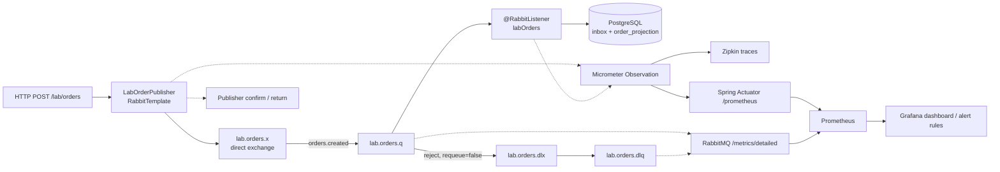
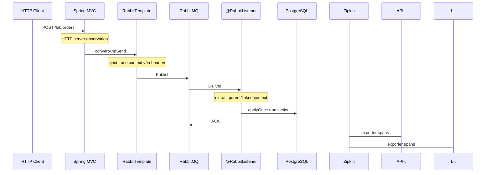

# Hoàn thiện kiểm thử tích hợp, tracing và bảng theo dõi vận hành

## 1. Mục tiêu thực hành tổng hợp

Trong chương **Thực hành tổng hợp** của module **SPRING_AMQP**, mục tiêu không còn là viết riêng một `RabbitTemplate` hay một `@RabbitListener`, mà là **chứng minh được hệ thống bất đồng bộ hoạt động và quan sát được nó khi lỗi**.

Bài lab xây một luồng nhỏ:

1. HTTP API nhận yêu cầu tạo đơn và publish `OrderCreated` qua `RabbitTemplate`.
2. RabbitMQ định tuyến bằng **direct exchange → binding → durable queue**.
3. Consumer `@RabbitListener` đọc JSON, validate, ghi một projection PostgreSQL theo **idempotency key**, rồi để container ACK.
4. Payload không hợp lệ đi qua nhánh **reject không requeue → dead-letter exchange (DLX) → DLQ**.
5. Producer bật **correlated publisher confirms** và **mandatory returns** để phân biệt broker nhận được publish với route không tới queue.
6. Testcontainers khởi động **RabbitMQ + PostgreSQL thật** cho integration tests; JUnit 5 và Awaitility kiểm tra các kết quả bất đồng bộ.
7. Micrometer Observation tạo dấu vết qua publisher/listener; Zipkin hiển thị trace; Prometheus thu metrics từ ứng dụng và broker; Grafana thể hiện bảng theo dõi và cảnh báo.

**Kết quả cần bàn giao của bài thực hành:**

- Bộ kiểm thử chứng minh **happy path, idempotency, invalid payload → DLQ, unroutable publish, behavior khi có lỗi tạm thời**.
- Có thể tìm được một message qua HTTP → RabbitTemplate → RabbitMQ → @RabbitListener → PostgreSQL bằng **trace**, đồng thời phân biệt trace ID với event ID.
- Dashboard trả lời được: queue có backlog không, có consumer không, throughput ra sao, processing failure/duplicate tăng không, DLQ có lớn lên không, latency/confirm ra sao.
- Có **runbook** và **ngưỡng cảnh báo ví dụ** để hành động dựa trên bằng chứng, không dựa vào một biểu đồ đơn lẻ.

**Giới hạn phạm vi:** triển khai theo **Spring Boot 3.5.x + Spring AMQP 3.2.x, Java 17+ và RabbitMQ AMQP 0.9.1**. Đây là lab hướng dẫn, **không phải kết quả chạy sẵn trong repository hiện tại**. Khi dùng Spring Boot 4.x/Spring AMQP 4.x hoặc RabbitMQ AMQP 1.0 (`RabbitAmqpTemplate`), cần đối chiếu tên property, dependencies và observability API theo phiên bản trước khi chuyển nguyên mẫu.

## 2. Tiêu chí hoàn thành phải kiểm tra được

| Mã | Tiêu chí | Bằng chứng bắt buộc |
| --- | --- | --- |
| AC-01 | Exchange/queue/binding/DLX hoạt động | Publish JSON → message vào đúng queue; invalid JSON → DLQ |
| AC-02 | Producer biết publish ACK, NACK, return | `CorrelationData.getFuture()` + `getReturned()` và test routing key sai |
| AC-03 | Consumer lưu dữ liệu bền vững | Query PostgreSQL từ transaction khác cho đúng `orderId` |
| AC-04 | Xử lý lặp an toàn | Gửi hai lần một event hoặc hai event cùng business key; projection không tăng đôi |
| AC-05 | Timeout không được che giấu | Test dùng polling có giới hạn; lỗi chờ có diagnostic |
| AC-06 | Trace qua AMQP | Một trace được export có spans publisher và listener liên kết phù hợp |
| AC-07 | Metrics ứng dụng tồn tại | `/actuator/prometheus` có metric custom và Spring Rabbit Observation |
| AC-08 | Metrics broker tồn tại | RabbitMQ `/metrics/detailed` có ready, unacked, consumers, delivery/ack |
| AC-09 | Dashboard có panel hành động được | Backlog, throughput, redelivery, duplicate, DLQ, consumer count, latency |
| AC-10 | Có cảnh báo và runbook | Ví dụ alert backlog + consumer=0, DLQ tăng, publisher NACK/return |
| AC-11 | Test có tính lặp lại trên CI | Containers cô lập, không `Thread.sleep` để chờ business assertion |
| AC-12 | Không nhầm kết quả nghiệp vụ với trạng thái broker | ACK/confirm, DB commit và business success được đo riêng |

**Không xem “test green” là đủ** nếu test chỉ xác nhận method được gọi. Điều cần khẳng định là các trạng thái **đã commit** trong DB và đã xảy ra trong RabbitMQ.

## 3. Kiến trúc và ranh giới quan sát



### 3.1. Bốn loại tín hiệu không nên đánh đồng

| Tín hiệu | Nó trả lời | Nó **không** chứng minh |
| --- | --- | --- |
| **Publisher confirm** | Broker có ACK/NACK publish hay không? | Consumer đã ghi DB |
| **Consumer ACK** | Delivery đã được xử lý theo acknowledgment policy? | Mọi side effect ngoài DB đã hoàn tất |
| **Trace** | Thời gian và quan hệ các spans qua service | Tất cả message đều được sampling hoặc chưa có message mất |
| **Metric/dashboard** | Xu hướng backlog, lỗi, latency, throughput | Nguyên nhân gốc nếu không đối chiếu log/trace/DB |

Với RabbitMQ, việc **confirm bị mất** có thể khiến producer gửi lại dù message đã vào broker; việc **consumer ACK bị mất** có thể khiến RabbitMQ redeliver dù DB đã commit. Vì vậy, DB **unique constraint** và idempotency là yêu cầu đầu tiên, trước cả dashboard.

## 4. Chuẩn bị môi trường và cấu trúc project

### 4.1. Điều kiện cần

- JDK 17 hoặc cao hơn; Gradle wrapper tương thích bản Spring Boot đã chọn.
- Docker Engine và Docker Compose; Testcontainers cần kết nối được Docker daemon.
- RabbitMQ AMQP 0.9.1; PostgreSQL để kiểm chứng transaction/unique constraint.
- Một backend traces (lab dùng **Zipkin**) và Prometheus/Grafana.
- Spring Boot **3.5.x** để các property `spring.rabbitmq.*` và API Jackson 2 trong ví dụ nhất quán.

### 4.2. Layout mẫu của bài

```text
spring-amqp-observability-lab/
├── build.gradle
├── settings.gradle
├── compose.yaml
├── ops/
│   ├── enabled_plugins
│   └── prometheus.yml
└── src/
    ├── main/
    │   ├── java/com/example/lab/
    │   │   ├── LabApplication.java
    │   │   ├── LabTopology.java
    │   │   ├── LabOrderCreated.java
    │   │   ├── LabOrderPublisher.java
    │   │   ├── LabOrderProcessor.java
    │   │   ├── LabOrderListener.java
    │   │   └── LabOrdersController.java
    │   └── resources/
    │       ├── application.yml
    │       └── schema.sql
    └── test/
        └── java/com/example/lab/
            └── LabFlowIT.java
```

Các path trong layout là **tên file minh họa để người học tạo trong project lab**, không phải yêu cầu bài học này tự tạo nhiều file trong repository nội dung.

### 4.3. Gradle dependencies

Sử dụng Spring Boot BOM để tránh trộn Spring AMQP, Jackson và Micrometer không tương thích:

```groovy
plugins {
    id 'java'
    id 'org.springframework.boot' version '3.5.7'
    id 'io.spring.dependency-management' version '1.1.7'
}

group = 'com.example'
version = '0.0.1-SNAPSHOT'

java {
    toolchain {
        languageVersion = JavaLanguageVersion.of(17)
    }
}

repositories {
    mavenCentral()
}

dependencies {
    implementation 'org.springframework.boot:spring-boot-starter-web'
    implementation 'org.springframework.boot:spring-boot-starter-amqp'
    implementation 'org.springframework.boot:spring-boot-starter-jdbc'
    implementation 'org.springframework.boot:spring-boot-starter-actuator'

    // Spring Boot 3.5: Micrometer Trace -> Zipkin/Brave.
    implementation 'io.micrometer:micrometer-tracing-bridge-brave'
    runtimeOnly 'io.zipkin.reporter2:zipkin-reporter-brave'
    runtimeOnly 'io.micrometer:micrometer-registry-prometheus'
    runtimeOnly 'org.postgresql:postgresql'

    testImplementation 'org.springframework.boot:spring-boot-starter-test'
    testImplementation 'org.springframework.amqp:spring-rabbit-test'
    testImplementation 'org.testcontainers:junit-jupiter'
    testImplementation 'org.testcontainers:rabbitmq'
    testImplementation 'org.testcontainers:postgresql'
    testImplementation 'org.awaitility:awaitility'
}

tasks.named('test') {
    useJUnitPlatform()
}
```

**Version note:** trên Spring Boot 3.5, các module `org.testcontainers:junit-jupiter`/`rabbitmq`/`postgresql` tương ứng với **Testcontainers 1.x** do BOM quản lý. Với **Testcontainers 2.x**, artifact tên `testcontainers-rabbitmq`, `testcontainers-postgresql`, `testcontainers-junit-jupiter` và Java packages `org.testcontainers.rabbitmq`, `org.testcontainers.postgresql`; cần chuyển **toàn bộ** module nhất quán, không ghép nửa phiên bản 1.x với 2.x.

Nếu dùng **Spring Boot 4.x**, công cụ tracing starter và property OTLP/Zipkin có thay đổi; đừng copy dependencies/config tracing của Boot 3.5 mà không đọc tài liệu version 4.

## 5. Docker Compose cho broker, DB, traces và metrics

### 5.1. Stack local

```yaml
# compose.yaml
services:
  rabbitmq:
    image: rabbitmq:4.1-management
    ports:
      - "5672:5672"    # AMQP 0.9.1
      - "15672:15672"  # Management UI
      - "15692:15692"  # Prometheus plugin
    environment:
      RABBITMQ_DEFAULT_USER: lab
      RABBITMQ_DEFAULT_PASS: labpass
    volumes:
      - ./ops/enabled_plugins:/etc/rabbitmq/enabled_plugins:ro

  postgres:
    image: postgres:16-alpine
    ports:
      - "5432:5432"
    environment:
      POSTGRES_DB: lab
      POSTGRES_USER: lab
      POSTGRES_PASSWORD: labpass
    healthcheck:
      test: ["CMD-SHELL", "pg_isready -U lab -d lab"]
      interval: 5s
      timeout: 3s
      retries: 20

  zipkin:
    image: openzipkin/zipkin:3
    ports:
      - "9411:9411"

  prometheus:
    image: prom/prometheus:v3.5.0
    ports:
      - "9090:9090"
    volumes:
      - ./ops/prometheus.yml:/etc/prometheus/prometheus.yml:ro
    extra_hosts:
      - "host.docker.internal:host-gateway"
    depends_on:
      - rabbitmq

  grafana:
    image: grafana/grafana:12.0.2
    ports:
      - "3000:3000"
    environment:
      GF_SECURITY_ADMIN_USER: admin
      GF_SECURITY_ADMIN_PASSWORD: admin
    depends_on:
      - prometheus
```

Tệp `ops/enabled_plugins` chứa **đúng một dòng Erlang term** (dấu chấm cuối là bắt buộc):

```text
[rabbitmq_management,rabbitmq_prometheus].
```

Lưu ý:

- Đây là **môi trường học tập trên máy local**, dùng credentials mẫu; không đưa password mẫu và những port quản trị này ra Internet.
- Với Docker Desktop, `host.docker.internal` thường có sẵn. Trên Linux, `extra_hosts: ["host.docker.internal:host-gateway"]` yêu cầu Docker Engine hỗ trợ `host-gateway`; nếu không, cho app chạy trong Compose network hoặc dùng địa chỉ host phù hợp.
- Đừng cố khởi tạo RabbitMQ broker **cùng một port 5672 trên host** nếu đã có broker khác.
- Khi cần chạy test integration, **Testcontainers tạo một broker/DB riêng với port động**; không trỏ test vào database Compose dùng cho phát triển.
- Pin phiên bản image là ví dụ học tập; production phải cập nhật image/security patches theo policy, mount persistent volumes, network restrictions và storage/retention phù hợp.
- Zipkin trong stack demo chưa có cấu hình persistent storage: không coi traces lưu lâu dài sau restart.

### 5.2. Khởi động hạ tầng

```bash
docker compose up -d
docker compose ps
```

Kiểm tra:

```bash
curl http://localhost:15692/metrics
curl "http://localhost:15692/metrics/detailed?family=queue_coarse_metrics&family=queue_consumer_count"
curl http://localhost:9090/-/ready
```

Sau khi app chạy, còn kiểm tra `/actuator/health` và `/actuator/prometheus` ở port 8080.

RabbitMQ Management: `http://localhost:15672`, user `lab`/`labpass`. Zipkin: `http://localhost:9411`. Prometheus: `http://localhost:9090`. Grafana: `http://localhost:3000`.

**Điểm rất dễ sai:** endpoint `/metrics/detailed` của RabbitMQ **mặc định không xuất bất kỳ family nào** khi không cung cấp query params `family`. Nếu chỉ scrape `/metrics` rồi hỏi “tại sao không có metric per queue?”, hãy kiểm tra chế độ aggregation/per-object/detailed.

## 6. Cấu hình Spring Boot: ACK, confirm, tracing, metrics

### 6.1. application.yml

```yaml
spring:
  application:
    name: lab-spring-amqp
  datasource:
    url: jdbc:postgresql://localhost:5432/lab
    username: lab
    password: labpass
  sql:
    init:
      mode: always
  rabbitmq:
    host: localhost
    port: 5672
    username: lab
    password: labpass

    publisher-confirm-type: correlated
    publisher-returns: true
    template:
      mandatory: true
      observation-enabled: true

    listener:
      type: simple
      simple:
        concurrency: 2
        max-concurrency: 2
        prefetch: 5
        acknowledge-mode: auto
        observation-enabled: true

        # Chính sách demo: thử ngắn rồi DLQ nếu không xử lý được.
        retry:
          enabled: true
          max-attempts: 3
          initial-interval: 200ms
          multiplier: 2.0
          max-interval: 1s
        default-requeue-rejected: false

management:
  endpoints:
    web:
      exposure:
        include: health,info,metrics,prometheus
  tracing:
    sampling:
      probability: 1.0   # Lab only; production đặt tỷ lệ thấp hơn.
  zipkin:
    tracing:
      endpoint: http://localhost:9411/api/v2/spans

logging:
  pattern:
    level: "%5p [traceId=%X{traceId:-},spanId=%X{spanId:-}]"
```

**Lưu ý về cấu hình này:**

1. `template.observation-enabled=true` bật Micrometer Observation cho publisher được **Boot auto-configure**; `listener.simple.observation-enabled=true` bật cho listener factory mặc định. Nếu tự khai báo `RabbitTemplate`/`SimpleRabbitListenerContainerFactory`, phải kiểm tra và đặt `setObservationEnabled(true)` trực tiếp hoặc dùng Boot configurer phù hợp.
2. Khi bật `observationEnabled`, Spring AMQP **không dùng bộ Micrometer timer cũ cùng cách như khi Observation bị tắt**. Hãy tạo dashboard theo metric quan sát thực tế (`spring.rabbit.listener`/`spring.rabbit.template`) và xác nhận tên đã export, thay vì copy query của timer `spring.rabbitmq.listener` trong bài cũ.
3. `AcknowledgeMode.AUTO` nghĩa là **container ACK sau khi listener đồng bộ trả về thành công**; không phải RabbitMQ auto-ack.
4. `default-requeue-rejected=false` và retry hữu hạn có ý nghĩa **trong lab**: lỗi kéo dài cuối cùng có thể bị reject/dead-letter. Production cần policy phân loại **transient DB outage** và **poison message** rõ hơn, có delayed retry, backoff và quy trình replay DLQ.
5. `spring.sql.init.mode=always` cho phép demo tạo bảng qua `schema.sql`. Với production dùng Flyway/Liquibase và migration idempotent; **không** tự chạy schema.sql thay đổi dữ liệu khi deploy.
6. Sampling `1.0` chỉ để kiểm tra liên kết traces; production thường bắt đầu với sampling nhỏ hơn và cơ chế quan sát error/slow traces phù hợp.

### 6.2. Với Spring AMQP 3.x, API bật observation trực tiếp

Khi không dùng Boot auto-configured factory, các method có thể sử dụng:

```java
template.setObservationEnabled(true);
listenerFactory.setObservationEnabled(true);
```

Ở lớp container concrete cũng có `setObservationEnabled(true)`. Nếu tự bật cả quan sát thông qua **Java agent OpenTelemetry và Micrometer Observation** mà không phối hợp, có thể bị **duplicate spans**; chọn rõ một cơ chế instrumentation làm nguồn chính.

## 7. Tạo topology: exchange, queue, DLX và DLQ

```java
package com.example.lab;

import org.springframework.amqp.core.*;
import org.springframework.context.annotation.Bean;
import org.springframework.context.annotation.Configuration;

@Configuration(proxyBeanMethods = false)
public class LabTopology {
    public static final String EXCHANGE = "lab.orders.x";
    public static final String ROUTING_KEY = "orders.created";
    public static final String QUEUE = "lab.orders.q";
    public static final String DLX = "lab.orders.dlx";
    public static final String DLQ = "lab.orders.dlq";

    @Bean
    DirectExchange labOrdersExchange() {
        return new DirectExchange(EXCHANGE, true, false);
    }

    @Bean
    DirectExchange labDeadLetterExchange() {
        return new DirectExchange(DLX, true, false);
    }

    @Bean
    Queue labOrdersQueue() {
        return QueueBuilder.durable(QUEUE)
                .deadLetterExchange(DLX)
                .deadLetterRoutingKey("orders.invalid")
                .build();
    }

    @Bean
    Queue labDeadLetterQueue() {
        return QueueBuilder.durable(DLQ).build();
    }

    @Bean
    Binding ordersBinding(Queue labOrdersQueue,
                          DirectExchange labOrdersExchange) {
        return BindingBuilder.bind(labOrdersQueue)
                .to(labOrdersExchange)
                .with(ROUTING_KEY);
    }

    @Bean
    Binding deadLettersBinding(Queue labDeadLetterQueue,
                               DirectExchange labDeadLetterExchange) {
        return BindingBuilder.bind(labDeadLetterQueue)
                .to(labDeadLetterExchange)
                .with("orders.invalid");
    }
}
```

**Làm rõ ranh giới:** durable queue không tự là quorum queue; publisher message persistent không tự có publisher confirm; consumer ACK không tự là DB commit xuyên broker. Để test một luồng nhỏ, ta dùng một node RabbitMQ. Khi chạy cluster production, cần chọn classic/quorum, replication và dead-letter strategy có chủ đích.

### 7.1. Cơ chế DLX/DLQ trong bài

```text
lab.orders.x --orders.created--> lab.orders.q
                                       |
                           reject (requeue=false)
                                       |
                                       v
                              lab.orders.dlx
                                       |
                               orders.invalid
                                       |
                                       v
                                lab.orders.dlq
```

Nếu không cấu hình `deadLetterExchange`, `deadLetterRoutingKey` và binding của DLQ, một message reject không requeue có thể bị drop. Bài test phải kiểm tra **có message thực sự tới DLQ**, không chỉ assert listener ném exception.

## 8. Schema PostgreSQL: chỉ một business effect

```sql
-- src/main/resources/schema.sql
CREATE TABLE IF NOT EXISTS lab_consumer_inbox (
    consumer_name TEXT NOT NULL,
    event_id UUID NOT NULL,
    processed_at TIMESTAMPTZ NOT NULL DEFAULT now(),
    PRIMARY KEY (consumer_name, event_id)
);

CREATE TABLE IF NOT EXISTS lab_order_projection (
    order_id TEXT PRIMARY KEY,
    event_id UUID NOT NULL,
    total_cents BIGINT NOT NULL CHECK (total_cents > 0),
    recorded_at TIMESTAMPTZ NOT NULL DEFAULT now()
);

CREATE INDEX IF NOT EXISTS ix_lab_projection_recorded_at
    ON lab_order_projection (recorded_at);
```

**Tại sao cần cả hai khóa?**

- `lab_consumer_inbox` chặn cùng `eventId` được áp dụng hai lần khi redelivery.
- `lab_order_projection.order_id` chặn **hai event khác ID nhưng cùng đơn hàng** làm tăng hiệu ứng nghiệp vụ.
- Inbox marker và projection phải được **commit trong cùng một DB transaction**; nếu projection thất bại thì inbox cũng rollback.

Projection trong bài là dữ liệu phục vụ dashboard/đọc; hệ thống thật có thể ghi ledger, reservation hoặc payment. Giữ unique constraint trong database thay vì tin một `ConcurrentHashMap` trong JVM: khi nhiều replica cùng consume, RAM của từng Pod không được chia sẻ.

## 9. DTO và Spring Boot main class

```java
package com.example.lab;

import java.util.UUID;

public record LabOrderCreated(
        UUID eventId,
        String orderId,
        long totalCents
) {}
```

```java
package com.example.lab;

import org.springframework.boot.SpringApplication;
import org.springframework.boot.autoconfigure.SpringBootApplication;

@SpringBootApplication
public class LabApplication {
    public static void main(String[] args) {
        SpringApplication.run(LabApplication.class, args);
    }
}
```

**Hợp đồng JSON**:

```json
{
  "eventId": "2541d997-e65a-4205-94e8-2ef2f7892944",
  "orderId": "ORD-100",
  "totalCents": 150000
}
```

Không truyền một Java class name từ inbound header để quyết định DTO. Bài sẽ **parse bytes thành class cụ thể** và validate input.

## 10. Publisher: correlated confirms, mandatory returns và métrics

### 10.1. Gửi JSON qua RabbitTemplate

```java
package com.example.lab;

import com.fasterxml.jackson.core.JsonProcessingException;
import com.fasterxml.jackson.databind.ObjectMapper;
import io.micrometer.core.instrument.MeterRegistry;
import io.micrometer.core.instrument.Timer;
import java.nio.charset.StandardCharsets;
import java.util.UUID;
import java.util.concurrent.TimeUnit;
import org.springframework.amqp.core.Message;
import org.springframework.amqp.core.MessageDeliveryMode;
import org.springframework.amqp.core.MessageProperties;
import org.springframework.amqp.rabbit.connection.CorrelationData;
import org.springframework.amqp.rabbit.core.RabbitTemplate;
import org.springframework.stereotype.Service;

@Service
public class LabOrderPublisher {
    private final RabbitTemplate rabbit;
    private final ObjectMapper json;
    private final MeterRegistry meters;

    public LabOrderPublisher(RabbitTemplate rabbit,
                             ObjectMapper json,
                             MeterRegistry meters) {
        this.rabbit = rabbit;
        this.json = json;
        this.meters = meters;
    }

    public void publish(LabOrderCreated event) {
        final String payload;
        try {
            payload = json.writeValueAsString(event);
        }
        catch (JsonProcessingException ex) {
            throw new IllegalArgumentException(
                    "Cannot serialize LabOrderCreated", ex);
        }

        // Publish attempt ID khác messageId nghiệp vụ.
        var correlation = new CorrelationData(
                UUID.randomUUID().toString());

        Timer.Sample waitTimer = Timer.start(meters);
        String outcome = "error";

        try {
            rabbit.convertAndSend(
                    LabTopology.EXCHANGE,
                    LabTopology.ROUTING_KEY,
                    payload,
                    message -> {
                        MessageProperties props =
                                message.getMessageProperties();
                        props.setContentType(
                                MessageProperties.CONTENT_TYPE_JSON);
                        props.setMessageId(event.eventId().toString());
                        props.setDeliveryMode(
                                MessageDeliveryMode.PERSISTENT);
                        return message;
                    },
                    correlation);

            var confirm = correlation.getFuture()
                    .get(10, TimeUnit.SECONDS);

            if (!confirm.isAck()) {
                outcome = "nack";
                throw new IllegalStateException(
                        "Broker NACK: " + confirm.getReason());
            }

            if (correlation.getReturned() != null) {
                outcome = "returned";
                throw new IllegalStateException(
                        "Message was unroutable");
            }

            outcome = "ack";
        }
        catch (InterruptedException ex) {
            Thread.currentThread().interrupt();
            throw new IllegalStateException(
                    "Interrupted while awaiting confirm", ex);
        }
        catch (Exception ex) {
            throw new IllegalStateException(
                    "Publish not confirmed or not routed", ex);
        }
        finally {
            meters.counter("lab.orders.publisher.confirm",
                    "outcome", outcome).increment();
            waitTimer.stop(meters.timer(
                    "lab.orders.publisher.confirm.wait"));
        }
    }
}
```

**Mô hình ở ví dụ:** hàm publish chờ confirm ngay trong HTTP request để dễ nhìn thấy kết quả. Production có tải lớn nên dùng async pipeline/outbox relay thay vì giữ nhiều HTTP threads chờ broker.

**Quan trọng:**

- `convertAndSend(...)` return **không** chứng minh broker đã confirm; tương quan nằm ở `CorrelationData.getFuture()`.
- Confirm **ACK** có thể đi cùng **returned message** nếu exchange nhận publish nhưng không định tuyến được. Chỉ khi ACK **và** `getReturned()==null` mới coi publish được broker nhận và không bị báo unroutable, **không** khẳng định consumer đã ghi DB.
- Nếu future timeout hoặc connection mất, outcome có thể **mơ hồ**: broker đã nhận nhưng confirm bị mất. Bài lab ném exception; nghiệp vụ quan trọng cần **transactional outbox + stable eventId** để retry an toàn.
- `MessageProperties.messageId` là một cách lưu event ID logic. `CorrelationData.id` trong ví dụ là ID của **publish attempt**, có thể khác nhau ở mỗi lần retry.
- Metrics `lab.orders.publisher.confirm` và `lab.orders.publisher.confirm.wait` là **custom metrics**, không phải tên Spring AMQP mặc định.

## 11. Consumer: JSON validation, transaction và idempotency

### 11.1. Service ghi dữ liệu bền vững

```java
package com.example.lab;

import org.springframework.jdbc.core.JdbcTemplate;
import org.springframework.stereotype.Service;
import org.springframework.transaction.annotation.Transactional;

@Service
public class LabOrderProcessor {
    private final JdbcTemplate jdbc;

    public LabOrderProcessor(JdbcTemplate jdbc) {
        this.jdbc = jdbc;
    }

    public enum Result { APPLIED, DUPLICATE }

    @Transactional
    public Result applyOnce(LabOrderCreated event) {
        int accepted = jdbc.update("""
            INSERT INTO lab_consumer_inbox
              (consumer_name, event_id)
            VALUES ('lab-orders', ?)
            ON CONFLICT (consumer_name, event_id) DO NOTHING
            """, event.eventId());

        if (accepted == 0) {
            return Result.DUPLICATE;
        }

        int inserted = jdbc.update("""
            INSERT INTO lab_order_projection
              (order_id, event_id, total_cents)
            VALUES (?, ?, ?)
            ON CONFLICT (order_id) DO NOTHING
            """,
            event.orderId(), event.eventId(), event.totalCents());

        if (inserted == 0) {
            Long amount = jdbc.queryForObject("""
                SELECT total_cents FROM lab_order_projection
                WHERE order_id = ?
                """, Long.class, event.orderId());

            if (amount == null || amount != event.totalCents()) {
                // Payload khác dù trùng business key.
                // Exception -> rollback cả inbox marker mới.
                throw new IllegalStateException(
                        "Conflicting duplicate order");
            }
            return Result.DUPLICATE;
        }

        return Result.APPLIED;
    }
}
```

**Chú ý khi thiết kế thật:** nếu `orderId` có thể cập nhật tổng tiền nhiều lần hợp lệ, không được khóa duy nhất theo `orderId` như trên; phải dùng `orderId + version`, operation ID hoặc state transition hợp đồng. Schema lab giả định **mỗi order có một create effect**.

### 11.2. Listener chỉ ACK sau khi service transaction hoàn tất

```java
package com.example.lab;

import com.fasterxml.jackson.core.JsonProcessingException;
import com.fasterxml.jackson.databind.ObjectMapper;
import io.micrometer.core.instrument.MeterRegistry;
import io.micrometer.observation.Observation;
import io.micrometer.observation.ObservationRegistry;
import java.util.Locale;
import org.slf4j.Logger;
import org.slf4j.LoggerFactory;
import org.springframework.amqp.AmqpRejectAndDontRequeueException;
import org.springframework.amqp.core.Message;
import org.springframework.amqp.rabbit.annotation.RabbitListener;
import org.springframework.stereotype.Component;

@Component
public class LabOrderListener {
    private static final Logger log =
            LoggerFactory.getLogger(LabOrderListener.class);

    private final ObjectMapper json;
    private final LabOrderProcessor processor;
    private final MeterRegistry meters;
    private final ObservationRegistry observations;

    public LabOrderListener(ObjectMapper json,
                            LabOrderProcessor processor,
                            MeterRegistry meters,
                            ObservationRegistry observations) {
        this.json = json;
        this.processor = processor;
        this.meters = meters;
        this.observations = observations;
    }

    @RabbitListener(id = "labOrders", queues = LabTopology.QUEUE)
    public void onMessage(Message message) {
        String contentType =
                message.getMessageProperties().getContentType();

        if (contentType == null
                || !contentType.split(";", 2)[0].trim()
                        .equalsIgnoreCase("application/json")) {
            reject("content_type", "Unsupported content type");
        }

        final LabOrderCreated event;
        try {
            event = json.readValue(
                    message.getBody(), LabOrderCreated.class);
        }
        catch (JsonProcessingException ex) {
            meters.counter("lab.orders.rejected",
                    "reason", "invalid_json").increment();
            throw new AmqpRejectAndDontRequeueException(
                    "Invalid JSON", ex);
        }

        if (event == null || event.eventId() == null
                || event.orderId() == null || event.orderId().isBlank()
                || event.totalCents() <= 0) {
            reject("business_contract", "Invalid order contract");
        }

        // Đo span nghiệp vụ lồng trong listener observation.
        var result = Observation.createNotStarted(
                "lab.order.project", observations)
                .lowCardinalityKeyValue("operation", "project-order")
                .observe(() -> processor.applyOnce(event));

        String outcome = result == LabOrderProcessor.Result.APPLIED
                ? "applied" : "duplicate";
        meters.counter("lab.orders.consumed",
                "outcome", outcome).increment();

        log.info("Order event handled eventId={} orderId={} outcome={}",
                event.eventId(), event.orderId(), outcome);
        // AUTO ack: container ACK khi method return bình thường.
    }

    private void reject(String reason, String message) {
        meters.counter("lab.orders.rejected",
                "reason", reason).increment();
        throw new AmqpRejectAndDontRequeueException(message);
    }
}
```

**Điểm kiểm tra:**

- Vì listener nhận `Message`, code **không** dùng `__TypeId__` do publisher gắn để chọn class Java. `ObjectMapper` parse bytes vào `LabOrderCreated.class`.
- `LabOrderProcessor.applyOnce` nằm trên Spring bean **khác** nên `@Transactional` proxy thực thi, commit trước khi listener trả về. Khi DB commit rồi ACK bị mất, delivery có thể lặp, nhưng unique key ngăn ghi trùng.
- Với `AcknowledgeMode.AUTO`, không gọi `Channel.basicAck(...)` trong method.
- `Observation.createNotStarted(...).observe(...)` thêm span/timer cho xử lý nghiệp vụ. Span này **không thay** listener observation: nó cho biết thời gian xử lý business code, trong khi thời gian queue wait/consumer scheduling có thể nằm ở vị trí khác.
- Counter `lab.orders.consumed{outcome=...}` chỉ tăng sau khi DB service **return thành công**. Do một số lỗi có thể xảy ra sau DB commit, vẫn cần DB query là nguồn sự thật thay vì coi metric count là transaction log.
- Ví dụ validate contract và content type; production cần giới hạn body size/parser depth và bảo vệ endpoint publish.

**Metric labels:** giữ `outcome` và `reason` trong tập nhỏ cố định; không đưa `orderId`, `eventId`, `messageId` hoặc trace ID vào Prometheus labels. Chúng có cardinality cao; dùng logs/traces có retention và quyền truy cập phù hợp.

## 12. HTTP endpoint tạo traffic và kiểm tra trạng thái

```java
package com.example.lab;

import java.net.URI;
import java.util.Map;
import java.util.UUID;
import org.springframework.http.ResponseEntity;
import org.springframework.jdbc.core.JdbcTemplate;
import org.springframework.web.bind.annotation.*;

@RestController
@RequestMapping("/lab/orders")
class LabOrdersController {
    private final LabOrderPublisher publisher;
    private final JdbcTemplate jdbc;

    LabOrdersController(LabOrderPublisher publisher, JdbcTemplate jdbc) {
        this.publisher = publisher;
        this.jdbc = jdbc;
    }

    record NewOrder(String orderId, long totalCents) {}

    @PostMapping
    ResponseEntity<Map<String, String>> submit(
            @RequestBody NewOrder request) {
        if (request.orderId() == null
                || request.orderId().isBlank()
                || request.totalCents() <= 0) {
            return ResponseEntity.badRequest()
                    .body(Map.of("error", "invalid request"));
        }

        UUID eventId = UUID.randomUUID();
        publisher.publish(new LabOrderCreated(
                eventId, request.orderId(), request.totalCents()));

        return ResponseEntity.accepted()
                .location(URI.create("/lab/orders/" + request.orderId()))
                .body(Map.of(
                        "eventId", eventId.toString(),
                        "status", "PENDING"));
    }

    @GetMapping("/{orderId}")
    ResponseEntity<?> status(@PathVariable String orderId) {
        var rows = jdbc.query("""
            SELECT order_id, total_cents
            FROM lab_order_projection WHERE order_id = ?
            """, (rs, row) -> Map.of(
                    "orderId", rs.getString("order_id"),
                    "totalCents", rs.getLong("total_cents"),
                    "status", "RECORDED"), orderId);

        return rows.isEmpty()
                ? ResponseEntity.notFound().build()
                : ResponseEntity.ok(rows.get(0));
    }
}
```

`POST` trả **202 Accepted**, không trả `201 Created`/`COMPLETED` chỉ vì broker đã ACK publish. Sau đó gọi `GET` để kiểm tra DB projection đã được consumer ghi.

**Lưu ý demo:** path `orderId` chưa được URL-encode và endpoint không xác thực; đây không phải API công khai sẵn sàng production. HTTP client có thể retry với cùng orderId nhưng API đang tạo eventId mới; consumer dựa trên **business key** nên không tạo projection trùng, nhưng API thật phải có **idempotency key** và kiểm tra conflicting duplicates trước khi publish.

### 12.1. Chạy application và tạo event

```bash
./gradlew bootRun
```

Từ terminal khác:

```bash
curl -i -X POST http://localhost:8080/lab/orders \
  -H "Content-Type: application/json" \
  -d '{"orderId":"ORD-100","totalCents":150000}'

curl http://localhost:8080/lab/orders/ORD-100
curl http://localhost:8080/actuator/health
curl http://localhost:8080/actuator/prometheus
```

Nếu chạy trên PowerShell, `curl` có thể là alias của `Invoke-WebRequest` ở một số môi trường; dùng `curl.exe` nếu muốn cú pháp curl truyền thống.

**Kỳ vọng:** HTTP 202, sau một thời gian ngắn GET trả `RECORDED`. RabbitMQ queue `lab.orders.q` trở về ready=0/unacked=0 sau ACK; có metric `lab_orders_consumed_total{outcome="applied"}` tăng. Tên Prometheus cụ thể vẫn cần xem payload `/actuator/prometheus` của bản Micrometer đang chạy.

## 13. Các lớp kiểm thử và mục đích riêng

| Lớp | Công cụ | Được chứng minh | Không nên kết luận |
| --- | --- | --- | --- |
| Unit | JUnit 5/Mockito | Rules validation, idempotency key, branching | Có delivery/requeue/confirm của broker |
| Listener harness | `spring-rabbit-test`, `@RabbitListenerTest`, `TestRabbitTemplate` | Invocation/arguments/reply của listener | Broker routing, queue durability, network/ACK |
| Database integration | PostgreSQL Testcontainers | Commit/rollback/unique constraint | Publish confirm, DLQ |
| Messaging integration | RabbitMQ Testcontainers | Exchange/binding, container, ACK/DLQ, returns | Business DB commit nếu DB mocked |
| Full integration | RabbitMQ + PostgreSQL Testcontainers | Đầu-cuối broker → DB và idempotency | Một test happy path đủ bao trùm mọi crash window |
| Chaos/smoke | Restart Pod/broker, network cut, traces exporter | Recovery/timeouts/observability | Không còn mọi failure trong production |

Theo Spring AMQP reference, `TestRabbitTemplate` có thể gọi listener trực tiếp **không cần broker**. Vì vậy, không dùng một test kiểu đó làm bằng chứng messages durable hoặc RabbitMQ sẽ redeliver sau khi channel mất.

### 13.1. Đừng đặt @Transactional trên toàn test end-to-end

`@Transactional` trên test method mặc định rollback cuối test; consumer chạy ở thread khác sẽ không nhất thiết thấy dữ liệu chưa commit. Khi muốn chứng minh trạng thái bền vững, để **service tự mở transaction và commit**, rồi query lại trong test ngoài transaction đó.

## 14. Integration test thật với Testcontainers

### 14.1. Bản kiểm thử nền

Dưới đây là skeleton **Testcontainers 1.x** được Spring Boot 3.5 BOM quản lý:

```java
package com.example.lab;

import java.time.Duration;
import java.util.UUID;
import org.junit.jupiter.api.Test;
import org.junit.jupiter.api.parallel.Execution;
import org.junit.jupiter.api.parallel.ExecutionMode;
import org.springframework.amqp.core.Message;
import org.springframework.amqp.core.MessageProperties;
import org.springframework.amqp.rabbit.connection.CorrelationData;
import org.springframework.amqp.rabbit.core.RabbitTemplate;
import org.springframework.beans.factory.annotation.Autowired;
import org.springframework.boot.test.context.SpringBootTest;
import org.springframework.jdbc.core.JdbcTemplate;
import org.springframework.test.context.DynamicPropertyRegistry;
import org.springframework.test.context.DynamicPropertySource;
import org.testcontainers.containers.PostgreSQLContainer;
import org.testcontainers.containers.RabbitMQContainer;
import org.testcontainers.junit.jupiter.Container;
import org.testcontainers.junit.jupiter.Testcontainers;

import static org.awaitility.Awaitility.await;
import static org.junit.jupiter.api.Assertions.*;

@Testcontainers
@SpringBootTest(properties = {
        "spring.sql.init.mode=always",
        "management.tracing.enabled=false"
})
@Execution(ExecutionMode.SAME_THREAD)
class LabFlowIT {

    @Container
    static final RabbitMQContainer rabbit =
            new RabbitMQContainer("rabbitmq:4.1-management");

    @Container
    static final PostgreSQLContainer<?> postgres =
            new PostgreSQLContainer<>("postgres:16-alpine")
                    .withDatabaseName("lab")
                    .withUsername("lab")
                    .withPassword("labpass");

    @DynamicPropertySource
    static void configure(DynamicPropertyRegistry registry) {
        registry.add("spring.rabbitmq.host", rabbit::getHost);
        registry.add("spring.rabbitmq.port", rabbit::getAmqpPort);
        registry.add("spring.rabbitmq.username",
                rabbit::getAdminUsername);
        registry.add("spring.rabbitmq.password",
                rabbit::getAdminPassword);

        registry.add("spring.datasource.url", postgres::getJdbcUrl);
        registry.add("spring.datasource.username",
                postgres::getUsername);
        registry.add("spring.datasource.password",
                postgres::getPassword);
    }

    @Autowired LabOrderPublisher publisher;
    @Autowired RabbitTemplate rabbitTemplate;
    @Autowired JdbcTemplate jdbc;

    private long countFor(String orderId) {
        Long count = jdbc.queryForObject("""
            SELECT count(*) FROM lab_order_projection
            WHERE order_id = ?
            """, Long.class, orderId);
        return count == null ? 0 : count;
    }

    @Test
    void validEventIsCommitted() {
        String orderId = "ORD-" + UUID.randomUUID();
        var event = new LabOrderCreated(
                UUID.randomUUID(), orderId, 150_000);

        publisher.publish(event);

        await().atMost(Duration.ofSeconds(15))
                .untilAsserted(() -> {
                    assertEquals(1, countFor(orderId));
                    Long amount = jdbc.queryForObject("""
                        SELECT total_cents
                        FROM lab_order_projection
                        WHERE order_id = ?
                        """, Long.class, orderId);
                    assertEquals(150_000L, amount);
                });
    }

    @Test
    void sameEventTwiceHasOneBusinessEffect() {
        String orderId = "ORD-" + UUID.randomUUID();
        var event = new LabOrderCreated(
                UUID.randomUUID(), orderId, 10_000);

        publisher.publish(event);
        publisher.publish(event);

        await().atMost(Duration.ofSeconds(15))
                .untilAsserted(() ->
                    assertEquals(1, countFor(orderId)));

        // Test nâng cao: chờ cả hai deliveries đã được ACK,
        // hoặc kiểm tra counter "duplicate" tăng rồi assert lại DB.
    }
}
```

**Đây là lớp test hoàn chỉnh ở cấp ví dụ**, nhưng yêu cầu các class/`application.yml`/`schema.sql` ở phần trước đã được tạo trong **project lab riêng**. Bài này không tuyên bố đã chạy Testcontainers thực tế trong workspace nội dung. 

### 14.2. Vì sao dùng @DynamicPropertySource?

Testcontainers map port 5672/5432 của container sang **port động** trên host, không cố định vào port Compose. `@DynamicPropertySource` đưa địa chỉ chính xác vào Spring context **trước khi các bean kết nối** khởi tạo.

Spring Boot còn hỗ trợ `@ServiceConnection` cho một số Testcontainers để giảm cấu hình tay, nhưng dùng `@DynamicPropertySource` ở đây dễ nhìn rõ kết nối và làm việc trên Boot 3.x.

### 14.3. Test malformed JSON → DLQ

Thêm method vào `LabFlowIT`:

```java
@Test
void invalidJsonIsDeadLettered() {
    String marker = "bad-" + UUID.randomUUID();

    var props = new MessageProperties();
    props.setContentType(MessageProperties.CONTENT_TYPE_JSON);
    props.setMessageId(marker);

    var invalid = new Message(
            "{broken".getBytes(
                    java.nio.charset.StandardCharsets.UTF_8),
            props);

    rabbitTemplate.send(
            LabTopology.EXCHANGE,
            LabTopology.ROUTING_KEY,
            invalid);

    var received =
            new java.util.concurrent.atomic.AtomicReference<Message>();

    await().atMost(Duration.ofSeconds(15))
            .until(() -> {
                Message next = rabbitTemplate.receive(
                        LabTopology.DLQ, 200);
                if (next != null) {
                    received.set(next);
                    return true;
                }
                return false;
            });

    assertNotNull(received.get());
    assertEquals(marker,
            received.get().getMessageProperties().getMessageId());
}
```

`AtomicReference` ở đây giữ message được test poll ra từ DLQ để assert sau khi `Awaitility` hoàn tất. Nếu tách import, có thể dùng `import java.util.concurrent.atomic.AtomicReference;` rồi viết `new AtomicReference<Message>()`.

**Điểm kiểm chứng:** `RabbitTemplate.receive(queue, timeout)` thực hiện `basic.get` theo semantics tương ứng, và sẽ **lấy message ra khỏi DLQ**. Vì vậy, khi test khẳng định có DLQ rồi, nó đã consume message. Không dùng test này trên DLQ production.

Nên cô lập test theo vhost/container hoặc dọn DLQ có kiểm soát; nếu có nhiều test song song cùng queue, một message lỗi từ test khác có thể khiến assertion sai. Ở đây method test được chạy trong class không song song và marker riêng.

### 14.4. Test mandatory return khi sai routing key

```java
@Test
void unroutablePublishIsReturned() throws Exception {
    var correlation = new CorrelationData(
            UUID.randomUUID().toString());

    rabbitTemplate.convertAndSend(
            LabTopology.EXCHANGE,
            "no.binding.for.this.key",
            "{}",
            message -> {
                message.getMessageProperties()
                        .setContentType(
                                MessageProperties.CONTENT_TYPE_JSON);
                return message;
            },
            correlation);

    var confirm = correlation.getFuture()
            .get(10, java.util.concurrent.TimeUnit.SECONDS);

    assertTrue(confirm.isAck(),
            "Exchange can ACK even when no queue is matched");
    assertNotNull(correlation.getReturned(),
            "mandatory return must expose unroutable message");
}
```

Test này phân biệt hai sự thật: **publish được broker ACK** nhưng **không route tới queue**. Điều kiện là `publisher-returns=true` và `template.mandatory=true` được bật trên template thực tế. Với exchange không tồn tại, broker có thể đóng channel thay vì phát một `NO_ROUTE` return; đó là kịch bản khác.

### 14.5. Test duplicate theo business key (hai eventId khác nhau)

```java
@Test
void differentEventIdsSameOrderStillHaveOneProjection() {
    String orderId = "ORD-" + UUID.randomUUID();

    publisher.publish(new LabOrderCreated(
            UUID.randomUUID(), orderId, 40_000));
    publisher.publish(new LabOrderCreated(
            UUID.randomUUID(), orderId, 40_000));

    await().atMost(Duration.ofSeconds(15))
            .untilAsserted(() ->
                    assertEquals(1, countFor(orderId)));
}
```

Phép test này chứng minh **một bất biến DB**, nhưng chỉ thấy count=1 chưa khẳng định cả hai delivery đã xử lý. Tốt hơn: theo dõi attempts/reply custom metric hoặc dùng hook có latch, đợi cả hai được ACK/queue drain, rồi query DB lại. Một hệ thống làm rơi toàn bộ event cũng có thể đáp ứng "không duplicate"; phải assert **ít nhất một effect thành công** và **đủ delivery đã được xử lý**.

## 15. Fault injection: những khoảng lỗi không thể bỏ qua

### 15.1. Ma trận

| Kịch bản | Cách tạo | Bằng chứng cần thu |
| --- | --- | --- |
| Broker không sẵn sàng trước publish | Dừng container RabbitMQ trong suite chaos riêng | Publisher không trả ACK giả, operation có cơ chế retry/outbox |
| Routing key sai | Publish vào exchange đúng, key không bound | Correlated confirm ACK **và** returned message |
| Bad JSON | Gửi bytes không parse được | Không ghi DB, message xuất hiện ở DLQ |
| DB lỗi tạm thời | Tắt PostgreSQL/đóng connection trong suite riêng | Retry/backoff có giới hạn, không ACK thành công giả |
| Hai message cùng event ID | Gửi lặp | Inbox unique, projection một lần |
| Hai event khác ID cùng order | Gửi lặp business key | Projection một lần |
| DB commit xong nhưng ACK bị mất | One-shot listener fault hoặc đóng channel sau commit | Redelivery, không ghi projection hai lần |
| Worker chậm | Test-only latch/timeout trong service | unacked tăng, processing latency cao, alert phù hợp |
| Consumer=0 | Stop listener container qua registry trong test profile | Queue ready tăng, dashboard thể hiện thiếu consumer |
| Trace exporter down | Tắt Zipkin trong lab | Business flow vẫn xử lý, warning/drop telemetry theo policy |
| Pod shutdown | SIGTERM và đợi drain | Unacked trở về 0 hoặc redelivery an toàn |
| DLQ replay | Duyệt và re-publish đã sửa contract | Idempotency vẫn bảo toàn |

### 15.2. Post-commit, pre-ACK: cách dựng test đúng

Với `@RabbitListener` đồng bộ và `AUTO`, có thể thêm **test-only one-shot hook**:

```text
listener nhận message
  -> processor.applyOnce(event)
       -> DB transaction COMMIT
  -> faultHook.failAfterCommitOnce(eventId)
       -> throw ImmediateRequeueAmqpException đúng một lần
  -> broker redeliver (tùy container/retry chain)
  -> processor.applyOnce(event) -> DUPLICATE
  -> listener return -> ACK
```

Đừng gắn `throw new RuntimeException(...)` vô điều kiện vào production; điều đó tạo requeue storm hoặc DLQ không mong muốn. Dùng profile test, một `AtomicBoolean.compareAndSet`/`ConcurrentHashMap.newKeySet` đánh dấu mỗi event fail **đúng một lần**. Với retry interceptor có thể thử lại trong cùng delivery trước khi broker redeliver; nếu mục tiêu phải kiểm chứng **broker redelivery**, hãy quan sát `MessageProperties.redelivered`/delivery counters và điều chỉnh test config, không chỉ đếm method invocation.

**Bất biến quan trọng:** sau khi các attempts kết thúc, `lab_order_projection` và `lab_consumer_inbox` có đúng một record, không có hai side effects. Nên chạy test này tách riêng với default retry policy để kiểm soát kịch bản.

### 15.3. Vì sao không lạm dụng Testcontainers restart trong mọi test?

Nếu dừng broker/PostgreSQL **static @Container** trong một method, các method khác dùng cùng Spring context có thể thất bại ngẫu nhiên. Hãy có **suite chaos riêng**, scope container per test/class, hoặc dùng network proxy như Toxiproxy. Các test integration nhanh nên chạy deterministic, còn chaos suite có timeout/cleanup riêng.

### 15.4. Điều cần phân biệt trong báo cáo lỗi

- **Infrastructure recovery**: broker/connection outage làm client reconnect; không phải tất cả delivery đều bị mất.
- **Application retry**: Spring retry interceptor chạy lại listener; khác broker redelivery.
- **Business idempotency**: DB unique constraint chặn duplicate side effect; không đồng nghĩa chỉ có một listener attempt.
- **Publisher confirmation**: báo broker outcome; không báo completion của consumer.
- **Telemetry exporter health**: exporter lỗi không được khiến business transaction sai hoặc ACK giả.

## 16. Micrometer Observation: tracing qua RabbitMQ

### 16.1. Quan sát hoạt động từ đâu?

Spring AMQP 3.0+ cung cấp Micrometer Observation cho `RabbitTemplate` và listener containers. Khi bật trên cả hai, hệ thống có thể tạo:

- Producer observation/span khi gửi qua RabbitTemplate.
- Receiver/listener observation/span khi nhận xử lý message.
- Context tracing được inject/extract qua **AMQP headers** theo tracer/propagator, tạo dấu vết có liên hệ giữa hai service hoặc giữa hai thread.
- Với HTTP vào service Spring Boot, một HTTP server span giúp bắt đầu trace và nối với publish span.



**Đừng kỳ vọng mọi span luôn cùng một cây parent-child y hệt giữa mọi version/transport.** Messaging trace conventions có thể sử dụng links hoặc spans có cấu trúc khác nhau, và sampling có thể bỏ một số spans. Acceptance đúng là: theo trace ID và metadata có thể đối chiếu publish và consume hoặc ít nhất các spans liên quan theo conventions đang chạy; không dựa vào thứ tự tên span cố định.

### 16.2. Trình tự xác minh trong Zipkin

1. Chạy `Zipkin` ở `localhost:9411` và ứng dụng bật `sampling.probability=1.0`.
2. Gọi một `POST /lab/orders` hợp lệ.
3. Chờ DB projection có order và `@RabbitListener` log đã xử lý.
4. Vào Zipkin → tìm service `lab-spring-amqp` → chạy query.
5. Mở trace mới: tìm HTTP POST, RabbitTemplate publish, listener receive và span `lab.order.project`. Tên chính xác có thể thay theo version/convention.
6. Đối chiếu duration; RabbitTemplate publish span **không nhất thiết** bao phủ thời gian chờ `CorrelationData` confirm vì đó là thao tác riêng. Custom timer `lab.orders.publisher.confirm.wait` bù phần quan sát này.

Nếu không thấy spans, xem **cả ba điều kiện**: Observation enabled cho đúng template/listener, tracing bridge/exporter dependency có trong runtime, Zipkin endpoint reachable và sampling không loại bỏ. Các header tracing không nên bị gateway/message post-processor xóa.

### 16.3. Trace ID không phải event ID

| Định danh | Vòng đời | Mục đích |
| --- | --- | --- |
| `traceId` | Một trace/sample, có thể đổi khi outbox relay chạy ở thời điểm khác | Liên kết latency/call graph |
| `spanId` | Một đoạn thao tác trong trace | Định vị bước chậm/lỗi |
| `eventId` | Một business event logic được publish/retry | Dedup và đối soát |
| `orderId` | Business aggregate key | Bảo đảm một projection/operation theo contract |
| `CorrelationData.id` | Một publish attempt | Ghép publisher confirm/return với attempt |
| `deliveryTag` | Một AMQP channel delivery | ACK/NACK theo channel, không lưu làm business ID |

**Không đặt traceId thành khóa dedup**. Khi một message được redeliver hoặc relayed lại, tracing có thể tạo spans mới nhưng business event vẫn giữ một ID. Nếu outbox relay thực hiện về sau, context HTTP ban đầu có thể không còn; muốn truy vết logic xuyên nhiều job dài cần lưu **business correlation ID và (nếu policy cho phép) sanitized trace context** một cách rõ ràng.

### 16.4. Async, batch và manual instrumentation

- Nếu tự tạo executor và xử lý trong thread khác, MDC/trace context **không tự luôn được copy**; dùng context propagation/supported task decorators và test.
- Với `@RabbitListener` batch, tài liệu Spring AMQP nêu **không tạo observation cho batch listener containers** vì không rõ xử lý quan hệ trace ra sao. Khi dùng batch, thiết kế spans/metrics riêng theo batch và item.
- Nếu thư viện đã tự tạo listener observation, không bọc lại `RabbitListener` như một instrumentation thứ hai cùng tên chỉ để “thấy trace”, vì có thể gây duplicate metrics/spans.
- Không để secret, access token, raw JSON chứa PII hoặc toàn bộ headers vào span attributes. Chỉ dùng low-cardinality dimensions cho metrics; high-cardinality IDs chỉ nên có trong traces/logs với retention phù hợp.

## 17. Spring metrics vs RabbitMQ broker metrics

### 17.1. Metrics phát từ ứng dụng

Đã định nghĩa:

| Metric custom | Kiểu | Nhãn hữu hạn | Ý nghĩa |
| --- | --- | --- | --- |
| `lab.orders.publisher.confirm` | Counter | `outcome=ack/nack/returned/error` | Outcome mà publisher quan sát |
| `lab.orders.publisher.confirm.wait` | Timer | Không gắn eventId | Thời gian chờ publisher confirm |
| `lab.orders.consumed` | Counter | `outcome=applied/duplicate` | Business service hoàn tất thành công |
| `lab.orders.rejected` | Counter | `reason=...` | Message không được phép xử lý |
| `lab.order.project` | Observation/timer/span | `operation=project-order` | Thời gian xử lý business method |
| `spring.rabbit.listener` | Observation timer | Theo convention Spring | Thời gian listener callback |
| `spring.rabbit.template` | Observation timer | Theo convention Spring | Publish phía Spring AMQP |

Các metric `spring.rabbit.listener`/`spring.rabbit.template` ở bảng tương ứng **Observation mode**. Với **Micrometer timer mode cũ**, metric có thể mang tên `spring.rabbitmq.listener` và tags `listenerId`, `queue`, `result`, `exception`. Không được vẽ một panel cũ rồi mặc định nó vẫn có dữ liệu sau khi bật `observationEnabled=true`.

### 17.2. Metrics broker từ RabbitMQ Prometheus plugin

Nhóm queue metrics dùng endpoint:

```text
GET /metrics/detailed?family=queue_coarse_metrics
                     &family=queue_consumer_count
                     &family=queue_delivery_metrics
```

Các series quan trọng:

| Series broker | Đọc như thế nào |
| --- | --- |
| `rabbitmq_detailed_queue_messages_ready` | Message đang chờ được delivery |
| `rabbitmq_detailed_queue_messages_unacked` | Đã delivery nhưng chưa ACK |
| `rabbitmq_detailed_queue_messages` | Tổng ready + unacked |
| `rabbitmq_detailed_queue_consumers` | Số consumers đang subscribe |
| `rabbitmq_detailed_queue_messages_acked_total` | Counter ACK từ consumer |
| `rabbitmq_detailed_queue_messages_redelivered_total` | Counter redelivery |
| `rabbitmq_detailed_queue_messages_delivered_ack_total` | Delivery với manual ACK semantics |
| `rabbitmq_detailed_queue_messages_delivered_total` | Delivery kiểu auto-ack |
| `rabbitmq_detailed_queue_messages_ready` của `lab.orders.dlq` | DLQ backlog cần xử lý |

**Ready = 0 không đồng nghĩa nghiệp vụ đã xử lý xong:** message có thể đang unacked hoặc đã dead-lettered. **Unacked = 0 cũng không chứng minh hết backlog:** có thể ready lớn và consumer count = 0.

### 17.3. Metrics business phải có nguồn sự thật

Một counter Micrometer có thể reset khi Pod restart. Database projection count là **trạng thái bền vững** trong bài. Trong production, nếu cần SLO theo từng business event, tạo audit/outbox/inbox và đối chiếu:

```sql
SELECT count(*) FROM lab_order_projection;
SELECT count(*) FROM lab_consumer_inbox;
```

Đừng viết PromQL để ước lượng số payment/reservation thành công **thay cho accounting database**. Metrics phản ánh xu hướng; DB/ledger là nguồn sự thật để đối soát.

## 18. Prometheus scrape configuration

### 18.1. ops/prometheus.yml

```yaml
global:
  scrape_interval: 15s

scrape_configs:
  - job_name: "spring-amqp-lab"
    metrics_path: /actuator/prometheus
    static_configs:
      - targets: ["host.docker.internal:8080"]

  - job_name: "rabbitmq-overview"
    metrics_path: /metrics
    static_configs:
      - targets: ["rabbitmq:15692"]

  - job_name: "rabbitmq-queues"
    metrics_path: /metrics/detailed
    params:
      family:
        - queue_coarse_metrics
        - queue_consumer_count
        - queue_delivery_metrics
    static_configs:
      - targets: ["rabbitmq:15692"]
```

**Lưu ý config:** trong Compose, hostname `rabbitmq` là **service name trên Docker network**, không phải `localhost` của container Prometheus. Ứng dụng Spring chạy trên host nên Prometheus scrape qua `host.docker.internal:8080`. Nếu Spring chạy trong Compose, thay target bằng `spring-app:8080` theo tên service phù hợp.

Nếu `rabbitmq-queues` có label `instance="rabbitmq:15692"` và `rabbitmq-overview` cũng scrape cùng instance, các metric families **không trùng** nếu query đúng; tránh cùng một metric xuất từ hai job trùng nhau mà sau đó `sum(...)` vô ý đếm đôi.

### 18.2. Kiểm tra target trước khi mở dashboard

1. Prometheus UI → **Status → Targets** (hoặc API tương ứng).
2. Kiểm tra cả ba jobs `UP`: app, broker overview và queue metrics.
3. Trên Prometheus expression browser chạy `up`; xem target nào `0`.
4. Truy vấn `rabbitmq_detailed_queue_messages_ready`, `rabbitmq_detailed_queue_consumers`.
5. Nếu series không có, kiểm tra plugin, family params, firewall, quyền truy cập, scrape path.
6. Với application metrics, gửi ít nhất một event trước khi tìm metric **lazy-created** như `lab_orders_consumed_total`.

**Không dùng thiếu series như số 0 một cách ngầm định.** “Không tồn tại metric” có thể do exporter down, scraping lỗi hoặc series chưa bao giờ được tạo. Grafana nên có panel/alert `up` để giám sát chính hệ thống giám sát.

## 19. Dashboard Grafana: panel nào, query gì?

Trong Grafana, thêm Prometheus datasource:

```text
Name: Prometheus
URL:  http://prometheus:9090
Access: Server / proxy
```

Nếu Grafana chạy trong Docker Compose này, dùng `http://prometheus:9090`, **không** dùng `http://localhost:9090` (localhost của Grafana container khác localhost của host).

Tạo dashboard `Spring AMQP – End-to-end Reliability` với các hàng:

### 19.1. Hàng A — Broker và queue health

| Panel | PromQL minh họa | Dạng |
| --- | --- | --- |
| Main queue ready | `sum(rabbitmq_detailed_queue_messages_ready{queue="lab.orders.q"})` | Stat/Time series |
| Main queue unacked | `sum(rabbitmq_detailed_queue_messages_unacked{queue="lab.orders.q"})` | Stat/Time series |
| Main queue consumers | `sum(rabbitmq_detailed_queue_consumers{queue="lab.orders.q"})` | Stat |
| DLQ ready | `sum(rabbitmq_detailed_queue_messages_ready{queue="lab.orders.dlq"})` | Stat |
| Prometheus targets | `up{job=~"spring-amqp-lab\|rabbitmq.*"}` | Status |

**Bối cảnh:** nếu queue ready tăng nhưng consumers=0, cần kiểm tra listener start, connection/vhost, credentials và rollout. Nếu unacked tăng, có thể worker bị kẹt ở DB/API hoặc prefetch quá lớn. Không tăng replica một cách mù quáng khi DB đã bão hòa.

### 19.2. Hàng B — Throughput và chất lượng delivery

```promql
# ACKs per second trên queue chính:
sum(rate(
  rabbitmq_detailed_queue_messages_acked_total{
    queue="lab.orders.q"
  }[5m]
))
```

```promql
# Redelivery per second:
sum(rate(
  rabbitmq_detailed_queue_messages_redelivered_total{
    queue="lab.orders.q"
  }[5m]
))
```

```promql
# Tỷ lệ redelivery / delivery (mẫu nghiên cứu):
sum(rate(rabbitmq_detailed_queue_messages_redelivered_total{
    queue="lab.orders.q"}[5m]))
/
clamp_min(
  sum(rate(rabbitmq_detailed_queue_messages_delivered_ack_total{
      queue="lab.orders.q"}[5m])),
  0.001
)
```

Tỷ lệ trên là **xấp xỉ** phụ thuộc cơ chế delivery/ACK và cách family được xuất; dùng để phát hiện spike, không dùng như định nghĩa chính thức của “business error rate”. Khi broker không có traffic, mẫu số sẽ rất nhỏ; nên ẩn tỷ lệ hoặc ghi rõ “no traffic” thay vì báo 100% error.

### 19.3. Hàng C — Business outcome và publisher

```promql
# Số business effects áp dụng mỗi giây:
sum(rate(lab_orders_consumed_total{outcome="applied"}[5m]))
```

```promql
# Duplicates đã bỏ qua:
sum(increase(lab_orders_consumed_total{outcome="duplicate"}[15m]))
```

```promql
# Invalid message trong 10 phút:
sum(increase(lab_orders_rejected_total[10m]))
```

```promql
# Publish không được xác nhận an toàn:
sum(increase(lab_orders_publisher_confirm_total{
    outcome=~"nack|returned|error"}[10m]))
```

**Tên custom series:** Micrometer chuyển `lab.orders.consumed` thành tên Prometheus dạng `lab_orders_consumed_total` khi là counter. Nhưng binder/registry version và naming convention có thể khác; **bắt buộc xác minh từ `/actuator/prometheus`** trước khi tạo panel. Các ví dụ là PromQL hướng dẫn trên giả định phổ biến, không phải assertion về một deployment chưa chạy.

### 19.4. Hàng D — Latency

```promql
# Mean publisher-confirm wait (Timer):
sum(rate(lab_orders_publisher_confirm_wait_seconds_sum[5m]))
/
clamp_min(
  sum(rate(lab_orders_publisher_confirm_wait_seconds_count[5m])),
  0.001
)
```

Để có P95 của `spring.rabbit.listener` trong **Observation mode**, cần bật histogram buckets cho timer theo hệ thống metrics của Boot/Micrometer. Ví dụ cấu hình bổ sung `application.properties`:

```properties
management.metrics.distribution.percentiles-histogram.spring.rabbit.listener=true
management.metrics.distribution.percentiles-histogram.lab.order.project=true
```

Sau khi bật và xác minh series `*_bucket` thật sự tồn tại:

```promql
histogram_quantile(
  0.95,
  sum by (le) (
    rate(spring_rabbit_listener_seconds_bucket[5m])
  )
)
```

Đó là P95 **listener processing duration**, không tự bao gồm toàn bộ **queue wait** trước khi message được giao. Muốn đo end-to-end từ HTTP/order create tới DB commit, cần một business timestamp chuẩn trong payload hoặc database và xử lý sai lệch đồng hồ/độ trễ. Không dùng processing P95 để kết luận SLA từ publish tới consumer đã đạt.

### 19.5. Dashboard nên kể được câu chuyện

Một bảng theo dõi tốt sắp xếp từ **triệu chứng** đến **nguyên nhân**:

```text
Row 1: Queue ready / unacked / consumers / DLQ
Row 2: Publish rate / ACK rate / redelivery
Row 3: Consumer applied / duplicate / invalid / publisher returns
Row 4: Listener p95 / confirm wait / DB pool / GC
Row 5: Target UP / app pod restarts / broker alarms
```

Khi ready tăng, thứ tự điều tra thường là consumers → processing rate → unacked → DB/API → redeliveries → DLQ. Một panel đơn lẻ không đủ.

## 20. Grafana alert rules: điều kiện và chống nhiễu

### 20.1. Những alert có giá trị

| Alert | Điều kiện tham khảo | Người xử lý nên làm gì |
| --- | --- | --- |
| No consumer with backlog | Ready > 0, consumer count = 0 liên tục 2 phút | Kiểm tra listener start, connection/vhost, deployment |
| Queue backlog rising | Ready > X và xu hướng tăng 10 phút | So sánh publish vs ack; DB/API saturation |
| DLQ growing | DLQ ready tăng hoặc rejected count tăng | Tìm poison payload/schema, quarantine/replay có kiểm soát |
| High redelivery | Redelivery rate vượt baseline | Retry storm, mất connection, consumer crash |
| Unroutable publish | Publisher returns > 0 | Kiểm tra exchange/binding/routing key |
| Confirm NACK/timeout | Publisher errors tăng | Broker health, network, outbox/retry |
| Listener latency P95 high | P95 vượt SLO liên tục | DB/API latency, thread/concurrency |
| Scrape target DOWN | `up==0` | Sửa exporter/network; không suy luận metric=0 |
| DB pool saturated | Active/pending gần limit | Giảm concurrency/replicas, kiểm tra SQL và DB |
| Consumer count below expected | Consumers thấp hơn replica × concurrency | Startup/recovery, Pod rollout, channel limit |

Các ngưỡng `X`, 2 phút, 10 phút chỉ là **ví dụ**, cần dựa vào tải thực tế. Một queue chỉ nhận event mỗi giờ không nên page khi consumer idle vài phút.

### 20.2. Ví dụ PromQL alert

```promql
(
  sum(rabbitmq_detailed_queue_messages_ready{
      queue="lab.orders.q"}) > 0
)
and
(
  sum(rabbitmq_detailed_queue_consumers{
      queue="lab.orders.q"}) == 0
)
```

Khi đưa vào Grafana/Prometheus Alerting, đặt `for: 2m` hoặc độ trễ phù hợp. Nếu metric consumer count **không tồn tại** do scrape lỗi, biểu thức có thể không cảnh báo; thêm alert `up==0` và kiểm tra missing data behavior riêng.

```promql
sum(increase(lab_orders_publisher_confirm_total{
    outcome=~"nack|returned|error"}[10m])) > 0
```

Một publisher return lúc chạy negative test là **kết quả mong đợi**; trong production alert phải lọc môi trường/test traffic, không làm on-call nhận báo động từ suite kiểm thử.

### 20.3. Dedup, severity và tránh alert storm

- Một RabbitMQ broker outage có thể gây errors trên nhiều Pod: nhóm alert theo `service/cluster/queue`, không page riêng theo từng event ID.
- Cảnh báo `consumer_count=0` phải xét queue có nhiệm vụ chạy liên tục hay không; scale-to-zero hợp lệ sẽ khác.
- Chỉ alert on-call khi có **hành động cụ thể**; idle event tự nó không phải incident.
- Khi DLQ tăng, cần policy retention/ownership/replay; đừng auto-replay poison messages vô hạn.
- Hệ thống cảnh báo phải theo dõi **own health**: Prometheus target down/Zipkin exporter down không được bị giấu.

## 21. Bài tập quan sát sự cố có hướng dẫn

### 21.1. Bài tập A — Happy path và tracing

1. Bật Docker Compose, app, mở Zipkin/Prometheus/Grafana.
2. Gửi `ORD-A` qua HTTP POST.
3. Kiểm tra `GET /lab/orders/ORD-A` chuyển từ not found sang `RECORDED`.
4. Kiểm tra `lab_orders_consumed_total{outcome="applied"}` tăng.
5. Kiểm tra broker ready/unacked giảm về 0.
6. Mở Zipkin: tìm HTTP, producer, listener và business observation spans.
7. Ghi lại **trace ID** và **eventId**, giải thích vì sao chúng khác vai trò.

**Đạt:** có DB row, publisher confirm ACK, listener xử lý và trace/metrics tương ứng.

### 21.2. Bài tập B — Malformed JSON

1. Gửi raw body JSON lỗi vào `lab.orders.x`.
2. Consumer từ chối, không ghi projection.
3. DLQ ready tăng hoặc message có trong `lab.orders.dlq`.
4. `lab_orders_rejected_total{reason="invalid_json"}` tăng.
5. Kiểm tra `x-death`/headers ở DLQ nếu broker cung cấp, đối chiếu queue và lý do reject.
6. Đề xuất cách sửa payload rồi replay có kiểm soát, **không thay DLQ consumer thành trusted-all deserializer**.

**Đạt:** message lỗi được cách ly, không tạo side effect.

### 21.3. Bài tập C — Wrong routing key

1. Publish đến `lab.orders.x` với key `orders.unknown`.
2. Xem publisher confirm và mandatory return.
3. Kiểm tra queue chính **không nhận** message.
4. Kiểm tra custom publisher outcome `returned` tăng (nếu gọi code publisher có hỗ trợ custom key; với test `RabbitTemplate` trực tiếp, chỉ có broker metrics).
5. Sửa binding/routing key và publish lại bằng cùng business key khi phù hợp.

**Đạt:** phân biệt **ACK tại exchange** với **message không route tới queue**.

### 21.4. Bài tập D — Duplicate delivery

1. Gửi cùng `eventId` hai lần.
2. Xem `@RabbitListener` có thể chạy hai lần.
3. DB inbox/projection vẫn đúng một lần, counter duplicate tăng.
4. Gửi **eventId khác** nhưng cùng `orderId`; projection vẫn một, không thay amount.
5. Gửi cùng orderId nhưng amount khác; phải bị phân loại conflicting duplicate, không ghi đè im lặng.

**Đạt:** idempotency dựa trên cả message ID và business key.

### 21.5. Bài tập E — Mất consumer

1. Trong môi trường lab, dừng listener container qua `RabbitListenerEndpointRegistry` hoặc dừng app.
2. Vẫn publish event; xem ready tăng và consumers giảm.
3. Khởi động listener/app, chờ queue drain và DB projection.
4. Đối chiếu dashboard ready, consumers, ack rate và traces.
5. Nếu process bị kill giữa xử lý, chứng minh redelivery không nhân đôi projection.

**Đạt:** dashboard có đủ tín hiệu chẩn đoán consumer unavailable, không coi một khoảng idle là lỗi tự động.

### 21.6. Bài tập F — Slow database/API

1. Dùng **test-only delay/latch** trước transaction commit ở consumer, không dùng `Thread.sleep` trong production.
2. Gửi nhiều event, theo dõi unacked/ready và listener duration.
3. Kiểm tra p95 tăng, completion rate có thể giảm.
4. Thử tăng concurrency 2→4; đo DB connection pool/locks và throughput thật.
5. Rút ra khi nào cần bulkhead, backoff và autoscaling theo backlog thay vì chỉ scale CPU.

**Đạt:** phân biệt ready backlog, unacked in-flight và business processing latency.

## 22. Runbook từ alert đến nguyên nhân gốc

### 22.1. Ready tăng, consumer count = 0

Kiểm tra theo thứ tự:

1. App Pod/JVM còn chạy không? `/actuator/health` và broker connections.
2. Listener có được đăng ký đúng ID không? `RabbitListenerEndpointRegistry`.
3. Queue name/vhost/credentials/permissions có đúng không?
4. App có dùng đúng listener factory hay bị `autoStartup=false`?
5. Container có event `ListenerContainerConsumerFailedEvent` hoặc `MissingQueueEvent` không?
6. Sau khôi phục, queue có drain và DB effects có tăng không?

**Không nên:** xóa queue hoặc chuyển toàn bộ message sang DLQ chỉ vì consumer tạm mất.

### 22.2. Ready thấp nhưng unacked cao

Các khả năng:

- Consumer nhận trước nhiều message do `prefetch` nhưng xử lý chậm.
- DB pool hết connection; API ngoài timeout; deadlock/GC pause.
- Listener giữ transaction dài, chưa return nên chưa ACK.
- Một số delivery đã hoàn tất nghiệp vụ nhưng ACK đang lỗi.

Hành động: kiểm tra thread dump, DB pool metrics, tracing p95, retry strategy, prefetch/concurrency và broker channel state. **Ready=0 không đồng nghĩa hoàn tất**.

### 22.3. Publisher confirm ACK nhưng không có DB effect

Điều tra:

1. `getReturned()` có khác null không? Có thể unroutable.
2. Broker queue có message/consumer không?
3. Listener đã nhận nhưng bị conversion error/validation không?
4. DLQ có tăng không?
5. Có duplicate bị inbox chặn không?
6. DB commit thành công hay rollback vì exception?
7. Message có bị gửi sang vhost/queue khác không?

**Không nên:** kết luận mất message chỉ dựa vào confirm ACK và không thấy app log.

### 22.4. Tracing đứt đoạn

- Có đủ dependencies tracing bridge/exporter không?
- App đang chạy Boot 3.5 hay 4.x? Property có đúng phiên bản?
- `spring.rabbitmq.template.observation-enabled` và `listener.simple.observation-enabled` đã bật ở **bean thực** chưa?
- Có custom template/container không được configurer nhận?
- Có message postprocessor xóa tracing headers không?
- Sampling hoặc Zipkin endpoint lỗi không?
- Outbox relay async có tạo root trace mới khi HTTP context hết không?
- Có batch listener (không tự tạo observation) hoặc custom executor thiếu propagation không?

Một trace thiếu span chưa chứng minh business mất message. Kiểm tra DB, metrics, log và broker song song.

## 23. Đưa lab vào CI mà không tạo test flaky

Một pipeline CI tối thiểu:

```text
checkout source
  -> setup JDK 17
  -> start Docker daemon / runner hỗ trợ Testcontainers
  -> ./gradlew test
  -> publish JUnit XML reports, logs đã redacted
  -> optional: integration/chaos suite riêng
  -> fail nếu assertions về DB/DLQ/returns/consumer outcome thất bại
```

Lệnh ví dụ:

```bash
./gradlew clean test
./gradlew test --tests '*LabFlowIT'
```

**Không bắt buộc chạy full Grafana/Zipkin trong mọi unit test:** phần unit/integration nhanh tập trung vào business correctness. Để kiểm tra tracing end-to-end, thêm một **smoke test môi trường** khởi động Zipkin và query spans qua API, có timeout/retry, nhưng đừng yêu cầu tracing backend là dependency bắt buộc của giao dịch nghiệp vụ.

### 23.1. Quy tắc chống flaky

- Sử dụng **eventId/orderId mới mỗi test**; không dùng cùng tên `ORD-1` giữa các test chạy parallel.
- Các tests chia sẻ queue/DLQ có thể tranh message; giới hạn parallel hoặc tách vhost/queue/container.
- Tránh `Thread.sleep(1000)` như một assertion. Dùng Awaitility cho DB state; khi test duplicate, đợi đủ attempts/requeue kết thúc rồi assert lại.
- Testcontainers `@Container` static sống theo class; không dừng RabbitMQ/PostgreSQL trong một method rồi để method kế tiếp sử dụng context hỏng.
- Không gắn `@Transactional` lên toàn method test asynchronous nếu cần thấy commit từ consumer thread.
- Đặt timeout **vừa đủ** với CI chậm; nếu hết timeout phải in diagnostics: ready/unacked/consumers/DLQ, logs và last DB state.
- Nếu Redis/API ngoài không thuộc phạm vi bài, mock ở boundary thích hợp; broker và PostgreSQL vẫn phải **thật** cho integration guarantees.
- Không purge queue production hoặc dùng credentials production khi chạy CI.
- Chạy suite với logging DEBUG có giới hạn trong CI khi thất bại; tránh log toàn bộ payload nhạy cảm.

## 24. Tối ưu tài nguyên của pipeline metrics và traces

Một hệ thống quan sát tốt cũng phải **không làm broker/app quá tải**:

| Lĩnh vực | Khuyến nghị |
| --- | --- |
| RabbitMQ Prometheus | Dùng `/metrics/detailed` chỉ với families cần; tránh `per-object` toàn bộ khi có nhiều queue |
| Scrape interval | 15–30s cho lab/nhóm dịch vụ nhỏ; đo exporter CPU/latency theo kích thước cluster |
| Tracing sampling | 100% chỉ cho lab; production điều chỉnh theo traffic, error rate và retention |
| Metric labels | Chỉ dùng queue, service, outcome, environment, listener ID hữu hạn |
| Log fields | eventId/orderId/traceId có thể tìm kiếm, nhưng redact secrets và hạn chế PII |
| Trace attributes | Không đẩy raw body, card/token, request headers nhạy cảm |
| Dashboard | Dùng template variables có giới hạn; tránh query quét toàn bộ instance/queue khi không cần |
| Exporter failure | Telemetry không nên block consumer transaction hoặc làm ACK thành công giả |
| Retention | Đặt retention riêng cho logs, metrics, traces, DLQ theo compliance/SLO |
| Alert grouping | Group theo queue/service/cluster để tránh một broker outage page hàng chục Pod |

Trên nhiều RabbitMQ nodes, Prometheus cần scrape **từng broker node** theo hướng dẫn RabbitMQ; khi aggregate per-queue metrics phải hiểu semantics per-node và tránh double count giữa jobs. Mẫu Compose một node không đại diện nguyên vẹn cho cluster quorum production.

## 25. Mở rộng bài lab sau khi tiêu chí tối thiểu đã đạt

Bài này thực hành luồng publish–consume–DB giản lược. Có thể nâng cấp tuần tự:

1. **Transactional outbox ở producer:** commit Order state + outbox record cùng DB transaction, relay có claim/lease và kiểm soát confirms/returns.
2. **Retry delayed queue:** phân loại lỗi tạm thời và poison message, TTL+DLX hoặc RabbitMQ delayed-retry strategy phù hợp, tránh requeue storm.
3. **Publisher/consumer nhiều replica:** tính tổng concurrency, prefetch, Hikari pool; đo redelivery khi rolling update.
4. **Distributed tracing liên service:** tách API và Consumer thành hai ứng dụng, sử dụng Zipkin cùng backend; kiểm tra trace propagation qua AMQP.
5. **SLO end-to-end:** đo thời gian từ lúc event được commit ở producer tới business effect ở consumer (khác listener processing time).
6. **Quorum queue và DLQ safety:** thử RabbitMQ node outage, dead-letter strategy phù hợp.
7. **Chaos test có Toxiproxy:** tách mất publish confirm, mất consumer ACK, mất trace exporter và DB timeout.
8. **Alert automation:** Grafana/Alertmanager route đúng đội ownership, thêm runbook URL và tránh alert storm.

Mỗi phần mở rộng cần giữ một test baseline để biết thay đổi làm tăng độ tin cậy hay chỉ thay đổi cách ghi metrics.

## 26. Checklist kết thúc bài thực hành

- [ ] Đã chọn đúng baseline Spring Boot 3.5/Spring AMQP 3.2, không trộn Jackson/Retry/AMQP 1.0 khác?
- [ ] Có RabbitMQ exchange/queue/binding và DLX/DLQ được kiểm chứng trên broker thật?
- [ ] Producer bật correlated confirms + mandatory returns và phân biệt ACK với unroutable?
- [ ] Consumer dùng DTO cố định, validation và giới hạn payload, không tin type headers không kiểm soát?
- [ ] Inbox và projection dùng unique constraints, commit trong cùng local DB transaction?
- [ ] Có test gửi cùng eventId và khác eventId nhưng cùng orderId?
- [ ] Có test invalid JSON đi vào DLQ và không tạo side effect?
- [ ] Có test wrong routing key nhận mandatory return?
- [ ] Có kịch bản post-DB-commit/pre-ACK và hiểu redelivery không bằng exactly-once?
- [ ] Testcontainers RabbitMQ/PostgreSQL dùng ports động, test không phụ thuộc broker/DB của developer?
- [ ] Test dùng Awaitility chờ state, tránh đồng hồ ngủ cố định và `@Transactional` test che lỗi?
- [ ] `RabbitTemplate` và listener container **thực sự** bật Observation?
- [ ] Đã xem được HTTP/publish/consume/business spans ở Zipkin với sampling lab?
- [ ] Đã kiểm tra `/actuator/prometheus` và `/metrics/detailed` có metrics cần thiết?
- [ ] Grafana có ready, unacked, consumers, DLQ, ACK/redelivery rate, duplicates, publisher outcomes, latency?
- [ ] Có alert cho target down, consumer=0+backlog, DLQ tăng và unroutable publish?
- [ ] Có runbook đi từ alert tới DB/broker/trace bằng business/event ID?
- [ ] Đã phân biệt **metrics** (xu hướng), **traces** (quan hệ/timing), **logs** (ngữ cảnh) và **database** (sự thật nghiệp vụ)?
- [ ] Traces/logs/metrics không làm lộ secret hoặc tạo cardinality vô hạn?
- [ ] Có kế hoạch vận hành/CI, tách negative testing và chaos suite khỏi production?

**Kết luận:** một bài lab Spring AMQP chỉ thực sự hoàn chỉnh khi **không những gửi/nhận được message, mà còn chứng minh được kết quả đúng khi retry/lặp, kiểm thử được routing và dead-letter, nhìn thấy trace từ publisher đến consumer, đồng thời vận hành bằng dashboard/alert có hành động cụ thể**. Testcontainers chứng minh broker và database thực sự phối hợp; Micrometer Observation/Zipkin cho thấy mối quan hệ giữa các bước; Prometheus/Grafana mô tả tình trạng queue và độ trễ. Kết hợp các nguồn bằng chứng đó giúp xử lý sự cố mà không nhầm publisher confirms, consumer ACK, telemetry và business commit với nhau.

## Tài liệu tham khảo chính thức

- [Spring AMQP — Testing Support](https://docs.spring.io/spring-amqp/reference/testing.html): `spring-rabbit-test`, `@RabbitListenerTest`, `TestRabbitTemplate` và giới hạn của test không có broker.
- [Spring AMQP — Micrometer Observation](https://docs.spring.io/spring-amqp/reference/amqp/receiving-messages/micrometer-observation.html): bật `observationEnabled` cho `RabbitTemplate`/listener, convention và batch limitation.
- [Spring AMQP 3.2 — Micrometer Observation Metrics/Spans](https://docs.spring.io/spring-amqp/reference/3.2/appendix/micrometer.html): `spring.rabbit.listener`, `spring.rabbit.template`, tags/metric conventions.
- [Spring AMQP — Micrometer Timers](https://docs.spring.io/spring-amqp/reference/amqp/receiving-messages/micrometer.html): tên `spring.rabbitmq.listener` khi dùng timer mode cũ.
- [Spring Boot 3.5 — Tracing](https://docs.spring.io/spring-boot/3.5/reference/actuator/tracing.html): Micrometer tracing bridge, Zipkin, sampling và Spring Boot auto-configuration.
- [Spring Boot 3.5 — Application Properties](https://docs.spring.io/spring-boot/3.5/appendix/application-properties/): `spring.rabbitmq.*.observation-enabled`, publisher confirms/returns, listener retry và tracing props.
- [Spring Boot — Testcontainers](https://docs.spring.io/spring-boot/3.5/reference/testing/testcontainers.html): dynamic properties/service connections trong integration tests.
- [Testcontainers — RabbitMQ](https://java.testcontainers.org/modules/rabbitmq/): container broker và dependencies theo Testcontainers version.
- [Testcontainers — PostgreSQL](https://java.testcontainers.org/modules/databases/postgres/): database thật cho transaction/unique constraint tests.
- [RabbitMQ — Monitoring with Prometheus and Grafana](https://www.rabbitmq.com/docs/prometheus): `rabbitmq_prometheus`, port 15692, `/metrics/detailed` và series per-queue.
- [RabbitMQ — Monitoring](https://www.rabbitmq.com/docs/monitoring): management vs Prometheus plugin, giới hạn metrics và health.
- [RabbitMQ — Publisher Confirms and Consumer Acknowledgements](https://www.rabbitmq.com/docs/confirms): confirm/ACK hai ranh giới riêng, redelivery.
- [RabbitMQ — Dead Letter Exchanges](https://www.rabbitmq.com/docs/dlx): reject/DLX/DLQ, chính sách dead-letter và lưu ý mất message khi routing.
