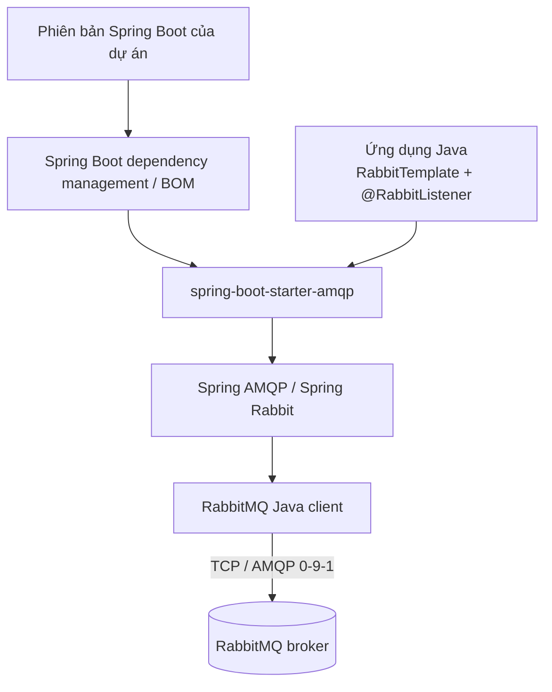

# Thêm starter RabbitMQ phù hợp phiên bản Spring Boot bằng Maven hoặc Gradle

## 1. Mục tiêu và bối cảnh

Trong module **SPRING_AMQP**, chúng ta học tích hợp RabbitMQ với Spring AMQP để xây dựng luồng xử lý bất đồng bộ đáng tin cậy: phát thông điệp bằng `RabbitTemplate`, nhận bằng `@RabbitListener`, định tuyến qua exchange/queue/binding, rồi bổ sung xác nhận giao nhận, retry, dead-letter, giao dịch và quan sát hệ thống.

Để sử dụng những API đó trong ứng dụng Spring Boot, bước khởi tạo quan trọng là khai báo đúng **RabbitMQ starter** và để **phiên bản Spring Boot của dự án** quản lý các thư viện liên quan.

Sau bài này, bạn có thể:

1. Xác định starter cần thêm và phân biệt starter với RabbitMQ broker.
2. Thêm dependency bằng **Maven**, **Gradle Groovy DSL** hoặc **Gradle Kotlin DSL**.
3. Giải thích vai trò của **Spring Boot parent/BOM**, Gradle plugin và cơ chế quản lý phiên bản.
4. Kiểm tra dependency đã được resolve đúng, thử kết nối RabbitMQ và gửi/nhận một thông điệp đơn giản.
5. Chẩn đoán những lỗi cấu hình thường gặp khi mới tích hợp Spring AMQP.

> **Nguyên tắc quan trọng:** Đối với ứng dụng Spring Boot, ưu tiên `org.springframework.boot:spring-boot-starter-amqp` và **không gắn phiên bản riêng** cho starter nếu dự án đã dùng cơ chế quản lý dependency của Spring Boot.

## 2. Cần thêm thư viện nào?

Spring AMQP là bộ thư viện Java giúp ứng dụng làm việc với RabbitMQ. Spring Boot cung cấp starter để đưa các thư viện cần thiết vào classpath và tự cấu hình những bean thông dụng.

| Thành phần | Vai trò | Có phải RabbitMQ server? |
|---|---|---|
| `spring-boot-starter-amqp` | Starter của Spring Boot để tích hợp RabbitMQ theo AMQP 0-9-1, bao gồm Spring AMQP và các dependency cần thiết. | Không |
| `spring-rabbit` | Các thành phần như `RabbitTemplate`, listener container, `@RabbitListener` và cơ chế làm việc với RabbitMQ. | Không |
| `spring-amqp` | Các kiểu dữ liệu và khái niệm AMQP như `Message`, `Queue`, `Exchange`, `Binding`. | Không |
| RabbitMQ Java client | Tương tác với broker qua giao thức AMQP 0-9-1 ở mức thấp hơn. | Không |
| **RabbitMQ broker** | Server thực sự nhận, định tuyến, lưu trữ và giao thông điệp cho consumer. | **Có** |

Trong ứng dụng Spring Boot, thông thường chỉ cần khai báo **một dependency trực tiếp** là `spring-boot-starter-amqp`. Maven/Gradle sẽ kéo theo các thư viện thích hợp theo cây dependency.



Starter **không khởi chạy broker**, không tự tạo kết nối thành công nếu RabbitMQ chưa tồn tại hoặc thông tin kết nối sai, và không tự giải quyết các bài toán retry, duplicate message hay giao dịch nghiệp vụ. Những cơ chế đó cần cấu hình riêng ở các bài tiếp theo.

### Vì sao phải khớp phiên bản Spring Boot?

Spring Boot duy trì một bộ phiên bản thư viện đã được tích hợp, kiểm thử và phát hành cùng nhau. Bộ phiên bản đó được mô tả bởi **`spring-boot-dependencies` BOM (Bill of Materials)**.

Nếu dự án dùng Spring Boot 3.x nhưng tự ép một phiên bản `spring-rabbit`, `spring-amqp` hoặc RabbitMQ client từ thế hệ khác, ứng dụng có thể gặp lỗi không tương thích khi biên dịch hoặc chạy, ví dụ `NoSuchMethodError`, `NoClassDefFoundError`. Đặc biệt khi chuyển giữa các **major version** của Spring Boot, không nên giả định mọi API hoặc yêu cầu Java đều giống nhau.

| Dòng Spring Boot | Cách chọn dependency | Lưu ý |
|---|---|---|
| **2.x** | Sử dụng starter do BOM tương ứng của Boot 2.x quản lý. | Đây là dòng cũ; yêu cầu Java và phạm vi hỗ trợ phụ thuộc phiên bản cụ thể. Không nâng một mình Spring AMQP lên major mới. |
| **3.x** | Sử dụng starter do BOM tương ứng của Boot 3.x quản lý. | Spring Boot 3.x yêu cầu Java 17 trở lên; rà soát thay đổi tương thích khi nâng từ 2.x. |
| **4.x** | Sử dụng starter và BOM tương ứng của Boot 4.x, tra cứu tài liệu phát hành của phiên bản dự án. | Đây là một major mới; kiểm tra yêu cầu Java, tên module và thay đổi API trong tài liệu của phiên bản đang dùng. |

**Đừng chọn phiên bản starter theo cảm tính.** Chẳng hạn, khi nâng Spring Boot, hãy nâng version của parent/plugin/BOM theo kế hoạch, để dependency management chọn phiên bản Spring AMQP phù hợp. Phiên bản Spring AMQP thực sự được chọn có thể xem qua dependency tree.

Các ví dụ dưới đây dùng **Spring Boot 3.5.0 làm mốc minh họa** để hiển thị cú pháp. Khi làm dự án thật, thay mốc này bằng phiên bản Spring Boot mà dự án đã thống nhất và còn được hỗ trợ; không nhất thiết dùng phiên bản minh họa.

## 3. Thêm starter bằng Maven

### 3.1. Dự án dùng `spring-boot-starter-parent`

Đây là cách phổ biến với dự án được tạo từ Spring Initializr. Trong `pom.xml`, phiên bản Spring Boot được khai báo ở `parent`:

```xml
<project xmlns="http://maven.apache.org/POM/4.0.0"
         xmlns:xsi="http://www.w3.org/2001/XMLSchema-instance"
         xsi:schemaLocation="http://maven.apache.org/POM/4.0.0
                             https://maven.apache.org/xsd/maven-4.0.0.xsd">
    <modelVersion>4.0.0</modelVersion>

    <parent>
        <groupId>org.springframework.boot</groupId>
        <artifactId>spring-boot-starter-parent</artifactId>
        <version>3.5.0</version>
        <relativePath/>
    </parent>

    <groupId>com.example</groupId>
    <artifactId>rabbitmq-demo</artifactId>
    <version>0.0.1-SNAPSHOT</version>
    <properties>
        <java.version>17</java.version>
    </properties>

    <dependencies>
        <dependency>
            <groupId>org.springframework.boot</groupId>
            <artifactId>spring-boot-starter-amqp</artifactId>
        </dependency>
    </dependencies>

    <build>
        <plugins>
            <plugin>
                <groupId>org.springframework.boot</groupId>
                <artifactId>spring-boot-maven-plugin</artifactId>
            </plugin>
        </plugins>
    </build>
</project>
```

Điểm cần quan sát là **không có `<version>` trong dependency `spring-boot-starter-amqp`**. Phiên bản của starter và các dependency được xác định bởi BOM mà Spring Boot parent cung cấp.

Nếu `pom.xml` đã có `parent` và các dependency khác, chỉ **thêm phần dependency này** vào `<dependencies>` hiện có:

```xml
<dependency>
    <groupId>org.springframework.boot</groupId>
    <artifactId>spring-boot-starter-amqp</artifactId>
</dependency>
```

Không tạo thêm khối `<dependencies>` trùng lặp và không thay parent đang dùng nếu không có kế hoạch nâng cấp dự án.

### 3.2. Dự án không thể kế thừa Spring Boot parent

Một số ứng dụng phải dùng parent POM của tổ chức. Trong trường hợp đó, hãy **import Spring Boot BOM** trong `<dependencyManagement>` để quản lý phiên bản dependency:

```xml
<dependencyManagement>
    <dependencies>
        <dependency>
            <groupId>org.springframework.boot</groupId>
            <artifactId>spring-boot-dependencies</artifactId>
            <version>3.5.0</version>
            <type>pom</type>
            <scope>import</scope>
        </dependency>
    </dependencies>
</dependencyManagement>

<dependencies>
    <dependency>
        <groupId>org.springframework.boot</groupId>
        <artifactId>spring-boot-starter-amqp</artifactId>
    </dependency>
</dependencies>
```

Đây là **đoạn thêm vào POM**, không phải toàn bộ file `pom.xml`. Với cách import BOM, Maven quản lý phiên bản dependency theo Boot nhưng **không tự áp dụng toàn bộ cấu hình plugin** mà Spring Boot parent cung cấp. Hãy cấu hình Maven Compiler Plugin, Spring Boot Maven Plugin và Java version phù hợp nếu dự án cần.

Nếu dự án đã import `spring-boot-dependencies` hoặc một BOM của tổ chức quản lý Spring Boot, tránh khai báo lại thêm một BOM khác mà chưa kiểm tra thứ tự ưu tiên version.

## 4. Thêm starter bằng Gradle

Gradle hỗ trợ Groovy DSL (`build.gradle`) và Kotlin DSL (`build.gradle.kts`). Cả hai đều dùng cùng artifact `spring-boot-starter-amqp`.

### 4.1. Gradle Groovy DSL — `build.gradle`

Ví dụ dự án Spring Boot:

```groovy
plugins {
    id 'java'
    id 'org.springframework.boot' version '3.5.0'
    id 'io.spring.dependency-management' version '1.1.7'
}

group = 'com.example'
version = '0.0.1-SNAPSHOT'

java {
    toolchain {
        languageVersion = JavaLanguageVersion.of(17)
    }
}

repositories {
    mavenCentral()
}

dependencies {
    implementation 'org.springframework.boot:spring-boot-starter-amqp'
    testImplementation 'org.springframework.boot:spring-boot-starter-test'
}
```

Khi `org.springframework.boot` và `io.spring.dependency-management` được áp dụng cùng nhau, Spring Boot Gradle Plugin phối hợp import `spring-boot-dependencies` của phiên bản Boot đang dùng. Vì vậy dependency `spring-boot-starter-amqp` không phải ghi version.

Nếu dự án đã có sẵn `plugins`, `repositories` và `dependencies`, chỉ cần bổ sung dòng:

```groovy
implementation 'org.springframework.boot:spring-boot-starter-amqp'
```

Đặt dòng này vào **khối `dependencies` đang tồn tại** và bảo đảm dự án có cơ chế quản lý phiên bản Spring Boot hợp lệ.

### 4.2. Gradle Kotlin DSL — `build.gradle.kts`

Với Kotlin DSL, cú pháp tương đương:

```kotlin
plugins {
    java
    id("org.springframework.boot") version "3.5.0"
    id("io.spring.dependency-management") version "1.1.7"
}

group = "com.example"
version = "0.0.1-SNAPSHOT"

java {
    toolchain {
        languageVersion = JavaLanguageVersion.of(17)
    }
}

repositories {
    mavenCentral()
}

dependencies {
    implementation("org.springframework.boot:spring-boot-starter-amqp")
    testImplementation("org.springframework.boot:spring-boot-starter-test")
}
```

Với dự án đã thiết lập plugin và dependency management, dòng cần thêm chỉ là:

```kotlin
implementation("org.springframework.boot:spring-boot-starter-amqp")
```

**Phân biệt các version:** `3.5.0` ở ví dụ là version của **Spring Boot Gradle Plugin**; `1.1.7` là version minh họa của plugin **`io.spring.dependency-management`**. Hai plugin có chu kỳ phát hành riêng. Hãy chọn version plugin tương thích từ cấu hình hoặc tài liệu của dự án; **không** copy version của Spring Boot sang dependency-management plugin.

### 4.3. Nếu dự án Gradle dùng BOM trực tiếp

`io.spring.dependency-management` không phải cách duy nhất. Gradle còn hỗ trợ Maven BOM qua `platform(...)`:

```groovy
dependencies {
    implementation platform('org.springframework.boot:spring-boot-dependencies:3.5.0')
    implementation 'org.springframework.boot:spring-boot-starter-amqp'
}
```

Đây là **phương án thay thế** trong project tự quản lý BOM. Nó cũng cần đồng bộ version BOM với version Spring Boot plugin. Không vô tình trộn nhiều BOM Spring Boot khác phiên bản trong cùng một project.

Nếu là **multi-module Gradle**, hãy thêm starter vào module thực sự sử dụng RabbitMQ, đồng thời tuân theo cấu hình quản lý dependency chung của dự án. Không nhất thiết áp dụng Spring Boot plugin lên mọi module thư viện Java.

## 5. So sánh nhanh Maven và Gradle

| Việc cần làm | Maven | Gradle |
|---|---|---|
| Thêm RabbitMQ starter | `<dependency>...spring-boot-starter-amqp...</dependency>` | `implementation 'org.springframework.boot:spring-boot-starter-amqp'` |
| Quản lý version | Spring Boot parent hoặc `spring-boot-dependencies` BOM | Spring Boot plugin + dependency management hoặc `platform(BOM)` |
| Version trên starter | **Bỏ trống** khi đã quản lý bởi BOM | **Bỏ trống** khi đã quản lý bởi BOM |
| Nơi khai báo | `pom.xml` | `build.gradle` hoặc `build.gradle.kts` |
| Xem thư viện đã resolve | `dependency:tree` | `dependencies` / `dependencyInsight` |

**Ví dụ sai thường gặp:**

```xml
<!-- KHÔNG nên tự ép phiên bản starter khác với BOM của dự án -->
<dependency>
    <groupId>org.springframework.boot</groupId>
    <artifactId>spring-boot-starter-amqp</artifactId>
    <version>3.0.0</version>
</dependency>
```

Nếu parent của dự án dùng Spring Boot 3.5.x mà starter bị ép về 3.0.0 thì các thư viện chuyển tiếp có thể bị trộn phiên bản. Đừng sửa bằng cách ép thêm hàng loạt version của `spring-rabbit` hay RabbitMQ client; hãy để phiên bản thống nhất đến từ BOM.

## 6. Kiểm tra dependency thực tế đã được cài

Thêm một dòng vào build file mới chỉ là bước khai báo. Cần xác minh Maven/Gradle **resolve** được starter và các thư viện liên quan.

### Maven

Trên Linux/macOS:

```bash
./mvnw dependency:tree -Dincludes=org.springframework.boot:spring-boot-starter-amqp
./mvnw dependency:tree -Dincludes=org.springframework.amqp:*
./mvnw compile
```

Trên Windows, dùng `mvnw.cmd` tương ứng:

```powershell
.\mvnw.cmd dependency:tree "-Dincludes=org.springframework.boot:spring-boot-starter-amqp"
.\mvnw.cmd compile
```

Khi dự án không có Maven Wrapper, dùng lệnh `mvn` đã cài trên máy. Kết quả dependency tree cho thấy **version được chọn thực tế**, không chỉ version bạn dự định dùng.

### Gradle

Trên Linux/macOS:

```bash
./gradlew dependencies --configuration runtimeClasspath
./gradlew dependencyInsight --dependency spring-rabbit --configuration runtimeClasspath
./gradlew compileJava
```

Trên Windows:

```powershell
.\gradlew.bat dependencies --configuration runtimeClasspath
.\gradlew.bat dependencyInsight --dependency spring-rabbit --configuration runtimeClasspath
.\gradlew.bat compileJava
```

Trong output, hãy xác nhận có starter `spring-boot-starter-amqp`, thư viện `spring-rabbit` và một version đã được resolve hợp lệ. Nếu dùng nhiều BOM, kiểm tra vì sao Gradle chọn version cụ thể trước khi cố tình override.

> `compileJava` hoặc `mvnw compile` kiểm tra việc biên dịch, **chưa kiểm tra được** broker RabbitMQ có đang chạy và listener có nhận thông điệp được hay không.

## 7. Cấu hình RabbitMQ local để kiểm tra nhanh

Starter được thêm thành công nghĩa là application có thư viện cần thiết, nhưng ứng dụng vẫn cần một RabbitMQ broker để giao tiếp.

Nếu đã có broker của môi trường phát triển, dùng host, port, tài khoản và virtual host do môi trường cung cấp. Nếu chưa có, có thể thử RabbitMQ qua Docker (máy cần cài Docker và chạy được container):

```bash
docker run -d --name rabbitmq-local \
  -p 5672:5672 -p 15672:15672 \
  rabbitmq:4-management
```

- Cổng **5672**: kết nối AMQP của ứng dụng.
- Cổng **15672**: giao diện RabbitMQ Management tại `http://localhost:15672`.
- Với broker mặc định dành cho phát triển cục bộ, tài khoản thường là `guest` / `guest`. RabbitMQ thường hạn chế tài khoản này cho kết nối loopback; khi kết nối từ máy khác cần tài khoản phù hợp.

Trong `src/main/resources/application.yml`:

```yaml
spring:
  rabbitmq:
    host: localhost
    port: 5672
    username: guest
    password: guest
    virtual-host: /
```

Mẫu trên chỉ dành cho thử nghiệm local. Ở các môi trường khác, nên lấy mật khẩu từ biến môi trường hoặc secret manager, dùng TLS và cấu hình thông tin truy cập phù hợp. Không commit mật khẩu thật vào repository.

Khi ứng dụng Boot khởi động, thông số `spring.rabbitmq.*` được auto-configuration dùng để tạo connection factory và các bean liên quan, miễn là tính năng tự cấu hình chưa bị vô hiệu hóa và classpath đủ dependency.

## 8. Thử sử dụng `RabbitTemplate` và `@RabbitListener`

Ví dụ tối giản dưới đây gửi một chuỗi vào queue thông qua **default exchange** của RabbitMQ. Nó giúp xác nhận starter, cấu hình kết nối và cơ chế gửi/nhận cơ bản hoạt động.

Đặt lớp sau trong mã nguồn ứng dụng Spring Boot (ví dụ `src/main/java/com/example/demo/RabbitDemoApplication.java`) và dùng package đúng với dự án:

```java
package com.example.demo;

import org.springframework.amqp.core.Queue;
import org.springframework.amqp.core.QueueBuilder;
import org.springframework.amqp.rabbit.annotation.EnableRabbit;
import org.springframework.amqp.rabbit.annotation.RabbitListener;
import org.springframework.amqp.rabbit.core.RabbitTemplate;
import org.springframework.boot.ApplicationRunner;
import org.springframework.boot.SpringApplication;
import org.springframework.boot.autoconfigure.SpringBootApplication;
import org.springframework.context.annotation.Bean;

@SpringBootApplication
@EnableRabbit
public class RabbitDemoApplication {

    public static void main(String[] args) {
        SpringApplication.run(RabbitDemoApplication.class, args);
    }

    @Bean
    Queue demoQueue() {
        return QueueBuilder.durable("demo.hello").build();
    }

    @Bean
    ApplicationRunner sendExample(RabbitTemplate rabbitTemplate) {
        return args -> rabbitTemplate.convertAndSend(
                "",             // default exchange
                "demo.hello",   // routing key = tên queue
                "Xin chao Spring AMQP");
    }

    @RabbitListener(queues = "demo.hello")
    public void receive(String payload) {
        System.out.println("Nhan tu RabbitMQ: " + payload);
    }
}
```

Khi ứng dụng kết nối đến broker, Spring AMQP có thể khai báo bean `Queue` thông qua `RabbitAdmin` được cấu hình tự động. `ApplicationRunner` gửi thông điệp sau giai đoạn khởi tạo ứng dụng; listener đọc từ queue `demo.hello` và in payload. Ví dụ dùng một queue nhỏ để kiểm tra, chưa bàn đến exchange/binding tùy biến hoặc độ tin cậy khi xảy ra sự cố.

Trong dự án Maven, chạy:

```bash
./mvnw spring-boot:run
```

Trong dự án Gradle, chạy:

```bash
./gradlew bootRun
```

Nếu chạy thành công, bạn sẽ thấy log tương tự:

```text
Nhan tu RabbitMQ: Xin chao Spring AMQP
```

Nếu đang có consumer khác cùng đọc queue `demo.hello`, thông điệp có thể được giao cho consumer đó thay vì listener trong ví dụ. Vì vậy khi smoke test, nên dùng queue dành riêng cho bài thực hành và tránh chạy nhiều consumer đọc cùng queue.

Sau khi thử xong, kiểm tra queue `demo.hello` trên giao diện RabbitMQ Management. Một queue có thể về `Ready = 0` rất nhanh vì listener đã lấy và xác nhận thông điệp; đó không phải dấu hiệu gửi thất bại.

## 9. Những lỗi thường gặp và cách xử lý

| Triệu chứng | Nguyên nhân có thể | Cách kiểm tra hoặc xử lý |
|---|---|---|
| Maven báo thiếu version cho `spring-boot-starter-amqp` | Dự án chưa import BOM hoặc chưa kế thừa Boot parent. | Kiểm tra `<parent>` và `<dependencyManagement>`; import đúng BOM tương ứng. |
| Gradle không tìm được version của starter | Thiếu dependency-management/plugin hoặc không khai báo `platform(BOM)`. | Xem `plugins` và `dependencies`; áp dụng một cơ chế quản lý version rõ ràng. |
| `Could not resolve ...` hoặc `Could not find ...` | Không có `mavenCentral()`, repository bị chặn hoặc tọa độ dependency sai. | Kiểm tra tên artifact `org.springframework.boot:spring-boot-starter-amqp`, repository và kết nối mạng/proxy. |
| `NoSuchMethodError` hoặc `NoClassDefFoundError` khi chạy | Thư viện Spring hoặc RabbitMQ client bị ép version không tương thích. | Kiểm tra dependency tree; bỏ override tùy ý và đồng bộ BOM với Spring Boot. |
| Không inject được `RabbitTemplate` | Starter chưa nằm trên runtime classpath, auto-configuration bị loại trừ hoặc cấu hình ứng dụng có xung đột. | Kiểm tra dependency và auto-configuration report của Spring Boot. |
| `Connection refused` đến `localhost:5672` | RabbitMQ broker chưa chạy, sai host/port hoặc ứng dụng chạy trong container riêng. | Kiểm tra `docker ps`, cổng 5672 và host đúng với mạng của tiến trình ứng dụng. |
| `ACCESS_REFUSED` khi kết nối | Sai username/password/virtual host hoặc tài khoản không được phép kết nối từ địa chỉ đó. | Kiểm tra quyền user, `spring.rabbitmq.*` và chính sách guest của RabbitMQ. |
| `NOT_FOUND - no queue` hoặc listener khởi động lỗi | Queue chưa tồn tại/chưa được khai báo, cấu hình tự khai báo bị tắt hoặc tên queue không khớp. | Kiểm tra bean `Queue`, `RabbitAdmin`, tên queue và broker hiện tại. |
| Compile pass nhưng không có log nhận message | Gửi tới sai exchange/routing key, listener chưa hoạt động hoặc message đến consumer khác. | Xem queue/binding, RabbitMQ Management và log listener; chạy với queue thử nghiệm riêng. |

**Hai nhầm lẫn cần tránh:**

1. **Thêm starter ≠ có broker:** một dependency trong build file không tạo ra RabbitMQ server.
2. **Gửi thành công ≠ xử lý thành công:** lời gọi `RabbitTemplate.convertAndSend(...)` hoàn tất không mặc nhiên chứng minh thông điệp đã vào đúng queue và được consumer xử lý. Để bảo đảm giao nhận cần tìm hiểu publisher confirms, returns, acknowledgement, retry và dead-letter.

## 10. Checklist hoàn thành bước khởi tạo

- [ ] Dự án đã xác định phiên bản Spring Boot và JDK phù hợp.
- [ ] Có `spring-boot-starter-amqp` trong dependency trực tiếp của module cần RabbitMQ.
- [ ] Starter và thư viện chuyển tiếp được Spring Boot parent/BOM hoặc Gradle dependency management quản lý; không ép version lẻ không có lý do.
- [ ] Maven/Gradle resolve và biên dịch thành công.
- [ ] Địa chỉ, port, credentials và virtual host RabbitMQ đúng với môi trường chạy.
- [ ] Có thể thử phát qua `RabbitTemplate` và nhận bằng `@RabbitListener`.
- [ ] Hiểu rằng cấu hình độ tin cậy (confirm, ack, retry, DLX) là bước tiếp theo, không mặc định được bảo đảm chỉ bằng cách thêm starter.

## Ghi nhớ

Với Spring Boot, cách bắt đầu an toàn và dễ bảo trì là thêm **`org.springframework.boot:spring-boot-starter-amqp`**, để **BOM của phiên bản Spring Boot hiện tại** quản lý dependency, kiểm tra dependency tree rồi mới kết nối RabbitMQ để thử gửi/nhận. Khi phần khởi tạo này ổn định, bạn đã có cơ sở để cấu hình exchange, queue, binding, định tuyến message và cơ chế giao nhận bất đồng bộ ở các bài tiếp theo.
