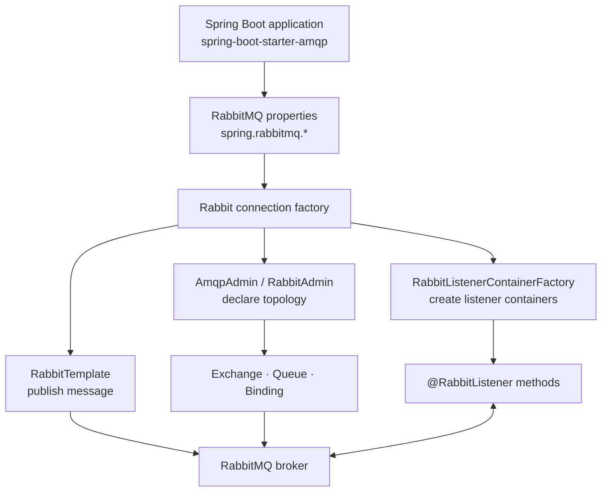
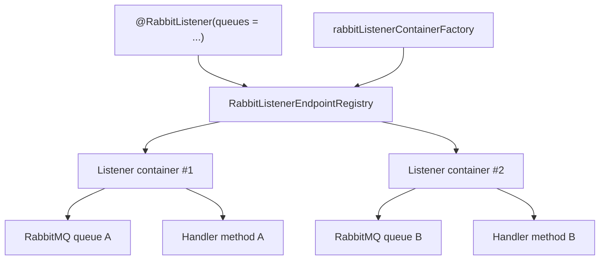
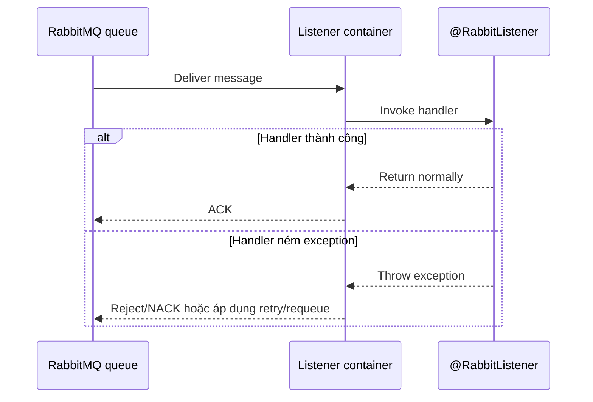

# Vai trò tự cấu hình của RabbitTemplate, RabbitAdmin và listener container factory

Trong một ứng dụng Spring Boot kết nối RabbitMQ, chúng ta thường chỉ thêm starter, khai báo thông số kết nối, tạo một số bean queue/exchange/binding, rồi gọi `RabbitTemplate` hoặc đánh dấu phương thức bằng `@RabbitListener`. Nhiều phần việc hậu trường đã được **Spring Boot AMQP auto-configuration (tự cấu hình)** chuẩn bị: kết nối tới broker, đối tượng gửi message, thành phần khai báo topology và factory tạo consumer.

Bài thuộc chương **Khởi tạo** của module **SPRING_AMQP**. Mục tiêu là hiểu chính xác **ai tạo bean nào, mỗi bean đảm nhận việc gì, khi nào tự cấu hình có hiệu lực và cách tùy biến mà vẫn giữ cấu hình mặc định có ích**. Đây là nền tảng để các bài về exchange, queue, binding, `RabbitTemplate`, `@RabbitListener`, xác nhận giao nhận, retry, dead-letter, giao dịch và quan sát hệ thống hoạt động đúng như kỳ vọng.

Sau bài học, bạn có thể:

- Giải thích vai trò riêng của `RabbitTemplate`, `RabbitAdmin` và `RabbitListenerContainerFactory`.
- Theo dõi quá trình từ cấu hình `spring.rabbitmq.*` đến kết nối, khai báo topology, phát và nhận message.
- Phân biệt listener container **factory** với listener container đang chạy.
- Xác định các trường hợp Spring Boot tạo sẵn bean, lùi lại khi ứng dụng định nghĩa bean riêng, hoặc không khai báo queue như mong đợi.
- Tạo một luồng gửi/nhận message ngắn, rồi tùy biến listener factory theo nhu cầu tải và độ tin cậy.

## 1. Tự cấu hình AMQP giải quyết những việc gì?

Không sử dụng tự cấu hình, ứng dụng cần tự lắp ghép ít nhất một connection factory, template để gửi, admin để tạo queue/exchange/binding và listener container để đọc message. Spring Boot thực hiện phần lớn công việc đó dựa trên starter và các thuộc tính cấu hình.



**Cần phân biệt ba phạm vi:**

1. **Cấu hình đối tượng ở phía ứng dụng:** Spring Boot tạo và thiết lập các bean, ví dụ `RabbitTemplate` hoặc listener container factory.
2. **Khai báo hạ tầng trên broker:** `RabbitAdmin` gửi yêu cầu tạo exchange, queue và binding dựa vào các định nghĩa tương ứng.
3. **Xử lý message lúc chạy:** producer gửi message bằng `RabbitTemplate`; listener container lấy message từ queue, gọi `@RabbitListener` rồi ACK/NACK theo cấu hình.

Có bean `RabbitTemplate` không có nghĩa queue đã tồn tại. Có queue trên broker không có nghĩa đã có listener. Có `@RabbitListener` không tự bảo đảm quá trình khai báo queue thành công. Phân biệt ba tầng này giúp khoanh vùng lỗi.

### 1.1. Những thành phần được dùng trong Spring Boot

Khi phụ thuộc AMQP và điều kiện tự cấu hình phù hợp, ứng dụng thường có:

| Thành phần | Loại điển hình | Trách nhiệm |
|---|---|---|
| `ConnectionFactory` | `CachingConnectionFactory` | Cung cấp connection/channel để trao đổi với RabbitMQ |
| `RabbitTemplate` | `RabbitTemplate` | Gửi message và thực hiện RPC-style request/reply khi được cấu hình |
| `AmqpAdmin` | `RabbitAdmin` | Khai báo, kiểm tra hoặc thao tác topology trên broker |
| `RabbitListenerContainerFactory` | Thường là `SimpleRabbitListenerContainerFactory` | Tạo các listener container theo cấu hình |
| Listener container | Container do factory tạo | Nhận delivery, quản lý luồng consumer và acknowledgement |
| `RabbitListenerEndpointRegistry` | Registry của Spring AMQP | Quản lý vòng đời các container của phương thức `@RabbitListener` |

Đây là **sơ đồ trách nhiệm**, không phải lời khẳng định tất cả bean luôn hiện diện trong mọi dự án. Kết quả phụ thuộc vào classpath, cấu hình, các bean do ứng dụng tự định nghĩa và phiên bản Spring Boot/Spring AMQP đang dùng.

### 1.2. Điều kiện phổ biến để có auto-configuration

Ứng dụng thường bắt đầu với starter:

```groovy
dependencies {
    implementation 'org.springframework.boot:spring-boot-starter-amqp'
}
```

Spring Boot sử dụng auto-configuration cho RabbitMQ khi các thư viện cần thiết có trong classpath và điều kiện tương ứng thỏa mãn. Các bean mặc định thường có điều kiện dạng **chưa có bean do ứng dụng cung cấp**, vì vậy khi bạn tự tạo bean cùng kiểu, Boot có thể không tạo bản mặc định tương ứng.

Ví dụ cấu hình cho RabbitMQ cục bộ:

```yaml
spring:
  rabbitmq:
    host: localhost
    port: 5672
    username: demo
    password: demo-local-only
    virtual-host: /
```

Những thuộc tính này mô tả **cách kết nối**; chúng không tự định nghĩa exchange hay queue nghiệp vụ. Trong môi trường production, hãy cấp thông tin xác thực qua secrets, giới hạn quyền, cấu hình TLS và vận hành broker độc lập với ứng dụng.

> **Lưu ý:** Có thư viện trong classpath và có bean `RabbitTemplate` chỉ chứng tỏ phía ứng dụng đã được khởi tạo. Kết nối thực tế tới RabbitMQ có thể chỉ được mở khi bean thực hiện thao tác hoặc khi listener khởi động; broker có thể chưa sẵn sàng ở thời điểm khởi tạo bean.

## 2. RabbitTemplate: cổng gửi message của ứng dụng

`RabbitTemplate` thực hiện các thao tác gửi message đến exchange, quản lý việc lấy connection/channel từ `ConnectionFactory` và phối hợp với message converter. Producer không cần tự mở socket hay xử lý các AMQP frame.

API thường gặp:

- `convertAndSend(exchange, routingKey, payload)`: chuyển đối tượng thành message rồi publish.
- `send(exchange, routingKey, message)`: gửi trực tiếp một đối tượng `Message` đã có body và properties.
- `receive(...)`: lấy message từ queue theo mô hình polling, trong những trường hợp phù hợp.
- `convertSendAndReceive(...)`: gửi yêu cầu và chờ phản hồi theo mẫu request/reply; đây không phải kiểu mặc định cho xử lý sự kiện bất đồng bộ.

Ví dụ một producer có thể được inject template Boot tạo:

```java
import org.springframework.amqp.rabbit.core.RabbitTemplate;
import org.springframework.stereotype.Service;

@Service
public class OrderCreatedPublisher {
    private final RabbitTemplate rabbitTemplate;

    public OrderCreatedPublisher(RabbitTemplate rabbitTemplate) {
        this.rabbitTemplate = rabbitTemplate;
    }

    public void publish(String orderId) {
        rabbitTemplate.convertAndSend(
                "orders.events",
                "order.created",
                orderId
        );
    }
}
```

Đối tượng `RabbitTemplate` có thể dùng lại giữa các lời gọi; trong ứng dụng thông thường, hãy để Spring quản lý lifecycle và tiêm phụ thuộc, thay vì tự tạo template mới cho từng request.

### 2.1. Boot tự thiết lập những gì cho template?

Tùy phiên bản và cấu hình hiện hành, auto-configuration hoặc configurer tương ứng có thể áp dụng:

- `ConnectionFactory` mà ứng dụng đã cấu hình.
- Message converter được đăng ký theo quy ước Spring Boot.
- Các thuộc tính template như retry, timeout, exchange/routing key mặc định nếu có thiết lập.
- Các tùy chọn publisher confirm, publisher return và mandatory trong cấu hình kết nối/template.

Chẳng hạn, cấu hình xác nhận phía producer:

```yaml
spring:
  rabbitmq:
    publisher-confirm-type: correlated
    publisher-returns: true
    template:
      mandatory: true
```

**Cần diễn giải đúng tín hiệu:** publisher confirm xác nhận trạng thái publish ở broker theo cơ chế confirm; publisher return giúp nhận biết message không tìm thấy queue đích khi có điều kiện return thích hợp; không cơ chế nào xác nhận consumer đã hoàn tất nghiệp vụ. Để ứng dụng thực sự biết kết quả, còn cần dùng callback hoặc API theo dõi confirm/return tương ứng, chứ chỉ thêm các thuộc tính YAML chưa đủ.

### 2.2. Thế nào là tùy biến template an toàn?

Nếu chỉ cần thay đổi các thuộc tính Boot đã hỗ trợ, ưu tiên cấu hình `spring.rabbitmq.*`. Nếu phải tự định nghĩa `RabbitTemplate`, không nên vô tình bỏ qua toàn bộ các thiết lập từ property.

Ví dụ dùng `RabbitTemplateConfigurer` do Spring Boot cung cấp:

```java
import org.springframework.amqp.rabbit.connection.ConnectionFactory;
import org.springframework.amqp.rabbit.core.RabbitTemplate;
import org.springframework.boot.autoconfigure.amqp.RabbitTemplateConfigurer;
import org.springframework.context.annotation.Bean;
import org.springframework.context.annotation.Configuration;

@Configuration
public class CustomTemplateConfiguration {
    @Bean
    RabbitTemplate rabbitTemplate(
            ConnectionFactory connectionFactory,
            RabbitTemplateConfigurer configurer) {
        RabbitTemplate template = new RabbitTemplate();
        configurer.configure(template, connectionFactory);
        // Thực hiện tùy biến bổ sung cho ứng dụng tại đây nếu cần.
        return template;
    }
}
```

Khi tự khai báo bean `RabbitTemplate`, Spring Boot thường lùi lại và dùng bean của bạn. Configurer giúp bảo toàn các thiết lập được hỗ trợ từ cấu hình Boot rồi mới thêm hành vi riêng. Đường dẫn class và các tùy chọn cụ thể cần được kiểm tra theo phiên bản dependency thực tế.

**Vấn đề hay gặp:** ứng dụng vừa có template mặc định vừa khai báo nhiều template tùy biến; injection chỉ theo kiểu có thể trở nên mơ hồ. Khi có nhiều bean cùng kiểu, hãy chọn rõ bằng `@Qualifier` hoặc `@Primary` theo ý định.

## 3. RabbitAdmin: khai báo exchange, queue và binding

`RabbitAdmin` là một triển khai của interface `AmqpAdmin`. Vai trò chính của nó là đưa các định nghĩa hạ tầng trong Spring context sang broker RabbitMQ.

Cấu hình Java mô tả topology:

```java
import org.springframework.amqp.core.Binding;
import org.springframework.amqp.core.BindingBuilder;
import org.springframework.amqp.core.DirectExchange;
import org.springframework.amqp.core.Queue;
import org.springframework.amqp.core.QueueBuilder;
import org.springframework.context.annotation.Bean;
import org.springframework.context.annotation.Configuration;

@Configuration
public class OrderTopology {
    public static final String EXCHANGE = "orders.events";
    public static final String QUEUE = "notifications.order-created.q";
    public static final String ROUTING_KEY = "order.created";

    @Bean
    DirectExchange ordersExchange() {
        return new DirectExchange(EXCHANGE, true, false);
    }

    @Bean
    Queue notificationQueue() {
        return QueueBuilder.durable(QUEUE).build();
    }

    @Bean
    Binding notificationBinding(
            Queue notificationQueue,
            DirectExchange ordersExchange) {
        return BindingBuilder.bind(notificationQueue)
                .to(ordersExchange)
                .with(ROUTING_KEY);
    }
}
```

Với `AmqpAdmin`/`RabbitAdmin` được bật và phát hiện các bean `Exchange`, `Queue`, `Binding`, Spring AMQP sẽ thực hiện việc khai báo tương ứng lên broker khi có kết nối và tại những điểm khôi phục kết nối theo cơ chế của nó.

**Các bean này chỉ là mô tả topology khi ở trong Spring context.** Broker mới là nơi message thực sự được định tuyến và lưu. Trong ví dụ, bean `Queue` có `durable=true`, nhưng độ bền của chính message và xác nhận publish là mối quan tâm riêng.

### 3.1. Khi nào RabbitAdmin được tạo?

Trong cấu hình Spring Boot RabbitMQ phổ biến, `spring.rabbitmq.dynamic` điều khiển cơ chế tạo bean `AmqpAdmin` mặc định; khi bật (thường là mặc định), Boot có thể cung cấp `RabbitAdmin` nếu điều kiện tạo bean phù hợp và ứng dụng chưa thay thế nó.

```yaml
spring:
  rabbitmq:
    dynamic: true
```

Nếu đặt `dynamic: false`, ứng dụng không còn dựa vào bean `AmqpAdmin` mặc định của Boot để tự khai báo topology. Tuy nhiên, điều đó **không ngăn** mã ứng dụng hoặc thành phần khác tự tạo admin và gọi khai báo; cần kiểm tra các bean thực tế.

Ví dụ một hệ thống production quản lý topology qua Terraform, script triển khai hoặc quy trình hạ tầng riêng có thể chủ động không để ứng dụng tự khai báo. Mọi thành phần khi ấy phải dùng tên exchange/queue đã được tạo sẵn.

### 3.2. “Tự khai báo” không có nghĩa “tự sửa mọi sai khác”

Khai báo một queue đã tồn tại với thuộc tính không tương thích (ví dụ kiểu queue, durable flag hoặc một số arguments) có thể dẫn tới lỗi từ broker, thay vì cập nhật queue theo ý muốn. Việc thay đổi topology cần được quản lý có kế hoạch.

Các điểm cần nhớ:

- `RabbitTemplate` **không** tự tạo queue chỉ vì bạn gửi đến một exchange.
- `@RabbitListener(queues = "some.queue")` chỉ tham chiếu tên queue; nếu queue chưa có và không được khai báo bằng cơ chế khác, listener có thể không khởi động thành công.
- Queue, exchange và binding thường được công bố bằng các bean tương ứng, bằng annotation khai báo topology được hỗ trợ hoặc bởi hạ tầng bên ngoài.
- Nếu tắt cơ chế auto-declare hoặc broker không cho phép user tạo topology, ứng dụng cần bảo đảm cấu hình broker đã sẵn sàng trước khi listener nhận message.
- Không nên dùng thay đổi bean tự phát để thay thế quy trình migration topology đối với hệ thống đang hoạt động.

Để đọc topology chủ động, có thể inject `AmqpAdmin` và gọi API phù hợp, nhưng phần lớn ứng dụng Spring Boot chỉ cần khai báo các bean `Queue`/`Exchange`/`Binding` rồi dùng hành vi tự động.

## 4. Listener container factory: khuôn mẫu tạo consumer

`@RabbitListener` chỉ là khai báo rằng một phương thức phải nhận message. Công việc thật sự nhận message do **listener container** thực hiện. Nó lấy connection/channel, đăng ký consumer, nhận delivery, chuyển payload thành tham số phương thức, xử lý luồng và acknowledgement.

**Listener container factory** là đối tượng tạo và cấu hình các container đó. Factory bản thân **không phải** một consumer đang nhận message.



Spring Boot thường cấu hình sẵn một factory mặc định với tên bean **`rabbitListenerContainerFactory`**. Khi `@RabbitListener` không chỉ định `containerFactory` riêng, cơ chế listener sẽ dùng factory mặc định này.

Ví dụ:

```java
import org.springframework.amqp.rabbit.annotation.RabbitListener;
import org.springframework.stereotype.Component;

@Component
public class OrderNotificationListener {
    @RabbitListener(queues = OrderTopology.QUEUE)
    public void handle(String orderId) {
        System.out.println("Nhận order.created cho " + orderId);
    }
}
```

Với starter và auto-configuration Spring Boot thông thường, hỗ trợ xử lý annotation được kích hoạt để bạn có thể sử dụng `@RabbitListener`. Trong cấu hình Spring Framework/Spring AMQP thuần không dùng Boot, bạn cần kiểm tra việc bật annotation support, thường thông qua `@EnableRabbit`.

### 4.1. Hai loại listener container phổ biến

| Loại | Factory tương ứng | Đặc điểm khái quát |
|---|---|---|
| `SimpleMessageListenerContainer` | `SimpleRabbitListenerContainerFactory` | Quản lý consumer theo mô hình đơn giản, có concurrency và mở rộng số consumer |
| `DirectMessageListenerContainer` | `DirectRabbitListenerContainerFactory` | Consumer nhận delivery theo mô hình trực tiếp trên client thread, có các tùy chọn quản lý consumer riêng |

Tùy phiên bản Boot, kiểu listener container mặc định thường là `simple` và có thể đổi thông qua thuộc tính hỗ trợ:

```yaml
spring:
  rabbitmq:
    listener:
      type: simple
      simple:
        concurrency: 2
        max-concurrency: 4
        prefetch: 20
        acknowledge-mode: auto
```

Các thuộc tính `simple.*` này áp dụng cho kiểu **simple**; nếu chuyển sang `direct`, phải dùng nhóm thuộc tính `spring.rabbitmq.listener.direct.*` phù hợp, không giả định mọi thiết lập giống nhau.

Giải thích các tham số minh họa:

- `concurrency: 2`: bắt đầu với hai consumer song song trong mô hình simple.
- `max-concurrency: 4`: cho phép tăng số consumer theo hành vi quản lý concurrency của container.
- `prefetch: 20`: giới hạn số delivery chưa ACK được cấp phát trước cho consumer theo cơ chế AMQP/QoS; tăng quá cao có thể làm phân phối không đều hoặc giữ nhiều message chưa xác nhận.
- `acknowledge-mode: auto`: listener container của Spring tự ACK sau xử lý thành công, và áp dụng chính sách lỗi khi handler ném exception.

**Dễ nhầm:** `acknowledge-mode: auto` của Spring khác với chế độ broker *no-ack/autoAck* khiến message được coi là xác nhận ngay khi giao. Với `AUTO` của Spring, nếu handler thất bại, kết quả phụ thuộc cơ chế retry, error handler và chính sách requeue/reject.

### 4.2. Factory tùy biến cho một nhóm listener

Một hệ thống có thể cần hai loại consumer: xử lý email chịu được concurrency cao, còn xử lý thanh toán cần giới hạn concurrency/prefetch để không gây áp lực lên database. Hãy tạo factory có tên riêng và chỉ định nó cho listener cần dùng.

Ví dụ tạo factory tên `fastRabbitListenerContainerFactory` bằng configurer của Spring Boot:

```java
import org.springframework.amqp.rabbit.config.SimpleRabbitListenerContainerFactory;
import org.springframework.amqp.rabbit.connection.ConnectionFactory;
import org.springframework.boot.autoconfigure.amqp.SimpleRabbitListenerContainerFactoryConfigurer;
import org.springframework.context.annotation.Bean;
import org.springframework.context.annotation.Configuration;

@Configuration
public class ListenerFactoryConfiguration {
    @Bean("fastRabbitListenerContainerFactory")
    SimpleRabbitListenerContainerFactory fastRabbitListenerContainerFactory(
            ConnectionFactory connectionFactory,
            SimpleRabbitListenerContainerFactoryConfigurer configurer) {
        SimpleRabbitListenerContainerFactory factory =
                new SimpleRabbitListenerContainerFactory();

        configurer.configure(factory, connectionFactory);
        factory.setConcurrentConsumers(2);
        factory.setMaxConcurrentConsumers(4);
        factory.setPrefetchCount(20);

        return factory;
    }
}
```

Sau đó chọn factory ở listener:

```java
@RabbitListener(
        queues = OrderTopology.QUEUE,
        containerFactory = "fastRabbitListenerContainerFactory")
public void handleOrder(String orderId) {
    System.out.println("Xử lý order " + orderId);
}
```

Đây là **đoạn phương thức** minh họa để đặt trong một bean Spring, ví dụ lớp gắn `@Component`. Khi ghép với ví dụ listener ở trên, chỉ giữ một listener tiêu thụ cùng queue nếu bạn không muốn chúng cạnh tranh nhận message.

Configurer giúp sao chép những thiết lập chung mà Spring Boot biết cách áp dụng, sau đó ghi đè các tham số riêng của factory mới. Nếu tự khởi tạo factory mà bỏ qua `configurer.configure(...)`, bạn có thể vô tình bỏ mất message converter, cấu hình retry, acknowledge mode, error handler hoặc các tùy chọn khác đã khai báo trong `application.yml`.

Một factory riêng có tên khác **không nhất thiết thay thế** factory mặc định. Ngược lại, khi chủ động đăng ký factory có tên `rabbitListenerContainerFactory`, bạn cần hiểu điều kiện bean của auto-configuration và cấu hình nó đầy đủ.

### 4.3. Listener container và trạng thái xử lý

Với listener thông thường, chuỗi xử lý là:



Các trạng thái quan trọng:

- **ACK:** broker nhận xác nhận của một delivery, có thể loại message khỏi queue theo cơ chế AMQP.
- **NACK/reject:** consumer từ chối message; tùy `requeue` và dead-letter policy mà message có thể được giao lại, dead-letter hoặc bị loại bỏ.
- **Redelivery:** message được giao lại sau gián đoạn hoặc khi requeue; consumer phải chấp nhận khả năng cùng một sự kiện được xử lý nhiều lần.
- **Retry ở phía ứng dụng:** interceptor/container có thể thử lại handler; cần cấu hình số lần thử, khoảng chờ và cách xử lý message hết lượt.
- **Idempotency:** nghiệp vụ phải tránh áp dụng lặp khi xử lý redelivery, đặc biệt với thanh toán, tồn kho và cập nhật dữ liệu.

Factory định nghĩa nhiều chính sách nhận message nhưng **không tự tạo được tính nhất quán end-to-end**. Muốn xử lý bất đồng bộ đáng tin cậy cần phối hợp publisher confirm, consumer ACK, giới hạn retry, DLQ, idempotency và khi cần transactional outbox.

## 5. Ví dụ hoàn chỉnh: Boot tự cấu hình ba thành phần thế nào?

Kết hợp các đoạn trên, đây là luồng tối thiểu để nhìn thấy từng vai trò trong một ứng dụng Spring Boot:

1. Spring Boot đọc `spring.rabbitmq.*` và cấu hình `ConnectionFactory`.
2. Boot cung cấp `RabbitTemplate` để mã gửi gọi `convertAndSend(...)`.
3. Boot cung cấp `AmqpAdmin` mặc định (trong điều kiện dynamic declaration được bật).
4. Các bean trong `OrderTopology` mô tả exchange, queue và binding; `RabbitAdmin` khai báo chúng trên broker khi cần.
5. Spring xử lý `@RabbitListener` và dùng listener factory để tạo container nhận message từ queue.
6. Listener xử lý body; container thực hiện cơ chế ACK hoặc xử lý lỗi theo cấu hình.

Để thử nhanh trên máy có Docker, có thể chạy RabbitMQ Management:

```bash
docker run -d --rm --name rabbitmq-setup-demo -p 5672:5672 -p 15672:15672 -e RABBITMQ_DEFAULT_USER=demo -e RABBITMQ_DEFAULT_PASS=demo-local-only rabbitmq:4-management
```

Thêm starter `spring-boot-starter-amqp` và cấu hình kết nối như mục 1, đặt các lớp `OrderTopology`, `OrderCreatedPublisher` và `OrderNotificationListener` vào package mà Spring Boot scan. Ví dụ controller để kích hoạt publisher:

```java
import org.springframework.http.ResponseEntity;
import org.springframework.web.bind.annotation.PathVariable;
import org.springframework.web.bind.annotation.PostMapping;
import org.springframework.web.bind.annotation.RestController;

@RestController
public class DemoPublishController {
    private final OrderCreatedPublisher publisher;

    public DemoPublishController(OrderCreatedPublisher publisher) {
        this.publisher = publisher;
    }

    @PostMapping("/demo/orders/{id}/created")
    public ResponseEntity<Void> publish(@PathVariable String id) {
        publisher.publish(id);
        return ResponseEntity.accepted().build();
    }
}
```

Bài thực hành này cần thêm `spring-boot-starter-web` nếu muốn sử dụng REST controller. Nếu chỉ cần thử messaging, bạn có thể gọi `OrderCreatedPublisher.publish(...)` từ `CommandLineRunner` hoặc test phù hợp mà không thêm HTTP.

Khi ứng dụng khởi chạy, gửi request:

```bash
curl -X POST http://localhost:8080/demo/orders/order-42/created
```

Kỳ vọng:

- Producer publish string `order-42` đến exchange `orders.events` với routing key `order.created`.
- Broker định tuyến message vào `notifications.order-created.q` nhờ binding.
- Listener nhận và in `Nhận order.created cho order-42`.
- Trên `http://localhost:15672`, đăng nhập bằng tài khoản demo đã thiết lập và kiểm tra exchange, queue và binding.

Phản hồi HTTP `202 Accepted` **chỉ phản ánh controller demo đã hoàn thành lời gọi phát message tại thời điểm đó**. Nó không chứng nhận RabbitMQ đã xác nhận lưu message hay consumer đã xử lý xong. Để có cam kết nghiệp vụ mạnh hơn cần thêm publisher confirms/returns, theo dõi trạng thái và xử lý lỗi.

### 5.1. Kiểm tra thực tế những bean nào đang có

Một cách dễ quan sát là tạo lớp chẩn đoán ngắn khi học (không nhất thiết giữ trong production):

```java
import org.springframework.amqp.core.AmqpAdmin;
import org.springframework.amqp.rabbit.core.RabbitTemplate;
import org.springframework.amqp.rabbit.listener.RabbitListenerEndpointRegistry;
import org.springframework.beans.factory.ObjectProvider;
import org.springframework.boot.CommandLineRunner;
import org.springframework.context.annotation.Bean;
import org.springframework.context.annotation.Configuration;
import org.springframework.context.ApplicationContext;

@Configuration
public class RabbitBeansProbe {
    @Bean
    CommandLineRunner inspectRabbitBeans(
            ApplicationContext context,
            RabbitTemplate rabbitTemplate,
            ObjectProvider<AmqpAdmin> admin,
            RabbitListenerEndpointRegistry registry) {
        return args -> {
            System.out.println("RabbitTemplate: "
                    + rabbitTemplate.getClass().getSimpleName());
            System.out.println("AmqpAdmin available: "
                    + (admin.getIfAvailable() != null));
            System.out.println("Default listener factory exists: "
                    + context.containsBean("rabbitListenerContainerFactory"));
            System.out.println("Registered listener containers: "
                    + registry.getListenerContainers().size());
        };
    }
}
```

Nếu ứng dụng có nhiều bean `AmqpAdmin` thì `getIfAvailable()` có thể báo lỗi không xác định bean duy nhất; trong trường hợp đó hãy kiểm tra danh sách tên bean hoặc dùng qualifier. Ví dụ trên dành cho cấu hình đơn giản và giúp nhìn ra khác biệt giữa **factory đã tồn tại** và **container được đăng ký cho listener**.

Khi bật Spring Boot Actuator, endpoint điều kiện auto-configuration (nếu được cấu hình cho phép truy cập) và log điều kiện khi chạy debug có thể giúp lý giải vì sao một bean mặc định được tạo hoặc không được tạo. Không nên bật endpoint chẩn đoán nhạy cảm công khai trong production.

## 6. Khi nào cần can thiệp tự cấu hình?

Các trường hợp thực tế và lựa chọn phù hợp:

| Nhu cầu | Cách tiếp cận |
|---|---|
| Một kết nối broker, một template, vài listener | Giữ auto-configuration và cấu hình qua `application.yml` |
| Thay đổi publisher timeout/confirm | Ưu tiên `spring.rabbitmq.*` và xử lý kết quả confirm/return |
| Cần message format JSON thống nhất | Khai báo message converter phù hợp và kiểm tra cả producer lẫn listener |
| Nhóm consumer cần prefetch/concurrency riêng | Tạo listener factory tên riêng, dùng Boot configurer và chọn bằng `containerFactory` |
| Topology do bộ phận hạ tầng quản lý | Chủ động kiểm soát auto-declare, bảo đảm exchange/queue tồn tại trước khi dùng |
| Nhiều broker/connection khác nhau | Định nghĩa `ConnectionFactory` và template/factory/admin cụ thể, gắn rõ bằng qualifier |
| Cần retry có giới hạn và dead-letter | Cấu hình retry/error handling cùng DLX/DLQ và kiểm thử các nhánh lỗi |

Với nhiều connection factory, không nên mặc định rằng Boot có thể tự chọn đúng mọi nơi. Producer, `RabbitAdmin` và listener factory cần cùng trỏ tới broker/vhost mong muốn; sai kết nối có thể gây hiện tượng “queue đã tạo nhưng listener không tìm thấy”.

### 6.1. Phân biệt lỗi cấu hình và lỗi nghiệp vụ

| Triệu chứng | Cần kiểm tra trước |
|---|---|
| Không inject được `RabbitTemplate` | Starter/classpath, điều kiện auto-config, bean tự định nghĩa, multiple beans |
| Listener báo queue không tồn tại | RabbitAdmin/dynamic, topology declarations, broker/vhost và quyền truy cập |
| Có message trong queue nhưng không nhận | Listener có được scan không, factory được chọn, container chạy không, consumer count |
| Publish trả về bình thường nhưng không tới queue | Exchange/routing key/binding, publisher returns, mandatory |
| Message bị giao lại nhiều lần | Exception ở handler, ACK/NACK, requeue, retry và idempotency |
| Thay đổi YAML nhưng concurrency không đổi | Factory đang dùng loại simple/direct nào, factory riêng có nhận cấu hình từ configurer không |
| Bị lỗi khai báo queue lúc khởi động | Tên queue trùng nhưng thuộc tính/arguments khác, quyền khai báo, type queue |
| Broker chậm hoặc backlog tăng | Queue depth, unacked count, prefetch, throughput, kết nối và giới hạn tài nguyên |

## 7. Bài tập vận dụng

**Bài 1 — Kiểm chứng auto-configuration.** Khởi động ví dụ mà không định nghĩa thủ công `RabbitTemplate`, `RabbitAdmin` và `rabbitListenerContainerFactory`. Dùng đoạn chẩn đoán xác định các bean có tồn tại không. Quan sát khi thử `spring.rabbitmq.dynamic: false`; giải thích vì sao exchange/queue đã tồn tại từ lần trước có thể khiến thử nghiệm gây nhầm lẫn.

**Bài 2 — Factory mặc định và factory riêng.** Tạo `fastRabbitListenerContainerFactory` như ví dụ, áp dụng cho một listener và đổi `prefetch`. Quan sát số message unacknowledged khi handler cố tình xử lý chậm. Thử giảm concurrency rồi mô tả ảnh hưởng lên throughput.

**Bài 3 — Tách lỗi định tuyến và lỗi consumer.** Gửi message tới routing key không có binding, sau đó gửi message đúng binding nhưng consumer chủ động ném exception. Cả hai tạo ra dấu hiệu khác nhau thế nào? Cơ chế xác nhận nào dùng để phân biệt?

**Bài 4 — Quyền khai báo topology.** Giả sử account RabbitMQ của ứng dụng chỉ được quyền read/write, không được quyền configure queue/exchange. Đề xuất quy trình triển khai để `RabbitAdmin` không gây lỗi mà listener vẫn hoạt động.

**Bài 5 — Tư duy độ tin cậy.** Một listener cập nhật database xong nhưng mất kết nối trước khi ACK. Giải thích vì sao đổi listener factory hoặc bật retry không đủ bảo đảm exactly-once; đề xuất dùng event ID và idempotency.

## 8. Ghi nhớ cốt lõi

Ba thành phần làm ba việc khác nhau:

- **`RabbitTemplate`:** phía *producer* — lấy connection và gửi message.
- **`RabbitAdmin`:** phía *topology* — khai báo exchange, queue và binding khi được bật và có đủ quyền.
- **`RabbitListenerContainerFactory`:** phía *consumer setup* — tạo container làm việc cho các phương thức `@RabbitListener`; container mới là thành phần nhận và xác nhận message.

Spring Boot tự cấu hình phần kết nối và các bean cơ bản, giúp ứng dụng tập trung vào nghiệp vụ. Nhưng **tự cấu hình không thay thế thiết kế messaging**: routing key phải khớp binding; queue phải tồn tại; consumer phải được cấu hình retry/ACK đúng; producer cần cơ chế xác nhận phù hợp; dữ liệu nghiệp vụ cần idempotency và khi cần outbox. Hiểu ba thành phần trên sẽ giúp bạn biết phải sửa cấu hình ở đâu khi hệ thống Spring AMQP hoạt động không như mong đợi.
