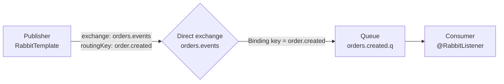
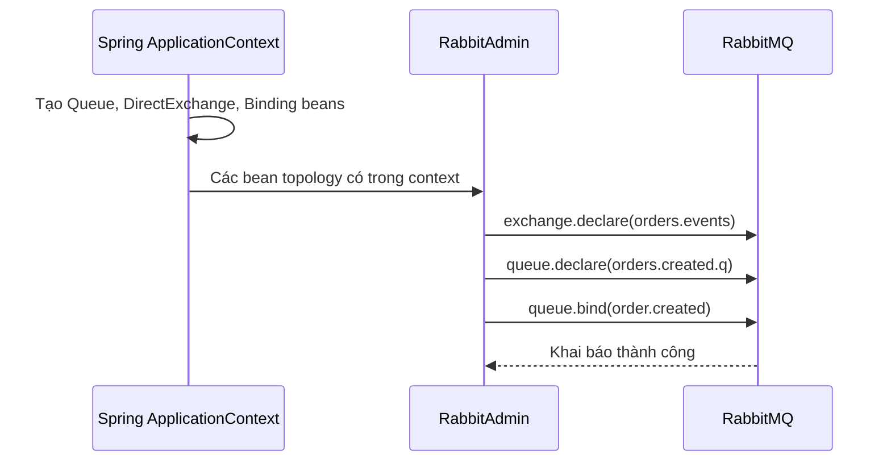

# Tạo exchange, queue và binding tối thiểu bằng Spring bean

Trong Spring AMQP, trước khi gửi message bằng `RabbitTemplate` hay nhận message bằng `@RabbitListener`, ứng dụng cần một **topology** trên RabbitMQ: exchange để nhận message từ publisher, queue để giữ message chờ consumer và binding để nối exchange với queue. Spring cho phép mô tả cả ba thành phần bằng các phương thức `@Bean`, giúp cấu hình định tuyến nằm cùng mã nguồn ứng dụng và có thể được khai báo lên broker lúc kết nối.

Bài này thuộc phần **Khởi tạo** của `SPRING_AMQP`. Chúng ta sẽ cấu hình một `DirectExchange`, một `Queue` và một `Binding` đủ để gửi sự kiện `order.created` từ publisher đến consumer. Từ cấu hình nền tảng này có thể mở rộng sang publisher confirm, consumer acknowledgement, retry, dead-letter, giao dịch và giám sát hệ thống.

## 1. Mục tiêu và điều kiện chuẩn bị

Sau bài học, bạn có thể:

- Giải thích đúng vai trò của **exchange**, **queue**, **binding** và **routing key**.
- Khai báo một topology RabbitMQ tối thiểu bằng ba Spring bean `DirectExchange`, `Queue`, `Binding`.
- Hiểu khi nào Spring AMQP thực sự tạo các đối tượng tương ứng trên RabbitMQ.
- Dùng `RabbitTemplate` và `@RabbitListener` để kiểm tra message đi qua binding vừa tạo.
- Nhận biết các lỗi cấu hình ban đầu như sai routing key, broker chưa chạy và khai báo trùng tên nhưng khác thuộc tính.

Điều kiện: một ứng dụng Spring Boot đã kết nối được RabbitMQ, Java và dependency `spring-boot-starter-amqp` tương thích với phiên bản Spring Boot của dự án. Ví dụ khai báo Maven:

```xml
<dependency>
    <groupId>org.springframework.boot</groupId>
    <artifactId>spring-boot-starter-amqp</artifactId>
</dependency>
```

Nếu Spring Boot project sử dụng dependency management/BOM, thông thường không cần ghi riêng phiên bản của starter. RabbitMQ cần có service đang chạy và cho phép ứng dụng kết nối. Ví dụ cấu hình kết nối cho RabbitMQ chạy trên cùng máy phát triển:

```yaml
# src/main/resources/application.yml
spring:
  rabbitmq:
    host: localhost
    port: 5672
    username: guest
    password: guest
```

Tài khoản `guest` mặc định của RabbitMQ thường chỉ được phép kết nối qua loopback; ví dụ này dành cho môi trường phát triển cục bộ. Khi ứng dụng và RabbitMQ chạy trong các container khác nhau, địa chỉ broker cần là tên host/service có thể truy cập được từ container ứng dụng, không mặc định là `localhost`.

## 2. Exchange, queue và binding kết hợp như thế nào?

Giả sử dịch vụ phát sự kiện đặt hàng cần gửi message vào queue dành cho bộ xử lý đơn hàng:

| Thành phần | Giá trị ví dụ | Vai trò |
|---|---|---|
| Exchange | `orders.events` | Nhận message do publisher gửi; quyết định định tuyến đến queue nào. |
| Loại exchange | `direct` | Đối chiếu routing key của message với binding key theo nguyên tắc khớp chính xác. |
| Queue | `orders.created.q` | Lưu các message được định tuyến đến để consumer lấy và xử lý. |
| Binding key | `order.created` | Điều kiện nối `orders.events` với `orders.created.q`. |
| Routing key của lần publish | `order.created` | Nhãn publisher gửi kèm message để direct exchange đối chiếu với binding key. |



**Điểm cốt lõi:** publisher gửi đến **exchange** với **routing key**, không gửi tên queue vào hàm gửi trong ví dụ này. Exchange căn cứ vào các binding đang tồn tại để xác định queue nhận. Với `DirectExchange`, routing key `order.created` khớp binding key `order.created`; nếu gửi `order.cancelled` nhưng chưa có binding phù hợp, message sẽ không đi vào queue trên.

Một exchange có thể có nhiều binding và nhiều queue. Một queue cũng có thể nhận message từ nhiều exchange/binding khác nhau. Ví dụ này chủ ý bắt đầu bằng mô hình **một exchange – một binding – một queue** để dễ quan sát.

## 3. Khai báo topology bằng ba Spring bean

Đặt lớp cấu hình dưới package được Spring Boot quét, ví dụ `com.example.orders.messaging.RabbitTopologyConfig`:

```java
package com.example.orders.messaging;

import org.springframework.amqp.core.Binding;
import org.springframework.amqp.core.BindingBuilder;
import org.springframework.amqp.core.DirectExchange;
import org.springframework.amqp.core.Queue;
import org.springframework.context.annotation.Bean;
import org.springframework.context.annotation.Configuration;

@Configuration(proxyBeanMethods = false)
public class RabbitTopologyConfig {

    public static final String EXCHANGE = "orders.events";
    public static final String QUEUE = "orders.created.q";
    public static final String ROUTING_KEY = "order.created";

    // 1. Exchange nhận message do publisher phát.
    @Bean
    public DirectExchange ordersExchange() {
        return new DirectExchange(EXCHANGE, true, false);
    }

    // 2. Queue giữ message chờ consumer xử lý.
    @Bean
    public Queue ordersQueue() {
        return new Queue(QUEUE, true);
    }

    // 3. Binding nối queue với exchange theo routing key.
    @Bean
    public Binding ordersCreatedBinding(
            Queue ordersQueue,
            DirectExchange ordersExchange) {

        return BindingBuilder.bind(ordersQueue)
                .to(ordersExchange)
                .with(ROUTING_KEY);
    }
}
```

**Đọc lần lượt từng bean:**

1. `new DirectExchange(EXCHANGE, true, false)` tạo định nghĩa direct exchange tên `orders.events`. `true` là **durable** và `false` là **autoDelete**. Exchange durable được lưu trong cấu hình broker qua lần khởi động lại (trong điều kiện broker có dữ liệu cấu hình được duy trì).
2. `new Queue(QUEUE, true)` tạo định nghĩa queue `orders.created.q` với `durable=true`. Constructor hai tham số dùng các giá trị mặc định tương ứng `exclusive=false` và `autoDelete=false`.
3. Phương thức `ordersCreatedBinding(...)` nhận hai bean ở trên thông qua dependency injection. `BindingBuilder.bind(queue).to(exchange).with(ROUTING_KEY)` định nghĩa quan hệ định tuyến với binding key `order.created`.

Vì có ba `@Bean`, Spring quản lý ba **đối tượng mô tả topology** trong `ApplicationContext`. Các phương thức này không phải là lệnh gửi message. Bean `Binding` cũng không chứa message; nó chỉ nói với broker cách đưa message từ exchange tới queue.

Các tên `EXCHANGE`, `QUEUE`, `ROUTING_KEY` là các hằng dùng chung, giúp tránh sai chính tả giữa nơi khai báo, nơi publish và nơi consume. Khi ứng dụng có nhiều bean cùng kiểu `Queue` hoặc `DirectExchange`, hãy dùng `@Qualifier("ordersQueue")`/`@Qualifier("ordersExchange")` trên tham số method để tiêm đúng bean, tránh tình trạng lựa chọn không rõ ràng.

### Cùng một topology bằng builder

Bạn cũng có thể viết hai bean đầu bằng API builder:

```java
@Bean
public DirectExchange ordersExchange() {
    return ExchangeBuilder.directExchange(EXCHANGE)
            .durable(true)
            .build();
}

@Bean
public Queue ordersQueue() {
    return QueueBuilder.durable(QUEUE).build();
}
```

Đoạn builder là **cách viết thay thế**, không được đặt thêm song song với hai `@Bean` cùng tên trong cùng lớp cấu hình. Nếu dùng builder, import `org.springframework.amqp.core.ExchangeBuilder` và `org.springframework.amqp.core.QueueBuilder`. Cả hai cách đều mô tả cùng cấu trúc tối thiểu; builder tiện khi cần mở rộng các thuộc tính hoặc arguments của queue.

## 4. Ai khai báo các bean này lên RabbitMQ?

Điểm thường gây nhầm lẫn là **Spring bean trong bộ nhớ ứng dụng chưa tự động đồng nghĩa với queue/exchange đã tồn tại trên broker**. Spring AMQP có thành phần `RabbitAdmin` (`AmqpAdmin`) dùng kết nối RabbitMQ để thực hiện các lệnh khai báo topology.

Trong ứng dụng Spring Boot sử dụng starter AMQP và auto-configuration mặc định, Boot thường tạo `RabbitAdmin` tự động (khi chức năng dynamic declaration được bật). `RabbitAdmin` tìm các bean kiểu `Queue`, `Exchange` và `Binding` trong context rồi khai báo chúng với broker khi kết nối được thiết lập. Khi kết nối được khôi phục, cơ chế khai báo tự động có thể giúp xác lập lại topology nếu cần.



Trong môi trường không dùng Spring Boot auto-configuration, bạn có thể cần cấu hình `RabbitAdmin` và `ConnectionFactory` thủ công. Khi dùng Spring Boot nhưng tắt `spring.rabbitmq.dynamic`, không nên kỳ vọng các bean topology được tự khai báo bằng cơ chế mặc định. Cũng lưu ý việc khởi tạo kết nối có thể diễn ra khi listener bắt đầu, khi `RabbitTemplate` gửi message hoặc qua tác vụ AMQP khác; **việc khai báo trên broker phụ thuộc vào kết nối và thành phần quản trị**, không đơn thuần vào thời điểm tạo bean Java.

Lệnh `declare` có tính chất thích hợp cho khởi tạo lặp lại nếu broker đã tồn tại đối tượng **cùng tên và cùng thuộc tính**. Ngược lại, nếu queue `orders.created.q` đã tồn tại với `durable=false` nhưng ứng dụng khai báo `durable=true`, RabbitMQ có thể từ chối bằng lỗi `PRECONDITION_FAILED` vì khai báo không tương đương. Thay đổi thuộc tính của queue đang tồn tại không phải thao tác chỉnh sửa tùy ý bằng cách sửa constructor Java; cần quản lý migration/topology một cách có chủ đích.

## 5. Kiểm tra tuyến gửi/nhận bằng RabbitTemplate và @RabbitListener

Sau khi topology tồn tại trên broker, publisher gửi message đến `orders.events` với routing key `order.created`. Ví dụ sau dùng API Spring AMQP hiện có trong starter:

```java
package com.example.orders.messaging;

import org.springframework.amqp.rabbit.core.RabbitTemplate;
import org.springframework.boot.ApplicationArguments;
import org.springframework.boot.ApplicationRunner;
import org.springframework.stereotype.Component;

@Component
public class DemoOrderPublisher implements ApplicationRunner {

    private final RabbitTemplate rabbitTemplate;

    public DemoOrderPublisher(RabbitTemplate rabbitTemplate) {
        this.rabbitTemplate = rabbitTemplate;
    }

    @Override
    public void run(ApplicationArguments args) {
        rabbitTemplate.convertAndSend(
                RabbitTopologyConfig.EXCHANGE,
                RabbitTopologyConfig.ROUTING_KEY,
                "{\"eventId\":\"evt-001\",\"orderId\":1001}");
    }
}
```

Vì sử dụng `ApplicationRunner`, đoạn minh họa gửi một message **mỗi lần khởi động ứng dụng**. Trong ứng dụng thật, hãy thay hành vi này bằng phương thức phát sự kiện khi nghiệp vụ thực sự xảy ra, tránh phát lại sự kiện mẫu mỗi lần deploy.

Consumer chỉ cần biết tên **queue** để lắng nghe:

```java
package com.example.orders.messaging;

import org.springframework.amqp.rabbit.annotation.RabbitListener;
import org.springframework.stereotype.Component;

@Component
public class DemoOrderConsumer {

    @RabbitListener(queues = RabbitTopologyConfig.QUEUE)
    public void receive(String payload) {
        System.out.println("Received order event: " + payload);
    }
}
```

`@RabbitListener` đăng ký một listener container để nhận message từ `orders.created.q`. Với ứng dụng Spring Boot có hỗ trợ listener AMQP tự động, ví dụ trên có thể dùng trực tiếp; khi cấu hình Spring Framework thủ công, cần bật xử lý listener bằng `@EnableRabbit` cùng listener container factory phù hợp. Mặc định Spring AMQP thường sử dụng cơ chế tự ACK qua listener container sau khi phương thức xử lý thành công; đây là một chủ đề riêng với `AcknowledgeMode.AUTO`, `MANUAL` và `NONE`.

**Đường đi trong lần chạy mẫu:**

1. Spring tạo ba bean topology, sau đó `RabbitAdmin` khai báo chúng trên RabbitMQ khi có kết nối.
2. `DemoOrderPublisher` dùng `RabbitTemplate.convertAndSend(...)` phát payload đến exchange `orders.events` với routing key `order.created`.
3. Direct exchange thấy binding key trùng routing key, chuyển message đến `orders.created.q`.
4. `DemoOrderConsumer` nhận payload từ queue và in dòng `Received order event: ...`.

Nếu consumer chưa chạy nhưng queue vẫn tồn tại, message có thể ở trạng thái **ready** để một consumer khác nhận sau đó. Điều đó khác với trường hợp **không có binding phù hợp**: khi ấy message chưa hề được đưa vào queue cần nhận.

## 6. Tự xác minh topology trong RabbitMQ

Sau khi chạy ứng dụng, mở RabbitMQ Management UI (thông thường tại `http://localhost:15672` nếu đã bật management plugin và mở cổng), rồi kiểm tra:

| Nơi quan sát | Kỳ vọng |
|---|---|
| **Exchanges** | Có `orders.events`, type `direct`, durable. |
| **Queues and Streams** | Có `orders.created.q`, durable. |
| **Bindings** của `orders.events` | Có binding đến `orders.created.q` với routing key `order.created`. |
| **Queue metrics** | `Ready` có thể tăng khi chưa có consumer; `Deliver/Get`/ack thay đổi khi consumer hoạt động. |
| **Log consumer** | Xuất hiện payload có `eventId` và `orderId` từ message mẫu. |

Nếu có công cụ `rabbitmqctl` trên môi trường broker, bạn cũng có thể quan sát danh sách bằng các lệnh tương ứng (cần đúng virtual host và quyền truy cập):

```bash
rabbitmqctl list_exchanges name type durable
rabbitmqctl list_queues name durable messages_ready messages_unacknowledged
rabbitmqctl list_bindings source_name destination_name routing_key
```

Không thấy dữ liệu trong queue sau khi chạy **chưa chắc là lỗi**: consumer có thể đã nhận và ACK message rất nhanh. Dựa đồng thời vào exchange, binding, log consumer và các chỉ số giao nhận để xác minh kết quả.

### Một phép thử định tuyến quan trọng

Thay giá trị routing key ở **lần publish** bằng `order.cancelled` nhưng giữ nguyên binding `order.created`:

```java
rabbitTemplate.convertAndSend(
        RabbitTopologyConfig.EXCHANGE,
        "order.cancelled",
        "test-unmatched-routing-key");
```

Với direct exchange hiện tại, message không khớp binding và không đi tới `orders.created.q`. Nếu không bật `mandatory`/publisher returns và exchange không có alternate exchange thích hợp, một message không định tuyến được có thể bị broker loại bỏ. Trong hệ thống thực, nên theo dõi trường hợp unroutable bằng publisher returns và kết hợp publisher confirm để biết broker đã tiếp nhận lần publish; hai tín hiệu này độc lập với consumer acknowledgement.

## 7. Lỗi thường gặp khi tạo topology

| Triệu chứng | Nguyên nhân có thể | Cách kiểm tra hoặc khắc phục |
|---|---|---|
| Không thấy exchange/queue trên Management UI | Ứng dụng chưa kết nối, `RabbitAdmin` không được tạo, tự khai báo bị tắt hoặc xem sai virtual host | Kiểm tra kết nối, cấu hình auto-configuration, `spring.rabbitmq.dynamic` và vhost đang xem. |
| Publish thành công ở phía ứng dụng nhưng consumer không nhận | Routing key sai; binding không tồn tại; message bị đưa sang queue khác; consumer trỏ sai queue | Kiểm tra chính xác exchange, binding key, routing key và `@RabbitListener(queues = ...)`. |
| `PRECONDITION_FAILED` khi startup | Đối tượng cùng tên đã tồn tại với thuộc tính khác (durable, auto-delete, arguments...) | Đối chiếu thuộc tính hiện có trên broker; điều chỉnh topology/migration có kiểm soát. |
| `NOT_FOUND - no exchange` | Publisher gửi vào exchange chưa được khai báo hoặc sai tên/vhost | Kiểm tra `RabbitAdmin`, thứ tự khởi tạo/kết nối và tên exchange. |
| Lỗi kết nối hoặc `ACCESS_REFUSED` | Sai host, port, tài khoản, vhost hoặc quyền declare/write/read | Kiểm tra thông số RabbitMQ và quyền tài khoản dùng cho ứng dụng. |
| Không tiêm được bean vào phương thức tạo binding | Có nhiều bean `Queue`/`DirectExchange` cùng kiểu gây ambiguity | Dùng `@Qualifier` với đúng tên bean cần liên kết. |
| Sau khi consumer nhận, queue luôn có `Ready=0` | Consumer xử lý rất nhanh | Xem log consumer và các chỉ số delivery/ack, thử tạm dừng consumer để kiểm tra ready. |

Đừng xử lý lỗi khai báo bằng cách xóa queue dữ liệu thật tùy tiện: xóa queue cũng xóa những message còn lưu trong queue. Với môi trường dùng chung hoặc production, thay đổi topology cần quy trình triển khai và chuyển đổi dữ liệu an toàn.

## 8. Bài tập mở rộng và tự kiểm tra

**Bài tập 1 — thay đổi routing key.** Tạo một message có routing key `order.cancelled`. Giải thích vì sao queue `orders.created.q` không nhận message đó khi chỉ có binding key `order.created`. Sau đó thêm một binding `order.cancelled` đến cùng queue (giữ nguyên exchange/queue) và kiểm tra hành vi mới.

**Bài tập 2 — nhiều queue.** Tạo queue `orders.audit.q`, thêm binding với cùng exchange và binding key `order.created`. Dự đoán số queue nhận message khi publisher gửi một message `order.created`: **hai queue** có binding khớp đều nhận một bản sao message từ exchange; nếu sau đó nhiều consumer cùng đọc **một queue**, các consumer đó cùng chia sẻ các delivery của queue ấy, không phải mỗi consumer đều nhận bản sao riêng.

**Bài tập 3 — bền vững.** Kiểm tra `durable=true` của exchange/queue. Giải thích vì sao chỉ bật durable vẫn chưa đủ để bảo đảm một message sống qua mọi lần broker restart: còn phụ thuộc vào delivery mode/persistence của message, loại queue và cơ chế lưu trữ của broker.

**Câu hỏi ôn tập:**

1. **`@Bean Queue` có phải nơi lưu message trong JVM không?** Không. Bean `Queue` là đối tượng cấu hình; RabbitMQ broker mới giữ message của queue thực tế.
2. **`RabbitTemplate.convertAndSend(exchange, routingKey, payload)` gửi đến đâu?** Gửi đến exchange có tên được chỉ định, kèm routing key để broker áp dụng các binding.
3. **Tạo `Queue` và `DirectExchange` đã đủ để message được định tuyến chưa?** Chưa. Cần `Binding` nối chúng với điều kiện routing phù hợp; đồng thời topology phải thực sự được khai báo trên broker.
4. **Nếu Spring tạo bean thành công nhưng broker chưa kết nối thì queue đã tồn tại trên RabbitMQ chưa?** Chưa thể kết luận. Việc tạo bean Java khác với bước `RabbitAdmin` gửi lệnh khai báo qua kết nối AMQP.

**Ghi nhớ:** Bài học tối thiểu cần **ba Spring bean: `DirectExchange` + `Queue` + `Binding`**. Sau khi `RabbitAdmin` khai báo lên broker, `RabbitTemplate` phát vào exchange theo routing key và `@RabbitListener` nhận từ queue. Đây là nền móng để triển khai các cơ chế xác nhận, xử lý lỗi và độ tin cậy ở những bài tiếp theo.
