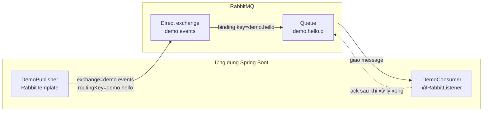

# Gửi thông điệp đầu tiên và nhận bằng @RabbitListener

## 1. Mục tiêu bài học

Trong chương **Khởi tạo** của module **Spring AMQP**, chúng ta sẽ tạo một ứng dụng Spring Boot nhỏ có thể **gửi một thông điệp qua RabbitMQ và nhận chính thông điệp đó bằng `@RabbitListener`**. Đây là bước thực hành nền tảng trước khi đi vào định tuyến message, publisher confirm, acknowledgement, retry, dead-letter, giao dịch và quan sát vận hành.

Sau bài này, bạn có thể:

- Khởi chạy RabbitMQ tại máy phát triển và cấu hình Spring Boot kết nối tới broker.
- Khai báo một **direct exchange**, một **queue** và **binding** nối chúng.
- Dùng `RabbitTemplate.convertAndSend(...)` để publish payload kiểu `String`.
- Dùng `@RabbitListener` để nhận message từ queue mà không phải tự quản lý connection/channel.
- Theo dõi đường đi của message, biết giới hạn của lần thử gửi/nhận đầu tiên và tự xử lý những lỗi cấu hình thường gặp.

Để bài thực hành tập trung, **producer và consumer chạy trong cùng một ứng dụng Spring Boot**, nhưng về mặt kiến trúc có thể tách thành các dịch vụ khác nhau mà không đổi cơ chế exchange → queue → consumer.

## 2. Nhìn toàn cảnh luồng message

Giả sử ứng dụng gửi chuỗi:

```text
Xin chào RabbitMQ từ Spring AMQP!
```

Luồng dữ liệu sẽ như sau:



| Thành phần | Nằm ở đâu? | Vai trò trong bài |
| --- | --- | --- |
| `RabbitTemplate` | Ứng dụng Java | Chuyển chuỗi thành message và gửi đến broker. |
| **Exchange** `demo.events` | RabbitMQ | Nhận message và quyết định queue đích dựa trên binding. |
| **Routing key** `demo.hello` | Thông tin khi publish | Giá trị dùng để direct exchange so khớp với binding key. |
| **Binding** | RabbitMQ | Nối exchange `demo.events` với queue `demo.hello.q`. |
| **Queue** `demo.hello.q` | RabbitMQ | Chứa message để consumer lấy ra xử lý. |
| `@RabbitListener` | Ứng dụng Java | Đăng ký consumer và gọi phương thức nhận khi có delivery. |

**Phân biệt:** `@RabbitListener` nghe **queue**, không nghe trực tiếp exchange. Producer publish đến **exchange**, không cần biết consumer nào đang hoạt động.

Ở đây chúng ta dùng **AMQP 0-9-1**, giao thức mà `RabbitTemplate` và listener container thông thường của Spring AMQP sử dụng.

## 3. Chuẩn bị môi trường

### 3.1. Các thành phần cần có

- **JDK 17 trở lên** và môi trường Spring Boot phù hợp.
- **Maven** hoặc Maven Wrapper (`mvnw`) để chạy dự án.
- **RabbitMQ** đang hoạt động; cách thuận tiện cho máy phát triển là chạy bằng Docker.
- Một IDE Java như IntelliJ IDEA, VS Code hoặc terminal.

Không cần tách thành hai dự án producer/consumer ở bài đầu; chúng ta dùng một project và hai Spring component riêng biệt.

### 3.2. Khởi chạy RabbitMQ với Docker

Nếu đã có RabbitMQ tại `localhost:5672`, bỏ qua bước tạo container.

Ví dụ chạy RabbitMQ 4.x với giao diện quản trị:

```bash
docker run -d --name spring-amqp-demo-rabbit \
  -p 5672:5672 \
  -p 15672:15672 \
  rabbitmq:4-management
```

Với **PowerShell**, có thể viết lệnh trên một dòng:

```powershell
docker run -d --name spring-amqp-demo-rabbit -p 5672:5672 -p 15672:15672 rabbitmq:4-management
```

Kiểm tra container:

```bash
docker ps --filter name=spring-amqp-demo-rabbit
docker logs spring-amqp-demo-rabbit
```

Hai cổng thường dùng:

| Cổng | Mục đích |
| --- | --- |
| `5672` | Kết nối AMQP 0-9-1 từ ứng dụng Spring Boot. |
| `15672` | RabbitMQ Management UI khi plugin quản trị được bật. |

Truy cập **http://localhost:15672**, đăng nhập `guest` / `guest` trong môi trường local mặc định. RabbitMQ thường giới hạn tài khoản `guest` cho kết nối loopback; đối với môi trường từ xa hoặc production, tạo user riêng với quyền thích hợp và quản lý mật khẩu an toàn.

> Lưu ý: Các lệnh và thông số trong bài giả định **ứng dụng Spring Boot chạy trực tiếp trên máy** và RabbitMQ container được publish cổng ra `localhost`. Nếu Spring Boot cũng chạy trong Docker Compose, `localhost` trỏ tới container ứng dụng; khi đó cần dùng tên service RabbitMQ trong mạng Compose thay cho `localhost`.

## 4. Tạo dự án Spring Boot có hỗ trợ AMQP

Bạn có thể tạo project bằng **Spring Initializr** rồi chọn:

- Project: Maven.
- Language: Java.
- Spring Boot: phiên bản ổn định tương thích JDK đang dùng.
- Dependency: **Spring for RabbitMQ** (Spring AMQP).

Với một project Spring Boot Maven sẵn có, thêm dependency sau vào `pom.xml` (phiên bản do Spring Boot dependency management quản lý):

```xml
<dependency>
    <groupId>org.springframework.boot</groupId>
    <artifactId>spring-boot-starter-amqp</artifactId>
</dependency>
```

Nếu dùng Gradle:

```groovy
implementation 'org.springframework.boot:spring-boot-starter-amqp'
```

Starter này cung cấp tích hợp Spring AMQP/RabbitMQ và cơ chế tự cấu hình trong Spring Boot, bao gồm các bean như `RabbitTemplate`, connection factory, listener infrastructure và việc khai báo các đối tượng topology khi được cấu hình mặc định.

**Bài này không cần `spring-boot-starter-web`:** message được gửi một lần khi ứng dụng sẵn sàng, thay vì phải tạo REST API để kích hoạt publisher.

Ví dụ cấu trúc project sau khi hoàn thành:

```text
spring-amqp-first-message/
├── pom.xml
└── src/
    └── main/
        ├── java/
        │   └── com/example/amqpdemo/
        │       ├── SpringAmqpDemoApplication.java
        │       ├── RabbitConfig.java
        │       ├── DemoPublisher.java
        │       └── DemoConsumer.java
        └── resources/
            └── application.yml
```

Tất cả các lớp Java trong ví dụ dùng package `com.example.amqpdemo`. Nếu project có package khác, hãy thay đồng nhất trong toàn bộ file.

## 5. Kết nối Spring Boot với RabbitMQ

Tạo `src/main/resources/application.yml`:

```yaml
spring:
  application:
    name: spring-amqp-first-message
  rabbitmq:
    host: localhost
    port: 5672
    username: guest
    password: guest
    listener:
      simple:
        acknowledge-mode: auto
```

Giải thích:

- `host` và `port` chỉ ra RabbitMQ broker nơi Spring AMQP sẽ kết nối.
- `username` / `password` dùng để xác thực với broker. Chỉ dùng `guest/guest` trong bài lab local.
- `acknowledge-mode: auto` là chế độ mà listener container **gửi ack sau khi xử lý thành công**. Đây không phải `autoAck=true` của RabbitMQ Java client, vốn có ngữ nghĩa xác nhận ngay khi giao.

Chế độ `AUTO` thường là mặc định của Spring AMQP listener container, nhưng chúng ta viết rõ để học cách xác nhận delivery. Ở bài đầu không cần cấu hình publisher confirms, manual ack hoặc retry.

Để ứng dụng có thông tin bí mật phù hợp khi triển khai thật, có thể chuyển thông tin đăng nhập sang biến môi trường; tránh commit mật khẩu production vào repository.

## 6. Viết mã ứng dụng

### 6.1. Lớp khởi động Spring Boot

File `src/main/java/com/example/amqpdemo/SpringAmqpDemoApplication.java`:

```java
package com.example.amqpdemo;

import org.springframework.boot.SpringApplication;
import org.springframework.boot.autoconfigure.SpringBootApplication;

@SpringBootApplication
public class SpringAmqpDemoApplication {

    public static void main(String[] args) {
        SpringApplication.run(SpringAmqpDemoApplication.class, args);
    }
}
```

Annotation `@SpringBootApplication` kích hoạt component scanning để tìm các lớp `@Configuration` và `@Component` trong package hiện tại cùng các package con.

### 6.2. Khai báo exchange, queue và binding

File `src/main/java/com/example/amqpdemo/RabbitConfig.java`:

```java
package com.example.amqpdemo;

import org.springframework.amqp.core.Binding;
import org.springframework.amqp.core.BindingBuilder;
import org.springframework.amqp.core.DirectExchange;
import org.springframework.amqp.core.Queue;
import org.springframework.amqp.core.QueueBuilder;
import org.springframework.context.annotation.Bean;
import org.springframework.context.annotation.Configuration;

@Configuration
public class RabbitConfig {

    public static final String EXCHANGE = "demo.events";
    public static final String QUEUE = "demo.hello.q";
    public static final String ROUTING_KEY = "demo.hello";

    @Bean
    public DirectExchange demoExchange() {
        return new DirectExchange(EXCHANGE);
    }

    @Bean
    public Queue demoQueue() {
        return QueueBuilder.durable(QUEUE).build();
    }

    @Bean
    public Binding demoBinding(
            Queue demoQueue,
            DirectExchange demoExchange) {

        return BindingBuilder.bind(demoQueue)
                .to(demoExchange)
                .with(ROUTING_KEY);
    }
}
```

Chúng ta đã khai báo ba đối tượng có vai trò khác nhau:

| Bean | Đối tượng được tạo ở broker | Tác dụng |
| --- | --- | --- |
| `demoExchange()` | Direct exchange tên `demo.events` | So routing key với binding key theo khớp chính xác. |
| `demoQueue()` | Durable queue tên `demo.hello.q` | Là nơi consumer nhận message. |
| `demoBinding(...)` | Binding với key `demo.hello` | Nối exchange với queue. |

**Durable queue** có nghĩa định nghĩa queue tồn tại qua lần restart broker theo cơ chế tương ứng. Điều này **không tự bảo đảm** mọi lần publish sẽ được lưu an toàn: còn cần xét delivery mode, loại queue, publisher confirm và cấu hình broker.

Với cấu hình mặc định thông thường của Spring Boot, `RabbitAdmin` có thể tự động khai báo các bean `Queue`, `Exchange` và `Binding` này lên broker khi có connection. Bản thân các bean Java chưa phải là dữ liệu thực trên RabbitMQ; chúng cần được khai báo thông qua cơ chế admin hoặc công cụ quản trị.

### 6.3. Gửi message bằng RabbitTemplate

File `src/main/java/com/example/amqpdemo/DemoPublisher.java`:

```java
package com.example.amqpdemo;

import org.springframework.amqp.rabbit.core.RabbitTemplate;
import org.springframework.boot.context.event.ApplicationReadyEvent;
import org.springframework.context.event.EventListener;
import org.springframework.stereotype.Component;

@Component
public class DemoPublisher {

    private final RabbitTemplate rabbitTemplate;

    public DemoPublisher(RabbitTemplate rabbitTemplate) {
        this.rabbitTemplate = rabbitTemplate;
    }

    @EventListener(ApplicationReadyEvent.class)
    public void sendFirstMessage() {
        String message = "Xin chào RabbitMQ từ Spring AMQP!";

        rabbitTemplate.convertAndSend(
                RabbitConfig.EXCHANGE,
                RabbitConfig.ROUTING_KEY,
                message
        );

        System.out.println("[PUBLISHER] Da gui: " + message);
    }
}
```

Đọc kỹ lệnh cốt lõi:

```java
rabbitTemplate.convertAndSend(
    "demo.events",  // exchange
    "demo.hello",   // routing key
    message         // payload
);
```

- `convertAndSend(...)` dùng `MessageConverter` để chuyển `String` thành AMQP message và publish tới broker.
- Giá trị `demo.events` phải trùng tên exchange đã khai báo.
- Routing key `demo.hello` phải khớp binding key để direct exchange chuyển message vào `demo.hello.q`.
- Trong ví dụ, payload là chuỗi thuần; chưa cần JSON converter hoặc class DTO.

**Vì sao dùng `ApplicationReadyEvent`?** Spring gọi phương thức `sendFirstMessage()` khi ứng dụng đã khởi động sẵn sàng. Cách này cho phép thử gửi thông điệp đầu tiên mà không thêm REST controller. Mỗi lần khởi động ứng dụng, publisher sẽ gửi **một message mới**.

Dòng log `[PUBLISHER] Da gui` chỉ xác nhận **lời gọi publish đã trả về mà không ném exception trong đoạn mã này**. Nó **chưa chứng minh** broker đã lưu bền vững, message đã route thành công hoặc consumer đã hoàn tất xử lý. Những xác nhận này sẽ được bổ sung trong các bài về publisher confirms và reliability.

### 6.4. Nhận message bằng @RabbitListener

File `src/main/java/com/example/amqpdemo/DemoConsumer.java`:

```java
package com.example.amqpdemo;

import org.springframework.amqp.rabbit.annotation.RabbitListener;
import org.springframework.stereotype.Component;

@Component
public class DemoConsumer {

    @RabbitListener(queues = RabbitConfig.QUEUE)
    public void receive(String message) {
        System.out.println("[CONSUMER] Da nhan: " + message);
    }
}
```

Phần quan trọng nhất:

```java
@RabbitListener(queues = "demo.hello.q")
public void receive(String message) {
    // Xử lý payload nhận từ queue.
}
```

Khi Spring Boot khởi tạo listener:

1. Spring AMQP tạo và quản lý listener container.
2. Container đăng ký một consumer với broker cho queue `demo.hello.q`.
3. Khi RabbitMQ giao message, Spring thực hiện chuyển đổi payload rồi gọi `receive(String message)`.
4. Nếu phương thức hoàn thành bình thường và container ở chế độ `AUTO`, container gửi acknowledgement cho delivery đó.

Các thành phần connection, channel, consumer callback và cơ chế gọi phương thức do framework quản lý. Vì thế bạn chỉ cần chú trọng vào phần xử lý nghiệp vụ trong `receive(...)`.

**Không nên thêm `@EnableRabbit` chỉ theo thói quen:** Spring Boot với AMQP auto-configuration thông thường đã thiết lập hỗ trợ `@RabbitListener`. Với cấu hình Spring Framework thuần (không dùng Boot), bạn cần tự kích hoạt annotation-driven listener, chẳng hạn qua `@EnableRabbit`, và cấu hình container factory tương ứng.

## 7. Chạy thử và quan sát kết quả

### 7.1. Chạy ứng dụng

Đảm bảo broker đang chạy, sau đó tại thư mục gốc project, chạy một trong các lệnh phù hợp:

**Windows PowerShell (Maven Wrapper):**

```powershell
.\mvnw.cmd spring-boot:run
```

**Linux/macOS (Maven Wrapper):**

```bash
./mvnw spring-boot:run
```

Hoặc nếu đã cài Maven:

```bash
mvn spring-boot:run
```

Khi chạy thành công, console sẽ có những dòng có nội dung tương tự:

```text
[PUBLISHER] Da gui: Xin chào RabbitMQ từ Spring AMQP!
[CONSUMER] Da nhan: Xin chào RabbitMQ từ Spring AMQP!
```

Thứ tự thực tế giữa các log có thể thay đổi bởi việc gửi và nhận được xử lý bất đồng bộ. Nếu ứng dụng khởi động nhưng consumer chưa kịp nhận ngay, quan sát log và kết nối broker trước khi kết luận có lỗi.

Khi muốn thử lại: dừng ứng dụng bằng `Ctrl+C` rồi chạy lại. `ApplicationReadyEvent` sẽ kích hoạt thêm một lần publish; ứng dụng không lưu tiến trình đã gửi trước đó.

### 7.2. Kiểm tra RabbitMQ Management UI

Tại **http://localhost:15672**:

1. Mở tab **Exchanges** và tìm `demo.events`.
2. Kiểm tra exchange có binding từ `demo.events` đến queue `demo.hello.q` với routing key `demo.hello`.
3. Mở tab **Queues and Streams** (tên tab có thể khác đôi chút theo phiên bản) và chọn `demo.hello.q`.
4. Xem **Consumers**, **Ready**, **Unacked** và biểu đồ message rates.

Nếu listener đang hoạt động và message được ack nhanh, chỉ số **Ready** có thể vẫn bằng `0` sau khi bạn mở trang; điều đó **không phải** dấu hiệu gửi thất bại. Quan sát log consumer và số liệu delivery/ack để xác nhận message đã được tiêu thụ.

### 7.3. Lần theo một message

| Bước | Thành phần | Việc xảy ra |
| --- | --- | --- |
| 1 | `ApplicationReadyEvent` | Spring gọi `DemoPublisher.sendFirstMessage()`. |
| 2 | `RabbitTemplate` | Chuyển chuỗi thành AMQP message, gửi tới exchange `demo.events` với routing key `demo.hello`. |
| 3 | RabbitMQ exchange | Kiểm tra binding, chọn queue `demo.hello.q`. |
| 4 | RabbitMQ queue | Nhận message và giao tới consumer được đăng ký. |
| 5 | Listener container | Chuyển nội dung message thành `String` rồi gọi `DemoConsumer.receive(...)`. |
| 6 | Phương thức consumer | In log xác nhận payload đã tới ứng dụng. |
| 7 | Listener container | Khi xử lý thành công trong chế độ `AUTO`, gửi ack để broker hoàn tất delivery. |

Lưu ý: trạng thái message ở queue, delivery tới consumer, thực thi nghiệp vụ và ack là các sự kiện **khác nhau**. Sau này, ta cần thiết kế logic chống xử lý trùng khi consumer bị mất kết nối hoặc lỗi giữa các bước.

## 8. Hiểu cấu hình bằng những thay đổi nhỏ

### Thử nghiệm A — Đổi routing key và quan sát message không được nhận

Trong `DemoPublisher`, tạm đổi:

```java
rabbitTemplate.convertAndSend(
    RabbitConfig.EXCHANGE,
    "demo.unknown",
    message
);
```

Direct exchange không có binding key `demo.unknown`, nên message sẽ không đến `demo.hello.q`. Với publish thông thường, nếu không bật `mandatory`/publisher returns hoặc alternate exchange, message có thể bị broker loại bỏ mà `convertAndSend` không báo lỗi cho ứng dụng.

Khôi phục `RabbitConfig.ROUTING_KEY` sau thử nghiệm. Khi cần phát hiện message không route được trong ứng dụng thật, phải cấu hình **publisher returns** và theo dõi callback/kết quả tương ứng.

### Thử nghiệm B — Xem queue làm gì khi consumer không chạy

Nếu chỉ có một application vừa publish vừa consume, hai vai trò thường cùng dừng khi bạn tắt ứng dụng. Để quan sát message tồn tại trước khi được tiêu thụ, bạn có thể:

1. Chạy ứng dụng một lần để exchange/queue/binding được khai báo.
2. Dừng ứng dụng.
3. Dùng mục **Publish message** của exchange `demo.events` trong Management UI, nhập routing key `demo.hello` và payload ví dụ `Xin chao khi consumer vang mat`.
4. Kiểm tra queue `demo.hello.q` đang có message ở trạng thái **Ready**.
5. Khởi động lại ứng dụng: listener sẽ đọc message đang chờ (đồng thời `ApplicationReadyEvent` sẽ gửi thêm message mới).

Thử nghiệm này cho thấy broker và ứng dụng không cần luôn chạy cùng lúc; broker có thể giữ message trong queue cho consumer nhận sau, trong phạm vi các bảo đảm về độ bền và cấu hình thực tế.

### Thử nghiệm C — Thêm một listener khác trên cùng queue

Nếu tạo hai consumer cùng nhận từ `demo.hello.q`, RabbitMQ sẽ phân phối các delivery cho các consumer cạnh tranh; **mỗi message thường được giao cho một consumer tại một thời điểm**, không mặc định phát bản sao cho cả hai.

Nếu mục tiêu là một event cần gửi đến cả Email Service lẫn Audit Service, hãy tạo **hai queue độc lập** và binding cả hai vào exchange. Mỗi service dùng `@RabbitListener` với queue riêng của mình.

## 9. Khắc phục lỗi thường gặp

| Triệu chứng | Nguyên nhân khả dĩ | Cách kiểm tra và xử lý |
| --- | --- | --- |
| `Connection refused` khi khởi động | Broker chưa chạy, sai host/port hoặc không publish cổng container. | Kiểm tra `docker ps`, `docker logs`; xác nhận ứng dụng đang kết nối tới `localhost:5672` từ máy host. |
| `ACCESS_REFUSED` hoặc authentication failure | Sai user/password hoặc hạn chế tài khoản `guest`. | Kiểm tra `spring.rabbitmq.*` và vị trí ứng dụng chạy; tạo user có quyền phù hợp cho môi trường khác local. |
| `NOT_FOUND - no exchange` | Exchange chưa được khai báo, cấu hình tên sai hoặc cơ chế `RabbitAdmin` không hoạt động. | Kiểm tra tab Exchanges, tên trong `RabbitConfig`, log khởi tạo và quyền tạo topology. |
| Queue đã tồn tại nhưng khai báo thất bại với `PRECONDITION_FAILED` | Queue cùng tên nhưng khác thuộc tính durable/arguments/type. | Đối chiếu topology thực trên broker; điều chỉnh cấu hình nhất quán. Trong lab có thể dùng tên mới để tránh dữ liệu cũ. |
| Publisher in log nhưng consumer không in log | Routing key sai, thiếu binding, listener chưa kết nối hoặc khác virtual host. | Kiểm tra exchange → binding → queue → consumer, log listener và cấu hình kết nối. |
| `@RabbitListener` không được gọi | Bean không được scan, thiếu AMQP starter, listener bị tắt hoặc sai tên queue. | Kiểm tra package, annotation `@Component`, dependency và cấu hình listener startup. |
| Payload hiển thị không đúng | Producer/consumer dùng bộ chuyển đổi nội dung không tương thích. | Với bài đầu giữ `String`; khi dùng JSON cần thống nhất format, content type và converter. |
| Message nhận lại nhiều lần | Consumer ném exception, mất kết nối trước ack hoặc được cấu hình requeue. | Kiểm tra log lỗi, acknowledge mode, retry và DLQ; thiết kế xử lý idempotent. |

Một vấn đề dễ bị bỏ qua là **virtual host**. RabbitMQ có thể có nhiều vhost, mỗi vhost là một không gian topology riêng. Producer và consumer cần cùng kết nối tới vhost có exchange/queue/binding mong muốn. Ví dụ local mặc định thường dùng `/`; nếu dùng vhost riêng, phải cấu hình `spring.rabbitmq.virtual-host` tương ứng.

## 10. Những điều cần nhớ trước khi xây hệ thống đáng tin cậy

Bài lab đã chứng minh rằng Spring AMQP giúp gửi/nhận message mà không cần tự viết code xử lý AMQP channel. Tuy nhiên, một lần chạy thành công **chưa đủ** để khẳng định hệ thống chịu lỗi.

| Mức cần quan tâm | Bài đầu đã làm gì? | Khi triển khai thật cần gì thêm? |
| --- | --- | --- |
| **Routing** | Direct exchange, queue, binding và routing key chính xác. | Chính sách khi message không có binding phù hợp; publisher returns/alternate exchange. |
| **Publish** | `RabbitTemplate.convertAndSend(...)`. | Publisher confirms và cách xử lý khi broker không xác nhận. |
| **Delivery** | `@RabbitListener` nhận message từ queue. | Acknowledge/requeue có chủ đích, prefetch và concurrency phù hợp. |
| **Lỗi consumer** | Ví dụ chỉ in chuỗi, không ném exception. | Retry có giới hạn, error handler, dead-letter exchange/queue và quan sát lỗi. |
| **Dữ liệu nghiệp vụ** | Payload `String`. | Hợp đồng message rõ ràng, schema/versioning, JSON converter khi cần. |
| **Tránh thao tác trùng** | Chưa có side effect. | Idempotency/deduplication khi message được giao lại. |
| **Giao dịch** | Chưa phối hợp với cơ sở dữ liệu. | Xem xét transaction boundary và transactional outbox cho phát event từ DB. |
| **Quan sát** | Console log và RabbitMQ Management UI. | Metrics, tracing, alert, backlog và độ trễ xử lý. |

Một điểm rất quan trọng: với chế độ `AUTO`, khi phương thức `receive(...)` hoàn thành bình thường, framework sẽ xác nhận delivery. Nếu mã của bạn **nuốt exception** rồi trả về thành công dù nghiệp vụ chưa được xử lý, broker vẫn có thể coi delivery đó đã hoàn tất. Hãy thiết kế rõ trường hợp thành công và thất bại thay vì giả định “có `@RabbitListener` là đảm bảo xử lý thành công”.

### Tổng kết

Bạn vừa xây dựng một chu trình AMQP 0-9-1 tối thiểu:

```text
RabbitTemplate.convertAndSend(...)
      -> DirectExchange ("demo.events")
      -> Binding ("demo.hello")
      -> Queue ("demo.hello.q")
      -> @RabbitListener(...)
      -> ack (nếu xử lý thành công trong AUTO mode)
```

Từ nền tảng này, bạn đã có thể phát triển các ví dụ thực tế hơn: đưa thông điệp JSON của `OrderCreated` vào exchange phù hợp, dùng nhiều queue cho từng dịch vụ, xác thực publisher confirm, thêm retry/dead-letter và quan sát hoạt động của RabbitMQ khi một consumer gặp lỗi.

### Tài liệu chính thức để đọc tiếp

- [Spring AMQP Reference](https://docs.spring.io/spring-amqp/reference/)
- [Spring AMQP — Sending Messages](https://docs.spring.io/spring-amqp/reference/amqp/sending-messages.html)
- [Spring AMQP — Annotation-driven Listener Endpoints](https://docs.spring.io/spring-amqp/reference/amqp/receiving-messages/async-annotation-driven.html)
- [RabbitMQ — AMQP 0-9-1 Model Explained](https://www.rabbitmq.com/tutorials/amqp-concepts)
- [RabbitMQ — Consumer Acknowledgements and Publisher Confirms](https://www.rabbitmq.com/docs/confirms)
