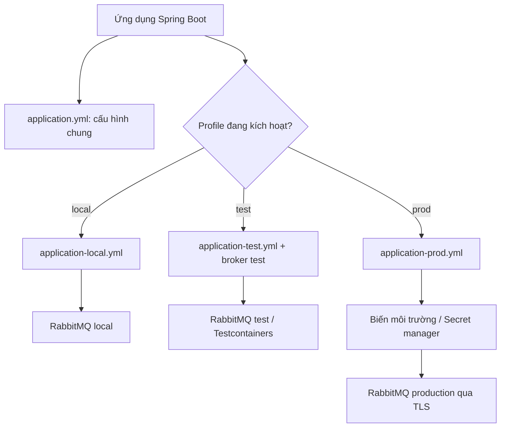
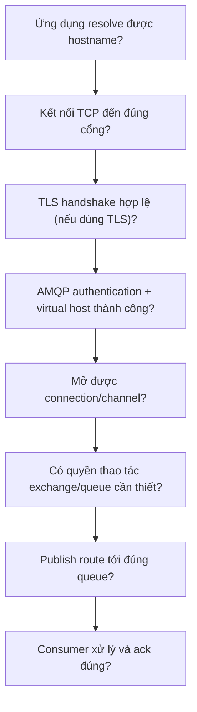

# Tách cấu hình môi trường và kiểm chứng kết nối ban đầu

Một ứng dụng sử dụng **Spring AMQP** có thể chạy ở máy cá nhân, môi trường kiểm thử, staging và production. Các môi trường thường khác nhau về địa chỉ RabbitMQ, cổng, virtual host, thông tin đăng nhập, TLS, quyền truy cập và cách vận hành. Nếu chép một bộ cấu hình cố định vào mã nguồn, ứng dụng có thể kết nối nhầm broker, lộ thông tin bí mật hoặc chỉ phát hiện cấu hình sai sau khi bắt đầu xử lý message thật.

Bài học thuộc phần **Khởi tạo** của module **SPRING_AMQP**. Ta sẽ thiết kế cấu hình Spring Boot theo môi trường, khởi chạy RabbitMQ cục bộ và xác minh từng mức kết nối trước khi phát triển các luồng `RabbitTemplate`, `@RabbitListener`, exchange, queue, binding, acknowledgement, retry, dead-letter, transaction và quan sát hệ thống.

## 1. Mục tiêu và nguyên tắc tách cấu hình

Sau bài này, bạn có thể:

1. Phân biệt cấu hình chung, cấu hình theo môi trường và **bí mật** như mật khẩu hoặc tài liệu khóa TLS.
2. Dùng `application.yml`, `application-local.yml` và `application-prod.yml` theo cơ chế **Spring Profiles**, không hard-code thông tin production.
3. Kiểm tra kết nối AMQP thật, sau đó xác minh đúng virtual host, quyền, queue và đường định tuyến khi cần.
4. Phân biệt lỗi kết nối, lỗi xác thực, lỗi phân quyền, lỗi TLS và lỗi route để xử lý đúng nguyên nhân.

Một mô hình phân chia hợp lý:

| Loại cấu hình | Ví dụ | Nơi đặt phù hợp |
| --- | --- | --- |
| **Chung cho ứng dụng** | Tên ứng dụng, timeout kết nối, heartbeat mong muốn | `application.yml` |
| **Phụ thuộc môi trường** | Host, port, virtual host, tên queue riêng cho môi trường | `application-{profile}.yml` hoặc biến môi trường |
| **Bí mật** | Mật khẩu AMQP, khóa TLS, mật khẩu key store | Secret manager hoặc secret được inject lúc chạy |
| **Cấu hình vận hành** | TLS, mức concurrency, prefetch, publisher confirms, chính sách retry | Mỗi môi trường, sau khi đánh giá tải và độ tin cậy |

**Nguyên tắc quan trọng:** Profile cho biết ứng dụng đang chạy ở môi trường nào; **profile không phải cơ chế bảo vệ mật khẩu**. Bí mật vẫn phải được cấp qua cơ chế quản lý secret phù hợp, kiểm soát quyền truy cập và tránh xuất hiện trong log, Git hoặc container image.



## 2. Điều kiện ban đầu của dự án

Ví dụ giả định ứng dụng Spring Boot đã có dependency cho Spring AMQP:

```xml
<dependency>
    <groupId>org.springframework.boot</groupId>
    <artifactId>spring-boot-starter-amqp</artifactId>
</dependency>
```

Để sử dụng endpoint kiểm tra sức khỏe RabbitMQ, thêm **Spring Boot Actuator**:

```xml
<dependency>
    <groupId>org.springframework.boot</groupId>
    <artifactId>spring-boot-starter-actuator</artifactId>
</dependency>
```

Nếu dùng Gradle, khai báo các starter tương đương trong `dependencies`. Với dự án Spring Boot, nên để Spring Boot parent/BOM quản lý phiên bản Spring AMQP và RabbitMQ Java client, không tự trộn các phiên bản `spring-rabbit` hay `com.rabbitmq:amqp-client` khi chưa kiểm tra tương thích.

Spring Boot thường tự cấu hình `ConnectionFactory`, `RabbitTemplate` và hạ tầng listener khi starter, cấu hình và các điều kiện cần thiết có mặt. **Việc ứng dụng khởi động không chứng minh rằng RabbitMQ đã kết nối thành công**: nhiều đường kết nối chỉ được mở khi có listener, khi gửi message hoặc khi health check thực sự truy cập broker.

## 3. Chuẩn bị RabbitMQ cục bộ để thực hành

Nếu có Docker, bạn có thể tạo một broker phục vụ riêng cho bài học bằng một lệnh:

```bash
docker run -d --name spring-amqp-local \
  -p 127.0.0.1:5672:5672 \
  -p 127.0.0.1:15672:15672 \
  -e RABBITMQ_DEFAULT_USER=app_local \
  -e RABBITMQ_DEFAULT_PASS=local-demo-only \
  -e RABBITMQ_DEFAULT_VHOST=orders_local \
  rabbitmq:management
```

Lệnh nhiều dòng dùng dấu `\` dành cho shell kiểu Bash; trên Windows PowerShell, viết các tham số trên **một dòng** hoặc dùng ký tự nối dòng PowerShell. Image `rabbitmq:management` là nhãn tiện thử nghiệm; với CI hoặc production, hãy **pin tag/digest được xác minh** để có thể tái lập môi trường.

Các cổng thường gặp:

| Cổng | Vai trò | Dùng trong ví dụ |
| --- | --- | --- |
| `5672` | AMQP không TLS; client Spring AMQP kết nối | `localhost:5672` |
| `5671` | AMQP qua TLS, nếu broker được cấu hình SSL listener | Cấu hình production mẫu |
| `15672` | Giao diện RabbitMQ Management (HTTP) nếu plugin được bật | `http://localhost:15672` |

Do ánh xạ cổng chỉ lên `127.0.0.1`, broker mẫu được truy cập từ máy đang chạy Docker. Đây là tài khoản và mật khẩu **dùng thử có thể công khai**, tuyệt đối không tái sử dụng cho staging hoặc production. Nếu ứng dụng chạy **trong container khác**, `localhost` bên trong container đó trỏ tới **chính container ứng dụng**, không phải container RabbitMQ; khi ấy nên đặt chúng trên cùng Docker network và dùng hostname của service RabbitMQ.

Để kiểm tra container:

```bash
docker ps --filter name=spring-amqp-local
docker logs spring-amqp-local
```

Sau khi RabbitMQ khởi động và sẵn sàng, truy cập `http://localhost:15672` bằng `app_local` / `local-demo-only`. Xác nhận virtual host `orders_local` đã tồn tại. Giao diện Management giúp quan sát connection, channel, exchange, queue, message `ready` và `unacked` ở những bài sau.

## 4. Tách các file cấu hình Spring Boot

### 4.1. `application.yml`: phần dùng chung

Trong `src/main/resources/application.yml`:

```yaml
spring:
  application:
    name: spring-amqp-demo
  rabbitmq:
    connection-timeout: 5s
    requested-heartbeat: 30s

management:
  health:
    rabbit:
      enabled: true
```

- `spring.rabbitmq.connection-timeout`: thời gian tối đa chờ kết nối ban đầu đến broker (ở đây là 5 giây), hữu ích khi host sai hoặc mạng không đáp ứng.
- `spring.rabbitmq.requested-heartbeat`: chu kỳ heartbeat mà client yêu cầu; giá trị cuối cùng được thương lượng theo cơ chế của RabbitMQ. Heartbeat dùng để phát hiện kết nối mất, không bảo đảm message đã xử lý thành công.
- `management.health.rabbit.enabled`: cho phép contributor kiểm tra RabbitMQ khi Spring Boot Actuator hiện diện và điều kiện auto-configuration phù hợp.

Đây là **giá trị khởi đầu để thực hành**, không phải một bộ tham số tối ưu cho mọi hệ thống. Điều chỉnh timeout và heartbeat theo mạng, broker và yêu cầu vận hành. Không đặt mật khẩu production vào file chung.

### 4.2. `application-local.yml`: broker phát triển

Trong `src/main/resources/application-local.yml`:

```yaml
spring:
  rabbitmq:
    host: localhost
    port: 5672
    username: app_local
    password: local-demo-only
    virtual-host: orders_local

management:
  endpoint:
    health:
      show-components: always
      show-details: always
```

Giá trị trong file **chỉ khớp broker Docker demo ở mục 3**. Không sao chép mật khẩu mẫu vào hệ thống thật. `show-details: always` giúp xem các contributor health khi học cục bộ; trong production phải kiểm soát quyền truy cập và hạn chế thông tin health được công khai.

Để chạy ứng dụng với profile local:

```bash
java -jar app.jar --spring.profiles.active=local
```

Hoặc đặt biến môi trường `SPRING_PROFILES_ACTIVE=local` trong môi trường chạy của ứng dụng. Nếu dùng IDE, cấu hình profile trong Run Configuration. Khi kích hoạt `local`, Spring Boot nạp giá trị chung và các giá trị ghi đè của `application-local.yml`.

### 4.3. `application-prod.yml`: lấy thông tin kết nối từ môi trường

Trong `src/main/resources/application-prod.yml`:

```yaml
spring:
  rabbitmq:
    addresses: ${RABBITMQ_ADDRESSES}
    username: ${RABBITMQ_USERNAME}
    password: ${RABBITMQ_PASSWORD}
    virtual-host: ${RABBITMQ_VHOST}
    ssl:
      enabled: true

management:
  endpoint:
    health:
      show-details: when-authorized
```

Ví dụ các giá trị **minh họa dạng tên**, không phải endpoint hoặc credential thực:

```text
SPRING_PROFILES_ACTIVE=prod
RABBITMQ_ADDRESSES=rmq-1.example.internal:5671,rmq-2.example.internal:5671
RABBITMQ_USERNAME=<tài khoản production được cấp>
RABBITMQ_PASSWORD=<secret được inject lúc chạy>
RABBITMQ_VHOST=orders_prod
```

Khi chọn `addresses`, tránh khai báo mâu thuẫn thêm `host`/`port`. Hãy cấu hình đúng hostname, cổng AMQPS và cơ chế trust certificate của môi trường đích; **bật `ssl.enabled` thôi chưa chứng minh mọi chứng thư và hostname đều được xác minh đúng**. Nếu RabbitMQ dùng CA nội bộ hoặc mutual TLS, cần cấu hình trust store/key store và chính sách xác minh phù hợp với phiên bản Spring Boot/RabbitMQ Java client đang chạy.

Lưu ý: `RABBITMQ_ADDRESSES` chỉ chứa `host:port` trong ví dụ; không nhét `user:password@...` vào URL để tránh rò rỉ thông tin đăng nhập qua log hoặc màn hình quản lý cấu hình. Cơ chế đọc địa chỉ AMQP dạng URI và thứ tự ưu tiên giữa các thuộc tính có thể khác theo phiên bản Boot; kiểm tra tài liệu phiên bản dự án khi sử dụng URI có scheme hoặc credentials.

Không nên gán giá trị mặc định có thể dùng được cho các placeholder production bắt buộc: thiếu `RABBITMQ_PASSWORD`, chẳng hạn, phải được phát hiện rõ ràng thay vì âm thầm dùng mật khẩu local. Khi chạy nhiều instance, các instance thuộc cùng môi trường cần kết nối đúng virtual host và topology đã quy hoạch.

### 4.4. `application-test.yml`: kiểm thử tách biệt

Mục tiêu của profile `test` là **không gửi message sang môi trường local của lập trình viên hoặc production**. Có thể dùng một RabbitMQ test riêng hay RabbitMQ Testcontainers trong integration test:

```yaml
# src/test/resources/application-test.yml
spring:
  rabbitmq:
    host: ${TEST_RABBIT_HOST:127.0.0.1}
    port: ${TEST_RABBIT_PORT:5672}
    username: ${TEST_RABBIT_USERNAME:app_test}
    password: ${TEST_RABBIT_PASSWORD:local-test-only}
    virtual-host: ${TEST_RABBIT_VHOST:orders_test}
```

Các giá trị mặc định trên là **minh họa một broker test đã được chuẩn bị**, không tự động tạo broker, user hoặc virtual host. Với Testcontainers, host và cổng có thể được gán động bằng `@DynamicPropertySource` hoặc `@ServiceConnection` (nếu phiên bản Spring Boot và dependency test tương ứng hỗ trợ); khi đó tránh hard-code `localhost:5672` vì cổng Docker có thể thay đổi. Cấu hình test nên có vòng đời và dữ liệu riêng, có thể reset an toàn giữa các lần chạy.

### 4.5. Quy tắc ưu tiên cấu hình

Spring Boot gộp thuộc tính từ nhiều property source; biến môi trường, tham số dòng lệnh, file cấu hình và các nguồn khác có **độ ưu tiên khác nhau**. Theo cách sử dụng thông thường, cấu hình profile được kích hoạt có thể ghi đè phần chung, còn biến môi trường hoặc tham số dòng lệnh có thể ghi đè giá trị trong YAML.

Ví dụ: `application-local.yml` đặt `port: 5672`, nhưng biến môi trường `SPRING_RABBITMQ_PORT=5673` được cấp khi chạy có thể khiến ứng dụng kết nối cổng 5673. Vì vậy, khi chẩn đoán, đừng chỉ nhìn nội dung file YAML; hãy xem **effective configuration** từ môi trường chạy thực tế và tìm nguồn ghi đè, nhưng tuyệt đối không in ra mật khẩu hay toàn bộ secret.

## 5. Hiểu các tham số kết nối trước khi kiểm tra

| Thuộc tính Spring Boot | Câu hỏi cần trả lời | Lỗi điển hình khi sai |
| --- | --- | --- |
| `spring.rabbitmq.host` / `port` | Ứng dụng có nhìn thấy đúng host và cổng AMQP không? | Connection refused, timeout, DNS failure |
| `spring.rabbitmq.addresses` | Có cấu hình nhiều địa chỉ broker, và các địa chỉ đều hợp lệ không? | Kết nối thất bại hoặc đi nhầm node |
| `spring.rabbitmq.username` / `password` | Broker có nhận credentials của ứng dụng không? | `ACCESS_REFUSED`/authentication failure |
| `spring.rabbitmq.virtual-host` | User có quyền truy cập đúng vhost không? | Vhost không tồn tại hoặc không được phép |
| `spring.rabbitmq.ssl.enabled` | Broker có TLS listener và client đã cấu hình trust đúng không? | TLS handshake failure hoặc lỗi giao thức |
| `spring.rabbitmq.connection-timeout` | Khi mất mạng, ứng dụng chờ kết nối bao lâu? | Khởi động/chạy tác vụ bị treo lâu trước khi lỗi |
| `spring.rabbitmq.requested-heartbeat` | Hai phía phát hiện kết nối chết theo cơ chế nào? | Kết nối rớt mà ứng dụng phát hiện chậm hoặc điều chỉnh không phù hợp |

**Virtual host không phải hostname.** Cùng một RabbitMQ broker có thể có nhiều vhost; chúng chứa các exchange, queue, binding và phân quyền độc lập theo vhost. Kết nối tới host/port thành công nhưng chọn sai vhost vẫn không cho ứng dụng sử dụng topology mong muốn.

Đặc biệt, mặc định RabbitMQ thường giới hạn tài khoản `guest` ở kết nối loopback. Một ứng dụng chạy từ container khác hoặc máy khác không nên dựa vào `guest`/`guest`; hãy tạo tài khoản riêng, cấp quyền cần thiết trên đúng virtual host và kiểm tra chính sách truy cập từ vị trí ứng dụng thật.

## 6. Kiểm chứng kết nối theo từng tầng

Kiểm tra một tầng thành công **không đồng nghĩa** tầng tiếp theo đã hoạt động:



### 6.1. Xác nhận broker đang chạy và đúng cổng

Với broker demo ở mục 3, chạy:

```bash
docker ps --filter name=spring-amqp-local
docker logs spring-amqp-local
```

Trên máy chạy Spring Boot, có thể kiểm tra TCP bằng công cụ của hệ điều hành, ví dụ PowerShell:

```powershell
Test-NetConnection -ComputerName localhost -Port 5672
```

Hoặc trên Linux/macOS có `nc`:

```bash
nc -vz localhost 5672
```

**TCP thành công chỉ nói rằng cổng đang mở**, chưa kiểm tra được protocol AMQP, username, password, vhost, TLS, quyền publish hoặc queue.

### 6.2. Dùng Actuator kiểm tra RabbitMQ ở mức ứng dụng

Khi đã thêm `spring-boot-starter-actuator`, chạy profile local rồi truy cập:

```bash
curl -i http://localhost:8080/actuator/health
```

Nếu ứng dụng chạy cổng HTTP khác, điều chỉnh URL. Spring Boot thường tự cấu hình Rabbit health contributor khi các điều kiện liên quan RabbitMQ được đáp ứng. Với profile local ở trên (`show-details: always`), phản hồi có thể có dạng:

```json
{
  "status": "UP",
  "components": {
    "rabbit": {"status": "UP"}
  }
}
```

Đây là **ví dụ rút gọn**; phản hồi thật có thể chứa các contributor khác và metadata khác. Khi RabbitMQ không thể kết nối, contributor tương ứng có thể báo `DOWN` và kéo trạng thái tổng thể xuống, tùy cấu hình. Nếu không thấy thành phần `rabbit`, kiểm tra Actuator có trên classpath, health contributor có được bật, điều kiện auto-configuration và quyền hiển thị chi tiết. Một trường `"status":"UP"` ở cấp root mà không quan sát được contributor `rabbit` không đủ để khẳng định đã kiểm tra RabbitMQ.

Không mở `show-details: always` không hạn chế truy cập trên production. Tùy chính sách vận hành, có thể tách liveness và readiness: lỗi broker tạm thời có thể ảnh hưởng **readiness** nhận traffic, nhưng không nên mặc định khiến tiến trình bị khởi động lại vô hạn. Thiết kế probe phải phù hợp khả năng phục hồi của ứng dụng và hệ điều phối.

### 6.3. Smoke test bằng `RabbitTemplate` để mở channel thật

Để chứng minh ứng dụng có thể tạo AMQP connection/channel với bộ credentials hiện tại, có thể dùng một đoạn kiểm tra **chỉ trong profile local**:

```java
import org.springframework.amqp.rabbit.core.RabbitTemplate;
import org.springframework.boot.ApplicationArguments;
import org.springframework.boot.ApplicationRunner;
import org.springframework.context.annotation.Profile;
import org.springframework.stereotype.Component;

@Component
@Profile("local")
public class RabbitConnectionSmokeCheck implements ApplicationRunner {

    private final RabbitTemplate rabbitTemplate;

    public RabbitConnectionSmokeCheck(RabbitTemplate rabbitTemplate) {
        this.rabbitTemplate = rabbitTemplate;
    }

    @Override
    public void run(ApplicationArguments args) {
        Boolean channelOpen = rabbitTemplate.execute(channel -> channel.isOpen());
        if (!Boolean.TRUE.equals(channelOpen)) {
            throw new IllegalStateException("Cannot open RabbitMQ channel");
        }
        System.out.println("RabbitMQ connection/channel: OK (local)");
    }
}
```

`RabbitTemplate.execute(...)` mượn channel từ connection factory; nếu broker không truy cập được, authentication hoặc virtual host sai, lời gọi thường ném exception liên quan thay vì trả `true`. Không in password hoặc URI có credentials vào log. Lớp này **fail fast khi chạy local** để giúp phát hiện sai cấu hình; đừng sao chép nguyên xi thành kiểm tra bắt buộc ở production khi broker có thể tạm thời không sẵn sàng và ứng dụng cần cơ chế tự phục hồi.

Thử đổi tạm `spring.rabbitmq.port` sang cổng không lắng nghe, username hoặc vhost sang một giá trị sai trong profile local và chạy lại. Quan sát exception và health state; trả về giá trị đúng trước khi làm bài tiếp.

### 6.4. Xác minh quyền và đường định tuyến bằng message thử nghiệm

Mở được AMQP channel **chưa chứng minh** ứng dụng có quyền khai báo queue, publish vào exchange hoặc consume từ queue. Sau bước kết nối, thực hiện một phép thử trên topology **chỉ dành cho local/test**:

1. Khai báo một exchange, queue và binding test, chẳng hạn `demo.setup.events`, `demo.setup.queue` và binding key `setup.ping`; làm qua Spring AMQP hoặc RabbitMQ Management trên **vhost `orders_local`**.
2. Dùng `RabbitTemplate.convertAndSend("demo.setup.events", "setup.ping", "ping-<unique-id>")` để gửi message. Trong code thật, tạo giá trị `unique-id` bằng UUID hoặc định danh duy nhất; không gửi thông tin nhạy cảm.
3. Dùng một `@RabbitListener` test đọc từ `demo.setup.queue`, ghi log định danh message và xác minh consumer nhận đúng payload.
4. Quan sát queue depth và `ready`/`unacked` trên Management UI; đảm bảo message được ack khi xử lý thành công theo chế độ listener đã chọn.
5. Thử một routing key **không** khớp binding để xác nhận khác biệt giữa *đã publish* và *đã route*. Nếu cần quan sát message không route được, cấu hình `mandatory`, publisher returns/callback và publisher confirms phù hợp; `convertAndSend` trả về bình thường **không tự chứng minh** message đã đến queue.

Để kiểm tra quyền mà không thay đổi topology, có thể xem cấu hình user/vhost trên Management UI hoặc dùng lệnh khai báo *passive* đối với queue đã tồn tại. Tuy nhiên, thao tác passive vẫn cần quyền theo chính sách RabbitMQ và sẽ lỗi nếu queue không tồn tại. Không thực hiện phép thử bằng cách tạo queue hoặc gửi message giả vào exchange/queue nghiệp vụ production nếu chưa có kế hoạch rõ ràng.

## 7. Những lỗi thường gặp và cách khoanh vùng

| Triệu chứng | Nguyên nhân cần xác minh | Cách xử lý |
| --- | --- | --- |
| `Connection refused` | Broker chưa chạy, host/port sai hoặc cổng chưa được publish | Kiểm tra `docker ps`, listener AMQP, port mapping và endpoint thực tế |
| Timeout hoặc `UnknownHostException` | DNS/network, firewall, địa chỉ sai hoặc môi trường container dùng nhầm `localhost` | Kiểm tra hostname từ **nơi chạy ứng dụng**, route mạng và security rules |
| `ACCESS_REFUSED` khi mở connection | Sai username/password, thiếu quyền trên vhost hoặc vhost không tồn tại | Xem broker log, xác thực lại credentials/vhost và quyền user |
| TLS handshake/hostname verification lỗi | Dùng `5672` với TLS, `5671` không TLS, CA không tin cậy hoặc certificate không khớp hostname | Kiểm tra TLS listener, trust store, hostname/SAN và cấu hình SSL của client |
| Actuator chỉ hiển thị `UP` tổng thể | Chưa thấy Rabbit contributor hoặc chi tiết bị ẩn | Kiểm tra Actuator, điều kiện health indicator và cấu hình hiển thị có kiểm soát |
| Channel mở được, nhưng queue/exchange lỗi `NOT_FOUND` | Resource chưa tồn tại hoặc đang ở vhost khác | Kiểm tra topology và đúng vhost, tạo/binding bằng IaC/RabbitAdmin đã quy hoạch |
| `PRECONDITION_FAILED` khi khai báo queue | Cùng tên queue nhưng thuộc tính khác (durable/arguments/queue type...) | So sánh cấu hình queue hiện có; xử lý thay đổi topology có kế hoạch |
| Publish không thấy message trong queue | Routing key không khớp, exchange sai, không có binding hoặc message bị consumer lấy ngay | Kiểm tra binding, confirms/returns và consumer/metrics |
| Consumer không nhận dù queue có message | Listener chưa khởi động, tên queue sai, consumer bị lỗi, connection rớt hoặc thiếu quyền đọc | Kiểm tra `@RabbitListener`, container logs, active consumer và permission |

Để phân tích, luôn đọc **exception đầu tiên và nguyên nhân gốc (root cause)** cùng broker log. Chẳng hạn, `AmqpConnectException` là lỗi Spring bọc lại; phần `Caused by` thường chứa thông tin cụ thể hơn về lỗi mạng, xác thực hoặc TLS. Không gửi toàn bộ cấu hình hoặc stack trace chứa secret vào công cụ chia sẻ công khai.

## 8. Những giới hạn của phép kiểm tra kết nối

Việc kết nối ban đầu thành công là điều kiện cần, **chưa phải** sự bảo đảm giao nhận bất đồng bộ đáng tin cậy.

| Kiểm chứng được | Chưa kiểm chứng được |
| --- | --- |
| TCP/TLS tới broker đúng endpoint | Broker sẽ luôn sẵn sàng khi mạng biến động |
| AMQP login và virtual host hợp lệ | Ứng dụng được quyền với mọi exchange/queue |
| Mở connection/channel qua `RabbitTemplate` | Message đã được route đến queue |
| `RabbitHealthIndicator` báo kết nối hoạt động | Consumer đã xử lý và commit dữ liệu nghiệp vụ |
| Một message test được listener nhận | Ứng dụng có retry, DLQ, idempotency và transaction boundary đúng khi lỗi |

Trong các bài sau, cần kiểm tra riêng **publisher confirms/returns**, **consumer acknowledgement** (`AUTO`/`MANUAL`), **retry và dead-letter exchange/queue**, xử lý lặp message, transaction và metrics. Ví dụ, publisher confirm chỉ xác nhận một mốc broker nhận publish; consumer ack là phản hồi của consumer về delivery; cả hai không thay thế transaction database.

Trên production, cần xây dựng monitoring liên tục cho connection/channel, số consumer, độ sâu queue, message `ready`/`unacked`, số lần redelivery và DLQ. Chỉ kiểm tra kết nối lúc khởi động không phát hiện tất cả lỗi xảy ra sau đó.

## 9. Checklist thực hành và kết quả mong đợi

Trước khi viết flow RabbitMQ đầu tiên, kiểm tra các mục sau:

- [ ] Project có `spring-boot-starter-amqp`; nếu dùng `/actuator/health` thì có thêm starter Actuator.
- [ ] `application.yml` chỉ chứa cấu hình chung; profile `local`, `test` và `prod` được chọn rõ ràng.
- [ ] Mật khẩu/secret thật được inject qua môi trường hoặc secret manager; không commit vào Git và không ghi vào log.
- [ ] Broker local chạy ở `localhost:5672`, UI ở `localhost:15672` (hoặc địa chỉ thực tế tương ứng khi chạy trong container).
- [ ] User có quyền trên đúng virtual host; host, port, vhost và TLS tương ứng môi trường chạy.
- [ ] `RabbitTemplate.execute(...)` hoặc Rabbit health contributor xác minh được kết nối AMQP thật.
- [ ] Nếu cần chứng minh publish/consume, đã thử exchange/queue/binding riêng cho local/test, xác nhận routing và ack.
- [ ] Trong trường hợp cố ý sai port, credentials hoặc vhost, quan sát được lỗi rõ ràng và sau đó khôi phục cấu hình đúng.
- [ ] Đã định nghĩa health/readiness, logging và monitoring production với mức tiết lộ thông tin phù hợp.

**Ghi nhớ:** Tách cấu hình theo môi trường để ứng dụng không kết nối nhầm broker; giữ bí mật ngoài mã nguồn; kiểm chứng theo từng tầng **TCP → TLS → AMQP authentication/vhost → channel → quyền → routing → consumer**. Đây là nền móng để tiếp tục triển khai `RabbitTemplate`, `@RabbitListener`, exchange, queue, binding và cơ chế retry, dead-letter, giao dịch, quan sát đáng tin cậy trong Spring AMQP.
