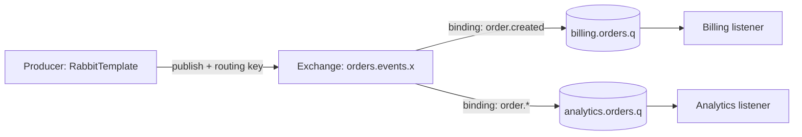
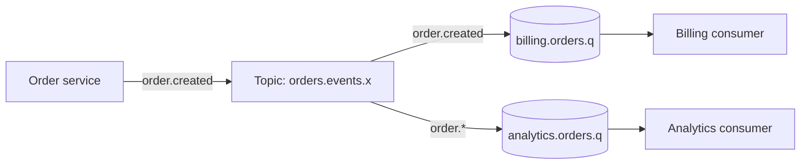
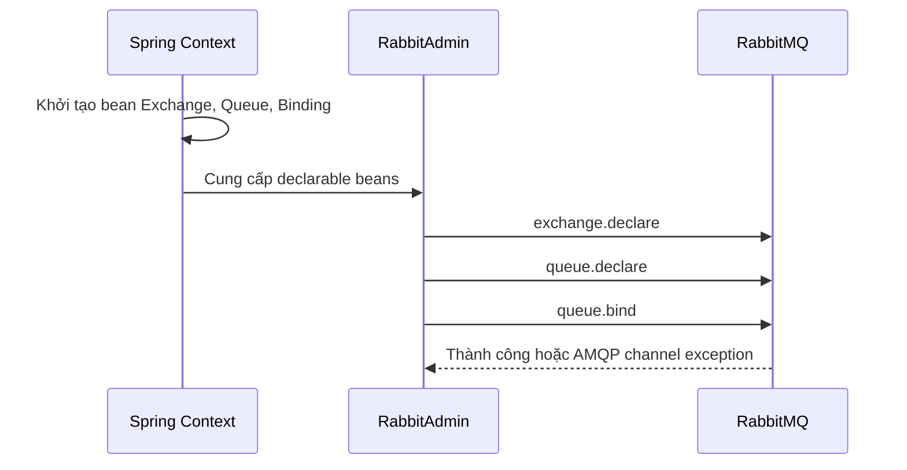
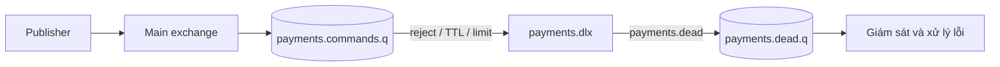

# Queue, Exchange, Binding và các builder của Spring AMQP

Trong RabbitMQ, producer thường **publish message vào exchange**. Exchange quyết định chuyển message đến queue nào thông qua các **binding**, còn consumer nhận message từ queue. Muốn tích hợp RabbitMQ với Spring AMQP một cách đáng tin cậy, ta phải mô tả chính xác topology của broker ngay từ đầu.

Đây là bài thuộc chương **Khai báo tài nguyên** của **SPRING_AMQP**, tập trung vào ba API `QueueBuilder`, `ExchangeBuilder`, `BindingBuilder` và cách ứng dụng Spring Boot đưa các đối tượng Java thành tài nguyên thực trên RabbitMQ. Kiến thức này đặt nền tảng cho `RabbitTemplate`, `@RabbitListener`, xác nhận giao nhận, retry, dead-letter, giao dịch và quan sát hệ thống bất đồng bộ.

Sau bài học, bạn có thể:

- Phân biệt queue, exchange, binding, routing key và consumer.
- Sử dụng builder để khai báo queue bền vững/tạm thời, direct/topic/fanout exchange và binding phù hợp.
- Nhận biết vai trò của `RabbitAdmin`, `Declarables` và `@QueueBinding` trong quá trình khai báo tài nguyên.
- Giải thích lỗi khi khai báo lại tài nguyên có thuộc tính không tương đương.
- Thiết kế topology đơn giản có thể mở rộng cho nhiều consumer, dead-letter và hệ thống nhiều service.

> Các ví dụ giả định dự án Spring Boot có dependency `org.springframework.boot:spring-boot-starter-amqp`, cấu hình kết nối RabbitMQ, và tài khoản đủ quyền trong virtual host. `Queue`, `Exchange`, `Binding` và các builder của chúng nằm trong package `org.springframework.amqp.core`.

## 1. Topology RabbitMQ gồm những gì?



| Thành phần | Trách nhiệm | Ví dụ |
| --- | --- | --- |
| **Exchange** | Nhận message từ producer và chọn queue dựa trên loại exchange/binding. | `orders.events.x` |
| **Queue** | Lưu message để consumer nhận và ACK/NACK theo cấu hình. | `billing.orders.q` |
| **Binding** | Liên kết exchange với queue bằng key, pattern hoặc arguments. | `orders.events.x` → `billing.orders.q`, key `order.created` |
| **Routing key** | Chuỗi producer đính kèm khi publish; một số exchange dùng để định tuyến. | `order.created` |
| **Consumer** | Nhận message từ queue; một queue có thể có nhiều consumer cạnh tranh. | `@RabbitListener(queues = "billing.orders.q")` |

Ví dụ publish:

```java
rabbitTemplate.convertAndSend(
        "orders.events.x", "order.created", "O-42");
```

Với topic exchange trong sơ đồ, routing key `order.created` khớp cả hai binding. **Mỗi queue nhận một bản message**, trong khi nhiều consumer cùng một queue chia nhau xử lý những message của queue đó.

**Phân biệt đối tượng Java và tài nguyên broker:** `QueueBuilder`, `ExchangeBuilder`, `BindingBuilder` chỉ tạo đối tượng cấu hình ở phía ứng dụng. Một thành phần như `RabbitAdmin` phải gửi lệnh declaration qua kết nối AMQP thì queue, exchange và binding mới tồn tại trên RabbitMQ.

## 2. Khai báo Queue bằng `QueueBuilder`

### 2.1. Queue bền vững

Một queue công việc cần có tên ổn định và tồn tại qua broker restart:

```java
import org.springframework.amqp.core.Queue;
import org.springframework.amqp.core.QueueBuilder;
import org.springframework.context.annotation.Bean;
import org.springframework.context.annotation.Configuration;

@Configuration
class EmailQueueConfig {
    @Bean
    Queue emailJobsQueue() {
        return QueueBuilder.durable("jobs.email.q").build();
    }
}
```

`durable=true` giúp **định nghĩa queue** tồn tại sau broker restart theo khả năng lưu trữ của RabbitMQ. Nó không bảo đảm mọi message đều bền vững: còn phải xét delivery mode của message, publisher confirms, loại queue, replication và tình trạng lưu trữ của broker.

### 2.2. Các thuộc tính của queue

| Thuộc tính | Ý nghĩa | Tình huống |
| --- | --- | --- |
| `durable` | Broker lưu định nghĩa queue bền vững. | Queue công việc/đơn hàng. |
| `exclusive` | Queue chỉ dành cho kết nối khai báo; bị xóa khi kết nối đó đóng. | Queue reply tạm thời hoặc subscription riêng. |
| `autoDelete` | Queue tự xóa khi consumer cuối cùng rời đi sau khi queue đã từng có consumer. | Queue cho subscriber ngắn hạn. |
| `arguments` | Thông số mở rộng của broker, thường là các key `x-*`. | TTL, dead-letter, queue type. |

Ví dụ queue ngắn hạn chỉ một connection sử dụng:

```java
@Bean
Queue temporaryResultsQueue() {
    return QueueBuilder.nonDurable("temp.results.q")
            .exclusive()
            .autoDelete()
            .build();
}
```

Đừng dùng cùng tên queue `exclusive` ở nhiều instance ứng dụng: các instance khác không có quyền sử dụng queue của kết nối đã khai báo. Với subscription chỉ tồn tại trong đời sống của một instance, có thể chọn `AnonymousQueue`:

```java
import org.springframework.amqp.core.AnonymousQueue;

@Bean
Queue temporarySubscription() {
    return new AnonymousQueue();
}
```

`AnonymousQueue` có tên sinh riêng và mặc định không durable, exclusive, auto-delete. Tên không ổn định giữa các vòng đời ứng dụng; do đó không dùng nó cho hàng đợi cần giữ backlog lâu dài theo một tên cố định.

### 2.3. Queue arguments và queue type

Ví dụ tạo **quorum queue**:

```java
@Bean
Queue paymentCommandsQueue() {
    return QueueBuilder.durable("payments.commands.q")
            .withArgument("x-queue-type", "quorum")
            .build();
}
```

Quorum queue phù hợp một số nhu cầu chịu lỗi và replication; nó có yêu cầu vận hành, tài nguyên và tính năng khác classic queue. Queue type là quyết định kiến trúc, **không phải thuộc tính tùy ý thay đổi trên queue đã tồn tại**.

Ví dụ TTL cho message trong queue:

```java
@Bean
Queue shortLivedQueue() {
    return QueueBuilder.durable("events.short-lived.q")
            .ttl(60_000)
            .build();
}
```

`ttl(60_000)` thiết lập `x-message-ttl` bằng 60 giây. Đây là thời gian sống của message trong queue, khác với thời hạn tồn tại của **chính queue** (thường dùng `x-expires`). Message hết hạn có thể bị loại bỏ hoặc dead-letter theo cấu hình broker.

**Lưu ý vận hành:** Nhiều tham số như TTL hay dead-letter cũng có thể đặt bằng **RabbitMQ policy**. Với các thuộc tính có thể cần thay đổi mà không muốn xóa/redeclare queue, nên cân nhắc policy khi tính năng đó hỗ trợ. Những `x-*` arguments đặt trực tiếp khi declare thường có ưu tiên so với regular policy; operator policy có cơ chế ưu tiên/giới hạn riêng.

## 3. Khai báo Exchange bằng `ExchangeBuilder`

Mỗi loại exchange chọn queue theo quy tắc khác nhau:

| Loại exchange | Cách định tuyến | Ví dụ |
| --- | --- | --- |
| **Direct** | Binding key phải khớp chính xác routing key. | `email.send`, `invoice.generate` |
| **Topic** | So khớp routing key theo pattern các từ ngăn cách bằng dấu chấm. | `order.created`, `payment.failed` |
| **Fanout** | Gửi đến tất cả queue được binding, bỏ qua routing key. | Broadcast thông báo tới nhiều hệ thống. |
| **Headers** | So khớp header của message với binding arguments. | Điều kiện dựa trên nhiều thuộc tính header. |

### 3.1. Direct exchange

```java
import org.springframework.amqp.core.DirectExchange;
import org.springframework.amqp.core.ExchangeBuilder;

@Bean
DirectExchange jobsExchange() {
    return ExchangeBuilder.directExchange("jobs.commands.x")
            .durable(true)
            .build();
}
```

Binding key `email.send` chỉ khớp routing key `email.send`. Ký hiệu `*` hay `#` **không có ý nghĩa wildcard trong direct exchange**.

### 3.2. Topic exchange

```java
import org.springframework.amqp.core.TopicExchange;

@Bean
TopicExchange orderEventsExchange() {
    return ExchangeBuilder.topicExchange("orders.events.x")
            .durable(true)
            .build();
}
```

Quy tắc pattern của topic exchange:

| Binding pattern | Routing key | Khớp? | Diễn giải |
| --- | --- | --- | --- |
| `order.*` | `order.created` | Có | `*` khớp một từ. |
| `order.*` | `order.created.eu` | Không | Có thêm một từ. |
| `order.#` | `order.created.eu` | Có | `#` khớp không hoặc nhiều từ. |
| `order.#` | `order` | Có | `#` có thể khớp không từ nào. |
| `*.failed` | `payment.failed` | Có | Phần đầu là một từ bất kỳ. |
| `*.failed` | `payment.retry.failed` | Không | Pattern chỉ gồm hai từ. |

### 3.3. Fanout exchange

```java
import org.springframework.amqp.core.FanoutExchange;

@Bean
FanoutExchange systemBroadcastExchange() {
    return ExchangeBuilder.fanoutExchange("system.broadcast.x")
            .durable(true)
            .build();
}
```

Fanout exchange không cần routing key. Nếu ba queue đã được binding, mỗi queue nhận bản message. Nếu chưa có queue/binding lúc publish thì subscriber được tạo về sau **không tự nhận lại** những message đã phát trước đó.

### 3.4. Default exchange với tên rỗng

RabbitMQ có **default exchange** là một direct exchange tích hợp sẵn, tên `""`. Mỗi queue được tạo có binding ngầm tới exchange này với routing key bằng **tên queue**:

```java
rabbitTemplate.convertAndSend(
        "", "jobs.email.q", "email-job-42");
```

Không cần bean exchange hoặc binding riêng cho cách gửi này; cũng không nên khai báo lại default exchange. Cách này hữu ích cho demo và gửi thẳng đến queue. Để định tuyến sự kiện linh hoạt hoặc mở rộng subscriber, nên tạo exchange riêng.

## 4. Khai báo Binding bằng `BindingBuilder`

Khai báo exchange và queue mới chỉ tạo hai tài nguyên. **Binding** nói cho exchange biết queue đích và điều kiện định tuyến.

### 4.1. Direct binding

```java
import org.springframework.amqp.core.Binding;
import org.springframework.amqp.core.BindingBuilder;
import org.springframework.beans.factory.annotation.Qualifier;

@Bean
Binding emailJobBinding(
        @Qualifier("emailJobsQueue") Queue queue,
        @Qualifier("jobsExchange") DirectExchange exchange) {
    return BindingBuilder.bind(queue)
            .to(exchange)
            .with("email.send");
}
```

`@Qualifier` chọn đúng bean khi context có nhiều queue hoặc exchange cùng kiểu. Tên bean là chi tiết wiring của Spring; broker chỉ thấy tên queue/exchange và binding key.

### 4.2. Topic binding

```java
@Bean
Binding orderBillingBinding(
        @Qualifier("billingOrdersQueue") Queue queue,
        @Qualifier("orderEventsExchange") TopicExchange exchange) {
    return BindingBuilder.bind(queue)
            .to(exchange)
            .with("order.*");
}
```

Topic binding `order.*` nhận message có routing key `order.created` hay `order.cancelled` nhưng không nhận `order.created.eu`. Khi chỉ quan tâm một loại sự kiện, dùng binding key cụ thể như `order.created`.

### 4.3. Fanout binding

```java
@Bean
Binding notificationsBroadcastBinding(
        @Qualifier("notificationsQueue") Queue queue,
        @Qualifier("systemBroadcastExchange") FanoutExchange exchange) {
    return BindingBuilder.bind(queue).to(exchange);
}
```

Không cần `with(routingKey)` vì fanout không xét routing key. Một queue có thể có nhiều binding và nhận message từ nhiều exchange; một exchange cũng có thể định tuyến đến nhiều queue.

## 5. Ví dụ hoàn chỉnh: hai subscriber độc lập

Giả sử service Order phát `order.created`, còn Billing và Analytics nhận sự kiện thông qua **hai queue riêng**:



Khai báo đầy đủ exchange, queues và bindings bằng Spring configuration:

```java
import org.springframework.amqp.core.Binding;
import org.springframework.amqp.core.BindingBuilder;
import org.springframework.amqp.core.ExchangeBuilder;
import org.springframework.amqp.core.Queue;
import org.springframework.amqp.core.QueueBuilder;
import org.springframework.amqp.core.TopicExchange;
import org.springframework.beans.factory.annotation.Qualifier;
import org.springframework.context.annotation.Bean;
import org.springframework.context.annotation.Configuration;

@Configuration
public class OrderTopologyConfig {
    @Bean
    TopicExchange orderEventsExchange() {
        return ExchangeBuilder.topicExchange("orders.events.x")
                .durable(true)
                .build();
    }

    @Bean
    Queue billingOrdersQueue() {
        return QueueBuilder.durable("billing.orders.q").build();
    }

    @Bean
    Queue analyticsOrdersQueue() {
        return QueueBuilder.durable("analytics.orders.q").build();
    }

    @Bean
    Binding billingOrdersBinding(
            @Qualifier("billingOrdersQueue") Queue queue,
            @Qualifier("orderEventsExchange") TopicExchange exchange) {
        return BindingBuilder.bind(queue)
                .to(exchange)
                .with("order.created");
    }

    @Bean
    Binding analyticsOrdersBinding(
            @Qualifier("analyticsOrdersQueue") Queue queue,
            @Qualifier("orderEventsExchange") TopicExchange exchange) {
        return BindingBuilder.bind(queue)
                .to(exchange)
                .with("order.*");
    }
}
```

Producer:

```java
import org.springframework.amqp.rabbit.core.RabbitTemplate;
import org.springframework.stereotype.Service;

@Service
public class OrderEventPublisher {
    private final RabbitTemplate rabbitTemplate;

    public OrderEventPublisher(RabbitTemplate rabbitTemplate) {
        this.rabbitTemplate = rabbitTemplate;
    }

    public void publishCreated(String orderId) {
        rabbitTemplate.convertAndSend(
                "orders.events.x", "order.created", orderId);
    }
}
```

Hai listener để thử nghiệm:

```java
import org.springframework.amqp.rabbit.annotation.RabbitListener;
import org.springframework.stereotype.Component;

@Component
class BillingOrderListener {
    @RabbitListener(queues = "billing.orders.q")
    public void onOrderCreated(String orderId) {
        System.out.println("Billing nhận đơn " + orderId);
    }
}

@Component
class AnalyticsOrderListener {
    @RabbitListener(queues = "analytics.orders.q")
    public void onOrderEvent(String orderId) {
        System.out.println("Analytics nhận sự kiện " + orderId);
    }
}
```

Trong hệ thống microservices, các listener thường thuộc **những ứng dụng khác nhau**. Mỗi service sở hữu queue của mình, còn exchange sự kiện được thống nhất trong hợp đồng giao tiếp. Nếu nhiều ứng dụng cùng khai báo exchange dùng chung, chúng phải dùng thuộc tính **tương đương**, đồng thời xác định rõ ai chịu trách nhiệm quản lý thay đổi topology.

Ví dụ này dùng payload `String` để tập trung vào routing; khi gửi object hoặc JSON, cần thống nhất schema, content type, converter và khả năng đọc message giữa các phiên bản ứng dụng.

## 6. `RabbitAdmin`: chuyển bean Java thành tài nguyên trên broker

Spring Boot với Spring AMQP thường có thể auto-configure `RabbitAdmin`. Khi cơ chế tự khai báo hoạt động và có kết nối đến broker, admin tìm những bean kiểu `Queue`, `Exchange`, `Binding`, `Declarables` để thực hiện `declare`.



Một bean `Queue` đã xuất hiện trong context **chưa chứng minh** queue đã được tạo trên broker. Việc khai báo còn phụ thuộc kết nối, quyền, chế độ auto-declaration, loại tài nguyên và khả năng broker chấp nhận thuộc tính.

### 6.1. Gom các khai báo bằng `Declarables`

```java
import org.springframework.amqp.core.Declarables;

@Bean
Declarables invoiceDeclarables() {
    DirectExchange exchange = ExchangeBuilder
            .directExchange("invoices.commands.x")
            .durable(true)
            .build();

    Queue queue = QueueBuilder
            .durable("invoices.generate.q")
            .build();

    Binding binding = BindingBuilder.bind(queue)
            .to(exchange)
            .with("invoice.generate");

    return new Declarables(exchange, queue, binding);
}
```

`Declarables` nhóm nhiều tài nguyên trong một bean để admin khai báo. Các object bên trong nhóm không tự trở thành bean độc lập để inject; nếu cần sử dụng ở nơi khác, có thể giữ tên tài nguyên trong constants hoặc tổ chức cấu hình riêng. Tránh khai báo cùng tài nguyên qua nhiều con đường khi chưa có lý do rõ ràng.

### 6.2. Khai báo trực tiếp qua `AmqpAdmin`

Trong công cụ quản trị hoặc provisioning được kiểm soát:

```java
import org.springframework.amqp.core.AmqpAdmin;

public void createMaintenanceQueue(AmqpAdmin admin) {
    admin.declareQueue(
            QueueBuilder.durable("ops.maintenance.q").build());
}
```

Lệnh trên gửi declaration ngay tới broker. Không nên tạo queue tùy ý cho **mỗi message**; điều này làm tăng số tài nguyên và gây khó cho giám sát, quyền và dọn dẹp.

## 7. Khai báo topology ngay tại `@RabbitListener`

Ngoài `@Bean`, Spring AMQP cho phép dùng `@QueueBinding`, `@Queue`, `@Exchange` tại listener:

```java
import org.springframework.amqp.core.ExchangeTypes;
import org.springframework.amqp.rabbit.annotation.Exchange;
import org.springframework.amqp.rabbit.annotation.Queue;
import org.springframework.amqp.rabbit.annotation.QueueBinding;
import org.springframework.amqp.rabbit.annotation.RabbitListener;
import org.springframework.stereotype.Component;

@Component
class NotificationOrderListener {
    @RabbitListener(bindings = @QueueBinding(
            value = @Queue(
                    value = "notifications.order-created.q",
                    durable = "true"),
            exchange = @Exchange(
                    value = "orders.events.x",
                    type = ExchangeTypes.TOPIC,
                    durable = "true"),
            key = "order.created"))
    public void handle(String orderId) {
        System.out.println("Notify đơn " + orderId);
    }
}
```

Khi có `RabbitAdmin` phù hợp và đủ quyền, các tài nguyên được mô tả bởi annotation này có thể được khai báo trên broker. Ngược lại, `@RabbitListener(queues = "billing.orders.q")` chỉ cho listener biết **tên queue để tiêu thụ**; bản thân thuộc tính `queues` **không tự tạo** queue.

| Cách khai báo | Khi nên dùng | Điểm cần chú ý |
| --- | --- | --- |
| `@Bean Queue/Exchange/Binding` | Muốn topology rõ ràng, dùng lại các object khai báo. | Cần wiring chính xác giữa bean. |
| `Declarables` | Gom tài nguyên cùng một use case. | Các phần tử không tự trở thành bean inject độc lập. |
| `@RabbitListener(bindings=...)` | Listener sở hữu queue/binding riêng. | Có thể khó quan sát khi topology phức tạp hoặc khai báo lặp. |
| `AmqpAdmin` trực tiếp | Provisioning hoặc thao tác động có kiểm soát. | Gửi declaration ngay, có thể lỗi do quyền/thuộc tính broker. |

## 8. Khai báo Dead-letter Exchange và Dead-letter Queue

Một queue có thể khai báo **dead-letter exchange (DLX)** để định tuyến message bị dead-letter, chẳng hạn khi bị reject với `requeue=false`, khi message hết TTL hoặc gặp các điều kiện giới hạn do RabbitMQ quy định.



Ví dụ queue với DLX và binding tới DLQ:

```java
import org.springframework.amqp.core.Binding;
import org.springframework.amqp.core.BindingBuilder;
import org.springframework.amqp.core.DirectExchange;
import org.springframework.amqp.core.Queue;
import org.springframework.amqp.core.QueueBuilder;
import org.springframework.beans.factory.annotation.Qualifier;
import org.springframework.context.annotation.Bean;
import org.springframework.context.annotation.Configuration;

@Configuration
class PaymentDeadLetterConfig {
    @Bean
    DirectExchange paymentsDeadLetterExchange() {
        return new DirectExchange("payments.dlx");
    }

    @Bean
    Queue paymentsCommandsQueue() {
        return QueueBuilder.durable("payments.commands.q")
                .deadLetterExchange("payments.dlx")
                .deadLetterRoutingKey("payments.dead")
                .build();
    }

    @Bean
    Queue paymentsDeadLetterQueue() {
        return QueueBuilder.durable("payments.dead.q").build();
    }

    @Bean
    Binding paymentsDeadLetterBinding(
            @Qualifier("paymentsDeadLetterQueue") Queue queue,
            @Qualifier("paymentsDeadLetterExchange") DirectExchange exchange) {
        return BindingBuilder.bind(queue)
                .to(exchange)
                .with("payments.dead");
    }
}
```

Để ví dụ trở thành luồng chạy đầy đủ, còn cần **main exchange và binding** dẫn message vào `payments.commands.q`. Đoạn mã chỉ tập trung phần dead-letter.

Trong production, cân nhắc cấu hình dead-letter bằng **broker policy** nếu cần thay đổi đích DLX về sau mà không sửa argument cố định của queue. Đồng thời kiểm tra quyền truy cập exchange, routing và thuộc tính queue. Không mặc định rằng mọi tình huống dead-letter đều bảo đảm message được lưu thành công.

Đặc biệt, **khai báo DLX không đồng nghĩa với tự động chuyển mọi exception vào DLQ**. Listener container có thể requeue khi gặp lỗi; cần phối hợp xác nhận ACK/NACK, chính sách retry, giới hạn số lần thử và dead-letter.

## 9. Khai báo tài nguyên nhiều lần: tương đương thì được, khác thì lỗi

Các lệnh declare của RabbitMQ có thể lặp lại an toàn nếu tài nguyên đã tồn tại với **cùng tên, loại và các thuộc tính tương đương**. Điều này cho phép ứng dụng khởi động lại mà không phải tạo tên queue mới.

Nhưng hãy xét tình huống:

1. Phiên bản đầu tạo `orders.q` bằng `QueueBuilder.durable("orders.q")`.
2. Phiên bản sau sửa thành `QueueBuilder.nonDurable("orders.q")`.
3. Ứng dụng khởi động và tự khai báo lại.
4. Broker có thể từ chối bằng `PRECONDITION_FAILED` (AMQP reply code thường là `406`) vì khác thuộc tính `durable`.

Tương tự, đổi `exclusive`, `autoDelete`, `x-queue-type` hoặc một số arguments khác trên queue đang tồn tại có thể gây lỗi khai báo. Đổi loại/durability exchange cũng có thể không tương đương với exchange hiện hữu.

**Không tự động xóa queue production để vượt qua `PRECONDITION_FAILED`.** Xóa queue có thể làm mất backlog và làm gián đoạn consumer. Khi phải thay queue type hoặc thuộc tính không sửa tại chỗ được, hãy lập kế hoạch chuyển đổi topology.

| Thay đổi | Điều cần xem xét |
| --- | --- |
| Thêm queue mới | Bổ sung binding và consumer; bảo đảm backlog có nơi được xử lý. |
| Thêm binding cho queue hiện tại | Queue có thể nhận **thêm loại message**, consumer phải xử lý được. |
| Đổi tên queue | Message còn trong queue cũ không tự chuyển qua queue mới. |
| Chuyển classic queue sang quorum queue | Cần tạo queue mới và kế hoạch chuyển luồng. |
| Đổi DLX hoặc TTL dưới dạng client arguments | Có thể cần policy phù hợp hoặc migration thay vì redeclare. |
| Đổi type hoặc durability của exchange | Kiểm tra tính tương đương; cân nhắc exchange mới và đổi publisher/binding. |

Một lộ trình migration an toàn thường gồm: tạo tài nguyên mới; xác minh quyền và binding; cập nhật producer/consumer theo trình tự phù hợp; xử lý hoặc chuyển backlog có kiểm soát; theo dõi số message `ready/unacked`; chỉ bỏ tài nguyên cũ sau khi đã xác nhận không còn luồng phụ thuộc.

## 10. Đặt tên và xác định quyền sở hữu topology

Trong một hệ thống có nhiều service, convention rõ ràng giúp tránh xung đột:

| Tài nguyên | Tên minh họa | Ý nghĩa |
| --- | --- | --- |
| Topic exchange | `orders.events.x` | Nơi publish sự kiện về đơn hàng. |
| Direct exchange | `emails.commands.x` | Nơi gửi yêu cầu thực hiện công việc email. |
| Consumer queue | `billing.order-created.q` | Backlog riêng của Billing. |
| Dead-letter exchange | `payments.dlx` | Đích định tuyến dead-letter. |
| Dead-letter queue | `payments.dead.q` | Nơi tiếp nhận message lỗi. |
| Routing key | `order.created` | Loại sự kiện, không phải tên queue. |

Một số nguyên tắc:

1. **Queue thuộc về subscriber:** Nếu Billing và Analytics đều cần mọi sự kiện `order.created`, mỗi bên có queue riêng. Các instance cùng service có thể tiêu thụ chung một queue để chia tải.
2. **Exchange và routing key là hợp đồng giao tiếp:** Producer và subscriber thống nhất tên, loại exchange, key và schema message. Không thay đổi ngầm giữa các lần triển khai.
3. **Phân quyền rõ:** Thỏa thuận tài nguyên do ứng dụng tự khai báo hay do nhóm platform/operations provisioning trước; cấp quyền configure/read/write phù hợp.
4. **Tránh khai báo trùng không kiểm soát:** Nhiều ứng dụng khai báo cùng exchange có thể hợp lệ nếu mọi thuộc tính tương đương, nhưng ai chịu trách nhiệm đổi topology phải rõ ràng.
5. **Tách môi trường:** Sử dụng virtual host, account hoặc naming convention nhất quán; tránh để ứng dụng test publish vào queue của production.
6. **Kiểm soát số lượng queue:** Không tạo queue mới theo từng request người dùng nếu không có cơ chế đặt quota và dọn dẹp; queue là tài nguyên vận hành thực sự.

## 11. Các lỗi khai báo và định tuyến thường gặp

| Dấu hiệu | Nguyên nhân cần kiểm tra | Hướng xác minh |
| --- | --- | --- |
| `PRECONDITION_FAILED - inequivalent arg` | Queue/exchange đã có nhưng thuộc tính không giống khai báo mới. | So sánh `durable`, `autoDelete`, `exclusive`, queue type và arguments. |
| `NOT_FOUND - no queue ...` | Listener trỏ tới queue chưa có hoặc admin khai báo thất bại. | Kiểm tra vhost, tên queue và log `RabbitAdmin`. |
| `ACCESS_REFUSED` khi declare/bind | Account thiếu quyền configure/read/write tương ứng. | Kiểm tra permissions của user/vhost. |
| Publish xong mà queue không có message | Sai exchange, binding, routing key hoặc consumer đã nhận ngay. | Kiểm tra bindings, `ready`, `unacked`, log consumer. |
| Confirm thành công nhưng message không đến queue mong muốn | Broker xác nhận publish nhưng message có thể unroutable. | Kiểm tra routing, `mandatory` + publisher returns hoặc alternate exchange. |
| Queue biến mất ngoài dự kiến | `exclusive`, `autoDelete`, `x-expires` hoặc policy. | Kiểm tra properties và lifecycle consumer/connection. |
| Hai service chia nhau sự kiện thay vì cùng nhận | Cả hai đang tiêu thụ **một queue**. | Tạo queue riêng cho từng nhóm subscriber, binding cùng exchange. |
| Message lỗi không vào DLQ | Requeue liên tục, thiếu DLX hoặc binding/routing key sai. | Kiểm tra listener ACK/NACK, retry và dead-letter config. |
| Chỉ sai sau khi đổi phiên bản ứng dụng | Bean topology đã thay thuộc tính, converter hoặc listener config thay đổi. | So sánh cấu hình trước/sau, dependency graph và log broker. |

**Ba lớp xác nhận không thay thế nhau:** publisher confirm là phản hồi từ broker về publish; consumer ACK xác nhận một delivery với broker; còn trạng thái xử lý thành công là thông tin nghiệp vụ. Không thể lấy một publisher confirm để kết luận consumer đã hoàn thành công việc.

## 12. Thực hành và tự kiểm chứng

### Bài 1 — Direct exchange và routing chính xác

Tạo `jobs.commands.x`, `jobs.email.q` và binding key `email.send`. Gửi hai message có routing key `email.send` và `email.unknown` bằng `RabbitTemplate`. Quan sát message nào vào queue. Tìm hiểu điều gì xảy ra với message không được route khi chưa cấu hình `mandatory` hoặc alternate exchange.

### Bài 2 — Topic exchange với hai subscriber

Tạo topic exchange `orders.events.x` và hai queue: một queue bind `order.created`, queue còn lại bind `order.*`. Publish `order.created`, `order.cancelled`, `payment.failed`. Lập bảng các queue nhận từng message và giải thích vì sao hai consumer chung một queue không phải publish–subscribe.

### Bài 3 — Thuộc tính queue và lỗi khai báo

Trong môi trường thực hành có thể chủ động xóa dữ liệu, tạo `demo.queue.q` với `durable=true`. Sau đó đổi code thành `durable=false` và khởi động lại. Đọc lỗi declaration rồi mô tả phương án chuyển sang queue mới, thay vì tự xóa một queue đang có backlog trong hệ thống thật.

### Bài 4 — Cấu hình DLX

Từ `PaymentDeadLetterConfig` ở mục 8, bổ sung main exchange và binding cho `payments.commands.q`. Tạo một consumer có kiểm soát để reject message thử nghiệm với `requeue=false`. Xác minh message được định tuyến tới `payments.dead.q` và kiểm tra các header liên quan dead-letter khi có.

### Bài 5 — Quan sát trạng thái thực của broker

Sau mỗi bài, mở RabbitMQ Management UI hoặc CLI phù hợp để xác nhận **tài nguyên trên broker**. Ghi lại tên exchange, loại, durability, tên queue, auto-delete/exclusive, arguments, binding source/destination/key và số message `ready/unacked`. So sánh kết quả thực với bean Java và log startup.

### Câu hỏi tự kiểm tra

1. `QueueBuilder.durable(...)` đã đủ để cam kết không mất message trong mọi lỗi broker chưa? Vì sao?
2. Với direct exchange, binding key `order.*` có nhận `order.created` không? Topic exchange thì sao?
3. `@RabbitListener(queues = "new.q")` có tự tạo queue `new.q` khi broker chưa có không?
4. `RabbitAdmin` đóng vai trò gì so với `QueueBuilder`?
5. Vì sao thay `x-queue-type` trong code không thể được coi là migration classic queue sang quorum queue?
6. Khi producer có publisher confirm thành công nhưng consumer không nhận message, bạn sẽ kiểm tra gì?
7. Vì sao không nên tự động xóa queue production khi broker báo `PRECONDITION_FAILED`?

## 13. Tài liệu tham khảo

- [Spring AMQP – Configuring the Broker](https://docs.spring.io/spring-amqp/reference/amqp/broker-configuration.html): queue, exchange, binding, `RabbitAdmin` và `Declarables`.
- [Spring AMQP – Annotation-driven Listener Endpoints](https://docs.spring.io/spring-amqp/reference/amqp/receiving-messages/async-annotation-driven.html): `@RabbitListener` và annotation binding.
- [RabbitMQ – Exchanges](https://www.rabbitmq.com/docs/exchanges): loại exchange, routing và default exchange.
- [RabbitMQ – Queues](https://www.rabbitmq.com/docs/queues): thuộc tính queue, durability, exclusive và auto-delete.
- [RabbitMQ – Dead Letter Exchanges](https://www.rabbitmq.com/docs/dlx): dead-letter routing và policy.
- [RabbitMQ – Consumer Acknowledgements and Publisher Confirms](https://www.rabbitmq.com/docs/confirms): hai cơ chế xác nhận độc lập.

**Điểm cốt lõi:** `QueueBuilder`, `ExchangeBuilder` và `BindingBuilder` mô tả topology ở phía Spring; `RabbitAdmin` hoặc cơ chế khai báo tương đương gửi declaration đến RabbitMQ. Khi exchange, queue, binding được thiết kế đúng, `RabbitTemplate` mới publish đúng tuyến và `@RabbitListener` mới tiêu thụ đúng việc. Các cơ chế ACK, confirms, retry, dead-letter, giao dịch và giám sát sẽ xây thêm lớp bảo đảm phía trên topology này.
