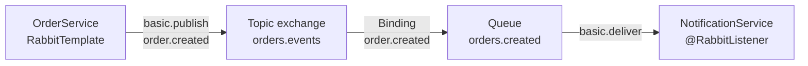
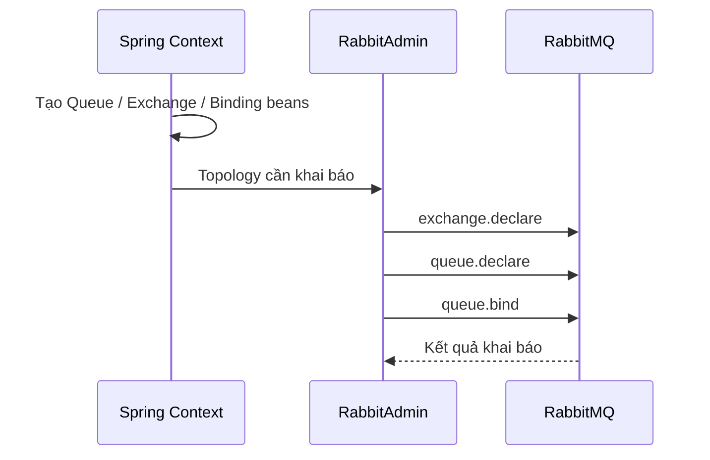
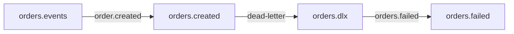

# QueueBuilder, ExchangeBuilder và BindingBuilder trong Spring AMQP

Khi tích hợp **RabbitMQ với Spring AMQP**, việc gửi message bằng `RabbitTemplate` và nhận bằng `@RabbitListener` phụ thuộc vào cách broker được cấu hình: message phải đi tới **exchange**, được định tuyến qua **binding** và cuối cùng nằm trong **queue**. Ba builder `ExchangeBuilder`, `QueueBuilder` và `BindingBuilder` giúp mô tả topology đó bằng Java thay vì tự tạo đối tượng cấu hình dài dòng.

Trong chương **Khai báo tài nguyên**, bài học này tập trung vào cách thiết kế, đăng ký và kiểm tra queue, exchange, binding cho những luồng xử lý bất đồng bộ; từ đó xây nền tảng cho xác nhận giao nhận, retry, dead-letter, giao dịch và quan sát RabbitMQ.

Sau bài này, bạn có thể:

- Phân biệt **tạo đối tượng Java** bằng `build()` với **khai báo tài nguyên thật trên broker**.
- Chọn loại exchange và thuộc tính queue phù hợp.
- Sử dụng ba builder trong Spring `@Configuration`, khai báo bằng `RabbitAdmin`.
- Tạo một topology sự kiện hoàn chỉnh và một tuyến dead-letter.
- Chẩn đoán lỗi tên, quyền, virtual host, routing key và sai lệch thuộc tính tài nguyên.

## 1. Ba builder giải quyết việc gì?



| Tài nguyên | Builder | Đối tượng trả về | Vai trò |
| --- | --- | --- | --- |
| **Exchange** | `ExchangeBuilder` | `TopicExchange`, `DirectExchange`, `FanoutExchange`, ... | Định tuyến message đến các queue |
| **Queue** | `QueueBuilder` | `Queue` | Lưu message để consumer nhận |
| **Binding** | `BindingBuilder` | `Binding` | Quy tắc nối exchange với queue |

Cả ba builder nằm trong package `org.springframework.amqp.core`. Điểm quan trọng là **`build()` chỉ tạo đối tượng mô tả tài nguyên trong JVM**; các đối tượng này phải được đăng ký/khai báo bởi `RabbitAdmin` hoặc công cụ quản trị để xuất hiện trên broker.

Về nguyên tắc, mỗi connection hoạt động trong **một virtual host** cụ thể. Một queue có cùng tên ở hai vhost là hai tài nguyên khác nhau.

## 2. QueueBuilder: xây dựng định nghĩa queue

### 2.1. Queue bền vững

```java
import org.springframework.amqp.core.Queue;
import org.springframework.amqp.core.QueueBuilder;

Queue ordersQueue = QueueBuilder
        .durable("orders.created")
        .build();
```

`durable("orders.created")` yêu cầu RabbitMQ giữ **định nghĩa queue** qua lần khởi động lại. Đây thường là cấu hình thích hợp cho queue nghiệp vụ dùng lâu dài.

**Không suy diễn rằng durable queue tự bảo đảm tất cả message bền vững.** Còn phải xét thuộc tính message, publisher confirm, loại queue, chính sách broker và cơ chế xử lý khi lỗi.

### 2.2. Queue tạm thời

```java
Queue sessionQueue = QueueBuilder
        .nonDurable("demo.session.reply")
        .exclusive()
        .autoDelete()
        .build();
```

- `nonDurable(...)`: không yêu cầu giữ định nghĩa queue qua broker restart.
- `exclusive()`: queue gắn với connection khai báo và không thể được connection khác dùng như queue thông thường; broker xóa queue khi connection sở hữu đóng.
- `autoDelete()`: queue có thể được xóa sau khi đã có consumer và consumer cuối cùng hủy đăng ký.

Queue tạm có thể hữu ích cho phiên làm việc hoặc thử nghiệm. Với nhiều instance cùng dùng queue, **không nên đặt một tên cố định kèm `exclusive`** vì có thể tranh chấp connection. Các cơ chế reply queue tạm trong ứng dụng thực tế thường dùng tên sinh tự động hoặc giải pháp theo vòng đời connection.

### 2.3. Những tùy chọn quan trọng

| Builder | Ý nghĩa | Lưu ý |
| --- | --- | --- |
| `durable(name)` | Queue có định nghĩa bền vững | Thường dùng trong production |
| `nonDurable(name)` | Queue không bền vững | Dữ liệu tạm, thử nghiệm |
| `exclusive()` | Phạm vi connection khai báo | Không phù hợp cho queue chung |
| `autoDelete()` | Tự xóa theo vòng đời consumer | Cần hiểu thời điểm xóa |
| `ttl(milliseconds)` | Đặt TTL message mặc định | Có thể dẫn tới dead-letter hoặc loại bỏ |
| `maxLength(limit)` | Giới hạn backlog | Xem thêm chính sách overflow |
| `deadLetterExchange(name)` | Chọn DLX cho message dead-letter | Cần khai báo DLX và binding |
| `deadLetterRoutingKey(key)` | Routing key khi dead-letter | Phụ thuộc binding ở DLX |
| `quorum()` | Yêu cầu loại quorum queue khi được hỗ trợ | Không thể tùy ý đổi loại queue đang tồn tại |

Ví dụ queue chính với cấu hình giới hạn và DLX:

```java
Queue processingQueue = QueueBuilder
        .durable("orders.processing")
        .ttl(120_000)                 // 120 giây
        .maxLength(10_000)
        .deadLetterExchange("orders.dlx")
        .deadLetterRoutingKey("orders.failed")
        .build();
```

Các lựa chọn như TTL, dead-letter và queue type được chuyển thành **queue arguments** trong lần khai báo. Tính năng cụ thể tùy phiên bản Spring AMQP và RabbitMQ. Với thiết lập vận hành cần điều chỉnh thường xuyên, **RabbitMQ policy** có thể phù hợp hơn việc ghi cứng arguments, do định nghĩa mới có thể xung đột với queue đã tồn tại.

## 3. ExchangeBuilder: xây dựng exchange

Publisher gửi message vào **exchange**, sau đó RabbitMQ dùng exchange type và các binding để định tuyến. Exchange có thể tồn tại mà không có queue nào được nối vào.

### 3.1. Direct exchange

```java
import org.springframework.amqp.core.DirectExchange;
import org.springframework.amqp.core.ExchangeBuilder;

DirectExchange commands = ExchangeBuilder
        .directExchange("orders.commands")
        .durable(true)
        .build();
```

Direct exchange định tuyến bằng **khớp chính xác routing key**. Binding key `order.create` sẽ không khớp `order.created`.

### 3.2. Topic exchange

```java
import org.springframework.amqp.core.TopicExchange;

TopicExchange events = ExchangeBuilder
        .topicExchange("orders.events")
        .durable(true)
        .build();
```

Topic exchange hỗ trợ định tuyến theo mẫu:

| Binding key | Khớp | Không khớp |
| --- | --- | --- |
| `order.created` | `order.created` | `order.cancelled` |
| `order.*` | `order.created` | `order.payment.completed` |
| `order.#` | `order.created`, `order.payment.completed` | `inventory.updated` |

Ký tự `*` khớp **đúng một thành phần** ngăn bởi dấu chấm; `#` khớp **không hoặc nhiều thành phần**. Đây là cú pháp của binding key, không phải phép tìm kiếm trong nội dung message.

### 3.3. Fanout exchange

```java
import org.springframework.amqp.core.FanoutExchange;

FanoutExchange broadcast = ExchangeBuilder
        .fanoutExchange("orders.broadcast")
        .durable(true)
        .build();
```

Fanout exchange gửi message tới **mọi queue đã bind**, không xét routing key. Nó phù hợp khi cùng một sự kiện cần được gửi tới nhiều service độc lập.

Spring AMQP cũng hỗ trợ `ExchangeBuilder.headersExchange(name)` để tạo headers exchange, định tuyến theo các header và điều kiện binding thay vì routing key.

### 3.4. Thuộc tính exchange

| Thuộc tính | Ý nghĩa |
| --- | --- |
| `durable(true)` | Giữ định nghĩa exchange qua restart, không tự bảo đảm message bền vững |
| `durable(false)` | Exchange không bền vững |
| `autoDelete()` | Exchange có thể bị xóa khi không còn binding theo ngữ nghĩa RabbitMQ |
| Tên và type | Phải phù hợp với exchange cùng tên đã tồn tại trong vhost |

RabbitMQ còn có **default exchange** với tên rỗng `""` và các binding tự động với từng queue theo tên queue. Đó không phải exchange bạn cần tạo lại bằng `ExchangeBuilder`.

## 4. BindingBuilder: tạo đường đi từ exchange đến queue

Chỉ tạo exchange và queue **không tự tạo tuyến** chuyển message giữa chúng. Binding kết nối hai tài nguyên bằng quy tắc rõ ràng.

### 4.1. Direct và topic binding

```java
import org.springframework.amqp.core.Binding;
import org.springframework.amqp.core.BindingBuilder;

Binding created = BindingBuilder
        .bind(ordersQueue)
        .to(events)
        .with("order.created");
```

Ở đây, `ordersQueue` là đối tượng `Queue` và `events` là `TopicExchange` từ phần trước. Message publish tới exchange `orders.events` với routing key `order.created` sẽ có tuyến tới queue `orders.created`.

Để nhận mọi sự kiện dạng `order.*`, có thể dùng `.with("order.*")` nếu exchange là **topic**. Nếu exchange là **direct**, dấu `*` chỉ là ký tự bình thường trong binding key, không phải wildcard.

### 4.2. Fanout binding

```java
Binding broadcastBinding = BindingBuilder
        .bind(ordersQueue)
        .to(broadcast);
```

Không cần `with(routingKey)` vì fanout bỏ qua routing key.

| Exchange | Builder minh họa | Ngữ nghĩa |
| --- | --- | --- |
| Direct | `bind(queue).to(direct).with("order.created")` | Khớp key chính xác |
| Topic | `bind(queue).to(topic).with("order.*")` | Khớp mẫu routing key |
| Fanout | `bind(queue).to(fanout)` | Không xét routing key |

Một queue có thể có nhiều binding; một exchange có thể định tuyến tới nhiều queue. Nếu một message khớp nhiều binding tới **cùng một queue**, RabbitMQ không tạo các bản sao riêng vào cùng queue chỉ vì có nhiều tuyến trùng khớp.

**Binding không có cờ durable riêng.** Vòng đời binding chịu tác động của tài nguyên hai đầu và ngữ nghĩa broker.

## 5. Ví dụ hoàn chỉnh trong Spring @Configuration

Đây là cấu hình đơn giản dùng đủ ba builder. Dự án cần dependency Spring AMQP dành cho giao thức AMQP 0-9-1 tương ứng phiên bản Spring Boot và cấu hình connection tới RabbitMQ.

```java
import org.springframework.amqp.core.Binding;
import org.springframework.amqp.core.BindingBuilder;
import org.springframework.amqp.core.ExchangeBuilder;
import org.springframework.amqp.core.Queue;
import org.springframework.amqp.core.QueueBuilder;
import org.springframework.amqp.core.TopicExchange;
import org.springframework.context.annotation.Bean;
import org.springframework.context.annotation.Configuration;

@Configuration
public class OrderTopologyConfig {

    public static final String EXCHANGE = "orders.events";
    public static final String QUEUE = "orders.created";
    public static final String ROUTING_KEY = "order.created";

    @Bean
    public TopicExchange ordersExchange() {
        return ExchangeBuilder.topicExchange(EXCHANGE)
                .durable(true)
                .build();
    }

    @Bean
    public Queue ordersCreatedQueue() {
        return QueueBuilder.durable(QUEUE)
                .build();
    }

    @Bean
    public Binding ordersCreatedBinding(
            Queue ordersCreatedQueue,
            TopicExchange ordersExchange) {
        return BindingBuilder.bind(ordersCreatedQueue)
                .to(ordersExchange)
                .with(ROUTING_KEY);
    }
}
```

Các tham số của phương thức `@Bean` được Spring tiêm từ các bean đã đăng ký. Ở ví dụ chỉ có một `Queue` và một `TopicExchange`, do đó định danh bằng kiểu là đủ. Trong hệ thống có nhiều bean cùng kiểu, dùng `@Qualifier` hoặc cấu hình tiêm phụ thuộc tường minh để tránh mơ hồ.

Thứ tự logic của cấu hình là:

1. `ExchangeBuilder` tạo đối tượng `TopicExchange` tên `orders.events`.
2. `QueueBuilder` tạo đối tượng `Queue` tên `orders.created`.
3. `BindingBuilder` tạo đối tượng `Binding` với key `order.created`.
4. Khi `RabbitAdmin` khai báo, RabbitMQ nhận các lệnh khai báo qua connection hiện tại trong vhost đang kết nối.

### 5.1. Kết nối RabbitMQ

```yaml
# application.yml - dùng các biến môi trường hoặc secret tương ứng
spring:
  rabbitmq:
    host: ${RABBITMQ_HOST:localhost}
    port: ${RABBITMQ_PORT:5672}
    virtual-host: ${RABBITMQ_VHOST:/orders}
    username: ${RABBITMQ_USERNAME}
    password: ${RABBITMQ_PASSWORD}
```

Vhost `/orders` phải tồn tại và user phải có quyền tương ứng để khai báo, publish và consume. Exchange, queue và binding được tạo **trong vhost của connection**, không tự lan sang vhost khác.

### 5.2. Gửi và nhận message

```java
import org.springframework.amqp.rabbit.core.RabbitTemplate;
import org.springframework.stereotype.Service;

@Service
public class OrderPublisher {
    private final RabbitTemplate rabbitTemplate;

    public OrderPublisher(RabbitTemplate rabbitTemplate) {
        this.rabbitTemplate = rabbitTemplate;
    }

    public void publishCreated(String orderId) {
        rabbitTemplate.convertAndSend(
                OrderTopologyConfig.EXCHANGE,
                OrderTopologyConfig.ROUTING_KEY,
                orderId);
    }
}
```

```java
import org.springframework.amqp.rabbit.annotation.RabbitListener;
import org.springframework.stereotype.Component;

@Component
public class OrderCreatedListener {

    @RabbitListener(queues = OrderTopologyConfig.QUEUE)
    public void onOrderCreated(String orderId) {
        System.out.println("Received order " + orderId);
    }
}
```

`RabbitTemplate` gửi message đến `orders.events` với key `order.created`, binding định tuyến vào queue `orders.created`, sau đó `@RabbitListener` nhận message. Ví dụ dùng `String` để tập trung vào topology. Với JSON hoặc sự kiện phức tạp, cần message converter và schema/contract giữa các service.

**Không đánh đồng publish thành công với xử lý thành công.** Publisher confirms, returns, consumer acknowledgements và retry là những cơ chế bổ sung cần thiết kế riêng.

## 6. Từ bean Java đến tài nguyên thực trên RabbitMQ

`ExchangeBuilder`, `QueueBuilder` và `BindingBuilder` không tự gọi broker. Spring AMQP dùng `RabbitAdmin` / `AmqpAdmin` để khai báo exchange, queue và binding qua connection. Trong cấu hình Spring Boot thông dụng, admin có thể được tự cấu hình và thực hiện khai báo khi connection được thiết lập.



| Trạng thái broker | Kết quả có thể xảy ra |
| --- | --- |
| Tài nguyên chưa tồn tại; user đủ quyền | Broker tạo tài nguyên |
| Tài nguyên đã tồn tại với thuộc tính tương thích | Khai báo lặp lại thường thành công |
| Cùng tên nhưng thuộc tính không tương thích | `PRECONDITION_FAILED` và channel bị đóng |
| Thiếu quyền cấu hình hoặc binding | `ACCESS_REFUSED` |
| Sai virtual host | Tài nguyên xuất hiện ở vhost khác hoặc kết nối bị từ chối |

**Đừng coi chỉnh sửa builder là migration tự động.** Ví dụ, queue `orders.created` đã tồn tại dạng classic và durable; đổi Java sang `.quorum()` rồi redeploy không có nghĩa broker chuyển đổi queue trong lúc vẫn giữ nguyên dữ liệu. Cần lên kế hoạch migration hoặc tạo tên queue mới phù hợp.

Nếu bạn chủ động khai báo bằng API quản trị, có thể dùng:

```java
// Giả sử đã có AmqpAdmin admin và các đối tượng ở phần trên:
admin.declareExchange(events);
admin.declareQueue(ordersQueue);
admin.declareBinding(created);
```

Không cần khai báo thủ công lần nữa khi `RabbitAdmin` đã tự khai báo chính topology đó.

### 6.1. Dùng Declarables khi topology có nhiều tài nguyên

Spring AMQP hỗ trợ `Declarables` để nhóm các đối tượng cần khai báo:

```java
import org.springframework.amqp.core.Declarables;

@Bean
public Declarables orderDeclarables() {
    TopicExchange exchange = ExchangeBuilder
            .topicExchange("orders.events").durable(true).build();
    Queue queue = QueueBuilder.durable("orders.created").build();
    Binding binding = BindingBuilder
            .bind(queue).to(exchange).with("order.created");

    return new Declarables(exchange, queue, binding);
}
```

Đây là **cách đăng ký khác** thay cho ba phương thức `@Bean` riêng ở phần 5. Trong một ứng dụng, nên chọn cách tổ chức nhất quán để tránh cấu hình trùng lặp gây khó quản lý.

## 7. Ví dụ dead-letter topology bằng các builder

Một queue xử lý đơn hàng có thể chuyển message bị dead-letter sang exchange riêng, từ đó định tuyến vào queue theo dõi lỗi:



Đoạn cấu hình dưới đây là **một ví dụ độc lập**; không đồng thời đăng ký topology này với phần 5 trên cùng các tên nếu chúng mô tả queue arguments khác nhau:

```java
import org.springframework.amqp.core.Binding;
import org.springframework.amqp.core.BindingBuilder;
import org.springframework.amqp.core.Declarables;
import org.springframework.amqp.core.DirectExchange;
import org.springframework.amqp.core.ExchangeBuilder;
import org.springframework.amqp.core.Queue;
import org.springframework.amqp.core.QueueBuilder;
import org.springframework.amqp.core.TopicExchange;
import org.springframework.context.annotation.Bean;
import org.springframework.context.annotation.Configuration;

@Configuration
public class OrderDeadLetterTopology {

    @Bean
    public Declarables orderResources() {
        TopicExchange events = ExchangeBuilder
                .topicExchange("orders.events").durable(true).build();

        Queue mainQueue = QueueBuilder.durable("orders.created")
                .deadLetterExchange("orders.dlx")
                .deadLetterRoutingKey("orders.failed")
                .build();

        Binding mainBinding = BindingBuilder
                .bind(mainQueue).to(events).with("order.created");

        DirectExchange dlx = ExchangeBuilder
                .directExchange("orders.dlx").durable(true).build();

        Queue failedQueue = QueueBuilder.durable("orders.failed").build();

        Binding failedBinding = BindingBuilder
                .bind(failedQueue).to(dlx).with("orders.failed");

        return new Declarables(
                events, mainQueue, mainBinding,
                dlx, failedQueue, failedBinding);
    }
}
```

**Giải thích:** Queue chính khai báo tên DLX và routing key dùng khi dead-letter; `orders.dlx` cùng `orders.failed` vẫn phải được tạo, bind riêng. Message có thể dead-letter khi consumer reject/nack không requeue, TTL hết hạn, giới hạn queue hoặc delivery limit áp dụng. Listener ném exception **không nhất thiết** khiến message lập tức vào DLQ, vì Spring có thể retry hoặc requeue theo cấu hình.

Với môi trường production, cần kiểm tra hành vi dead lettering theo loại queue, tránh vòng lặp DLX và cân nhắc cấu hình DLX qua policy để quản lý thay đổi vận hành.

## 8. Các lỗi khai báo phổ biến

| Triệu chứng | Khả năng cần kiểm tra | Hướng xử lý |
| --- | --- | --- |
| `PRECONDITION_FAILED - inequivalent arg` | Queue/exchange cùng tên nhưng khác durability, type hoặc arguments | So sánh định nghĩa với broker; migration an toàn nếu cần thay đổi |
| `ACCESS_REFUSED` | User thiếu quyền configure/write/read ở vhost hiện tại | Xác minh permission theo tên tài nguyên và vhost |
| `NOT_FOUND` khi listener consume | Queue chưa khai báo hoặc ứng dụng kết nối sai vhost | Kiểm tra admin, queue name và vhost |
| Publisher không tạo được message đến queue | Thiếu binding, sai exchange type hoặc routing key | Kiểm tra đường đi từ exchange đến queue |
| Nhiều instance không dùng chung queue tạm | Queue `exclusive` với tên cố định | Đổi thiết kế queue tạm hoặc dùng queue chung |
| DLQ không nhận message lỗi | DLX chưa bind, queue không có DLX, container đang requeue | Kiểm tra DLX arguments và policy xử lý lỗi |
| Queue mất sau restart | `nonDurable` hoặc cấu hình không phù hợp | Kiểm tra durability và khả năng khôi phục |
| UI không thấy exchange/queue | Đang chọn sai virtual host hoặc admin chưa khai báo | Chọn đúng vhost, xem log connection và admin |

Cùng tên queue không có nghĩa có thể tùy ý thay đổi `durable`, queue type, `exclusive` hoặc các arguments bất kỳ lúc nào. Đối với queue đã có dữ liệu, **không xóa để sửa lỗi khai báo** nếu chưa có phương án bảo toàn message và chuyển đổi topology.

## 9. Thực hành kiểm chứng topology

Giả sử ứng dụng dùng vhost `/orders` và user có quyền, sau khi ứng dụng thiết lập connection có thể kiểm tra bằng RabbitMQ Management UI hoặc CLI:

```bash
# Xác minh các exchange và kiểu định tuyến
rabbitmqctl list_exchanges -p /orders name type durable

# Xác minh queue, durability và arguments
rabbitmqctl list_queues -p /orders name durable auto_delete arguments

# Xác minh exchange -> queue và routing key
rabbitmqctl list_bindings -p /orders source_name destination_name routing_key
```

Trình tự kiểm chứng gợi ý:

1. Kiểm tra `orders.events` tồn tại và có binding key `order.created` đến `orders.created`.
2. Gọi `OrderPublisher.publishCreated("ORD-1001")`; quan sát log listener nhận `ORD-1001`.
3. Gửi routing key không khớp, chẳng hạn `order.cancelled` khi chỉ có binding `order.created`; xác minh message không đi vào queue này.
4. Với mô hình DLX, cấu hình consumer reject/nack không requeue trong môi trường thử nghiệm; quan sát message chuyển từ queue chính sang `orders.failed`.
5. Kiểm tra vhost khác để thấy rằng topology có cùng tên **không được chia sẻ** qua vhost.

Nếu message không đến, hãy phân biệt **lỗi topology** với **lỗi delivery**. Builder và binding cho biết có tuyến hay không; publisher confirm, publisher return, consumer acknowledgement và chính sách retry mới giải thích việc gửi hoặc xử lý đã thành công tới mức nào.

## 10. Nguyên tắc thiết kế khi khai báo tài nguyên

- Đặt tên exchange, queue và routing key thể hiện rõ chức năng, ví dụ `orders.events`, `orders.created` và `order.created`.
- Chọn **direct** khi định tuyến bằng key chính xác, **topic** khi cần mẫu sự kiện, **fanout** khi phát cho nhiều queue.
- Dùng queue durable với nghiệp vụ cần sống qua restart; tránh `exclusive`/`autoDelete` cho queue dùng chung lâu dài.
- Thiết kế vòng đời khai báo: Spring `RabbitAdmin` tự declare hay hệ thống hạ tầng quản lý topology; tránh hai nguồn cấu hình mâu thuẫn.
- Xác định vhost, quyền user, DLX, TTL và chính sách vận hành trước khi triển khai.
- Kiểm tra tài nguyên thực tế trên broker và lập kế hoạch migration khi định nghĩa hiện có khác code.

**Ghi nhớ:** `QueueBuilder` tạo đối tượng mô tả nơi chứa message, `ExchangeBuilder` tạo đối tượng mô tả nơi định tuyến, còn `BindingBuilder` nối hai tài nguyên theo một quy tắc. Khi các đối tượng được khai báo trên RabbitMQ trong **đúng virtual host**, `RabbitTemplate` và `@RabbitListener` mới có topology để trao đổi message. Độ tin cậy của xử lý bất đồng bộ còn cần publisher confirms, acknowledgements, retry, dead-letter, idempotency và quan sát phù hợp.

### Tài liệu tham khảo

- [Spring AMQP Reference — Configuring the Broker](https://docs.spring.io/spring-amqp/reference/amqp/broker-configuration.html)
- [Spring AMQP Reference — RabbitTemplate](https://docs.spring.io/spring-amqp/reference/amqp/template.html)
- [RabbitMQ — AMQP 0-9-1 Model Explained](https://www.rabbitmq.com/tutorials/amqp-concepts)
- [RabbitMQ — Queues](https://www.rabbitmq.com/docs/queues)
- [RabbitMQ — Exchanges](https://www.rabbitmq.com/docs/exchanges)
- [RabbitMQ — Dead Letter Exchanges](https://www.rabbitmq.com/docs/dlx)

