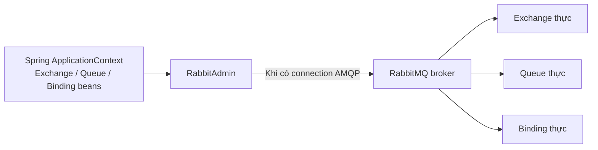
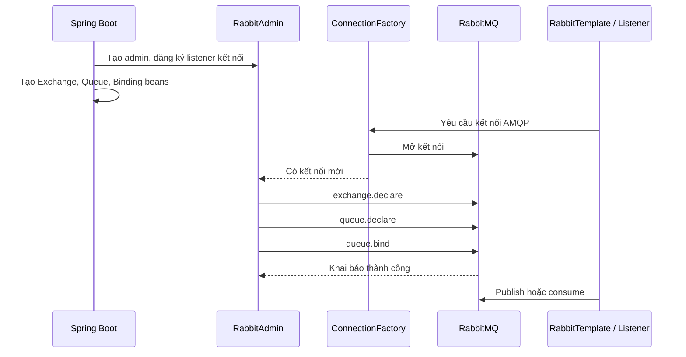

# RabbitAdmin và tự động khai báo tài nguyên khi có kết nối

## Mục tiêu bài học

Trong **SPRING_AMQP**, ứng dụng dùng `RabbitTemplate` để gửi message và `@RabbitListener` để nhận message từ RabbitMQ. Trước khi định tuyến message qua exchange, queue và binding, broker cần có các tài nguyên đó. Spring AMQP cung cấp **`AmqpAdmin`** và triển khai **`RabbitAdmin`** để khai báo tài nguyên bằng Java, đồng thời hỗ trợ **tự động khai báo khi ứng dụng tạo kết nối tới RabbitMQ**.

Bài này thuộc phần **Khai báo tài nguyên**, tập trung vào thời điểm khai báo, cách Spring Boot tạo admin, những gì được tự động khai báo và cách kiểm soát cơ chế này. Đây là bước nền để các bài tiếp theo thiết kế xác nhận giao nhận, retry, dead-letter, giao dịch và quan sát hệ thống mà không phụ thuộc vào việc người vận hành tạo queue thủ công.

Sau khi học, bạn có thể:

- Phân biệt **khai báo bean trong Spring** với **tạo tài nguyên thực trên RabbitMQ broker**.
- Giải thích vai trò của `AmqpAdmin`, `RabbitAdmin` và vòng đời auto-declaration theo kết nối.
- Khai báo `Exchange`, `Queue`, `Binding` dưới dạng `@Bean` để admin tự tạo topology.
- Điều khiển auto-declaration trong Spring Boot; biết khi nào cần gọi admin thủ công.
- Chẩn đoán lỗi sai tên queue, sai thuộc tính, thiếu kết nối hoặc nhiều `RabbitAdmin`.

## 1. Khai báo trong ứng dụng khác gì khai báo trên broker?

Xét một ứng dụng xử lý đơn hàng:

- Publisher gửi sự kiện `order.created` vào topic exchange `app.orders.events`.
- Exchange định tuyến tới queue `app.billing.orders` qua binding key `order.created`.
- Consumer dùng `@RabbitListener` đọc từ `app.billing.orders`.

Bạn có thể tạo exchange, queue và binding qua giao diện quản trị RabbitMQ, qua script triển khai hoặc khai báo bằng Spring AMQP. Với cách cuối cùng, khi viết:

```java
@Bean
Queue billingQueue() {
    return QueueBuilder.durable("app.billing.orders").build();
}
```

Spring mới chỉ có **đối tượng `Queue` trong application context**. Broker chưa nhất thiết có queue đó, vì việc khai báo thực lên RabbitMQ đòi hỏi một **kết nối AMQP** và lệnh `queue.declare`.



Điểm cần nhớ:

| Khái niệm | Nằm ở đâu? | Chức năng |
|---|---|---|
| `Queue` / `Exchange` / `Binding` bean | Bộ nhớ của ứng dụng Spring | Mô tả tài nguyên mong muốn và thuộc tính cấu hình. |
| `ConnectionFactory` | Ứng dụng Spring | Tạo kết nối tới RabbitMQ, dùng chung cho publisher, listener và admin. |
| `AmqpAdmin` | API Spring AMQP | Giao diện thao tác khai báo, kiểm tra và xóa tài nguyên. |
| `RabbitAdmin` | Ứng dụng Spring | Triển khai `AmqpAdmin` cho RabbitMQ, có thể khai báo tự động khi kết nối được tạo. |
| Exchange, queue, binding thực | RabbitMQ broker | Topology mà broker thực sự sử dụng để định tuyến và lưu giữ message. |

**Tên bean không nhất thiết là tên tài nguyên trên broker.** Trong ví dụ, `billingQueue` là tên bean mặc định; `app.billing.orders` mới là tên queue mà RabbitMQ biết. `@RabbitListener(queues = "app.billing.orders")` tham chiếu tới **tên queue trên broker**.

## 2. `RabbitAdmin` làm gì?

`RabbitAdmin` là triển khai `AmqpAdmin` của Spring AMQP. Nó sử dụng `ConnectionFactory` để phát các lệnh khai báo của giao thức AMQP 0-9-1, trong đó có:

- `exchange.declare`: tạo exchange với tên, loại và các thuộc tính mong muốn.
- `queue.declare`: tạo queue với tên và các thuộc tính mong muốn.
- `queue.bind`: nối queue vào exchange bằng binding và routing/binding key.

Trong code ứng dụng, bạn có thể dùng API tổng quát `AmqpAdmin`:

```java
import org.springframework.amqp.core.AmqpAdmin;
import org.springframework.amqp.core.Queue;
import org.springframework.stereotype.Service;

@Service
public class QueueProvisioner {
    private final AmqpAdmin amqpAdmin;

    public QueueProvisioner(AmqpAdmin amqpAdmin) {
        this.amqpAdmin = amqpAdmin;
    }

    public void createReportsQueue() {
        amqpAdmin.declareQueue(new Queue("app.reports.ready", true));
    }
}
```

Lời gọi `declareQueue(...)` là **khai báo chủ động**: bạn yêu cầu broker tạo/xác minh queue ngay khi phương thức chạy và kết nối thành công. Nếu queue đã tồn tại với thuộc tính tương thích, thao tác khai báo là idempotent ở mức topology. Nếu thuộc tính xung đột, broker sẽ từ chối.

Tuy nhiên, nhiều ứng dụng không cần gọi `declareQueue(...)` cho từng tài nguyên. `RabbitAdmin` có cơ chế đọc các bean khai báo tài nguyên trong context và khai báo chúng tự động.

## 3. Cơ chế tự động khai báo theo vòng đời kết nối

Một điểm thường bị hiểu nhầm là **`@Bean Queue` không làm queue xuất hiện ngay tại thời điểm đối tượng Java được khởi tạo**.

Với `RabbitAdmin` có `autoStartup = true`, luồng điển hình là:

1. Spring Boot tạo `ConnectionFactory` và `RabbitAdmin` (nếu cấu hình auto-configuration cho phép).
2. Spring khởi tạo các bean `Exchange`, `Queue`, `Binding` hoặc `Declarables`.
3. `RabbitAdmin` đăng ký lắng nghe sự kiện tạo kết nối từ `ConnectionFactory`.
4. Khi `RabbitTemplate`, listener container hoặc thành phần khác thực sự cần một kết nối, connection được mở tới RabbitMQ.
5. `RabbitAdmin` tìm các khai báo phù hợp trong Spring context và gửi lệnh tới broker, thông thường theo thứ tự **exchange → queue → binding**.
6. Sau khi topology hợp lệ, ứng dụng có thể publish/consume theo routing và queue tương ứng.



Sơ đồ mô tả cơ chế thông dụng; chi tiết khởi tạo và xử lý listener có thể phụ thuộc cấu hình và phiên bản Spring AMQP. Ý nghĩa quan trọng nhất: **việc khai báo lên broker cần kết nối**. Nếu ứng dụng chỉ tạo context nhưng không thành phần nào mở kết nối tới RabbitMQ, bạn không nên mặc định rằng các queue đã xuất hiện trên broker.

### Điều gì kích hoạt kết nối?

- Một `@RabbitListener` được kích hoạt: listener container cần kết nối để đăng ký consumer.
- Một lời gọi `RabbitTemplate.convertAndSend(...)`: template cần kết nối để publish.
- Ứng dụng chủ động gọi API `AmqpAdmin` hoặc các thao tác dùng `RabbitTemplate`.

Không phải mỗi message đều kích hoạt một vòng khai báo. Admin hoạt động theo vòng đời kết nối/khởi tạo, còn các thao tác publish thông thường sử dụng kết nối đã được quản lý.

### Điều gì xảy ra khi kết nối mất rồi được tạo lại?

`RabbitAdmin` có thể tự động khai báo lại topology khi `ConnectionFactory` tạo kết nối mới, hữu ích cho các queue tạm thời hoặc sau khi broker bị khởi động lại. Nhưng **tự khai báo lại không đồng nghĩa khôi phục dữ liệu đã mất**. Các thông điệp trong queue còn tồn tại hay không phụ thuộc vào tính durable/persistent, loại queue, tình trạng broker và chính sách bảo đảm giao nhận.

Không nên dựa vào `RabbitAdmin` như một công cụ migration tự động cho các thay đổi topology không tương thích.

## 4. Spring Boot tự cấu hình `RabbitAdmin` như thế nào?

Với dependency `spring-boot-starter-amqp`, Spring Boot thông thường tự cấu hình `CachingConnectionFactory`, `RabbitTemplate` và một `AmqpAdmin` dạng `RabbitAdmin` khi các điều kiện auto-configuration được đáp ứng.

Cấu hình trong `application.yml`:

```yaml
spring:
  rabbitmq:
    host: localhost
    port: 5672
    username: guest
    password: guest
    virtual-host: /
    dynamic: true
```

Thuộc tính `spring.rabbitmq.dynamic` thường có giá trị mặc định **`true`** trong Spring Boot; nó điều khiển việc **Boot tự tạo `AmqpAdmin`**. Nếu ứng dụng đã khai báo một `AmqpAdmin` riêng, Boot thường không tạo bean mặc định khác.

| Thiết lập | Ý nghĩa trong cấu hình Boot thông dụng |
|---|---|
| Có starter và `spring.rabbitmq.dynamic=true` | Boot có thể tạo `AmqpAdmin` tự động; các bean topology đủ điều kiện được khai báo khi có kết nối. |
| `spring.rabbitmq.dynamic=false` | Boot không tự cấu hình `AmqpAdmin` theo cơ chế dynamic này. Một `RabbitAdmin` do bạn **tự khai báo** vẫn có thể hoạt động. |
| Tự tạo bean `RabbitAdmin` | Chủ động tùy chỉnh `autoStartup`, lựa chọn `ConnectionFactory` và các thiết lập của admin. |
| `RabbitAdmin.setAutoStartup(false)` | Admin đó không tự chạy cơ chế khai báo theo sự kiện kết nối; bạn vẫn có thể thực hiện các lệnh admin chủ động. |

**Phân biệt hai công tắc:** `spring.rabbitmq.dynamic=false` ảnh hưởng tới **auto-configuration của Spring Boot**; `RabbitAdmin.setAutoStartup(false)` ảnh hưởng tới **hành vi tự khai báo của một instance admin**. Không xem hai cấu hình này là đồng nhất.

Nếu ứng dụng có nhiều `ConnectionFactory` hoặc nhiều `AmqpAdmin`, việc Boot tự cấu hình phụ thuộc các điều kiện bean cụ thể. Khi đó bạn cần chỉ rõ admin nào có quyền khai báo lên broker nào, thay vì giả định mọi admin đều quản lý tất cả tài nguyên.

## 5. Ví dụ hoàn chỉnh: để admin tự tạo exchange, queue và binding

Ví dụ này dùng một Spring Boot application đã thêm `spring-boot-starter-amqp`, RabbitMQ local đang chạy ở `localhost:5672`, và cấu hình kết nối như mục trước.

Để thử bằng Gradle Groovy DSL, dependency chính:

```groovy
dependencies {
    implementation 'org.springframework.boot:spring-boot-starter-amqp'
}
```

Trong Maven, dependency tương đương:

```xml
<dependency>
    <groupId>org.springframework.boot</groupId>
    <artifactId>spring-boot-starter-amqp</artifactId>
</dependency>
```

Spring Boot parent/BOM hoặc hệ thống quản lý dependency của dự án sẽ chọn phiên bản tương thích. Nếu đang dùng RabbitMQ local với account `guest/guest`, tài khoản mặc định chỉ nên dùng cho phát triển trên loopback.

Tạo một lớp `MessagingApplication.java`:

```java
package com.example.messaging;

import org.springframework.amqp.core.Binding;
import org.springframework.amqp.core.BindingBuilder;
import org.springframework.amqp.core.Queue;
import org.springframework.amqp.core.QueueBuilder;
import org.springframework.amqp.core.TopicExchange;
import org.springframework.amqp.rabbit.annotation.EnableRabbit;
import org.springframework.amqp.rabbit.annotation.RabbitListener;
import org.springframework.amqp.rabbit.core.RabbitTemplate;
import org.springframework.beans.factory.annotation.Qualifier;
import org.springframework.boot.ApplicationRunner;
import org.springframework.boot.SpringApplication;
import org.springframework.boot.autoconfigure.SpringBootApplication;
import org.springframework.context.annotation.Bean;

@SpringBootApplication
@EnableRabbit
public class MessagingApplication {
    private static final String EXCHANGE = "app.orders.events";
    private static final String QUEUE = "app.billing.orders";

    public static void main(String[] args) {
        SpringApplication.run(MessagingApplication.class, args);
    }

    @Bean
    TopicExchange ordersExchange() {
        return new TopicExchange(EXCHANGE, true, false);
    }

    @Bean
    Queue billingOrdersQueue() {
        return QueueBuilder.durable(QUEUE).build();
    }

    @Bean
    Binding billingOrdersBinding(
            @Qualifier("billingOrdersQueue") Queue queue,
            @Qualifier("ordersExchange") TopicExchange exchange) {
        return BindingBuilder.bind(queue)
                .to(exchange)
                .with("order.created");
    }

    @Bean
    ApplicationRunner sendDemoEvent(RabbitTemplate rabbitTemplate) {
        return args -> rabbitTemplate.convertAndSend(
                EXCHANGE, "order.created", "orderId=42");
    }

    @RabbitListener(queues = QUEUE)
    public void onOrderCreated(String payload) {
        System.out.println("Billing received: " + payload);
    }
}
```

**Giải thích:**

1. Ba phương thức `@Bean` mô tả một **topic exchange durable**, một **queue durable**, một binding từ exchange đến queue với key `order.created`.
2. Không có chỗ nào trong đoạn mã gọi trực tiếp `declareExchange`, `declareQueue` hoặc `declareBinding`.
3. Khi listener container khởi động hoặc `RabbitTemplate` mở connection, `RabbitAdmin` đủ điều kiện sẽ khai báo các bean này lên RabbitMQ.
4. `sendDemoEvent` gửi `orderId=42` qua exchange `app.orders.events`. RabbitMQ dùng binding key `order.created` để định tuyến tới `app.billing.orders`.
5. Listener đọc từ **tên queue của broker**, và output dự kiến là `Billing received: orderId=42`.

```text
Spring @Bean objects                  RabbitMQ broker
----------------------                ----------------------
TopicExchange ordersExchange   --->   exchange: app.orders.events
Queue billingOrdersQueue       --->   queue:    app.billing.orders
Binding billingOrdersBinding   --->   binding:  order.created

RabbitTemplate --order.created--> app.orders.events
                                     |
                                     v
                             app.billing.orders
                                     |
                                     v
                            @RabbitListener
```

Để chứng kiến việc tạo tài nguyên, bạn có thể mở RabbitMQ Management (thường là `http://localhost:15672` nếu dùng image quản trị và đã publish cổng 15672). Kiểm tra tên, loại, thuộc tính durable và binding của từng tài nguyên.

Nếu queue đã có consumer, message thử nghiệm có thể được lấy đi ngay; giá trị `Ready = 0` trên giao diện không có nghĩa là queue chưa được tạo hay publish bị lỗi.

## 6. Khai báo chủ động và `initialize()`

Auto-declaration phù hợp với topology cố định, được mô tả qua bean Spring. Khi cần tạo tài nguyên có điều kiện tại thời điểm chạy, bạn có thể gọi các phương thức trên `AmqpAdmin`:

```java
import org.springframework.amqp.core.AmqpAdmin;
import org.springframework.amqp.core.Binding;
import org.springframework.amqp.core.BindingBuilder;
import org.springframework.amqp.core.DirectExchange;
import org.springframework.amqp.core.Queue;

public class ReportTopologyProvisioner {
    private final AmqpAdmin admin;

    public ReportTopologyProvisioner(AmqpAdmin admin) {
        this.admin = admin;
    }

    public void declareNow() {
        DirectExchange exchange =
                new DirectExchange("app.reports.direct", true, false);
        Queue queue = new Queue("app.reports.ready", true);
        Binding binding = BindingBuilder.bind(queue)
                .to(exchange).with("report.ready");

        admin.declareExchange(exchange);
        admin.declareQueue(queue);
        admin.declareBinding(binding);
    }
}
```

Thứ tự khai báo rất quan trọng khi thao tác thủ công: exchange và queue phải tồn tại trước khi binding được tạo. Khác với bean tự động, các đối tượng cục bộ trong `declareNow()` **không tự động được admin tìm thấy trong Spring context**; chúng chỉ được gửi lên broker khi phương thức `declareNow()` được gọi.

Với một `RabbitAdmin` cụ thể, phương thức `initialize()` có thể yêu cầu admin tiến hành quy trình khai báo đối với các bean topology mà nó quản lý. Chẳng hạn:

```java
import org.springframework.amqp.rabbit.core.RabbitAdmin;

// Dùng khi chủ động muốn chạy vòng khai báo của admin.
rabbitAdmin.initialize();
```

Không cần gọi `initialize()` sau mỗi lần publish. Nó hữu ích trong một số quy trình quản trị hoặc khi bạn chủ động kiểm soát thời điểm khai báo. Khi broker không truy cập được hoặc topology xung đột, lệnh khai báo vẫn có thể thất bại; `initialize()` không phải cơ chế “tự chữa” mọi lỗi kết nối.

## 7. `Declarables`: gom một nhóm tài nguyên

Khi một tính năng có nhiều exchange, queue và binding liên quan, Spring AMQP cung cấp `Declarables` để gom các định nghĩa vào cùng một bean.

```java
import org.springframework.amqp.core.Binding;
import org.springframework.amqp.core.BindingBuilder;
import org.springframework.amqp.core.Declarables;
import org.springframework.amqp.core.Queue;
import org.springframework.amqp.core.QueueBuilder;
import org.springframework.amqp.core.TopicExchange;
import org.springframework.context.annotation.Bean;
import org.springframework.context.annotation.Configuration;

@Configuration
public class AuditTopologyConfiguration {
    @Bean
    Declarables auditTopology() {
        TopicExchange exchange =
                new TopicExchange("app.audit.events", true, false);
        Queue queue = QueueBuilder.durable("app.audit.order-events").build();
        Binding binding = BindingBuilder.bind(queue)
                .to(exchange).with("order.#");

        return new Declarables(exchange, queue, binding);
    }
}
```

Admin có thể đọc các đối tượng `Declarable` trong `Declarables` và khai báo chúng như các bean độc lập. `Declarables` giúp một nhóm topology có cấu trúc rõ ràng; nó **không tạo giao dịch nguyên tử** giữa các thao tác declare. Nếu lệnh cuối cùng thất bại, các khai báo trước đó có thể đã tồn tại trên broker.

## 8. Kiểm soát tự động khai báo cho từng tài nguyên

Không phải mọi `Queue`/`Exchange`/`Binding` bean đều phải được một admin tự động khai báo. Các kiểu này hỗ trợ cấu hình thông qua giao diện `Declarable`, chẳng hạn `setShouldDeclare(false)`.

```java
@Bean
Queue externallyManagedQueue() {
    Queue queue = QueueBuilder.durable("external.billing.orders").build();
    queue.setShouldDeclare(false);
    return queue;
}
```

Queue trên vẫn được mô tả trong Spring context nhưng admin sẽ **không tự declare nó**. Cách này phù hợp khi queue được quản trị bởi nền tảng hạ tầng và ứng dụng chỉ được phép đọc hoặc ghi vào một tài nguyên đã tồn tại.

Với **nhiều `RabbitAdmin`**, mỗi admin gắn với một kết nối/broker hoặc virtual host, cần phân chia quyền sở hữu topology. Bạn có thể:

- Chọn rõ `ConnectionFactory` cho từng `RabbitAdmin`.
- Giới hạn admin được phép khai báo từng `Declarable` bằng `setAdminsThatShouldDeclare(...)` khi phù hợp.
- Tránh để tất cả admin tự động khai báo mọi tài nguyên vào nhiều broker một cách vô ý.

Ví dụ tự tạo một admin cho connection factory đã được cấu hình:

```java
import org.springframework.amqp.rabbit.connection.ConnectionFactory;
import org.springframework.amqp.rabbit.core.RabbitAdmin;
import org.springframework.context.annotation.Bean;
import org.springframework.context.annotation.Configuration;

@Configuration
public class RabbitAdminConfiguration {
    @Bean
    RabbitAdmin rabbitAdmin(ConnectionFactory connectionFactory) {
        RabbitAdmin admin = new RabbitAdmin(connectionFactory);
        admin.setAutoStartup(true);
        return admin;
    }
}
```

**Đây là phương án tùy biến**, không phải bean bạn bắt buộc phải tự tạo trong mọi ứng dụng Spring Boot. Nếu Boot đã tự cấu hình `AmqpAdmin` phù hợp, bạn chỉ cần khai báo các bean topology. Nếu tự tạo admin, cần kiểm tra không có cấu hình nào khác vô tình tạo thêm admin cạnh tranh.

### Tài nguyên tạm thời và khai báo lại

Queue `durable`, `exclusive` và `auto-delete` có ý nghĩa khác nhau:

| Thuộc tính | Ảnh hưởng |
|---|---|
| `durable=true` | Định nghĩa queue có thể tồn tại qua broker restart. Không đủ để khẳng định message đã được lưu an toàn. |
| `exclusive=true` | Queue chỉ được sử dụng bởi kết nối sở hữu và bị xóa khi kết nối đó đóng. |
| `autoDelete=true` | Broker có thể xóa queue khi consumer cuối cùng hủy đăng ký, nếu queue đã từng có consumer. |
| `arguments` | Cấu hình bổ sung như TTL, dead-letter exchange hoặc queue type (phụ thuộc broker). |

`RabbitAdmin` hỗ trợ kịch bản tự khai báo lại sau khi connection được tạo mới, đặc biệt hữu ích cho tài nguyên tạm thời. Dù vậy, khi sử dụng queue exclusive hoặc auto-delete, cần thiết kế cách consumer khôi phục, thời điểm tạo queue và quyền truy cập tương ứng.

## 9. Những lỗi thường gặp khi khai báo tài nguyên

### 9.1. Bean đã có nhưng queue không xuất hiện

Hãy kiểm tra theo thứ tự:

1. Ứng dụng đã thực sự mở kết nối RabbitMQ chưa? Nếu không có publisher/listener nào dùng broker, auto-declaration có thể chưa chạy.
2. `spring.rabbitmq.dynamic` có bật để Boot tạo admin không? Có bean `RabbitAdmin` do ứng dụng tự cấu hình không?
3. `RabbitAdmin` có đang bật `autoStartup` không?
4. Bean `Queue` có thực sự được tạo trong application context không (ví dụ có `@Profile`, `@ConditionalOnProperty` đang vô hiệu hóa)?
5. Tài nguyên có `setShouldDeclare(false)` hoặc bị giới hạn cho admin khác không?
6. Bạn có đang nhìn đúng RabbitMQ **host**, **virtual host** và đúng instance broker không?

Thông thường, khi bắt đầu dùng `RabbitAdmin` nên bật log phù hợp để xem broker declaration và lỗi khi khởi tạo:

```yaml
logging:
  level:
    org.springframework.amqp.rabbit.core.RabbitAdmin: DEBUG
```

Đây là cấu hình chẩn đoán; không nên bật DEBUG quá rộng trong production nếu gây log lớn hoặc lộ metadata không cần thiết.

### 9.2. Queue đã tồn tại nhưng khai báo bị lỗi

Giả sử broker đã có queue `app.billing.orders` được tạo với `durable=false`. Trong code, bạn sửa:

```java
@Bean
Queue billingOrdersQueue() {
    return QueueBuilder.durable("app.billing.orders").build();
}
```

Nếu cùng một queue name nhưng thuộc tính thực tế không tương thích, broker có thể trả lỗi `PRECONDITION_FAILED - inequivalent arg ...`. Với AMQP, thao tác khai báo queue/exchange **không cập nhật tùy ý thuộc tính** của tài nguyên đã tồn tại.

Cách xử lý là kiểm tra trạng thái topology đang chạy, đánh giá tác động dữ liệu và consumer, rồi thực hiện migration tài nguyên theo kế hoạch. **Không xóa queue đang chứa message chỉ để ứng dụng khởi động được**. Tương tự, đổi exchange từ `direct` sang `topic` với cùng tên có thể gây xung đột.

### 9.3. Khai báo exchange và queue thành công nhưng binding không có

Các nguyên nhân có thể:

- Chưa tạo bean `Binding` hoặc bean nằm ngoài phạm vi component scan.
- Binding trỏ nhầm **tên exchange/queue**, hoặc phụ thuộc resource chưa được declare.
- Admin không được phép tạo binding do phân quyền user trên virtual host.
- Có lỗi khai báo trước đó khiến quá trình không hoàn tất.

Ví dụ code đúng cho topic exchange:

```java
@Bean
Binding billingOrdersBinding(
        @Qualifier("billingOrdersQueue") Queue queue,
        @Qualifier("ordersExchange") TopicExchange exchange) {
    return BindingBuilder.bind(queue).to(exchange).with("order.created");
}
```

Ở đây `order.created` là **binding key**, không phải tên queue. Khi publish, `RabbitTemplate` phải gửi đến đúng exchange với routing key phù hợp.

### 9.4. Những hiểu lầm về độ tin cậy

| Phát biểu | Điều cần hiểu |
|---|---|
| “RabbitAdmin đã khai báo queue thì message chắc chắn không mất.” | Admin xử lý **topology**. Độ bền message cần xét publisher confirms, persistent message, loại queue và tình trạng broker. |
| “Listener chạy xong nghĩa là RabbitAdmin xác nhận message.” | Consumer acknowledgement thuộc cơ chế giao nhận của listener container, **không phải RabbitAdmin**. |
| “Bật auto-declare sẽ tự tạo DLQ và retry cho mọi queue.” | Chỉ các tài nguyên được khai báo hoặc cấu hình rõ ràng mới xuất hiện; retry/DLX cần chính sách riêng. |
| “Có thể sửa mọi thuộc tính queue bằng cách thay bean rồi restart.” | Broker chỉ chấp nhận khai báo lại **tương thích**; thay đổi xung đột cần migration. |
| “Ứng dụng không mở connection nhưng mọi `@Bean Queue` đều tồn tại trên broker.” | Bean Java và tài nguyên broker là hai giai đoạn khác nhau. |

## 10. Thực hành kiểm chứng tự động khai báo

Thử với môi trường RabbitMQ dùng riêng cho học tập:

1. Khởi chạy RabbitMQ. Nếu có Docker, có thể dùng:

   ```bash
   docker run -d --name rabbitmq-admin-lab \
     -p 5672:5672 -p 15672:15672 \
     rabbitmq:4-management
   ```

2. Chạy ứng dụng ở **mục 5** và kiểm tra log. Vì listener/container mở connection, `RabbitAdmin` có thể tự tạo topology.
3. Vào RabbitMQ Management, kiểm tra exchange `app.orders.events`, queue `app.billing.orders` và binding `order.created`.
4. Đổi routing key lúc publish thành `order.shipped` nhưng giữ binding `order.created`; quan sát listener không nhận message này. Điều đó chứng minh binding tham gia định tuyến, không phải việc có queue tự động tạo là đủ.
5. Đặt `spring.rabbitmq.dynamic=false` **trong môi trường lab mới, không có admin tự định nghĩa**, rồi chạy lại sau khi bảo đảm topology lab đã được xóa theo cách an toàn. Quan sát rằng Boot không còn tự tạo admin qua thuộc tính dynamic. Nếu broker vẫn còn exchange/queue từ lần chạy trước, chúng có thể tiếp tục tồn tại; đừng lấy sự tồn tại đó làm bằng chứng auto-declaration đang chạy.
6. Bật lại `spring.rabbitmq.dynamic=true` và kiểm tra lần đầu connection được mở, tài nguyên có thể được khai báo lại.

### Câu hỏi tự kiểm tra

**Câu 1.** Đã có `@Bean Queue` trong Spring context nhưng broker chưa chạy. Queue tồn tại trên broker chưa?

**Đáp án:** Chưa thể kết luận tồn tại. Bean chỉ là định nghĩa trong ứng dụng; nếu broker chưa có queue từ trước thì Spring chưa thể tạo được tài nguyên thực vì không kết nối được.

**Câu 2.** `RabbitAdmin` có tự đặt message vào dead-letter queue sau khi listener ném exception không?

**Đáp án:** Không. RabbitAdmin phụ trách khai báo; việc reject/requeue và dead-letter do consumer acknowledgement, cấu hình listener và chính sách broker quyết định.

**Câu 3.** Khi Spring Boot có `spring.rabbitmq.dynamic=false`, ta tự khai báo `@Bean RabbitAdmin` với `autoStartup=true`. Có khả năng vẫn auto-declare không?

**Đáp án:** Có. `dynamic=false` chặn Boot tạo admin mặc định; nó không vô hiệu hóa một `RabbitAdmin` do chính ứng dụng tạo và cấu hình.

**Câu 4.** Queue đang có `durable=false` trên broker. Đổi bean sang `durable=true` rồi restart sẽ tự nâng cấp queue đó chứ?

**Đáp án:** Không. Broker thường từ chối khai báo lại với thuộc tính không tương thích. Phải thiết kế thay đổi topology có kiểm soát.

## Ghi nhớ

- **`@Bean Exchange` / `Queue` / `Binding` mô tả topology**; `RabbitAdmin` mới gửi lệnh khai báo để broker tạo tài nguyên thực.
- Auto-declaration thông thường gắn với **sự kiện tạo kết nối**, không phải thời điểm bạn viết hoặc khởi tạo bean Java.
- Spring Boot thường tự tạo `AmqpAdmin` khi có starter và `spring.rabbitmq.dynamic=true`. `RabbitAdmin.setAutoStartup(false)` là một cấu hình khác, trên chính admin.
- `AmqpAdmin` hỗ trợ khai báo chủ động; `Declarables` dùng để gom topology; `setShouldDeclare(false)` và lựa chọn admin giúp kiểm soát phạm vi.
- Khai báo lại với cấu hình **tương thích** thường an toàn; cấu hình **xung đột** gây lỗi và cần migration.
- RabbitAdmin quản lý **tài nguyên**, còn độ tin cậy xử lý bất đồng bộ cần kết hợp routing, publisher confirms, consumer acknowledgements, retry, dead-letter và giám sát thực tế.
