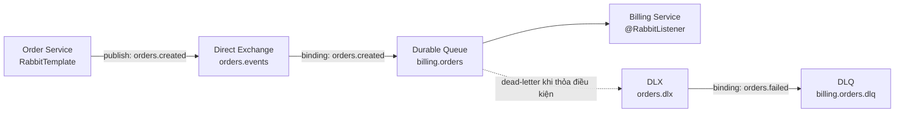
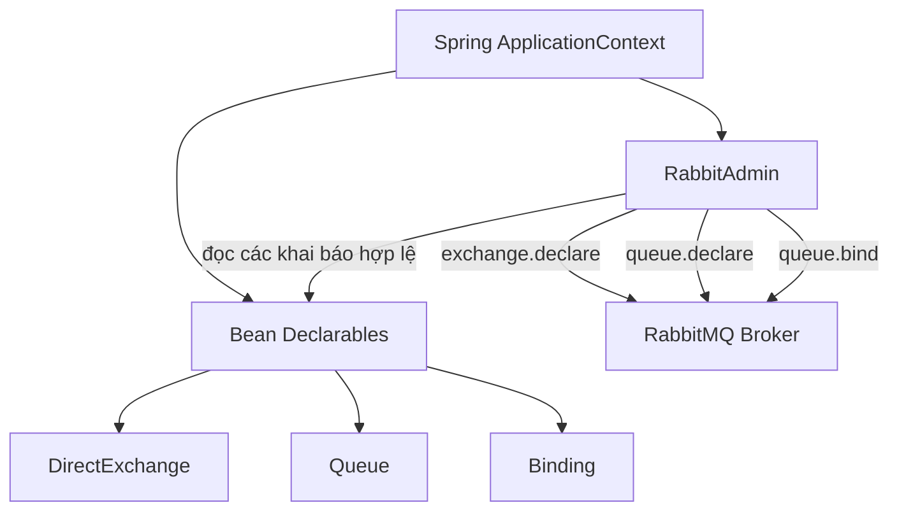
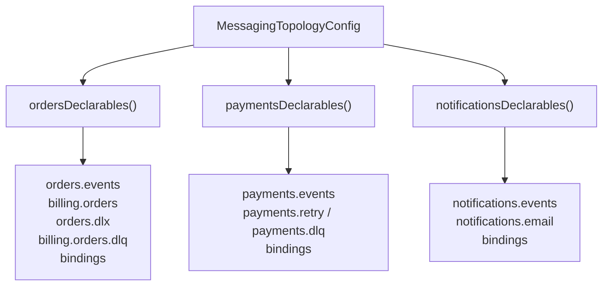
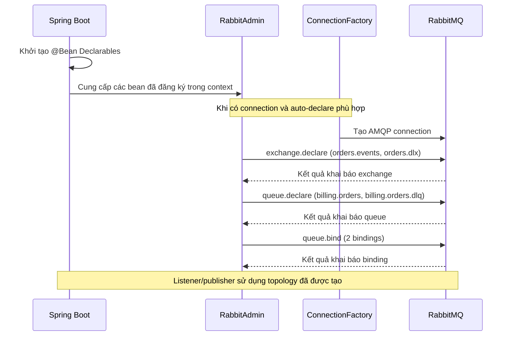
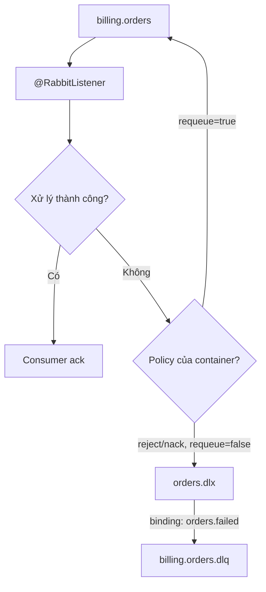

# Declarables và tổ chức tập tài nguyên liên quan

## 1. Mục tiêu và bối cảnh

Khi tích hợp **RabbitMQ với Spring AMQP**, ứng dụng thường không chỉ cần một queue đơn lẻ. Một chức năng nghiệp vụ có thể cần cả **exchange**, **queue**, **binding**, **dead-letter exchange** và **dead-letter queue (DLQ)**. Nếu các khai báo nằm rải rác ở nhiều lớp cấu hình, người bảo trì khó thấy chúng tạo thành một tuyến message chung, dễ đổi nhầm tên hoặc bỏ sót binding khi mở rộng chức năng.

**`Declarables`** trong Spring AMQP giúp **gom nhiều đối tượng khai báo tài nguyên AMQP 0-9-1 thành một tập logic**. Với một bean `Declarables`, ta có thể biểu diễn đầy đủ topology của một tính năng; `RabbitAdmin` sẽ dùng các khai báo đó để tương tác với broker khi cơ chế tự khai báo được bật.

Sau bài này, bạn có thể:

- Phân biệt `Declarable`, `Declarables`, `Queue`, `Exchange`, `Binding` và `RabbitAdmin`.
- Dùng `@Bean Declarables` để quản lý các tài nguyên của một chức năng RabbitMQ.
- Tổ chức topology theo nhóm nghiệp vụ, có cả luồng message chính và dead-letter.
- Giải thích cách khai báo tự động hoạt động khi ứng dụng khởi động và khi tái kết nối.
- Biết cách giới hạn phạm vi khai báo khi có nhiều connection factory hoặc RabbitAdmin.
- Tránh nhầm lẫn giữa **khai báo hạ tầng** và **publish/consume/ack/retry**.
- Chẩn đoán các lỗi như thiếu exchange/queue, trùng định nghĩa, `PRECONDITION_FAILED` và sai vhost.

Bài thuộc chương **Khai báo tài nguyên** của module **SPRING_AMQP**. Những ví dụ dưới đây sử dụng `RabbitTemplate`, `@RabbitListener`, exchange, queue và binding để xây nền tảng cho xử lý bất đồng bộ, sau đó liên hệ với xác nhận giao nhận, retry, dead-letter, transaction và quan sát hệ thống.

## 2. Khái niệm cốt lõi: topology được cấu thành từ những gì?

Trong AMQP 0-9-1, publisher gửi message vào **exchange** với **routing key**. Exchange xác định queue đích bằng các **binding**. Consumer sau đó nhận message từ queue.



| Đối tượng | Vai trò | Ví dụ | Spring AMQP |
| --- | --- | --- | --- |
| Exchange | Nhận message từ publisher và định tuyến | `orders.events` | `DirectExchange`, `TopicExchange`, `FanoutExchange`... |
| Queue | Giữ message để consumer nhận | `billing.orders` | `Queue`, `QueueBuilder` |
| Binding | Nối queue với exchange theo quy tắc định tuyến | `orders.created` | `Binding`, `BindingBuilder` |
| Dead-letter exchange (DLX) | Nhận message được dead-letter từ queue nguồn | `orders.dlx` | Một exchange thông thường, ví dụ `DirectExchange` |
| Dead-letter queue (DLQ) | Queue nhận message qua DLX và binding phù hợp | `billing.orders.dlq` | Một `Queue` thông thường, được bind với DLX |

**DLX và DLQ không phải hai kiểu đối tượng Java đặc biệt bắt buộc.** Chúng là exchange/queue được cấu hình và sử dụng theo mục đích dead-letter. Queue nguồn phải biết DLX qua policy/argument phù hợp; DLQ phải có binding nhận routing key mà DLX dùng. Nếu chỉ tạo một queue tên `*.dlq` mà không cấu hình đường đi, message lỗi sẽ không tự chảy vào đó.

## 3. `Declarable`, `Declarables` và `RabbitAdmin` khác nhau thế nào?

| Thành phần | Nằm ở đâu | Trách nhiệm |
| --- | --- | --- |
| `org.springframework.amqp.core.Declarable` | Spring AMQP abstraction | Giao diện thể hiện tài nguyên có thể được khai báo; hỗ trợ metadata như có nên khai báo, admin đích và cách xử lý lỗi |
| `Queue`, `Exchange`, `Binding` | Spring AMQP core | Các lớp mô tả từng tài nguyên cụ thể và thuộc tính của nó |
| `org.springframework.amqp.core.Declarables` | Spring AMQP core | **Vỏ chứa một tập** `Declarable`, thường đóng gói exchange, queue và binding liên quan thành một bean |
| `org.springframework.amqp.core.AmqpAdmin` | Spring AMQP abstraction | API quản trị để khai báo/xóa exchange, queue, binding |
| `org.springframework.amqp.rabbit.core.RabbitAdmin` | Spring Rabbit | Implementation thường dùng của `AmqpAdmin` cho RabbitMQ, có khả năng tự khai báo từ Spring context |
| `RabbitTemplate` | Spring Rabbit | API **gửi/nhận** message; không thay thế vai trò quản lý topology của `RabbitAdmin` |
| `@RabbitListener` | Spring Rabbit | Định nghĩa consumer; có thể yêu cầu queue đã tồn tại hoặc sử dụng cơ chế khai báo khác được cấu hình |

Về bản chất:

- **`Declarable` = một tài nguyên cần khai báo.** Ví dụ một `Queue` hay một `Binding`.
- **`Declarables` = một tập tài nguyên được mô tả cùng nhau.** Tập này **không phải** một loại queue/exchange mới trên RabbitMQ.
- **`RabbitAdmin` = thành phần thực thi khai báo qua connection/channel AMQP.** Tạo `Declarables` không tự gửi lệnh ra broker nếu không có cơ chế quản trị hoạt động.



Tên class Java của từng tài nguyên không bắt buộc trùng tên thật trên broker. Tên thực tế nằm trong thuộc tính như `new DirectExchange("orders.events")` hoặc `QueueBuilder.durable("billing.orders")`.

### Vì sao cần `Declarables` nếu đã có `@Bean Queue` và `@Bean Exchange`?

Spring AMQP cũng có thể tự khai báo khi những đối tượng này là các bean riêng lẻ:

```java
@Bean
DirectExchange ordersExchange() {
    return new DirectExchange("orders.events");
}

@Bean
Queue ordersQueue() {
    return QueueBuilder.durable("billing.orders").build();
}

@Bean
Binding ordersBinding(Queue ordersQueue, DirectExchange ordersExchange) {
    return BindingBuilder.bind(ordersQueue)
            .to(ordersExchange)
            .with("orders.created");
}
```

Cách này **hoàn toàn hợp lệ** với topology nhỏ. `Declarables` có ích khi một feature có nhiều tài nguyên liên quan hoặc cần trả về nhiều đối tượng cùng loại (chẳng hạn nhiều queue và nhiều binding) dưới **một bean cấu hình**. Nó giúp người đọc nhìn thấy cả tuyến định tuyến của chức năng mà không phải dò nhiều bean rời.

Với một `Declarables` bean, các đối tượng `Queue`/`Exchange`/`Binding` bên trong là **phần tử của tập**; không nên mặc định chúng cũng tồn tại như những Spring bean riêng lẻ để autowire trực tiếp bằng kiểu. Nếu cần truy cập từ code khác, dùng hằng tên rõ ràng, cung cấp bean riêng theo thiết kế hoặc truy xuất từ tập một cách có chủ đích.

## 4. Ví dụ đầy đủ: nhóm tài nguyên cho sự kiện tạo đơn hàng

Một hệ thống có hai chức năng:

1. Khi Order Service tạo đơn, publisher gửi `orderId` đến exchange `orders.events` với routing key `orders.created`.
2. Billing Service nhận từ queue `billing.orders`. Nếu message không thể xử lý và bị từ chối **không requeue**, broker định tuyến sang `orders.dlx`, rồi vào `billing.orders.dlq` theo routing key `orders.failed`.

### 4.1. Thêm thư viện

Trong ứng dụng Spring Boot, dùng starter AMQP (để Spring Boot quản lý các phiên bản tương thích thông qua BOM):

```xml
<dependency>
    <groupId>org.springframework.boot</groupId>
    <artifactId>spring-boot-starter-amqp</artifactId>
</dependency>
```

Ví dụ dưới đây dùng các API Spring AMQP phổ biến và không phụ thuộc một phiên bản minor cụ thể. Khi áp dụng cho dự án, kiểm tra lại Java baseline, phiên bản Spring Boot/Spring AMQP và các API có thay đổi theo release của dự án.

### 4.2. Khai báo một `Declarables` bean cho toàn bộ topology

```java
package example.messaging;

import org.springframework.amqp.core.Binding;
import org.springframework.amqp.core.BindingBuilder;
import org.springframework.amqp.core.Declarables;
import org.springframework.amqp.core.DirectExchange;
import org.springframework.amqp.core.Queue;
import org.springframework.amqp.core.QueueBuilder;
import org.springframework.context.annotation.Bean;
import org.springframework.context.annotation.Configuration;

@Configuration
public class OrdersTopology {

    public static final String ORDERS_EXCHANGE = "orders.events";
    public static final String ORDERS_QUEUE = "billing.orders";
    public static final String CREATED_KEY = "orders.created";

    public static final String DLX = "orders.dlx";
    public static final String DLQ = "billing.orders.dlq";
    public static final String FAILED_KEY = "orders.failed";

    @Bean
    public Declarables orderDeclarables() {
        // Luồng chính: orders.events -> billing.orders
        DirectExchange ordersExchange =
                new DirectExchange(ORDERS_EXCHANGE, true, false);

        Queue billingQueue = QueueBuilder.durable(ORDERS_QUEUE)
                .deadLetterExchange(DLX)
                .deadLetterRoutingKey(FAILED_KEY)
                .build();

        Binding createdBinding = BindingBuilder.bind(billingQueue)
                .to(ordersExchange)
                .with(CREATED_KEY);

        // Luồng dead-letter: orders.dlx -> billing.orders.dlq
        DirectExchange deadLetterExchange =
                new DirectExchange(DLX, true, false);

        Queue deadLetterQueue = QueueBuilder.durable(DLQ).build();

        Binding deadLetterBinding = BindingBuilder.bind(deadLetterQueue)
                .to(deadLetterExchange)
                .with(FAILED_KEY);

        return new Declarables(
                ordersExchange,
                billingQueue,
                createdBinding,
                deadLetterExchange,
                deadLetterQueue,
                deadLetterBinding);
    }
}
```

Điểm cần đọc kỹ:

- `new DirectExchange(name, true, false)` đặt exchange **durable** và **không auto-delete**.
- `QueueBuilder.durable(name)` tạo định nghĩa queue durable; broker sẽ lưu cấu trúc queue qua restart theo khả năng lưu trữ tương ứng.
- `deadLetterExchange(DLX)` và `deadLetterRoutingKey(FAILED_KEY)` đặt arguments liên quan lên **queue nguồn**. DLX và DLQ vẫn cần được khai báo riêng.
- `BindingBuilder.bind(queue).to(exchange).with(key)` tạo binding; bản thân `Binding` không lưu message.
- `new Declarables(...)` gom tất cả thành **một bean** để admin nhìn thấy. Nó không mở connection hay publish message ngay tại dòng `return`.
- `durable` của queue **không tự đảm bảo** mọi message sống sót qua mọi sự cố. Với độ tin cậy cao, cần xem thêm persistence của message, publisher confirms, chính sách broker và cách consumer xác nhận.

Cùng một luồng business có thể cần nhiều binding hoặc nhiều queue đích. Chỉ việc bổ sung phần tử vào `Declarables` chưa đủ nếu binding/routing key không khớp với yêu cầu. Hãy coi tập khai báo như một **sơ đồ topology có kiểm chứng**, không phải danh sách tên tài nguyên.

### 4.3. Cấu hình Spring Boot cho connection và listener

```yaml
spring:
  rabbitmq:
    host: ${RABBITMQ_HOST:localhost}
    port: ${RABBITMQ_PORT:5672}
    username: ${RABBITMQ_USERNAME:guest}
    password: ${RABBITMQ_PASSWORD:guest}
    virtual-host: ${RABBITMQ_VHOST:/}
    listener:
      simple:
        acknowledge-mode: auto
        default-requeue-rejected: false
```

Với cấu hình Spring Boot thông thường và cơ chế tạo `RabbitAdmin` tự động đang hoạt động, admin phát hiện các bean `Declarables` trong context và khai báo tài nguyên trên broker khi connection phù hợp được thiết lập. Mặc định có thể phụ thuộc phiên bản/điều kiện auto-configuration; cần kiểm tra `RabbitAdmin` thực sự tồn tại và có bật auto startup/auto declare trong ứng dụng.

Trong ví dụ này, `default-requeue-rejected: false` là lựa chọn minh họa **để exception từ listener bị reject không requeue theo hành vi container phù hợp**, tạo cơ hội dead-letter qua DLX. Nếu bật retry advice, recoverer, manual ack hoặc error handler riêng, hành vi cuối cùng cần kiểm tra lại. Không nên coi mọi exception tự động chuyển DLQ.

**Bảo mật:** dùng credentials riêng theo ứng dụng/vhost khi deploy. Tài khoản `guest` mặc định của RabbitMQ thường bị giới hạn kết nối từ localhost.

### 4.4. Publish và consume cùng tên tài nguyên

```java
package example.messaging;

import org.springframework.amqp.rabbit.core.RabbitTemplate;
import org.springframework.stereotype.Service;

@Service
public class OrderEventsPublisher {
    private final RabbitTemplate rabbitTemplate;

    public OrderEventsPublisher(RabbitTemplate rabbitTemplate) {
        this.rabbitTemplate = rabbitTemplate;
    }

    public void publishCreated(String orderId) {
        rabbitTemplate.convertAndSend(
                OrdersTopology.ORDERS_EXCHANGE,
                OrdersTopology.CREATED_KEY,
                orderId);
    }
}
```

```java
package example.messaging;

import org.springframework.amqp.rabbit.annotation.RabbitListener;
import org.springframework.stereotype.Component;

@Component
public class BillingEventsConsumer {
    @RabbitListener(queues = OrdersTopology.ORDERS_QUEUE)
    public void handleOrderCreated(String orderId) {
        // Dùng event ID/unique constraint để chống xử lý trùng.
        // Thực hiện nghiệp vụ tạo yêu cầu thanh toán.
        System.out.println("Billing requested for order " + orderId);
    }
}
```

Publisher và listener dùng cùng **hằng tên** để giảm lỗi gõ nhầm, nhưng mỗi ứng dụng triển khai độc lập vẫn cần có cách quản lý **topology contract** thống nhất. Nếu cả hai service cùng khai báo `billing.orders` với arguments khác nhau, broker có thể từ chối khai báo thứ hai.

Ví dụ listener trên dùng `AUTO` acknowledge mode của Spring: khi method xử lý thành công, container gửi ack theo chính sách của nó. Đây **không phải** cờ `autoAck=true` của RabbitMQ Java client. Nếu code thất bại, hành vi reject/requeue phụ thuộc container, retry và error handler.

## 5. Chọn cách tổ chức tập `Declarables`

Một module lớn có thể chứa các nhóm nghiệp vụ **orders**, **payment**, **notification**. Nên tách topology theo ranh giới sở hữu rõ ràng thay vì gom toàn bộ hệ thống vào một bean duy nhất.



### 5.1. Mỗi feature một bean

```java
@Configuration
class MessagingResources {

    @Bean
    Declarables orderResources() {
        DirectExchange exchange = new DirectExchange("orders.events");
        Queue queue = QueueBuilder.durable("billing.orders").build();
        Binding binding = BindingBuilder.bind(queue)
                .to(exchange)
                .with("orders.created");
        return new Declarables(exchange, queue, binding);
    }

    @Bean
    Declarables paymentResources() {
        DirectExchange exchange = new DirectExchange("payments.events");
        Queue queue = QueueBuilder.durable("email.payment-receipts").build();
        Binding binding = BindingBuilder.bind(queue)
                .to(exchange)
                .with("payments.completed");
        return new Declarables(exchange, queue, binding);
    }
}
```

Lợi ích:

- Khi đổi một chức năng, có thể nhìn thấy tài nguyên của chức năng đó trong một chỗ.
- Nhiều `Declarables` bean hợp lệ trong cùng context; không cần một bean tổng khổng lồ.
- Mỗi nhóm có thể kiểm tra độc lập danh sách exchange, queue, binding, DLX/DLQ.
- Đặt tên bean theo **ngữ nghĩa nghiệp vụ**, không theo kiểu chung `declarables1`, `declarables2`.

### 5.2. Tách các hằng tên và tránh “string rải rác”

Chọn convention nhất quán, chẳng hạn:

| Loại | Ví dụ | Gợi ý |
| --- | --- | --- |
| Exchange | `orders.events` | Thể hiện domain và vai trò |
| Queue consumer | `billing.orders` | Nêu **consumer/nhóm xử lý** và nguồn sự kiện |
| Routing key | `orders.created` | Nêu sự kiện hoặc tác vụ |
| DLX | `orders.dlx` | Phân biệt dead-letter exchange |
| DLQ | `billing.orders.dlq` | Gắn với queue nguồn |
| Retry queue | `billing.orders.retry` | Nếu chủ động triển khai retry qua queue riêng |

Nên duy trì hợp đồng tên tài nguyên và kiểu exchange rõ ràng. Đổi **tên** queue thường khiến broker tạo một queue mới thay vì “đổi tên” queue cũ; dữ liệu đang nằm ở queue cũ không tự được chuyển sang queue mới. Thay đổi kiểu exchange hoặc arguments của queue cùng tên có thể không được broker chấp nhận.

### 5.3. Bao giờ nên dùng nhiều bean riêng?

Dùng `@Bean Queue`, `@Bean Exchange`, `@Bean Binding` riêng khi cần autowire từng đối tượng làm dependency ở nơi khác, khi topology nhỏ và sơ đồ vẫn dễ đọc, hoặc khi cấu hình quản trị yêu cầu tham chiếu từng bean.

Dùng `Declarables` khi muốn mô tả **một nhóm kết nối logic**, tạo nhiều tài nguyên cùng loại, hoặc tạo chúng có tính hệ thống qua cấu hình. Hai cách đều được `RabbitAdmin` hỗ trợ trong điều kiện phù hợp. Tránh khai báo **cùng một tài nguyên hai lần với thuộc tính mâu thuẫn** từ bean riêng và phần tử bên trong `Declarables`.

## 6. Vòng đời tự khai báo: từ Spring context đến RabbitMQ

**Một Spring bean được tạo không có nghĩa tài nguyên đã có mặt trên broker ngay lập tức.** Chu trình tổng quát:



`RabbitAdmin` thường khai báo theo nhóm loại tài nguyên: **exchanges → queues → bindings**, giúp giảm lỗi binding tham chiếu tài nguyên chưa có. Sơ đồ mang tính logic; thứ tự chi tiết, thời điểm connection và cách xử lý exception phụ thuộc phiên bản và cấu hình.

### 6.1. Các điều kiện để khai báo tự động hoạt động

- `OrdersTopology` phải được Spring component scan/import để method `@Bean` chạy.
- Spring context phải có `RabbitAdmin` phù hợp với `ConnectionFactory` và tính năng tự khai báo đang bật.
- Broker, host, port, virtual host và credentials phải đúng; user phải có quyền **configure** cho tài nguyên cần tạo.
- Các phần tử `Declarable` phải được phép khai báo bởi admin đang chạy (ví dụ `shouldDeclare` không bị tắt, admin đích khớp).
- Tên tài nguyên và thuộc tính không mâu thuẫn với tài nguyên có sẵn trên broker.

Nếu trước khi listener hoạt động có lỗi tên queue không tồn tại, cần kiểm tra **đã có auto-declaration hay chưa**, thay vì chỉ tăng retry của listener.

### 6.2. Tái kết nối và khai báo lại

Khi connection mất rồi tạo lại, `RabbitAdmin` có thể thực hiện lại khai báo phù hợp. Điều này giúp khôi phục những tài nguyên bị xóa/mất (chẳng hạn tài nguyên tự động xóa sau disconnect). Tuy nhiên:

- Các lệnh declare riêng lẻ **không phải** một transaction atomic cho toàn bộ `Declarables`.
- Nếu broker chấp nhận khai báo exchange nhưng từ chối queue do sai arguments, bạn có thể thấy **topology được áp dụng một phần**.
- Khai báo cùng tên và cùng thuộc tính nhìn chung có tính tái sử dụng; **khác thuộc tính** có thể gây lỗi `PRECONDITION_FAILED`.
- Khai báo lại không bảo đảm message đã gửi hoặc đã xử lý thành công trước khi disconnect.
- Với tài nguyên `autoDelete` hoặc `exclusive`, cần hiểu vòng đời gắn với consumer/connection và cách tên queue được quản lý; không thay queue bền vững bằng exclusive queue tùy tiện.

### 6.3. Khai báo chủ động với `AmqpAdmin`

Nếu không dùng auto-declaration hoặc tạo topology động trong runtime, có thể gọi API quản trị rõ ràng:

```java
import org.springframework.amqp.core.AmqpAdmin;
import org.springframework.amqp.core.BindingBuilder;
import org.springframework.amqp.core.DirectExchange;
import org.springframework.amqp.core.Queue;

public void declareManually(AmqpAdmin admin) {
    DirectExchange exchange = new DirectExchange("reports.events");
    Queue queue = new Queue("analytics.reports", true);

    admin.declareExchange(exchange);
    admin.declareQueue(queue);
    admin.declareBinding(
            BindingBuilder.bind(queue).to(exchange).with("reports.ready"));
}
```

Đoạn trên minh họa cách dùng API. Không nên vừa tự khai báo runtime vừa để một `Declarables` khác quản lý cùng tên nhưng có thuộc tính khác nhau. Khi chạy ứng dụng nhiều instance, mọi instance cùng có khả năng khai báo nên cần thống nhất ownership và policy thay đổi topology.

**Tạo bean `Declarables` sau khi context đã hoàn tất khởi tạo** không bảo đảm `RabbitAdmin` tự phát hiện/khai báo ngay tài nguyên mới. Với tài nguyên thật sự động, gọi `AmqpAdmin` hoặc thiết kế một lifecycle đăng ký/đồng bộ rõ ràng.

## 7. Khi có nhiều broker, vhost hoặc RabbitAdmin

Trong hệ thống đơn giản, một `ConnectionFactory` và một `RabbitAdmin` thường đủ. Nhưng hệ thống có thể có:

- Một RabbitMQ broker/vhost phục vụ nghiệp vụ đơn hàng.
- Broker/vhost khác phục vụ thông báo hoặc kiểm thử.
- Một admin có quyền tạo topology; client xử lý message chỉ có quyền đọc/ghi tối thiểu.
- Nhiều application instance cùng dùng một broker nhưng sở hữu các resource riêng.

Đặt **hai RabbitAdmin** trong context mà không định phạm vi có thể khiến cả hai tìm cách khai báo các resource của nhau (tùy cấu hình mặc định). Các đối tượng `Declarable` hỗ trợ chọn **admin nào được khai báo** thông qua metadata, và `RabbitAdmin` có tùy chọn **explicit declarations only** để chỉ làm việc với những khai báo được chỉ định rõ.

### 7.1. Nguyên tắc cấu hình scope

- Tạo connection factory đúng vhost/broker cho từng admin.
- Gắn từng `Queue`, `Exchange`, `Binding` vào admin đích với `setAdminsThatShouldDeclare(...)` khi cần.
- Nếu dùng một bean `Declarables`, thiết lập admin đích cho **các phần tử bên trong**, không giả định chỉ đặt tên nhóm là đủ.
- Khi muốn tránh tự khai báo nhầm tài nguyên của admin khác, cân nhắc chế độ `explicitDeclarationsOnly` theo API và phiên bản triển khai.
- Kiểm tra quyền `configure`/`write`/`read` trên đúng vhost; **cùng tên tài nguyên trong các vhost là các thực thể riêng**.

Ví dụ khái niệm khi **đã có** một `RabbitAdmin` được đặt tên `ordersAdmin`:

```java
@Bean
Declarables ordersResourcesForAdmin(
        @org.springframework.beans.factory.annotation.Qualifier("ordersAdmin")
        org.springframework.amqp.rabbit.core.RabbitAdmin ordersAdmin) {
    DirectExchange exchange = new DirectExchange("orders.events");
    Queue queue = QueueBuilder.durable("billing.orders").build();
    org.springframework.amqp.core.Binding binding =
            BindingBuilder.bind(queue).to(exchange).with("orders.created");

    exchange.setAdminsThatShouldDeclare(ordersAdmin);
    queue.setAdminsThatShouldDeclare(ordersAdmin);
    binding.setAdminsThatShouldDeclare(ordersAdmin);

    return new Declarables(exchange, queue, binding);
}
```

Đây là **một ví dụ thay thế** cho cấu hình topology ở mục 4, không phải cấu hình bổ sung được bật cùng lúc cho đúng các tài nguyên đó. Trong ứng dụng thực tế, admin/connection factory và policy auto declaration phải được đăng ký nhất quán; API và chế độ khai báo cụ thể có thể thay đổi theo phiên bản Spring AMQP. Với nhiều broker, hãy kiểm tra thực tế để đảm bảo không admin nào tự tạo nhầm topology.

## 8. Declarables liên quan gì đến retry, DLQ, confirm và transaction?

`Declarables` là **định nghĩa topology**, vì thế nó tạo điều kiện cho các cơ chế tin cậy, nhưng **không tự kích hoạt** tất cả những cơ chế đó.

| Khả năng | Tập `Declarables` có thể định nghĩa | Thành phần còn phải cấu hình |
| --- | --- | --- |
| Định tuyến | Exchange, queue, binding với routing key | Publisher gửi đúng exchange/routing key; kiểm tra mandatory/returns khi cần |
| Consumer ack | Queue đích | `@RabbitListener` container, `AUTO`/`MANUAL` ack, cơ chế xử lý lỗi |
| Publisher confirm | Không phải đặc tính của exchange/queue/binding | Connection factory, `RabbitTemplate` callback/correlation data |
| Retry trong listener | Có thể cung cấp retry queue, DLX, binding nếu thiết kế dùng queue | Retry interceptor/advice, backoff, recoverer hoặc reject/requeue |
| Dead-letter | Queue nguồn với DLX argument, DLX, DLQ, binding | Nguyên nhân dead-letter và chính sách reject/TTL/length/delivery limit thích hợp |
| Transaction | Có thể tạo các tài nguyên mà transaction thao tác tới | Transaction/channel/`RabbitTemplate`/listener config; không có transaction trên cả tập khai báo |
| Quan sát | Tên tài nguyên nhất quán để gắn metric/alert | RabbitMQ Management, metrics, log, tracing và chỉ số nghiệp vụ |

### 8.1. Vì sao khai báo DLQ chưa đủ?

Đường đi lỗi thường là:



Khi listener lỗi, message chỉ được chuyển vào DLQ **nếu** broker quyết định dead-letter theo điều kiện thích hợp và định tuyến qua DLX thành công. Nếu container liên tục requeue, message có thể lặp vô hạn trên queue nguồn. Nếu DLX/binding sai, message có thể không đến DLQ như mong muốn. Cần thiết kế đường xử lý DLQ: giám sát, điều tra lỗi, sửa dữ liệu và redrive có kiểm soát.

Ưu tiên quản lý DLX và TTL/retry qua **broker policies** khi cần thay đổi linh hoạt mà không redeploy/sửa queue arguments; những gì được đặt bằng hardcoded `x-arguments` có thể khó thay đổi sau khi queue đã tồn tại. Không khai báo đồng thời các chính sách mâu thuẫn rồi giả định broker sẽ tự hòa giải.

### 8.2. Publisher confirm và returns là hai tín hiệu khác nhau

Kể cả khi `Declarables` đã tạo đầy đủ exchange, queue và binding, publisher cần quan tâm:

- **Confirm**: broker xác nhận xử lý publish ở phạm vi giao thức AMQP 0-9-1; không đồng nghĩa consumer đã xử lý xong.
- **Return**: khi bật mandatory và hỗ trợ returns, có thể báo message không được route đến queue phù hợp.
- **Idempotency**: nếu mất connection khi chờ confirm, publisher có thể không chắc message đã tới broker hay chưa; retry có thể sinh message trùng. Consumer cần chống trùng khi có khả năng redelivery.

### 8.3. Transaction không bao trùm `Declarables`

Một transaction message AMQP có ngữ nghĩa riêng ở channel và ứng dụng; nó **không** biến chuỗi `exchange.declare`, `queue.declare` và `queue.bind` thành một thao tác topology nguyên tử. Đừng nhầm giữa “nhóm resource trong một bean” và “một giao dịch quản trị được commit đồng thời”.

## 9. Lỗi phổ biến và cách chẩn đoán

| Hiện tượng | Nguyên nhân thường gặp | Kiểm tra và xử lý |
| --- | --- | --- |
| Bean `Declarables` có nhưng broker không có queue | `@Configuration` chưa được scan; không có/bị tắt `RabbitAdmin`; chưa phát sinh connection; sai vhost hoặc quyền | Kiểm tra Spring bean registry, connection, RabbitAdmin auto declare và quyền configure |
| `PRECONDITION_FAILED` (thường `406`) khi khai báo queue | Queue cùng tên đã tồn tại với durable, exclusive, auto-delete hoặc arguments khác | So sánh thuộc tính trên broker với code/policy; thực hiện migration có chủ đích thay vì retry vô hạn |
| `NOT_FOUND` hoặc lỗi bind | Exchange/queue không tồn tại trong vhost được chọn, tên sai hoặc khai báo thiếu | Kiểm tra đúng vhost, tên resource, thứ tự tạo, quyền và binding thực tế |
| Publish không có consumer nhận | Binding không khớp routing key; consumer trỏ queue khác; listener không chạy | Xem exchange bindings, queue depth, số consumers, returns và application logs |
| Message lỗi không vào DLQ | Container requeue, thiếu DLX/DLQ binding, routing key khác hoặc policy không đúng | Quan sát reject/nack, `x-dead-letter-*`, retry, queue arguments/policies và DLX bindings |
| Cả hai admin khai báo tài nguyên lên broker không mong muốn | Nhiều RabbitAdmin không được giới hạn phạm vi | Gán admin đích cho từng `Declarable`, kiểm tra explicit declarations only |
| Nhiều instance startup cùng khai báo topology | Tài nguyên giống nhau nhìn chung được tái khai báo; khác arguments gây lỗi | Duy trì topology contract duy nhất, quản lý migration và startup rollout |
| Listener không thể khởi động do queue missing | Auto declaration chưa thành công hoặc listener đang kiểm tra queue trước khi nó tồn tại | Kiểm tra RabbitAdmin và startup logs trước khi tăng số lần retry |
| Sau reconnect xuất hiện lỗi cũ | Admin khai báo lại nhưng cấu hình không tương thích với broker | Sửa sai khác topology/quyền; reconnect không sửa được khai báo sai |

**Không dùng xóa queue trong production làm “cách sửa nhanh” cho `PRECONDITION_FAILED`.** Xóa queue có thể làm mất message, consumer hoặc trạng thái xử lý. Muốn đổi queue arguments hay kiểu resource đã tồn tại phải có kế hoạch migration (queue mới, chuyển producer/consumer, xử lý message tồn và rollback).

### 9.1. Kiểm chứng qua Management UI hoặc CLI

Ở môi trường local/test, mở RabbitMQ Management UI và xác nhận:

1. Có `orders.events` và `orders.dlx`, đều là direct exchange.
2. Có `billing.orders` và `billing.orders.dlq`, thuộc tính durable đúng.
3. `billing.orders` có dead-letter exchange/routing key hoặc policy tương đương.
4. Binding từ `orders.events` đến `billing.orders` dùng `orders.created`.
5. Binding từ `orders.dlx` đến `billing.orders.dlq` dùng `orders.failed`.
6. Queue consumer đang có listener, và message chưa ack/ready phù hợp với thực tế.

Nếu có quyền thao tác bằng RabbitMQ CLI:

```bash
rabbitmqctl -p / list_exchanges name type durable
rabbitmqctl -p / list_queues name durable arguments messages_ready messages_unacknowledged consumers
rabbitmqctl -p / list_bindings source_name destination_name routing_key
```

Tùy phiên bản RabbitMQ, tên cột hoặc cú pháp tùy chọn có thể thay đổi; đối chiếu `rabbitmqctl help` trên broker thực tế. Ví dụ dùng vhost `/`; thay bằng vhost dự án nếu khác. Không cần quyền chỉnh sửa production chỉ để quan sát nếu tổ chức đã cung cấp quyền đọc phù hợp.

## 10. Bài thực hành: mở rộng một nhóm resource

Bắt đầu từ `OrdersTopology` ở mục 4 và thực hiện trên RabbitMQ local/test.

### Phần A — Bổ sung một loại consumer thứ hai

Yêu cầu: khi có `orders.created`, ngoài Billing còn có Inventory nhận message độc lập. Thay vì hai consumer cùng đọc **một queue** (cạnh tranh nhau lấy delivery), hãy tạo **queue riêng** và binding riêng:

```java
Queue inventoryQueue = QueueBuilder.durable("inventory.orders").build();

Binding inventoryBinding = BindingBuilder.bind(inventoryQueue)
        .to(ordersExchange)
        .with(CREATED_KEY);

// Thêm inventoryQueue, inventoryBinding
// vào new Declarables(...) của cùng nhóm topology.
```

Đây là đoạn mã đặt **bên trong** `orderDeclarables()` ở ví dụ trước, nơi biến `ordersExchange` có sẵn. Dùng queue riêng giúp mỗi nhóm consumer nhận một bản được định tuyến đến queue của mình khi exchange có binding phù hợp.

### Phần B — Quan sát DLQ theo đường đi thực tế

Tạo một message thử nghiệm mà listener cố tình từ chối **không requeue** (chỉ trong môi trường lab). Xác nhận queue nguồn giảm, DLQ tăng; kiểm tra `x-death` hoặc metadata dead-letter theo broker/client khi cần điều tra lý do. Nếu message cứ quay lại queue nguồn, kiểm tra requeue/retry trước khi chỉnh `Declarables`.

### Phần C — Thử tính tái khai báo

Khởi động lại ứng dụng khi broker vẫn còn topology. Đối chiếu broker không tạo bản sao vô tình chỉ vì bean được khởi tạo lại. Sau đó, ở môi trường test, thay một argument queue đang tồn tại để quan sát lỗi `PRECONDITION_FAILED` và rút ra bài học: **khai báo lại tài nguyên không phải migration schema**. Khôi phục trạng thái test sau thử nghiệm.

### Phần D — Trả lời bằng sơ đồ

Vẽ tuyến message cho ba trường hợp:

- `orders.created` đến `billing.orders`.
- `orders.created` đến `inventory.orders`.
- Message từ `billing.orders` bị reject không requeue đến `billing.orders.dlq`.

Đánh dấu exchange, queue, binding, routing key, điểm ack/nack và vị trí quan sát số message `ready/unacked`.

## 11. Nguyên tắc thiết kế nên duy trì

1. **Một nhóm `Declarables` cho một trách nhiệm rõ ràng**; giữ tên hằng nhất quán giữa publisher, binding và listener.
2. **Phân biệt tập khai báo với hạ tầng thực tế**: `Declarables` là mô tả trong Spring; `RabbitAdmin` và broker quyết định quá trình khai báo có thành công hay không.
3. **Khai báo đủ tuyến**: tạo queue thôi không thay cho exchange và binding; khai báo DLQ thôi không bảo đảm dead-letter hoạt động.
4. **Coi topology là hợp đồng giữa các service**; cùng tên resource phải thống nhất loại/arguments, không thay tùy tiện trong rollout.
5. **Cấu hình admin/vhost rõ ràng** khi có nhiều broker hoặc application sở hữu resource khác nhau.
6. **Không kỳ vọng tính atomic** từ nhóm `Declarables`. Theo dõi lỗi tạo topology từng phần và dùng migration an toàn cho thay đổi không tương thích.
7. **Giám sát cả hạ tầng lẫn xử lý message**: exchange/queue/binding có mặt, queue depth, consumer count, unacked, returns/confirms, retry/DLQ và lỗi nghiệp vụ.
8. **Kiểm tra thực tế với broker** trong integration test; unit test chỉ kiểm tra bean `Declarables` chứa đúng object chưa chứng minh route/retry/ack đã chạy đúng.

## 12. Câu hỏi tự đánh giá

1. Tại sao `Declarables` không phải một loại exchange hoặc queue? Ai thực sự gửi lệnh `queue.declare` đến RabbitMQ?
2. Nếu `@Bean Declarables` chứa hai queue và ba binding, bạn có thể chắc chắn các `Queue` đó tự động trở thành hai Spring bean độc lập để autowire hay không? Tại sao?
3. Một `DirectExchange` đã tồn tại nhưng bị khai báo lại với cùng tên và khác kiểu exchange. Điều gì có thể xảy ra, và tại sao restart ứng dụng chưa chắc giải quyết được?
4. Vì sao cần một queue riêng cho Billing và một queue riêng cho Inventory khi cả hai phải xử lý cùng sự kiện `orders.created`?
5. Có `billing.orders.dlq` nhưng message lỗi vẫn không vào. Bạn sẽ kiểm tra những thứ nào trước khi thay cấu hình DLQ?
6. Trong hệ thống có hai `RabbitAdmin` trỏ đến hai vhost, làm sao ngăn một admin khai báo nhầm tài nguyên của admin kia?
7. `Declarables` đã tạo đủ resource, nhưng publisher vẫn không biết event nào đến broker. Cơ chế nào cần thêm, và cơ chế đó khác consumer ack ra sao?
8. Việc dùng một bean `Declarables` cho cả exchange, queue và binding có giúp cập nhật topology thành một transaction atomic không? Hãy giải thích.

**Ghi nhớ:** `Declarables` tổ chức **tập tài nguyên RabbitMQ liên quan** trong Spring AMQP, còn `RabbitAdmin` thực thi khai báo trên broker. Cách nhóm theo feature giúp quản lý exchange, queue, binding và DLQ nhất quán; độ tin cậy của hệ thống vẫn phụ thuộc vào routing đúng, publisher confirms, acknowledgement, retry/dead-letter, idempotency, transaction phù hợp và quan sát vận hành.
