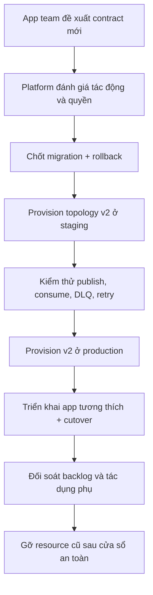

# Quyền sở hữu topology giữa ứng dụng và đội vận hành

Trong Spring AMQP, việc khai báo một `Queue`, `Exchange` hay `Binding` bằng Java có vẻ đơn giản. Nhưng ở môi trường thực tế, câu hỏi quan trọng hơn là: **ai có quyền tạo, thay đổi và xóa tài nguyên RabbitMQ; ai chịu trách nhiệm khi cấu hình trên broker không khớp với nhu cầu ứng dụng?** Đó là bài toán **quyền sở hữu topology** (topology ownership).

Bài học thuộc chương **Khai báo tài nguyên** của mô-đun **SPRING_AMQP**. Nội dung áp dụng cho hệ thống tích hợp RabbitMQ với Spring AMQP qua `RabbitTemplate`, `@RabbitListener`, exchange, queue và binding; đồng thời gắn việc khai báo tài nguyên với các yêu cầu định tuyến message, xác nhận giao nhận, retry, dead-letter, giao dịch và quan sát hệ thống để vận hành bất đồng bộ đáng tin cậy.

Sau bài học, người đọc có thể:

- Phân biệt **người định nghĩa hợp đồng topology** với **người thực thi khai báo topology**.
- Chọn mô hình ứng dụng tự khai báo, đội vận hành quản lý bằng IaC, hoặc mô hình kết hợp theo môi trường.
- Kiểm soát hành vi `RabbitAdmin`/`Declarables` và giới hạn quyền tài khoản ứng dụng.
- Thiết kế quy trình thay đổi queue, exchange, binding, policy có migration và rollback.
- Tạo hợp đồng topology và bảng trách nhiệm vận hành cho producer/consumer.

> Các ví dụ Spring AMQP trong bài dùng nhánh RabbitMQ với AMQP 0.9.1 (`spring-rabbit`). Generic AMQP 1.0 có các API và quy ước địa chỉ khác; không áp dụng trực tiếp cơ chế `RabbitAdmin` của `spring-rabbit` cho các client AMQP 1.0.

## 1. Topology gồm những gì?

**Topology** là tập tài nguyên và quan hệ định tuyến được cấu hình trên broker:

| Thành phần | Vai trò | Điều cần có người sở hữu |
| --- | --- | --- |
| **Virtual host (vhost)** | Không gian tên và ranh giới phân quyền | Tên vhost, chuẩn cô lập môi trường, quotas, quyền truy cập |
| **Exchange** | Nhận message và định tuyến theo loại exchange | Tên, loại `direct`/`topic`/`fanout`, độ bền, quyền publish |
| **Queue** | Lưu message cho consumer | Tên, queue type, `durable`, chính sách lưu trữ, ownership |
| **Binding** | Liên kết exchange với queue/exchange khác | Routing key/pattern, đối tượng nhận và thời điểm đổi route |
| **Policy và operator policy** | Điều chỉnh hành vi tài nguyên | DLX, TTL, giới hạn dung lượng, ràng buộc cấp hạ tầng |
| **User/permission** | Xác định ai được configure/write/read | Tài khoản runtime, pipeline IaC, đội xử lý sự cố |

Topology là **cấu trúc broker**; payload và trạng thái ACK của một message là các vấn đề khác. Một `@RabbitListener` xử lý thành công rồi ACK không có nghĩa nó sở hữu hoặc khai báo queue.

### 1.1. Ví dụ hai consumer cần nhận cùng sự kiện

Giả sử `order-service` phát sự kiện xác nhận đơn hàng, còn `mail-service` và `loyalty-service` cần xử lý độc lập:

```mermaid
flowchart LR
    O[order-service<br/>RabbitTemplate]
    X{{Exchange<br/>orders.events}}
    Q1[(mail.order-confirmed)]
    Q2[(loyalty.order-confirmed)]
    M[mail-service<br/>@RabbitListener]
    L[loyalty-service<br/>@RabbitListener]
    O -->|order.confirmed| X
    X -->|binding: order.confirmed| Q1
    X -->|binding: order.confirmed| Q2
    Q1 --> M
    Q2 --> L
```

Ở đây, **hai queue riêng** giúp mỗi service nhận một bản của sự kiện và theo dõi backlog độc lập. Nếu hai service cùng consume **một queue**, RabbitMQ thường phân phối message giữa các consumer cạnh tranh; không mặc định gửi một bản cho từng service.

Có hai loại quyết định liên quan:

1. **Nhu cầu nghiệp vụ:** `order-service` phát sự kiện `order.confirmed`; `mail-service` cần queue riêng; `loyalty-service` cần queue riêng.
2. **Hiện thực và vận hành:** ai tạo hai queue, ai đặt queue type/TTL/DLX, ai cấp quyền, ai xử lý khi policy không khớp, ai chịu trách nhiệm migration.

### 1.2. Phân biệt contract, owner, provisioner và operator

| Khái niệm | Câu hỏi | Ví dụ |
| --- | --- | --- |
| **Contract** | Ứng dụng cần topology như thế nào? | Exchange `orders.events`, routing key `order.confirmed`, queue `mail.order-confirmed.v1` |
| **Owner** | Nhóm nào chịu trách nhiệm vòng đời và phê duyệt thay đổi? | Team mail sở hữu subscription và queue mail |
| **Provisioner** | Thành phần nào thực sự gửi lệnh tạo/xóa đến broker? | `RabbitAdmin` hoặc pipeline IaC |
| **Operator** | Ai bảo trì broker và chịu trách nhiệm cảnh báo/khôi phục? | Platform/SRE |

Các vai trò có thể do cùng một nhóm đảm nhận ở dự án nhỏ, nhưng cần được **ghi nhận minh bạch**. Việc tạo resource bằng pipeline không tự chứng minh đội viết pipeline là owner nghiệp vụ của queue.

## 2. Ba mô hình quyền sở hữu phổ biến

### 2.1. Ứng dụng tự khai báo

Ứng dụng khai báo các bean `Queue`, `Exchange`, `Binding`, `Declarables` và để `RabbitAdmin` đăng ký tài nguyên với RabbitMQ.

**Phù hợp:** phát triển local, integration test, môi trường sandbox, demo hoặc service nhỏ có phạm vi sở hữu độc lập.

**Ưu điểm:** topology đi cùng code; triển khai thử nhanh; dễ tạo môi trường trống để kiểm thử.

**Đánh đổi:** runtime cần quyền cấu hình; nhiều instance có thể khai báo đồng thời; thay đổi không tương thích có thể khiến deployment lỗi; khó quản lý vòng đời tài nguyên có dữ liệu.

### 2.2. Đội vận hành/IaC quản lý

App team công bố **hợp đồng topology**; pipeline hạ tầng provisioning exchange, queue, binding và policy; ứng dụng chỉ publish/consume.

**Phù hợp:** production, hệ thống nhiều service/đội, broker dùng chung, môi trường có quy trình thay đổi và quản lý quyền chặt chẽ.

**Ưu điểm:** quyền tạo/sửa/xóa tách khỏi tài khoản runtime; thay đổi có review, audit, migration và rollback; cấu hình HA, queue type, policy nhất quán.

**Đánh đổi:** phải phối hợp giữa app/platform; xuất hiện nguy cơ **drift** nếu contract trong code khác IaC; rollout cần thứ tự.

### 2.3. Kết hợp theo môi trường

| Môi trường | Cách khai báo | Quy tắc kiểm soát |
| --- | --- | --- |
| Local / integration test | App dùng `RabbitAdmin` hoặc test fixture | Tài nguyên chỉ ở vhost/container thử nghiệm |
| Development dùng chung | IaC hoặc khai báo tự động giới hạn trong namespace riêng | Không được ảnh hưởng queue của team khác |
| Staging | Pipeline hạ tầng gần giống production | Kiểm thử contract, permission, retry, DLQ và rollback |
| Production | Platform/SRE và IaC được kiểm soát | Runtime chỉ có quyền cần thiết; đổi topology qua change process |

**Điểm cốt lõi:** môi trường có thể khác cách thực thi khai báo, nhưng **contract phải có phiên bản và nhất quán**. Không nên chỉ kiểm thử topology tự tạo ở local rồi hy vọng production với policy khác sẽ hoạt động tương đương.

## 3. Cơ chế khai báo của Spring AMQP

Trong `spring-rabbit`:

- `Queue`, `Exchange`, `Binding` là các bean biểu diễn tài nguyên phía ứng dụng.
- `Declarables` nhóm nhiều khai báo thành một bean tiện quản lý.
- `RabbitAdmin` triển khai `AmqpAdmin` và có thể khai báo tài nguyên khi có kết nối tới broker.
- `RabbitTemplate` gửi message; `@RabbitListener` tạo consumer. Hai API này không bắt buộc phải là nơi tạo tài nguyên.

### 3.1. Ví dụ: ứng dụng tự khai báo ở local

```java
import org.springframework.amqp.core.*;
import org.springframework.context.annotation.*;

@Configuration(proxyBeanMethods = false)
@Profile("local")
public class LocalOrderTopology {

    @Bean
    Declarables mailTopology() {
        DirectExchange exchange =
                new DirectExchange("orders.events", true, false);

        Queue mailQueue = QueueBuilder
                .durable("mail.order-confirmed.v1")
                .build();

        Binding mailBinding = BindingBuilder
                .bind(mailQueue)
                .to(exchange)
                .with("order.confirmed");

        return new Declarables(exchange, mailQueue, mailBinding);
    }
}
```

Để các bean trên được khai báo trên RabbitMQ, ứng dụng phải có một `RabbitAdmin` hoạt động với connection factory tương ứng. Có thể để Spring Boot tạo admin khi auto-configuration của phiên bản đang sử dụng hỗ trợ, hoặc tự cấu hình:

```java
@Bean
@Profile("local")
RabbitAdmin localRabbitAdmin(
        org.springframework.amqp.rabbit.connection.ConnectionFactory factory) {
    return new RabbitAdmin(factory);
}
```

`RabbitAdmin` thuộc `org.springframework.amqp.rabbit.core.RabbitAdmin`. Khi được cấu hình auto startup, nó có thể khai báo các bean `Declarable` lúc kết nối được thiết lập; `initialize()` có thể dùng để chủ động khai báo lại khi cần.

**Lưu ý:** nếu Spring Boot đã tự tạo một admin phù hợp, không tạo thêm một admin thứ hai không cần thiết. Chỉ khai báo `Queue` bean mà không có `RabbitAdmin` phù hợp không bảo đảm queue được tạo trên broker.

Phần nghiệp vụ giữ nguyên:

```java
@Service
class OrderEventPublisher {

    private final RabbitTemplate template;

    OrderEventPublisher(RabbitTemplate template) {
        this.template = template;
    }

    void orderConfirmed(String orderId) {
        template.convertAndSend(
                "orders.events",
                "order.confirmed",
                orderId
        );
    }
}

@Component
class MailOrderConsumer {

    @RabbitListener(queues = "mail.order-confirmed.v1")
    void onOrderConfirmed(String orderId) {
        // Xử lý nghiệp vụ và chống xử lý trùng.
    }
}
```

Với production do IaC quản lý, producer/consumer vẫn dùng cùng tên exchange, routing key và queue. **Quyền được publish/consume khác với quyền được tạo hoặc thay đổi những tài nguyên này.**

### 3.2. Tự khai báo lại khi kết nối

Một cấu hình `RabbitAdmin` có thể tự khai báo những tài nguyên do nó quản lý khi kết nối được thiết lập sau khi broker khởi động hoặc kết nối được phục hồi. Tính năng hữu ích cho môi trường ứng dụng sở hữu topology, nhưng cần kiểm soát khi có nhiều instance:

- Hai phiên bản ứng dụng đang chạy có thể mang cấu hình queue khác nhau.
- Runtime có thể thiếu quyền `configure` dù đã được cấp quyền publish/consume.
- Broker được khôi phục từ definitions nhưng ứng dụng lại cố redeclare một resource với arguments khác.
- Việc khởi động nhiều consumer cùng lúc không bảo đảm một thứ tự migration nào.

Khai báo lặp lại **cùng tên và thuộc tính tương đương** thường là thao tác an toàn, nhưng **redeclare không phải công cụ di chuyển schema của queue**.

### 3.3. Chọn admin và giới hạn phạm vi khai báo

Trong môi trường có nhiều `RabbitAdmin` hoặc nhiều broker, Spring AMQP cung cấp các cơ chế:

| API | Ý nghĩa |
| --- | --- |
| `setShouldDeclare(false)` trên `Declarable` | Không để bean này tự khai báo |
| `setAdminsThatShouldDeclare(admin)` | Chỉ định admin được phép khai báo bean |
| `RabbitAdmin#setExplicitDeclarationsOnly(true)` | Admin chỉ khai báo các tài nguyên có ràng buộc admin cụ thể |
| `Declarables` | Gom các khai báo exchange, queue, binding |

Ví dụ queue chỉ được khai báo bởi admin được chỉ định:

```java
@Bean
Queue auditQueue(RabbitAdmin auditAdmin) {
    Queue queue = QueueBuilder.durable("orders.audit.v1").build();
    queue.setAdminsThatShouldDeclare(auditAdmin);
    return queue;
}
```

Khi dùng nhiều admin, cần đồng bộ phạm vi **queue, exchange và binding**, tránh để binding của broker A được gửi sang broker B. Đây là vấn đề topology ownership chứ không chỉ là cấu hình Java.

### 3.4. Không tự khai báo ở production do IaC quản lý

Một cấu hình Spring Boot cho RabbitMQ AMQP 0.9.1 có thể dùng:

```yaml
spring:
  rabbitmq:
    host: rabbitmq.internal
    port: 5672
    dynamic: false
```

Ở các phiên bản Spring Boot hỗ trợ property này, `spring.rabbitmq.dynamic=false` ngăn **Spring Boot tự tạo bean `AmqpAdmin`**. Tuy nhiên, nếu ứng dụng **tự tạo `RabbitAdmin`**, property này không tự vô hiệu hóa bean thủ công. Phải kiểm tra tất cả các admin và những annotation/declaration khác mà ứng dụng sử dụng.

`@RabbitListener(queues = "...")` tham chiếu một queue cần tồn tại; listener container có thể **kiểm tra thụ động** sự tồn tại của queue khi khởi động và retry/fail tùy cấu hình. Passive check khác với tạo mới tài nguyên.

## 4. Ma trận quyền và ranh giới trách nhiệm

RabbitMQ áp dụng quyền theo vhost và tài nguyên với các nhóm quyền chính: **configure**, **write** và **read**.

| Vai trò | Quyền điển hình | Trách nhiệm |
| --- | --- | --- |
| Pipeline provisioning | `configure` và các quyền liên quan để tạo/bind theo RabbitMQ | Tạo và cập nhật topology được phê duyệt |
| Producer service | `write` đến exchange có quyền phát | Gửi message và theo dõi kết quả gửi |
| Consumer service | `read` từ queue tương ứng | Xử lý message, ACK/NACK và báo lỗi nghiệp vụ |
| Platform/SRE | Quyền quản trị theo vai trò | Chính sách broker, quotas, giám sát, khôi phục |
| Developer local | Quyền khai báo trong vhost thử nghiệm riêng | Dựng và xóa tài nguyên phục vụ phát triển |

**Bảng là định hướng**, không thay thế các quy tắc permission chính thức cho từng thao tác. Khai báo binding, dead-letter hoặc các tính năng đặc biệt có thể yêu cầu quyền `read`/`write` bổ sung đối với tài nguyên nguồn/đích.

Nên áp dụng:

- Mỗi service có thông tin xác thực phù hợp, giới hạn theo vhost và tài nguyên cần thiết.
- Tài khoản runtime không dùng quyền quản trị cluster chỉ để gọi `RabbitTemplate`.
- Pipeline sở hữu quyền tạo/sửa/xóa, service chạy với quyền tối thiểu.
- Quyền production được thay đổi qua quy trình review/audit; secrets được lưu trong hệ thống quản lý bí mật.
- Nếu cần đọc/ghi nhiều vhost, xét lại ranh giới nghiệp vụ và xác nhận rõ từng quyền.

### 4.1. Producer sở hữu event, consumer sở hữu subscription

Một quy ước hữu ích:

| Tài nguyên / contract | Owner đề xuất |
| --- | --- |
| Exchange `orders.events`, loại exchange | Nhóm phát sự kiện hoặc nhóm tích hợp được ủy quyền |
| Routing key `order.confirmed`, payload schema, event version | `order-service` |
| Queue `mail.order-confirmed.v1`, thời gian xử lý, DLQ | `mail-service` |
| Queue `loyalty.order-confirmed.v1`, retry và idempotency | `loyalty-service` |
| Binding từ `orders.events` tới các queue | Consumer owner phối hợp với owner của exchange |
| Policy, queue type, quota, provisioning | Platform/SRE review và triển khai theo nhu cầu đã phê duyệt |

Lý do: consumer biết backlog, retry và SLA của mình; producer biết hợp đồng sự kiện phát ra. Tuy nhiên, mỗi đội vẫn phải thống nhất **ai có quyền quyết định cuối cùng** cho các resource dùng chung.

## 5. Thuộc tính topology ảnh hưởng đến compatibility

Không phải mọi thay đổi topology đều có thể áp dụng trực tiếp vào resource đang có dữ liệu.

| Thuộc tính | Hậu quả khi thay đổi | Hướng xử lý |
| --- | --- | --- |
| Tên queue/exchange | Consumer/producer không tìm thấy đích cũ | Tạo tên mới, cập nhật theo kế hoạch |
| `durable` | Resource có thể không tương đương với khai báo cũ | Migration thay vì redeclare khác thuộc tính |
| `exclusive`, `autoDelete` | Thay đổi vòng đời queue | Chỉ dùng đúng trường hợp tạm thời; không áp cho queue công việc dài hạn |
| Queue type (classic/quorum) | Khác cách lưu trữ/replication và tính năng | Tạo queue mới, cutover và xử lý backlog |
| Exchange type (`direct`, `topic`, `fanout`) | Thay đổi thuật toán định tuyến | Đánh giá exchange mới và route chuyển đổi |
| Client `x-arguments` | Nhiều tham số không thay được sau khai báo | Phân loại thay đổi hỗ trợ policy hoặc cần migration |
| Binding/routing key | Thay đổi tập message đến consumer | Test route, rollout theo thứ tự; đề phòng duplicate |
| Policy | Có thể tác động nhiều queue cùng lúc | Review pattern, precedence và rollback |

Nếu ứng dụng redeclare một queue cùng tên nhưng khác thuộc tính, RabbitMQ có thể trả:

```text
PRECONDITION_FAILED - inequivalent arg
for queue 'mail.order-confirmed.v1'
```

Trường hợp này có thể khiến channel bị đóng. Cách giải quyết là **so sánh topology thực tế với contract**, xác định nguyên nhân khác biệt và chọn migration phù hợp. Không xóa queue đang có message chỉ để app khởi động được.

### 5.1. Policy và `x-arguments`

Ví dụ Java đặt DLX trực tiếp:

```java
@Bean
Queue mailQueue() {
    return QueueBuilder.durable("mail.order-confirmed.v1")
            .deadLetterExchange("mail.dlx")
            .build();
}
```

Cấu hình này đặt `x-dead-letter-exchange` từ phía client. Với các thuộc tính RabbitMQ hỗ trợ quản lý bằng **policy** (ví dụ dead lettering, TTL), nên cân nhắc để đội vận hành sở hữu qua policy thay vì hard-code mọi `x-arguments` trong ứng dụng, bởi nhiều x-arguments không sửa trực tiếp sau khi queue được khai báo.

Policy, operator policy và client x-arguments có **quy tắc ưu tiên riêng**; không giả định sửa policy luôn ghi đè giá trị do client đặt. Contract cần chỉ rõ **nguồn cấu hình chủ đạo cho từng thuộc tính** và cơ chế kiểm thử tương thích.

### 5.2. Durable không bảo đảm exactly-once

Ngay cả khi queue durable và broker được cấu hình bền vững, xử lý nghiệp vụ vẫn cần cơ chế khác:

- **Publisher confirms**: producer nhận tín hiệu broker xác nhận publish theo cơ chế đã cấu hình.
- **Publisher returns/`mandatory`**: hỗ trợ phát hiện message không được route tới queue trong các tình huống tương ứng.
- **Consumer ACK/NACK**: ghi nhận trạng thái xử lý message phía consumer.
- **Retry, dead-letter exchange/queue**: xử lý lỗi tạm thời, lỗi vĩnh viễn và poison message.
- **Idempotency**: tránh tác dụng phụ trùng khi message được giao lại.
- **Transactional outbox**: tránh khoảng trống giữa DB commit và publish message.

**Khai báo topology thành công khác với gửi thành công, nhận thành công và xử lý nghiệp vụ thành công.** Quyền sở hữu topology chỉ là một phần của thiết kế xử lý bất đồng bộ đáng tin cậy.

## 6. Quy trình thay đổi topology an toàn

Ví dụ `mail-service` muốn đổi queue `mail.order-confirmed.v1` từ classic sang quorum. Đổi `x-queue-type` trong code rồi redeploy **không phải một chiến lược migration đáng tin cậy**.



### 6.1. Migration bằng queue mới

Một lộ trình:

1. Định nghĩa tên `mail.order-confirmed.v2`, queue type, DLX, quota, quyền và consumer owner.
2. Để platform tạo queue/binding v2 qua pipeline, bật dashboard và cảnh báo cho queue mới.
3. Triển khai consumer có khả năng đọc message v2 và xử lý idempotent.
4. Chuyển routing theo kế hoạch có kiểm thử, bảo đảm producer không mất đường gửi.
5. Duy trì consumer v1 để **drain** backlog đã tồn tại; kiểm tra cả DLQ liên quan.
6. Đối soát số lượng, eventId, tác dụng phụ và timeout nghiệp vụ.
7. Chỉ xóa queue v1 sau khi xác nhận không còn phụ thuộc và có phương án rollback/replay phù hợp.

**Cẩn trọng:** nếu bind cả v1 và v2 vào cùng exchange với cùng routing key, RabbitMQ gửi **một bản message tới mỗi queue**. Hai consumer có thể cùng thực thi một nghiệp vụ; cần kế hoạch cutover hoặc deduplication rõ ràng. Đây là fan-out, không phải “dịch chuyển message” tự động.

### 6.2. Thay đổi binding cũng cần quản lý

Thêm binding có thể làm subscriber mới nhận message trong khi producer không thay đổi. Ngược lại, gỡ binding có thể khiến một consumer không còn nhận sự kiện. Trước khi đổi route:

- Kiểm tra producer/consumer đang dùng routing key và event version nào.
- Provision đích nhận trước khi producer phát dữ liệu mới.
- Kiểm thử rollback và cửa sổ chạy song song.
- Đo publisher returns, queue depth và độ trễ end-to-end.
- Xác định rõ cách xử lý sự kiện phát trong khoảng chuyển đổi.

### 6.3. Chia trách nhiệm trong đợt triển khai

| Công việc | App team | Platform/SRE |
| --- | --- | --- |
| Xác định sự kiện, payload, idempotency | Chủ trì | Tham vấn bảo mật/vận hành |
| Xác định queue subscription và SLA | Chủ trì | Tham vấn sizing, HA |
| Chọn queue type, limits, DLX, policy | Đưa yêu cầu | Phê duyệt và triển khai |
| Viết/duyệt IaC hoặc definitions | Review contract | Chủ trì |
| Kiểm thử publish/consume/retry | Chủ trì | Cấp staging và công cụ kiểm tra |
| Theo dõi backlog, DLQ, tác dụng phụ | Chủ trì phần nghiệp vụ | Chủ trì phần broker và cảnh báo |
| Rollback, replay và decommission | Xác nhận an toàn dữ liệu | Phối hợp thực hiện thay đổi hạ tầng |

Với mỗi queue quan trọng, ghi nhận **primary owner**, người hỗ trợ và cách liên hệ khi có incident.

## 7. Những lỗi thường gặp khi không rõ owner

### 7.1. Các instance cùng redeclare với hai cấu hình khác nhau

**Tình huống:** v1 khai báo classic queue, v2 đổi bean thành quorum queue nhưng giữ tên. Trong rolling deployment, cả hai version còn hoạt động.

**Hệ quả:** RabbitMQ có thể từ chối khai báo không tương đương (`PRECONDITION_FAILED`), làm ứng dụng mất channel và listener khởi động lỗi.

**Khắc phục:** migration qua queue v2 có tên khác, thống nhất thứ tự release và provision trước khi đổi route.

### 7.2. Production đã cấp quyền tối thiểu nhưng app vẫn tạo `RabbitAdmin`

**Tình huống:** producer được cấp `write`, consumer được cấp `read` nhưng Spring vẫn bật một admin tự khai báo các bean `Declarable`.

**Hệ quả:** yêu cầu `configure` thất bại (`ACCESS_REFUSED`), dù runtime chỉ cần gửi/nhận.

**Khắc phục:** rà soát auto-configured/admin thủ công, vô hiệu hóa auto-declaration không có chủ đích, giữ provisioning trong pipeline.

### 7.3. Dùng queue tạm thời cho tác vụ bền vững

**Tình huống:** queue `exclusive` hoặc `autoDelete` được dùng cho công việc lâu dài.

**Hệ quả:** queue có thể biến mất khi connection/consumer thỏa điều kiện xóa; công việc chờ có nguy cơ mất đường nhận.

**Khắc phục:** chọn kiểu queue và vòng đời phù hợp; kiểm tra thêm persistent message, loại queue và chiến lược broker recovery.

### 7.4. App hard-code DLX trong khi SRE muốn đổi policy

**Tình huống:** code đặt `x-dead-letter-exchange`, SRE cập nhật policy.

**Hệ quả:** precedence không như mong đợi, đổi cấu hình không có hiệu lực hoặc gặp lỗi tương đương thuộc tính.

**Khắc phục:** một nguồn quản lý cho từng thuộc tính; thực hiện migration có kiểm thử khi chuyển từ client args sang policy.

### 7.5. Xóa queue để tránh lỗi redeclare

**Tình huống:** queue production có backlog, app khởi động lỗi, đội dự án xóa queue để tạo lại.

**Hệ quả:** message đang chờ có thể mất, producer tiếp tục publish khi đích tạm vắng và gây rủi ro nghiệp vụ.

**Khắc phục:** dừng thay đổi, kiểm tra queue depth, DLQ, data retention, kế hoạch drain và rollback; thay đổi qua owner được phân công.

## 8. Quan sát và khôi phục hệ thống có owner rõ ràng

Tách quyền khai báo không có nghĩa team ứng dụng thôi chịu trách nhiệm với chất lượng xử lý end-to-end.

| Tín hiệu | Người theo dõi | Ý nghĩa |
| --- | --- | --- |
| Publisher confirms, returns, publish failures | Producer owner | Có thể mất route hoặc không publish thành công |
| Ready/unacked, publish/ACK rate | Consumer owner + SRE | Backlog, consumer nghẽn, mất cân bằng công suất |
| Tuổi message, độ trễ từ event đến tác dụng phụ | Consumer owner | Vi phạm SLA dù API trả nhanh |
| Redelivery, retry, DLQ count | Consumer owner + SRE | Poison message, lỗi phụ thuộc, vòng retry |
| `PRECONDITION_FAILED`, `ACCESS_REFUSED` | App owner + SRE | Drift topology và sai permission |
| Connection/channel count, memory/disk alarms | Platform/SRE | Broker quá tải hoặc bị giới hạn tài nguyên |
| Drift giữa IaC và broker | Platform/SRE | Thay đổi thủ công hoặc cấu hình không nhất quán |
| CorrelationId/eventId, trạng thái outbox | App owner | Truy vết message và đối soát tác dụng phụ |

Khi broker lỗi hoặc phải dựng lại, thứ tự khôi phục cần được thực hành trước:

1. Khôi phục vhost, danh tính, permissions và các cấu hình cluster cần thiết.
2. Provision exchange, queue, binding và policy từ nguồn đã được phê duyệt.
3. Đối chiếu queue type, thuộc tính và binding thực tế với contract.
4. Khởi động producer/consumer và kiểm tra kết nối, passive queue checks, routing.
5. Kiểm tra khả năng phục hồi message theo cơ chế bền vững thực tế của broker; xử lý tồn đọng.
6. Chỉ replay từ outbox/DLQ sau khi có quy trình idempotency và đối soát dữ liệu nghiệp vụ.

**Khôi phục topology** không tự động khôi phục mọi message nếu không có cơ chế bảo quản/phục hồi dữ liệu tương ứng.

## 9. Tài liệu hợp đồng topology mẫu

Khi ứng dụng không trực tiếp khai báo production, cần có một **topology contract** đủ cụ thể để cả app team và đội vận hành cùng thực hiện.

| Trường | Giá trị minh họa | Owner |
| --- | --- | --- |
| Vhost | `orders-prod` | Platform |
| Exchange | `orders.events`, topic, durable | Producer owner + platform |
| Routing key | `order.confirmed` | `order-service` |
| Queue | `mail.order-confirmed.v1`, durable, quorum | Consumer owner + platform |
| Binding | `orders.events` + `order.confirmed` → queue | Consumer owner |
| Message | `OrderConfirmed.v1`, `eventId` duy nhất | Producer + consumer |
| SLO | 99% công việc hoàn tất trong 5 phút | Consumer owner |
| Retry/DLQ | Có giới hạn retry, phân loại lỗi, DLQ riêng | Consumer owner + platform |
| Permissions | Producer write, consumer read, provisioning configure theo nhu cầu | Platform/security |
| Monitoring | Queue age, backlog, DLQ, publisher returns | Consumer owner + SRE |
| Migration | PR, staging test, cutover, rollback và decommission | Các đội cùng phê duyệt |

Có thể lưu contract cùng tài liệu kiến trúc hoặc kho mã IaC có version. Một manifest chỉ có ý nghĩa quản trị nếu được review và có cơ chế kiểm tra tính khớp với topology thật.

Ví dụ cấu trúc YAML **mang tính mô tả**, không phải cấu hình Spring AMQP hay RabbitMQ có thể tự đọc:

```yaml
topologyContract:
  vhost: orders-prod
  exchange:
    name: orders.events
    type: topic
    durable: true
  queue:
    name: mail.order-confirmed.v1
    type: quorum
    durable: true
  bindingKey: order.confirmed
  producerOwner: order-service
  consumerOwner: mail-service
  provisioningOwner: platform-team
  policyOwner: platform-team
  processingSlo: 5m
```

## 10. Bài thực hành: chuyển từ app-managed sang platform-managed

**Bối cảnh:** `order-service` publish vào `orders.events`; `mail-service` nhận từ `mail.order-confirmed.v1`.

### Phần A — Local: ứng dụng tự khai báo

1. Dùng cấu hình `Declarables` ở mục 3.1 cùng `RabbitAdmin` trong profile `local`.
2. Cấp tài khoản local các quyền tạo exchange, queue, binding trong vhost thử nghiệm.
3. Chạy ứng dụng, kiểm tra exchange/queue/binding qua RabbitMQ Management UI.
4. Publish bằng `RabbitTemplate` rồi nhận bằng `@RabbitListener`.
5. Khởi động lại ứng dụng, xác minh resource và route còn đúng.

### Phần B — Staging: pipeline khai báo

1. Tạo trước topology tương đương bằng definitions/IaC được team platform quản lý.
2. Tắt auto-declaration không cần thiết và giữ nguyên code publish/consume.
3. Cấp producer/consumer quyền runtime tối thiểu theo quy tắc broker.
4. Khởi động ứng dụng; xác nhận đường gửi/nhận hoạt động dù runtime không có quyền cấu hình topology.
5. Đổi queue name trong listener sang queue không tồn tại; quan sát log/startup/retry theo container config rồi hoàn nguyên.

### Phần C — Migration không tương thích

1. Trên **môi trường thử nghiệm có thể xóa**, tạo queue v1 và đưa vài message vào backlog.
2. Thử redeclare cùng tên với thuộc tính không tương đương; quan sát `PRECONDITION_FAILED` và lỗi channel.
3. Provision `mail.order-confirmed.v2` với queue type mới.
4. Triển khai consumer v2 và lập kế hoạch routing có tránh duplicate.
5. Drain backlog v1, quan sát DLQ, xác minh idempotency và đối soát business event.
6. Viết runbook rollback/cutover và điều kiện xóa queue v1.

**Câu hỏi tự kiểm tra:**

- Tại sao runtime chỉ có quyền `read`/`write` vẫn có thể xử lý message nhưng một `RabbitAdmin` bật không đúng chỗ lại gây lỗi?
- Vì sao thêm binding cùng routing key tới hai queue có thể dẫn đến xử lý một event hai lần?
- Khi muốn đổi `x-queue-type`, tại sao không nên sửa bean Java và redeploy trực tiếp?
- Ai sở hữu DLQ, quyền replay và hành động khi tuổi message vượt SLA?
- Khi broker được dựng lại, bạn phân biệt thế nào giữa khôi phục topology và khôi phục message?

## 11. Ghi nhớ

Quyền sở hữu topology là **quy tắc phối hợp giữa nhu cầu nghiệp vụ và quyền thực thi trên RabbitMQ**. Ứng dụng nên sở hữu contract sự kiện/consumer; đội vận hành thường sở hữu provisioning production, policy, phân quyền và quá trình migration. `RabbitAdmin` rất tiện cho local/test nhưng cần được dùng có chủ đích trong hệ thống có nhiều service, nhiều instance và nhiều đội.

Một topology đáng tin cậy cần hơn ba tên exchange–queue–binding: nó có **người chịu trách nhiệm, phiên bản hợp đồng, quyền tối thiểu, quy trình thay đổi an toàn, kế hoạch khôi phục và giám sát message từ đầu đến cuối**.
