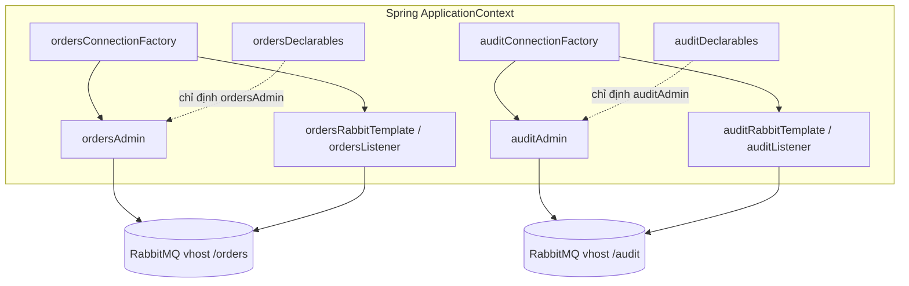
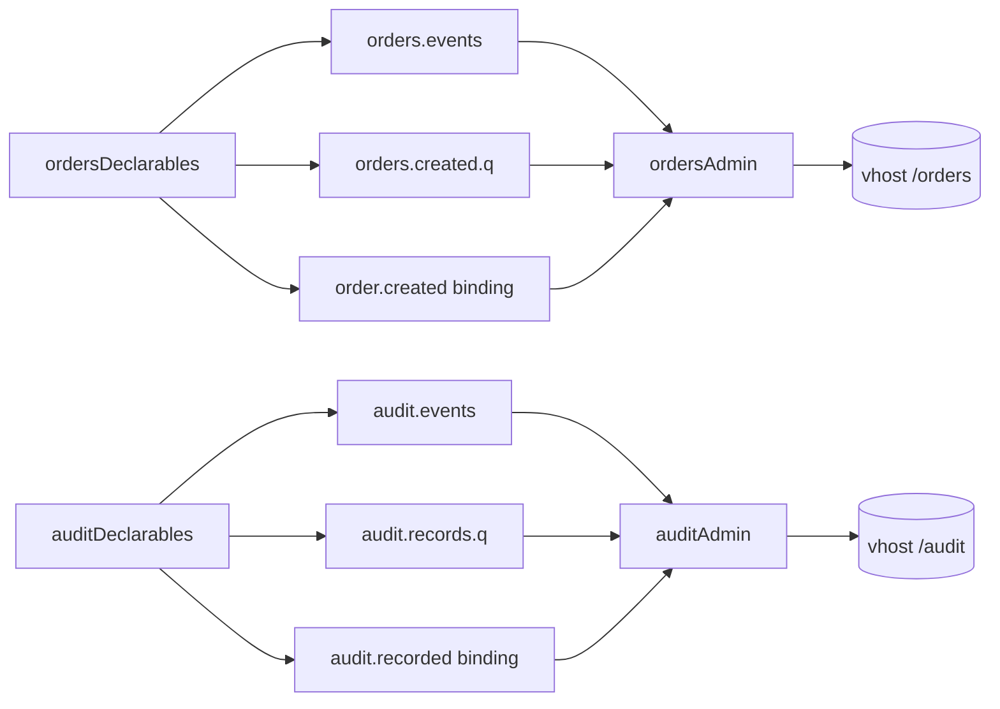
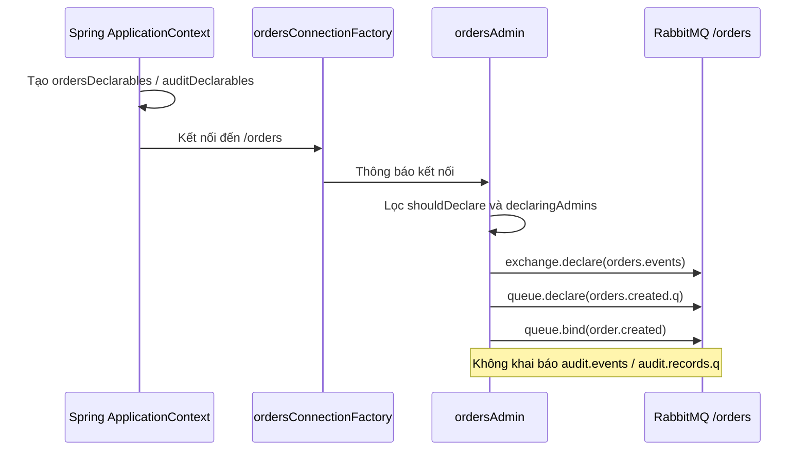

# Khai báo tài nguyên khi có nhiều connection factory hoặc RabbitAdmin

Khi ứng dụng Spring AMQP chỉ dùng một RabbitMQ connection factory, việc khai báo `Exchange`, `Queue` và `Binding` dưới dạng Spring bean thường khá đơn giản: `RabbitAdmin` có thể tự khai báo các tài nguyên đó lên broker khi kết nối được thiết lập. Tuy nhiên, một ứng dụng tích hợp nhiều broker, nhiều virtual host hoặc nhiều `RabbitAdmin` cần kiểm soát rõ **admin nào khai báo tài nguyên nào, trên kết nối nào**.

Trong module **SPRING_AMQP**, đây là phần **Khai báo tài nguyên**. Chủ đề liên quan trực tiếp đến các tác vụ gửi message bằng `RabbitTemplate`, nhận message bằng `@RabbitListener`, định tuyến qua exchange/binding, cũng như các queue dành cho retry, dead-letter và quan sát hệ thống. Khai báo nhầm broker hoặc virtual host có thể khiến producer gửi thành công nhưng consumer không nhận được message, hoặc khiến ứng dụng tự tạo một topology ngoài dự kiến.

## 1. Phân biệt bốn khái niệm trước khi cấu hình

| Thành phần | Trách nhiệm | Điểm cần lưu ý khi có nhiều kết nối |
|---|---|---|
| `ConnectionFactory` | Cấp kết nối AMQP đến một broker/cluster và **virtual host** cụ thể. | Hai factory có thể trỏ đến hai broker hoặc hai vhost trên cùng broker. |
| `RabbitAdmin` (`AmqpAdmin`) | Thực hiện lệnh khai báo/kiểm tra/xóa exchange, queue, binding qua connection factory của nó. | Mỗi admin dùng **factory được truyền vào constructor**; đặt tên bean cho dễ nhận diện. |
| `Declarable` | Mô tả đối tượng AMQP cần khai báo (`Queue`, `Exchange`, `Binding`). | Có thể chỉ định admin được phép tự khai báo qua `setAdminsThatShouldDeclare(...)`. |
| `RabbitTemplate` / listener container | Gửi hoặc nhận message bằng connection factory được cấu hình. | Chọn factory cho publisher/consumer **độc lập** với việc chọn admin khai báo topology. |



**Một virtual host là không gian tên riêng của RabbitMQ.** Cùng một tên queue, ví dụ `events.q`, có thể xuất hiện ở hai vhost nhưng là hai queue độc lập. `RabbitAdmin` không tự đồng bộ message giữa các broker/vhost. Muốn gửi message từ vùng này sang vùng kia, ứng dụng hoặc một cơ chế liên kết broker phải chủ động chuyển message.

## 2. Quy tắc mặc định dễ gây khai báo nhầm

Trong cùng `ApplicationContext`, `RabbitAdmin` mặc định có thể xem xét **toàn bộ các bean `Queue`, `Exchange`, `Binding` và các đối tượng trong `Declarables`**, chứ không mặc định tự giới hạn ở tài nguyên “có tên giống” connection factory. Nếu có nhiều `RabbitAdmin`, một tài nguyên chưa chỉ rõ admin có thể được **mọi admin** tự khai báo khi từng admin có kết nối và bật tự khai báo.

Ví dụ: `ordersAdmin` trỏ đến vhost `/orders` và `auditAdmin` trỏ đến vhost `/audit`. Nếu chỉ có:

```java
@Bean
Queue ordersQueue() {
    return new Queue("orders.created.q", true);
}
```

thì queue `orders.created.q` có thể được khai báo ở **cả `/orders` lẫn `/audit`**. Việc bean mang tên `ordersQueue` không khiến Spring tự suy ra phải dùng `ordersAdmin`.

Các quy tắc nên nhớ:

| Cấu hình trên `Declarable` | `ordersAdmin` mặc định (`explicitDeclarationsOnly=false`) | `auditAdmin` mặc định (`explicitDeclarationsOnly=false`) |
|---|---|---|
| Không chỉ định admin, `shouldDeclare=true` | Có thể tự khai báo | Có thể tự khai báo |
| `setAdminsThatShouldDeclare("ordersAdmin")` | Tự khai báo | Bỏ qua |
| `setAdminsThatShouldDeclare("auditAdmin")` | Bỏ qua | Tự khai báo |
| `setShouldDeclare(false)` | Bỏ qua | Bỏ qua |

Nếu đặt `explicitDeclarationsOnly=true` cho cả hai admin, **tài nguyên không gắn tên admin sẽ bị cả hai bỏ qua** trong cơ chế tự khai báo, còn tài nguyên đã gắn `ordersAdmin`/`auditAdmin` vẫn được admin tương ứng khai báo.

Điều kiện của bảng là admin có quyền, `autoStartup` được bật và có kết nối đến broker. Tạo Java bean thành công không chứng minh rằng queue/exchange đã được tạo trên RabbitMQ.

## 3. Ví dụ thực tế: hai connection factory đến hai virtual host

Giả sử một ứng dụng cần tách hai nhóm nghiệp vụ:

- `/orders`: nhận và xử lý sự kiện đặt hàng tại exchange `orders.events`, queue `orders.created.q`, routing key `order.created`.
- `/audit`: ghi sự kiện nhật ký nghiệp vụ tại exchange `audit.events`, queue `audit.records.q`, routing key `audit.recorded`.

Hai vhost có thể cùng nằm trên một RabbitMQ server hoặc nằm trên hai server khác nhau. Ta dùng hai tên cấu hình riêng để dễ thay đổi địa chỉ mà không sửa code.

### 3.1. Cấu hình kết nối

```yaml
# application.yml — cấu hình riêng của ví dụ
app:
  rabbit:
    orders:
      host: localhost
      port: 5672
      vhost: /orders
      username: ${ORDERS_RABBIT_USERNAME}
      password: ${ORDERS_RABBIT_PASSWORD}
    audit:
      host: localhost
      port: 5672
      vhost: /audit
      username: ${AUDIT_RABBIT_USERNAME}
      password: ${AUDIT_RABBIT_PASSWORD}
```

Đây là nhóm property `app.rabbit.*` do ứng dụng ví dụ tự định nghĩa, **không phải** property tự cấu hình nhiều connection factory của Spring Boot. Các virtual host `/orders`, `/audit` và tài khoản có quyền truy cập tương ứng phải được tạo/cấp quyền trên RabbitMQ từ trước. Với môi trường chạy Docker, địa chỉ `localhost` phải được thay bằng hostname có thể truy cập từ container ứng dụng.

Chọn **starter RabbitMQ AMQP 0-9-1** phù hợp với phiên bản Spring Boot đang dùng. Với **Spring Boot 3.x**:

```xml
<dependency>
    <groupId>org.springframework.boot</groupId>
    <artifactId>spring-boot-starter-amqp</artifactId>
</dependency>
```

Với **Spring Boot 4.x** (theo cách đặt tên starter của phiên bản này), dùng starter cho RabbitMQ AMQP 0-9-1:

```xml
<dependency>
    <groupId>org.springframework.boot</groupId>
    <artifactId>spring-boot-starter-rabbitmq</artifactId>
</dependency>
```

Không nhầm `spring-boot-starter-amqp` của Spring Boot 4.x (AMQP 1.0 tổng quát) với starter RabbitMQ AMQP 0-9-1 phục vụ `RabbitTemplate`, `RabbitAdmin` và `@RabbitListener` trong ví dụ này.

### 3.2. Khai báo connection factory và hai RabbitAdmin

```java
package com.example.multirabbit;

import org.springframework.amqp.rabbit.connection.CachingConnectionFactory;
import org.springframework.amqp.rabbit.connection.ConnectionFactory;
import org.springframework.amqp.rabbit.core.RabbitAdmin;
import org.springframework.beans.factory.annotation.Qualifier;
import org.springframework.beans.factory.annotation.Value;
import org.springframework.context.annotation.Bean;
import org.springframework.context.annotation.Configuration;

@Configuration(proxyBeanMethods = false)
public class RabbitConnectionsConfig {

    @Bean("ordersConnectionFactory")
    public CachingConnectionFactory ordersConnectionFactory(
            @Value("${app.rabbit.orders.host}") String host,
            @Value("${app.rabbit.orders.port:5672}") int port,
            @Value("${app.rabbit.orders.vhost}") String vhost,
            @Value("${app.rabbit.orders.username}") String username,
            @Value("${app.rabbit.orders.password}") String password) {
        return newFactory(host, port, vhost, username, password);
    }

    @Bean("auditConnectionFactory")
    public CachingConnectionFactory auditConnectionFactory(
            @Value("${app.rabbit.audit.host}") String host,
            @Value("${app.rabbit.audit.port:5672}") int port,
            @Value("${app.rabbit.audit.vhost}") String vhost,
            @Value("${app.rabbit.audit.username}") String username,
            @Value("${app.rabbit.audit.password}") String password) {
        return newFactory(host, port, vhost, username, password);
    }

    private static CachingConnectionFactory newFactory(
            String host, int port, String vhost,
            String username, String password) {
        CachingConnectionFactory factory = new CachingConnectionFactory(host, port);
        factory.setVirtualHost(vhost);
        factory.setUsername(username);
        factory.setPassword(password);
        return factory;
    }

    @Bean("ordersAdmin")
    public RabbitAdmin ordersAdmin(
            @Qualifier("ordersConnectionFactory") ConnectionFactory factory) {
        RabbitAdmin admin = new RabbitAdmin(factory);
        admin.setExplicitDeclarationsOnly(true);
        return admin;
    }

    @Bean("auditAdmin")
    public RabbitAdmin auditAdmin(
            @Qualifier("auditConnectionFactory") ConnectionFactory factory) {
        RabbitAdmin admin = new RabbitAdmin(factory);
        admin.setExplicitDeclarationsOnly(true);
        return admin;
    }
}
```

Hai chi tiết quyết định ở đây:

1. Mỗi `RabbitAdmin` được khởi tạo bằng **đúng** `ConnectionFactory` thông qua `@Qualifier`. `ordersAdmin` thao tác trên `/orders`, `auditAdmin` thao tác trên `/audit`.
2. `setExplicitDeclarationsOnly(true)` yêu cầu admin chỉ tự khai báo những tài nguyên **được chỉ định cho admin đó**. Cách này giúp tránh khai báo nhầm các bean không gắn admin vào vhost khác.

Tên bean `ordersAdmin` và `auditAdmin` phải khớp chính xác các tên dùng trong `setAdminsThatShouldDeclare(...)` ở phần tiếp theo. `explicitDeclarationsOnly` điều chỉnh quá trình **tự quét và tự khai báo bean**; nếu gọi trực tiếp `ordersAdmin.declareQueue(...)`, chính lời gọi đó vẫn yêu cầu khai báo queue qua connection factory của `ordersAdmin`.

## 4. Gán mỗi exchange, queue, binding cho đúng RabbitAdmin

Với topology cố định, `Declarables` là cách gói các tài nguyên liên quan trong một bean, thuận tiện khi hệ thống có nhiều queue, binding và dead-letter exchange. Tuy nhiên, **việc đặt chung trong một `Declarables` không tự chọn admin**; vẫn phải chỉ định trên từng đối tượng con.

```java
package com.example.multirabbit;

import org.springframework.amqp.core.Binding;
import org.springframework.amqp.core.BindingBuilder;
import org.springframework.amqp.core.Declarables;
import org.springframework.amqp.core.DirectExchange;
import org.springframework.amqp.core.Queue;
import org.springframework.context.annotation.Bean;
import org.springframework.context.annotation.Configuration;

@Configuration(proxyBeanMethods = false)
public class RabbitTopologyConfig {

    @Bean("ordersDeclarables")
    public Declarables ordersDeclarables() {
        DirectExchange exchange = new DirectExchange("orders.events", true, false);
        Queue queue = new Queue("orders.created.q", true);
        Binding binding = BindingBuilder.bind(queue)
                .to(exchange).with("order.created");

        exchange.setAdminsThatShouldDeclare("ordersAdmin");
        queue.setAdminsThatShouldDeclare("ordersAdmin");
        binding.setAdminsThatShouldDeclare("ordersAdmin");

        return new Declarables(exchange, queue, binding);
    }

    @Bean("auditDeclarables")
    public Declarables auditDeclarables() {
        DirectExchange exchange = new DirectExchange("audit.events", true, false);
        Queue queue = new Queue("audit.records.q", true);
        Binding binding = BindingBuilder.bind(queue)
                .to(exchange).with("audit.recorded");

        exchange.setAdminsThatShouldDeclare("auditAdmin");
        queue.setAdminsThatShouldDeclare("auditAdmin");
        binding.setAdminsThatShouldDeclare("auditAdmin");

        return new Declarables(exchange, queue, binding);
    }
}
```

Ba lời gọi `setAdminsThatShouldDeclare` ở **mỗi nhóm** là có chủ đích. Nếu quên chỉ định trên `Binding`, admin có `explicitDeclarationsOnly=true` sẽ bỏ qua binding, khiến exchange và queue có thể đã tồn tại nhưng message vẫn không được định tuyến giữa chúng. Nếu quên trên `Queue` hoặc `Exchange`, binding có thể khai báo lỗi vì thiếu điểm đích hoặc nguồn.



Thay vì tạo một `Declarables`, bạn có thể trả về từng `@Bean` kiểu `DirectExchange`, `Queue`, `Binding` rồi gán `setAdminsThatShouldDeclare(...)` cho từng bean. Đây là **cách tổ chức tương đương** nếu giữ nguyên ràng buộc khai báo. Với cùng một tài nguyên, không cần khai báo lặp cả hai kiểu chỉ để được quét hai lần.

### Khi muốn một tài nguyên xuất hiện trên nhiều broker

`setAdminsThatShouldDeclare(...)` nhận nhiều admin:

```java
queue.setAdminsThatShouldDeclare("ordersAdmin", "auditAdmin");
```

Điều đó **chủ đích khai báo queue trên cả hai connection**, không phải cấu hình sao chép message qua lại. Nếu chọn nhiều admin cho queue, phải bảo đảm các exchange và binding phụ thuộc cũng được tạo ở nơi phù hợp; các tên và thuộc tính tại từng broker/vhost phải tương thích.

### Khi không muốn bất kỳ RabbitAdmin nào tự khai báo

```java
queue.setShouldDeclare(false);
```

`shouldDeclare=false` thường dùng cho tài nguyên do một quy trình hạ tầng khác quản lý, hoặc khi không muốn ứng dụng tự thay đổi topology. Khi đó, nếu listener cần queue, phải bảo đảm queue thực sự đã được tạo ở broker/vhost tương ứng. Thuộc tính này điều khiển **tự khai báo từ bean**, không cấm một đoạn code khác gọi `AmqpAdmin.declareQueue(...)` thủ công.

## 5. Chọn cùng connection factory cho RabbitTemplate và @RabbitListener

Gán đúng `RabbitAdmin` chỉ giải quyết việc **khai báo topology**. Khi chạy nghiệp vụ, publisher và consumer còn phải trỏ đến đúng broker/vhost thông qua template và listener container factory.

```java
package com.example.multirabbit;

import org.springframework.amqp.rabbit.config.SimpleRabbitListenerContainerFactory;
import org.springframework.amqp.rabbit.annotation.EnableRabbit;
import org.springframework.amqp.rabbit.connection.ConnectionFactory;
import org.springframework.amqp.rabbit.core.RabbitTemplate;
import org.springframework.beans.factory.annotation.Qualifier;
import org.springframework.context.annotation.Bean;
import org.springframework.context.annotation.Configuration;

@Configuration(proxyBeanMethods = false)
@EnableRabbit
public class RabbitClientConfig {

    @Bean("ordersRabbitTemplate")
    public RabbitTemplate ordersRabbitTemplate(
            @Qualifier("ordersConnectionFactory") ConnectionFactory factory) {
        return new RabbitTemplate(factory);
    }

    @Bean("auditRabbitTemplate")
    public RabbitTemplate auditRabbitTemplate(
            @Qualifier("auditConnectionFactory") ConnectionFactory factory) {
        return new RabbitTemplate(factory);
    }

    @Bean("ordersListenerContainerFactory")
    public SimpleRabbitListenerContainerFactory ordersListenerContainerFactory(
            @Qualifier("ordersConnectionFactory") ConnectionFactory factory) {
        SimpleRabbitListenerContainerFactory containerFactory =
                new SimpleRabbitListenerContainerFactory();
        containerFactory.setConnectionFactory(factory);
        return containerFactory;
    }

    @Bean("auditListenerContainerFactory")
    public SimpleRabbitListenerContainerFactory auditListenerContainerFactory(
            @Qualifier("auditConnectionFactory") ConnectionFactory factory) {
        SimpleRabbitListenerContainerFactory containerFactory =
                new SimpleRabbitListenerContainerFactory();
        containerFactory.setConnectionFactory(factory);
        return containerFactory;
    }
}
```

Ví dụ publisher phát sự kiện vào vhost `/orders`:

```java
@Component
class OrderEventPublisher {
    private final RabbitTemplate template;

    OrderEventPublisher(@Qualifier("ordersRabbitTemplate") RabbitTemplate template) {
        this.template = template;
    }

    void sendOrderCreated(String eventJson) {
        template.convertAndSend("orders.events", "order.created", eventJson);
    }
}
```

Ví dụ consumer nhận từ queue trong `/orders`:

```java
@Component
class OrderEventConsumer {

    @RabbitListener(
            queues = "orders.created.q",
            containerFactory = "ordersListenerContainerFactory",
            admin = "ordersAdmin")
    public void onOrderCreated(String payload) {
        System.out.println("Received order event: " + payload);
    }
}
```

Đối với hai đoạn Java ngắn này, cần import `org.springframework.stereotype.Component`, `org.springframework.beans.factory.annotation.Qualifier`, `org.springframework.amqp.rabbit.core.RabbitTemplate` và `org.springframework.amqp.rabbit.annotation.RabbitListener` tương ứng.

`containerFactory="ordersListenerContainerFactory"` xác định connection factory của **consumer**. `admin="ordersAdmin"` chọn admin mà listener container dùng trong các trường hợp cần khai báo lại tài nguyên, đặc biệt với queue `auto-delete` và topology có conditional declaration. Chọn `admin` **không tự động thay đổi** connection factory của listener; muốn chắc chắn đúng vhost phải cấu hình cả container factory.

Nếu có nhiều `ConnectionFactory`, `RabbitTemplate` hay listener factory cùng kiểu, đừng phụ thuộc vào việc Spring tự chọn bean. Hãy dùng `@Qualifier` và tên `containerFactory` rõ ràng. `@Primary` có thể xác định bean mặc định cho một số điểm tiêm, nhưng **không thay thế** việc gán admin cho tài nguyên cần khai báo.

## 6. Tự khai báo khi kết nối, khi container khởi động lại và khi mất kết nối

`RabbitAdmin` có cơ chế tự khai báo các `Declarable` trong `ApplicationContext` khi connection của admin được mở. Với `CachingConnectionFactory` ở chế độ cache channel mặc định, việc khởi tạo kết nối có thể do listener hoặc publisher kích hoạt. Đó là lý do tạo bean Java hoặc gọi `@Bean` chưa đủ để xác nhận queue đã có trên broker.



Khi kết nối được khôi phục, admin có thể khai báo lại các tài nguyên được quản lý nhằm phục hồi topology còn thiếu. Nhưng điều này **không thay thế** chính sách durable/persistent của RabbitMQ và không giúp bảo đảm không mất message trong mọi sự cố.

Listener container cũng có thể muốn khai báo lại queue bị thiếu trong lúc khởi động (đặc biệt với queue tự xóa). Khi có nhiều admin trong context, phải chỉ rõ admin phù hợp thay vì để container gặp tình huống lựa chọn không rõ ràng. `@RabbitListener(admin="ordersAdmin")` là một cách; với cấu hình container thủ công, dùng thuộc tính `rabbitAdmin` phù hợp của container.

`setExplicitDeclarationsOnly(true)` chỉ giới hạn tài nguyên do admin **tự quét**. Nếu ứng dụng trực tiếp gọi `ordersAdmin.declareExchange(...)`, `ordersAdmin.declareQueue(...)` hoặc `ordersAdmin.declareBinding(...)`, các lệnh đó vẫn thao tác trên vhost `/orders`. Cần phân biệt luồng **declarative** (bean tự được quét) và **imperative** (code gọi `AmqpAdmin` trực tiếp).

## 7. Kiểm tra kết quả bằng hai virtual host

Trước khi chạy ví dụ, tạo hai vhost và phân quyền khai báo/exchange/queue cho tài khoản tương ứng trong RabbitMQ; bước đó thuộc quản trị broker. Khi ứng dụng kết nối được cả hai vhost, mở RabbitMQ Management UI và chuyển lần lượt giữa `/orders` và `/audit`:

| Vhost | Exchange cần thấy | Queue cần thấy | Binding cần thấy | Không nên thấy |
|---|---|---|---|---|
| `/orders` | `orders.events` | `orders.created.q` | `order.created` → `orders.created.q` | Các tài nguyên `audit.*` của ví dụ |
| `/audit` | `audit.events` | `audit.records.q` | `audit.recorded` → `audit.records.q` | Các tài nguyên `orders.*` của ví dụ |

Để xác minh bằng câu lệnh tại máy có quyền sử dụng `rabbitmqctl`:

```bash
rabbitmqctl -p /orders list_exchanges name type durable
rabbitmqctl -p /orders list_queues name durable
rabbitmqctl -p /orders list_bindings source_name destination_name routing_key

rabbitmqctl -p /audit list_exchanges name type durable
rabbitmqctl -p /audit list_queues name durable
rabbitmqctl -p /audit list_bindings source_name destination_name routing_key
```

Tiếp theo, gửi một message `order.created` qua `ordersRabbitTemplate`; xác minh consumer của `/orders` nhận message và queue `/audit` không xuất hiện thêm message từ sự kiện đó. Gửi một `audit.recorded` qua `auditRabbitTemplate` (sử dụng exchange/routing key của nhóm audit) và kiểm tra độc lập trên `/audit`.

**Phép thử phát hiện lỗi:** tạm thời bỏ lời gọi `queue.setAdminsThatShouldDeclare("ordersAdmin")` khỏi cấu hình nhóm orders trong môi trường test. Vì `ordersAdmin` được đặt `explicitDeclarationsOnly=true`, queue không còn được admin đó tự khai báo. Nếu vẫn thấy queue xuất hiện, hãy kiểm tra nó đã tồn tại từ trước hoặc còn một `RabbitAdmin` khác tự khai báo hay không. Không kết luận dựa trên một queue đã có từ lần chạy trước.

## 8. Các lỗi thường gặp và cách xử lý

| Hiện tượng | Giải thích khả dĩ | Hướng xử lý |
|---|---|---|
| Queue xuất hiện trên cả hai vhost ngoài ý muốn | Tài nguyên chưa gắn declaring admin; một admin vẫn cho phép khai báo mặc định. | Gắn `setAdminsThatShouldDeclare(...)` cho **exchange, queue và binding**; bật `explicitDeclarationsOnly` cho các admin cần giới hạn. |
| Exchange đã tạo nhưng queue chưa có | Quên gắn admin cho queue hoặc khai báo queue lỗi. | Kiểm tra `queue.getDeclaringAdmins()`, log RabbitAdmin và quyền `configure` tại vhost. |
| Exchange và queue đều có nhưng message không vào queue | Thiếu binding, sai routing key hoặc binding bị admin bỏ qua. | Kiểm tra binding key, `binding.setAdminsThatShouldDeclare(...)` và danh sách bindings đúng vhost. |
| `NOT_FOUND - no queue` khi listener chạy | Listener trỏ nhầm connection factory/vhost, hoặc queue chưa khai báo. | Kiểm tra `containerFactory`, `admin`, quyền truy cập và vhost của consumer. |
| `PRECONDITION_FAILED` khi khai báo | Queue/exchange cùng tên đã tồn tại nhưng thuộc tính không tương đương (durable, auto-delete, arguments...). | So sánh cấu hình hiện có; thực hiện migration topology có kiểm soát, không xóa queue có dữ liệu tùy tiện. |
| Có nhiều bean `ConnectionFactory`, Spring báo không chọn được bean | Thiếu `@Qualifier`/`@Primary` hoặc cấu hình auto-configuration không phù hợp. | Chỉ định bean cụ thể cho admin, template và listener container factory. |
| Không có tài nguyên nào được tạo | `explicitDeclarationsOnly=true` nhưng mọi resource đều chưa chỉ định admin; hoặc chưa có kết nối. | Kiểm tra tên admin và việc tạo kết nối; quan sát log RabbitAdmin. |
| Startup chỉ báo lỗi một resource nhưng các resource sau không tạo | `RabbitAdmin` thường dừng khai báo tiếp khi gặp lỗi không được bỏ qua. | Sửa lỗi gốc; cân nhắc `ignoreDeclarationExceptions` có chủ đích, đồng thời theo dõi `DeclarationExceptionEvent`. |

Không nên bật `admin.setIgnoreDeclarationExceptions(true)` như một giải pháp chung cho việc lệch cấu hình. Tùy chọn này có thể giúp tiếp tục khai báo các tài nguyên khác, nhưng cũng có thể để lại topology **chưa hoàn chỉnh**. Cần quan sát lỗi và điều tra nguyên nhân. Với hệ thống production, quyền khai báo tài nguyên, thay đổi arguments và chiến lược migration nên được quản lý rõ ràng.

## 9. Mở rộng sang retry, dead-letter, giao dịch và quan sát

Khi nghiệp vụ có retry hoặc dead-letter, mỗi vùng kết nối thường cần nhóm tài nguyên riêng: work queue, retry queue, dead-letter exchange, dead-letter queue và binding. Nếu nhóm tài nguyên thuộc vhost `/orders`, hãy gắn cùng declaring admin phù hợp cho **mọi** exchange/queue/binding liên quan, không chỉ queue chính. Queue cấu hình dead-letter exchange phải tham chiếu đến exchange có trong **cùng virtual host**, trừ khi có một cơ chế chuyển message giữa các vùng được thiết kế riêng.

Publisher confirm và consumer acknowledgement cũng theo kết nối của publisher/consumer; việc admin đã khai báo topology không xác nhận message đã được gửi, xử lý hay commit nghiệp vụ. Đối với luồng cần tin cậy, tiếp tục cấu hình confirm/returns, ACK/NACK, retry có giới hạn, dead-letter và xử lý idempotent; nếu cập nhật cơ sở dữ liệu cùng phát message, cân nhắc transactional outbox. Những cơ chế này **không được tự kích hoạt** chỉ bằng `setAdminsThatShouldDeclare(...)`.

Để quan sát và đối soát trong ứng dụng đa kết nối, nên gắn nhãn `broker`/`vhost`/`admin bean` cho log và metrics, đồng thời kiểm tra `ready`, `unacked`, số redelivery, publisher returns và DLQ ở đúng vhost. Cùng tên queue trên hai vhost không đại diện cho một hàng đợi chung.

## 10. Bài thực hành và câu hỏi tự đánh giá

**Bài 1 — phát hiện tự khai báo chéo.** Trong môi trường test sạch, cấu hình hai admin với `explicitDeclarationsOnly=false` và một queue bean **không** gắn admin. Kết nối lần lượt từng vhost, ghi nhận nơi queue được tạo. Sau đó bật `explicitDeclarationsOnly=true` và gắn `setAdminsThatShouldDeclare("ordersAdmin")`; xác nhận queue chỉ xuất hiện ở `/orders`.

**Bài 2 — thiếu binding.** Trong cấu hình `ordersDeclarables`, tạm bỏ `binding.setAdminsThatShouldDeclare("ordersAdmin")` khi dùng `explicitDeclarationsOnly=true`. Dự đoán và kiểm tra trạng thái exchange, queue, binding; khôi phục lời gọi để sửa tuyến message.

**Bài 3 — template trỏ nhầm vhost.** Thử dùng `auditRabbitTemplate` để publish vào `orders.events`. Phân tích lỗi nếu exchange không tồn tại ở `/audit`; nếu vô tình có exchange trùng tên ở vhost khác, giải thích vì sao hành vi còn nguy hiểm hơn vì message có thể đi đến luồng không mong muốn.

**Bài 4 — listener khôi phục queue.** Tạo queue thử nghiệm có cấu hình `auto-delete`, gắn cho `ordersAdmin`, chọn `ordersListenerContainerFactory` và `admin="ordersAdmin"`. Quan sát hành vi khai báo lại khi listener container bắt đầu và queue bị broker tự xóa; so sánh với trường hợp dùng sai admin.

**Câu hỏi nhanh:**

1. **Có hai `RabbitAdmin`, một `Queue` bean không gắn admin; queue được khai báo ở đâu?** Theo mặc định, cả hai admin đều có thể khai báo ở nơi mà connection factory của chúng trỏ đến.
2. **Chỉ gắn `setAdminsThatShouldDeclare` cho exchange có đủ không?** Không. Phải kiểm soát cả queue và binding để topology đầy đủ trên cùng broker/vhost.
3. **`@RabbitListener(admin="ordersAdmin")` có bắt consumer dùng `/orders` không?** Không. Connection đến broker/vhost của consumer do **listener container factory** quyết định.
4. **`explicitDeclarationsOnly=true` có ngăn lệnh `admin.declareQueue(...)` gọi trực tiếp không?** Không. Thuộc tính này điều khiển tập `Declarable` được admin quét để tự khai báo.
5. **Nếu hai vhost cùng có queue `orders.created.q`, message có tự xuất hiện ở cả hai không?** Không. Đó là hai namespace độc lập; việc chuyển message giữa các vùng cần thiết kế riêng.

**Kết luận:** Khi Spring AMQP có nhiều connection factory hoặc `RabbitAdmin`, hãy xác định ba quan hệ một cách tường minh: **`RabbitAdmin → ConnectionFactory`**, **`Declarable → declaringAdmins`** và **`RabbitTemplate`/listener → connection factory**. Dùng `explicitDeclarationsOnly=true` cùng `setAdminsThatShouldDeclare(...)` để kiểm soát tự khai báo; luôn xác minh exchange, queue, binding và message trên **đúng broker hoặc virtual host**.

### Tài liệu tham khảo

- Spring AMQP Reference — [Configuring the Broker (Conditional Declaration, Declarables)](https://docs.spring.io/spring-amqp/reference/amqp/broker-configuration.html).
- Spring AMQP Reference — [Message Listener Container Configuration](https://docs.spring.io/spring-amqp/reference/amqp/containerAttributes.html).
- Spring Boot Reference — [AMQP](https://docs.spring.io/spring-boot/reference/messaging/amqp.html).
