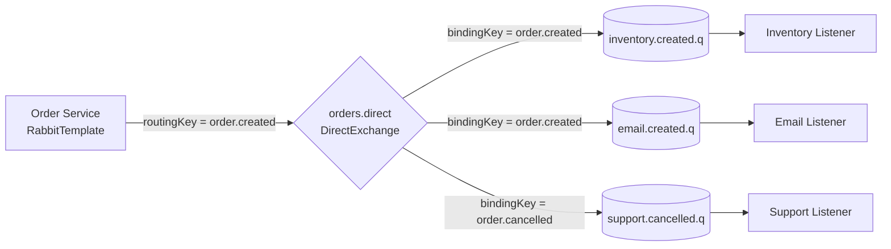
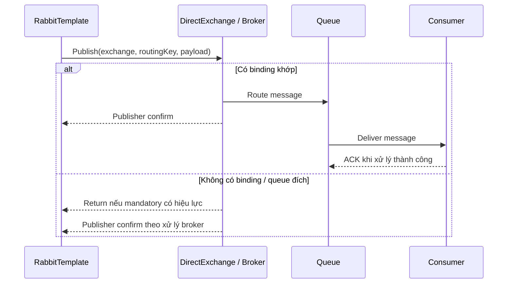

# DirectExchange và khớp chính xác routing key

Trong hệ thống xử lý bất đồng bộ, producer gửi thông điệp với ý nghĩa nghiệp vụ như `order.created`, `order.cancelled` hay `payment.completed`. Broker cần biết thông điệp nào thuộc queue nào. Với RabbitMQ, một cách định tuyến rõ ràng là **direct exchange**: một message chỉ được chuyển tới những queue có **binding key trùng chính xác với routing key** của message.

Bài thuộc chương **Định tuyến thông điệp** của module **SPRING_AMQP**. Nội dung thực hành kết hợp RabbitMQ và Spring AMQP qua `RabbitTemplate`, `@RabbitListener`, exchange, queue và binding; đồng thời đặt quy tắc định tuyến vào bối cảnh xử lý đáng tin cậy với publisher confirm, consumer acknowledgement, retry, dead-letter và khả năng quan sát.

Sau khi học, bạn có thể:

- Phân biệt exchange, queue, routing key và binding key.
- Dự đoán chính xác message nào vào queue nào khi dùng `DirectExchange`.
- Giải thích điều gì xảy ra khi nhiều queue cùng binding key hoặc khi một queue có nhiều consumer.
- Khai báo direct exchange, queue và binding bằng Spring AMQP; gửi bằng `RabbitTemplate` và nhận bằng `@RabbitListener`.
- Kiểm tra thông điệp không được định tuyến và hiểu giới hạn của publisher confirm, publisher return, ACK/NACK.
- Phát hiện các lỗi định tuyến thường gặp trước khi cấu hình retry hay dead-letter.

## 1. Direct exchange giải quyết bài toán nào?

Giả sử một hệ thống bán hàng phát ba loại sự kiện: tạo đơn, hủy đơn và hoàn tiền. Dịch vụ quản lý tồn kho xử lý đơn mới; dịch vụ chăm sóc khách hàng xử lý đơn bị hủy; dịch vụ kế toán xử lý hoàn tiền.

Nếu producer gửi trực tiếp đến tên queue, producer phải biết cách mỗi bộ phận tổ chức queue. Khi thêm consumer mới hoặc đổi queue, producer có thể phải thay đổi theo. Exchange giúp producer chỉ cần biết **ý nghĩa message qua routing key**, còn broker xử lý quan hệ từ key đến queue.



Với message có routing key `order.created`, broker gửi **một bản đến mỗi queue** có binding key `order.created`. Queue `support.cancelled.q` không nhận message đó vì binding key khác.

Lưu ý: sơ đồ hiển thị **các binding đã khai báo**, không có nghĩa một message tự động đi theo mọi nhánh. Mỗi lần publish, broker chọn nhánh dựa trên routing key của chính message đó.

## 2. Bốn khái niệm bắt buộc phân biệt

| Khái niệm | Định nghĩa | Ví dụ |
|---|---|---|
| **Exchange** | Nhận message từ producer và quyết định queue đích dựa trên loại exchange cùng các binding | `orders.direct` |
| **Queue** | Lưu các message đã được định tuyến để consumer nhận và xử lý | `inventory.created.q` |
| **Routing key** | Chuỗi producer gắn khi publish đến exchange | `order.created` |
| **Binding key** | Chuỗi được khai báo trên liên kết giữa exchange và queue; dùng để so khớp | `order.created` |

Luồng cơ bản:

```text
RabbitTemplate.convertAndSend(exchange, routingKey, payload)
                           │
                           ▼
                    [DirectExchange]
                           │
                so sánh routingKey
                với từng bindingKey
                           │
              match ──────┴────── no match
                │                     │
                ▼                     ▼
           Queue được bind       Không vào queue đó
                │
                ▼
         @RabbitListener
```

Một queue có thể bind với nhiều exchange, và một exchange có thể bind với nhiều queue. **Binding là một quan hệ độc lập**, không phải thuộc tính cố định chỉ thuộc queue hay chỉ thuộc exchange.

### 2.1. Quy tắc khớp chính xác

Với direct exchange, quy tắc cốt lõi là:

> Message được route đến queue nếu **routing key của message bằng chính xác binding key** trên một binding nối direct exchange với queue đó.

Có thể mô tả bằng điều kiện:

```text
deliver(exchange, message, queue)
  khi exchange.type == "direct"
  và tồn tại binding(exchange -> queue)
  thỏa message.routingKey == binding.bindingKey
```

Việc so khớp là theo giá trị chuỗi, có phân biệt chữ hoa/chữ thường và ký tự. Direct exchange không diễn giải dấu chấm, dấu sao hay dấu thăng như ký tự đại diện.

| Routing key trên message | Binding key của queue | Có khớp? | Lý do |
|---|---|---|---|
| `order.created` | `order.created` | Có | Chuỗi giống hệt |
| `order.created` | `order.cancelled` | Không | Khác từ cuối |
| `order.created` | `Order.created` | Không | Khác chữ hoa/chữ thường |
| `order.created` | `order.created.v2` | Không | Khác số phân đoạn |
| `order.created` | `order.*` | Không | Dấu `*` là ký tự thường đối với direct exchange |
| `order.created` | `order.#` | Không | Dấu `#` cũng không có nghĩa wildcard trong direct exchange |
| `order.created` | `order.created ` | Không | Khác dấu cách cuối chuỗi |

Quy ước `order.created` chỉ là cách đặt tên dễ đọc; đối với direct exchange, dấu chấm không có ý nghĩa đặc biệt. Khả năng wildcard `*` (một phân đoạn) và `#` (không hoặc nhiều phân đoạn) là tính năng của **topic exchange**, không phải direct exchange.

### 2.2. Exchange khác queue

Producer thông thường **publish tới exchange** cùng routing key, không publish trực tiếp đến tên queue. Broker dùng binding để quyết định message vào queue nào. Đôi khi có ví dụ gửi với exchange rỗng, trông như gửi thẳng vào queue: đây là **default exchange** đặc biệt của RabbitMQ, sẽ được giải thích ở phần sau.

## 3. Phân tích một bảng định tuyến thực tế

Giả sử exchange `orders.direct` được khai báo với những binding sau:

| Queue | Binding key | Mục đích |
|---|---|---|
| `inventory.created.q` | `order.created` | Trừ hoặc giữ hàng theo quy trình nghiệp vụ |
| `email.created.q` | `order.created` | Chuẩn bị thông báo đơn mới |
| `support.cancelled.q` | `order.cancelled` | Xử lý đơn hủy |
| `analytics.all-orders.q` | `order.created` | Thu thập sự kiện đơn mới |
| `analytics.all-orders.q` | `order.cancelled` | Thu thập sự kiện đơn hủy |

Cùng một queue `analytics.all-orders.q` có hai binding key. Điều đó hoàn toàn hợp lệ: queue nhận cả hai loại sự kiện.

Kết quả khi publish:

| Exchange | Routing key | Các queue nhận |
|---|---|---|
| `orders.direct` | `order.created` | `inventory.created.q`, `email.created.q`, `analytics.all-orders.q` |
| `orders.direct` | `order.cancelled` | `support.cancelled.q`, `analytics.all-orders.q` |
| `orders.direct` | `order.refunded` | Không queue nào trong topology này |
| `orders.direct` | `order.*` | Không queue nào trong topology này |

**Một message, nhiều queue:** nếu nhiều queue có binding key giống nhau, mỗi queue nhận một bản sao riêng. Việc một consumer ACK bản sao ở `inventory.created.q` không tự xóa bản sao ở `email.created.q`.

**Nhiều consumer, một queue:** nếu hai instance cùng nghe `inventory.created.q`, chúng là các competing consumers. Mỗi delivery của message được giao cho một consumer tại một thời điểm; khi consumer thất bại, message có thể được giao lại. Điều này khác với fan-out sang nhiều queue.

**Một queue, nhiều binding:** cùng queue có thể nhận nhiều loại sự kiện. Nếu có nhiều binding đều khớp một message đến cùng queue, RabbitMQ không cố ý nhân bản message thành nhiều bản chỉ vì có nhiều binding trùng đến cùng queue.

## 4. Thực hành: định tuyến bằng Spring AMQP

Phần thực hành tạo hai queue, một cho `order.created` và một cho `order.cancelled`. Sau khi chạy, bạn có thể thử routing key đúng, routing key sai và quan sát đường đi của message.

### 4.1. Chuẩn bị RabbitMQ

Ví dụ dùng Docker với RabbitMQ Management. Thông tin đăng nhập chỉ dành cho môi trường học tập:

```bash
docker run -d --rm --name rabbitmq-direct-lab -p 5672:5672 -p 15672:15672 -e RABBITMQ_DEFAULT_USER=demo -e RABBITMQ_DEFAULT_PASS=demo-local-only rabbitmq:4-management
```

RabbitMQ nhận kết nối AMQP tại cổng `5672`. Giao diện quản trị dùng cổng `15672` tại `http://localhost:15672`, với username `demo` và password `demo-local-only`.

Nếu máy đã có container hoặc broker chiếm các cổng này, hãy dùng broker hiện có hoặc đổi cổng. Không dùng thông tin đăng nhập minh họa trong production.

### 4.2. Thêm dependency

Trong ứng dụng Spring Boot, khai báo:

```groovy
dependencies {
    implementation 'org.springframework.boot:spring-boot-starter-amqp'
    implementation 'org.springframework.boot:spring-boot-starter-web'
}
```

Starter AMQP cung cấp tích hợp RabbitMQ; starter Web chỉ để tạo HTTP endpoint dùng thử. Nếu ứng dụng đã có cách kích hoạt publisher khác, không nhất thiết cần Web.

Cấu hình kết nối `application.yml`:

```yaml
spring:
  rabbitmq:
    host: localhost
    port: 5672
    username: demo
    password: demo-local-only
    virtual-host: /
```

Spring Boot thường cấu hình sẵn `ConnectionFactory`, `RabbitTemplate`, `RabbitAdmin` và listener container factory theo điều kiện auto-configuration. Cấu hình kết nối **không tự tạo topology nghiệp vụ**; chúng ta vẫn cần khai báo exchange, queue và binding.

### 4.3. Khai báo DirectExchange, Queue và Binding

Tạo file `DirectRoutingConfiguration.java` trong package được Spring Boot quét:

```java
import org.springframework.amqp.core.Binding;
import org.springframework.amqp.core.BindingBuilder;
import org.springframework.amqp.core.DirectExchange;
import org.springframework.amqp.core.Queue;
import org.springframework.amqp.core.QueueBuilder;
import org.springframework.beans.factory.annotation.Qualifier;
import org.springframework.context.annotation.Bean;
import org.springframework.context.annotation.Configuration;

@Configuration
public class DirectRoutingConfiguration {
    public static final String EXCHANGE = "orders.direct";
    public static final String CREATED_QUEUE = "orders.created.q";
    public static final String CANCELLED_QUEUE = "orders.cancelled.q";
    public static final String CREATED_KEY = "order.created";
    public static final String CANCELLED_KEY = "order.cancelled";

    @Bean
    DirectExchange ordersDirectExchange() {
        // durable=true, autoDelete=false
        return new DirectExchange(EXCHANGE, true, false);
    }

    @Bean
    Queue createdQueue() {
        return QueueBuilder.durable(CREATED_QUEUE).build();
    }

    @Bean
    Queue cancelledQueue() {
        return QueueBuilder.durable(CANCELLED_QUEUE).build();
    }

    @Bean
    Binding createdBinding(
            @Qualifier("createdQueue") Queue queue,
            DirectExchange ordersDirectExchange) {
        return BindingBuilder.bind(queue)
                .to(ordersDirectExchange)
                .with(CREATED_KEY);
    }

    @Bean
    Binding cancelledBinding(
            @Qualifier("cancelledQueue") Queue queue,
            DirectExchange ordersDirectExchange) {
        return BindingBuilder.bind(queue)
                .to(ordersDirectExchange)
                .with(CANCELLED_KEY);
    }
}
```

Cần lưu ý ba chi tiết:

1. `new DirectExchange(EXCHANGE, true, false)` khai báo exchange có tên `orders.direct`, durable và không tự xóa; kiểu exchange là `direct`.
2. Hai `Queue` là hai đích lưu thông điệp khác nhau; durable queue là một điều kiện bảo toàn topology, **không phải bảo đảm toàn bộ chuỗi xử lý**.
3. Hai binding kết nối queue với exchange theo **hai chuỗi chính xác**. `@Qualifier` giúp Spring chọn đúng queue vì có nhiều bean kiểu `Queue`.

Trong cấu hình Spring Boot AMQP thông thường, `RabbitAdmin` có thể khai báo các bean topology này lên RabbitMQ khi kết nối được thiết lập. Nếu queue đã tồn tại với thuộc tính xung đột, broker có thể từ chối khai báo. Không mặc định rằng thay đổi Java bean sẽ tự sửa được queue đang dùng trong production.

### 4.4. Gửi message với RabbitTemplate

Tạo file `OrderEventPublisher.java`:

```java
import org.springframework.amqp.rabbit.core.RabbitTemplate;
import org.springframework.stereotype.Service;

@Service
public class OrderEventPublisher {
    private final RabbitTemplate rabbitTemplate;

    public OrderEventPublisher(RabbitTemplate rabbitTemplate) {
        this.rabbitTemplate = rabbitTemplate;
    }

    public void publish(String routingKey, String orderId) {
        rabbitTemplate.convertAndSend(
                DirectRoutingConfiguration.EXCHANGE,
                routingKey,
                orderId
        );
    }
}
```

Ý nghĩa các tham số:

```java
rabbitTemplate.convertAndSend(
    "orders.direct", // exchange đích
    "order.created", // routing key trên message
    "order-1001"     // payload (String)
);
```

Lệnh trên không nêu tên `orders.created.q`. Producer chỉ biết exchange và routing key; binding đang có trong broker quyết định queue đích.

Với payload `String`, ví dụ này dùng cấu hình chuyển đổi message mặc định phù hợp cho chuỗi. Với JSON object, cần thống nhất message converter và schema giữa producer/consumer; điều đó độc lập với cách direct exchange so khớp routing key.

### 4.5. Nhận message qua @RabbitListener

Tạo hai lớp listener độc lập:

```java
import org.springframework.amqp.rabbit.annotation.RabbitListener;
import org.springframework.stereotype.Component;

@Component
public class CreatedOrderListener {
    @RabbitListener(queues = DirectRoutingConfiguration.CREATED_QUEUE)
    public void handle(String orderId) {
        System.out.println("[CREATED] " + orderId);
    }
}
```

```java
import org.springframework.amqp.rabbit.annotation.RabbitListener;
import org.springframework.stereotype.Component;

@Component
public class CancelledOrderListener {
    @RabbitListener(queues = DirectRoutingConfiguration.CANCELLED_QUEUE)
    public void handle(String orderId) {
        System.out.println("[CANCELLED] " + orderId);
    }
}
```

Listener gắn vào **queue**, không gắn trực tiếp vào exchange hoặc routing key. Exchange chỉ quyết định nơi message được đưa vào; listener container lấy message từ queue đã chọn.

Trong Spring Boot tích hợp AMQP, listener container sẽ gọi handler và thực hiện cơ chế acknowledgement theo cấu hình. Với Spring `AcknowledgeMode.AUTO` thông thường, ACK được thực hiện sau khi listener xử lý thành công. Không nhầm chế độ này với chế độ broker *auto-ack* (không cần consumer ACK).

### 4.6. Tạo HTTP endpoint để thử routing key

Tạo file `DirectRoutingDemoController.java`:

```java
import org.springframework.http.ResponseEntity;
import org.springframework.web.bind.annotation.PathVariable;
import org.springframework.web.bind.annotation.PostMapping;
import org.springframework.web.bind.annotation.RequestBody;
import org.springframework.web.bind.annotation.RequestMapping;
import org.springframework.web.bind.annotation.RestController;

@RestController
@RequestMapping("/demo/routing")
public class DirectRoutingDemoController {
    private final OrderEventPublisher publisher;

    public DirectRoutingDemoController(OrderEventPublisher publisher) {
        this.publisher = publisher;
    }

    @PostMapping("/{routingKey}")
    public ResponseEntity<Void> publish(
            @PathVariable String routingKey,
            @RequestBody String orderId) {
        publisher.publish(routingKey, orderId);
        return ResponseEntity.accepted().build();
    }
}
```

Endpoint cho phép người học chủ động thay routing key để so sánh. Trong API production, không nên cho người dùng bên ngoài tự do chọn routing key nghiệp vụ; hãy kiểm tra loại sự kiện hợp lệ và quyền thực hiện.

Đặt bốn thành phần `DirectRoutingConfiguration`, `OrderEventPublisher`, hai listener và controller vào các file tương ứng thuộc package ứng dụng Spring Boot; khởi chạy ứng dụng có `@SpringBootApplication`.

### 4.7. Gửi message đúng và sai routing key

Gửi hai trường hợp khớp:

```bash
curl -X POST http://localhost:8080/demo/routing/order.created -H "Content-Type: text/plain" -d "order-1001"

curl -X POST http://localhost:8080/demo/routing/order.cancelled -H "Content-Type: text/plain" -d "order-1002"
```

Kết quả kỳ vọng trên console listener:

```text
[CREATED] order-1001
[CANCELLED] order-1002
```

Tiếp theo, thử message không có binding chính xác:

```bash
curl -X POST http://localhost:8080/demo/routing/order.unknown -H "Content-Type: text/plain" -d "order-1003"

curl -X POST http://localhost:8080/demo/routing/order.x -H "Content-Type: text/plain" -d "order-1004"
```

Không có log listener mới cho hai message này vì không có binding key `order.unknown` hoặc `order.x`. Điều đó **không có nghĩa HTTP endpoint tự biết routing thất bại**: `convertAndSend(...)` không đồng bộ chờ consumer và thường không báo ngay rằng message không được định tuyến.

Vào RabbitMQ Management UI để xem exchange `orders.direct`, hai queue, danh sách binding và tốc độ publish/deliver. Nếu listener đang chạy nhanh, queue có thể thường xuyên hiển thị `Ready = 0` do message đã được tiêu thụ, không phải vì publish thất bại.

## 5. Message không có binding được xử lý thế nào?

Khi producer publish một message đến **exchange tồn tại** nhưng exchange không tìm được binding phù hợp, message được gọi là **unroutable** (không định tuyến được). Hành vi thường gặp phụ thuộc cấu hình publish và exchange:

- Không có alternate exchange và `mandatory=false`: broker có thể loại bỏ message không đến queue nào.
- Có `mandatory=true` và publisher returns được bật: broker có thể trả lại message không được định tuyến qua cơ chế `basic.return`.
- Có **alternate exchange** được cấu hình: message không khớp binding trên exchange chính có thể được chuyển tới alternate exchange; khi đó cần xem thêm topology của exchange thay thế.

**Trường hợp khác:** publish đến một exchange **không tồn tại** là lỗi ở mức AMQP channel (ví dụ `NOT_FOUND`), không phải trường hợp routing key không khớp binding. Không gộp hai lỗi này làm một.

### 5.1. Bật publisher returns để phát hiện unroutable

Trong `application.yml`, có thể bật:

```yaml
spring:
  rabbitmq:
    publisher-confirm-type: correlated
    publisher-returns: true
    template:
      mandatory: true
```

Ba mục đích khác nhau:

| Cấu hình | Ý nghĩa |
|---|---|
| `publisher-confirm-type: correlated` | Bật cơ chế publisher confirms có correlation trong cấu hình được hỗ trợ |
| `publisher-returns: true` | Cho phép ứng dụng nhận thông tin về message được broker trả lại |
| `template.mandatory: true` | Yêu cầu broker trả lại các message không được route nếu điều kiện AMQP thích hợp |

Có thể thêm callback để ghi nhận message không định tuyến. Ví dụ đặt trong lớp `@Configuration`:

```java
import org.springframework.amqp.rabbit.core.RabbitTemplate;
import org.springframework.boot.ApplicationRunner;
import org.springframework.context.annotation.Bean;
import org.springframework.context.annotation.Configuration;

@Configuration
public class PublisherReturnDiagnostics {
    @Bean
    ApplicationRunner logReturnedMessages(RabbitTemplate rabbitTemplate) {
        return args -> rabbitTemplate.setReturnsCallback(returned -> {
            System.err.printf(
                "UNROUTABLE exchange=%s routingKey=%s replyCode=%d reason=%s%n",
                returned.getExchange(),
                returned.getRoutingKey(),
                returned.getReplyCode(),
                returned.getReplyText()
            );
        });
    }
}
```

Chạy lại thử nghiệm với routing key `order.unknown`. Nếu không có queue đích, không có alternate exchange và cấu hình returns có hiệu lực, callback sẽ nhận thông tin trả về. Đây là tín hiệu để log, đưa vào cơ chế xử lý lỗi phù hợp hoặc cảnh báo, thay vì ngầm bỏ qua thông điệp quan trọng.

**Quan trọng:** callback này chỉ minh họa chẩn đoán. Ứng dụng thực tế phải xử lý bất đồng bộ, kiểm soát correlation dữ liệu publish và quyết định liệu có retry hay báo lỗi nghiệp vụ. Đồng thời không nên để nhiều nơi cùng thay thế `ReturnsCallback` của một template mà không có phối hợp.

### 5.2. Publisher confirm không thay thế publisher return

Một lỗi tư duy thường gặp là: “Broker xác nhận publish thành công, vậy message đã có queue nhận”. Trong RabbitMQ, publisher confirm có thể xác nhận rằng broker đã xử lý publish, ngay cả khi message **không được route đến queue nào** theo cách mong muốn. Để giám sát cả nhận publish và định tuyến, cần xét **confirm và return** cùng lúc.

Mặt khác, kể cả message đã vào queue, producer vẫn chưa biết consumer đã xử lý thành công. Consumer ACK trả lời một câu hỏi khác.



Không nhầm “message chưa có queue đích” với “consumer xử lý lỗi”: lỗi thứ nhất là **routing**, lỗi thứ hai xảy ra **sau khi đã deliver**.

## 6. Cấu hình các kiểu binding thường gặp

### 6.1. Hai queue nhận cùng một loại sự kiện

Nếu muốn cả Email Service và Inventory Service xử lý `order.created`, hãy khai báo hai queue cùng bind vào direct exchange bằng `order.created`:

```java
@Bean
Binding emailCreatedBinding(
        @Qualifier("emailQueue") Queue emailQueue,
        DirectExchange ordersDirectExchange) {
    return BindingBuilder.bind(emailQueue)
            .to(ordersDirectExchange)
            .with("order.created");
}

@Bean
Binding inventoryCreatedBinding(
        @Qualifier("inventoryQueue") Queue inventoryQueue,
        DirectExchange ordersDirectExchange) {
    return BindingBuilder.bind(inventoryQueue)
            .to(ordersDirectExchange)
            .with("order.created");
}
```

Đoạn trên là phần bổ sung minh họa: để áp dụng, cần **khai báo hai bean Queue** tương ứng `emailQueue` và `inventoryQueue`. Mỗi queue có bản sao message riêng; mỗi dịch vụ quản lý thời gian xử lý, retry và ACK độc lập.

Điều này khác với chạy hai listener cùng đọc **một queue**. Với một queue, các listener cạnh tranh nhận từng delivery; chúng không cùng nhận một bản sao sự kiện.

### 6.2. Một queue nhận nhiều routing key

Nếu cùng một consumer cần đọc cả `order.created` và `order.cancelled`, tạo hai binding vào cùng queue:

```java
@Bean
Binding createdToAudit(
        @Qualifier("auditQueue") Queue auditQueue,
        DirectExchange ordersDirectExchange) {
    return BindingBuilder.bind(auditQueue)
            .to(ordersDirectExchange)
            .with("order.created");
}

@Bean
Binding cancelledToAudit(
        @Qualifier("auditQueue") Queue auditQueue,
        DirectExchange ordersDirectExchange) {
    return BindingBuilder.bind(auditQueue)
            .to(ordersDirectExchange)
            .with("order.cancelled");
}
```

Tương tự, ví dụ cần bean `auditQueue` được khai báo riêng. Hai binding cho phép queue nhận **hai chuỗi khóa khác nhau**, không phải một mẫu wildcard.

Nếu consumer cần phân biệt loại sự kiện khi payload giống nhau, có thể nhận thêm message metadata hoặc thiết kế payload bao gồm trường `eventType`. Tránh dựa duy nhất vào cấu trúc text của `orderId` để đoán ý nghĩa nghiệp vụ.

### 6.3. Khi nào nên chuyển sang TopicExchange?

Nếu cần “mọi event thuộc nhóm `order`”, direct exchange buộc bạn khai báo từng binding key như `order.created`, `order.cancelled`, `order.shipped`. Topic exchange hỗ trợ pattern để nhận rộng hơn, ví dụ `order.*` hoặc `order.#`.

| Yêu cầu | Exchange phù hợp |
|---|---|
| Chỉ route khi bằng `order.created` | `DirectExchange` |
| Chỉ route khi bằng `order.cancelled` | `DirectExchange` |
| Route mọi khóa đúng dạng `order.<một phân đoạn>` | `TopicExchange` với `order.*` |
| Route mọi routing key bắt đầu bằng `order.` theo các phân đoạn | `TopicExchange` với `order.#` |
| Không cần quan tâm routing key, phát tới mọi queue được bind | `FanoutExchange` |

**Không dùng `order.*` trên direct exchange với kỳ vọng wildcard.** Với direct, đó là một binding key literal: chỉ message thật sự có routing key `order.*` mới khớp.

## 7. Direct exchange và default exchange của RabbitMQ

RabbitMQ có một **default exchange** được khai báo sẵn với **tên là chuỗi rỗng** (`""`). Nó là một direct exchange đặc biệt: queue thường được tự động bind vào default exchange với binding key **bằng tên queue**.

Ví dụ:

```java
rabbitTemplate.convertAndSend(
        "",
        "orders.created.q",
        "order-1005"
);
```

Trong ví dụ này, routing key là tên queue `orders.created.q`. Khi queue tồn tại và binding tự động với default exchange còn hiệu lực, message có thể đi thẳng vào queue đó.

Ngược lại:

```java
rabbitTemplate.convertAndSend(
        "orders.direct",
        "order.created",
        "order-1005"
);
```

Lệnh thứ hai đi qua direct exchange do ứng dụng khai báo và sử dụng binding key `order.created`.

| Đặc điểm | Default exchange | Direct exchange do ứng dụng đặt tên |
|---|---|---|
| Tên | `""` | Ví dụ `orders.direct` |
| Ai tạo? | RabbitMQ cung cấp sẵn | Ứng dụng hoặc quy trình triển khai khai báo |
| Routing thông thường | Dựa vào tên queue qua binding mặc định | Dựa vào binding key do ứng dụng chọn |
| Tách producer khỏi tên queue? | Thấp, vì producer thường biết tên queue | Tốt hơn, vì producer dựa vào routing key nghiệp vụ |
| Phù hợp | Tình huống gửi trực tiếp đến queue xác định | Định tuyến nghiệp vụ theo loại sự kiện/công việc |

Bạn **không cần và không nên cố khai báo lại** default exchange như một exchange mới. Trong thiết kế event-driven có nhiều bên nhận sự kiện, exchange có tên và binding nghiệp vụ giúp hệ thống dễ mở rộng hơn.

## 8. DirectExchange trong thiết kế xử lý đáng tin cậy

Direct exchange giải quyết câu hỏi **“message được định tuyến đến queue nào?”**. Nó không tự giải quyết câu hỏi **“message đã được xử lý chính xác và bền vững chưa?”**.

### 8.1. Durable queue, persistent message và confirm

Queue durable giúp định nghĩa queue tồn tại qua quá trình khởi động lại broker theo các điều kiện áp dụng. Message persistent và thiết kế queue phù hợp giúp tăng độ bền của message. Publisher confirms cung cấp tín hiệu từ broker về quá trình nhận/xử lý publish.

Ba yếu tố này cần được thiết kế đồng bộ cùng broker topology và vận hành. Không thể suy ra “chắc chắn không mất message” chỉ từ một cờ `durable=true`.

### 8.2. Consumer acknowledgement và xử lý trùng

Nếu consumer lưu dữ liệu vào database, sau đó kết nối AMQP mất trước khi broker nhận ACK, RabbitMQ có thể giao lại cùng message. Vì vậy consumer cần **idempotent**: xử lý lại cùng sự kiện không gây tác dụng phụ lặp không mong muốn.

Ví dụ, message nghiệp vụ nên có `eventId` ổn định; consumer ghi dấu đã xử lý trong cùng transaction với cập nhật dữ liệu khi có thể. Direct exchange không loại trùng message hay bảo đảm exactly-once cho database.

### 8.3. Retry và dead-letter vẫn cần routing rõ ràng

Khi listener ném exception, chính sách retry, reject/NACK và requeue quyết định delivery tiếp theo. Nếu requeue không kiểm soát, message lỗi có thể tạo vòng lặp xử lý liên tục.

Dead-letter exchange (DLX) cũng sử dụng **một exchange** để route message bị dead-letter. DLX có thể thuộc loại direct. Ví dụ:

```text
Main Queue: orders.created.q
   │ lỗi không thể phục hồi / reject (requeue=false)
   ▼
Dead-Letter Exchange: orders.dlx (direct)
   │ dead-letter routing key: order.created.dead
   ▼
Dead-Letter Queue: orders.created.dlq
```

Để luồng này hoạt động, cần cấu hình nguồn dead-letter của queue, khai báo DLX/DLQ và binding khớp `order.created.dead`. Nếu thiếu binding DLX phù hợp, message dead-letter cũng có thể không đến DLQ; không thể giả định cứ bật retry là tự có dead-letter queue. Trong production, cân nhắc RabbitMQ policy cho cấu hình DLX để tránh thay đổi queue arguments đang được sử dụng.

### 8.4. Transaction và outbox

Tạo đơn trong database rồi publish `order.created` là hai thao tác thuộc hai hệ thống. Nếu database commit thành công nhưng publish thất bại, event có thể bị mất dù routing key đúng. **Transactional outbox** ghi dữ liệu đơn và bản ghi sự kiện trong cùng transaction database; một worker đọc outbox và publish có kiểm tra xác nhận. Consumer vẫn cần idempotency vì publish có thể được thử lại.

Spring AMQP/RabbitMQ có cơ chế giao dịch riêng ở mức messaging, nhưng không nên mặc định một transaction AMQP sẽ làm database và broker cùng commit nguyên tử như một thao tác.

### 8.5. Quan sát đúng tầng

| Tín hiệu | Giúp kiểm tra |
|---|---|
| Exchange publish rate và routing/return | Producer có publish? Có message không tìm được queue? |
| Queue ready/unacknowledged | Message đang chờ hay đã giao nhưng chưa ACK? |
| Consumer count và deliver/ack rate | Có listener đang nhận và xử lý không? |
| Redelivery/retry, DLQ depth | Message có lỗi nghiệp vụ, lặp hoặc đi vào luồng xử lý lỗi không? |
| Event ID, correlation ID, trace ID | Có thể lần theo một message qua producer, broker và consumer không? |

RabbitMQ Management UI, log Spring Boot, Micrometer/Actuator và distributed tracing là các công cụ bổ trợ. Chúng giúp phân biệt sự cố **không route được** với **route đúng nhưng consumer không xử lý kịp**.

## 9. Lỗi phổ biến khi dùng DirectExchange

| Hiện tượng | Nguyên nhân có thể | Cách kiểm tra |
|---|---|---|
| Publish không ném exception nhưng listener không nhận | Routing key không khớp binding key | Xem bindings trên exchange và bật mandatory returns |
| Binding dùng `order.*` nhưng `order.created` không tới | Nhầm direct exchange với topic exchange | So khớp chuỗi literal; nếu cần wildcard hãy dùng topic |
| Email và Inventory chỉ có một bên nhận | Hai consumer đang dùng chung một queue | Tạo queue riêng cho mỗi dịch vụ và bind cùng routing key |
| Message đến sai consumer | Listener gắn sai queue hoặc hai queue có binding ngoài ý muốn | Kiểm tra tên queue, binding và annotation `@RabbitListener` |
| Queue đã khai báo trong code nhưng broker không có | RabbitAdmin chưa khai báo, thiếu quyền hoặc nhầm vhost | Kiểm tra bean admin, kết nối, quyền configure, broker UI |
| Gửi tới `orders.direct` lỗi channel | Exchange chưa tồn tại hoặc sai tên | Kiểm tra exchange trên broker, log và thứ tự triển khai |
| Queue depth luôn bằng 0 | Listener tiêu thụ nhanh hoặc message không route | Xem publish/deliver/ack rate và publisher returns |
| Message được giao lại nhiều lần | Listener lỗi, ACK không thành công, retry/requeue | Kiểm tra exception, acknowledgement, idempotency |
| Thêm binding nhưng ứng dụng vẫn có message cũ không nhận | Message trước đó đã bị loại bỏ khi unroutable | Kiểm tra publisher returns, quy trình phát lại và outbox |

**Cách chẩn đoán theo thứ tự:** xác nhận exchange tồn tại → kiểm tra binding key chính xác → kiểm tra queue đích → kiểm tra consumer/listener → kiểm tra ACK, retry và DLQ. Cách này tránh nhầm lỗi topology với lỗi xử lý nghiệp vụ.

## 10. Bài tập thực hành và câu hỏi tự kiểm tra

### Bài 1 — Dự đoán đường đi

Exchange `payments.direct` có ba binding:

- `payment.succeeded` → `receipt.q`.
- `payment.succeeded` → `analytics.q`.
- `payment.failed` → `alert.q`.

Hãy xác định các queue nhận khi publish `payment.succeeded`, `payment.failed` và `payment.refunded`. Với case `payment.refunded`, hãy nêu cơ chế giúp producer biết không có queue đích.

### Bài 2 — Phân biệt direct và topic

Bind queue `audit.q` vào `orders.direct` bằng khóa `order.*`, sau đó publish lần lượt `order.created` và `order.*`. Message nào vào queue? Thay exchange bằng `TopicExchange` cùng binding key thì kết quả thay đổi ra sao?

### Bài 3 — Một message, hai hệ thống

Mở rộng topology phần 4: thêm `email.created.q` với cùng binding key `order.created`. Tạo listener mới cho email rồi publish một lần. Quan sát mỗi queue nhận một message độc lập; dừng email listener rồi thử lại để kiểm tra tồn đọng của queue email.

### Bài 4 — Bắt message không route

Bật publisher confirms, returns và mandatory; gắn returns callback. Gửi `order.unknown`. Mô tả bạn thấy ở returns callback, exchange và listener. So sánh với trường hợp cố ý publish đến tên exchange không tồn tại.

### Bài 5 — Kiểm soát retry và dữ liệu trùng

Giả sử `orders.created.q` có message đã được consumer xử lý database nhưng chưa ACK thì bị mất kết nối. Trình bày khả năng redelivery, cách thiết kế idempotency theo `eventId`, và lý do DLQ không thể tự giải quyết tác dụng phụ đã xảy ra.

### Bài 6 — Chọn exchange hợp lý

Với yêu cầu “mọi message có tiền tố `order.` đều vào queue kiểm toán, kể cả loại sự kiện sẽ bổ sung sau này”, hãy chọn direct hoặc topic exchange và giải thích. Nếu bắt buộc dùng direct exchange, cần quản lý binding ra sao khi loại sự kiện mới được thêm?

## 11. Ghi nhớ cốt lõi

- **DirectExchange định tuyến theo khớp chính xác:** `routingKey == bindingKey`, phân biệt chữ hoa/chữ thường và không dùng wildcard.
- **Exchange không phải queue:** `RabbitTemplate` publish đến exchange, binding quyết định queue, và `@RabbitListener` đọc từ queue.
- **Nhiều queue cùng binding key** nhận những bản message độc lập; **nhiều consumer cùng queue** cạnh tranh xử lý delivery.
- **Unroutable** cần được phát hiện bằng publisher returns/mandatory và cấu hình liên quan; publisher confirm không đồng nghĩa consumer đã xử lý.
- Định tuyến chỉ là một tầng của hệ thống bất đồng bộ: vẫn cần ACK, retry có giới hạn, DLQ, idempotency, transaction/outbox và khả năng quan sát để đạt độ tin cậy mong muốn.

Hiểu chính xác mối quan hệ giữa `DirectExchange`, routing key và binding key giúp bạn thiết kế các tuyến xử lý RabbitMQ rõ ràng, dễ kiểm thử và dễ xử lý lỗi khi tích hợp ứng dụng bằng Spring AMQP.
