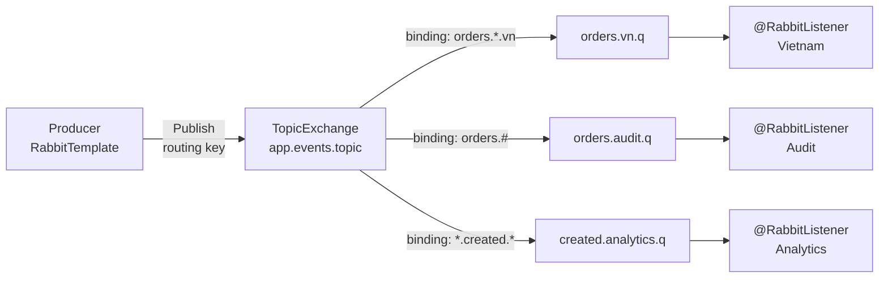

# TopicExchange với wildcard * và #

## 1. Khi nào cần TopicExchange?

Trong hệ thống xử lý bất đồng bộ, producer có thể phát nhiều loại sự kiện như:

- `orders.created.vn`: đơn hàng mới được tạo tại Việt Nam.
- `orders.paid.vn`: đơn hàng tại Việt Nam đã thanh toán.
- `orders.created.us`: đơn hàng mới được tạo tại Mỹ.
- `billing.created.vn`: một bản ghi thanh toán được tạo tại Việt Nam.

Nếu consumer chỉ quan tâm một sự kiện chính xác, có thể dùng `DirectExchange`. Nhưng khi cần chọn **một nhóm sự kiện có cấu trúc tên tương tự nhau**, ví dụ “mọi sự kiện của đơn hàng”, hoặc “mọi sự kiện *created* từ các miền nghiệp vụ”, việc khai báo từng routing key sẽ nhanh chóng trở nên dài dòng.

**`TopicExchange`** của RabbitMQ cho phép định tuyến message bằng cách **so khớp routing key của message với binding key theo mẫu**, trong đó:

- `*` khớp **đúng một từ** (*word*).
- `#` khớp **không, một hoặc nhiều từ**.

Các từ được ngăn bằng dấu chấm (`.`). Đây là một cơ chế định tuyến của **AMQP 0-9-1/RabbitMQ** và được Spring AMQP hỗ trợ thông qua `TopicExchange`, `BindingBuilder`, `RabbitTemplate`, và `@RabbitListener`.

Bài học thuộc chương **Định tuyến thông điệp** của module **SPRING_AMQP**. Mục tiêu là viết và thử một topology nhiều queue để hiểu chính xác wildcard hoạt động thế nào, thay vì chỉ học thuộc định nghĩa. Kiến thức này giúp thiết kế exchange, queue, binding, rồi phát triển thêm xác nhận giao nhận, retry, dead-letter, giao dịch và quan sát hệ thống.

Sau bài học, bạn sẽ:

1. Phân biệt **routing key** và **binding key**.
2. Dự đoán chính xác queue nào nhận một message với `*` và `#`.
3. Khai báo `TopicExchange` và các binding bằng Spring AMQP.
4. Gửi sự kiện bằng `RabbitTemplate`, nhận bằng `@RabbitListener` và quan sát luồng routing.
5. Tránh các lỗi đặt mẫu quá rộng, đặt sai số phần hoặc hiểu nhầm về độ tin cậy.

## 2. Vai trò của exchange, routing key và binding key

RabbitMQ vận hành luồng định tuyến theo mô hình:



Ba khái niệm cần tách rõ:

| Khái niệm | Ai cung cấp? | Ví dụ | Ý nghĩa |
| --- | --- | --- | --- |
| **Routing key** | Producer truyền khi publish | `orders.created.vn` | Một chuỗi giá trị cụ thể gắn với message. |
| **Binding key** | Được khai báo khi liên kết queue với topic exchange | `orders.*.vn` | Mẫu để RabbitMQ xác định queue có nhận message không. |
| **Topic exchange** | Broker RabbitMQ quản lý; Spring có thể khai báo | `app.events.topic` | So routing key với các binding key để chọn queue đích. |

Ví dụ:

```text
Producer publish:
  exchange   = app.events.topic
  routingKey = orders.created.vn
  message    = OrderCreated(orderId=101)

RabbitMQ kiểm tra binding:
  orders.*.vn  -> khớp
  orders.#     -> khớp
  *.created.*  -> khớp

Kết quả: cả 3 queue đều nhận một bản sao message.
```

Một message có thể đi tới **nhiều queue** nếu nhiều binding cùng khớp. Consumer dùng `@RabbitListener` nhận từ **queue**; consumer không trực tiếp subscribe vào exchange.

Nếu **nhiều consumer cùng đọc một queue**, chúng thường **chia nhau** các message của queue đó. Nếu muốn hai dịch vụ nhận mỗi sự kiện một cách độc lập, mỗi dịch vụ cần một queue riêng được binding vào exchange.

## 3. Quy tắc wildcard chính xác

RabbitMQ chia routing key/binding key thành các từ qua dấu chấm. Để dễ đọc và tránh nhập nhằng, hãy đặt routing key bằng các từ **không rỗng**, chẳng hạn:

```text
<domain>.<event>.<region>
orders .created.vn
orders .paid   .us
billing.created.vn
```

Trong ví dụ trên, `orders.created.vn` gồm **ba từ**: `orders`, `created`, `vn`.

### 3.1. Wildcard *: đúng một từ

`*` thay thế **một từ và chỉ một từ** tại vị trí đó.

| Binding key | Routing key | Khớp? | Giải thích |
| --- | --- | --- | --- |
| `orders.*.vn` | `orders.created.vn` | Có | `*` đại diện `created`. |
| `orders.*.vn` | `orders.paid.vn` | Có | `*` đại diện `paid`. |
| `orders.*.vn` | `orders.created.us` | Không | Phần cuối phải là `vn`. |
| `orders.*.vn` | `orders.created.vip.vn` | Không | Có bốn từ, trong khi mẫu cần ba. |
| `orders.*` | `orders.created` | Có | Một từ sau `orders`. |
| `orders.*` | `orders` | Không | Thiếu một từ. |
| `orders.*` | `orders.created.vn` | Không | Thừa một từ. |

Điểm quan trọng: `*` **không** giống biểu thức chính quy `.*`. Trong TopicExchange, một dấu `*` không thể tự khớp nhiều từ phân cách bằng dấu chấm.

### 3.2. Wildcard #: không hoặc nhiều từ

`#` thay thế **0, 1 hoặc nhiều từ**.

| Binding key | Routing key | Khớp? | Giải thích |
| --- | --- | --- | --- |
| `orders.#` | `orders` | Có | `#` khớp **0 từ**. |
| `orders.#` | `orders.created` | Có | `#` khớp `created`. |
| `orders.#` | `orders.created.vn` | Có | `#` khớp `created.vn`. |
| `orders.#` | `orders.created.vn.priority` | Có | `#` khớp ba từ phía sau. |
| `orders.#` | `billing.created.vn` | Không | Từ đầu phải là `orders`. |
| `#.created` | `created` | Có | `#` khớp **0 từ** phía trước. |
| `#.created` | `orders.created` | Có | `#` khớp `orders`. |
| `#.created` | `orders.created.vn` | Không | Từ cuối phải là `created`. |
| `#.created.#` | `orders.created.vn` | Có | `created` nằm giữa các phần có thể dài tùy ý. |

Có thể dùng `#` tại đầu, giữa hoặc cuối binding key. Mẫu `#` đơn lẻ khớp mọi routing key trong mô hình từ phân tách bằng dấu chấm: nó hữu ích khi cần bắt tất cả message, nhưng có thể tạo tải rất lớn và không phải lúc nào cũng cần thiết.

### 3.3. So sánh * và # bằng một tình huống

Giả sử producer publish hai message:

```text
A: orders.created
B: orders.created.vn
```

Binding `orders.*` chỉ nhận **A**, vì sau `orders` phải có đúng một từ. Binding `orders.#` nhận **cả A và B**, vì phần sau `orders` có thể gồm một hoặc nhiều từ; nó cũng nhận routing key chỉ là `orders` vì `#` cho phép không có từ nào.

**Lưu ý về ký tự:** `*` và `#` có ý nghĩa wildcard trong **binding key của topic exchange**, không phải là cú pháp để producer yêu cầu gửi đến nhiều queue. Producer nên đặt routing key **cụ thể** như `orders.created.vn`, rồi để broker xử lý các mẫu binding.

**Viết đúng chữ:** matching phân biệt chữ hoa/chữ thường; `Orders.Created.VN` không tự khớp với `orders.*.vn`. Thống nhất chữ thường giúp giảm lỗi.

## 4. Bảng định tuyến mẫu trước khi viết code

Ta thiết kế một exchange và ba queue với nhu cầu khác nhau:

| Queue | Binding key | Mục đích |
| --- | --- | --- |
| `orders.vn.q` | `orders.*.vn` | Nhận các loại sự kiện có dạng ba từ, bắt đầu `orders` và kết thúc `vn`. |
| `orders.audit.q` | `orders.#` | Ghi nhận mọi routing key thuộc miền `orders`, kể cả nhiều tầng. |
| `created.analytics.q` | `*.created.*` | Phân tích sự kiện `created` có đúng ba từ, không phân biệt domain và region. |

Bây giờ dự đoán **queue đích**:

| Routing key | `orders.*.vn` | `orders.#` | `*.created.*` |
| --- | :---: | :---: | :---: |
| `orders.created.vn` | ✅ | ✅ | ✅ |
| `orders.paid.us` | ❌ | ✅ | ❌ |
| `orders.created.us` | ❌ | ✅ | ✅ |
| `billing.created.vn` | ❌ | ❌ | ✅ |
| `orders` | ❌ | ✅ | ❌ |
| `orders.created.vn.priority` | ❌ | ✅ | ❌ |
| `catalog.updated.vn` | ❌ | ❌ | ❌ |

Bảng này là **kết quả mong đợi** của bài chạy thử. Đừng tiếp tục nếu vẫn chưa giải thích được vì sao `orders.created.vn.priority` không khớp `orders.*.vn`: mẫu đó chỉ chấp nhận **ba từ**, trong khi routing key có **bốn từ**.

Nếu một queue có **hai binding cùng khớp cùng một message**, RabbitMQ vẫn định tuyến message **một lần đến queue đích đó**, không tạo hai bản sao trong cùng queue chỉ vì nhiều binding trùng kết quả. Tuy nhiên, hai **queue khác nhau** cùng khớp thì mỗi queue nhận bản sao riêng.

## 5. Chuẩn bị Spring Boot và RabbitMQ

Ví dụ dùng Java 17+, Spring Boot có Spring AMQP starter và một RabbitMQ local đang hoạt động. Có thể chạy RabbitMQ với Docker:

```bash
docker run -d --name rabbitmq-topic-demo -p 5672:5672 -p 15672:15672 rabbitmq:4-management
```

- `5672`: cổng AMQP 0-9-1 được ứng dụng Spring AMQP sử dụng.
- `15672`: cổng RabbitMQ Management UI, mở tại `http://localhost:15672`.
- `guest/guest`: thông tin mặc định phù hợp **lab local** với broker mặc định; production cần user riêng và thông tin bí mật được quản lý an toàn.

Nếu đã có broker trên cổng `5672`, không cần tạo container thứ hai. Nếu Spring Boot chạy trong container khác, đặt host RabbitMQ bằng tên service trên mạng Docker, không sử dụng `localhost` của container ứng dụng.

### 5.1. Dependency

Với Maven, thêm vào phần `<dependencies>` trong `pom.xml` của dự án Spring Boot:

```xml
<dependency>
    <groupId>org.springframework.boot</groupId>
    <artifactId>spring-boot-starter-amqp</artifactId>
</dependency>
```

Với Gradle:

```groovy
implementation 'org.springframework.boot:spring-boot-starter-amqp'
```

Spring Boot quản lý phiên bản dependency trong project đã cấu hình BOM/parent chuẩn. Không cần `spring-boot-starter-web` cho ví dụ này vì chúng ta gửi tự động một loạt message khi ứng dụng chạy.

### 5.2. Cấu hình kết nối

Tạo `src/main/resources/application.yml`:

```yaml
spring:
  application:
    name: spring-amqp-topic-demo
  rabbitmq:
    host: localhost
    port: 5672
    username: guest
    password: guest
    listener:
      simple:
        acknowledge-mode: auto
```

Ở đây `acknowledge-mode: auto` là **Spring AMQP listener container AUTO**: framework sẽ ack delivery **sau khi phương thức listener xử lý thành công**. Không nhầm nó với RabbitMQ consumer `autoAck=true`, vốn xác nhận ngay lúc giao message.

Mọi Java class trong các phần sau sử dụng package `com.example.topicdemo`. Bạn có thể đổi package, nhưng phải đổi nhất quán.

## 6. Triển khai TopicExchange bằng Spring AMQP

### 6.1. Khai báo TopicExchange, ba Queue và ba Binding

Tạo `TopicRoutingConfig.java`:

```java
package com.example.topicdemo;

import org.springframework.amqp.core.Binding;
import org.springframework.amqp.core.BindingBuilder;
import org.springframework.amqp.core.Queue;
import org.springframework.amqp.core.QueueBuilder;
import org.springframework.amqp.core.TopicExchange;
import org.springframework.beans.factory.annotation.Qualifier;
import org.springframework.context.annotation.Bean;
import org.springframework.context.annotation.Configuration;

@Configuration
public class TopicRoutingConfig {

    public static final String EXCHANGE = "app.events.topic";

    public static final String QUEUE_VN = "orders.vn.q";
    public static final String QUEUE_AUDIT = "orders.audit.q";
    public static final String QUEUE_ANALYTICS = "created.analytics.q";

    @Bean
    public TopicExchange topicExchange() {
        return new TopicExchange(EXCHANGE, true, false);
    }

    @Bean
    public Queue vietnamOrdersQueue() {
        return QueueBuilder.durable(QUEUE_VN).build();
    }

    @Bean
    public Queue auditOrdersQueue() {
        return QueueBuilder.durable(QUEUE_AUDIT).build();
    }

    @Bean
    public Queue createdAnalyticsQueue() {
        return QueueBuilder.durable(QUEUE_ANALYTICS).build();
    }

    @Bean
    public Binding vietnamOrdersBinding(
            @Qualifier("vietnamOrdersQueue") Queue queue,
            TopicExchange topicExchange) {

        return BindingBuilder.bind(queue)
                .to(topicExchange)
                .with("orders.*.vn");
    }

    @Bean
    public Binding auditOrdersBinding(
            @Qualifier("auditOrdersQueue") Queue queue,
            TopicExchange topicExchange) {

        return BindingBuilder.bind(queue)
                .to(topicExchange)
                .with("orders.#");
    }

    @Bean
    public Binding createdAnalyticsBinding(
            @Qualifier("createdAnalyticsQueue") Queue queue,
            TopicExchange topicExchange) {

        return BindingBuilder.bind(queue)
                .to(topicExchange)
                .with("*.created.*");
    }
}
```

Có một số chi tiết đáng chú ý:

- `TopicExchange` là lớp biểu diễn exchange kiểu **topic** trong Spring AMQP; constructor trên tạo exchange **durable** và **không auto-delete**.
- `QueueBuilder.durable(...)` tạo mô tả queue bền vững theo metadata của broker. Đó không phải cam kết end-to-end rằng message không bao giờ mất.
- `BindingBuilder.bind(queue).to(topicExchange).with("...")` xác định chính xác **binding key** dùng để so khớp.
- `@Qualifier` cho biết rõ queue tương ứng vì ở đây có **ba bean cùng kiểu `Queue`**; không để Spring phải tự suy đoán bean được inject.
- Các bean `TopicExchange`, `Queue` và `Binding` mô tả topology. Spring Boot với auto-configuration thường cung cấp `RabbitAdmin` để khai báo chúng trên RabbitMQ khi có connection; có thể khai báo topology từ công cụ hạ tầng thay thế trong môi trường production.

### 6.2. Producer gửi message với routing key cụ thể

Tạo `TopicEventPublisher.java`:

```java
package com.example.topicdemo;

import org.springframework.amqp.rabbit.core.RabbitTemplate;
import org.springframework.stereotype.Component;

@Component
public class TopicEventPublisher {

    private final RabbitTemplate rabbitTemplate;

    public TopicEventPublisher(RabbitTemplate rabbitTemplate) {
        this.rabbitTemplate = rabbitTemplate;
    }

    public void publish(String routingKey, String payload) {
        rabbitTemplate.convertAndSend(
                TopicRoutingConfig.EXCHANGE,
                routingKey,
                payload
        );

        System.out.printf(
                "[PUBLISH] key=%s payload=%s%n",
                routingKey,
                payload
        );
    }
}
```

Lệnh trung tâm:

```java
rabbitTemplate.convertAndSend(
    "app.events.topic",
    "orders.created.vn",
    "orderId=101"
);
```

Producer **không** gửi riêng ba lần đến ba queue. Nó gửi **một lần** tới exchange; RabbitMQ định tuyến đến các queue có binding khớp.

Message đang sử dụng `String` để việc chuyển đổi payload đơn giản. Với nghiệp vụ thật có thể dùng JSON/DTO, nhưng phải thống nhất serialization và schema giữa publisher/consumer.

**Dòng log sau `convertAndSend` không phải publisher confirm.** Nó chỉ chứng minh đoạn code publish đã hoàn thành ở phía gọi mà không ném exception. Để biết broker xác nhận publish hoặc message không route được, cần cấu hình publisher confirms/returns tương ứng.

### 6.3. Consumer nhận từ từng queue

Tạo `TopicEventListeners.java`:

```java
package com.example.topicdemo;

import org.springframework.amqp.rabbit.annotation.RabbitListener;
import org.springframework.stereotype.Component;

@Component
public class TopicEventListeners {

    @RabbitListener(queues = TopicRoutingConfig.QUEUE_VN)
    public void onVietnamOrders(String payload) {
        System.out.println("[VN] " + payload);
    }

    @RabbitListener(queues = TopicRoutingConfig.QUEUE_AUDIT)
    public void onAllOrders(String payload) {
        System.out.println("[AUDIT] " + payload);
    }

    @RabbitListener(queues = TopicRoutingConfig.QUEUE_ANALYTICS)
    public void onCreatedEvents(String payload) {
        System.out.println("[ANALYTICS] " + payload);
    }
}
```

Mỗi `@RabbitListener` gắn với một **queue cụ thể**. Khi `orders.created.vn` được phát:

- RabbitMQ gửi một bản sao vào `orders.vn.q`, được listener `onVietnamOrders` xử lý.
- RabbitMQ gửi một bản sao vào `orders.audit.q`, được listener `onAllOrders` xử lý.
- RabbitMQ gửi một bản sao vào `created.analytics.q`, được listener `onCreatedEvents` xử lý.

Việc một listener xử lý xong message ở queue của nó **không xóa bản sao ở queue khác**. Mỗi queue có tiến trình giao/ack riêng.

### 6.4. Khởi chạy demo và phát 7 routing key

Tạo `TopicDemoApplication.java`:

```java
package com.example.topicdemo;

import org.springframework.boot.ApplicationRunner;
import org.springframework.boot.SpringApplication;
import org.springframework.boot.autoconfigure.SpringBootApplication;
import org.springframework.context.annotation.Bean;

@SpringBootApplication
public class TopicDemoApplication {

    public static void main(String[] args) {
        SpringApplication.run(TopicDemoApplication.class, args);
    }

    @Bean
    public ApplicationRunner demoMessages(TopicEventPublisher publisher) {
        return args -> {
            publisher.publish("orders.created.vn", "orderId=101");
            publisher.publish("orders.paid.us", "orderId=102");
            publisher.publish("orders.created.us", "orderId=103");
            publisher.publish("billing.created.vn", "billingId=104");
            publisher.publish("orders", "orders-root-event");
            publisher.publish(
                    "orders.created.vn.priority",
                    "orderId=105"
            );
            publisher.publish("catalog.updated.vn", "catalogId=106");
        };
    }
}
```

`ApplicationRunner` được Spring Boot gọi sau khi application context được khởi tạo. Mỗi lần chạy ứng dụng, chương trình gửi lại **bảy message mới**; những message không route được không tự nằm chờ để được xử lý sau.

Lưu ý: nếu một broker đã có exchange/queue **cùng tên nhưng khác loại hoặc thuộc tính khai báo**, RabbitMQ có thể báo `PRECONDITION_FAILED`. Trong lab, đặt tên riêng hoặc kiểm tra topology cũ trước khi chạy lại.

## 7. Chạy thử và đối chiếu kết quả

Chạy broker trước rồi chạy ứng dụng trong thư mục Maven:

```bash
./mvnw spring-boot:run
```

Trên Windows PowerShell:

```powershell
.\mvnw.cmd spring-boot:run
```

Nếu không có Maven Wrapper, sử dụng `mvn spring-boot:run` khi Maven đã cài trên máy.

### 7.1. Dự đoán các listener được gọi

| Producer phát message | VN | AUDIT | ANALYTICS |
| --- | :---: | :---: | :---: |
| `orders.created.vn` (`orderId=101`) | ✅ | ✅ | ✅ |
| `orders.paid.us` (`orderId=102`) | ❌ | ✅ | ❌ |
| `orders.created.us` (`orderId=103`) | ❌ | ✅ | ✅ |
| `billing.created.vn` (`billingId=104`) | ❌ | ❌ | ✅ |
| `orders` (`orders-root-event`) | ❌ | ✅ | ❌ |
| `orders.created.vn.priority` (`orderId=105`) | ❌ | ✅ | ❌ |
| `catalog.updated.vn` (`catalogId=106`) | ❌ | ❌ | ❌ |

Đếm số lần xử lý khi các listener đều chạy thành công và không có redelivery:

- `[VN]`: **1** lần.
- `[AUDIT]`: **5** lần.
- `[ANALYTICS]`: **3** lần.
- Tổng số message delivery đến các queue: **9**, từ **6 message được route** và **1 message không khớp queue nào**.

Số lượng delivery **lớn hơn số lần publish** là bình thường vì một message có thể được nhân bản đến nhiều queue. Trong log thật, thứ tự các dòng `[VN]`, `[AUDIT]` và `[ANALYTICS]` có thể đan xen do consumer hoạt động bất đồng bộ; đừng lấy thứ tự console giữa các queue làm bằng chứng cho thứ tự nghiệp vụ.

### 7.2. Kiểm tra trong RabbitMQ Management UI

Mở `http://localhost:15672`, đăng nhập môi trường local và kiểm tra:

1. **Exchanges:** tìm `app.events.topic`; xác nhận type là **topic**.
2. **Bindings:** tại exchange, xác nhận các binding key `orders.*.vn`, `orders.#`, `*.created.*` lần lượt đi tới ba queue.
3. **Queues and Streams:** kiểm tra `orders.vn.q`, `orders.audit.q`, `created.analytics.q`, số consumer và các message rates.
4. **Ready/Unacked:** nếu các listener xử lý rất nhanh, các giá trị tồn đọng có thể đều `0`. Quan sát delivery/ack rates hoặc log listener để biết message đã đi qua.

Khi debug, hãy đi từ trái sang phải: **routing key publisher → exchange đúng tên/loại → binding đúng mẫu → queue → listener đang chạy**.

### 7.3. Thử riêng một routing key bằng Management UI

Ở trang exchange `app.events.topic`, tìm mục publish message (tùy giao diện phiên bản), điền:

```text
Routing key: orders.cancelled.vn
Payload:     orderId=201
```

Kỳ vọng:

- Queue `orders.vn.q` nhận vì khớp `orders.*.vn`.
- Queue `orders.audit.q` nhận vì khớp `orders.#`.
- Queue `created.analytics.q` **không** nhận vì từ giữa là `cancelled`, không phải `created`.

Thử tiếp với `billing.created.us`: chỉ listener **ANALYTICS** nhận. Đây là cách dễ kiểm tra tác dụng của một wildcard mà không thay đổi mã Java.

## 8. Phân biệt TopicExchange, DirectExchange và FanoutExchange

| Tình huống | Exchange thường phù hợp | Cách định tuyến |
| --- | --- | --- |
| Định tuyến tới một nhóm queue theo key chính xác như `orders.created` | `DirectExchange` | Routing key bằng binding key. |
| Nhận **mọi sự kiện đơn hàng** như `orders.created.vn`, `orders.paid.us` | `TopicExchange` | Mẫu `orders.#`. |
| Nhận mọi sự kiện có đúng ba phần và giữa là `created` | `TopicExchange` | Mẫu `*.created.*`. |
| Phát mọi message tới tất cả queue liên kết, không cần xét routing key | `FanoutExchange` | Bỏ qua routing key cho mục tiêu định tuyến. |

Với TopicExchange, một binding key **không có wildcard** như `orders.created.vn` khớp như key chính xác. Điều đó không khiến exchange đổi type: broker vẫn đang xử lý message qua **topic exchange**, chỉ là mẫu binding không chứa ký tự đại diện.

## 9. Chọn cấu trúc routing key dễ mở rộng

### 9.1. Đặt tên có hợp đồng

Nên xác định cấu trúc routing key **trước** khi viết binding. Một cách là:

```text
<domain>.<event>.<region>
orders.created.vn
orders.paid.us
billing.created.vn
```

Các nguyên tắc hữu ích:

- Sử dụng chữ thường, từ ngắn, ngăn bằng `.` và tránh các từ rỗng.
- Giữ thứ tự các phần nhất quán giữa các producer.
- Chọn phần có ý nghĩa nghiệp vụ ổn định (domain, event, region, channel, version).
- Xác định chính xác có bao nhiêu phần, rồi mới dùng `*` khi cần **đúng một phần** hoặc `#` khi thật sự cần **nhiều mức**.
- Tránh đặt giá trị biến động cao như user ID hay order ID vào key nếu không cần dùng chúng cho routing; những dữ liệu đó thường phù hợp hơn trong message body/header.
- Khi thay đổi schema routing key, kiểm tra mọi binding cũ trước khi publish để tránh khiến consumer đang chạy không còn nhận message.

Ví dụ, nếu bạn đổi từ ba phần sang bốn phần:

```text
Trước: orders.created.vn
Sau:   orders.created.vn.v2
```

Binding `orders.*.vn` **không còn khớp**, trong khi `orders.#` vẫn khớp. Cần chọn chiến lược versioning cẩn thận: đổi vị trí hay số phần không chỉ là chuyện đặt tên, mà là **thay đổi hợp đồng định tuyến**.

### 9.2. Mẫu quá rộng và mẫu quá hẹp

- Binding `#` có thể khiến queue nhận khối lượng rất lớn từ mọi domain; chỉ dùng khi thực sự cần toàn bộ event.
- Binding `orders.#` thuận tiện cho audit nhưng có thể bao gồm cả các sự kiện mới mà audit chưa biết cách xử lý.
- Binding `orders.*.vn` quá hẹp nếu nghiệp vụ có thêm phần như `orders.created.vn.priority`.
- Binding `#.created.#` linh hoạt nhưng dễ match ngoài dự kiến nếu từ `created` xuất hiện ở vị trí khác.

Chọn binding theo **hợp đồng event rõ ràng**. Đừng dùng `#` để sửa nhanh mọi lỗi routing mà chưa biết dữ liệu sẽ đi tới đâu.

## 10. TopicExchange và độ tin cậy: hai việc khác nhau

Wildcard quyết định **message sẽ được đưa vào queue nào**. Sau bước định tuyến, hệ thống vẫn phải xử lý các câu hỏi: publish đã đến broker chưa, message có vào queue chưa, consumer xử lý có thành công không, có phát lại hoặc duplicate không?

| Tình huống | TopicExchange làm gì? | Cần xử lý thêm ở ứng dụng/hạ tầng |
| --- | --- | --- |
| Routing key không khớp binding nào | Không có queue đích; message có thể bị loại bỏ theo cơ chế mặc định. | Dùng `mandatory` + publisher returns, hoặc alternate exchange để xử lý unroutable message. |
| Broker xác nhận đã nhận publish | Exchange áp dụng mẫu và routing theo topology hiện tại. | Bật **publisher confirms** để theo dõi phản hồi publish; confirm không tự xác minh nghiệp vụ bên nhận. |
| Một event khớp ba queue | Mỗi queue nhận bản sao riêng. | Mỗi consumer phải xử lý lỗi/ack riêng; không suy một consumer thành công nghĩa là tất cả thành công. |
| Consumer ném exception | TopicExchange không quyết định retry của listener. | Chọn acknowledge mode, requeue, retry có giới hạn và dead-letter queue. |
| Broker/consumer mất kết nối | Mẫu wildcard không đảm bảo delivery một lần duy nhất. | Thiết kế consumer **idempotent**, kiểm soát redelivery và thông báo trùng. |
| Producer vừa ghi DB vừa publish event | Exchange chỉ định tuyến message khi đã được publish. | Xem xét transactional outbox hoặc giải pháp nhất quán dữ liệu; không giả định Spring transaction DB cũng bao trùm broker. |
| Backlog tăng sau một binding rộng | Một binding mới có thể đẩy lượng message lớn vào queue. | Quan sát queue depth, publish/deliver/ack rate, latency và khả năng xử lý của consumer. |

Ví dụ bật các cấu hình phục vụ quan sát publish trong Spring Boot (còn phải cài đặt callback/logic xử lý kết quả để có tác dụng):

```yaml
spring:
  rabbitmq:
    publisher-confirm-type: correlated
    publisher-returns: true
    template:
      mandatory: true
```

**Phân biệt hai tín hiệu:**

- **Publisher confirm**: broker xác nhận publish đã được xử lý theo cơ chế confirm.
- **Publisher return**: thông báo message **không route được** tới queue khi điều kiện return được đáp ứng, thường là publish với `mandatory`.

Một publish có thể được broker confirm mà vẫn không có queue đích. Với ví dụ `catalog.updated.vn`, cần đặc biệt lưu ý khả năng này nếu bạn muốn cảnh báo khi người dùng gửi sai routing key.

**Acknowledge phía consumer** là cơ chế thứ ba: trong chế độ `AUTO` của Spring listener container, framework gửi ack sau khi listener xử lý thành công. Một message có thể được broker giao lại nếu consumer mất kết nối trước ack; vì vậy hãy thiết kế các side effect như ghi DB và gửi email theo cách có thể xử lý trùng an toàn.

## 11. Bài tập củng cố

### Bài tập 1 — Dự đoán trước khi chạy

Thêm binding `orders.*.priority` cho một queue `priority.q`. Đánh dấu routing key có thể đi vào queue này:

| Routing key | Có khớp `orders.*.priority`? |
| --- | :---: |
| `orders.created.priority` | ✅ |
| `orders.paid.priority` | ✅ |
| `orders.created.vn.priority` | ❌ |
| `orders.priority` | ❌ |
| `orders.created.us` | ❌ |

Giải thích: binding cần **ba từ**, với `orders` ở đầu, `priority` ở cuối và **đúng một từ** ở giữa.

### Bài tập 2 — Thay * bằng #

Đổi binding `orders.*.vn` thành `orders.#` trên queue `orders.vn.q`, rồi publish:

```text
orders.created.vn
orders.paid.us
orders
orders.created.vn.priority
```

Khi đó queue `orders.vn.q` **nhận cả bốn message**. Mẫu mới không giới hạn region `vn` nữa. Điều này minh họa tại sao thay wildcard có thể làm consumer nhận dữ liệu **ngoài phạm vi nghiệp vụ** dù không có lỗi kỹ thuật.

Sau thử nghiệm, khôi phục binding ban đầu. Với broker đang có binding cũ, cần **xóa binding cũ** nếu thao tác thủ công; chỉ thêm binding mới có thể khiến cả hai cùng tồn tại.

### Bài tập 3 — Thiết kế cho nhiều đối tượng độc lập

Một event `orders.created.vn` cần:

- Email Service gửi email.
- Audit Service ghi nhật ký.
- Analytics Service thống kê.

Có nên cho ba dịch vụ cùng đọc `orders.events.q` hay không? Nếu muốn **mỗi dịch vụ đều nhận event**, hãy tạo **ba queue riêng** rồi binding vào cùng topic exchange theo phạm vi sự kiện của từng dịch vụ. Khi đó, sự cố hoặc tốc độ xử lý của một consumer không trực tiếp làm mất bản sao event của hai consumer còn lại.

### Bài tập 4 — Kiểm tra message không có đích

Publish `catalog.updated.vn` với topology gốc: không binding nào khớp. Bật cơ chế returns và kiểm tra callback trong bài học nâng cao. Hãy giải thích vì sao “`convertAndSend` không ném exception” không đủ để kết luận message đến đúng queue.

## 12. Lỗi thường gặp và cách kiểm tra

| Hiện tượng | Nguyên nhân có thể | Cách xử lý |
| --- | --- | --- |
| Gửi `orders.created.vn` nhưng listener không nhận | Sai exchange, vhost, binding hoặc queue; consumer chưa chạy. | Xem exchange → binding → queue → consumers trong RabbitMQ Management UI. |
| `orders.*` không nhận `orders.created.vn` | `*` chỉ khớp **một** từ, nhưng sau `orders` có hai từ. | Dùng `orders.#` nếu muốn chấp nhận mọi độ dài phía sau. |
| `orders.#` nhận cả `orders` | `#` cho phép **0 từ**. | Nếu cần ít nhất một từ, thiết kế binding khác hoặc kiểm tra schema trong consumer. |
| Queue nhận nhiều hơn dự kiến | Binding dùng `#` quá rộng, hoặc queue còn binding cũ. | Kiểm tra toàn bộ bindings của queue, loại bỏ binding thừa. |
| Publisher có log nhưng không queue nào nhận | Routing key không khớp và chưa bật returns/mandatory. | Kiểm tra bằng bảng mẫu rồi cấu hình returns/mandatory hoặc alternate exchange. |
| `PRECONDITION_FAILED` khi khai báo topology | Exchange cùng tên nhưng type khác, queue cùng tên nhưng arguments khác. | Đồng bộ thuộc tính broker và code; đổi tên tài nguyên cho lab mới nếu cần. |
| Lỗi inject `Queue` hoặc không khởi tạo `Binding` | Có nhiều `Queue` bean mà thiếu lựa chọn rõ ràng. | Dùng `@Qualifier` cho từng queue khi khai báo binding. |
| Một event được xử lý nhiều lần trong cùng dịch vụ | Consumer bị redelivery, cấu hình retry, nhiều message từ producer hoặc nhiều queue cùng được listener xử lý. | Xem message ID, số publish và ack; bảo vệ side effect bằng idempotency. |
| Không thấy log theo thứ tự bảng kết quả | Ba consumer chạy bất đồng bộ. | Kiểm tra **tập và số lượng** message mỗi queue nhận, không kỳ vọng thứ tự log giữa các queue. |

## 13. Tổng kết và tài liệu tham khảo

**TopicExchange** cho phép RabbitMQ chọn một hoặc nhiều queue đích bằng cách so **routing key cụ thể** với **binding key có wildcard**:

```text
*  = đúng một từ
#  = không, một hoặc nhiều từ
.  = phân tách các từ

orders.*.vn  khớp orders.created.vn
orders.#     khớp orders và orders.created.vn.priority
*.created.*  khớp billing.created.vn
```

Trong Spring AMQP, bạn khai báo `TopicExchange`, `Queue`, `Binding` bằng bean và `BindingBuilder`, publish bằng `RabbitTemplate.convertAndSend(...)`, sau đó nhận qua `@RabbitListener(queues = "...")`.

**Wildcard chỉ giải quyết việc định tuyến.** Khi đưa kiến trúc vào vận hành, bạn cần tiếp tục cấu hình và kiểm chứng publisher confirm/return, acknowledgement, retry, dead-letter, idempotency, độ bền queue và khả năng quan sát.

Tài liệu chính thức để tra cứu thêm:

- [RabbitMQ — Exchanges, topic routing và bindings](https://www.rabbitmq.com/tutorials/amqp-concepts)
- [RabbitMQ — Topics Tutorial (Java)](https://www.rabbitmq.com/tutorials/tutorial-five-java)
- [Spring AMQP Reference](https://docs.spring.io/spring-amqp/reference/)
- [Spring AMQP — Configuring the Broker](https://docs.spring.io/spring-amqp/reference/amqp/broker-configuration.html)
- [RabbitMQ — Consumer Acknowledgements and Publisher Confirms](https://www.rabbitmq.com/docs/confirms)
