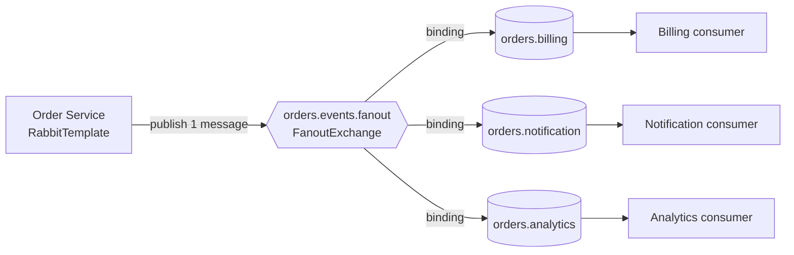

# FanoutExchange và phát thông điệp đến nhiều queue

Trong RabbitMQ, một sự kiện nghiệp vụ có thể cần được nhiều thành phần xử lý độc lập. Ví dụ, khi đơn hàng được tạo, dịch vụ **thanh toán** cần chuẩn bị hóa đơn, dịch vụ **thông báo** cần gửi email, còn dịch vụ **phân tích** cần cập nhật báo cáo. Producer không nên phải gửi ba lần đến ba queue bằng mã riêng. Ta có thể publish **một message đến fanout exchange** và để RabbitMQ phân phối bản sao của message vào từng queue đã binding với exchange đó.

Bài học nằm trong chương **Định tuyến thông điệp** của module **SPRING_AMQP**, tập trung vào cách khai báo `FanoutExchange`, `Queue`, `Binding`, publish bằng `RabbitTemplate` và tiêu thụ bằng `@RabbitListener`. Bài cũng giải thích ranh giới của mô hình broadcast và những lưu ý về acknowledgement, retry, dead-letter, độ bền và quan sát hệ thống khi xây xử lý bất đồng bộ đáng tin cậy.

## 1. Fanout exchange hoạt động như thế nào?

**Fanout exchange** chuyển một message đến **mọi queue đang được binding** với exchange tại thời điểm RabbitMQ định tuyến message. Nó **không xét routing key**. Mỗi queue được khớp nhận một bản sao độc lập để các consumer thuộc những queue khác nhau xử lý theo tiến độ riêng.



Với sơ đồ trên:

1. Producer phát sự kiện `orders.created` đến exchange `orders.events.fanout`.
2. RabbitMQ kiểm tra các binding của **exchange**; vì đây là fanout, mọi queue liên kết đều là đích nhận.
3. Ba queue `orders.billing`, `orders.notification`, `orders.analytics` nhận message tương ứng.
4. Mỗi consumer đọc **queue của mình**. Nếu consumer thông báo tạm ngừng hoạt động, các consumer khác vẫn có thể tiếp tục.

Fanout phù hợp với bài toán **một sự kiện có nhiều nhóm xử lý độc lập**. Nó không phải cách để chia công việc của một queue cho nhiều consumer: nhiều consumer đọc **cùng một queue** thường là mô hình competing consumers, tức mỗi delivery được giao cho một consumer tại một thời điểm.

### Các thành phần cần phân biệt

| Khái niệm | Vai trò | Trong ví dụ |
| --- | --- | --- |
| **Producer** | Tạo sự kiện và gửi message | Order Service |
| **Exchange** | Nhận message từ producer và định tuyến đến queue | `orders.events.fanout` |
| **Queue** | Lưu message chờ consumer xử lý | `orders.billing`, `orders.notification`, `orders.analytics` |
| **Binding** | Liên kết queue với exchange | Mỗi queue có một binding với fanout exchange |
| **Routing key** | Thuộc tính publish mà một số exchange dùng để lựa chọn đích | **Bị bỏ qua bởi fanout exchange** |
| **Consumer** | Nhận delivery từ queue và chạy nghiệp vụ | Các `@RabbitListener` tương ứng |

### Fanout khác direct và topic ở đâu?

| Loại exchange | Điều kiện định tuyến | Khi phù hợp |
| --- | --- | --- |
| `FanoutExchange` | Gửi tới tất cả queue được binding; không xét routing key | Broadcast sự kiện cho nhiều bộ phận |
| `DirectExchange` | So sánh routing key của message và binding key theo kiểu khớp chính xác | Chọn queue cho từng loại tác vụ |
| `TopicExchange` | So khớp mẫu binding key với routing key, như `orders.*` và `orders.#` | Có nhiều loại event và cần subscription theo chủ đề |
| `HeadersExchange` | Định tuyến theo các thuộc tính header được quy định trong binding | Điều kiện dựa trên header |

Nếu cùng exchange có nhiều loại sự kiện `orders.created` và `orders.cancelled` mà mỗi nhóm cần lọc khác nhau **ở cấp RabbitMQ**, hãy cân nhắc `TopicExchange`. Fanout sẽ phát **cả hai** loại đến toàn bộ queue được binding. Consumer có thể tự lọc trong code, nhưng message đã vào queue và đã tạo thêm lưu lượng.

## 2. Thiết lập project Spring Boot

Một ứng dụng Spring Boot có thể dùng Spring AMQP thông qua starter, để Spring Boot quản lý các phiên bản thư viện tương thích:

```xml
<!-- pom.xml: dependency trong dự án đã có Spring Boot parent/BOM -->
<dependency>
    <groupId>org.springframework.boot</groupId>
    <artifactId>spring-boot-starter-amqp</artifactId>
</dependency>
```

Ví dụ môi trường local có RabbitMQ chạy tại `localhost:5672`. Cấu hình `src/main/resources/application-local.yml`:

```yaml
spring:
  rabbitmq:
    host: localhost
    port: 5672
    username: app_local
    password: local-demo-only
    virtual-host: orders_local
```

Thông tin trên là **giá trị giả định cho broker thực hành**: user và vhost phải được tạo trước và có quyền với topology. Khi dùng RabbitMQ khác, thay bằng cấu hình thực tế. Không commit credentials production vào repository; dùng biến môi trường hoặc secret manager. Nếu ứng dụng chạy trong Docker container khác, `localhost` không tự trỏ tới container RabbitMQ.

## 3. Khai báo fanout exchange, queue và binding

Đây là bước quan trọng nhất: **tạo ba queue riêng biệt** và binding cả ba vào **cùng một** `FanoutExchange`. Ví dụ sử dụng các bean của Spring AMQP:

```java
import org.springframework.amqp.core.Binding;
import org.springframework.amqp.core.BindingBuilder;
import org.springframework.amqp.core.FanoutExchange;
import org.springframework.amqp.core.Queue;
import org.springframework.amqp.core.QueueBuilder;
import org.springframework.beans.factory.annotation.Qualifier;
import org.springframework.context.annotation.Bean;
import org.springframework.context.annotation.Configuration;

@Configuration
public class OrderFanoutTopology {
    public static final String EXCHANGE = "orders.events.fanout";
    public static final String BILLING_QUEUE = "orders.billing";
    public static final String NOTIFICATION_QUEUE = "orders.notification";
    public static final String ANALYTICS_QUEUE = "orders.analytics";

    @Bean
    public FanoutExchange orderFanoutExchange() {
        return new FanoutExchange(EXCHANGE, true, false);
    }

    @Bean
    public Queue billingQueue() {
        return QueueBuilder.durable(BILLING_QUEUE).build();
    }

    @Bean
    public Queue notificationQueue() {
        return QueueBuilder.durable(NOTIFICATION_QUEUE).build();
    }

    @Bean
    public Queue analyticsQueue() {
        return QueueBuilder.durable(ANALYTICS_QUEUE).build();
    }

    @Bean
    public Binding billingBinding(
            @Qualifier("billingQueue") Queue queue,
            @Qualifier("orderFanoutExchange") FanoutExchange exchange) {
        return BindingBuilder.bind(queue).to(exchange);
    }

    @Bean
    public Binding notificationBinding(
            @Qualifier("notificationQueue") Queue queue,
            @Qualifier("orderFanoutExchange") FanoutExchange exchange) {
        return BindingBuilder.bind(queue).to(exchange);
    }

    @Bean
    public Binding analyticsBinding(
            @Qualifier("analyticsQueue") Queue queue,
            @Qualifier("orderFanoutExchange") FanoutExchange exchange) {
        return BindingBuilder.bind(queue).to(exchange);
    }
}
```

Trong cấu hình này:

- `new FanoutExchange(EXCHANGE, true, false)`: exchange **durable**, không tự xóa. Exchange durable có khả năng tồn tại sau khi broker khởi động lại theo cơ chế lưu metadata của broker.
- `QueueBuilder.durable(...)`: yêu cầu queue durable. **Queue durable không tự bảo đảm mọi message sống sót sau restart**; message còn phụ thuộc delivery mode, loại queue và cơ chế lưu của broker.
- `BindingBuilder.bind(queue).to(exchange)`: tạo binding tới fanout exchange, **không có** `.with("routing.key")`. Đây là khác biệt so với direct hoặc topic.
- `@Qualifier`: chỉ rõ queue được inject vào từng binding; nếu không có, ba bean `Queue` cùng kiểu có thể làm wiring mơ hồ.

Khi Spring Boot tự cấu hình `RabbitAdmin` và kết nối broker thành công, các bean `Exchange`, `Queue`, `Binding` có thể được khai báo lên RabbitMQ. Việc khai báo thực tế còn phụ thuộc điều kiện auto-configuration và quyền của tài khoản AMQP. Trên production, cần phối hợp với topology do hạ tầng quản lý để tránh xung đột khai báo.

**Không thay đổi tùy tiện thuộc tính của queue đã tồn tại.** Ví dụ, khai báo queue cùng tên nhưng khác `durable`, loại queue hoặc một số arguments có thể gây lỗi `PRECONDITION_FAILED`; cần có kế hoạch migration topology.

## 4. Publisher: gửi một lần bằng RabbitTemplate

Producer chỉ cần biết tên exchange và nội dung sự kiện. Với fanout exchange, tham số routing key có thể để chuỗi rỗng:

```java
import org.springframework.amqp.rabbit.core.RabbitTemplate;
import org.springframework.stereotype.Service;

@Service
public class OrderEventPublisher {
    private final RabbitTemplate rabbitTemplate;

    public OrderEventPublisher(RabbitTemplate rabbitTemplate) {
        this.rabbitTemplate = rabbitTemplate;
    }

    public void publishCreated(String eventJson) {
        rabbitTemplate.convertAndSend(
                OrderFanoutTopology.EXCHANGE,
                "", // FanoutExchange bỏ qua routing key
                eventJson
        );
    }
}
```

Ví dụ payload dạng JSON để minh họa:

```json
{
  "eventId": "ef681084-0645-4b6e-a355-1710f4c4c211",
  "type": "orders.created",
  "orderId": "ORD-1001",
  "occurredAt": "2026-01-15T10:15:30Z"
}
```

Trong code publisher trên, `eventJson` là **chuỗi JSON**, nên với message converter dạng chuỗi thông dụng, consumer có thể nhận `String`. Nếu ứng dụng gửi trực tiếp DTO/record Java, hãy cấu hình JSON message converter và quy ước schema rõ ràng. Đừng giả định mọi converter biến POJO thành JSON tự động.

**Lưu ý quan trọng:** `convertAndSend(...)` hoàn thành không đồng nghĩa cả ba queue đã nhận message, càng không chứng minh cả ba consumer đã xử lý nghiệp vụ xong. Cần cấu hình publisher confirms/returns và quan sát broker nếu muốn biết kết quả publish/routing.

## 5. Consumer: mỗi nhóm đọc queue riêng

Để ba hệ thống xử lý cùng một sự kiện, mỗi nhóm sử dụng **queue riêng**, dù có thể chạy trong một ứng dụng demo:

```java
import org.slf4j.Logger;
import org.slf4j.LoggerFactory;
import org.springframework.amqp.rabbit.annotation.RabbitListener;
import org.springframework.stereotype.Component;

@Component
public class BillingOrderListener {
    private static final Logger log =
            LoggerFactory.getLogger(BillingOrderListener.class);

    @RabbitListener(queues = OrderFanoutTopology.BILLING_QUEUE)
    public void onEvent(String message) {
        log.info("Billing nhận event: {}", message);
        // Tạo dữ liệu hóa đơn, bảo đảm xử lý trùng an toàn.
    }
}
```

```java
import org.slf4j.Logger;
import org.slf4j.LoggerFactory;
import org.springframework.amqp.rabbit.annotation.RabbitListener;
import org.springframework.stereotype.Component;

@Component
public class NotificationOrderListener {
    private static final Logger log =
            LoggerFactory.getLogger(NotificationOrderListener.class);

    @RabbitListener(queues = OrderFanoutTopology.NOTIFICATION_QUEUE)
    public void onEvent(String message) {
        log.info("Notification nhận event: {}", message);
        // Gửi thông báo theo logic nghiệp vụ.
    }
}
```

```java
import org.slf4j.Logger;
import org.slf4j.LoggerFactory;
import org.springframework.amqp.rabbit.annotation.RabbitListener;
import org.springframework.stereotype.Component;

@Component
public class AnalyticsOrderListener {
    private static final Logger log =
            LoggerFactory.getLogger(AnalyticsOrderListener.class);

    @RabbitListener(queues = OrderFanoutTopology.ANALYTICS_QUEUE)
    public void onEvent(String message) {
        log.info("Analytics nhận event: {}", message);
        // Cập nhật dữ liệu báo cáo.
    }
}
```

Đây là ba class **độc lập**; trong hệ thống microservice, mỗi service thường chỉ đóng gói listener và cấu hình liên quan đến queue của mình. Tài nguyên exchange/queue/binding có thể được quản lý tập trung hoặc khai báo từ ứng dụng theo một quy ước thống nhất.

Khi một sự kiện được publish, mỗi queue nhận một message tương ứng; từng listener xử lý delivery trên queue của mình. Nếu `BillingOrderListener` xử lý thất bại, điều đó **không khiến** message ở `orders.notification` hoặc `orders.analytics` tự động bị rollback.

## 6. Thực hành kiểm chứng broadcast

### 6.1. Gửi message thử trong profile local

Để tái hiện được với mã trên mà không cần thêm Spring Web, có thể tạo `ApplicationRunner` chỉ cho môi trường `local`:

```java
import java.util.UUID;
import org.springframework.boot.ApplicationArguments;
import org.springframework.boot.ApplicationRunner;
import org.springframework.context.annotation.Profile;
import org.springframework.stereotype.Component;

@Component
@Profile("local")
public class FanoutDemoRunner implements ApplicationRunner {
    private final OrderEventPublisher publisher;

    public FanoutDemoRunner(OrderEventPublisher publisher) {
        this.publisher = publisher;
    }

    @Override
    public void run(ApplicationArguments args) {
        String eventId = UUID.randomUUID().toString();
        String json = "{\"eventId\":\"" + eventId
                + "\",\"type\":\"orders.created\",\"orderId\":\"ORD-1001\"}";
        publisher.publishCreated(json);
    }
}
```

Khởi chạy ứng dụng với Spring profile `local`. Runner gửi một message sau khi context khởi tạo; các listener nhận message khi kết nối tới broker và queue đã sẵn sàng. Nếu mạng hoặc RabbitMQ chưa sẵn sàng, lần publish từ runner có thể thất bại; đó là hành vi có ích để phát hiện lỗi trong demo, nhưng không nên dùng runner này để publish sự kiện nghiệp vụ khi production khởi động lại.

### 6.2. Quan sát kết quả

Trong RabbitMQ Management UI, mở virtual host đã cấu hình, xem exchange `orders.events.fanout` và ba queue. Kiểm tra:

1. Exchange có **type = fanout** và có binding đến cả ba queue.
2. Cả ba listener đã kết nối tới queue tương ứng; các log `Billing nhận event`, `Notification nhận event`, `Analytics nhận event` có cùng `eventId`.
3. Với listener đang chạy, message có thể được nhận nhanh nên chỉ số **Ready** trở về 0 gần như ngay lập tức. Không suy luận “không được route” chỉ vì queue đang trống.
4. Thử **dừng riêng notification consumer**, tiếp tục publish một event khác: queue `orders.notification` có thể tích lũy message trong khi hai nhóm còn lại tiếp tục xử lý. Khi notification consumer chạy lại, nó đọc backlog theo cấu hình queue/consumer.
5. Kiểm tra `Ready`, `Unacked`, tổng số consumer và tốc độ publish/deliver trên Management UI; khi test ack/retry, cố ý gây lỗi ở một listener để xem ảnh hưởng riêng của queue đó.

**Thí nghiệm routing key:** đổi `""` trong lời gọi publish thành `"orders.created"` hoặc `"unknown.key"`. Với cùng fanout exchange và cùng các binding, kết quả fanout **không đổi**, vì exchange không dùng routing key.

### 6.3. Trường hợp không có binding

Nếu lúc publish chưa có queue nào được binding, fanout exchange **không có đích để route**. Với cấu hình mặc định, message không đến queue nào và có thể bị loại bỏ; nếu bật cơ chế `mandatory`/publisher returns hoặc alternate exchange phù hợp, có thể quan sát/xử lý message không route được.

**Fanout không lưu lịch sử để phát lại cho queue tạo sau.** Khi một service mới được triển khai, nó chỉ nhận message được route **sau khi binding queue đã tồn tại**, trừ khi hệ thống có một cơ chế replay khác được thiết kế riêng.

## 7. Phân biệt broadcast giữa queue và nhân bản consumer

Hai cấu hình trông gần giống nhưng có ý nghĩa rất khác:

| Mô hình | Số queue | Hành vi điển hình | Mục đích |
| --- | --- | --- | --- |
| Một fanout exchange binding tới **ba queue** | 3 | Mỗi queue nhận một bản message | Ba nhóm nghiệp vụ xử lý độc lập |
| Một queue có **ba consumer** | 1 | Mỗi message từ queue được giao cho một consumer trong số các consumer cạnh tranh tại một thời điểm | Tăng throughput cho cùng một nhóm xử lý |
| Một fanout exchange binding tới ba queue, **mỗi queue có nhiều consumer** | 3 | Mỗi nhóm nhận bản message riêng; các instance trong cùng nhóm chia tải nội bộ | Pub/sub và scale-out đồng thời |

Giả sử ba replica của dịch vụ `billing` đều cần chia tải: hãy cho cả ba đọc **cùng** queue `orders.billing`. Nếu mỗi replica tự tạo một queue riêng và binding fanout, mỗi sự kiện sẽ được cả ba replica nhận, dễ gây tạo hóa đơn trùng.

Ngược lại, nếu `billing` và `notification` cùng đọc một queue, một message thường chỉ được giao cho một nhóm; điều này làm mất yêu cầu “cả hai nghiệp vụ đều phải nhận sự kiện”. Vì vậy, thiết kế số queue dựa trên **số nhóm xử lý độc lập**, không dựa trên số instance.

## 8. Thiết kế tin cậy: fanout không tự bảo đảm xử lý thành công

### 8.1. Durability và sự tồn tại của queue

Exchange và queue `durable` giúp topology tồn tại qua việc broker khởi động lại theo cơ chế hỗ trợ của broker. Để tăng tính bền của message, còn phải xem **message delivery mode**, loại queue (chẳng hạn quorum queue khi có yêu cầu HA), cơ chế lưu trữ và xác nhận publish.

Fanout chỉ route đến **queue đã binding tại lúc publish**. Nếu một service bị tắt nhưng queue của service vẫn tồn tại, queue có thể giữ backlog; nếu queue đã bị xóa hoặc chưa tạo, không có nơi nhận bản sao tương ứng.

### 8.2. Publisher confirms và returns

Spring AMQP/RabbitMQ có các cơ chế publisher confirms và returns, nhưng chúng trả lời **những câu hỏi khác nhau**:

- **Publisher confirm:** RabbitMQ xác nhận việc xử lý publish ở mức broker theo chế độ và loại tài nguyên liên quan; **không có nghĩa** tất cả consumer đã xử lý thành công.
- **Publisher return:** Khi bật `mandatory` và trả về message không route được, producer có thể biết message không đến queue nào theo cơ chế routing đang sử dụng. Nó **không báo** rằng “một trong ba queue mong muốn bị thiếu” nếu message vẫn route tới các queue khác.
- **Consumer ack:** Mỗi queue/delivery có xác nhận của consumer riêng. Ack của `billing` không phải ack của `notification` hay `analytics`.

Nếu nghiệp vụ yêu cầu **bắt buộc cả ba nhóm luôn nhận sự kiện**, việc kiểm tra topology và số binding mong đợi phải là phần của quy trình triển khai/giám sát. Publisher confirm đơn lẻ không phải giấy chứng nhận fanout đã được tất cả nhóm nhận.

### 8.3. Retry và dead-letter theo từng queue

Một listener thất bại có thể được retry, requeue hoặc dead-letter tùy chế độ acknowledgement và error handler. Nếu lỗi lặp vô hạn, **requeue liên tục** khiến CPU và broker bị tải cao, đồng thời chiếm chỗ xử lý những message sau.

Một cách thiết kế phổ biến là:

```text
orders.events.fanout
  ├── orders.billing       -> lỗi billing       -> billing DLQ
  ├── orders.notification  -> lỗi notification  -> notification DLQ
  └── orders.analytics     -> lỗi analytics     -> analytics DLQ
```

Mỗi queue có thể có retry policy, DLX/DLQ và quy trình xử lý lỗi riêng. Nên đặt retry có giới hạn, phân biệt lỗi tạm thời với dữ liệu không hợp lệ, thêm cảnh báo theo độ sâu DLQ. Dead-letter exchange và dead-letter routing key được cấu hình tại queue/policy; **`FanoutExchange` ở đầu luồng không tự tạo hoặc kích hoạt DLQ**.

Trong thực tế, nên ưu tiên quy hoạch DLX và TTL qua chính sách RabbitMQ khi phù hợp để dễ vận hành. Nếu dùng arguments cố định trong lúc khai báo queue, việc thay đổi chính sách sau này có thể cần migration; không tùy tiện khai báo lại queue có tên cũ với arguments không tương thích.

### 8.4. Idempotency và transaction boundary

Đặc tính giao message thường cần được thiết kế theo hướng **có thể giao lại**. Ví dụ, `billing` đã ghi dữ liệu vào database nhưng chết trước khi ack; broker có thể giao lại event `orders.created`. Nếu listener luôn tạo thêm một hóa đơn mới, dữ liệu sẽ bị trùng.

Giải pháp thường là dùng `eventId` hoặc khóa nghiệp vụ phù hợp để thực hiện xử lý **idempotent** (lặp lại không tạo tác dụng phụ ngoài ý muốn). Nếu producer phải ghi DB và publish sự kiện như một nghiệp vụ nhất quán, hãy đánh giá transactional outbox thay vì giả định RabbitMQ transaction và database transaction tự động là một transaction phân tán.

Lưu ý: ba queue xử lý **độc lập và không cùng một transaction**. Không có cơ chế mặc định nào bảo đảm rằng hoặc cả ba nhóm đều commit, hoặc cả ba cùng rollback khi một nhóm lỗi.

## 9. Những sai lầm hay gặp

| Hiện tượng | Nguyên nhân có thể | Hướng xử lý |
| --- | --- | --- |
| Chỉ một listener nhận message | Ba listener cùng đọc một queue hoặc chỉ một queue được binding | Kiểm tra topology và tên queue trong từng `@RabbitListener` |
| Không thấy message trong queue | Consumer đã nhận ngay; hoặc exchange không có binding | Xem binding, logs, deliver rate, publish/return callbacks |
| Đổi routing key nhưng message vẫn đến mọi queue | **Đúng hành vi fanout** | Dùng direct/topic khi cần lọc theo key |
| Khởi động ứng dụng có lỗi `NOT_FOUND` | Exchange/queue không được tạo hoặc khai báo sai vhost | Kiểm tra quyền, vhost và trạng thái khai báo topology |
| `PRECONDITION_FAILED` khi khai báo queue | Trùng tên queue nhưng cấu hình durable/type/arguments khác | So sánh tài nguyên hiện tại và thực hiện migration phù hợp |
| Sau khi tăng replicas, nghiệp vụ bị chạy nhiều lần | Mỗi replica tự khai báo queue riêng rồi binding fanout | Dùng một queue chung cho cùng nhóm xử lý; áp dụng idempotency |
| Một nhóm mất event được publish trước khi triển khai | Queue của nhóm chưa tồn tại hoặc chưa được binding tại thời điểm publish | Khởi tạo topology trước; thêm cơ chế replay nếu nghiệp vụ yêu cầu |
| Một queue nhiều `Unacked` | Consumer đang xử lý chậm, bị lỗi hoặc cấu hình prefetch chưa hợp lý | Kiểm tra logs, processing time, prefetch, concurrency, retry và ack |
| Một nhóm gặp lỗi và backlog tăng, hai nhóm khác bình thường | Các queue có tiến độ xử lý độc lập | Giám sát và xử lý queue/DLQ riêng theo từng nhóm |

## 10. Checklist vận dụng và bài tập mở rộng

Khi hoàn thành thực hành, hãy tự xác minh:

- [ ] Đã tạo một `FanoutExchange` và ít nhất **hai queue khác tên**, mỗi queue có binding riêng.
- [ ] Gửi một message bằng `RabbitTemplate.convertAndSend(exchange, "", payload)`; mỗi listener trên queue khác nhau nhận được sự kiện có cùng `eventId`.
- [ ] Đã xác nhận thay routing key không thay đổi kết quả fanout.
- [ ] Biết vì sao nhiều instance cùng đọc **một queue** khác với nhiều queue binding vào **một exchange**.
- [ ] Đã xem được exchange, bindings, số consumer, message `Ready`/`Unacked` và tốc độ delivery bằng RabbitMQ Management UI.
- [ ] Hiểu ranh giới của publisher confirms/returns, consumer acknowledgement, retry và dead-letter; không suy diễn một lần publish thành xử lý thành công ở mọi nhóm.
- [ ] Biết cách bảo đảm consumer xử lý trùng an toàn, và không nhầm queue durable với cam kết mọi message tồn tại vĩnh viễn.

**Bài tập 1 – Thêm một nhóm độc lập:** Thêm `orders.search-index` vào cùng fanout exchange và một listener tạo chỉ mục tìm kiếm. Publish một sự kiện mới; quan sát cả bốn nhóm nhận cùng `eventId` mà không sửa code publisher.

**Bài tập 2 – Chia tải một nhóm:** Tạo hai consumer instance cùng đọc `orders.billing`, gửi nhiều sự kiện với các `eventId` khác nhau và quan sát việc phân phối delivery trong một queue. Sau đó so sánh với việc tạo hai queue `orders.billing-a` và `orders.billing-b` binding cùng fanout exchange.

**Bài tập 3 – Cô lập lỗi:** Cho riêng notification listener ném exception trong môi trường test; cấu hình retry có giới hạn và DLQ cho notification. Xác minh billing/analytics vẫn xử lý bình thường và message lỗi được quan sát qua notification DLQ.

**Ghi nhớ:** `FanoutExchange` thực hiện **broadcast từ một lần publish tới mọi queue đã binding**, **bỏ qua routing key**. Để nhiều nhóm nghiệp vụ nhận độc lập, hãy dùng **mỗi nhóm một queue**; để tăng throughput trong một nhóm, dùng **nhiều consumer trên cùng queue**. Định tuyến thành công mới chỉ là khởi đầu: hệ thống Spring AMQP đáng tin cậy còn cần xác nhận publish, quản lý ack, retry, dead-letter, idempotency và giám sát riêng cho từng luồng.
