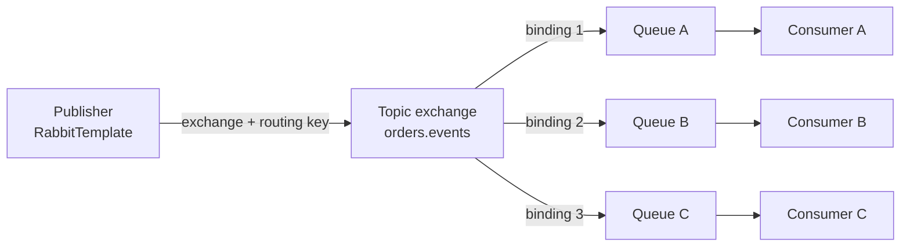
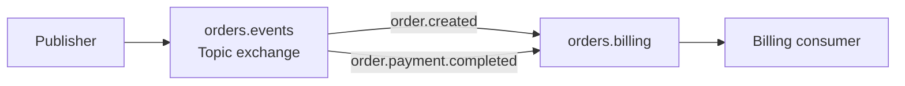
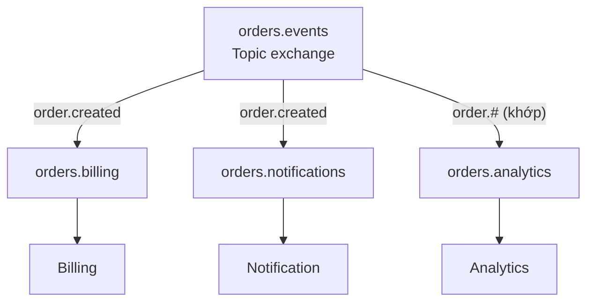

# Nhiều binding trên một queue và nhiều queue cho một sự kiện

Khi xây dựng hệ thống xử lý bất đồng bộ với **RabbitMQ và Spring AMQP**, một sự kiện như `order.created` có thể liên quan đến nhiều nghiệp vụ: lập hóa đơn, gửi thông báo và ghi nhận phân tích. Đồng thời, một nghiệp vụ như lập hóa đơn có thể quan tâm đến **nhiều loại sự kiện**. Hai nhu cầu này được giải quyết bằng cấu trúc **exchange – binding – queue**, không cần publisher biết tên từng consumer.

Trong chương **Định tuyến thông điệp**, bài học này tập trung vào hai tình huống thường gặp:

- **Một queue có nhiều binding:** gom nhiều loại sự kiện vào cùng luồng xử lý của một nhóm consumer.
- **Một sự kiện được định tuyến đến nhiều queue:** tạo các bản giao độc lập cho nhiều nghiệp vụ, để mỗi nghiệp vụ tự quản lý tốc độ tiêu thụ, lỗi và xác nhận message.

Bạn sẽ dùng `ExchangeBuilder`, `QueueBuilder`, `BindingBuilder`, `RabbitTemplate` và `@RabbitListener` để dựng ví dụ hoàn chỉnh, sau đó kiểm chứng routing, acknowledgment, retry và việc quan sát message trên broker.

## 1. Nhắc lại: exchange quyết định tuyến, queue giữ message

Publisher sử dụng `RabbitTemplate` để publish **vào exchange** với một **routing key**. RabbitMQ so sánh key với các **binding** của exchange rồi đưa message vào những queue phù hợp. Consumer dùng `@RabbitListener` nhận message từ queue, không trực tiếp lắng nghe exchange.



Một **binding** là quy tắc định tuyến. Exchange có thể có nhiều binding; queue có thể được bind vào một hoặc nhiều exchange, kể cả nhiều lần tới **cùng exchange** nhưng dùng binding key khác nhau.

Các thực thể nằm trong **virtual host của connection**. Binding không thể nối queue ở vhost này trực tiếp sang exchange ở vhost khác.

### 1.1. Các exchange type cần biết

| Loại exchange | Cách chọn queue | Phù hợp với |
| --- | --- | --- |
| **Direct** | Routing key khớp **chính xác** với binding key | Các loại lệnh hoặc sự kiện xác định |
| **Topic** | Routing key khớp mẫu binding key, dùng `*` và `#` | Nhóm sự kiện theo chủ đề |
| **Fanout** | Gửi đến **tất cả queue đã bind**, bỏ qua routing key | Phát một thông báo cho nhiều nhóm nhận |
| **Headers** | So sánh header với điều kiện trong binding | Định tuyến theo metadata |

Bài học sẽ dùng **topic exchange** vì nó minh họa được cả binding key chính xác và theo mẫu. Với topic exchange, `*` khớp **đúng một thành phần** giữa hai dấu chấm; `#` khớp **không hoặc nhiều thành phần**. Ví dụ `order.*` khớp `order.created` nhưng không khớp `order.payment.completed`, còn `order.#` khớp cả hai.

## 2. Tình huống A: nhiều binding trên cùng một queue

Giả sử service **Billing** cần xử lý hai loại sự kiện:

- `order.created`: chuẩn bị bản ghi hóa đơn.
- `order.payment.completed`: cập nhật trạng thái thanh toán.

Billing có thể nhận cả hai loại message qua **một queue** tên `orders.billing`. Ta tạo hai binding từ `orders.events` đến cùng queue:



Đường logic là:

```text
orders.events + routing key "order.created"
    → binding "order.created"
    → orders.billing

orders.events + routing key "order.payment.completed"
    → binding "order.payment.completed"
    → orders.billing
```

Các binding hoạt động theo phép **HOẶC (OR)**: message chỉ cần khớp một binding để có tuyến tới queue.

### 2.1. Khai báo hai binding bằng Spring AMQP

```java
import org.springframework.amqp.core.Binding;
import org.springframework.amqp.core.BindingBuilder;
import org.springframework.amqp.core.Queue;
import org.springframework.amqp.core.QueueBuilder;
import org.springframework.amqp.core.TopicExchange;
import org.springframework.amqp.core.ExchangeBuilder;

TopicExchange exchange = ExchangeBuilder
        .topicExchange("orders.events").durable(true).build();

Queue billingQueue = QueueBuilder
        .durable("orders.billing").build();

Binding billingCreated = BindingBuilder
        .bind(billingQueue).to(exchange).with("order.created");

Binding billingPaid = BindingBuilder
        .bind(billingQueue).to(exchange).with("order.payment.completed");
```

Hai đối tượng `Binding` khác nhau vì có hai binding key, nhưng **đích của chúng cùng là `orders.billing`**. Khi khai báo cả hai trên RabbitMQ, Billing có thể tiêu thụ hai loại sự kiện từ một queue.

### 2.2. Hai binding cùng khớp một message có gây nhân đôi không?

Giả sử một queue được bind vào cùng topic exchange với hai mẫu **giao nhau**:

```java
Binding exact = BindingBuilder.bind(billingQueue)
        .to(exchange).with("order.created");

Binding broad = BindingBuilder.bind(billingQueue)
        .to(exchange).with("order.#");
```

Message với routing key `order.created` khớp **cả hai** binding. RabbitMQ vẫn đưa **một bản** của lần publish đó vào cùng queue, vì broker loại trùng đích queue khi định tuyến qua nhiều binding phù hợp.

> **Phân biệt:** Điều này không ngăn trùng lặp do **hai lần publish thực sự**, publisher retry hoặc broker **redeliver** message khi consumer chưa ACK. Ứng dụng cần thiết kế idempotency nếu xử lý lặp gây sai kết quả.

Dù không nhân đôi message trong cùng queue, binding `order.#` vẫn làm queue nhận thêm tất cả sự kiện `order.*` khác. Vì vậy, **mẫu binding quá rộng** có thể tăng lưu lượng hoặc đưa những sự kiện consumer không biết xử lý vào queue.

### 2.3. Khi nào dùng nhiều binding trên một queue?

Phù hợp khi các loại sự kiện cùng thuộc **một nhóm nghiệp vụ**, sử dụng cùng chính sách tiêu thụ và có thể được xử lý bởi cùng tập consumer. Cần cân nhắc nếu một loại sự kiện thường xử lý rất chậm: backlog của loại đó có thể làm tăng độ trễ các loại còn lại vì chúng chung queue.

## 3. Tình huống B: nhiều queue nhận cùng một sự kiện

Khi sự kiện `order.created` cần kích hoạt **Billing**, **Notification** và **Analytics**, mỗi nghiệp vụ nên có queue riêng:



Một lần publish `order.created` có tuyến tới **ba queue độc lập**. Mỗi queue nhận một bản message để nhóm consumer của queue đó xử lý.

| Thuộc tính | `orders.billing` | `orders.notifications` | `orders.analytics` |
| --- | --- | --- | --- |
| Nhiệm vụ | Hóa đơn | Email/thông báo | Thống kê |
| Binding quan tâm | `order.created`, `order.payment.completed` | `order.created`, `order.shipped` | `order.#` |
| Consumer | Billing | Notification | Analytics |
| Backlog | Riêng | Riêng | Riêng |
| ACK / retry / DLQ | Quản lý độc lập | Quản lý độc lập | Quản lý độc lập |

Nếu Notification đang lỗi và ngừng ACK, message có thể tồn tại trong `orders.notifications` mà **không cản Billing** ACK bản message nằm trong `orders.billing`. Tài nguyên broker (CPU, RAM, disk) vẫn được chia sẻ, nên một queue quá tải có thể ảnh hưởng hạ tầng chung; tính độc lập ở đây là **luồng message, backlog và trạng thái xử lý theo queue**.

### 3.1. Không nhầm nhiều queue với nhiều consumer trên cùng queue

Hai cách triển khai tạo ra hai ngữ nghĩa khác nhau:

| Cấu trúc | Điều xảy ra với một message | Mục tiêu |
| --- | --- | --- |
| **Một queue – nhiều consumer** | Thông thường chỉ **một consumer** trong nhóm nhận và xử lý mỗi lần giao message; broker phân phối công việc giữa các consumer cạnh tranh | Tăng năng lực xử lý một luồng công việc |
| **Nhiều queue – mỗi queue có consumer riêng** | **Mỗi queue được định tuyến** có một bản message; mỗi nghiệp vụ có thể xử lý độc lập | Phân phối cùng một sự kiện cho nhiều nghiệp vụ |
| **Một queue – nhiều binding** | Queue nhận các **loại message** thỏa một hoặc nhiều quy tắc; các consumer vẫn cạnh tranh đọc cùng queue | Gom các loại sự kiện vào một luồng |

Không thể có ba service đều luôn nhận `order.created` chỉ bằng cách cho cả ba cùng `@RabbitListener(queues = "orders.billing")`. Khi cùng consume **một queue**, các listener cạnh tranh nhận message; muốn ba nghiệp vụ đều nhận, cần **các queue riêng** và binding đến exchange.

## 4. Ví dụ hoàn chỉnh: hai chiều định tuyến trong một topology

Ta khai báo:

- **Một topic exchange:** `orders.events`.
- **Ba queue durable:** `orders.billing`, `orders.notifications`, `orders.analytics`.
- **Năm binding:** Billing hai binding; Notification hai binding; Analytics một binding.

Bảng định tuyến mong đợi:

| Routing key của lần publish | Billing | Notification | Analytics |
| --- | :---: | :---: | :---: |
| `order.created` | ✓ | ✓ | ✓ |
| `order.payment.completed` | ✓ | – | ✓ |
| `order.shipped` | – | ✓ | ✓ |
| `order.cancelled` | – | – | ✓ |
| `inventory.low` | – | – | – |

Bảng giả định không có binding khác được khai báo trong exchange. Đây là **tập kết quả định tuyến**, không chỉ ra thứ tự message sẽ được các consumer xử lý.

### 4.1. Spring @Configuration dùng ba builder

Đoạn mã sau dùng bean `Declarables` để Spring quản lý cả exchange, các queue và binding. Spring Rabbit có thể dùng `RabbitAdmin` để khai báo chúng trên broker khi connection được thiết lập.

```java
import org.springframework.amqp.core.Binding;
import org.springframework.amqp.core.BindingBuilder;
import org.springframework.amqp.core.Declarables;
import org.springframework.amqp.core.Queue;
import org.springframework.amqp.core.QueueBuilder;
import org.springframework.amqp.core.TopicExchange;
import org.springframework.amqp.core.ExchangeBuilder;
import org.springframework.context.annotation.Bean;
import org.springframework.context.annotation.Configuration;

@Configuration
public class OrderRoutingConfig {
    public static final String EXCHANGE = "orders.events";
    public static final String BILLING_QUEUE = "orders.billing";
    public static final String NOTIFICATION_QUEUE = "orders.notifications";
    public static final String ANALYTICS_QUEUE = "orders.analytics";

    @Bean
    public Declarables orderRoutingDeclarables() {
        TopicExchange exchange = ExchangeBuilder
                .topicExchange(EXCHANGE)
                .durable(true)
                .build();

        Queue billing = QueueBuilder.durable(BILLING_QUEUE).build();
        Queue notification = QueueBuilder.durable(NOTIFICATION_QUEUE).build();
        Queue analytics = QueueBuilder.durable(ANALYTICS_QUEUE).build();

        // Nhiều binding cùng đích: Billing
        Binding billingCreated = BindingBuilder
                .bind(billing).to(exchange).with("order.created");
        Binding billingPayment = BindingBuilder
                .bind(billing).to(exchange).with("order.payment.completed");

        // Nhiều binding cùng đích: Notification
        Binding notificationCreated = BindingBuilder
                .bind(notification).to(exchange).with("order.created");
        Binding notificationShipped = BindingBuilder
                .bind(notification).to(exchange).with("order.shipped");

        // Analytics nhận cả họ sự kiện order.*
        Binding analyticsEvents = BindingBuilder
                .bind(analytics).to(exchange).with("order.#");

        return new Declarables(
                exchange,
                billing, notification, analytics,
                billingCreated, billingPayment,
                notificationCreated, notificationShipped,
                analyticsEvents);
    }
}
```

`Declarables` chỉ chứa mô tả tài nguyên. Nếu broker chưa có những tài nguyên này, ứng dụng phải có một thành phần khai báo như `RabbitAdmin` và **quyền truy cập phù hợp**. Spring Boot thường tự cấu hình admin khi dùng Spring Rabbit starter và điều kiện auto-configuration được thỏa mãn.

### 4.2. Kết nối đến đúng RabbitMQ và vhost

```yaml
# application.yml
spring:
  rabbitmq:
    host: ${RABBITMQ_HOST:localhost}
    port: ${RABBITMQ_PORT:5672}
    virtual-host: ${RABBITMQ_VHOST:/orders}
    username: ${RABBITMQ_USERNAME}
    password: ${RABBITMQ_PASSWORD}
    listener:
      simple:
        acknowledge-mode: auto
```

Ví dụ giả định vhost `/orders` đã được tạo và user được cấp quyền khai báo, publish, consume tương ứng. Đừng lưu mật khẩu thực trong file được commit; dùng secret hoặc biến môi trường.

**`acknowledge-mode: auto` là chế độ AUTO của Spring listener container**: container gửi ACK khi listener xử lý thành công theo chính sách của nó. Không nhầm với `autoAck=true` ở protocol, là kiểu giao nhận không yêu cầu consumer ACK.

### 4.3. Publisher chỉ biết exchange và routing key

```java
import org.springframework.amqp.rabbit.core.RabbitTemplate;
import org.springframework.stereotype.Service;

@Service
public class OrderEventPublisher {
    private final RabbitTemplate rabbitTemplate;

    public OrderEventPublisher(RabbitTemplate rabbitTemplate) {
        this.rabbitTemplate = rabbitTemplate;
    }

    public void created(String orderId) {
        rabbitTemplate.convertAndSend(
                OrderRoutingConfig.EXCHANGE, "order.created", orderId);
    }

    public void paymentCompleted(String orderId) {
        rabbitTemplate.convertAndSend(
                OrderRoutingConfig.EXCHANGE, "order.payment.completed", orderId);
    }

    public void shipped(String orderId) {
        rabbitTemplate.convertAndSend(
                OrderRoutingConfig.EXCHANGE, "order.shipped", orderId);
    }

    public void cancelled(String orderId) {
        rabbitTemplate.convertAndSend(
                OrderRoutingConfig.EXCHANGE, "order.cancelled", orderId);
    }
}
```

Publisher **không cần biết** hiện có bao nhiêu queue đăng ký nhận. Bổ sung Analytics với binding `order.#` không đòi hỏi sửa publisher đang gửi `order.created`. Đây là một lợi ích quan trọng của mô hình publish–subscribe dựa trên exchange.

### 4.4. Ba consumer quan sát các bản giao độc lập

Để học và kiểm chứng, có thể đặt ba listener trong **cùng ứng dụng thử nghiệm**. Trong hệ thống microservice thật, chúng thường được đặt ở các service riêng với các deployment độc lập:

```java
import org.springframework.amqp.rabbit.annotation.RabbitListener;
import org.springframework.stereotype.Component;

@Component
public class OrderEventConsumers {

    @RabbitListener(queues = OrderRoutingConfig.BILLING_QUEUE)
    public void billing(String orderId) {
        System.out.println("[Billing] " + orderId);
    }

    @RabbitListener(queues = OrderRoutingConfig.NOTIFICATION_QUEUE)
    public void notification(String orderId) {
        System.out.println("[Notification] " + orderId);
    }

    @RabbitListener(queues = OrderRoutingConfig.ANALYTICS_QUEUE)
    public void analytics(String orderId) {
        System.out.println("[Analytics] " + orderId);
    }
}
```

Đoạn code dùng message body là `String` cho dễ theo dõi. Để xác định **loại sự kiện** ở consumer khi một queue nhận nhiều routing key, có thể đọc received routing key từ header:

```java
import org.springframework.amqp.rabbit.annotation.RabbitListener;
import org.springframework.messaging.handler.annotation.Header;
import org.springframework.amqp.support.AmqpHeaders;

@RabbitListener(queues = OrderRoutingConfig.BILLING_QUEUE)
public void billingEvent(
        String orderId,
        @Header(AmqpHeaders.RECEIVED_ROUTING_KEY) String routingKey) {

    switch (routingKey) {
        case "order.created":
            System.out.println("Create invoice for " + orderId);
            break;
        case "order.payment.completed":
            System.out.println("Mark invoice paid: " + orderId);
            break;
        default:
            throw new IllegalArgumentException(
                    "Unexpected routing key: " + routingKey);
    }
}
```

Đây là một **phương án thay thế** cho phương thức `billing(...)` đơn giản ở đoạn trước. Chỉ đăng ký **một listener cho Billing** trong lúc thử nghiệm, nếu không hai listener của cùng queue sẽ cạnh tranh nhận message.

Ở môi trường thật, thay chuỗi `orderId` bằng payload có **event ID, loại sự kiện, phiên bản schema và dữ liệu nghiệp vụ**, đồng thời chuẩn bị xử lý idempotent.

## 5. Những ngữ nghĩa routing dễ nhầm

### 5.1. Nhiều binding không tạo nhiều bản trong cùng queue

Một lần publish `order.created` qua topic exchange có thể khớp cả `order.created` và `order.#` trên cùng queue. Broker định tuyến **một lần tới mỗi queue đích**, nên queue đó chỉ có một bản message từ một lần publish.

Tuy nhiên, ba queue độc lập (`orders.billing`, `orders.notifications`, `orders.analytics`) sẽ có **ba bản giao**. Mỗi bản được ACK, retry hoặc dead-letter theo tình trạng riêng của queue tương ứng.

### 5.2. Một queue không phải nơi phát bản sao cho mọi consumer

Nếu bạn chạy hai instance Billing cùng consume `orders.billing`, các instance này là **competing consumers**. Broker phân phối các delivery giữa chúng theo trạng thái consumer, prefetch và cơ chế điều phối; **không mặc định mỗi instance đều nhận một bản**.

Nếu muốn Billing và Notification đều nhận sự kiện `order.created`, chúng phải có **queue khác nhau** và mỗi queue được bind vào exchange.

### 5.3. Binding có thể lọc sai vì dùng pattern quá rộng

Một binding `order.#` nhận nhiều sự kiện hơn `order.created`. Nó sẽ khớp cả `order.cancelled`, `order.payment.completed` và các routing key mở rộng sau này. Consumer có thể gặp message không hiểu nếu không có chiến lược phân loại/versioning phù hợp.

Một binding quá hẹp thì ngược lại: sự kiện không vào queue, dù exchange và queue đều tồn tại. Hãy lập **bảng routing key và queue đích** trước khi viết builder, rồi kiểm chứng bằng các message mẫu.

### 5.4. Fanout và topic không thay thế nhau hoàn toàn

Nếu *mọi* queue luôn cần *mọi* message của cùng một exchange, **fanout** có thể đơn giản hơn. Nếu mỗi queue cần những tập con khác nhau như Billing/Notification/Analytics, **topic** thường phù hợp hơn vì binding key có thể biểu diễn yêu cầu đó.

### 5.5. Publisher không biết một queue bị thiếu

Khi publish `order.created`, nếu chỉ `orders.billing` tồn tại và có binding phù hợp, message vẫn có thể được định tuyến vào Billing. **Publisher confirm ACK** không xác nhận các queue dự kiến như Notification và Analytics đều đã nhận. Ngay cả `mandatory=true` và publisher return cũng chỉ giúp phát hiện trường hợp message **không được định tuyến tới bất kỳ queue nào**, chứ không xác nhận đủ một tập queue mong đợi.

Muốn bảo đảm topology có đủ consumer, hãy kiểm tra định nghĩa queue/binding khi triển khai và theo dõi metrics, thay vì dựa hoàn toàn vào confirm của publisher.

## 6. ACK, retry và dead-letter theo từng queue

Giả sử một lần publish `order.created` đã được đưa vào đủ ba queue:

1. Billing xử lý thành công và ACK message trong `orders.billing`.
2. Notification gặp lỗi mạng, chưa ACK. Delivery có thể được giao lại cho Notification theo cấu hình container/broker.
3. Analytics xử lý thành công và ACK message trong `orders.analytics`.

ACK ở Billing **không xóa** message của Notification hay Analytics, vì mỗi queue có bản giao riêng. Ngược lại, khi Notification requeue/đẩy message vào dead-letter exchange, message ở Billing không bị phát lại theo cơ chế đó.

| Cơ chế | Phạm vi thực tế | Điều cần thiết kế |
| --- | --- | --- |
| Consumer ACK/NACK | Delivery của **một queue** | Chỉ ACK sau khi logic thành công; quyết định requeue |
| Listener retry | Luồng xử lý listener/container | Backoff, retry limit, phân loại lỗi |
| Dead-letter exchange (DLX) | Chính sách/cấu hình của **queue phát sinh dead-letter** | DLX, binding, queue lỗi, tránh vòng lặp |
| Prefetch/concurrency | Luồng giao delivery tới consumer của queue | Điều tiết tải và tài nguyên |
| Publisher confirm | Lần publisher gửi message tới broker | Xử lý ACK/NACK hoặc trường hợp không biết kết quả |
| Idempotency | **Logic nghiệp vụ** của mỗi consumer | Tránh ghi nhận trùng khi redelivery hoặc publisher gửi lại |

Ví dụ, Billing có thể cần retry ngắn và DLQ riêng để tránh tạo hóa đơn nhiều lần. Notification có thể có backoff dài hơn khi nhà cung cấp email lỗi. Analytics có thể xử lý batch. **Tách queue giúp mỗi nghiệp vụ có chính sách riêng**.

### 6.1. Hai dạng nhân bản cần phân biệt

- **Nhân bản hợp lệ theo routing:** một lần publish tới ba queue tạo ba bản giao để **ba nghiệp vụ khác nhau** xử lý.
- **Bản giao trùng không mong muốn:** cùng nghiệp vụ nhận cùng event nhiều lần do publisher gửi lại, consumer redelivery hoặc thao tác phục hồi. Cần event ID ổn định và cơ chế deduplication/idempotency.

Dù exchange routing không đưa hai bản vào **một queue** chỉ vì hai binding chồng lấn, điều đó không có nghĩa *exactly-once end-to-end*. Xác nhận giao nhận, retry và transaction của RabbitMQ/Spring AMQP không tự tạo một giao dịch nguyên tử với database; với trường hợp cần chắc chắn phát sự kiện sau commit DB, cân nhắc transactional outbox.

## 7. Thực hành kiểm chứng bằng RabbitMQ và Spring AMQP

### 7.1. Kiểm tra topology sau khi ứng dụng kết nối

Trong môi trường thử nghiệm có quyền quản trị broker, chọn đúng vhost (ví dụ `/orders`) rồi chạy:

```bash
# Kiểm tra loại exchange
rabbitmqctl list_exchanges -p /orders name type

# Kiểm tra ba queue cùng số consumer và số message đang chờ
rabbitmqctl list_queues -p /orders name messages_ready messages_unacknowledged consumers

# Kiểm tra năm binding và routing key
rabbitmqctl list_bindings -p /orders source_name destination_name routing_key
```

Tìm exchange `orders.events`, ba queue và **năm binding** mà cấu hình đã mô tả. Các lệnh CLI quản trị này khác với việc ứng dụng publish/consume qua giao thức AMQP.

### 7.2. Gửi các sự kiện và đối chiếu bảng routing

Trong ứng dụng thử nghiệm, lần lượt gọi:

```java
orderEventPublisher.created("ORD-1001");
orderEventPublisher.paymentCompleted("ORD-1002");
orderEventPublisher.shipped("ORD-1003");
orderEventPublisher.cancelled("ORD-1004");
```

Khi các listener hoạt động và ACK bình thường, log kỳ vọng:

| Gửi sự kiện | Listener có thể nhận |
| --- | --- |
| `created("ORD-1001")` | Billing, Notification, Analytics |
| `paymentCompleted("ORD-1002")` | Billing, Analytics |
| `shipped("ORD-1003")` | Notification, Analytics |
| `cancelled("ORD-1004")` | Analytics |

Thứ tự các dòng log không nhất thiết giống thứ tự trong bảng do xử lý bất đồng bộ. Nếu listener liên tục consume, số message đang chờ có thể bằng **0** ngay sau khi publish; đó không có nghĩa routing thất bại. Có thể tạm dừng consumer trong môi trường thử nghiệm để quan sát queue depth, rồi bật lại để kiểm tra đường nhận.

### 7.3. Thử binding trùng và binding thiếu

**Thử binding trùng:** thêm binding `order.#` vào `orders.billing` bên cạnh `order.created`, rồi publish một message `order.created` khi không có consumer. Queue Billing chỉ tăng **một message** cho lần publish đó (giả sử không có hoạt động khác, TTL hoặc người consume). Lưu ý binding mới cũng khiến Billing nhận thêm các routing key `order.*` khác.

**Thử binding thiếu:** xóa **chỉ binding** `order.shipped` của `orders.notifications` trong môi trường thử nghiệm, giữ binding `order.#` tới Analytics. Publish `order.shipped`: Analytics có thể nhận, Notification không có tuyến. Publisher vẫn có thể nhận confirm ACK vì message được route tới Analytics.

Trong sản phẩm đang chạy, thay đổi binding/queue có thể ảnh hưởng nghiệp vụ. Các thí nghiệm sửa topology nên thực hiện trên vhost riêng và khôi phục định nghĩa trước khi kết thúc.

### 7.4. Thử nhiều consumer trên một queue

Khởi động thêm một instance có listener `orders.billing` (đủ cấu hình/permission), rồi publish nhiều message `order.created`. Quan sát các instance Billing **chia nhau xử lý**, thay vì mỗi instance nhận mọi message. Sự phân phối thực tế phụ thuộc tốc độ xử lý, prefetch và trạng thái ACK, nên không nên mặc định tỷ lệ chính xác 50/50.

## 8. Lỗi thường gặp và cách điều tra

| Hiện tượng | Khả năng nguyên nhân | Hướng kiểm tra |
| --- | --- | --- |
| Cả ba listener không nhận gì | Publish nhầm exchange hoặc vhost; exchange chưa tồn tại | Kiểm tra connection, tên exchange, vhost, log publish |
| Chỉ Analytics nhận `order.created` | Thiếu binding chính xác ở Billing/Notification | Kiểm tra `list_bindings`; xác nhận builder đã được admin khai báo |
| Billing nhận sự kiện ngoài phạm vi | Có binding `order.#` hoặc pattern quá rộng | Kiểm tra tất cả binding cùng đích của Billing |
| Một message được nhiều **service** xử lý nhưng lại tưởng trùng | Các service dùng **queue khác nhau** | Xác minh mỗi service nhận bản giao hợp lệ qua queue riêng |
| Một nghiệp vụ xử lý trùng cùng event | Publisher retry, consumer redelivery, hoặc nhiều lần publish | Dùng event ID, kiểm tra delivery và làm nghiệp vụ idempotent |
| Hai instance cùng queue không đều nhận mọi message | Competing consumers | Muốn mỗi nghiệp vụ có bản riêng phải dùng queue riêng |
| Notification lỗi làm backlog tăng | ACK/retry ở Notification không thành công | Kiểm tra `messages_unacknowledged`, retry/DLX, consumer error log |
| Declare binding báo `ACCESS_REFUSED` | User thiếu quyền tương ứng trên exchange/queue | Kiểm tra permissions theo vhost, tránh cấp quyền quá rộng |
| Declare queue báo `PRECONDITION_FAILED` | Cùng tên queue nhưng thuộc tính khác queue đang có | So sánh durable/type/arguments, lập kế hoạch migration |
| Không thấy publisher return dù thiếu một queue dự kiến | Message vẫn route được tới queue khác | Kiểm tra đủ các binding mong đợi, đừng coi return là kiểm tra tính đầy đủ topology |

Khi điều tra, hãy phân biệt ba bước: **publish tới exchange**, **routing tới queue**, và **consumer xử lý rồi ACK**. Mỗi bước có cơ chế quan sát và nguồn lỗi khác nhau.

## 9. Nguyên tắc thiết kế khi mở rộng hệ thống

### Chọn queue theo ranh giới nghiệp vụ

Mỗi nghiệp vụ độc lập nên có queue riêng khi cần lịch triển khai, khả năng mở rộng, độ trễ hoặc retry khác nhau. Gom quá nhiều nghiệp vụ vào một queue sẽ khiến chúng cạnh tranh tài nguyên tiêu thụ và khó kiểm soát backlog.

### Đặt binding theo hợp đồng sự kiện

Dùng key thể hiện ngữ nghĩa, ví dụ `order.created`, `order.payment.completed`, `order.shipped`. Binding chính xác giúp tránh nhận sự kiện không liên quan; topic wildcard giúp đăng ký nhóm sự kiện rộng hơn nhưng consumer phải hiểu các phiên bản và loại payload đi kèm.

### Không phụ thuộc vào số lượng consumer để tạo subscription

Một queue với nhiều listener chỉ là **nhiều worker của cùng subscription**. Muốn thêm subscriber độc lập, tạo queue và binding mới. Tránh dùng fanout chỉ để chữa vấn đề đặt binding key sai nếu cần lọc chọn sự kiện.

### Chuẩn bị cho lỗi độc lập và trùng lặp

Kết quả ACK, retry, DLX và trạng thái tiến độ độc lập theo queue; publisher confirm không khẳng định mọi consumer đã hoàn tất. Dùng các chỉ số per-queue như `messages_ready`, `messages_unacknowledged`, consumer count, publish/deliver/ack rates và DLQ depth để quan sát.

## 10. Ghi nhớ

**Nhiều binding trên một queue** mở rộng **tập loại sự kiện mà một nhóm consumer nhận**; nhiều binding khớp cùng message không tự tạo nhiều bản trong một queue. **Nhiều queue cho một sự kiện** tạo **các bản giao độc lập** để nhiều nghiệp vụ cùng xử lý.

Khi dùng Spring AMQP, hãy khai báo topology bằng `ExchangeBuilder`, `QueueBuilder`, `BindingBuilder`, xác nhận `RabbitAdmin` đã tạo chúng trong đúng vhost, rồi dùng `RabbitTemplate` và `@RabbitListener` kiểm chứng kết quả. Để xử lý bất đồng bộ đáng tin cậy, kết hợp định tuyến đúng với **publisher confirms/returns, consumer acknowledgements, retry, dead-letter, idempotency và quan sát hệ thống**.

### Tài liệu tham khảo

- [RabbitMQ — AMQP 0-9-1 Model Explained](https://www.rabbitmq.com/tutorials/amqp-concepts)
- [RabbitMQ — Publish/Subscribe với Spring AMQP](https://www.rabbitmq.com/tutorials/tutorial-three-spring-amqp)
- [RabbitMQ — Routing với Spring AMQP](https://www.rabbitmq.com/tutorials/tutorial-four-spring-amqp)
- [RabbitMQ — Topics với Spring AMQP](https://www.rabbitmq.com/tutorials/tutorial-five-spring-amqp)
- [RabbitMQ — Consumer Acknowledgements and Publisher Confirms](https://www.rabbitmq.com/docs/confirms)
- [RabbitMQ — Dead Letter Exchanges](https://www.rabbitmq.com/docs/dlx)
- [Spring AMQP Reference — Configuring the Broker](https://docs.spring.io/spring-amqp/reference/amqp/broker-configuration.html)
- [Spring AMQP Reference — Annotation-driven listeners](https://docs.spring.io/spring-amqp/reference/amqp/receiving-messages/async-annotation-driven.html)

