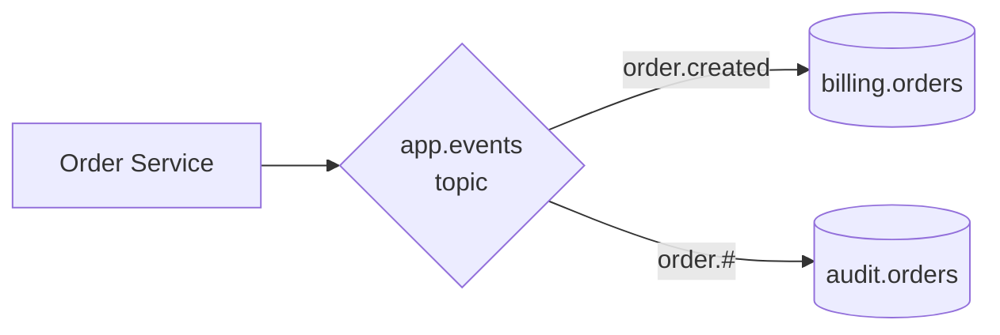
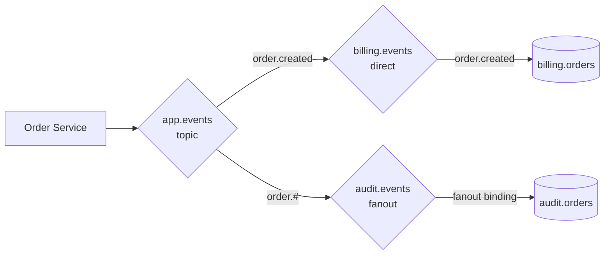
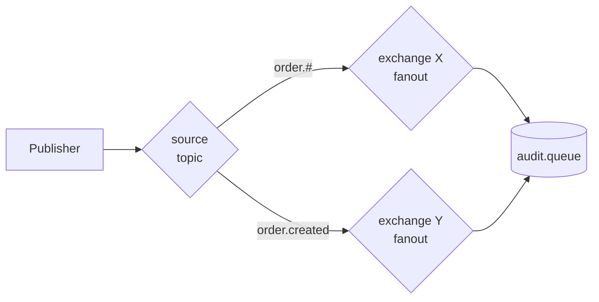
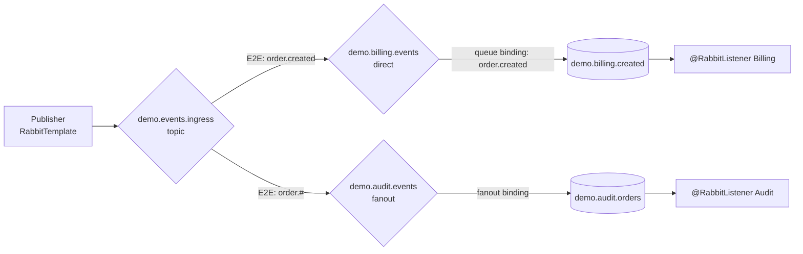

# Exchange-to-exchange binding trong RabbitMQ

## Mục tiêu bài học

Trong **SPRING_AMQP**, khi dùng `RabbitTemplate` phát message và `@RabbitListener` nhận message, ta thường nối một **exchange** trực tiếp với một hoặc nhiều **queue**. Tuy nhiên, RabbitMQ còn hỗ trợ nối **exchange nguồn** với **exchange đích**. Kỹ thuật này gọi là **exchange-to-exchange binding** (viết tắt **E2E binding**) và giúp ghép các quy tắc định tuyến thành một topology nhiều tầng.

Bài học thuộc chương **Định tuyến thông điệp**, tập trung vào:

- Giải thích chính xác chiều **source exchange → destination exchange** và sự khác biệt với binding từ exchange đến queue.
- Hiểu cách loại exchange và binding key ở **mỗi tầng** quyết định queue cuối cùng nhận message.
- Khai báo E2E binding trong RabbitMQ và trong Spring AMQP bằng `BindingBuilder` / `RabbitAdmin`.
- Thiết kế bài thực hành với `RabbitTemplate`, `@RabbitListener`, `TopicExchange`, `DirectExchange` và `FanoutExchange`.
- Phân tích routing trùng đường, vòng lặp, message không định tuyến được và những giới hạn của E2E khi xây ứng dụng bất đồng bộ đáng tin cậy.

> **Phạm vi giao thức:** E2E binding là **phần mở rộng AMQP 0-9-1 của RabbitMQ**, sử dụng lệnh `exchange.bind`. Không xem đây là khả năng bắt buộc của mọi broker triển khai AMQP 0-9-1, cũng không đồng nhất với mô hình AMQP 1.0.

## 1. Vì sao phải nối exchange với exchange?

Giả sử một hệ thống thương mại điện tử có **Order Service** phát sự kiện `order.created`, `order.shipped` và `order.cancelled`. Các dịch vụ phía sau có nhu cầu khác nhau:

- Billing chỉ xử lý `order.created`.
- Audit ghi nhận **mọi** sự kiện bắt đầu bằng `order.`.
- Một nhóm vận hành mới có thể muốn lấy toàn bộ sự kiện của nhiều domain vào cùng một exchange để áp dụng chính sách định tuyến chung.

Với cách đơn giản, publisher gửi vào exchange `app.events` rồi binding trực tiếp các queue vào exchange đó:



Khi số nhóm nhận thông điệp tăng lên, một exchange đầu vào có thể phải chứa nhiều binding gắn chặt với chi tiết queue của từng dịch vụ. E2E binding cho phép **ủy quyền một phần việc định tuyến sang exchange khác**:



Publisher **vẫn gửi một lần tới `app.events`**. Exchange `app.events` quyết định message có thể đi đến exchange con nào, sau đó quy tắc của exchange con quyết định queue nhận được. Khi thêm một queue audit mới, ta có thể gắn queue vào `audit.events` mà không phải sửa publisher hay binding nguồn.

E2E phù hợp với tổ chức topology theo miền nghiệp vụ, phân phối nhiều nhóm consumer, hoặc tạo các tầng lọc và phân phối. Nó không tự giải quyết mọi vấn đề về độ tin cậy; các cơ chế publisher confirm, consumer acknowledgement, retry, dead-letter và giám sát vẫn cần được thiết kế riêng.

## 2. Cấu trúc một E2E binding

Trong RabbitMQ, binding có hướng. Với E2E:

```text
          exchange.bind
    source exchange             destination exchange
  ┌────────────────┐           ┌─────────────────────┐
  │   app.events   │ ────────> │   billing.events    │
  └────────────────┘           └─────────────────────┘
       (source)        key          (destination)
                     order.created
```

Các thông số chính:

| Thuộc tính | Ý nghĩa |
|---|---|
| **Source exchange** | Exchange được publisher chọn làm điểm đầu vào, nơi điều kiện của E2E binding được đánh giá. |
| **Destination exchange** | Exchange nhận luồng định tuyến từ source và tiếp tục áp dụng các binding của **chính nó**. |
| **Binding key / arguments** | Điều kiện để source chuyển message tới destination; cách khớp phụ thuộc vào **loại source exchange**. |
| **Routing key của message** | Giá trị publisher đặt khi publish; được dùng tiếp trong các phép định tuyến theo key, không bị binding tự động thay bằng binding key. |

Lưu ý chiều dữ liệu: **source → destination**, không phải ngược lại. Với cùng hai exchange A và B, binding **A → B** khác binding **B → A**.

### So sánh exchange-to-queue và exchange-to-exchange

| Đặc điểm | Exchange → Queue | Exchange → Exchange |
|---|---|---|
| Nguồn | Exchange | Exchange |
| Đích | Queue | Exchange |
| Lệnh RabbitMQ | `queue.bind` | `exchange.bind` (RabbitMQ extension) |
| Sau khi source khớp binding | Message được định tuyến vào queue để consumer nhận | Message tiếp tục đi qua quy tắc của destination exchange |
| Điều kiện routing key | Phụ thuộc loại source exchange | Cũng phụ thuộc loại source exchange |
| Consumer có thể đọc trực tiếp từ đích? | Có, vì đích là queue | Không; consumer vẫn đọc từ **queue** ở cuối đường định tuyến |

**Điểm then chốt:** exchange không phải queue. Nối exchange A sang exchange B không khiến `@RabbitListener` có thể lắng nghe trực tiếp exchange B. Bạn vẫn phải khai báo queue và binding từ exchange B (hoặc exchange khác trên đường đi) đến queue đó.

## 3. Quy tắc định tuyến khi message đi qua hai exchange

Lấy chuỗi topology:

```text
order-service
    │ publish: exchange=app.events; routingKey=order.created
    ▼
app.events                  [topic]
    │ E2E binding: order.#
    ▼
billing.events              [direct]
    │ exchange→queue binding: order.created
    ▼
billing.orders              [queue]
    │
    ▼
@RabbitListener
```

Message đi tới `billing.orders` nếu **cả hai điều kiện** đều thỏa mãn:

1. `app.events` là **topic exchange**; pattern của E2E binding `order.#` khớp routing key `order.created`.
2. `billing.events` là **direct exchange**; binding từ đó đến queue có key `order.created` và khớp chính xác routing key gốc.

Nếu publisher gửi `order.shipped`, điều kiện ở source vẫn khớp `order.#`, nhưng binding của direct exchange đích không khớp. Kết quả: **`billing.orders` không nhận message**.

### Loại của source và destination đều có tác dụng

| Source exchange → destination exchange | Điều kiện để đi qua E2E | Điều kiện để tới queue sau đó |
|---|---|---|
| **Topic → Direct** | Pattern topic ở source, ví dụ `order.#` | Routing key khớp chính xác binding của direct đích |
| **Direct → Topic** | Key chính xác ở source, ví dụ `order.created` | Pattern topic ở destination, ví dụ `order.*` |
| **Topic → Fanout** | Pattern topic ở source | Fanout đích đưa message đến mọi queue bind với nó |
| **Fanout → Topic** | Source fanout bỏ qua binding key | Topic đích lọc message theo routing key |
| **Headers → Direct** | Source xét headers và các binding arguments | Destination direct xét routing key |

Đây là **hai lần áp dụng quy tắc định tuyến trong cùng topology**, không phải hai lần publisher thực hiện `basic.publish`. Theo cơ chế triển khai RabbitMQ, E2E là một phần của quá trình tính toán định tuyến; broker **không republish** message như một publisher thứ hai.

### Binding key của tầng dưới không thay routing key gốc

Ví dụ source topic có E2E binding `order.#`, còn destination direct có queue binding `order.created`. Message được publish với routing key `order.shipped` **không** bị đổi thành `order.#` khi đến destination. Phép khớp thứ hai vẫn xử lý `order.shipped`.

Đây là nhầm lẫn dễ mắc khi nhìn E2E như một chuỗi chuyển tiếp thủ công. **Binding key là bộ lọc, không phải một lệnh sửa routing key.**

## 4. RabbitMQ dùng E2E để định tuyến, không tạo message trung gian

Mô hình nhiều tầng có thể khiến người học tưởng mỗi exchange sẽ lưu một bản message rồi gửi tiếp sang exchange sau. Thực tế:

1. **Exchange không phải nơi lưu message như queue.** Exchange cung cấp quy tắc định tuyến.
2. **Publisher chỉ publish đến source exchange**. RabbitMQ áp dụng các binding có liên quan để tìm những queue đích hợp lệ.
3. **Mỗi queue được định tuyến nhận một bản sao của message**, dù topology có nhiều đường đi đến queue đó.
4. E2E **không thay thế queue**, không tạo một đợt giao nhận với acknowledgement riêng giữa hai exchange.

Ví dụ cùng queue có hai đường đi:



Với routing key `order.created`, hai nhánh X và Y đều phù hợp. RabbitMQ phát hiện các đường hội tụ và bảo đảm **một queue chỉ nhận một bản sao cho một lần định tuyến message**, thay vì hai bản sao do có hai đường đi.

RabbitMQ cũng **phát hiện và loại bỏ chu trình khi định tuyến**. Nếu các exchange có binding tạo thành A → B → C → A, broker không chuyển message vô hạn theo chu trình đó. Tuy nhiên, vẫn **không nên cố ý thiết kế topology vòng**: sơ đồ khó kiểm tra, người vận hành khó dự đoán đường đi, và thay đổi binding về sau có thể gây hiệu ứng ngoài ý muốn.

> **Phạm vi bảo đảm “một bản sao”:** Quy tắc trên áp dụng cho **một lần publish và một queue đích** trong quá trình định tuyến. Nó **không** loại bỏ các bản sao do publisher gửi lặp, consumer bị redelivery sau lỗi, retry nghiệp vụ hoặc các luồng publish riêng. Ứng dụng xử lý thanh toán vẫn cần idempotency phù hợp.

### Ý nghĩa đối với số liệu giám sát

Vì E2E không republish, số liệu **incoming / publish-in của destination exchange** không nhất thiết tăng khi một message đi từ source qua E2E. RabbitMQ ghi nhận hoạt động định tuyến tới các queue/stream đích; đừng dựa chỉ vào biểu đồ incoming của destination exchange để kết luận E2E không hoạt động. Hãy xem binding, tốc độ vào queue và consumer logs.

## 5. Khai báo trực tiếp bằng RabbitMQ Java Client

RabbitMQ cung cấp lệnh extension `exchange.bind`. Trong RabbitMQ Java Client, thao tác tương ứng là:

```java
channel.exchangeBind(
        "billing.events",  // destination exchange
        "app.events",      // source exchange
        "order.created"    // binding key tại source
);
```

**Thứ tự tham số là `destination, source, routingKey`**, dễ bị đọc nhầm thành `source, destination`.

Trước khi bind, source và destination exchange phải **đã tồn tại**. Ví dụ khung minh họa với cả khai báo exchange, queue và binding:

```java
import com.rabbitmq.client.Channel;
import com.rabbitmq.client.Connection;
import com.rabbitmq.client.ConnectionFactory;

public class RawRabbitE2eExample {
    public static void main(String[] args) throws Exception {
        ConnectionFactory factory = new ConnectionFactory();
        factory.setHost("localhost");

        try (Connection connection = factory.newConnection();
             Channel channel = connection.createChannel()) {

            channel.exchangeDeclare("app.events", "topic", true);
            channel.exchangeDeclare("billing.events", "direct", true);
            channel.queueDeclare("billing.orders", true, false, false, null);

            channel.exchangeBind(
                    "billing.events", "app.events", "order.created");
            channel.queueBind(
                    "billing.orders", "billing.events", "order.created");
        }
    }
}
```

Ứng dụng Spring Boot sử dụng Spring AMQP thường **không cần** thao tác trực tiếp trên `Channel` như trên. Đoạn code chỉ giúp làm rõ giao thức và chiều source/destination. Phần tiếp theo khai báo tương đương bằng Spring.

## 6. Khai báo E2E binding bằng Spring AMQP

### 6.1. Chuẩn bị dependency và broker

Dự án Spring Boot cần starter:

```groovy
dependencies {
    implementation 'org.springframework.boot:spring-boot-starter-amqp'
}
```

Với Maven:

```xml
<dependency>
    <groupId>org.springframework.boot</groupId>
    <artifactId>spring-boot-starter-amqp</artifactId>
</dependency>
```

Để Spring Boot BOM/plugin quản lý phiên bản starter phù hợp với phiên bản ứng dụng. Bạn cần một RabbitMQ broker đang hoạt động; để thử nghiệm local có thể dùng image quản trị:

```bash
docker run -d --name rabbitmq-e2e-lab \
  -p 5672:5672 -p 15672:15672 \
  rabbitmq:4-management
```

Ví dụ `src/main/resources/application.yml` cho môi trường local:

```yaml
spring:
  rabbitmq:
    host: localhost
    port: 5672
    username: guest
    password: guest
    virtual-host: /
```

Tài khoản `guest` thường giới hạn kết nối từ loopback; chỉ dùng cấu hình minh họa cho môi trường phát triển. Nếu đã có broker thì sử dụng kết nối của môi trường đó.

### 6.2. Topology minh họa: topic đầu vào, direct và fanout ở phía sau

Thiết kế:

- Publisher gửi vào **source topic exchange** `demo.events.ingress`.
- E2E binding `order.created` chuyển sự kiện tạo đơn hàng đến **destination direct exchange** `demo.billing.events`.
- E2E binding `order.#` chuyển mọi sự kiện đơn hàng đến **destination fanout exchange** `demo.audit.events`.
- Queue billing chỉ nhận `order.created` từ exchange billing.
- Queue audit nhận tất cả message đã đến exchange audit.



### 6.3. Tạo exchange, queue và hai loại binding

Đặt class trong một package được Spring Boot component-scan. Ví dụ file `MessagingTopology.java`:

```java
package com.example.routing;

import org.springframework.amqp.core.Binding;
import org.springframework.amqp.core.BindingBuilder;
import org.springframework.amqp.core.DirectExchange;
import org.springframework.amqp.core.FanoutExchange;
import org.springframework.amqp.core.Queue;
import org.springframework.amqp.core.QueueBuilder;
import org.springframework.amqp.core.TopicExchange;
import org.springframework.beans.factory.annotation.Qualifier;
import org.springframework.context.annotation.Bean;
import org.springframework.context.annotation.Configuration;

@Configuration
public class MessagingTopology {

    public static final String INGRESS = "demo.events.ingress";
    public static final String BILLING_EXCHANGE = "demo.billing.events";
    public static final String AUDIT_EXCHANGE = "demo.audit.events";
    public static final String BILLING_QUEUE = "demo.billing.created";
    public static final String AUDIT_QUEUE = "demo.audit.orders";

    // 1. Exchange nguồn
    @Bean
    TopicExchange ingressExchange() {
        return new TopicExchange(INGRESS, true, false);
    }

    // 2. Hai exchange đích
    @Bean
    DirectExchange billingExchange() {
        return new DirectExchange(BILLING_EXCHANGE, true, false);
    }

    @Bean
    FanoutExchange auditExchange() {
        return new FanoutExchange(AUDIT_EXCHANGE, true, false);
    }

    // 3. Queue ở cuối đường định tuyến
    @Bean
    Queue billingQueue() {
        return QueueBuilder.durable(BILLING_QUEUE).build();
    }

    @Bean
    Queue auditQueue() {
        return QueueBuilder.durable(AUDIT_QUEUE).build();
    }

    // 4. E2E: ingress topic -> billing direct
    @Bean
    Binding ingressToBilling(
            @Qualifier("billingExchange") DirectExchange destination,
            @Qualifier("ingressExchange") TopicExchange source) {
        return BindingBuilder.bind(destination)
                .to(source)
                .with("order.created");
    }

    // 5. E2E: ingress topic -> audit fanout
    @Bean
    Binding ingressToAudit(
            @Qualifier("auditExchange") FanoutExchange destination,
            @Qualifier("ingressExchange") TopicExchange source) {
        return BindingBuilder.bind(destination)
                .to(source)
                .with("order.#");
    }

    // 6. Exchange đích -> queue cuối
    @Bean
    Binding billingToQueue(
            @Qualifier("billingQueue") Queue destination,
            @Qualifier("billingExchange") DirectExchange source) {
        return BindingBuilder.bind(destination)
                .to(source)
                .with("order.created");
    }

    @Bean
    Binding auditToQueue(
            @Qualifier("auditQueue") Queue destination,
            @Qualifier("auditExchange") FanoutExchange source) {
        return BindingBuilder.bind(destination).to(source);
    }
}
```

Quan sát cú pháp **rất quan trọng**:

```java
// Exchange-to-exchange:
BindingBuilder.bind(destinationExchange).to(sourceExchange).with("key");

// Exchange-to-queue:
BindingBuilder.bind(destinationQueue).to(sourceExchange).with("key");
```

`BindingBuilder.bind(...)` **chọn đích** (queue hoặc exchange); `to(...)` **chọn exchange nguồn**. Trong ví dụ thực, kiểu `TopicExchange` của source cho phép `with("order.#")`; kiểu `DirectExchange` dùng exact match khi nối đến queue; kiểu `FanoutExchange` không cần binding key.

Spring AMQP tạo các đối tượng `Binding` có `DestinationType.EXCHANGE` cho E2E, còn binding tới queue có `DestinationType.QUEUE`. Trong ứng dụng Spring Boot với `RabbitAdmin` được auto-configure và bật auto-declaration, các bean `Exchange`, `Queue` và `Binding` đủ điều kiện sẽ được khai báo lên broker khi có kết nối. Không cần gọi `exchangeBind` của Java Client thủ công.

### 6.4. Publisher và consumer dùng đúng exchange/queue

File `OrderEventPublisher.java`:

```java
package com.example.routing;

import org.springframework.amqp.rabbit.core.RabbitTemplate;
import org.springframework.stereotype.Service;

@Service
public class OrderEventPublisher {

    private final RabbitTemplate rabbitTemplate;

    public OrderEventPublisher(RabbitTemplate rabbitTemplate) {
        this.rabbitTemplate = rabbitTemplate;
    }

    public void publish(String routingKey, String orderId) {
        rabbitTemplate.convertAndSend(
                MessagingTopology.INGRESS,
                routingKey,
                "orderId=" + orderId
        );
    }
}
```

File `OrderEventListeners.java`:

```java
package com.example.routing;

import org.springframework.amqp.rabbit.annotation.RabbitListener;
import org.springframework.stereotype.Component;

@Component
public class OrderEventListeners {

    @RabbitListener(queues = MessagingTopology.BILLING_QUEUE)
    public void receiveBilling(String payload) {
        System.out.println("Billing: " + payload);
    }

    @RabbitListener(queues = MessagingTopology.AUDIT_QUEUE)
    public void receiveAudit(String payload) {
        System.out.println("Audit: " + payload);
    }
}
```

File `RoutingApplication.java` (đặt cùng package):

```java
package com.example.routing;

import org.springframework.boot.ApplicationRunner;
import org.springframework.boot.SpringApplication;
import org.springframework.boot.autoconfigure.SpringBootApplication;
import org.springframework.context.annotation.Bean;

@SpringBootApplication
public class RoutingApplication {

    public static void main(String[] args) {
        SpringApplication.run(RoutingApplication.class, args);
    }

    @Bean
    ApplicationRunner publishExamples(OrderEventPublisher publisher) {
        return args -> {
            publisher.publish("order.created", "1001");
            publisher.publish("order.shipped", "1002");
            publisher.publish("payment.failed", "1003");
        };
    }
}
```

Khi ứng dụng khởi động và tự khai báo thành công, kết quả dự kiến:

| Routing key publish tới `demo.events.ingress` | E2E đến billing | E2E đến audit | Queue cuối nhận |
|---|:---:|:---:|---|
| `order.created` | Có | Có | `demo.billing.created` và `demo.audit.orders` |
| `order.shipped` | Không | Có | `demo.audit.orders` |
| `payment.failed` | Không | Không | Không queue nào trong topology ví dụ |

Log có thể xuất hiện như sau, với **thứ tự không được bảo đảm**:

```text
Billing: orderId=1001
Audit: orderId=1001
Audit: orderId=1002
```

Đừng mong `payment.failed` xuất hiện trên audit queue, vì `order.#` không khớp routing key đó. Nếu consumer đã có sẵn trên queue, log và số lượng `Ready` phụ thuộc thời điểm xử lý.

## 7. Khai báo bằng `AmqpAdmin` và `Declarables`

### 7.1. `AmqpAdmin.declareBinding(...)`

Khi cần chủ động tạo binding tại thời điểm chạy thay vì đăng ký `@Bean`, Spring AMQP có thể gọi:

```java
import org.springframework.amqp.core.AmqpAdmin;
import org.springframework.amqp.core.Binding;
import org.springframework.amqp.core.BindingBuilder;
import org.springframework.amqp.core.DirectExchange;
import org.springframework.amqp.core.TopicExchange;

public class DynamicExchangeBinder {
    private final AmqpAdmin admin;

    public DynamicExchangeBinder(AmqpAdmin admin) {
        this.admin = admin;
    }

    public void bindNow() {
        TopicExchange source =
                new TopicExchange("dynamic.source", true, false);
        DirectExchange destination =
                new DirectExchange("dynamic.destination", true, false);

        admin.declareExchange(source);
        admin.declareExchange(destination);

        Binding e2e = BindingBuilder.bind(destination)
                .to(source)
                .with("order.created");
        admin.declareBinding(e2e);
    }
}
```

Lưu ý `declareExchange` trước `declareBinding`: cả source và destination phải tồn tại trên broker khi tạo binding. Đoạn code minh họa này chỉ tạo **E2E binding**, chưa khai báo queue/consumer; nếu muốn message đến consumer thì phải tạo một queue và binding phía sau destination.

### 7.2. Gom topology với `Declarables`

`Declarables` phù hợp nếu một tính năng sở hữu trọn nhóm tài nguyên. Một bean có thể trả về toàn bộ cấu hình:

```java
@Bean
org.springframework.amqp.core.Declarables reportingTopology() {
    TopicExchange source =
            new TopicExchange("reporting.inbound", true, false);
    DirectExchange destination =
            new DirectExchange("reporting.dispatch", true, false);
    Queue queue = QueueBuilder.durable("reporting.finished").build();

    Binding e2e = BindingBuilder.bind(destination)
            .to(source).with("report.finished");
    Binding toQueue = BindingBuilder.bind(queue)
            .to(destination).with("report.finished");

    return new org.springframework.amqp.core.Declarables(
            source, destination, queue, e2e, toQueue);
}
```

Ví dụ trên giả sử lớp được đặt bên trong một class `@Configuration` và đã import các kiểu `TopicExchange`, `DirectExchange`, `Queue`, `QueueBuilder`, `Binding` và `BindingBuilder`. `RabbitAdmin` đọc các `Declarable` từ `Declarables` để khai báo. E2E và exchange-to-queue binding vẫn là **hai tài nguyên khác nhau**; không nên khai báo chúng trùng nhau qua nhiều bean nếu không có chủ đích.

Tương tự các khai báo tài nguyên khác, `Declarables` **không tạo một giao dịch nguyên tử** cho toàn bộ topology: nếu một binding thất bại, những exchange và queue khai báo trước đó có thể đã tồn tại.

## 8. Cách quan sát E2E binding trên RabbitMQ

Nếu chạy broker bằng Docker image `rabbitmq:4-management` và đã map cổng, mở `http://localhost:15672` để kiểm tra qua giao diện RabbitMQ Management:

1. Mở **Exchanges**, xác nhận có ba exchange `demo.events.ingress` (topic), `demo.billing.events` (direct), `demo.audit.events` (fanout).
2. Ở exchange **nguồn** `demo.events.ingress`, xem phần **Bindings**; các đích phải là **exchange**, với khóa `order.created` và `order.#`.
3. Ở mỗi **exchange đích**, xem binding tới queue tương ứng: billing với key `order.created`, audit với fanout binding.
4. Mở **Queues and Streams** để kiểm tra queue tồn tại, tốc độ vào queue và lượng message `Ready`/`Unacked`.
5. Dùng chức năng publish thử trên **source exchange**, lần lượt nhập `order.created` và `order.shipped` để xem consumer logs hoặc các chỉ số của queue đích.

Nếu có quyền dòng lệnh trên node RabbitMQ, `rabbitmqctl list_bindings` cũng giúp xem nguồn, đích, loại đích và routing key. Ví dụ:

```bash
rabbitmqctl list_bindings -p / source_name destination_name destination_kind routing_key
```

Tên virtual host và quyền quản trị cần phù hợp với môi trường; `/` chỉ là virtual host mặc định trong ví dụ.

### Cảnh báo về thống kê exchange

Khi publish vào source và định tuyến qua E2E, **destination exchange không được republish** nên chỉ số inbound của destination có thể không tăng như khi publisher gửi trực tiếp vào đó. Dựa vào:

- Thông tin **binding đúng chiều** trên broker.
- Số message được định tuyến vào **queue cuối**.
- Log consumer và các metrics queue (publish/deliver/ack, tùy công cụ).

Đây là cách kiểm tra đáng tin cậy hơn việc chỉ nhìn incoming rate của exchange đích.

## 9. Phân biệt E2E với các cơ chế khác

| Cơ chế | Mục đích | Điểm khác với E2E |
|---|---|---|
| **Exchange → Queue binding** | Định tuyến message trực tiếp vào queue | Không có tầng exchange tiếp theo. |
| **E2E binding** | Nối topology định tuyến giữa các exchange | Áp dụng định tuyến qua nhiều exchange; không tạo một lần publish mới. |
| **Alternate exchange (AE)** | Xử lý message không định tuyến được bởi exchange chính, theo cấu hình của broker | Được dùng khi cơ chế định tuyến thông thường không đưa message đến queue hợp lệ; không phải liên kết nhận mọi message như E2E. |
| **Dead-letter exchange (DLX)** | Định tuyến lại message khi bị dead-letter (ví dụ reject không requeue, TTL hết hạn, vượt giới hạn theo chính sách) | Được kích hoạt bởi sự kiện vòng đời message trong queue, không phải việc định tuyến bình thường qua E2E. |
| **Publisher gửi tới hai exchange** | Publisher phát hai lần hoặc chủ động phân phối sự kiện | Có hai lần publish độc lập; cần xem xét idempotency và trạng thái gửi riêng của từng lần. |
| **Một queue có nhiều consumer** | Chia tải xử lý các message trong một queue | Các consumer thường cạnh tranh đọc message, không tự nhận mỗi người một bản sao. |

Đặc biệt, **E2E không phải retry**: nếu consumer xử lý thất bại, việc requeue, retry hoặc dead-letter phải được cấu hình ở listener/broker. E2E cũng không bảo đảm atomicity giữa việc cập nhật database và việc publish message; đó là bài toán giao dịch và kiến trúc ứng dụng riêng.

## 10. Những lỗi thiết kế và triển khai thường gặp

### 10.1. Đảo chiều source và destination

Sai:

```java
// Ý định: từ source -> destination, nhưng code đảo ngược!
BindingBuilder.bind(source).to(destination).with("order.created");
```

Đúng:

```java
BindingBuilder.bind(destination).to(source).with("order.created");
```

Vì `bind(...)` là **đích**, code sai sẽ định tuyến theo chiều ngược với kỳ vọng. Khi phân tích lỗi, xem cả tên source/destination trên RabbitMQ Management; không chỉ đọc tên biến trong Java.

### 10.2. Nhầm filter ở source với filter ở destination

Với `source(topic) --"order.#"--> destination(direct) --"order.created"--> queue`, chỉ các message khớp **cả hai tầng** mới đến queue.

Nếu message `order.cancelled` không vào queue, chưa chắc E2E bị lỗi: nó có thể **đã đi qua E2E**, nhưng **không khớp** binding direct đích. Hãy kiểm tra từng tầng theo thứ tự.

### 10.3. Tạo E2E nhưng không có queue sau exchange đích

Mọi binding đều tồn tại nhưng không có queue cuối phù hợp thì consumer không thể nhận message. Một exchange đích đơn lẻ **không lưu message để tiêu thụ sau**.

### 10.4. Broker từ chối khai báo

Các tình huống thường gặp:

- Source hoặc destination exchange chưa được declare, dẫn đến lỗi như `NOT_FOUND` khi tạo binding.
- Exchange đã tồn tại nhưng type hoặc thuộc tính không khớp với bean mới, dẫn đến `PRECONDITION_FAILED`.
- Người dùng AMQP thiếu quyền cấu hình phù hợp trên source/destination trong virtual host.
- Ứng dụng kết nối nhầm broker hoặc virtual host.
- `RabbitAdmin` chưa được khởi tạo, đã tắt auto-declaration, hoặc các bean topology không thuộc application context đang được admin quản lý.

Tránh xóa exchange/queue production để “sửa nhanh” lỗi khai báo. Thay đổi topology cần xem xét consumer đang chạy, message tồn đọng và yêu cầu vận hành.

### 10.5. Vòng lặp hoặc nhiều đường dẫn khó kiểm soát

RabbitMQ loại bỏ vòng lặp và ngăn một queue nhận nhiều bản sao từ nhiều đường trong **một lần định tuyến**. Tuy nhiên, topology vòng hoặc quá nhiều tầng khiến người phát triển khó hiểu nguyên nhân một message đi tới queue. Nên:

- Ưu tiên **đồ thị có hướng không vòng** và ít tầng nếu nghiệp vụ cho phép.
- Thống nhất tên source/destination, quy ước routing key và chủ sở hữu binding.
- Ghi rõ “exchange nào lọc theo điều kiện nào” trong sơ đồ.
- Theo dõi message đi tới queue cuối bằng metrics và consumer log.

### 10.6. Coi E2E là bảo đảm giao nhận

E2E giải quyết **đường đi** của message. Độ tin cậy cần phân tích riêng:

| Câu hỏi | Cơ chế cần xem xét |
|---|---|
| Broker đã xác nhận publish chưa? | **Publisher confirms**. |
| Message có được định tuyến vào queue không? | Binding đúng, `mandatory` / publisher returns khi cần phát hiện unroutable, alternate exchange nếu được cấu hình. |
| Message có tồn tại sau sự cố broker không? | Durable topology, message persistence, loại queue, chính sách replication và publisher confirms. |
| Consumer đã xử lý xong chưa? | Consumer acknowledgement, error handling, retry/requeue, dead-letter. |
| Message được giao lại thì có gây xử lý trùng không? | Idempotency key, kiểm soát trạng thái nghiệp vụ. |

Ví dụ `RabbitTemplate.convertAndSend(...)` trả về bình thường không tự chứng minh queue cuối đã nhận và consumer đã xử lý thành công. Publisher returns và confirms có cấu hình riêng; một số trường hợp không định tuyến vẫn có thể được broker chấp nhận.

## 11. Bài tập tự kiểm tra định tuyến E2E

Cho topology:

```text
                 source: platform.events (topic)
                       /                  \
              E2E: user.#           E2E: *.failed
                     /                      \
          users.events (topic)       alerts.events (fanout)
                |                           |
          binding: user.*             fanout binding
                |                           |
          users.audit                  ops.alerts
```

Giả sử publisher luôn gửi vào `platform.events`. Dự đoán queue đích:

| Routing key | `users.audit` | `ops.alerts` | Lý do |
|---|:---:|:---:|---|
| `user.created` | Nhận | — | Khớp `user.#` ở source và `user.*` ở destination. |
| `user.login.failed` | — | — | Khớp `user.#` nhưng **không** khớp `user.*`; đồng thời không khớp `*.failed`. |
| `payment.failed` | — | Nhận | Khớp `*.failed` ở source; fanout đích chuyển tới queue alerts. |
| `user.failed` | Nhận | Nhận | Đồng thời khớp cả hai E2E binding; các queue nhận riêng. |
| `order.created` | — | — | Không khớp binding E2E nào. |

### Thử thay đổi

1. Đổi binding từ `users.events` đến `users.audit` thành `user.#`. Khi đó `user.login.failed` bắt đầu tới `users.audit`.
2. Thêm một binding trực tiếp từ `platform.events` tới `ops.alerts` với pattern `user.failed`. Với routing key `user.failed`, message tới queue theo **hai đường**, nhưng RabbitMQ vẫn đưa một bản sao cho queue đó trong một lần publish.
3. Thêm E2E từ `alerts.events` về `platform.events`, tạo chu trình. RabbitMQ không lặp vô hạn; tuy vậy hãy ghi lại vì sao cách nối này gây khó khăn cho bảo trì và chọn topology không vòng nếu không có lý do đặc biệt.

### Câu hỏi kiểm tra hiểu biết

**Câu 1.** Trong `channel.exchangeBind("B", "A", "x")`, message đi theo chiều nào?

**Đáp án:** Từ **exchange A** đến **exchange B** khi điều kiện key `x` khớp theo quy tắc của A.

**Câu 2.** Exchange A là `fanout` và B là `topic`. Binding A → B có key `order.#`. Có phải chỉ message thuộc `order` mới đi tới B?

**Đáp án:** **Không.** Fanout A không lọc routing key; B sẽ tiếp tục áp dụng các **topic binding của B** tới những queue/exchange tiếp theo.

**Câu 3.** Hai đường E2E cùng dẫn một message vào một queue. Queue sẽ có hai bản sao từ một lần publish?

**Đáp án:** **Không.** RabbitMQ loại trùng tại queue trong một lần định tuyến. Quy tắc này không thay thế idempotency khi publisher gửi lặp hoặc consumer được redelivery.

**Câu 4.** Có thể đặt `@RabbitListener(queues = "demo.audit.events")` để lắng nghe fanout exchange đích không?

**Đáp án:** **Không** nếu `demo.audit.events` chỉ là exchange. Listener cần tên **queue** đã bind phía sau exchange. Chỉ khi tình cờ có một queue mang đúng chuỗi tên ấy (tài nguyên khác) thì nó mới là tên queue hợp lệ.

## 12. Nguồn tham khảo

- [RabbitMQ — Exchange to Exchange Bindings](https://www.rabbitmq.com/docs/e2e): khái niệm `exchange.bind`, chiều source/destination, xử lý vòng lặp và nhiều đường dẫn.
- [RabbitMQ — Exchanges](https://www.rabbitmq.com/docs/exchanges): loại exchange, quy tắc định tuyến và lưu ý số liệu đối với E2E.
- [Spring AMQP — BindingBuilder API](https://docs.spring.io/spring-amqp/docs/3.2.x/api/org/springframework/amqp/core/BindingBuilder.html): cách `bind(Exchange)` và `to(Exchange)` tạo binding.

## Ghi nhớ

- **E2E binding** nối **source exchange → destination exchange** và là phần mở rộng AMQP 0-9-1 của **RabbitMQ**.
- Điều kiện E2E được đánh giá theo **loại source exchange**; destination exchange tiếp tục áp dụng quy tắc của **loại destination**. Routing key gốc vẫn được dùng cho những bước định tuyến theo key.
- Trong Spring AMQP, viết `BindingBuilder.bind(destinationExchange).to(sourceExchange).with("key")` cho source loại direct/topic. **Đích đứng ở `bind(...)`, nguồn đứng ở `to(...)`.**
- E2E không republish hay lưu message tại exchange; consumer luôn nhận từ queue. RabbitMQ loại trùng đường đến cùng queue trong một lần định tuyến và ngăn vòng lặp vô hạn.
- E2E giúp tổ chức topology định tuyến phức tạp, nhưng xác nhận publish, xử lý consumer, retry, dead-letter, giao dịch và khả năng quan sát vẫn cần được cấu hình và kiểm chứng độc lập.
