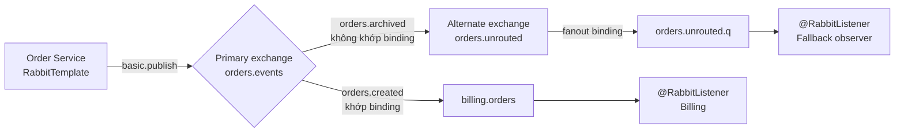
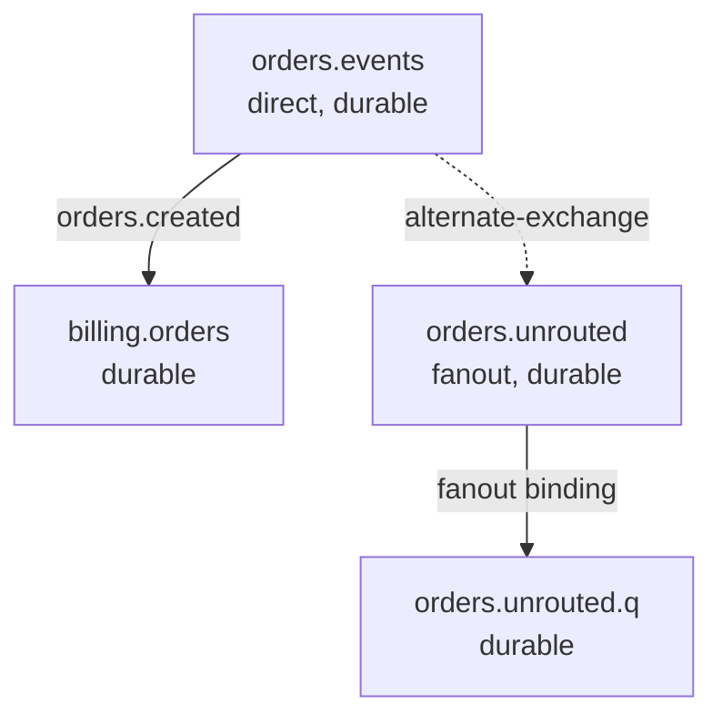
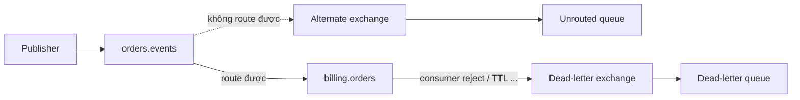
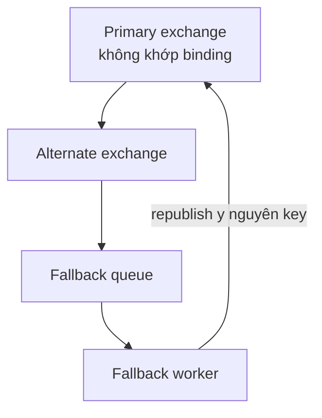

# Alternate exchange cho thông điệp không có queue phù hợp

## 1. Mục tiêu bài học

Trong RabbitMQ, publisher gửi message đến **exchange** với một **routing key**. Exchange dùng binding để tìm các queue nhận message. Nếu không có binding nào đưa message đến một queue, message được xem là **unroutable** tại bước định tuyến. Không có cơ chế xử lý phù hợp, publisher rất dễ tưởng rằng đã gửi thành công trong khi không consumer nào có thể nhận message đó.

**Alternate exchange (AE)** là cơ chế dự phòng ở cấp exchange của RabbitMQ: khi một exchange không định tuyến được message đến bất kỳ queue nào, broker thử chuyển message sang exchange dự phòng đã cấu hình. AE thường được dùng để thu gom message không được route, phục vụ kiểm tra cấu hình, xử lý ngoại lệ nghiệp vụ hoặc giám sát sự kiện bị bỏ sót.

Bài này thuộc chương **Định tuyến thông điệp** của module **SPRING_AMQP**. Ta sử dụng `RabbitTemplate`, `@RabbitListener`, exchange, queue và binding làm nền tảng; từ đó liên hệ với publisher confirms/returns, retry, dead-letter, transaction và khả năng quan sát để xây dựng hệ thống bất đồng bộ đáng tin cậy.

Sau bài học, bạn có thể:

- Mô tả chính xác **điều kiện kích hoạt alternate exchange**.
- Phân biệt message **unroutable** với message chưa có consumer, xử lý lỗi, bị reject/nack hoặc hết TTL.
- Khai báo primary exchange, alternate exchange, queue và binding bằng Spring AMQP.
- Thiết lập alternate exchange bằng **exchange argument** hoặc **RabbitMQ policy**, và biết khi nào nên dùng mỗi cách.
- Phân tích tương tác giữa alternate exchange, `mandatory`, publisher returns và publisher confirms.
- Thiết kế fallback queue, listener và cơ chế giám sát message không định tuyến được.
- Kiểm thử các kịch bản định tuyến bình thường, rơi vào fallback và cấu hình sai.

## 2. Điểm cốt lõi: alternate exchange nằm ở bước định tuyến

Giả sử dịch vụ Order phát hai loại sự kiện:

- `orders.created` đã có binding đến queue của dịch vụ Billing.
- `orders.archived` chưa có binding nào.

Với một **direct exchange** tên `orders.events`, routing key `orders.created` khớp binding của `billing.orders`. Nhưng `orders.archived` không khớp; nếu exchange có AE `orders.unrouted`, broker thử định tuyến message sang exchange này.



**Điểm cần ghi nhớ:** AE là **một exchange thực sự**. Nó có type (direct/topic/fanout/headers), có binding riêng và tuân theo các quy tắc định tuyến của type đó. Nó không phải một queue đặc biệt, cũng không tạo queue tự động.

Thứ tự xử lý ở mức khái niệm:

1. Publisher gửi message vào **primary exchange** với routing key.
2. Broker tìm queue phù hợp dựa trên bindings của primary exchange.
3. Nếu định tuyến được đến **ít nhất một queue**, broker xử lý theo đường bình thường và không dùng AE chỉ vì có queue khác không khớp.
4. Nếu **không có queue phù hợp**, RabbitMQ thử định tuyến qua AE đã chỉ định.
5. AE tự áp dụng bindings của nó để tìm queue dự phòng. Nếu không có đường đến queue cuối cùng, AE không tự bảo đảm message được giữ lại.

AE đặc biệt hữu ích với topic exchange có nhiều routing key động, ứng dụng có nhiều phiên bản producer/consumer hoặc hệ thống cần phát hiện sự kiện chưa được hỗ trợ.

### 2.1. “Không có queue phù hợp” có nghĩa gì?

| Tình huống khi publish | Primary có route đến queue? | AE của primary có được dùng? |
| --- | --- | --- |
| Direct exchange có binding `orders.created`, publish `orders.created` | Có | Không |
| Cùng exchange, publish `orders.archived` không có binding | Không | Có, nếu đã cấu hình AE |
| Queue đích tồn tại nhưng **không có consumer đang online** | Có | Không |
| Queue có consumer nhưng consumer đang bận, prefetch đầy | Có | Không |
| Message đã vào queue rồi listener throw exception, reject/nack | Đã có queue | Không phải trách nhiệm của AE; xem DLX/requeue |
| Queue có message hết TTL hoặc bị loại theo giới hạn queue | Đã có queue | Không phải điều kiện kích hoạt AE; xem dead-letter policy |
| Publish đến tên exchange không tồn tại | Không đến được bước route của exchange đó | Không; broker có thể báo lỗi channel vì exchange không tồn tại |

Một sự kiện rất quan trọng: **“có queue” không đồng nghĩa “có consumer xử lý”**. Nếu queue đã nhận message mà không consumer nào chạy, message sẽ nằm trong queue (theo chính sách và khả năng lưu trữ), không tự chuyển sang AE.

### 2.2. AE khác default exchange và exchange-to-exchange binding

RabbitMQ có **default exchange** (tên chuỗi rỗng `""`) để gửi trực tiếp tới queue theo tên queue. Default exchange có semantics riêng và không phải exchange ứng dụng tự tạo để gắn alternate exchange tùy ý.

Exchange-to-exchange bindings cũng cho phép xây topology trung gian, nhưng chúng dùng cho **định tuyến chủ động bằng binding**. AE được kích hoạt vì **primary exchange không route được message**. Không nên dùng hai cơ chế này như những thuật ngữ đồng nghĩa.

## 3. Chọn kiểu alternate exchange

AE có thể là exchange thuộc những type RabbitMQ hỗ trợ. Type ảnh hưởng trực tiếp đến cách message fallback đi tới queue.

| Type của AE | Hành vi thường dùng | Ví dụ |
| --- | --- | --- |
| **Fanout** | Bỏ qua routing key, chuyển cho tất cả queue bind đến AE | Thu gom mọi message unroutable vào một queue quan sát |
| **Direct** | Chỉ nhận vào queue có binding key trùng routing key được chuyển tiếp | Các nhóm fallback khác nhau theo routing key chính xác |
| **Topic** | Dùng wildcard `*` và `#` trên routing key phân cấp bằng dấu chấm | Route `orders.*` sang một queue, các key khác theo pattern |
| **Headers** | Định tuyến dựa trên headers theo binding arguments | Trường hợp có quy tắc theo metadata thay vì routing key |

Với mục tiêu **không bỏ sót message cần quan sát**, lựa chọn đơn giản thường là **fanout AE** trỏ đến một fallback queue bền vững. Nếu cần nhóm riêng theo tên sự kiện, có thể dùng direct/topic AE và định nghĩa bindings đủ rộng; phải kiểm thử các routing key không khớp vì AE cũng có thể không route được.

Có thể thiết kế nhiều tầng fallback bằng cách cấu hình AE cho một exchange dự phòng khác, nhưng điều này làm tăng độ khó chẩn đoán. Không xây vòng lặp exchange hoặc chuỗi AE phức tạp nếu không có yêu cầu rõ ràng; kiểm tra cách broker xử lý đường định tuyến trong integration test.

## 4. Hai cách cấu hình alternate exchange trong RabbitMQ

RabbitMQ hỗ trợ gắn AE cho exchange qua **argument khi khai báo exchange** hoặc **policy**.

### 4.1. Cấu hình bằng exchange argument

Khi khai báo primary exchange, cung cấp argument có key **`alternate-exchange`** và value là tên exchange dự phòng. Ví dụ với RabbitMQ Java client:

```java
Map<String, Object> arguments = Map.of(
        "alternate-exchange", "orders.unrouted"
);

channel.exchangeDeclare(
        "orders.events",
        "direct",
        true,   // durable
        false,  // autoDelete
        arguments
);
```

Trong Spring AMQP, có thể dùng constructor của `DirectExchange` nhận `Map<String, Object>` để biểu diễn tương tự. Điểm đáng chú ý: argument tên `alternate-exchange` được áp dụng **cho primary exchange**; nó **không** khai báo alternate exchange hay fallback queue hộ bạn.

Argument nằm trong cấu hình của exchange được declare. Khi exchange cùng tên đã tồn tại với cấu hình không tương thích, broker có thể từ chối khai báo lại (ví dụ `PRECONDITION_FAILED`). Không nên sửa argument tùy tiện khi nhiều application instance đang dùng chung topology.

### 4.2. Cấu hình bằng RabbitMQ policy

Policy gắn alternate exchange cho các exchange có tên khớp pattern, thường thuận tiện hơn khi muốn thay đổi routing fallback qua cấu hình vận hành mà không cần redeploy ứng dụng.

Ví dụ minh họa với RabbitMQ CLI trong shell Unix:

```bash
rabbitmqctl set_policy -p / --apply-to exchanges AE_ORDERS "^orders[.]events$" '{"alternate-exchange":"orders.unrouted"}'
```

Lưu ý khi áp dụng:

- Policy phải được áp dụng vào **vhost phù hợp** và phạm vi **exchanges**.
- Regex phải khớp tên **primary exchange**. Pattern `^orders[.]events$` chỉ nhắm đúng `orders.events`.
- Alternate exchange `orders.unrouted` và binding đến fallback queue vẫn phải tồn tại.
- Cú pháp CLI có thể được kiểm chứng bằng `rabbitmqctl help set_policy` trên phiên bản RabbitMQ thực tế; trong hệ thống quản trị khác có thể dùng Management UI hoặc API.
- Nếu primary exchange đã có argument `alternate-exchange` từ phía ứng dụng, **client-provided argument thường được ưu tiên hơn regular policy cho cùng khóa**. Vì vậy không nên đồng thời dùng hai cơ chế với hai tên AE khác nhau rồi chờ policy ghi đè argument.

**Lựa chọn vận hành:** ưu tiên policy khi tổ chức muốn quản lý fallback tập trung và có thể thay đổi mà không phải sửa code exchange declaration; dùng argument khi topology là một hợp đồng rõ ràng nằm trong ứng dụng và vòng đời khai báo được quản lý chặt. Cần thống nhất một nguồn cấu hình có thẩm quyền, đặc biệt khi deploy nhiều instance.

## 5. Ví dụ Spring Boot: gom topology với `Declarables`

Ta sẽ xây ví dụ đầy đủ với primary exchange `orders.events` kiểu direct, AE `orders.unrouted` kiểu fanout, một queue bình thường và một fallback queue.

### 5.1. Dependency

Với Spring Boot, dùng Spring AMQP starter:

```xml
<dependency>
    <groupId>org.springframework.boot</groupId>
    <artifactId>spring-boot-starter-amqp</artifactId>
</dependency>
```

Spring Boot BOM nên quản lý phiên bản Spring AMQP và RabbitMQ Java client cho stack đã chọn. Các đoạn code bên dưới mô tả Spring AMQP dùng AMQP 0-9-1; không áp dụng máy móc cho AMQP 1.0, MQTT hay RabbitMQ Stream protocol.

### 5.2. Khai báo primary, alternate, queue và binding

```java
package example.messaging;

import java.util.Map;

import org.springframework.amqp.core.Binding;
import org.springframework.amqp.core.BindingBuilder;
import org.springframework.amqp.core.Declarables;
import org.springframework.amqp.core.DirectExchange;
import org.springframework.amqp.core.FanoutExchange;
import org.springframework.amqp.core.Queue;
import org.springframework.amqp.core.QueueBuilder;
import org.springframework.context.annotation.Bean;
import org.springframework.context.annotation.Configuration;

@Configuration
public class OrderRoutingTopology {

    public static final String PRIMARY = "orders.events";
    public static final String ALTERNATE = "orders.unrouted";

    public static final String BILLING_QUEUE = "billing.orders";
    public static final String FALLBACK_QUEUE = "orders.unrouted.q";

    public static final String CREATED_KEY = "orders.created";

    @Bean
    public Declarables orderRoutingResources() {
        // "alternate-exchange" là argument của PRIMARY.
        DirectExchange primaryExchange = new DirectExchange(
                PRIMARY,
                true,
                false,
                Map.of("alternate-exchange", ALTERNATE));

        // Fanout giúp mọi key không route được ở PRIMARY
        // đều có cơ hội đi vào fallback queue.
        FanoutExchange alternateExchange =
                new FanoutExchange(ALTERNATE, true, false);

        Queue billingQueue =
                QueueBuilder.durable(BILLING_QUEUE).build();

        Queue fallbackQueue =
                QueueBuilder.durable(FALLBACK_QUEUE).build();

        Binding normalBinding = BindingBuilder.bind(billingQueue)
                .to(primaryExchange)
                .with(CREATED_KEY);

        Binding fallbackBinding = BindingBuilder.bind(fallbackQueue)
                .to(alternateExchange);

        return new Declarables(
                primaryExchange,
                alternateExchange,
                billingQueue,
                fallbackQueue,
                normalBinding,
                fallbackBinding);
    }
}
```

Sau khi `RabbitAdmin` khai báo thành công, broker có một tuyến bình thường và một tuyến dự phòng:



**Không nhầm vai trò của `Declarables`:** nó chỉ gom các đối tượng `Exchange`, `Queue`, `Binding` để quản lý. `RabbitAdmin` mới thực hiện khai báo thực tế trên RabbitMQ. Nếu ứng dụng không được scan cấu hình, auto declaration bị tắt hoặc user thiếu quyền configure trên vhost, việc có `@Bean Declarables` vẫn chưa chứng minh topology đã tồn tại trên broker.

### 5.3. Phương án dùng policy thay cho exchange argument

Nếu tổ chức dùng policy ở mục 4.2 làm nguồn cấu hình AE, đổi đúng một dòng ở primary exchange:

```java
DirectExchange primaryExchange =
        new DirectExchange(PRIMARY, true, false);
// Không cung cấp Map.of("alternate-exchange", ALTERNATE)
// khi AE được quản lý bằng policy.
```

Đoạn này là **phương án thay thế** cho định nghĩa `primaryExchange` trong `orderRoutingResources()`, không phải một bean bổ sung cùng tên. Khi chuyển từ argument cứng sang policy trên **exchange đã tồn tại**, cần kiểm tra cách migration để tránh khai báo mâu thuẫn. Trên broker đang chạy production, không xóa exchange hoặc queue chỉ để vượt qua lỗi khai báo.

### 5.4. Cấu hình kết nối, confirms và returns

```yaml
spring:
  rabbitmq:
    host: ${RABBITMQ_HOST:localhost}
    port: ${RABBITMQ_PORT:5672}
    username: ${RABBITMQ_USERNAME:guest}
    password: ${RABBITMQ_PASSWORD:guest}
    virtual-host: ${RABBITMQ_VHOST:/}
    publisher-confirm-type: correlated
    publisher-returns: true
    template:
      mandatory: true
    listener:
      simple:
        acknowledge-mode: auto
        prefetch: 20
```

- `publisher-confirm-type: correlated` cấu hình hỗ trợ correlated publisher confirms trong Spring AMQP.
- `publisher-returns: true` và `template.mandatory: true` cho phép ứng dụng quan sát các trường hợp message không được broker định tuyến đến queue theo semantics của AMQP/RabbitMQ.
- **Nếu primary không route nhưng AE route đến fallback queue, message đã có queue đích**; không kỳ vọng một publisher return chỉ vì primary không match binding.
- `acknowledge-mode: auto` là chế độ container Spring tự ack sau xử lý thành công; khác với `autoAck/noAck` cấp RabbitMQ client.
- Thông tin đăng nhập `guest` thường chỉ dùng được từ localhost theo cấu hình mặc định của RabbitMQ; môi trường triển khai cần tài khoản riêng.

Nếu ứng dụng có nhiều publisher, nên cấu hình confirm/return callbacks tập trung để không vô tình ghi đè callback của component khác. Tên property hay các option cụ thể cần đối chiếu với Spring Boot release của dự án.

## 6. Publish message và quan sát fallback

### 6.1. Publisher sử dụng `RabbitTemplate`

```java
package example.messaging;

import org.springframework.amqp.rabbit.core.RabbitTemplate;
import org.springframework.stereotype.Service;

@Service
public class OrderEventsPublisher {
    private final RabbitTemplate rabbitTemplate;

    public OrderEventsPublisher(RabbitTemplate rabbitTemplate) {
        this.rabbitTemplate = rabbitTemplate;
    }

    public void publishCreated(String orderId) {
        rabbitTemplate.convertAndSend(
                OrderRoutingTopology.PRIMARY,
                OrderRoutingTopology.CREATED_KEY,
                orderId);
    }

    public void publishUnsupportedEvent(String orderId) {
        rabbitTemplate.convertAndSend(
                OrderRoutingTopology.PRIMARY,
                "orders.archived", // Chưa có binding trên PRIMARY
                orderId);
    }
}
```

Với topology ở mục 5:

- `publishCreated("ord-001")` đi vào `billing.orders`.
- `publishUnsupportedEvent("ord-002")` không match binding của `orders.events` nên RabbitMQ thử `orders.unrouted`; do AE là fanout có fallback binding, message đi vào `orders.unrouted.q`.

Việc publisher gọi `convertAndSend` thành công **không tự chứng minh** consumer của cả queue bình thường hay fallback đã xử lý message. Nếu cần độ tin cậy cao, hãy theo dõi confirms/returns, gắn message ID và thực hiện retry có chủ đích.

### 6.2. Consumer cho queue bình thường và queue fallback

```java
package example.messaging;

import org.springframework.amqp.rabbit.annotation.RabbitListener;
import org.springframework.stereotype.Component;

@Component
public class OrderEventListeners {

    @RabbitListener(queues = OrderRoutingTopology.BILLING_QUEUE)
    public void handleCreated(String orderId) {
        // Xử lý thanh toán phải có cơ chế chống xử lý trùng.
        System.out.println("Billing order: " + orderId);
    }

    @RabbitListener(queues = OrderRoutingTopology.FALLBACK_QUEUE)
    public void handleUnroutable(String orderId) {
        // Ghi nhận để phân tích key không được hỗ trợ.
        // Không tự động xử lý như orders.created.
        System.out.println("Unroutable order event: " + orderId);
    }
}
```

Ví dụ dùng payload `String` để dễ quan sát. Trong hệ thống thật, listener fallback có thể đọc `org.springframework.amqp.core.Message` để lấy body và metadata, hoặc dùng converter cho event envelope gồm `eventId`, `eventType`, `occurredAt`, `schemaVersion`.

Một lưu ý vận hành: fallback queue thường chứa **nhiều loại message không dự đoán trước**, vì vậy đừng ép tất cả payload phải khớp đúng DTO của một sự kiện cụ thể. Nếu conversion thất bại trước khi listener được gọi, message có thể bị reject/đưa vào chu trình lỗi tùy cấu hình. Có thể lựa chọn nhận raw `Message`, lưu thông tin cần thiết và xử lý phân loại ngoài luồng.

### 6.3. Theo dõi publisher confirms và returns

Ví dụ cấu hình một callback tập trung trên `RabbitTemplate` được Spring Boot tạo sẵn:

```java
package example.messaging;

import org.springframework.amqp.rabbit.core.RabbitTemplate;
import org.springframework.stereotype.Component;

@Component
public class PublishDiagnostics {

    public PublishDiagnostics(RabbitTemplate template) {
        template.setConfirmCallback((correlationData, ack, cause) -> {
            if (!ack) {
                System.err.println("Broker nacked publish: " + cause);
            }
        });

        template.setReturnsCallback(returned -> {
            System.err.println(
                    "Returned: exchange=" + returned.getExchange()
                    + ", routingKey=" + returned.getRoutingKey()
                    + ", replyText=" + returned.getReplyText());
        });
    }
}
```

Đây là ví dụ đơn giản về callback; trong môi trường production nên sử dụng logger, metric và gắn `CorrelationData`/event ID để truy vết, đồng thời bảo đảm chỉ có một thành phần chịu trách nhiệm đăng ký callbacks trên cùng template.

Đọc kết quả đúng ngữ nghĩa:

- **Publisher confirm ACK:** broker đã xử lý publish theo cam kết của publisher-confirm; không phải xác nhận listener đã chạy thành công và không tự cho biết message đang ở queue bình thường hay fallback.
- **Publisher confirm NACK:** broker không thể xác nhận publish ở phạm vi confirm; cần đánh giá khả năng retry.
- **Publisher return:** message được báo không route tới queue theo quy tắc `mandatory`. AE đã route thành công đến fallback queue sẽ **không gây return chỉ vì primary không match**.
- **Consumer ACK:** listener hoàn tất xử lý theo ack mode đã cấu hình. Nó độc lập với publisher confirm.

Khi network đứt lúc chờ confirm, publisher có thể không xác định message đã được broker nhận hay chưa. Retry có thể gây duplicate, do đó cần event ID, idempotency và (nếu phù hợp) outbox để hạn chế mất/sinh trùng sự kiện.

## 7. Ma trận tình huống: primary, alternate và mandatory

Giả sử:

- Primary `orders.events` là direct exchange, bind `orders.created` → `billing.orders`.
- Alternate `orders.unrouted` là fanout exchange, bind → `orders.unrouted.q`.
- Publisher dùng `mandatory=true` và correlated confirms.

| Publish | Primary route | AE route | Điều người vận hành cần thấy |
| --- | --- | --- | --- |
| `orders.created` | `billing.orders` | Không cần | Message vào queue bình thường; confirm có thể ACK khi broker chấp nhận publish |
| `orders.archived` | Không | `orders.unrouted.q` | Message vào fallback; không mong đợi return chỉ vì binding chính không match |
| `orders.created` nhưng Billing listener offline | `billing.orders` | Không cần | Message chờ trong queue; AE không cứu vấn đề consumer offline |
| `orders.archived` và fallback queue bị bỏ binding | Không | Không còn queue đích ở fallback | Message có nguy cơ không được lưu; xem return/đường định tuyến cuối cùng và kiểm thử `mandatory` |
| Publish đến `orders.missing` không tồn tại | Không có exchange hợp lệ | Không áp dụng | Lỗi publish/protocol; AE của `orders.events` không can thiệp |
| `orders.created` đã vào queue nhưng bị consumer reject không requeue | Đã route | Không áp dụng | Xem DLX của **queue**, không phải AE của exchange |

**Tránh kết luận sai từ confirm:** RabbitMQ có thể xác nhận một publish nhưng điều đó không chứng minh message đi vào queue mà nghiệp vụ mong muốn. Với fallback, message “được broker nhận và route” nhưng vẫn có thể là **lỗi contract** vì routing key chưa được hỗ trợ. Hãy đo riêng lượng message đi vào fallback queue.

## 8. Alternate exchange và dead-letter exchange khác nhau thế nào?

Đây là hai cơ chế thường bị nhầm vì đều có một exchange đóng vai trò “đường phụ”.

| Tiêu chí | Alternate exchange (AE) | Dead-letter exchange (DLX) |
| --- | --- | --- |
| Được gắn vào | **Exchange chính** qua `alternate-exchange`/policy | **Queue nguồn** qua `x-dead-letter-exchange`/policy |
| Điểm kích hoạt | **Exchange không tìm được queue đích khi route** | Message **đã ở trong queue**, rồi bị dead-letter vì các điều kiện như reject/nack không requeue, hết TTL, queue limit hoặc delivery-limit của quorum queue |
| Mục tiêu điển hình | Thu gom message không route được vì routing key/binding | Thu gom message lỗi xử lý, quá hạn hoặc bị loại theo policy |
| Có cần fallback exchange/queue? | Có; AE phải route được đến queue nhận | Có nếu muốn giữ dead-letter; DLX phải route đến queue nhận |
| Liên hệ với consumer ack | Không phụ thuộc listener ack | Reject/nack không requeue là một trong các tác nhân |
| Metadata thường dùng | Routing key, message ID, application headers | Có thể có các header về dead-letter như `x-death` |
| Ví dụ | `orders.archived` không match primary binding | `orders.created` vào Billing queue nhưng bị reject không requeue |



**Không được mặc định message trong AE có header `x-death`.** AE là một lần định tuyến dự phòng của exchange; dead-letter là hành động broker phát sinh từ queue. Nếu cần biết message đã đi qua fallback vì sao, ứng dụng có thể dựa vào **việc message tới fallback queue**, event envelope và các thông tin routing được ghi lại, thay vì giả định sẽ có metadata DLX.

Một hệ thống có thể đồng thời dùng cả hai:

- **AE** xử lý event type/routing key mà hệ thống chưa có queue nào nhận.
- **DLX/DLQ** xử lý event đã được nhận vào queue nghiệp vụ nhưng không hoàn thành quá trình xử lý.
- **Retry** xử lý lỗi tạm thời qua interceptor/backoff hoặc topology retry phù hợp.
- **Publisher confirms/returns** quan sát chiều gửi.
- **Ack và idempotency** giúp xử lý chiều nhận an toàn.

Chúng giải quyết những điểm hỏng khác nhau trong chuỗi bất đồng bộ.

## 9. Tổ chức fallback an toàn trong ứng dụng thực tế

### 9.1. Chọn độ bền và retention có chủ đích

Fallback queue bền vững có thể giúp giữ các message chưa được hỗ trợ, nhưng **durable queue không tự bảo đảm message an toàn trước mọi sự cố**. Muốn nâng độ tin cậy, cần xem persistence của message, publisher confirm, loại queue, chiến lược retry và lưu trữ broker. Nếu fallback queue tích tụ mà không ai xử lý, hệ thống có thể gặp áp lực disk/memory.

Nên xác định:

- **Owner**: ai chịu trách nhiệm xem và phân loại message unroutable?
- **SLO/cảnh báo**: bao nhiêu message fallback là bất thường? Cảnh báo dựa trên tốc độ vào, số lượng chờ hoặc tuổi message.
- **Retention**: giữ bao lâu, có được xóa hay đưa sang kho lưu trữ/kiểm toán không?
- **Replay/redrive**: sau khi sửa binding, message cũ sẽ được publish lại thế nào, có thể gửi trùng không?
- **Bảo mật**: fallback có thể chứa dữ liệu của nhiều nghiệp vụ; ai được đọc payload và metadata?

### 9.2. Không replay mù quáng

Một message rơi vào fallback có thể do publisher gửi sai routing key, do consumer service chưa deploy topology mới hoặc do cấu hình binding lỗi. Nếu một worker tự đọc fallback rồi **publish lại nguyên message vào primary ngay lập tức**, nó có thể tạo vòng lặp vô hạn:



Muốn redrive an toàn:

1. Xác định nguyên nhân (thiếu binding, version contract, routing key sai hay event không hỗ trợ).
2. Khắc phục topology hoặc sửa dữ liệu trước khi phát lại.
3. Lưu event ID và số lần redrive; tránh duplicate nghiệp vụ.
4. Áp dụng tốc độ xử lý và giới hạn thử lại để không tạo thêm backlog.
5. Với event không có consumer theo thiết kế, chọn lưu trữ/bỏ qua theo policy thay vì retry mãi.

### 9.3. Tách queue fallback theo domain khi cần

Một AE fanout chung rất tiện để quan sát, nhưng dễ trộn payload từ nhiều domain. Đối với hệ thống lớn, cân nhắc:

- Mỗi domain (orders, inventory, payments) có AE và fallback queue riêng.
- Một topic/direct AE với bindings hợp lý nếu cần phân loại fallback theo routing key.
- Queue riêng theo tenant hay mức độ nhạy cảm nếu có yêu cầu phân quyền rõ.
- DLQ độc lập với fallback queue để không trộn **message không route được** với **message xử lý thất bại**.

Một fallback queue có consumer vẫn có thể tích tụ message do payload lỗi hoặc consumer đang dừng. Vì thế, theo dõi trạng thái queue và lỗi xử lý fallback là phần bắt buộc của thiết kế.

## 10. Vòng đời topology và các lưu ý triển khai

### 10.1. `RabbitAdmin` và việc tạo tài nguyên

Với Spring Boot được cấu hình phù hợp, `RabbitAdmin` có thể tự khai báo exchange, queue và binding từ các bean `Declarables`. Để thành công:

- Cấu hình `@Configuration` được Spring scan/import.
- RabbitMQ connection dùng đúng host, vhost và credentials.
- User có quyền `configure`, `write`/`read` phù hợp với thao tác.
- `RabbitAdmin` tồn tại, auto declaration hoạt động và phần tử `Declarable` được phép khai báo qua admin tương ứng.
- Các exchange, queue đã tồn tại không xung đột về thuộc tính hoặc arguments.

Khi broker restart hoặc connection hồi phục, admin có thể thực hiện khai báo lại; điều này **không** tự sửa một `alternate-exchange` tham chiếu sai tên hay binding bị cấu hình mâu thuẫn. Sự kiện reconnect cũng không đảm bảo message phát trong lúc mất kết nối đã được nhận.

### 10.2. Thay đổi AE trong môi trường production

Nếu phải chuyển fallback từ `orders.unrouted` sang một exchange mới:

1. Xem AE đang được quản lý bởi **policy** hay **client x-argument**.
2. Tạo exchange/binding/queue mới và kiểm thử đường route trước.
3. Nếu dùng policy, cập nhật policy đúng vhost/pattern và kiểm tra precedence; nếu dùng argument trong code, lập kế hoạch rollout/migration topology tránh `PRECONDITION_FAILED`.
4. Theo dõi cả fallback cũ lẫn mới trong quá trình chuyển đổi.
5. Xử lý backlog và quyền truy cập trước khi bỏ tài nguyên cũ.

Không xóa primary exchange hoặc queue chứa message chỉ để khiến khai báo lại “chạy được”.

### 10.3. Broker không tự suy ra fallback từ tên queue

Các tên như `orders.dead`, `orders.unrouted`, `orders.fallback` chỉ là convention. RabbitMQ cần một argument/policy thực sự trên primary exchange và **binding** trên AE. Việc đặt tên “alternate” không có tác dụng định tuyến nếu thiếu cấu hình.

## 11. Quan sát và chẩn đoán

Với RabbitMQ Management UI (khi được bật), có thể kiểm tra:

- **Exchanges:** primary `orders.events` thuộc type direct, alternate `orders.unrouted` thuộc type fanout; alternate setting của primary (argument hoặc policy có hiệu lực).
- **Bindings:** key `orders.created` từ primary đến `billing.orders`; binding từ alternate đến `orders.unrouted.q`.
- **Queues:** ready/unacked, consumer count và tốc độ enqueue/dequeue của fallback queue.
- **Connections/channels:** lỗi khi khai báo exchange/queue và trạng thái publisher/consumer.
- **Logs/metrics:** lỗi `PRECONDITION_FAILED`, `NOT_FOUND`, publisher returns, publisher confirms, sự kiện reconnect.

Trong môi trường test có quyền RabbitMQ CLI:

```bash
rabbitmqctl -p / list_exchanges name type durable arguments
rabbitmqctl -p / list_bindings source_name destination_name routing_key
rabbitmqctl -p / list_queues name consumers messages_ready messages_unacknowledged
rabbitmqctl -p / list_policies
```

Tùy phiên bản, các cột CLI có thể khác; kiểm tra `rabbitmqctl help` hoặc dùng Management UI/API của broker thực tế. Vhost `/` trong ví dụ phải được thay bằng vhost phù hợp nếu hệ thống sử dụng môi trường khác.

### 11.1. Những câu hỏi khi fallback tăng đột biến

- Có producer mới gửi thêm event type hoặc routing key chưa được hỗ trợ không?
- Có service vừa deploy thay đổi binding key, exchange type hay vhost không?
- Có queue đích bị xóa hoặc binding mất sau thay đổi topology không?
- Primary exchange còn đúng argument/policy AE không?
- Fallback queue có consumer không, consumer có xử lý thành công không?
- Tốc độ message tới fallback tăng do lỗi nghiệp vụ hay do cấu hình giữa các phiên bản không khớp?

Cần đối chiếu theo thời gian triển khai và event ID. Đừng chỉ tăng số lượng consumer fallback nếu nguyên nhân là binding của primary bị xóa nhầm.

## 12. Bài thực hành kiểm chứng với RabbitMQ local/test

Sử dụng code mục 5 và 6 cùng một RabbitMQ broker thử nghiệm. Không làm các bước xóa/thay đổi binding trên môi trường production.

### Bước 1 — Xác minh topology

Khởi động ứng dụng; trong Management UI kiểm tra đúng hai exchanges, hai queues và hai bindings đã nêu. Xác nhận `orders.events` có `alternate-exchange` đúng tên `orders.unrouted` hoặc policy tương ứng đã có hiệu lực.

### Bước 2 — Gửi sự kiện được hỗ trợ

Gọi:

```java
orderEventsPublisher.publishCreated("ord-001");
```

Quan sát `billing.orders` nhận message và listener Billing xử lý. Fallback queue không tăng chỉ vì event đã route bình thường.

### Bước 3 — Gửi sự kiện chưa hỗ trợ

Gọi:

```java
orderEventsPublisher.publishUnsupportedEvent("ord-002");
```

Kỳ vọng message vào `orders.unrouted.q`. Nếu fallback listener đang bật, message có thể được tiêu thụ ngay nên queue depth không nhất thiết tăng rõ rệt; dùng listener log, management publish/deliver rates hoặc tạm dừng listener fallback để quan sát trong lab.

### Bước 4 — So sánh với consumer offline

Tạm dừng listener Billing nhưng giữ queue và binding; publish `orders.created`. Kỳ vọng message có thể **chờ trong `billing.orders`** và **không chuyển sang AE**. Đây là phép thử chứng minh AE dựa trên **routing**, không dựa trên **consumer availability**.

### Bước 5 — Kiểm thử thiếu binding fallback

Trong broker test, tạm xóa binding từ `orders.unrouted` đến `orders.unrouted.q` rồi publish `orders.archived`. Quan sát việc không có queue đích và tín hiệu `mandatory`/returns trong stack đang dùng. Khôi phục binding sau thử nghiệm.

Lưu ý: nếu `RabbitAdmin` tự khai báo lại sau reconnect hoặc restart, binding đã xóa thủ công có thể được tạo lại; kiểm tra trạng thái broker trước khi diễn giải kết quả.

### Bước 6 — Thử so sánh với DLX

Tạo một đường DLX riêng trên queue nghiệp vụ và cấu hình listener test reject không requeue. Gửi `orders.created` vốn route được vào queue. Message lỗi xử lý phải được đánh giá qua **DLX của queue**, không qua AE chỉ vì listener throw exception.

### Bước 7 — Tổng hợp kết quả

Điền bảng sau sau khi thực nghiệm:

| Case | Routing key | Binding ở primary | Kết quả mong đợi | Kết quả đo được |
| --- | --- | --- | --- | --- |
| Normal | `orders.created` | Có | Billing queue/consumer | ... |
| Unroutable | `orders.archived` | Không | Fallback queue | ... |
| Consumer offline | `orders.created` | Có | Chờ trong Billing queue | ... |
| Fallback unbound | `orders.archived` | Không | Không có queue đích; kiểm tra returns | ... |
| Consumer reject | `orders.created` | Có | Theo requeue/DLX của queue | ... |

Đừng chỉ dựa vào một log `send success`. Kết hợp broker queue counts, return/confirm callbacks và các log consumer để xác minh đường đi thực tế.

## 13. Checklist thiết kế

| Câu hỏi | Câu trả lời cần xác nhận |
| --- | --- |
| Primary exchange là type gì? | Direct/topic/fanout/headers, bindings phù hợp |
| AE được đặt ở đâu? | Argument `alternate-exchange` của primary hoặc policy áp dụng vào primary |
| AE là exchange gì? | Tên, type, durable và các bindings |
| Fallback có queue thật không? | Có queue tồn tại và binding từ AE tới queue |
| Có cần giữ mọi message unroutable? | Quyết định persistence, confirms, khả năng lưu trữ, retention và quyền đọc |
| Khi producer gửi key mới thì sao? | AE route fallback; có cảnh báo và người xử lý |
| Consumer offline có làm AE hoạt động không? | Không nếu primary vẫn route được vào queue |
| Message xử lý thất bại đi đâu? | Retry/requeue/DLX theo queue và listener policy |
| Publisher dùng confirm/returns không? | Định nghĩa rõ điều chúng xác nhận và không xác nhận |
| Có nguy cơ vòng redrive không? | Kiểm soát số lần phát lại, sửa nguyên nhân trước khi replay |
| Có nhiều broker/vhost/admin không? | Mỗi topology và policy áp dụng đúng phạm vi |
| Kiểm tra sau deploy thế nào? | Integration test normal/unroutable, alerts cho fallback queue |

## 14. Câu hỏi tự đánh giá

1. Primary exchange `orders.events` đang bind `orders.created` → `billing.orders`. Nếu không còn consumer Billing nhưng queue vẫn tồn tại, message `orders.created` có chuyển sang alternate exchange không? Giải thích.
2. Vì sao chỉ khai báo một queue tên `orders.unrouted.q` chưa đủ để bắt message không có binding?
3. Một publisher bật `mandatory=true`, gửi `orders.archived` không khớp primary nhưng AE đã chuyển đến fallback queue. Vì sao không nên kỳ vọng một publisher return do primary không match?
4. Nếu bạn đã khai báo `alternate-exchange` bằng argument và vận hành đồng thời đặt policy dùng một AE khác, nguồn cấu hình nào có thể chiếm ưu tiên?
5. Hãy mô tả sự khác nhau giữa **message unroutable** và **message bị listener reject không requeue**, và cho biết mỗi loại thường dùng exchange gì để xử lý.
6. Vì sao một publisher confirm ACK không phải bằng chứng message đã tới `billing.orders` thay vì `orders.unrouted.q`?
7. Khi fallback queue tăng bất thường, cần kiểm tra producer event type, bindings, policy, listener và tốc độ xử lý theo thứ tự nào?
8. Một fallback worker tự publish lại message nguyên routing key vào primary mà chưa sửa binding có thể gây hậu quả gì? Nêu biện pháp khắc phục.

**Ghi nhớ:** **Alternate exchange xử lý thất bại định tuyến ở cấp exchange**: khi primary không đưa message đến bất kỳ queue nào, RabbitMQ thử chuyển tiếp sang AE. Khai báo AE và fallback queue/binding đúng giúp phát hiện event không được hỗ trợ, nhưng không thay thế publisher confirms, returns, retry, DLX, consumer ack hoặc idempotency. Trong Spring AMQP, hãy khai báo topology rõ ràng, kiểm thử cả đường bình thường lẫn fallback và giám sát fallback queue như một tín hiệu quan trọng của chất lượng hợp đồng message.
