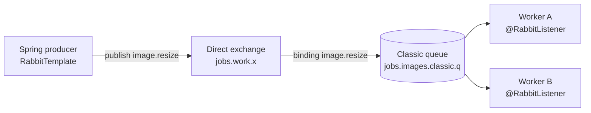
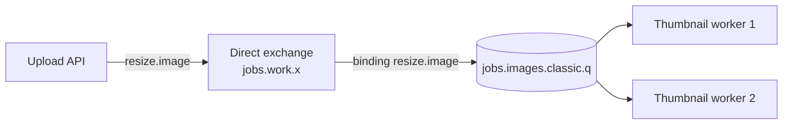
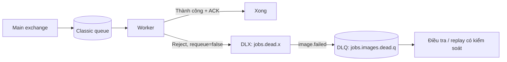
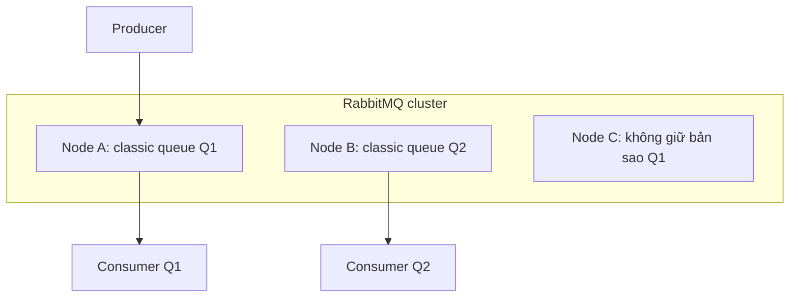

# Classic queue và đặc điểm sử dụng

Khi xây dựng hệ thống bất đồng bộ bằng RabbitMQ và Spring AMQP, loại queue là một quyết định kiến trúc. Cùng một đoạn code `RabbitTemplate.convertAndSend(...)` hoặc `@RabbitListener` có thể làm việc với nhiều loại queue, nhưng **cách dữ liệu được lưu, khả năng chịu lỗi khi node dừng, chính sách phân phối message và chi phí vận hành** có thể rất khác nhau. **Classic queue** là loại hàng đợi truyền thống của RabbitMQ, thích hợp khi muốn có mô hình hàng đợi công việc đơn giản và chấp nhận các giới hạn về khả năng sẵn sàng của một queue trên một node.

Bài thuộc chương **Các loại hàng đợi** của module **SPRING_AMQP**. Trọng tâm là hiểu classic queue, cách khai báo từ Spring AMQP, và những đánh đổi để thiết kế luồng gửi nhận qua `RabbitTemplate`, `@RabbitListener`, exchange, binding, ACK, retry, dead-letter, giao dịch và quan sát hệ thống đáng tin cậy.

Sau khi học xong, bạn có thể:

- Giải thích classic queue lưu và phân phối message như thế nào; phân biệt queue durable với message persistent.
- Nhận biết giới hạn của classic queue khi node lưu queue gặp sự cố và khi hệ thống cần độ sẵn sàng cao.
- Khai báo rõ `x-queue-type=classic` và các thuộc tính queue bằng Spring AMQP.
- Xây dựng producer, consumer, exchange và binding dùng classic queue, kèm xác nhận giao nhận phù hợp.
- Dùng TTL, dead-letter, priority và single active consumer đúng tình huống.
- So sánh classic queue với quorum queue và stream để chọn thiết kế theo yêu cầu thực tế.

> Ví dụ sử dụng Spring Boot với `spring-boot-starter-amqp` và RabbitMQ hỗ trợ queue type `classic`. Những tính năng và giới hạn cụ thể thay đổi theo phiên bản broker; đặc biệt, **classic queue mirroring và classic queue v1** là công nghệ cũ đã bị loại bỏ trong thế hệ RabbitMQ 4.x. Hãy đối chiếu phiên bản RabbitMQ thực tế trước khi áp dụng hướng dẫn vận hành.

## 1. Classic queue trong luồng giao nhận AMQP

Classic queue là một queue của broker RabbitMQ, nhận message sau khi exchange định tuyến thành công và cung cấp chúng cho consumer. Cách sử dụng nhìn từ ứng dụng Spring AMQP tương tự các loại queue khác.



Trong topology này:

1. Producer publish một message vào `jobs.work.x` với routing key `image.resize`.
2. Direct exchange tìm binding có key tương ứng và chuyển message vào `jobs.images.classic.q`.
3. Broker giao message của queue cho một worker đang có khả năng nhận.
4. Worker xử lý và gửi ACK (qua listener container hoặc chủ động, tùy acknowledge mode).
5. Nếu delivery chưa được ACK và kết nối/channel thất bại, message có thể được đưa trở lại để giao lần nữa.

Nếu cả Worker A và Worker B tiêu thụ **cùng queue**, chúng **cạnh tranh xử lý**, không phải mỗi bên đều nhận một bản sao. Muốn hai hệ thống độc lập nhận cùng event, mỗi hệ thống cần queue riêng và binding phù hợp.

**Đặc điểm phân biệt quan trọng:** Một classic queue thông thường có dữ liệu được lưu trên **một node RabbitMQ**, không có cơ chế sao chép dữ liệu của queue giữa các node như quorum queue. Việc RabbitMQ chạy thành một cluster **không làm message của classic queue tự động được replicate**.

## 2. Message đi vào, nằm trong và rời khỏi classic queue

### 2.1. Trạng thái ready và unacknowledged

Hai số liệu thường thấy ở RabbitMQ Management UI:

| Trạng thái | Diễn giải | Điều cần theo dõi |
| --- | --- | --- |
| **Ready** | Message đang đợi được giao cho consumer. | Backlog tăng báo hiệu tốc độ nhận thấp hơn tốc độ gửi hoặc consumer đang gián đoạn. |
| **Unacked** | Message đã giao nhưng chưa được consumer ACK. | Có thể tăng khi prefetch lớn, xử lý chậm hoặc consumer bị treo. |
| **Total** | Tổng ready và unacked tại thời điểm quan sát. | Không đồng nghĩa số công việc chưa hoàn thành trong toàn hệ thống nếu còn thao tác ngoài broker. |

Ví dụ broker có 100 message ready và 20 unacked: có 100 message chưa giao; 20 message đang được các consumer giữ mà broker chưa nhận xác nhận xử lý. Nếu consumer đang xử lý một thao tác bên ngoài (như gọi dịch vụ thanh toán), thành công của thao tác đó không nhất thiết được lưu vào RabbitMQ trước khi ACK.

### 2.2. ACK, NACK và việc giao lại

| Tình huống | Hành vi thường gặp |
| --- | --- |
| Listener trả về thành công trong chế độ Spring `AUTO` | Listener container gửi ACK sau khi xử lý xong. |
| Listener ném exception | Container áp dụng error handler, retry/requeue/reject theo cấu hình. |
| Consumer mất connection khi còn message unacked | Broker có thể đưa message chưa ACK trở lại để giao cho consumer khác. |
| Consumer dùng `MANUAL` | Code phải tự ACK/NACK/REJECT đúng delivery tag và channel. |
| Consumer dùng `NONE` | Broker sử dụng auto-ack; message có thể mất sau khi được giao nếu consumer chết trước lúc xử lý xong. |

**Không nhầm `AUTO` của Spring với auto-ack của broker:** với `AcknowledgeMode.AUTO`, Spring listener container vẫn quản lý các ACK thủ công ở cấp AMQP. Với `AcknowledgeMode.NONE`, consumer nhận theo chế độ broker tự xác nhận.

Classic queue có thể giao lại message, dẫn đến **xử lý trùng**. Đó là lý do một hệ thống cần idempotency theo message ID hoặc mã nghiệp vụ, nhất là khi một thao tác như gửi email, trừ tiền hoặc cập nhật dữ liệu không thể tự hoàn tác.

### 2.3. Thứ tự message

RabbitMQ thường đưa các message vào queue theo thứ tự nhận và cố gắng giao theo thứ tự queue, nhưng **thứ tự xử lý hoàn tất không được bảo đảm** khi có nhiều consumer, prefetch, message priority, requeue, retry hoặc failover.

Ví dụ: message A giao cho Worker 1 xử lý lâu, B giao cho Worker 2 xử lý nhanh. B có thể hoàn tất trước A, dù A được đưa vào queue trước. Nếu nghiệp vụ yêu cầu thứ tự theo từng đối tượng, cần kiểm soát concurrency, phân vùng dữ liệu hoặc dùng một chiến lược ordering rõ ràng.

## 3. Durable queue và persistent message là hai khái niệm khác nhau

`Durable` là thuộc tính của **queue**, còn `deliveryMode=PERSISTENT` là thuộc tính của **message**.

| Queue | Message | Ý nghĩa |
| --- | --- | --- |
| Non-durable | Transient | Phù hợp dữ liệu tạm có thể mất khi broker restart. |
| Durable | Transient | Định nghĩa queue có thể tồn tại sau restart; message transient không có bảo đảm độ bền tương ứng. |
| Durable | Persistent | Là lựa chọn phù hợp khi cần lưu message qua restart, nhưng vẫn phải xét cơ chế ghi đĩa, publisher confirms và lỗi hệ thống. |
| Non-durable | Persistent | Message được đánh dấu persistent không biến queue non-durable thành queue bền vững. |

Độ bền không có nghĩa một classic queue đột nhiên có bản sao trên nhiều node. Nếu node chứa classic queue gặp sự cố nghiêm trọng, queue có thể không sẵn sàng trong khi node đó offline. Nếu dữ liệu của node bị mất, bản message trên node đó cũng có thể mất.

**Nguyên tắc:** Nếu bài toán yêu cầu queue tiếp tục khả dụng khi một node RabbitMQ ngừng hoạt động, nên đánh giá **quorum queue** thay vì nghĩ rằng chỉ cần đặt classic queue `durable=true` và chạy cluster.

## 4. Khai báo classic queue với `QueueBuilder`

### 4.1. Chỉ rõ queue type

Trong hệ thống có nhiều queue type, tránh phụ thuộc ngầm vào **default queue type (DQT)** của vhost/broker. Tên queue type được thiết lập bằng argument `x-queue-type` khi declare:

```java
import org.springframework.amqp.core.Queue;
import org.springframework.amqp.core.QueueBuilder;
import org.springframework.context.annotation.Bean;
import org.springframework.context.annotation.Configuration;

@Configuration
class ClassicQueueConfig {
    @Bean
    Queue imageJobsQueue() {
        return QueueBuilder.durable("jobs.images.classic.q")
                .withArgument("x-queue-type", "classic")
                .build();
    }
}
```

Ở đây:

- `durable(...)` tạo đối tượng queue với `durable=true`.
- `withArgument("x-queue-type", "classic")` yêu cầu broker khai báo classic queue.
- `build()` hoàn tất đối tượng Java; nó **chưa tự gửi lệnh** sang RabbitMQ.

Khi ứng dụng Spring Boot có kết nối và `RabbitAdmin` đang hoạt động, admin thường tự khai báo các bean `Queue`, `Exchange` và `Binding` trên broker. Việc declare chỉ thành công khi tên/thuộc tính hợp lệ và tài khoản có quyền.

> Nếu queue cùng tên đã tồn tại với thuộc tính khác, broker có thể từ chối khai báo bằng `PRECONDITION_FAILED`. `x-queue-type` là thuộc tính cốt lõi của queue, không thể biến classic queue đang có thành quorum queue bằng cách đổi code rồi khởi động lại.

### 4.2. Các thuộc tính cần cân nhắc

```java
@Bean
Queue temporaryClassicQueue() {
    return QueueBuilder.nonDurable("demo.temp.classic.q")
            .withArgument("x-queue-type", "classic")
            .autoDelete()
            .build();
}
```

| Thuộc tính | Ý nghĩa | Khuyến nghị |
| --- | --- | --- |
| `durable` | Giữ định nghĩa queue qua broker restart. | Queue công việc thường dùng `true`. |
| `exclusive` | Chỉ connection đã khai báo có quyền dùng queue; xóa khi connection đóng. | Hợp cho queue tạm từng kết nối, không hợp cho worker pool đa instance. |
| `autoDelete` | Xóa sau khi consumer cuối cùng rời queue đã từng có consumer. | Chỉ dùng khi backlog không cần giữ lại lâu dài. |
| `x-queue-type` | `classic`, `quorum` hoặc loại khác tùy broker. | Khai báo rõ khi cần tính ổn định về semantics. |
| `x-message-ttl` | Thời gian sống tối đa của message trong queue (ms). | Dùng khi message hết giá trị sau hạn định. |
| `x-max-length` / `x-max-length-bytes` | Giới hạn backlog theo số message/kích thước. | Ngăn tích lũy vô hạn; cần hiểu chính sách overflow. |
| `x-dead-letter-exchange` | Exchange để định tuyến message bị dead-letter. | Dùng với DLQ và quy trình xử lý lỗi. |
| `x-max-priority` | Bật mức ưu tiên message đối với classic priority queue. | Cân nhắc chi phí CPU/bộ nhớ và fairness. |
| `x-single-active-consumer` | Chỉ một consumer được active nhận delivery tại một thời điểm. | Dùng khi cần giảm cạnh tranh xử lý của cùng queue. |

Một số tham số như TTL, DLX và max length có thể cấu hình bằng **RabbitMQ policy** thay vì hard-code trong queue declaration. Điều này giúp vận hành linh hoạt hơn khi cần thay đổi chính sách. Những `x-*` đặt ngay trong khai báo thường có ưu tiên hơn regular policy; hãy kiểm tra operator policies và hành vi broker đang dùng.

### 4.3. Classic queue trong RabbitMQ thế hệ mới

Không nên nhầm “classic queue” với một tính năng đã biến mất. **Classic queue vẫn là một queue type được hỗ trợ** trong RabbitMQ hiện đại. Tuy nhiên:

- **Classic queue mirroring** (HA policy cho classic queue kiểu cũ) đã bị loại bỏ trong RabbitMQ 4.x; dùng quorum queue cho các yêu cầu replicated queue.
- **Classic queue v1** là cơ chế lưu trữ cũ và đã được loại bỏ trong RabbitMQ 4.x; các hệ thống hiện đại sử dụng cơ chế lưu trữ classic queue v2.
- Tùy chọn “lazy queue” lịch sử không nên dùng như cách lập kế hoạch lưu trữ mới; classic queue v2 đã thay đổi cơ chế lưu trữ, nên phải tham chiếu tài liệu của đúng bản broker.

Nếu đang học theo blog cũ dùng `ha-mode=all`, `ha-sync-mode` hoặc `x-queue-mode=lazy`, đừng sao chép nguyên các ví dụ đó vào RabbitMQ mới. Kiểm tra release notes và tài liệu migration trước khi dùng.

## 5. Ví dụ hoàn chỉnh: direct exchange và classic work queue

Chúng ta thiết kế một luồng xử lý tác vụ tạo thumbnail:



Khai báo ba tài nguyên trong cùng một lớp Spring configuration:

```java
import org.springframework.amqp.core.Binding;
import org.springframework.amqp.core.BindingBuilder;
import org.springframework.amqp.core.DirectExchange;
import org.springframework.amqp.core.ExchangeBuilder;
import org.springframework.amqp.core.Queue;
import org.springframework.amqp.core.QueueBuilder;
import org.springframework.beans.factory.annotation.Qualifier;
import org.springframework.context.annotation.Bean;
import org.springframework.context.annotation.Configuration;

@Configuration
public class ThumbnailMessagingConfig {

    @Bean
    DirectExchange jobsWorkExchange() {
        return ExchangeBuilder.directExchange("jobs.work.x")
                .durable(true)
                .build();
    }

    @Bean
    Queue imageJobsQueue() {
        return QueueBuilder.durable("jobs.images.classic.q")
                .withArgument("x-queue-type", "classic")
                .build();
    }

    @Bean
    Binding imageJobsBinding(
            @Qualifier("imageJobsQueue") Queue queue,
            @Qualifier("jobsWorkExchange") DirectExchange exchange) {
        return BindingBuilder.bind(queue)
                .to(exchange)
                .with("resize.image");
    }
}
```

**Lưu ý phạm vi ví dụ:** Không khai báo bean `imageJobsQueue` lần thứ hai nếu đã dùng `ThumbnailMessagingConfig`. Các đoạn mã độc lập trong bài minh họa nhiều cách thiết lập; khi ghép vào một ứng dụng thực hành, chỉ giữ **một cấu hình chính thức** cho mỗi tên queue/exchange.

Producer gửi ID công việc, thay vì nhồi toàn bộ file ảnh vào message:

```java
import org.springframework.amqp.core.MessageDeliveryMode;
import org.springframework.amqp.rabbit.core.RabbitTemplate;
import org.springframework.stereotype.Service;

@Service
public class ThumbnailJobPublisher {
    private final RabbitTemplate rabbitTemplate;

    public ThumbnailJobPublisher(RabbitTemplate rabbitTemplate) {
        this.rabbitTemplate = rabbitTemplate;
    }

    public void enqueue(String imageId) {
        rabbitTemplate.convertAndSend(
                "jobs.work.x", "resize.image", imageId,
                message -> {
                    message.getMessageProperties()
                            .setDeliveryMode(MessageDeliveryMode.PERSISTENT);
                    return message;
                });
    }
}
```

Consumer:

```java
import org.springframework.amqp.rabbit.annotation.RabbitListener;
import org.springframework.stereotype.Component;

@Component
public class ThumbnailWorker {
    @RabbitListener(
            queues = "jobs.images.classic.q",
            concurrency = "2-4")
    public void generateThumbnail(String imageId) {
        // Tra cứu đối tượng ảnh theo imageId, tạo thumbnail,
        // kiểm tra idempotency rồi cập nhật kết quả công việc.
        System.out.println("Xử lý thumbnail cho " + imageId);
    }
}
```

`concurrency = "2-4"` minh họa số consumer động của **simple listener container**. Nếu dùng direct listener container hoặc cấu hình container khác, ý nghĩa và giá trị của concurrency cần điều chỉnh theo cơ chế của loại container đó. Nhiều instance ứng dụng cũng có thể cùng lắng nghe queue này.

Ví dụ dùng `String` nên chưa cần JSON converter. Trong production, hãy dùng message ID, schema payload và tracing metadata; tránh đưa dữ liệu nhạy cảm hoặc file lớn trực tiếp vào message khi một reference đủ dùng.

## 6. Xác nhận giao nhận và giới hạn độ tin cậy

Một classic queue có thể dùng trong hệ thống tin cậy nếu kiến trúc xử lý đúng các tình huống lỗi. Tuy nhiên, cần phân biệt **broker đã nhận publish**, **message đã vào queue**, **consumer đã ACK**, và **nghiệp vụ thực sự hoàn tất**.

### 6.1. Publisher confirms và returns

Producer có thể bật publisher confirms để biết broker đã xử lý publish tới mức xác nhận theo cơ chế RabbitMQ. Với message không được định tuyến vào queue nào, cần xem xét `mandatory` và publisher returns; **publisher confirm thành công không đồng nghĩa message đến đúng queue**.

Ví dụ cấu hình Spring Boot (tên property áp dụng cho dòng Spring Boot hỗ trợ chúng):

```yaml
spring:
  rabbitmq:
    host: localhost
    port: 5672
    publisher-confirm-type: correlated
    publisher-returns: true
    template:
      mandatory: true
    listener:
      simple:
        acknowledge-mode: auto
        prefetch: 10
        concurrency: 2
        max-concurrency: 4
```

`publisher-confirm-type: correlated` cho phép đối chiếu confirm với publish khi dùng correlation data và callback/future phù hợp. `publisher-returns: true` kết hợp `mandatory: true` hỗ trợ phát hiện thông điệp không được route tới queue. **Chỉ bật property chưa đủ để xử lý kết quả**: ứng dụng cần đăng ký callback, theo dõi confirm/return và có chiến lược báo lỗi/retry.

Ví dụ đăng ký callback minh họa trong một ứng dụng chỉ có **một nơi quản lý** callbacks trên `RabbitTemplate`:

```java
import jakarta.annotation.PostConstruct;
import org.springframework.amqp.rabbit.core.RabbitTemplate;
import org.springframework.stereotype.Component;

@Component
class PublishDiagnostics {
    private final RabbitTemplate rabbitTemplate;

    PublishDiagnostics(RabbitTemplate rabbitTemplate) {
        this.rabbitTemplate = rabbitTemplate;
    }

    @PostConstruct
    void registerCallbacks() {
        rabbitTemplate.setConfirmCallback((correlationData, ack, cause) -> {
            if (!ack) {
                System.err.println("Broker NACK publish: " + cause);
            }
        });

        rabbitTemplate.setReturnsCallback(returned -> {
            System.err.println(
                    "Message không được route: " +
                    returned.getReplyText());
        });
    }
}
```

Trong dự án thật, hãy tích hợp callbacks vào cơ chế đo lường, tracing và xử lý thất bại có cấu trúc. Nếu nhiều component cùng gọi `setConfirmCallback` hoặc `setReturnsCallback` trên một template, cấu hình sau có thể thay thế cấu hình trước; cần quy ước chủ sở hữu callbacks. Ngoài ra, `jakarta.annotation.PostConstruct` thuộc hệ sinh thái Jakarta dùng ở các dòng Spring Boot mới; với ứng dụng legacy, namespace có thể khác.

### 6.2. Listener ACK không phải transaction nghiệp vụ

Với `acknowledge-mode: auto`:

- Listener xử lý xong không ném exception → listener container ACK với broker.
- Listener lỗi → container áp dụng cơ chế xử lý lỗi; có thể retry, reject, requeue hoặc chuyển sang DLX tùy cấu hình.
- Nếu process chết **sau khi database đã commit nhưng trước khi ACK**, broker có thể phát lại message; thao tác database có nguy cơ thực hiện hai lần.

Vì vậy, hãy thiết kế **idempotency**: gắn ID duy nhất cho công việc, lưu lại trạng thái đã xử lý trong database và chỉ thực hiện side effect khi cần. Có thể dùng unique constraint hoặc transaction ở database để bảo vệ xử lý trùng.

Ví dụ:

```text
1. Consumer nhận message jobId = IMG-184.
2. Consumer kiểm tra bảng processed_job theo jobId.
3. Nếu đã hoàn thành: bỏ qua side effect và trả về thành công.
4. Nếu chưa: xử lý và ghi kết quả + trạng thái trong cùng transaction DB (khi phù hợp).
5. Listener trả về; container mới ACK.
6. Nếu ACK bị mất, message có thể giao lại nhưng jobId đã được ghi nhận.
```

**Chú ý:** Transaction của RabbitMQ channel và transaction của database **không tự tạo một transaction nguyên tử xuyên hai hệ thống**. Với bài toán publish sự kiện cùng lúc cập nhật database, cân nhắc transactional outbox hoặc giải pháp nhất quán dữ liệu thích hợp.

## 7. TTL, dead-letter và retry trên classic queue

Classic queue hỗ trợ những cấu hình phổ biến của RabbitMQ như message TTL, giới hạn backlog và dead-letter exchange. Các cơ chế này có ý nghĩa khác nhau:

| Cơ chế | Mục đích | Hạn chế cần hiểu |
| --- | --- | --- |
| TTL | Cho phép message hết hạn khi không còn giá trị. | Message hết hạn có thể bị bỏ hoặc dead-letter; không phải scheduler chính xác tuyệt đối. |
| Dead-letter exchange | Định tuyến message bị dead-letter theo quy tắc broker. | Phải có exchange/binding đích; cần giám sát thất bại và chu kỳ xử lý. |
| Retry | Thử lại lỗi tạm thời, với số lần và khoảng nghỉ thích hợp. | Retry vô hạn có thể gây vòng lặp nóng và tăng tải. |
| Max length | Giới hạn backlog để bảo vệ tài nguyên. | Message vượt giới hạn có thể bị loại hoặc bị từ chối publish theo overflow policy. |

### 7.1. Khai báo queue có dead-letter exchange

Ví dụ triển khai **một topology khác** với `ThumbnailMessagingConfig` ở mục 5: nếu dùng lại cùng tên queue nhưng thêm DLX sau khi queue đã tồn tại, có thể gặp lỗi không tương đương. Với môi trường mới, dùng khai báo sau:

```java
import org.springframework.amqp.core.Queue;
import org.springframework.amqp.core.QueueBuilder;
import org.springframework.context.annotation.Bean;
import org.springframework.context.annotation.Configuration;

@Configuration
class ImageJobsWithDlxConfig {
    @Bean
    Queue imageJobsQueue() {
        return QueueBuilder.durable("jobs.images.classic.q")
                .withArgument("x-queue-type", "classic")
                .deadLetterExchange("jobs.dead.x")
                .deadLetterRoutingKey("image.failed")
                .build();
    }
}
```

Sau đó khai báo DLX, DLQ và binding:

```java
import org.springframework.amqp.core.Binding;
import org.springframework.amqp.core.BindingBuilder;
import org.springframework.amqp.core.DirectExchange;
import org.springframework.amqp.core.Queue;
import org.springframework.amqp.core.QueueBuilder;
import org.springframework.beans.factory.annotation.Qualifier;
import org.springframework.context.annotation.Bean;
import org.springframework.context.annotation.Configuration;

@Configuration
class ImageDlxConfig {
    @Bean
    DirectExchange imageDeadLetterExchange() {
        return new DirectExchange("jobs.dead.x");
    }

    @Bean
    Queue imageDeadLetterQueue() {
        return QueueBuilder.durable("jobs.images.dead.q")
                .withArgument("x-queue-type", "classic")
                .build();
    }

    @Bean
    Binding imageDeadLetterBinding(
            @Qualifier("imageDeadLetterQueue") Queue queue,
            @Qualifier("imageDeadLetterExchange") DirectExchange exchange) {
        return BindingBuilder.bind(queue)
                .to(exchange)
                .with("image.failed");
    }
}
```

Luồng xử lý:



Nếu listener gặp lỗi và container vẫn **requeue=true**, message chưa chắc được dead-letter. Vì vậy phải phối hợp cấu hình listener retry, exception handling, reject/requeue và DLX; chỉ khai báo DLX **không tạo thành một hệ thống retry hoàn chỉnh**.

### 7.2. Lựa chọn chính sách retry

Thông thường nên phân biệt:

1. **Lỗi ngắn hạn:** timeout gọi dịch vụ khác, kết nối tạm mất; retry có giới hạn và backoff.
2. **Lỗi dữ liệu:** payload không hợp lệ, thiếu trường bắt buộc; có thể đẩy thẳng đến DLQ.
3. **Lỗi hệ thống kéo dài:** dừng tăng retries liên tục, cảnh báo và cho phép xử lý lại khi nguyên nhân được giải quyết.

Khi cần retry trì hoãn, có thể dùng một topology retry riêng (ví dụ queue có TTL + DLX hoặc cơ chế delayed message được broker hỗ trợ); không nên nhầm **TTL trên queue** với tính năng đặt lịch chuẩn xác cho từng message. Kiểm tra tình huống lặp vô hạn khi kết nối nhiều DLX.

**Cảnh báo tính khả dụng:** Dead-letter cũng là một thao tác định tuyến qua broker. Dữ liệu có thể gặp rủi ro khi DLX/queue đích không tồn tại, không đủ quyền, hết tài nguyên hoặc có lỗi hệ thống. Không giả định cứ cấu hình DLX là đã có bảo đảm tuyệt đối.

## 8. Priority queue và Single Active Consumer

### 8.1. Priority queue của classic queue

Một trường hợp classic queue thường được lựa chọn là sử dụng **message priorities**. Cấu hình mức ưu tiên tối đa cho queue ngay lúc khai báo:

```java
@Bean
Queue prioritizedEmailQueue() {
    return QueueBuilder.durable("jobs.email-priority.classic.q")
            .withArgument("x-queue-type", "classic")
            .maxPriority(5)
            .build();
}
```

Khi publish, producer có thể đặt priority của message:

```java
rabbitTemplate.convertAndSend(
        "emails.commands.x", "email.send", "job-important",
        message -> {
            message.getMessageProperties().setPriority(5);
            return message;
        });
```

**Cần lưu ý:** Ví dụ publish yêu cầu exchange `emails.commands.x`, binding tới queue `jobs.email-priority.classic.q` và các tài nguyên đó phải đã được khai báo. Đoạn mã chỉ nhấn mạnh thuộc tính priority.

Ưu tiên cao ảnh hưởng thứ tự chọn message **đang chờ trong queue**; nó **không thu hồi** message đã giao cho consumer. Nếu consumer đang giữ backlog lớn do prefetch, message ưu tiên cao mới đến vẫn có thể phải đợi. Nhiều mức priority tăng chi phí tài nguyên; thường chỉ nên dùng vài mức có ý nghĩa nghiệp vụ. Không nên xem priority queue là cam kết SLA cứng hoặc bảo đảm message ưu tiên thấp không bao giờ bị đói.

### 8.2. Single Active Consumer

Khi nhiều consumer kết nối nhưng muốn tại một thời điểm chỉ **một consumer active** lấy message từ queue, có thể cân nhắc Single Active Consumer:

```java
@Bean
Queue orderedClassicQueue() {
    return QueueBuilder.durable("jobs.serial.classic.q")
            .withArgument("x-queue-type", "classic")
            .withArgument("x-single-active-consumer", true)
            .build();
}
```

Nếu consumer active ngừng hoạt động, broker có thể chọn consumer dự phòng khác. Cơ chế này giúp giảm xử lý song song và hỗ trợ thiết kế cần quan hệ thứ tự giữa các message, nhưng **không tự bảo đảm exactly-once**, và cũng không giải quyết mọi vấn đề thứ tự khi có requeue, retry hoặc tác vụ xử lý không đồng bộ.

Nếu yêu cầu xử lý theo thứ tự rất nghiêm ngặt, cần đánh giá cả prefetch, số tác vụ chạy song song trong worker, tác dụng phụ và chính sách xử lý khi một message thất bại.

## 9. Giới hạn sẵn sàng và khả năng mở rộng của classic queue

### 9.1. Classic queue hoạt động trên một node

RabbitMQ cluster có thể có nhiều node, nhưng classic queue **không tự có bản sao message trên các node khác**. Queue hiện diện và thực hiện lưu trữ trên node đảm nhiệm queue đó.



Sơ đồ nhấn mạnh Q1 và Q2 là **hai queue khác nhau**. Node B không chứa một bản replica của Q1 chỉ vì cùng thuộc cluster. Khi node A dừng, dữ liệu Q1 có thể không truy cập được cho đến khi node A phục hồi; nếu mất dữ liệu trên node A, hệ thống có thể không phục hồi được toàn bộ message của Q1.

Đối với bài toán cần chịu được lỗi node và duy trì queue replicated, **quorum queue** được thiết kế phù hợp hơn. Nó dùng mô hình replica, cơ chế quorum và các đánh đổi về disk I/O, tài nguyên và độ trễ.

### 9.2. Thêm consumer không đồng nghĩa tăng vô hạn throughput

Các yếu tố giới hạn tốc độ:

- **Một queue trên một node:** năng lực CPU, RAM, đĩa và I/O của node lưu queue.
- **Kích thước message:** message lớn làm tăng I/O và băng thông; nên cân nhắc gửi reference đến dữ liệu ngoài.
- **Message ready/unacked:** prefetch và số lượng consumers ảnh hưởng phân phối và tài nguyên.
- **Năng lực hệ thống đích:** một consumer gọi API bị rate limit hoặc database bận không tăng tốc chỉ nhờ thêm threads.
- **Publisher/consumer flow control:** RabbitMQ có thể áp dụng memory/disk alarms và cơ chế điều tiết.

Nếu một queue trở thành nút thắt, cân nhắc **chia workload theo nhiều queue**, routing key/shard và tập consumer tương ứng. Việc tăng concurrency cần đo lường trước/sau, không mặc định càng nhiều threads càng nhanh.

### 9.3. So sánh classic, quorum và stream

| Tiêu chí | Classic queue | Quorum queue | Stream |
| --- | --- | --- | --- |
| Mô hình | Hàng đợi AMQP truyền thống, dữ liệu queue trên một node. | Queue được replicate qua quorum nodes. | Log lưu trữ tuần tự, hỗ trợ replay theo offset. |
| Mục tiêu | Work queue đơn giản, chi phí phù hợp, một số tính năng như priority. | Công việc/command cần HA, an toàn khi node lỗi với cấu hình quorum phù hợp. | Lượng lớn sự kiện, retention dài và nhiều consumer cần đọc lại. |
| Khi consumer ACK | Delivery được xác nhận, message có thể được loại khỏi queue. | Cũng là mô hình queue với ACK. | Consumer quản lý vị trí đọc/offset theo cơ chế stream. |
| Khả năng replay lịch sử | Không phải mục tiêu của queue thông thường. | Không nhằm giữ sự kiện sau khi đã tiêu thụ. | Là tính năng trung tâm. |
| Replication dữ liệu | Không có replication dữ liệu classic queue hiện đại. | Có replication dựa trên quorum. | Có thể cấu hình replication theo mô hình stream. |
| Chi phí vận hành | Phụ thuộc workload và node chứa queue; thường đơn giản hơn quorum. | Dùng thêm tài nguyên và phải theo dõi quorum/replication. | Phải quản lý retention, offset và quy mô lưu trữ. |

**Cách chọn nhanh theo yêu cầu:**

- Chọn **classic queue** khi chấp nhận giới hạn một node cho mỗi queue, cần semantics hàng đợi AMQP truyền thống hoặc tính năng queue mà bản broker của bạn hỗ trợ tốt trên classic.
- Chọn **quorum queue** khi message có giá trị và yêu cầu chịu lỗi node ở tầng queue được đặt lên hàng đầu.
- Chọn **stream** khi cần giữ log sự kiện theo thời gian, cho nhiều nhóm consumer đọc theo offset và replay dữ liệu đã phát.

Một ứng dụng có thể sử dụng đồng thời nhiều loại queue tùy nghiệp vụ; không cần cố chọn một loại cho toàn bộ RabbitMQ cluster.

## 10. Quan sát classic queue khi vận hành

Classic queue có thể trở thành nơi tích lũy backlog, đặc biệt khi xử lý công việc nặng hoặc consumer đang gặp lỗi. Nên quan sát đồng thời cả broker, ứng dụng và hệ thống đích.

| Chỉ số | Ý nghĩa thực tế | Khi bất thường nên xem gì? |
| --- | --- | --- |
| `messages_ready` | Số message chờ được phân phối. | Consumer offline, tốc độ xử lý thấp, routing tạo tải ngoài dự kiến. |
| `messages_unacknowledged` | Message được giao nhưng chưa ACK. | Prefetch lớn, worker treo, downstream chậm, thiếu timeout. |
| Publish rate | Tốc độ producer đưa message vào broker. | Tăng tải đột biến, publisher retry lặp. |
| Deliver/ACK rates | Tốc độ broker giao và nhận xác nhận xử lý. | Chênh lệch kéo dài với publish rate. |
| Consumer count | Số consumer kết nối với queue. | Bị mất consumer sau restart, scaling sai hoặc quyền lỗi. |
| Redelivery rate | Tần suất message được giao lại. | Lỗi consumer, retry/requeue vô hạn, mất kết nối. |
| Node disk/memory alarms | Broker đang bị áp lực tài nguyên. | I/O thấp, backlog quá lớn, thiếu dung lượng. |
| Publisher confirm/return failures | Producer publish không đạt mong đợi. | Kết nối broker, routing, quyền, queue/exchange biến mất. |
| Độ trễ nghiệp vụ | Thời gian từ nhận yêu cầu đến hoàn tất job. | Queue wait time, thời gian xử lý, tốc độ downstream. |

Một dashboard tốt phải phân biệt **backlog queue** với **thời gian xử lý nghiệp vụ**. Nếu `messages_ready` gần 0 nhưng `messages_unacknowledged` cao và thời gian xử lý kéo dài, tăng publisher hoặc thay queue type sẽ không giải quyết được phần xử lý đang nghẽn.

### 10.1. Điều chỉnh prefetch và concurrency

Ví dụ:

```yaml
spring:
  rabbitmq:
    listener:
      simple:
        acknowledge-mode: auto
        prefetch: 10
        concurrency: 2
        max-concurrency: 4
```

- **Prefetch thấp** thường giúp phân phối công việc công bằng hơn nếu mỗi job rất nặng hoặc thời gian xử lý biến động, nhưng có thể giảm throughput khi mạng có độ trễ.
- **Prefetch cao** giảm số lần broker phải chờ ACK để gửi tiếp, nhưng khiến nhiều message nằm trong trạng thái unacked và một consumer có thể giữ nhiều việc hơn năng lực xử lý.
- **Concurrency cao** có ích khi worker có khả năng chạy song song; nếu bottleneck ở database hoặc một API rate-limited, concurrency cao có thể chỉ tăng áp lực.

Hãy thử nhiều mức trên workload thực tế và chọn theo throughput, độ trễ, tình trạng ACK và khả năng phục hồi sau khi worker bị dừng. **Không có giá trị prefetch hay concurrency tối ưu cho mọi classic queue.**

### 10.2. Bảo vệ queue khỏi backlog vô hạn

Nếu một message quá hạn sẽ không còn giá trị nghiệp vụ, có thể đặt TTL; nếu cần giới hạn bộ nhớ/disk, cân nhắc max length/bytes:

```java
@Bean
Queue boundedClassicQueue() {
    return QueueBuilder.durable("jobs.bounded.classic.q")
            .withArgument("x-queue-type", "classic")
            .ttl(300_000)
            .maxLength(10_000)
            .build();
}
```

Ví dụ đặt TTL 5 phút và giới hạn 10.000 message. Nếu vượt giới hạn, message có thể bị drop hoặc broker từ chối publish theo cấu hình overflow; **đừng bật giới hạn mà không quyết định dữ liệu nào được phép mất**. Với queue quan trọng, cân nhắc policy, DLX, cảnh báo sớm và scale consumer để backlog không chạm ngưỡng.

## 11. Vòng đời queue và kế hoạch thay đổi

Queue declaration có tính lặp lại an toàn khi tài nguyên **đã tồn tại và các thuộc tính tương đương**. Việc đổi thuộc tính bất biến hoặc khác biệt `x-queue-type` có thể dẫn đến `PRECONDITION_FAILED` khi ứng dụng khởi động.

### 11.1. Từ classic queue sang quorum queue

Giả sử `jobs.images.classic.q` đang xử lý công việc nhưng yêu cầu mới đòi hỏi chịu lỗi node. Không nên thay `"classic"` thành `"quorum"` trên chính queue đó và chờ RabbitMQ tự biến đổi dữ liệu.

Một hướng migration an toàn hơn:

1. Tạo queue mới `jobs.images.quorum.q` với `x-queue-type=quorum` trong môi trường staging và thử toàn bộ thuộc tính hỗ trợ.
2. Tạo binding của queue mới; quyết định producer sẽ chuyển routing vào queue mới như thế nào để **không làm mất, không nhân đôi ngoài kiểm soát**.
3. Triển khai consumer hỗ trợ payload và cách xử lý đang dùng; thử ACK, redelivery, retry, DLX và recovery khi node lỗi.
4. Chuyển traffic theo kế hoạch; tiếp tục drain hoặc xử lý backlog còn ở classic queue.
5. Theo dõi message `ready/unacked` và các tác vụ nghiệp vụ còn dang dở; dừng dùng queue cũ khi đã xác nhận an toàn.
6. Chỉ xóa tài nguyên cũ sau khi có quyết định vận hành rõ ràng.

Nếu cần dual-publish trong giai đoạn chuyển đổi, mỗi message phải có ID phục vụ idempotency; không mặc định rằng publish hai queue sẽ chỉ xử lý một lần.

### 11.2. Những thay đổi dễ gây `PRECONDITION_FAILED`

| Thay đổi | Rủi ro |
| --- | --- |
| `durable=true` thành `durable=false` | Broker từ chối khai báo lại cùng tên do không tương đương. |
| Thêm hoặc thay `x-queue-type` | Không thể đổi loại queue đang tồn tại theo cách này. |
| Thay các queue arguments quan trọng | Có thể lỗi vì các arguments được ràng buộc lúc tạo queue. |
| Hai service khai báo khác nhau một queue chung | Một service có thể hoạt động, service kia lỗi startup. |
| Broker policy và client arguments không thống nhất | Dẫn đến hành vi không như mong đợi, khó thay đổi và khó debug. |

**Không tự động xóa queue production để “chữa” lỗi không tương đương:** xóa queue có thể làm mất message chưa xử lý và gây downtime cho consumer. Luôn xác minh thuộc tính hiện tại trên broker và dùng migration có kiểm soát nếu buộc phải thay queue.

## 12. Chẩn đoán lỗi thường gặp

| Dấu hiệu | Nguyên nhân cần kiểm tra | Bước xác minh |
| --- | --- | --- |
| `PRECONDITION_FAILED - inequivalent arg 'x-queue-type'` | Queue đã tồn tại với type khác. | Kiểm tra queue type trên broker; tạo tên mới khi migration. |
| `NOT_FOUND - no queue` | Queue chưa được declare, sai virtual host hoặc tên. | Xem log `RabbitAdmin`, binding và permission. |
| Publish confirm ACK nhưng listener không nhận | Sai routing key/binding, returns chưa bật, queue không có consumer. | Xem routing, returns, `messages_ready` và consumer count. |
| Consumer nhận đi nhận lại cùng message | Exception + requeue, connection loss, ACK không tới broker. | Xem retry policy, error handler, ACK, redelivered flag và idempotency. |
| Mất message khi node classic queue hỏng | Không có replication của classic queue. | Xem yêu cầu HA; đánh giá quorum queue cho dữ liệu quan trọng. |
| Message priority cao vẫn chậm | Job ưu tiên thấp đã được giao, prefetch cao hoặc worker bận. | Kiểm tra `x-max-priority`, prefetch và queue backlog. |
| DLQ không có message dù consumer lỗi | Container requeue, DLX sai key hoặc chưa có binding. | Xem hành vi reject/requeue, DLX arguments/policy. |
| Queue biến mất khi đóng kết nối | `exclusive`, `autoDelete` hoặc queue expiration. | Kiểm tra cách khai báo và vòng đời connection/consumer. |
| Backlog tăng mặc dù thêm consumer | Nút thắt node/đĩa, hệ thống downstream hoặc phân phối prefetch. | So sánh publish/ack rates, CPU/I/O, latency và unacked. |

## 13. Thực hành kiểm chứng classic queue

### Bài 1 — Tạo queue và xác minh queue type

Tạo `jobs.images.classic.q` với `x-queue-type=classic`, direct exchange `jobs.work.x` và binding `resize.image` theo mục 5. Kết nối tới broker thực hành, xem RabbitMQ Management UI hoặc CLI để xác minh:

- Queue type là `classic`, `durable=true`, tên queue/virtual host đúng.
- Exchange là direct, binding key `resize.image` chính xác.
- Khi publish một công việc, số message `ready` có thể tăng nếu chưa có consumer; khi consumer xử lý và ACK, backlog giảm.

### Bài 2 — Hai consumer cạnh tranh

Chạy hai instance `ThumbnailWorker`, gửi 20 job phân biệt ID. Quan sát tổng số job được xử lý và tỷ lệ phân phối. Không yêu cầu mỗi worker nhận đúng 10 job; việc phân phối phụ thuộc prefetch và tốc độ xử lý. Nếu một worker chết trước ACK, một số message có thể được giao lại, nên kiểm tra tránh làm trùng tác vụ.

### Bài 3 — Prefetch và tốc độ xử lý

Cho một worker xử lý mỗi job trong thời gian mô phỏng (ví dụ ghi log, không gọi dịch vụ thật). So sánh `prefetch=1` và `prefetch=10`, ghi lại `ready`, `unacked`, độ trễ hoàn tất và cách chia tải. Giải thích vì sao prefetch lớn có thể không phù hợp với công việc có thời gian chạy rất khác nhau.

### Bài 4 — Priority queue

Tạo `jobs.email-priority.classic.q` với `x-max-priority=5`. Giữ consumer tạm dừng để tạo backlog gồm các message priority 1 và 5; bật consumer và quan sát trình tự nhận. Lặp lại với consumer đang hoạt động và prefetch lớn để nhận thấy message ưu tiên không thể “vượt” qua message đã giao cho worker.

### Bài 5 — Dead-letter khi từ chối message

Khai báo topology `jobs.dead.x` và `jobs.images.dead.q`. Cấu hình listener test từ chối một message với `requeue=false` sau khi đã thử lỗi theo chính sách. Quan sát message đến DLQ. Ghi rõ trường hợp chỉ ném exception nhưng container requeue sẽ có kết quả khác.

### Bài 6 — Xử lý lỗi declaration mà không xóa dữ liệu

Trong môi trường test riêng biệt, tạo một queue `demo.type.classic.q` kiểu classic, sau đó thử khai báo lại cùng tên với `x-queue-type=quorum`. Ghi lại lỗi broker. Thiết kế một kế hoạch migration sang `demo.type.quorum.q`, ghi rõ cách xử lý backlog và ID chống trùng.

### Bài 7 — Chọn queue type cho từng yêu cầu

Đánh giá ba nghiệp vụ:

1. Tạo thumbnail có thể làm lại từ ảnh gốc, chấp nhận tạm dừng khi node lưu queue offline.
2. Xử lý lệnh xuất tiền, cần queue replicated và độ sẵn sàng cao.
3. Thu thập sự kiện clickstream cần giữ vài ngày và replay cho nhiều nhóm phân tích.

Trình bày lý do chọn lần lượt classic, quorum hay stream dựa trên yêu cầu phục hồi, khả năng chấp nhận mất việc, retention và replay. Không chỉ lựa chọn theo tốc độ.

### Câu hỏi ôn tập

1. Classic queue `durable=true` có tự động được replicate sang các node khác trong cluster không?
2. Khác biệt giữa trạng thái `ready` và `unacked` là gì?
3. Vì sao message `PERSISTENT` chưa đủ bảo đảm tác vụ nghiệp vụ chỉ chạy một lần?
4. `x-max-priority` hoạt động thế nào khi nhiều message đã được giao sẵn cho consumer?
5. Spring `acknowledge-mode: auto` khác broker `autoAck=true` ra sao?
6. Khi producer nhận confirm nhưng consumer không nhận message, tại sao phải kiểm tra publisher returns và binding?
7. Tại sao nâng classic queue thành quorum queue cần kế hoạch migration?
8. Khi một node lưu classic queue không khả dụng, việc có thêm nhiều consumer ở node khác có làm queue đó lập tức hoạt động không?

## 14. Tài liệu chính thức

- [RabbitMQ — Classic Queues](https://www.rabbitmq.com/docs/classic-queues): cách hoạt động và các đặc điểm của classic queue theo phiên bản broker.
- [RabbitMQ — Quorum Queues](https://www.rabbitmq.com/docs/quorum-queues): replication, quorum và giới hạn của queue dành cho độ tin cậy cao.
- [RabbitMQ — Streams](https://www.rabbitmq.com/docs/streams): retention, offset và replay log sự kiện.
- [RabbitMQ — Queues](https://www.rabbitmq.com/docs/queues): durable, exclusive, auto-delete và queue declaration.
- [RabbitMQ — Priority Queues](https://www.rabbitmq.com/docs/priority): đặc điểm và chi phí message priority.
- [RabbitMQ — Consumer Acknowledgements and Publisher Confirms](https://www.rabbitmq.com/docs/confirms): phân biệt ACK của consumer với publisher confirms.
- [RabbitMQ — Dead Letter Exchanges](https://www.rabbitmq.com/docs/dlx): định tuyến message bị dead-letter.
- [Spring AMQP — Configuring the Broker](https://docs.spring.io/spring-amqp/reference/amqp/broker-configuration.html): `QueueBuilder`, exchange, binding và admin.
- [Spring AMQP — Receiving Messages](https://docs.spring.io/spring-amqp/reference/amqp/receiving-messages/async-consumer.html): listener container và cơ chế nhận message.

**Ghi nhớ:** Classic queue là lựa chọn hữu ích cho các hàng đợi công việc AMQP truyền thống khi hiểu rõ giới hạn lưu trữ trên một node. Đặt `durable` và dùng persistent message, publisher confirms, consumer ACK, retry, DLX, giám sát cùng idempotency để giảm rủi ro mất hoặc xử lý trùng message. Khi yêu cầu chính là **replication và duy trì khả dụng sau lỗi node**, cần đánh giá quorum queue; khi cần **retention và replay**, cân nhắc stream.
