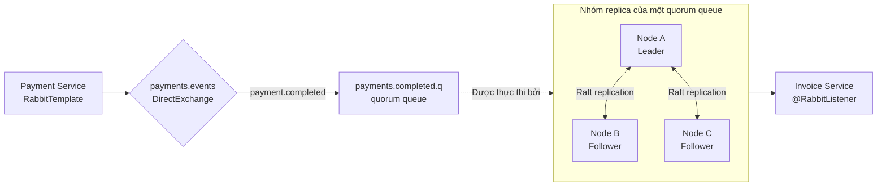
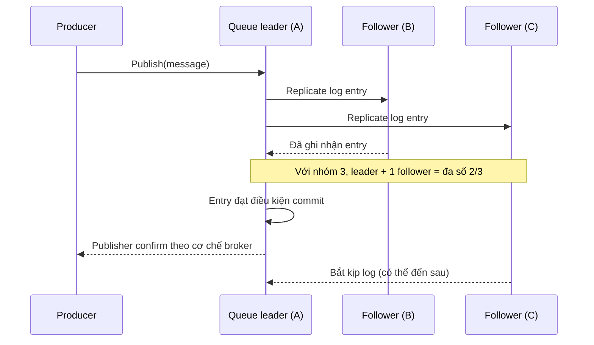
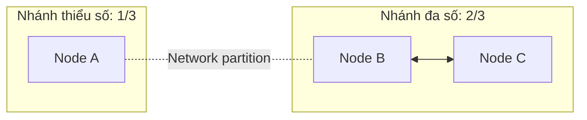
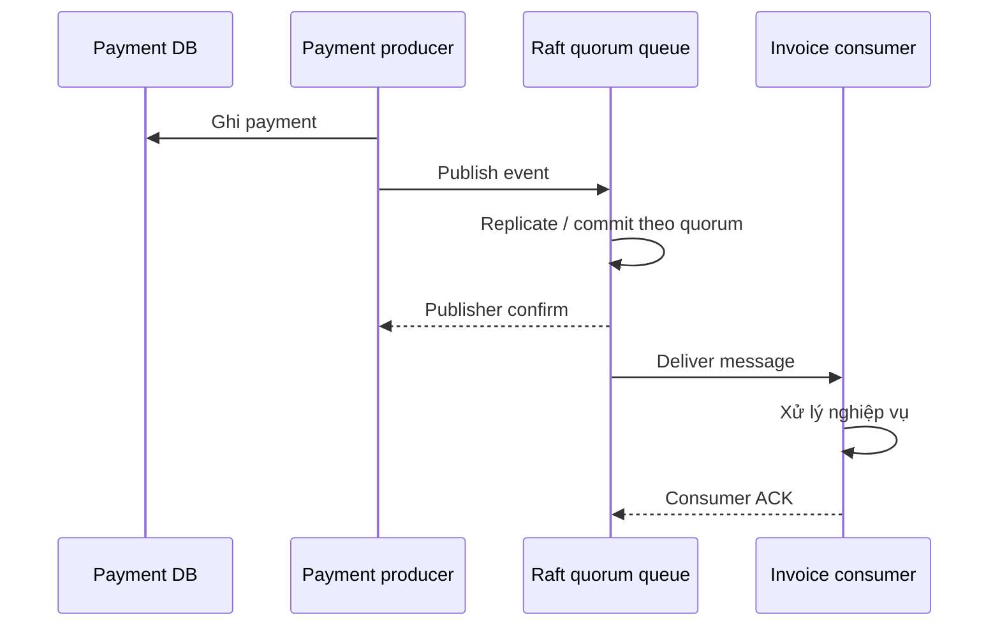
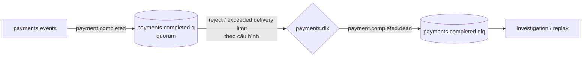
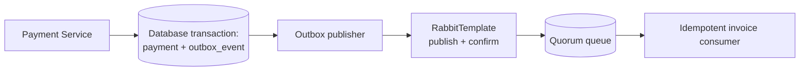

# Quorum queue, sao chép và điều kiện đủ số bản sao

Trong hệ thống xử lý bất đồng bộ, một thông điệp đặt hàng hoặc thanh toán có thể đã được nhận vào RabbitMQ nhưng chưa được consumer xử lý. Nếu node broker đang lưu queue gặp sự cố, điều gì bảo vệ message? Làm thế nào để một node khác tiếp tục cung cấp queue mà không chấp nhận hai lịch sử ghi mâu thuẫn khi mạng bị chia cắt?

**Quorum queue** là loại hàng đợi RabbitMQ được thiết kế cho những tác vụ cần dữ liệu được **sao chép giữa nhiều node** và cần cơ chế đồng thuận để quyết định bản ghi nào được chấp nhận. Quorum queue sử dụng thuật toán **Raft**, tổ chức các bản sao thành thành viên có **leader** và **follower**; những quyết định quan trọng cần được một **đa số (quorum)** thành viên chấp nhận.

Bài thuộc chương **Các loại hàng đợi** của module **SPRING_AMQP**. Bạn sẽ kết nối cách vận hành quorum queue với các thành phần Spring AMQP quen thuộc: `RabbitTemplate`, `@RabbitListener`, `DirectExchange`, `Queue` và `Binding`, cũng như xác nhận publish, consumer ACK, retry, dead-letter, giao dịch và giám sát hệ thống.

Sau khi học, bạn có thể:

1. Giải thích quorum queue khác classic queue ở điểm nào và vì sao replication cần đồng thuận.
2. Tính số thành viên tối thiểu để có quorum, phân tích khả năng chịu lỗi của nhóm 1, 3 và 5 bản sao.
3. Dự đoán hành vi khi leader mất, một follower mất hoặc cluster bị network partition.
4. Khai báo quorum queue trong Spring Boot/Spring AMQP và định tuyến message vào queue đó.
5. Phân biệt publisher confirm, quorum commit và consumer acknowledgement.
6. Lập kế hoạch giám sát, mở rộng replica, phục hồi và chống xử lý trùng cho hệ thống quan trọng.

## 1. Bài toán: queue bền vững nhưng vẫn phụ thuộc node

Hãy xét `Payment Service` phát sự kiện `payment.completed`. `Invoice Service` nhận thông điệp để phát hành hóa đơn. Trong lúc consumer tạm ngừng, message nằm chờ trong queue.

Nếu queue chỉ có dữ liệu trên một broker node, hỏng ổ đĩa hoặc mất vĩnh viễn node đó có thể gây mất dữ liệu, cho dù queue được khai báo `durable` và message được đánh dấu `persistent`. Hai thuộc tính này giúp tồn tại qua các tình huống khởi động lại phù hợp, nhưng **không tự tạo thêm bản sao dữ liệu trên node khác**.

Quorum queue được thiết kế để giảm rủi ro này bằng cách duy trì nhiều bản sao của cùng một log trên các node RabbitMQ.



Sơ đồ này biểu diễn **một queue có ba replica** trên ba RabbitMQ node. Đây không phải ba queue nghiệp vụ độc lập. Exchange định tuyến message đến queue; bên trong queue, cơ chế Raft quyết định dữ liệu được ghi và sao chép ra sao.

**Quorum queue không thay thế database, outbox, backup hay idempotency.** Nó bảo vệ một chặng của luồng giao nhận message; những chặng khác vẫn cần thiết kế riêng.

## 2. Quorum queue là gì?

Một quorum queue trong RabbitMQ có các đặc điểm chính:

- **Queue được sao chép:** dữ liệu queue được biểu diễn bằng một log nhân bản trên nhiều thành viên thuộc các node RabbitMQ khác nhau.
- **Có một leader tại một thời điểm trong cấu hình có quorum:** leader điều phối thao tác đối với queue; follower tham gia sao chép log và bầu leader khi cần.
- **Dùng Raft để đồng thuận:** một mục log chỉ được xem là đã commit theo cơ chế đồng thuận khi đạt điều kiện đa số thành viên.
- **Có chuyển leader:** nếu leader mất nhưng các thành viên còn lại vẫn có quorum, hệ thống có thể bầu leader mới và tiếp tục phục vụ sau khoảng gián đoạn.
- **Hướng tới an toàn dữ liệu:** khi không có đa số, queue hạn chế các thao tác cần đồng thuận để tránh hai phía chia mạng đều xác nhận những lịch sử ghi không tương thích.

Queue là đối tượng logic; mỗi replica là **một thành viên của queue trên một broker node**, không phải một consumer và cũng không phải một bản sao do ứng dụng tự chạy.

### 2.1. Classic queue và quorum queue

| Khía cạnh | Classic queue | Quorum queue |
|---|---|---|
| Mục tiêu chính | Hàng đợi thông thường, chi phí phù hợp với nhiều nhu cầu | Hàng đợi có dữ liệu nhân bản và xử lý failover theo đồng thuận |
| Vị trí dữ liệu | Một queue có một nơi lưu chính trong mô hình classic hiện đại | Nhiều replica của cùng một queue trên các node khác nhau |
| Đồng thuận Raft | Không | Có |
| Mất node đang giữ dữ liệu | Có nguy cơ queue không sẵn sàng hoặc mất dữ liệu nếu node/ổ lưu hỏng | Có thể tiếp tục nếu còn đa số thành viên và hạ tầng phù hợp |
| Chi phí | Thường tiết kiệm tài nguyên hơn | Tốn thêm ổ đĩa, mạng và công việc sao chép |
| Khả năng mở rộng tải | Phụ thuộc tải và loại công việc | Thêm replica chủ yếu tăng khả năng chịu lỗi, không tự nhân throughput của một queue |
| Phù hợp | Tác vụ thông thường với mức bảo vệ dữ liệu yêu cầu thấp hơn | Message nghiệp vụ quan trọng cần tính sẵn sàng và an toàn dữ liệu cao hơn |

Chọn quorum queue không có nghĩa hệ thống luôn nhanh hơn hoặc mọi loại message đều cần sao chép. Với dữ liệu có thể tái tạo dễ dàng hoặc tác vụ ngắn không quan trọng, chi phí replication có thể không tương xứng. Mặt khác, nếu mất message gây hậu quả nghiệp vụ lớn, nên cân nhắc quorum queue cùng các cơ chế xác nhận và khôi phục.

## 3. Raft: leader, follower và log được sao chép

Quorum queue dùng mô hình đồng thuận Raft. Ở mức khái niệm, mỗi thành viên có một bản log; leader tiếp nhận yêu cầu liên quan đến queue, sao chép các mục log đến follower và chỉ xác nhận kết quả theo cơ chế commit khi thỏa điều kiện đa số.

Một lần publish đến quorum queue có thể hình dung như sau:



Sơ đồ minh họa **điều kiện đa số**, không bắt buộc follower C phải phản hồi trước khi broker xác nhận. Thứ tự lưu log và xác nhận thực tế phụ thuộc giao thức, phiên bản broker, cấu hình và trạng thái cụm.

Các thuật ngữ cần phân biệt:

| Thuật ngữ | Ý nghĩa |
|---|---|
| **Member/replica** | Một thành viên của một quorum queue đang giữ bản log trên một RabbitMQ node |
| **Leader** | Thành viên đang điều phối thao tác của queue |
| **Follower** | Thành viên theo leader, nhân bản log và có thể tham gia bầu cử |
| **Commit** | Mục log đã vượt qua điều kiện đồng thuận của Raft |
| **Publisher confirm** | Tín hiệu broker gửi cho producer về kết quả publish theo cơ chế xác nhận của RabbitMQ |
| **Consumer ACK** | Tín hiệu consumer gửi sau khi xử lý delivery theo chính sách listener |

Không nên đồng nhất **đã ghi vào bộ nhớ/ổ đĩa của một follower**, **đã commit bởi đa số**, **đã gửi publisher confirm** và **consumer đã hoàn tất nghiệp vụ**. Đây là các mốc khác nhau.

### 3.1. Quorum thuộc về từng queue

Một cluster RabbitMQ có năm node không có nghĩa mọi quorum queue đều có năm replica. **Danh sách thành viên được quản lý theo từng queue**. Ví dụ:

- `payments.completed.q` có member trên A, B và C.
- `notifications.email.q` có member trên B, C và D.
- Node E thuộc cluster nhưng không là member của hai queue trên.

Nếu A mất, chỉ những queue có A là member chịu tác động trực tiếp đến nhóm replication tương ứng. Vì vậy khi đánh giá khả năng chịu lỗi, phải biết **membership và leader thực tế của từng quorum queue**, không chỉ đếm số node trong cluster.

### 3.2. Thêm consumer không phải thêm replica

Ba container Spring Boot cùng chạy `@RabbitListener(queues = "payments.completed.q")` tạo ra nhiều consumer cạnh tranh nhận delivery từ **một queue**. Điều đó không làm tăng số Raft member.

Ngược lại, tăng số member từ ba lên năm là thao tác vận hành RabbitMQ, không liên quan đến số listener Java. Tăng số replica chủ yếu phục vụ khả năng chịu lỗi; tăng số consumer phục vụ khả năng xử lý message, nhưng phải xét thêm giới hạn của database và downstream services.

## 4. Điều kiện đủ số bản sao: majority quorum

Giả sử một quorum queue có **N thành viên trong cấu hình hiện hành**. Số thành viên tối thiểu cần đạt đa số là:

```text
quorum(N) = floor(N / 2) + 1

Số member có thể mất mà vẫn còn quorum
= N - quorum(N)
```

Ví dụ:

| N (member) | Đa số tối thiểu | Số member mất tối đa còn quorum | Nhận xét |
|---:|---:|---:|---|
| 1 | 1 | 0 | Không có khả năng chịu lỗi node |
| 2 | 2 | 0 | Mất một member là mất quorum |
| 3 | 2 | 1 | Chịu được một member mất |
| 4 | 3 | 1 | Không chịu được nhiều lỗi hơn nhóm 3 |
| 5 | 3 | 2 | Chịu được hai member mất |
| 7 | 4 | 3 | Tăng khả năng chịu lỗi nhưng chi phí cũng tăng |

**Vì sao thường chọn số lẻ?** Hai và ba member đều chịu được tối đa một lỗi? **Không:** hai member cần cả hai cùng còn hoạt động, nên chịu được **0** lỗi; ba member chỉ cần hai, nên chịu được **1** lỗi. Tương tự, bốn và năm member cùng cần ba phiếu, nhưng năm member chịu được hai lỗi so với một lỗi của bốn member. Vì vậy nhóm **3 hoặc 5** thường cân bằng tốt hơn giữa khả năng chịu lỗi và chi phí.

### 4.1. Ví dụ ba replica

Với A, B, C:

```text
Trạng thái 1: A ✓   B ✓   C ✓    → 3/3: có quorum
Trạng thái 2: A ✗   B ✓   C ✓    → 2/3: có quorum
Trạng thái 3: A ✓   B ✗   C ✗    → 1/3: mất quorum
Trạng thái 4: A ✗   B ✗   C ✗    → 0/3: mất quorum
```

Nếu A là leader và A ngừng hoạt động, B và C có thể tổ chức bầu leader mới khi còn quorum. Quá trình bầu cử, kết nối lại và xử lý request đang dang dở có thể tạo ra một khoảng gián đoạn ngắn mà ứng dụng phải chịu được.

Nếu chỉ còn A, nhóm không có đa số. Việc một member đang chạy và còn truy cập được trên mạng **không đủ** để queue tiếp tục xác nhận các thao tác cần quorum.

### 4.2. Ví dụ năm replica

Với A, B, C, D, E, điều kiện là **3/5**. Hai node mất thì ba node còn lại vẫn tạo được quorum; ba node mất thì chỉ còn hai, không đủ.

Đây là khả năng chịu lỗi theo **thành viên của queue**. Nếu ba container được đặt trên cùng một máy vật lý và máy đó hỏng, cả ba replica có thể mất đồng thời. Vì vậy cần rải member trên các fault domain độc lập như host hoặc availability zone theo mức tin cậy mong muốn.

### 4.3. Vì sao minority không được ghi tiếp?

Giả sử nhóm ba member bị chia mạng thành phía A và phía B+C:



Nếu cả A và B+C đều có thể xác nhận ghi độc lập, khi mạng nối lại sẽ xuất hiện hai lịch sử có thể mâu thuẫn. Raft bảo vệ an toàn dữ liệu bằng cách chỉ cho nhánh có điều kiện đa số tiến hành các quyết định cần đồng thuận. Nhánh A không có quorum, dù A trước đó từng là leader.

**Đánh đổi cốt lõi:** quorum queue ưu tiên tính nhất quán của dữ liệu đã commit; khi mất đa số, tính sẵn sàng cho các thao tác cần quorum bị ảnh hưởng. Không có cấu hình “quorum luôn nhận ghi dù chỉ còn một replica” mà vẫn duy trì cùng bảo đảm đồng thuận.

## 5. Quorum queue và các tình huống sự cố

| Tình huống (queue 3 member) | Quorum còn? | Điều có thể xảy ra |
|---|---|---|
| Một follower tạm mất | Có: 2/3 | Leader còn hoạt động có thể tiếp tục; replica mất sẽ bắt kịp khi trở lại |
| Leader mất, hai follower còn | Có: 2/3 | Bầu leader mới; publish/consume có thể gián đoạn trong quá trình chuyển |
| Hai member mất | Không: 1/3 | Queue không thể tiếp tục các thao tác cần đồng thuận bình thường |
| Chia mạng 1 so với 2 | Chỉ phía 2/3 có quorum | Phía đa số có thể tiếp tục sau bầu cử; phía thiểu số không được xác nhận lịch sử ghi mâu thuẫn |
| Một member mất vĩnh viễn | Tạm còn: 2/3 | Cần quy trình khôi phục/thay thành viên, vì mất thêm một member sẽ mất quorum |
| Consumer Spring Boot chết | Membership không đổi | Delivery chưa ACK có thể được giao lại khi consumer/kết nối được khôi phục |
| Producer Spring Boot chết trước khi nhận confirm | Không xác định từ góc nhìn producer | Có thể broker đã commit message; producer phải xử lý trạng thái chưa chắc chắn và khả năng gửi trùng |

### 5.1. An toàn dữ liệu và khả năng phục vụ khác nhau

Cụm có đủ quorum giúp queue tiếp tục hoạt động nhưng **không đồng nghĩa mọi client luôn kết nối được**. Producer/consumer có thể đang trỏ vào một node chết hoặc bị ngắt khỏi phía đa số. Ứng dụng cần cấu hình endpoint broker, load balancer, chiến lược reconnect và timeout phù hợp.

Với Spring AMQP, `CachingConnectionFactory` và listener container hỗ trợ các cơ chế kết nối/khôi phục của thư viện; khả năng phục hồi thực tế còn phụ thuộc topology mạng và cách expose nhiều broker node. Khi failover, một publish đang chờ confirm có thể có kết quả chưa rõ ràng đối với producer. Cơ chế retry cần đi cùng idempotency.

### 5.2. Node quay lại không có nghĩa tự động tăng số member

Một node là thành viên của cluster chưa chắc là replica của một quorum queue mới. Khi node tham gia lại hoặc sau khi thay máy, cần kiểm tra nó có còn là member của queue, có bắt kịp log hay không và topology membership đã đạt kích thước mục tiêu chưa.

Các thao tác thêm/bớt member, thay node lỗi, thay đổi leader placement và xử lý khi mất quorum phải tuân theo quy trình vận hành RabbitMQ phù hợp phiên bản. **Không xóa/redeclare queue để “sửa replication” khi queue đang có dữ liệu quan trọng**; xóa queue sẽ có hậu quả dữ liệu và không phải phép thay đổi membership an toàn.

## 6. Khai báo quorum queue bằng Spring AMQP

Spring AMQP hỗ trợ khai báo quorum queue bằng queue argument `x-queue-type = quorum`. Code producer/consumer sử dụng `RabbitTemplate` và `@RabbitListener` tương tự các queue thông thường; khác biệt chủ yếu nằm ở **topology broker và đặc tính vận hành**.

### 6.1. Chuẩn bị một RabbitMQ broker để thử API

Nếu chỉ cần học khai báo, định tuyến và xử lý message, có thể chạy một broker cục bộ:

```bash
docker run -d --rm --name rabbitmq-quorum-demo -p 5672:5672 -p 15672:15672 -e RABBITMQ_DEFAULT_USER=demo -e RABBITMQ_DEFAULT_PASS=demo-local-only rabbitmq:4-management
```

Giao diện quản trị ở `http://localhost:15672`, tài khoản `demo` / `demo-local-only`; cổng AMQP là `5672`.

**Giới hạn quan trọng:** quorum queue được tạo trên broker **chỉ có một node** có thể có **một member**, tức `quorum(1) = 1`. Ví dụ này giúp thử Spring AMQP nhưng **không chứng minh khả năng sao chép hay chịu lỗi**. Muốn kiểm tra failover thực sự cần một RabbitMQ cluster đã cấu hình đủ node độc lập, thường ít nhất ba node cho nhóm ba member.

### 6.2. Dependencies và application.yml

Trong ứng dụng Spring Boot, dùng starter AMQP và thêm Web cho endpoint demo:

```groovy
dependencies {
    implementation 'org.springframework.boot:spring-boot-starter-amqp'
    implementation 'org.springframework.boot:spring-boot-starter-web'
}
```

```yaml
spring:
  rabbitmq:
    host: localhost
    port: 5672
    username: demo
    password: demo-local-only
    publisher-confirm-type: correlated
    publisher-returns: true
    template:
      mandatory: true
```

Cấu hình này bật các khả năng liên quan đến publisher confirm và return khi điều kiện AMQP đáp ứng. **Chỉ cấu hình thuộc tính chưa đủ để ứng dụng biết publish đã được xác nhận**: cần chủ động theo dõi kết quả xác nhận, correlation và những message được trả lại.

### 6.3. Định nghĩa queue, exchange và binding

Tạo lớp `PaymentMessagingConfiguration.java`:

```java
import org.springframework.amqp.core.Binding;
import org.springframework.amqp.core.BindingBuilder;
import org.springframework.amqp.core.DirectExchange;
import org.springframework.amqp.core.Queue;
import org.springframework.amqp.core.QueueBuilder;
import org.springframework.context.annotation.Bean;
import org.springframework.context.annotation.Configuration;

@Configuration
public class PaymentMessagingConfiguration {
    public static final String EXCHANGE = "payments.events";
    public static final String QUEUE = "payments.completed.q";
    public static final String ROUTING_KEY = "payment.completed";

    @Bean
    DirectExchange paymentsExchange() {
        return new DirectExchange(EXCHANGE, true, false);
    }

    @Bean
    Queue paymentsQuorumQueue() {
        return QueueBuilder.durable(QUEUE)
                .withArgument("x-queue-type", "quorum")
                .build();
    }

    @Bean
    Binding paymentsCompletedBinding(
            Queue paymentsQuorumQueue,
            DirectExchange paymentsExchange) {
        return BindingBuilder.bind(paymentsQuorumQueue)
                .to(paymentsExchange)
                .with(ROUTING_KEY);
    }
}
```

Hai chi tiết đặc biệt quan trọng:

1. `x-queue-type: quorum` yêu cầu RabbitMQ tạo queue loại quorum. Queue loại này được thiết kế là **durable**, không dùng như queue tạm `exclusive`/`auto-delete`.
2. `QueueBuilder.durable(...)` khai báo thuộc tính queue. Nó **không xác định số member**; số thành viên cần xem từ topology cluster và cấu hình membership khi queue được tạo.

Spring Boot thường cung cấp `RabbitAdmin` để khai báo các bean `Queue`, `Exchange` và `Binding` trên broker khi đủ điều kiện kết nối và auto-declare. Nếu queue tên `payments.completed.q` **đã tồn tại kiểu classic**, việc thêm `x-queue-type=quorum` vào Java bean **không chuyển đổi tại chỗ**. Broker có thể từ chối khai báo vì thuộc tính queue xung đột. Muốn đổi loại queue có dữ liệu, phải có kế hoạch di chuyển an toàn và cơ chế tạm dừng/đọc lại/phát lại phù hợp.

### 6.4. Publish với RabbitTemplate

Tạo `PaymentPublisher.java`:

```java
import org.springframework.amqp.rabbit.connection.CorrelationData;
import org.springframework.amqp.rabbit.core.RabbitTemplate;
import org.springframework.stereotype.Service;

@Service
public class PaymentPublisher {
    private final RabbitTemplate rabbitTemplate;

    public PaymentPublisher(RabbitTemplate rabbitTemplate) {
        this.rabbitTemplate = rabbitTemplate;
    }

    public void publishCompleted(String eventId) {
        rabbitTemplate.convertAndSend(
                PaymentMessagingConfiguration.EXCHANGE,
                PaymentMessagingConfiguration.ROUTING_KEY,
                eventId,
                new CorrelationData(eventId)
        );
    }
}
```

Ví dụ cố ý gửi `String eventId` để tập trung vào đường đi của message. Trong hệ thống thật, nên gửi payload có schema rõ ràng, ví dụ `eventId`, `paymentId`, `occurredAt`, `eventType` và `version`, đồng thời thống nhất converter JSON giữa các bên.

`CorrelationData` giúp phân biệt các yêu cầu publish khi theo dõi confirms. Ở đây chưa xử lý callback hoặc future xác nhận: lời gọi `convertAndSend(...)` trả về bình thường không tự chứng minh quorum queue đã commit message, càng không chứng minh consumer đã xử lý.

### 6.5. Consume với @RabbitListener

Tạo `PaymentCompletedListener.java`:

```java
import org.springframework.amqp.rabbit.annotation.RabbitListener;
import org.springframework.stereotype.Component;

@Component
public class PaymentCompletedListener {
    @RabbitListener(queues = PaymentMessagingConfiguration.QUEUE)
    public void onPaymentCompleted(String eventId) {
        System.out.println("Process payment event: " + eventId);
    }
}
```

Dù queue có nhiều replica, consumer vẫn đăng ký **một tên queue** như thông thường. Spring AMQP listener container làm việc với broker và xử lý acknowledgement theo cấu hình.

Khi dùng `AcknowledgeMode.AUTO` thông thường của Spring, container ACK sau khi handler kết thúc thành công. Điều này **khác** broker *auto-ack/no-ack*, vốn có nghĩa broker không chờ ACK của consumer. Nếu handler ném exception, hành vi reject/requeue/retry phụ thuộc cấu hình container.

### 6.6. Endpoint demo và kiểm tra

Tạo `PaymentDemoController.java`:

```java
import org.springframework.http.ResponseEntity;
import org.springframework.web.bind.annotation.PathVariable;
import org.springframework.web.bind.annotation.PostMapping;
import org.springframework.web.bind.annotation.RestController;

@RestController
public class PaymentDemoController {
    private final PaymentPublisher publisher;

    public PaymentDemoController(PaymentPublisher publisher) {
        this.publisher = publisher;
    }

    @PostMapping("/demo/payments/{eventId}/complete")
    public ResponseEntity<Void> completed(@PathVariable String eventId) {
        publisher.publishCompleted(eventId);
        return ResponseEntity.accepted().build();
    }
}
```

Đặt các lớp vào package được `@SpringBootApplication` quét, sau đó chạy ứng dụng và gửi:

```bash
curl -X POST http://localhost:8080/demo/payments/event-1001/complete
```

Kết quả kỳ vọng trên console:

```text
Process payment event: event-1001
```

Vào RabbitMQ Management UI, kiểm tra queue `payments.completed.q` có **type = quorum**, binding từ `payments.events` với routing key `payment.completed`, danh sách member/leader (nếu giao diện phiên bản hiện tại cung cấp), trạng thái messages ready/unacknowledged và tốc độ publish/ack.

HTTP `202 Accepted` trong demo **chỉ cho biết controller trả lời sau khi gọi publish**. Để API tuyên bố “broker đã nhận an toàn”, cần theo dõi publisher confirm và thiết kế phản hồi/thao tác bù phù hợp.

## 7. Làm thế nào để có ba replica thực sự?

Mã Java ở mục 6 hoạt động với RabbitMQ một node và cũng có thể làm việc với cluster nhiều node. **Replication do RabbitMQ cluster quản lý**, không phải vòng lặp publish trong Java.

Một bài lab ba member cần:

1. Có **ba RabbitMQ node** thực sự tham gia cùng một cluster, chẳng hạn A, B và C, trên các môi trường độc lập đủ để kiểm thử mất node.
2. Khai báo quorum queue **sau khi** các node đã sẵn sàng và kiểm tra nhóm member của queue có đủ ba thành viên.
3. Kết nối Spring Boot tới broker cluster bằng thiết lập connection/recovery phù hợp; gửi một số message và đọc trạng thái qua management.
4. Dừng một member (hoặc cô lập một node trong môi trường lab) rồi quan sát leader, quorum và việc publish/consume tiếp tục thế nào.
5. Cho node trở lại, kiểm tra thành viên bắt kịp log và trạng thái queue phục hồi.

Tùy RabbitMQ release, cơ chế cấu hình số member ban đầu và công cụ điều chỉnh membership có thể khác nhau. Hãy kiểm tra **membership thực tế của queue** trước khi coi bài lab có ba replica. Một cluster ba node không tự bảo đảm mọi queue đều có ba member trong mọi trạng thái và cấu hình.

### 7.1. Kịch bản kiểm thử có kỳ vọng rõ ràng

| Thử nghiệm | Kỳ vọng với queue ba member |
|---|---|
| Ba node đang chạy | Có quorum 3/3 |
| Dừng một follower | Còn 2/3, vẫn có quorum; không phát sinh leader election nếu leader vẫn hoạt động |
| Khôi phục follower | Member trở lại, đồng bộ theo cơ chế broker |
| Dừng leader khi hai follower vẫn chạy | Có thể bầu leader mới; ứng dụng có thể phải reconnect/retry |
| Chỉ còn một member | Không còn quorum; các thao tác cần consensus không thể hoàn thành bình thường |
| Phục hồi đủ member sau sự cố | Kiểm tra quorum/leader, log replication, delivery và publisher confirms |

**Không kiểm thử “mất hai node” trên môi trường production.** Với hệ thống thật, cần diễn tập có giới hạn trong staging, quan sát recovery, đánh giá độ trễ và có quy trình khôi phục trước khi áp dụng rộng rãi.

### 7.2. Kích thước ban đầu và thay đổi membership

Quorum queue có cấu hình kích thước nhóm thành viên ban đầu khi khai báo và các cơ chế thay đổi membership sau đó. RabbitMQ có thể chọn các node đủ điều kiện cho nhóm ban đầu, nhưng con số cuối cùng vẫn phụ thuộc cluster hiện hữu và cấu hình.

Điều cần phân biệt:

- **Thêm node vào cluster** không tương đương **thêm thành viên vào mọi quorum queue**.
- **Tăng số consumer** không tăng replica.
- **Tăng từ ba lên năm member** giúp chịu thêm một lỗi node nữa (hai lỗi thay vì một), nhưng tiêu tốn thêm tài nguyên.
- **Giảm member** thay đổi mẫu số N của tính toán đa số và cần thao tác có kiểm soát; không làm bừa khi cluster đã mất quorum.

Một cách tổ chức an toàn là theo dõi số member mục tiêu, số member hiện có, node placement và trạng thái leader từng queue. Công cụ quản trị RabbitMQ có các lệnh hỗ trợ kiểm tra và điều chỉnh membership; cú pháp và hành vi cần đối chiếu đúng phiên bản broker đang triển khai.

## 8. Publisher confirms và consumer ACK trong quorum queue

Hãy tách **độ tin cậy khi producer gửi vào queue** khỏi **độ tin cậy khi consumer xử lý nội dung**.



| Mốc | Điều được biết | Điều chưa được biết |
|---|---|---|
| `convertAndSend` trả về | Mã đã gọi gửi mà không gặp lỗi đồng bộ tại điểm đó | Broker đã commit hay chưa |
| Nhận publisher confirm ACK cho message đã route vào quorum queue | Broker xác nhận publish theo bảo đảm của queue và cơ chế confirms | Consumer đã hoàn tất nghiệp vụ |
| Broker trả lại message (publisher return) | Không có queue đích phù hợp theo điều kiện mandatory/return | Không thể suy ra thành công chỉ từ confirm |
| Consumer ACK sau handler | Consumer báo hoàn thành delivery theo logic handler | Cập nhật database có bị trùng hoặc còn lỗi ở dịch vụ khác không |

Quorum queue không làm cho `RabbitTemplate` trở thành lời gọi request/reply đồng bộ đến consumer. Nếu producer chưa nhận confirm khi mất kết nối, kết quả của publish có thể **không xác định** từ phía producer: broker có thể đã commit nhưng confirm chưa đến. Gửi lại có thể tạo message trùng, nên cần `eventId` ổn định và khả năng xử lý lặp an toàn.

### 8.1. Ví dụ đăng ký callback để quan sát confirm và return

Có thể thêm thành phần chẩn đoán cho template dùng trong ví dụ:

```java
import jakarta.annotation.PostConstruct;
import org.springframework.amqp.rabbit.core.RabbitTemplate;
import org.springframework.stereotype.Component;

@Component
public class PublisherConfirmLogger {
    private final RabbitTemplate rabbitTemplate;

    public PublisherConfirmLogger(RabbitTemplate rabbitTemplate) {
        this.rabbitTemplate = rabbitTemplate;
    }

    @PostConstruct
    public void configureCallbacks() {
        rabbitTemplate.setConfirmCallback((data, ack, cause) -> {
            String id = data == null ? "unknown" : data.getId();
            System.out.printf(
                    "Publish id=%s confirmed=%s cause=%s%n",
                    id, ack, cause
            );
        });

        rabbitTemplate.setReturnsCallback(returned -> {
            System.err.printf(
                    "Unroutable exchange=%s routingKey=%s reason=%s%n",
                    returned.getExchange(),
                    returned.getRoutingKey(),
                    returned.getReplyText()
            );
        });
    }
}
```

Đoạn code này minh họa cách quan sát, cần chạy cùng cấu hình confirms/returns/mandatory ở mục 6.2. Trong ứng dụng thực tế chỉ nên có **một cơ chế sở hữu callback trên mỗi template** và cần xử lý correlation, timeout, callback failure cùng chiến lược retry có kiểm soát. Không ghi log đơn thuần rồi coi publish đã bền vững thành công.

### 8.2. Consumer ACK và xử lý lặp

Giả sử consumer nhận `event-1001`, ghi hóa đơn vào database, rồi kết nối mất **trước khi broker nhận ACK**. RabbitMQ có thể giao lại message. Nếu handler tự động phát hành hóa đơn mới mỗi lần gọi, sẽ tạo hóa đơn trùng.

Mẫu xử lý là **idempotency**: đặt một mã `eventId` duy nhất cho sự kiện, lưu dấu đã xử lý trong cùng database transaction với thay đổi nghiệp vụ khi có thể, và dùng unique constraint để ngăn áp dụng lặp.

Một ví dụ ý tưởng:

```text
transaction:
    insert processed_event(event_id = "event-1001")
       nếu event_id đã tồn tại → coi như đã xử lý
    insert invoice(payment_id = ...)
commit
ACK sau khi transaction thành công
```

Khi có nhiều consumer instance và race condition, kiểm tra “đã tồn tại chưa” rồi mới insert không đủ. **Ràng buộc duy nhất ở database** và transaction phù hợp bảo vệ tính nguyên tử của dấu xử lý.

## 9. Retry, poison message và dead-letter

Quorum queue thường được chọn cho sự kiện quan trọng, nên một message lỗi không thể để lặp vô hạn và chiếm tài nguyên.

- **Lỗi tạm thời:** có thể retry có giới hạn và backoff.
- **Lỗi dữ liệu/schema:** không nên retry mãi; đưa vào quy trình điều tra hoặc dead-letter.
- **Redelivery do failover/mất ACK:** không có nghĩa message sai; handler vẫn phải idempotent.
- **Poison message:** message liên tục khiến consumer lỗi; quorum queue có cơ chế theo dõi số lần giao lại/giới hạn delivery tùy phiên bản và chính sách.

Ở những phiên bản RabbitMQ mới, quorum queue có thể áp dụng **delivery limit** mặc định và/hoặc chính sách `delivery-limit`; giới hạn và hành vi cụ thể phụ thuộc broker release. Khi vượt giới hạn, nếu DLX/DLQ không được cấu hình phù hợp, message có thể bị loại bỏ. Vì vậy hãy kiểm tra cấu hình thực tế thay vì giả định “RabbitMQ sẽ giữ message lỗi mãi”.

### 9.1. Dead-letter cho quorum queue

Một ví dụ topology:



Cần cấu hình DLX, routing key dead-letter, DLQ và binding tương ứng. Việc dead-letter trong RabbitMQ có những lựa chọn chiến lược và bảo đảm giao nhận khác nhau, trong đó **at-most-once** và **at-least-once** dead-lettering (khi release và điều kiện cấu hình hỗ trợ) không tương đương. Nếu sự kiện là dữ liệu quan trọng, phải kiểm chứng hành vi DLX khi đích tạm không sẵn sàng và giám sát việc chuyển message.

Khi cấu hình lỗi listener, tránh vòng lặp nóng `NACK(requeue=true)` liên tục. Hãy giới hạn retry, áp dụng backoff, có ngưỡng cảnh báo và quy trình phát lại message sau khi sửa nguyên nhân.

## 10. Transaction và outbox: điều quorum queue không tự giải quyết

Quorum queue giúp tăng an toàn khi message **đã vào broker theo bảo đảm của nó**, nhưng không làm cho thao tác ghi dữ liệu nghiệp vụ và publish RabbitMQ trở thành một transaction phân tán tự động.

Ví dụ:

1. `Payment Service` commit trạng thái thanh toán trong PostgreSQL.
2. Ứng dụng cố gắng publish `payment.completed` vào RabbitMQ.
3. Kết nối mất trước khi broker xác nhận.

Đã có payment trong database nhưng producer chưa biết event đã được ghi vào queue hay chưa. Bên cạnh đó, nếu đảo thứ tự hai thao tác, message có thể đến consumer dù database cuối cùng rollback.

**Transactional outbox** giảm khoảng hở này:



Trong cùng database transaction, ứng dụng ghi payment và bản ghi outbox. Một tiến trình đọc outbox, publish có theo dõi confirm rồi đánh dấu trạng thái gửi. Nếu tiến trình gặp lỗi giữa các bước, event có thể được publish lại, nên consumer vẫn cần idempotency. Đây là **at-least-once với chống xử lý trùng**, không nên mô tả thành exactly-once end-to-end khi không có cơ chế nghiệp vụ tương ứng.

Giao dịch RabbitMQ ở cấp channel và transaction của database là hai miền độc lập; quorum replication không làm chúng commit nguyên tử cùng nhau.

## 11. Quan sát quorum queue trong môi trường vận hành

Khi đánh giá một quorum queue, đừng chỉ hỏi “có bao nhiêu node đang chạy?”. Cần quan sát **queue membership, leader và khả năng đạt đa số của riêng queue đó**.

| Nhóm kiểm tra | Dữ liệu cần quan sát | Câu hỏi |
|---|---|---|
| Membership | Member list, member online, kích thước nhóm | Queue thực có 1, 3 hay 5 replica? |
| Leader | Node leader, tình trạng leader election | Có leader phù hợp và đang chuyển leader liên tục không? |
| Đồng thuận | Quorum availability, tình trạng replication/member lag theo công cụ broker | Có đủ đa số để commit không? |
| Producer | Publish rate, confirm rate/latency, returns, timeouts | Message đã được xác nhận hay đang ở trạng thái chưa chắc chắn? |
| Consumer | Consumer count, deliver/ACK rate, unacknowledged | Đang xử lý đến đâu, có giữ message lâu không? |
| Backlog | Messages ready, độ tuổi message, queue depth | Consumer có theo kịp producer không? |
| Lỗi | Redelivery, retry, poison messages, DLQ depth | Có message lỗi lặp hoặc bị loại bỏ không? |
| Tài nguyên | Disk, memory, network, I/O, tình trạng các node | Replication có đang gặp nút thắt tài nguyên không? |

RabbitMQ Management UI và các công cụ CLI/metrics của RabbitMQ cung cấp quan sát theo queue, tùy phiên bản. Spring Boot Actuator, Micrometer, tracing và log mang `eventId` hỗ trợ nhìn từ phía ứng dụng.

### 11.1. Chỉ số để đặt cảnh báo

Cần có cảnh báo khi:

- Số member online giảm gần hoặc xuống dưới quorum.
- Leader thay đổi thường xuyên hoặc node lỗi lặp lại.
- Publisher confirm latency/timeout tăng bất thường.
- Queue backlog/tuổi message vượt ngưỡng xử lý nghiệp vụ.
- Redelivery, lỗi listener hoặc DLQ tăng liên tục.
- Disk hoặc mạng giữa node trở thành nút thắt làm chậm replication.

Một queue còn quorum nhưng chỉ còn đúng đa số (ví dụ **2/3**) đang ở trạng thái **giảm dự phòng**: mất thêm một member sẽ mất quorum. Đây là lý do cần khôi phục member sớm, kể cả khi ứng dụng vẫn hoạt động.

### 11.2. Chi phí của số replica

Mỗi replica tiêu thụ tài nguyên đĩa, mạng, CPU và chi phí đồng thuận. Vì vậy:

- Không mặc định tạo năm hoặc bảy replica cho mọi queue.
- Chọn vị trí member để tránh cùng một sự cố cơ sở hạ tầng làm mất nhiều replica.
- Theo dõi tốc độ publish/consume, latency confirm và backlog trước/sau khi thay đổi membership.
- Cân nhắc phân phối nhiều queue để phân tán tải; thêm replica cho **một queue** không đồng nghĩa tăng trực tiếp khả năng tiêu thụ của queue đó.
- Kiểm thử kịch bản bảo trì, mất leader, reconnect và recovery trước khi dựa vào SLA.

## 12. Các hiểu lầm phổ biến

| Hiểu lầm | Cách hiểu đúng |
|---|---|
| “Cluster có ba node nên tất cả quorum queue có ba replica.” | Membership được cấu hình và kiểm tra **theo từng queue**. |
| “Một consumer mới là một bản sao của queue.” | Consumer xử lý delivery; replica là thành viên Raft trên broker node. |
| “Hai replica chịu được mất một node.” | Nhóm hai cần **2/2** để có đa số; mất một là hết quorum. |
| “Có một leader đang chạy thì queue luôn nhận ghi.” | Leader cần quorum để thực hiện quyết định theo đồng thuận. |
| “Mất leader chắc chắn mất message đã được confirm.” | Với bảo đảm của quorum queue và khi còn đa số, log đã commit được bảo vệ theo cơ chế Raft. |
| “Thêm replica giúp mỗi message được consumer xử lý nhanh gấp đôi.” | Replica phục vụ sao chép/khả năng chịu lỗi; throughput phụ thuộc nhiều yếu tố khác. |
| “Queue durable đồng nghĩa dữ liệu được sao chép.” | Durable và replication là hai thuộc tính khác nhau. |
| “Publisher confirm nghĩa là handler đã hoàn thành.” | Confirm thuộc chặng broker; consumer ACK thuộc chặng xử lý. |
| “Quorum queue bảo đảm exactly-once toàn hệ thống.” | Producer có thể gửi trùng khi không nhận confirm; consumer có thể redeliver khi ACK thất lạc. |
| “Thay classic queue thành quorum bằng việc sửa x-queue-type.” | Không thể mặc định đổi kiểu queue đang tồn tại tại chỗ; cần quy trình migration. |
| “Chỉ cần DLQ là sẽ không mất poison message.” | Cần cấu hình dead-letter và xác minh chiến lược/bảo đảm đích phù hợp. |

## 13. Bài tập thực hành

### Bài 1 — Tính quorum và khả năng chịu lỗi

Cho các kích thước nhóm `N = 1, 2, 3, 4, 5, 7`. Hãy tính `floor(N/2)+1` và số member có thể mất mà vẫn còn quorum. Giải thích vì sao kích thước lẻ thường có lợi hơn kích thước chẵn liền trước.

### Bài 2 — Kịch bản chia mạng

Một quorum queue có member A, B, C. A là leader, sau đó bị tách mạng khỏi B+C. B+C có thể làm gì? A có thể tiếp tục xác nhận publish không? Sau khi mạng hồi phục, Raft giải quyết nguy cơ hai log mâu thuẫn như thế nào ở mức nguyên tắc?

### Bài 3 — Queue một member so với ba member

Chạy code Spring Boot ở mục 6 trên broker Docker một node và xem queue type/membership trong Management UI. Sau đó thử cùng code trên một cluster ba node được cấu hình sẵn. Giải thích vì sao cùng một bean `Queue` có thể được dùng trong cả hai bài lab nhưng khả năng chịu lỗi thực tế khác nhau.

### Bài 4 — Phân biệt ba mốc xác nhận

Gọi `convertAndSend` với `CorrelationData` và quan sát publisher confirm. Cho listener cố tình ném exception. Xác định lúc nào broker xác nhận publish, lúc nào listener ACK, lúc nào message có thể redeliver. Nêu cơ chế kiểm tra unroutable message nếu sai binding key.

### Bài 5 — Khôi phục sau lỗi leader

Trong môi trường staging có ba member, dừng node leader. Theo dõi thời gian chuyển leader, publisher confirm latency và số delivery chưa ACK. Đề xuất cơ chế reconnect/retry của Spring AMQP và cách phát hiện event trùng trong database.

### Bài 6 — Thiết kế giao dịch

Payment Service commit payment rồi publish event vào quorum queue. Nếu không nhận confirm do lỗi mạng, hệ thống nên làm gì? Hãy thiết kế outbox với event ID ổn định và cách consumer ngăn phát hành hai hóa đơn cho cùng payment.

### Bài 7 — Lập kế hoạch vận hành

Hệ thống có năm broker node nhưng một quorum queue chỉ có ba member. Hai member của queue gặp sự cố đồng thời. Có thể dựa vào hai broker node còn lại không thuộc membership để queue tiếp tục ghi ngay lập tức không? Hãy trình bày thông tin membership nào cần có và bước khôi phục nào phải theo quy trình của broker.

## 14. Tóm tắt kiến thức trọng tâm

Quorum queue của RabbitMQ là hàng đợi có dữ liệu được nhân bản qua các member và dùng Raft để duy trì **một lịch sử commit nhất quán**. Số member tối thiểu để có quorum là **`floor(N/2) + 1`**: nhóm ba cần hai, nhóm năm cần ba. Nếu mất leader nhưng vẫn còn đa số, queue có thể bầu leader mới; khi mất đa số, không thể tiếp tục các thao tác cần đồng thuận bình thường.

Trong Spring AMQP, khai báo queue bằng `QueueBuilder.durable(...).withArgument("x-queue-type", "quorum")`; `RabbitTemplate` vẫn publish qua exchange/binding và `@RabbitListener` vẫn xử lý delivery. **Quorum queue tăng bảo đảm ở tầng broker**, còn hệ thống bất đồng bộ đáng tin cậy cần thêm publisher confirms/returns, consumer ACK, retry có giới hạn, dead-letter, idempotency, outbox và quan sát khả năng đạt quorum của từng queue.
