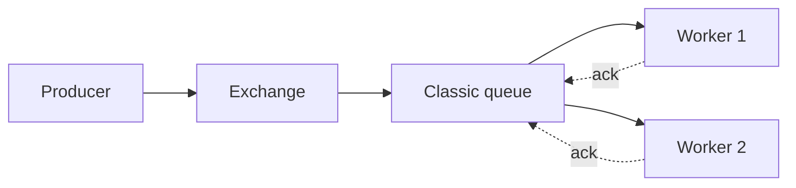
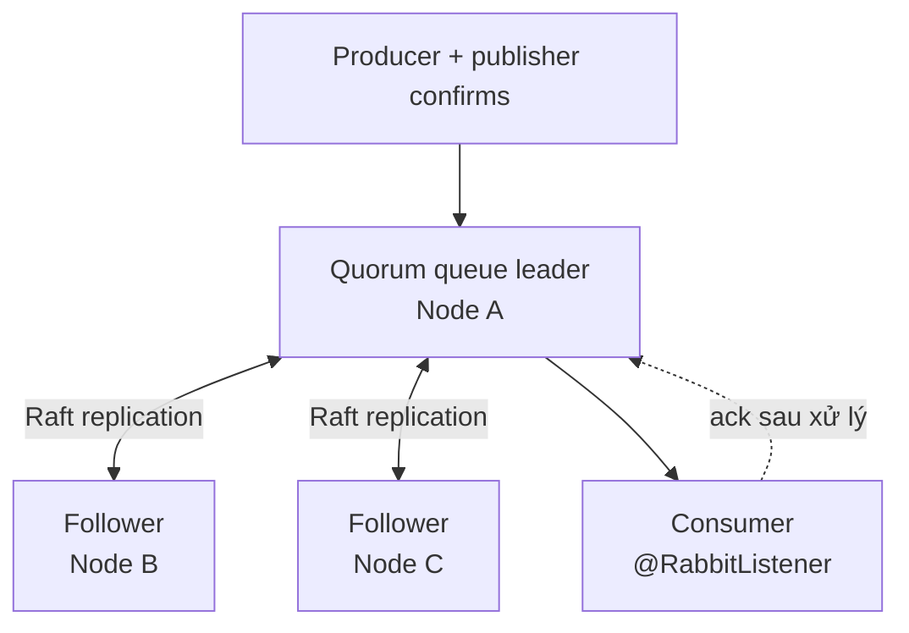
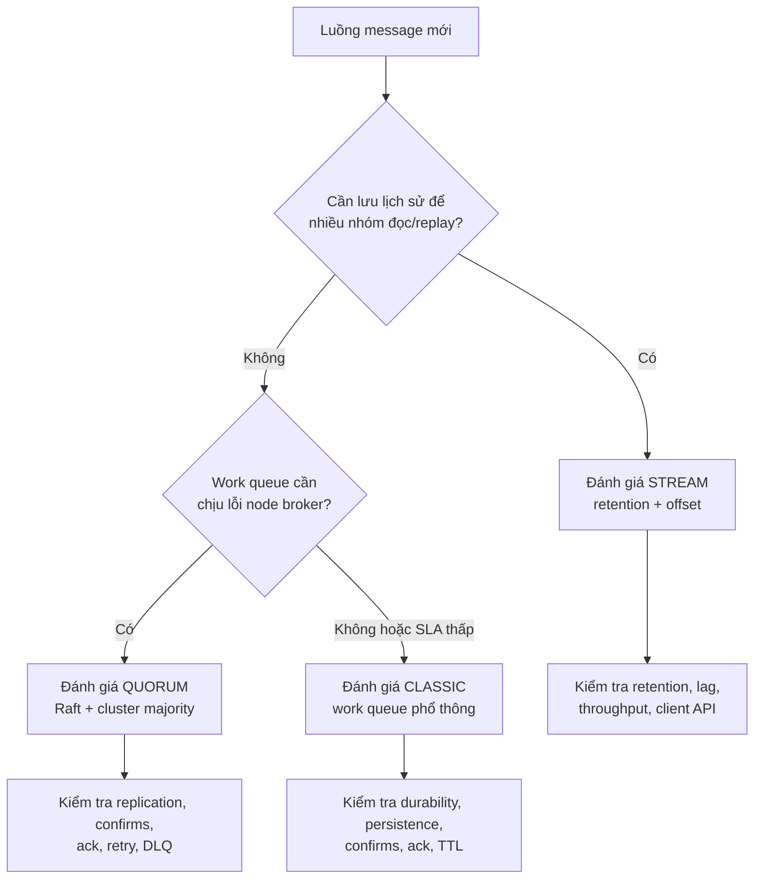
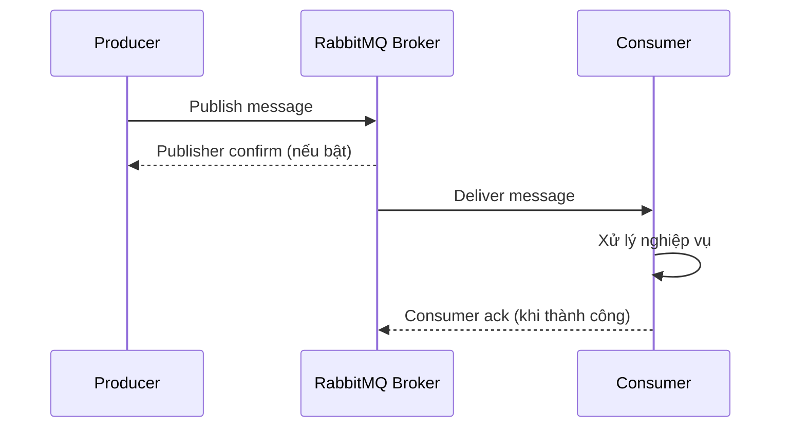

# Chọn queue type theo độ tin cậy, thời gian lưu và cách tiêu thụ

## 1. Vì sao chọn đúng queue type lại quan trọng?

Trong chương **Các loại hàng đợi** của module **SPRING_AMQP**, chúng ta đã có thể dùng `RabbitTemplate` để publish, `@RabbitListener` để consume, và khai báo exchange, queue, binding bằng Spring AMQP. Nhưng khi đưa một luồng xử lý bất đồng bộ lên môi trường thật, **queue type** ảnh hưởng trực tiếp đến những câu hỏi:

- Broker hoặc một node gặp sự cố thì message còn được phục hồi hay không?
- Consumer tạm dừng nhiều giờ thì message có được giữ lại để xử lý tiếp không?
- Khi đã xử lý một message, hệ thống có cần giữ nó để consumer khác đọc lại không?
- Hệ thống cần một nhóm worker chia nhau công việc hay nhiều nhóm độc lập đọc cùng một lịch sử sự kiện?
- Độ trễ, thông lượng, ổ đĩa và chi phí vận hành có giới hạn thế nào?

RabbitMQ có ba loại queue trọng tâm cần phân biệt:

1. **Classic queue:** hàng đợi truyền thống, phù hợp nhiều luồng công việc phổ thông.
2. **Quorum queue:** hàng đợi được nhân bản bằng cơ chế đồng thuận, hướng đến độ bền và tính sẵn sàng khi chạy cluster.
3. **Stream:** log message dạng append-only, ưu tiên lưu lịch sử có retention và cho phép đọc lại theo offset.

**Không có một queue type tối ưu cho mọi ứng dụng.** Chọn theo yêu cầu nghiệp vụ trước, sau đó mới tối ưu cấu hình. Ví dụ gửi email nền, xử lý lệnh thanh toán và phát event để hệ thống phân tích đọc lại sẽ có yêu cầu rất khác nhau.

Mục tiêu sau bài này: đọc được bảng so sánh, tự chọn queue type cho một use case, khai báo queue bằng Spring AMQP và biết cách kiểm chứng độ tin cậy, retention và cách tiêu thụ message.

## 2. Trước hết phân biệt 5 khái niệm thường bị trộn lẫn

| Khái niệm | Ý nghĩa | Câu hỏi cần hỏi |
| --- | --- | --- |
| **Durable queue** | Định nghĩa queue được duy trì sau broker restart theo cơ chế của loại queue. | Queue còn tồn tại sau khi broker khởi động lại không? |
| **Persistent message** | Message được publish với delivery mode phù hợp để được lưu bền vững khi dùng queue hỗ trợ. | Nội dung message có được broker lưu theo yêu cầu không? |
| **Replication / HA** | Dữ liệu queue có các bản sao trên nhiều node, với quy tắc đồng bộ và failover. | Một node mất thì dịch vụ vẫn hoạt động được không? |
| **Retention / TTL / giới hạn độ dài** | Quy định dữ liệu được giữ bao lâu hoặc đến dung lượng nào, tùy queue type. | Message cũ còn tồn tại, bị hết hạn hay bị loại bỏ khi nào? |
| **Acknowledgement / offset** | Theo dõi việc consumer hoàn thành delivery hoặc vị trí đã đọc trong log. | Sau khi đọc, message còn tồn tại và có thể đọc lại không? |

Ba hiểu nhầm cần tránh:

- **Durable không đồng nghĩa replicated.** Một classic queue durable vẫn có thể phụ thuộc vào node chứa nó.
- **Publisher confirm không đồng nghĩa consumer ack.** Confirm cho biết broker đã xác nhận publish theo cơ chế tương ứng; ack cho biết một delivery phía consumer đã được xác nhận.
- **Retention không đồng nghĩa retry.** Stream retention giữ dữ liệu cho phép đọc lại; cơ chế retry của work queue phải xử lý lỗi giao nhận và side effect theo quy tắc khác.

Một thiết kế đáng tin cậy cần phối hợp **queue type + loại message + publisher confirms + xử lý ack/redelivery + idempotency**, chứ không chỉ chọn “quorum” hay “stream”.

## 3. Bảng so sánh Classic, Quorum và Stream

| Tiêu chí | Classic queue | Quorum queue | Stream |
| --- | --- | --- | --- |
| **Mô hình dữ liệu** | Hàng đợi công việc truyền thống | Hàng đợi công việc có nhật ký nhân bản và đồng thuận | Log ghi nối tiếp, đọc theo vị trí |
| **Nhân bản tự thân** | Không theo mô hình classic queue hiện đại | Có, qua **Raft** với các member trên nhiều node | Có thể nhân bản theo cấu hình stream |
| **Định hướng chính** | Work queue phổ thông, cấu hình linh hoạt | Work queue cần chống mất dữ liệu khi một node lỗi và có cơ chế failover | Event log, replay, nhiều nhóm đọc độc lập, backlog lớn |
| **Sau khi consumer xử lý** | Ack giúp broker loại message khỏi queue | Ack giúp broker hoàn thành delivery, loại message theo cơ chế queue | Đọc/ghi offset không xóa log entry ngay |
| **Đọc lại message đã hoàn tất** | Thường không, nếu message đã bị loại bỏ sau ack | Thường không, nếu đã ack xong | Có, nếu log entry vẫn nằm trong retention |
| **Thời gian lưu** | Giữ đến khi tiêu thụ/loại bỏ hoặc theo TTL/length/policy | Tương tự work queue, có giới hạn và chính sách phù hợp | Retention theo tuổi/dung lượng; không phụ thuộc một consumer ack |
| **Nhiều consumer** | Competing consumers chia công việc trong cùng queue | Competing consumers chia công việc trong cùng queue | Nhiều consumer/nhóm có thể đọc cùng một log ở offset riêng |
| **Publisher/consumer điển hình** | Spring AMQP `RabbitTemplate`, `@RabbitListener` | Spring AMQP `RabbitTemplate`, `@RabbitListener` | Stream client hoặc Spring `RabbitStreamTemplate` / stream listener |
| **Exchange/binding** | Có thể định tuyến qua exchange | Có thể định tuyến qua exchange | Có thể được publish qua exchange; native Stream protocol có cách truy cập riêng |
| **Retry / dead-letter** | Các cơ chế AMQP quen thuộc | Các cơ chế tương tự, thêm chính sách an toàn riêng cho quorum | Không xem DLX, TTL hay ack/xóa từng message giống classic/quorum |
| **Đổi từ loại này sang loại khác** | Không đổi queue type của một queue hiện hữu chỉ bằng code redeclare | Cần migration/dữ liệu/topology phù hợp | Cần điều chỉnh cả mô hình consumer/offset |

Trong RabbitMQ 4.x, **classic mirrored queues đã bị loại bỏ**. “Classic queue” ở đây không có nghĩa “classic queue đã được mirror để failover”; nếu cần một work queue được nhân bản, hãy đánh giá quorum queue. Stream có cấu trúc khác và thường không phải lựa chọn thay thế trực tiếp cho work queue truyền thống.

**Hiệu năng không có bảng xếp hạng cố định:** throughput và latency phụ thuộc kích thước message, ổ đĩa, batching, số consumer, prefetch, replication, phiên bản RabbitMQ và network. Hãy benchmark với tải gần nhu cầu thật.

## 4. Classic queue: tác vụ nền với cách tiêu thụ truyền thống

### 4.1. Message đi qua classic queue như thế nào?



Classic queue phù hợp với **work queue**:

1. Producer publish một công việc (ví dụ gửi email).
2. Exchange route message vào một classic queue.
3. Một trong các worker đăng ký queue nhận delivery.
4. Worker xử lý và gửi acknowledgement.
5. Sau khi delivery được ack, broker có thể loại message đó khỏi queue.

Hai worker cùng nghe một queue **không** có nghĩa cả hai đều nhận một bản sao. Đây là cơ chế **competing consumers**: nhiều worker chia tải để xử lý tập công việc.

### 4.2. Khi nào Classic phù hợp?

- Tác vụ có thể thực hiện lại an toàn hoặc có nguồn dữ liệu để dựng lại khi gặp sự cố lớn.
- Hệ thống nhỏ/chạy một node RabbitMQ, không yêu cầu một queue tự failover qua nhiều node.
- Workload không cần replay message sau khi đã xử lý thành công.
- Cần các khả năng work queue truyền thống và muốn chi phí vận hành đơn giản.

Ví dụ **gửi email nhắc lịch**: API tạo yêu cầu, publisher gửi job đến `emails.send.q`; nhiều worker nhận việc, gửi email, ack khi hoàn thành. Dù dùng classic, vẫn cần **idempotency** để tránh gửi email trùng nếu worker bị giao lại message.

### 4.3. Ranh giới độ tin cậy của classic queue

Khai báo classic queue **durable** cùng message **persistent** giúp broker có cơ chế lưu qua restart phù hợp, nhưng một queue truyền thống vẫn gắn với node lưu trữ của nó. Sự cố khiến node đó không khả dụng có thể làm queue không sẵn sàng; lỗi hạ tầng nghiêm trọng vẫn có thể dẫn tới mất dữ liệu.

Nếu nghiệp vụ buộc phải tiếp tục xử lý khi một node RabbitMQ lỗi, không nên chỉ xem durable classic queue là đủ.

## 5. Quorum queue: work queue nhân bản dùng Raft

### 5.1. Mô hình quorum

Quorum queue dùng **Raft** để duy trì một tập member có **leader** và các replica. Các thay đổi được xử lý theo quy tắc đồng thuận của nhóm; queue có thể tiếp tục hoạt động khi một số node lỗi, miễn vẫn giữ được **đa số** thành viên cần thiết và điều kiện hệ thống đáp ứng.



Ví dụ queue có **3 member** trên **3 node độc lập**: cấu hình này có thể chịu lỗi **1 member/node** mà vẫn còn đa số 2/3. Nếu mất 2/3 member, queue không còn quorum để tiến hành các thao tác cần đồng thuận. Chỉ chạy quorum queue trong **một RabbitMQ node** không tạo được khả năng chịu lỗi một node.

Replication có chi phí: ghi message cần xử lý đồng bộ/nhất quán giữa các member, dùng thêm network và disk. Đây là chi phí để cải thiện khả năng chịu lỗi, không phải một cách tăng throughput miễn phí.

### 5.2. Khi nào nên chọn Quorum?

- Lệnh nghiệp vụ quan trọng, ví dụ **yêu cầu thanh toán**, **đặt hàng**, **cập nhật trạng thái cần xử lý chắc chắn**, nơi mất job có tác động lớn.
- Hệ thống dùng cluster RabbitMQ với ít nhất vài node độc lập và muốn failover cho từng queue.
- Mô hình tiêu thụ vẫn là **work queue**: mỗi message thường được một worker xử lý thành công, rồi không cần giữ để replay.
- Cần chiến lược dead-letter/retry rõ ràng và kiểm soát message lỗi lặp lại.

Quorum queue **không** tự bảo đảm end-to-end exactly-once. Sau khi một worker ghi DB thành công nhưng mất kết nối trước ack, broker có thể giao lại message. Vì vậy phải xử lý **idempotency**, ví dụ lưu event ID/command ID đã xử lý trong DB.

### 5.3. Điểm cần lưu ý khi vận hành Quorum

- **Đa số member là điều kiện hoạt động.** Ba replica trên cùng một máy không tương đương ba node độc lập chịu lỗi.
- **Publisher confirms vẫn cần thiết.** Publisher phải xử lý trường hợp broker không xác nhận publish, không tự coi lệnh gọi gửi trả về là dữ liệu đã an toàn.
- **Quorum queue có cơ chế kiểm soát poison message/redelivery**; chính sách delivery limit thay đổi theo phiên bản/cấu hình. Phải biết một message bị retry mãi hay bị loại/chuyển dead-letter ở ngưỡng nào.
- **Dead-letter có các mức bảo đảm khác nhau.** Quorum queue hỗ trợ chiến lược dead-letter an toàn hơn khi cấu hình phù hợp; không mặc định mọi đường dead-letter là at-least-once.
- **Tài nguyên phải đủ:** kiểm tra queue membership, replica health, disk, network, số lượng queue, số message tồn và khả năng chịu tải khi một node rời cluster.

Quorum queue là lựa chọn rất tốt cho nhiều **công việc quan trọng cần HA**, nhưng vẫn không thay thế logic xử lý nghiệp vụ và giám sát.

## 6. Stream: lưu event log và đọc lại bằng offset

### 6.1. Cách lưu và tiêu thụ khác work queue

RabbitMQ stream giữ message dưới dạng **log append-only**: message mới được ghi tiếp vào log, còn consumer đọc từ một **offset**. Khi consumer hoàn thành xử lý, message **không bị xóa ngay vì một acknowledgement**; dữ liệu được giữ theo cấu hình retention.

```text
Stream "orders.events"
Offset:    0        1        2        3        4
Message:  [A]      [B]      [C]      [D]      [E]     ...
             \                  \
              \                  -> Consumer Analytics bắt đầu từ offset 2
               -> Consumer Audit bắt đầu từ offset 0

Cả hai consumer có thể đọc cùng các event khi dữ liệu còn nằm trong retention.
```

Điểm khác biệt:

- **Classic/quorum queue:** consumer nhận công việc, ack, message được hoàn tất và có thể bị xóa khỏi queue.
- **Stream:** consumer đọc log theo offset; tiến độ đọc và vòng đời lưu trữ là **hai việc độc lập**.

Một consumer mới có thể bắt đầu từ đầu log còn được giữ, từ một offset cụ thể, từ cuối log hoặc theo vị trí được hỗ trợ bởi client. Điều này tạo khả năng **replay**: sửa logic phân tích rồi đọc lại dữ liệu cũ mà producer không cần publish lại toàn bộ event.

### 6.2. Retention của stream

Stream dùng **retention theo thời gian hoặc dung lượng** (tùy thiết lập). Ví dụ giữ khoảng 7 ngày hoặc giới hạn dung lượng log. Đây là **mục tiêu quản lý vòng đời dữ liệu**, không phải một lời hứa mọi message sẽ bị xóa chính xác vào từng mili-giây hết hạn; thực tế retention được dọn theo cơ chế lưu trữ/segment của stream.

Ví dụ:

| Nhu cầu | Cơ chế phù hợp |
| --- | --- |
| Giữ event để xử lý phân tích lại trong 7 ngày | Stream retention theo tuổi |
| Giới hạn chi phí đĩa cho event log | Stream retention theo dung lượng |
| Một worker xử lý xong là không cần lưu job nữa | Classic/quorum + ack |
| Xóa job khỏi work queue nếu quá 10 phút chưa xử lý | TTL hoặc policy phù hợp với classic/quorum |
| Một hệ thống đọc lại sự kiện sau khi deploy code mới | Stream + offset và retention đủ dài |

**Cần tính rủi ro consumer lag:** nếu consumer bị dừng lâu hơn thời gian retention, offset cần đọc có thể trỏ tới dữ liệu đã bị dọn. Stream không đảm bảo replay vô hạn; hãy xác định **cửa sổ giữ dữ liệu** và cảnh báo consumer tụt lại.

### 6.3. Streams có nhiều consumer độc lập

Giả sử ba dịch vụ cùng quan tâm sự kiện `orders.created`:

- Email Service dùng message mới nhất để gửi thông báo.
- Analytics Service tính chỉ số theo thời gian.
- Audit Service cần đọc lại khi tái tạo báo cáo.

Với work queues, bạn thường **tạo ba queue riêng và binding chúng cùng exchange**, để mỗi dịch vụ nhận một bản sao. Với stream, **các nhóm consumer có thể đọc cùng log từ những offset riêng**, miễn dữ liệu còn retention. Nếu throughput lớn, có thể đánh giá **super streams** (phân vùng) và phân phối dữ liệu theo partition key.

**Thứ tự message** cần hiểu theo phạm vi: stream duy trì thứ tự trong từng partition/log; super stream phân vùng không tự bảo đảm một thứ tự toàn cục giữa các partition. Với classic/quorum, nhiều competing consumer hoặc redelivery cũng khiến **thứ tự hoàn thành xử lý** khác thứ tự publish.

### 6.4. Stream protocol và queue type là hai khái niệm

- **Stream queue type** được khai báo ở broker, ví dụ tham số `x-queue-type=stream`.
- **RabbitMQ Stream protocol** là giao thức riêng dùng bởi RabbitMQ Stream client/Spring Rabbit Stream, có các tính năng như offset tracking, batching và khả năng publish/consume được tối ưu cho stream.
- RabbitMQ cũng có thể cho phép tiếp cận stream qua AMQP 0-9-1/AMQP 1.0 trong phạm vi chức năng hỗ trợ.

Trong Spring AMQP, `RabbitTemplate` và `@RabbitListener` thông thường dùng **AMQP 0-9-1**. Muốn tận dụng native Stream protocol thì dùng **RabbitMQ Stream Java client**, hoặc module Spring Rabbit Stream với `RabbitStreamTemplate` và `StreamListenerContainer`/stream listener factory.

**Không nên tự gắn cơ chế DLQ, TTL, message priority hoặc ACK xóa từng delivery của classic queue vào stream.** Với message lỗi, stream consumer cần chiến lược riêng: phân loại lỗi, retry có kiểm soát, lưu event lỗi ra nơi khác, bỏ qua/quarantine, và quản lý offset sao cho không mất dữ liệu cần xử lý.

## 7. Sơ đồ chọn queue theo yêu cầu



Sơ đồ giúp chọn **ứng viên đầu tiên**, không thay cho kiểm thử. Đôi khi một hệ thống cần **cả stream và quorum**: stream lưu lịch sử đơn hàng cho phân tích, còn quorum queue chịu trách nhiệm thực thi tác vụ quan trọng đã được trích từ sự kiện đó.

### Ma trận lựa chọn theo tình huống

| Bài toán | Lựa chọn nên xem xét | Vì sao? |
| --- | --- | --- |
| Hàng nghìn email nhắc lịch; job có thể được tạo lại, không yêu cầu failover đa node | **Classic** | Mô hình task queue đơn giản, dễ triển khai và vận hành. |
| Lệnh xử lý đơn hàng cần tồn tại qua một node RabbitMQ mất kết nối trong cluster 3 node | **Quorum** | Replication/đồng thuận hỗ trợ hoạt động khi vẫn có đa số member. |
| Phát event sang Analytics, Fraud, Audit; mỗi nhóm có thể đọc lại dữ liệu trong 30 ngày | **Stream** | Append-only log, retention và offset độc lập. |
| Một API cần xử lý tác vụ quan trọng và ghi nhận lịch sử để truy vết | **Quorum + stream** | Work queue thực thi lệnh; stream phục vụ lịch sử/replay; cần thiết kế nhất quán khi phát hai luồng. |
| Ứng dụng Spring Boot nhỏ, một RabbitMQ node, không cần replay | **Classic**, hoặc **quorum** nếu có lý do cụ thể | Quorum trên một node không đem lại khả năng chịu lỗi node. |
| Event ingestion rất lớn, nhiều consumer, cần batching và replay | **Stream** | Cấu trúc log và Stream protocol phù hợp hơn work queue truyền thống. |

**Cảnh báo về từ “đáng tin cậy”:** nếu business cần một lệnh thanh toán *không được tạo hai lần*, queue type chỉ bảo vệ một phần đường truyền. Còn cần kiểm tra ràng buộc DB, idempotency key và transaction boundary/outbox phía ứng dụng.

## 8. Thực hành: khai báo ba queue type trong Spring AMQP

Bài thực hành minh họa **cách khai báo topology và chọn consumer theo loại queue**. Để thực thi, cần RabbitMQ có phiên bản hỗ trợ các loại queue tương ứng, ứng dụng Spring Boot với `spring-boot-starter-amqp` và kết nối broker.

### 8.1. Dependency và kết nối local

Maven:

```xml
<dependency>
    <groupId>org.springframework.boot</groupId>
    <artifactId>spring-boot-starter-amqp</artifactId>
</dependency>
```

Tệp `application.yml` cho môi trường RabbitMQ chạy trên máy phát triển:

```yaml
spring:
  rabbitmq:
    host: localhost
    port: 5672
    username: guest
    password: guest
    publisher-confirm-type: correlated
    publisher-returns: true
    template:
      mandatory: true
```

Có thể khởi chạy broker dùng Docker cho lab định tuyến:

```bash
docker run -d --name rabbitmq-queue-types -p 5672:5672 -p 15672:15672 rabbitmq:4-management
```

Bài thực hành trên **một node** có thể giúp quan sát classic, quorum, stream ở mức chức năng; **không kiểm chứng failover của quorum hoặc replication của stream**. Muốn đo HA phải có cluster với các node độc lập và thiết kế thử nghiệm lỗi có kiểm soát.

Các cấu hình `publisher-confirm-type`, `publisher-returns` và `mandatory` **cho phép nhận tín hiệu**, nhưng ứng dụng vẫn phải xử lý confirm/return bằng callback hoặc cơ chế tương ứng thì mới có chiến lược xử lý publish thất bại. Chúng không biến một lần gọi `convertAndSend` thành exactly-once.

### 8.2. Khai báo classic, quorum và stream bằng QueueBuilder

Tạo `QueueTypesConfig.java`:

```java
package com.example.queuetypes;

import org.springframework.amqp.core.Binding;
import org.springframework.amqp.core.BindingBuilder;
import org.springframework.amqp.core.DirectExchange;
import org.springframework.amqp.core.Queue;
import org.springframework.amqp.core.QueueBuilder;
import org.springframework.beans.factory.annotation.Qualifier;
import org.springframework.context.annotation.Bean;
import org.springframework.context.annotation.Configuration;

@Configuration
public class QueueTypesConfig {

    public static final String EXCHANGE = "business.events";
    public static final String EMAIL_QUEUE = "emails.send.classic.q";
    public static final String PAYMENT_QUEUE = "payments.capture.quorum.q";
    public static final String EVENTS_STREAM = "orders.events.stream";

    @Bean
    DirectExchange businessExchange() {
        return new DirectExchange(EXCHANGE);
    }

    @Bean
    Queue emailClassicQueue() {
        return QueueBuilder.durable(EMAIL_QUEUE)
                .withArgument("x-queue-type", "classic")
                .build();
    }

    @Bean
    Queue paymentQuorumQueue() {
        return QueueBuilder.durable(PAYMENT_QUEUE)
                .withArgument("x-queue-type", "quorum")
                .build();
    }

    @Bean
    Queue ordersEventStream() {
        return QueueBuilder.durable(EVENTS_STREAM)
                .withArgument("x-queue-type", "stream")
                .withArgument("x-max-age", "7D")
                .build();
    }

    @Bean
    Binding bindEmail(
            @Qualifier("emailClassicQueue") Queue queue,
            DirectExchange businessExchange) {

        return BindingBuilder.bind(queue)
                .to(businessExchange)
                .with("emails.send");
    }

    @Bean
    Binding bindPayment(
            @Qualifier("paymentQuorumQueue") Queue queue,
            DirectExchange businessExchange) {

        return BindingBuilder.bind(queue)
                .to(businessExchange)
                .with("payments.capture");
    }

    @Bean
    Binding bindEvents(
            @Qualifier("ordersEventStream") Queue queue,
            DirectExchange businessExchange) {

        return BindingBuilder.bind(queue)
                .to(businessExchange)
                .with("orders.changed");
    }
}
```

Giải thích ý nghĩa **`x-queue-type`**:

- `classic`: queue công việc truyền thống.
- `quorum`: queue nhân bản theo Raft khi triển khai trên cluster đủ node.
- `stream`: log với offset/retention; `x-max-age=7D` đặt mục tiêu retention bảy ngày.

`QueueBuilder.durable(...)` được dùng nhất quán để thể hiện sự khai báo bền vững; một queue type có thể có các ràng buộc riêng. Cấu hình retention/lifecycle trong production nên cân nhắc **policy** của RabbitMQ để dễ điều chỉnh vận hành mà không phải thay đổi code/redeclare queue. Một số queue arguments được chọn trong code là cấu hình khai báo không thể thay đổi tùy ý sau khi queue đã tồn tại.

**Không thể chuyển một queue đang tồn tại từ classic sang quorum hoặc stream chỉ bằng cách sửa `x-queue-type` rồi khởi động lại ứng dụng.** Broker kiểm tra thuộc tính queue và có thể trả lỗi `PRECONDITION_FAILED`. Migration cần tạo queue mới, chuyển topology/producer/consumer, và lập kế hoạch dữ liệu chưa xử lý.

Khi Spring Boot có `RabbitAdmin` hoạt động, các bean `Queue`/`Exchange`/`Binding` được đăng ký với broker qua kết nối AMQP. Nếu chỉ dùng Stream protocol và không có cơ chế khai báo AMQP, cần cung cấp stream bằng quản trị broker hoặc admin dành cho stream.

### 8.3. Publish vào các loại queue qua exchange

Tạo `BusinessPublisher.java`:

```java
package com.example.queuetypes;

import org.springframework.amqp.rabbit.core.RabbitTemplate;
import org.springframework.stereotype.Service;

@Service
public class BusinessPublisher {

    private final RabbitTemplate rabbitTemplate;

    public BusinessPublisher(RabbitTemplate rabbitTemplate) {
        this.rabbitTemplate = rabbitTemplate;
    }

    public void sendEmailJob(String notificationId) {
        rabbitTemplate.convertAndSend(
                QueueTypesConfig.EXCHANGE,
                "emails.send",
                notificationId
        );
    }

    public void sendPaymentJob(String paymentId) {
        rabbitTemplate.convertAndSend(
                QueueTypesConfig.EXCHANGE,
                "payments.capture",
                paymentId
        );
    }

    public void publishOrderEvent(String eventId) {
        rabbitTemplate.convertAndSend(
                QueueTypesConfig.EXCHANGE,
                "orders.changed",
                eventId
        );
    }
}
```

Ba lời gọi đều publish bằng **AMQP 0-9-1** đến một direct exchange, nhưng broker đưa message đến **ba loại queue khác nhau** dựa trên binding.

Cách publish AMQP 0-9-1 vào stream queue giúp hình dung queue type và client protocol là hai quyết định khác nhau; khi triển khai stream quy mô lớn, hãy đánh giá **RabbitMQ Stream protocol và Stream Java client/Spring Rabbit Stream** để tận dụng batching, deduplication và các tính năng tối ưu.

### 8.4. Consume classic/quorum với @RabbitListener

Tạo `WorkQueueListeners.java`:

```java
package com.example.queuetypes;

import org.springframework.amqp.rabbit.annotation.RabbitListener;
import org.springframework.stereotype.Component;

@Component
public class WorkQueueListeners {

    @RabbitListener(queues = QueueTypesConfig.EMAIL_QUEUE)
    public void handleEmail(String notificationId) {
        System.out.println("Send email for " + notificationId);
        // Xử lý thực tế: kiểm soát retry và chống gửi trùng.
    }

    @RabbitListener(queues = QueueTypesConfig.PAYMENT_QUEUE)
    public void handlePayment(String paymentId) {
        System.out.println("Process payment " + paymentId);
        // Xử lý thực tế: idempotency key, DB transaction, lỗi tạm thời.
    }
}
```

Cả hai đều dùng `@RabbitListener` quen thuộc, vì classic và quorum có mô hình **work queue với consumer acknowledgement**. Ở chế độ `AUTO` của Spring listener container, framework ack sau khi phương thức xử lý thành công; khi lỗi, phải xem chính sách retry/requeue/error handler để biết broker xử lý delivery ra sao.

**Không nên sao chép listener này để nhận native stream rồi kết luận đã tận dụng offset/replay**. Dù một stream có thể được truy cập qua AMQP trong phạm vi hỗ trợ, luồng consume native stream cần listener container và chiến lược offset riêng.

### 8.5. Stream có API riêng khi dùng native protocol

Trong Spring AMQP, thêm module `spring-rabbit-stream` tương thích phiên bản Spring AMQP đang dùng cùng RabbitMQ Stream Java client cần thiết. Một ứng dụng native stream có thể sử dụng các thành phần:

```text
RabbitMQ Stream client Environment
    -> RabbitStreamTemplate      : publish vào stream
    -> StreamListenerContainer   : tiêu thụ từ offset
    -> consumer offset tracking  : ghi nhận tiến độ đọc
```

Ví dụ khai báo template ở mức minh họa (giả định đã cấu hình `Environment` của stream client và stream đã tồn tại):

```java
@Bean
RabbitStreamTemplate orderStreamTemplate(
        com.rabbitmq.stream.Environment environment) {
    return new RabbitStreamTemplate(
            environment,
            "orders.events.stream"
    );
}
```

Đây là **đoạn cấu hình minh họa**, cần import class Spring và tạo `Environment` để thành project chạy được. Ngoài ra consumer cần đặt offset bắt đầu, chọn thời điểm lưu tiến độ sau khi xử lý và xử lý sự cố khi vị trí cũ không còn trong retention.

## 9. Độ tin cậy: chọn queue type là bước đầu, không phải bước cuối

### 9.1. Ba chặng xác nhận khác nhau



**Publisher confirm** giúp producer biết broker đã xác nhận publish theo cơ chế tương ứng; **consumer ack** liên quan delivery đã được consumer xử lý. Không được dùng confirm để kết luận bên nhận đã gửi email hoặc ghi DB.

Nếu message không được định tuyến đến queue, broker có thể trả message khi publisher bật `mandatory`/returns. **Publisher return khác publisher confirm**. Việc publish có confirm chưa chứng minh message đến đúng queue nếu không kiểm soát routing.

### 9.2. Cùng một lỗi, ba queue type phản ứng khác nhau

Giả sử consumer nhận message, ghi dữ liệu vào DB xong nhưng **mất kết nối trước khi xác nhận**:

- **Classic/quorum:** broker có thể giao lại delivery chưa ack; consumer phải xử lý lặp an toàn. Quorum replication cải thiện chống lỗi node broker, **không loại trừ delivery trùng**.
- **Stream:** consumer có thể đọc lại log từ offset đã lưu; nếu tiến độ chưa được ghi đúng, một event có thể được xử lý lại. Retention còn dữ liệu thì replay được, nhưng **offset tracking vẫn không làm side effect tự thành exactly-once**.

Một kỹ thuật chung là **idempotency**: dùng `eventId`/`commandId` độc nhất, kiểm tra và ghi nhận kết quả đã xử lý trong transaction DB có ràng buộc duy nhất. Khi message đến lần nữa, hệ thống nhận ra và không thực hiện side effect trùng.

### 9.3. Giao dịch với cơ sở dữ liệu

Giả sử hệ thống lưu đơn hàng rồi publish `OrderCreated`. Nếu DB commit thành công nhưng publish thất bại, consumer không nhận event. Nếu publish trước khi DB commit rồi DB rollback, consumer lại nhận sự kiện không hợp lệ. Chọn quorum queue không tự làm hai thao tác này trở thành **một transaction phân tán**.

Một hướng phổ biến là **transactional outbox**: cùng transaction DB lưu đơn hàng và một bản ghi outbox; tiến trình khác publish outbox đến RabbitMQ và xác nhận kết quả. Consumer vẫn phải xử lý idempotent vì outbox publisher có thể gửi lại sau lỗi.

## 10. TTL, DLQ, retry và retention có thể thay thế nhau không?

Không. Chúng giải quyết các vấn đề khác nhau.

| Cơ chế | Classic/quorum work queue | Stream |
| --- | --- | --- |
| **Message TTL** | Có thể giới hạn thời gian chờ hoặc tồn tại của message bằng policy/argument tương thích. | Không xử lý từng message bằng TTL work queue cùng ngữ nghĩa; dùng retention cho log. |
| **Queue length limit** | Có thể giới hạn backlog, định nghĩa overflow behavior phù hợp. | Retention theo dung lượng/time cho dữ liệu log. |
| **Dead-letter exchange** | Hỗ trợ theo tính năng mỗi loại; có thể điều hướng message bị reject/expired hoặc vượt điều kiện. | Không dùng DLX/TTL/message priority theo mô hình work queue; thiết kế luồng lỗi riêng. |
| **Retry** | Consumer có thể requeue hoặc dùng retry có giới hạn rồi đưa DLQ. | Consumer quyết định vị trí đọc lại, xử lý event lỗi, điều khiển offset và quarantine. |
| **Completion** | Ack hoàn tất delivery; message được dọn theo cơ chế queue. | Ghi tiến độ offset; event chỉ được dọn theo retention. |
| **Replay sau xử lý thành công** | Không phải mục tiêu tự nhiên của work queue. | Là một use case trung tâm trong giới hạn retention. |

### Ví dụ: xử lý lỗi thanh toán

Với `payments.capture.quorum.q`, nếu external payment gateway trả 503:

1. Consumer ném lỗi hoặc áp dụng retry có giới hạn với backoff.
2. Nếu vẫn thất bại sau số lần cho phép, chuyển message tới DLQ phù hợp để phân tích/bù trừ.
3. Cảnh báo backlog và độ tuổi message ở DLQ.
4. Khi xử lý lại, sử dụng idempotency key để không thu tiền hai lần.

**Không nên requeue ngay vô hạn.** Message lỗi có thể tạo vòng lặp nóng, tốn CPU và làm chậm các job khác. Ở quorum queue, cần kiểm tra delivery limit và dead-letter strategy thực tế của broker để không vô tình làm mất message lỗi.

### Ví dụ: event sai schema trong stream

Với `orders.events.stream`, Analytics Service đọc được event không phân tích nổi:

1. Ghi log đầy đủ `eventId`, offset, lỗi schema và phiên bản consumer.
2. Chọn chiến lược: dừng tại offset cần sửa, đưa event lỗi sang luồng quarantine, hoặc ghi nhận bỏ qua theo quy định nghiệp vụ.
3. Quản lý tiến độ offset sau bước xử lý hợp lệ.
4. Khi sửa consumer, đọc lại từ offset cũ nếu event vẫn còn retention.

Với stream, một event lỗi không nhất thiết phải được “xóa khỏi queue” mới cho consumer đi tiếp; ứng dụng phải tự quyết định tiến độ và khả năng tái xử lý.

## 11. Quan sát đúng loại queue trong RabbitMQ

Một bảng dashboard chung có thể không phản ánh đầy đủ sự khác nhau giữa backlog công việc và stream lag.

| Số liệu cần theo dõi | Classic | Quorum | Stream |
| --- | --- | --- | --- |
| Số message ready | Quan trọng cho backlog | Quan trọng cho backlog | Không đủ để mô tả mọi consumer đã đọc tới đâu |
| Số unacked | Cho biết delivery đang được xử lý | Cho biết delivery đang được xử lý | Native stream theo dõi offset/trạng thái khác |
| Publish/deliver/ack rates | Giúp phát hiện tắc nghẽn | Giúp phát hiện tắc nghẽn | Theo dõi tốc độ append/read và offset |
| Độ bền/HA | Node lưu trữ và ổ đĩa | Quorum member, leader, tình trạng replica | Stream leader/replica theo cấu hình |
| Dung lượng disk | Cần kiểm soát backlog và giới hạn queue | Cần tính cả replication và tài nguyên Raft | Quan trọng vì retention/segment có thể giữ dữ liệu lâu |
| Consumer lag | Thường xem message ready/tuổi message | Tương tự, kèm cảnh báo quorum | **Offset lag và độ trễ theo thời gian** rất quan trọng |

Với Spring AMQP, ngoài RabbitMQ Management UI và số liệu broker, nên thu thập:

- Số message được publisher gửi, confirm/return, tỉ lệ thất bại publish.
- Số message listener xử lý thành công/thất bại, thời gian xử lý, retry và DLQ.
- Thời gian tồn backlog, số consumer, mức prefetch/concurrency.
- Với stream: vị trí đọc theo nhóm, chênh lệch offset so với cuối log, tốc độ phát sinh event, độ đầy retention và nguy cơ consumer bị dọn mất dữ liệu chưa đọc.

**Theo dõi độ tin cậy bằng tác động nghiệp vụ:** dashboard broker báo ack thành công vẫn không chứng minh email đã được gửi đúng người hay thanh toán được ghi một lần. Kết hợp correlation ID, event ID và log/metrics của ứng dụng.

## 12. Lab nhỏ: tự kiểm chứng quyết định

Hãy dùng cùng một exchange, ba routing key và ba loại queue trong ví dụ Java phía trên.

### Thử nghiệm A — Work queue và consumer ack

1. Gửi `emails.send` vào classic queue khi consumer đang chạy.
2. Quan sát message được xử lý; queue trống sau khi ack.
3. Dừng consumer, publish thêm job rồi xem số message **Ready** tăng.
4. Khởi động consumer lại, xác minh job đang chờ được nhận.

Điều cần kết luận: **work queue không giữ lại message đã ack để replay theo offset**. Việc dừng consumer chủ yếu làm backlog chờ tăng.

### Thử nghiệm B — Quorum và HA

1. Trên cluster có ít nhất ba node độc lập, tạo quorum queue với các member phân bố phù hợp.
2. Publish job và kiểm tra publisher confirm, số member/leader.
3. Trong **môi trường thử nghiệm có kiểm soát**, tắt node giữ leader rồi quan sát việc bầu leader/failover khi cluster vẫn còn đa số member.
4. Xác minh consumer tiếp tục và job chưa ack được xử lý lại nếu cần.

Điều cần kết luận: replication mang lại khả năng chịu lỗi theo **đa số member**, nhưng không loại trừ redelivery. Nếu chỉ có Docker một node thì **bỏ qua** kiểm thử failover, vì kết quả không chứng minh HA.

### Thử nghiệm C — Stream và replay

1. Tạo `orders.events.stream` với retention đủ dài cho bài lab.
2. Publish các event `event-001`, `event-002` và `event-003`.
3. Sử dụng native stream consumer để đọc từ offset đầu tiên được giữ lại.
4. Dừng consumer, chạy consumer khác cũng đọc từ đầu.
5. Xác minh consumer thứ hai vẫn thấy các event mà consumer thứ nhất đã đọc.

Điều cần kết luận: **stream giữ dữ liệu theo retention, không xóa khi một consumer đã xử lý xong**. Thiết kế offset và chiến lược lưu tiến độ là trách nhiệm quan trọng của client.

### Thử nghiệm D — Chọn theo SLA

Đặt yêu cầu cho ba hệ thống:

| Yêu cầu | Queue type đề xuất | Yếu tố phải xác minh |
| --- | --- | --- |
| Job có thể dựng lại, không yêu cầu failover đa node | Classic | Durable/persistent, confirm, ack, retry, khả năng dựng lại |
| Job không được mất khi một node trong cluster lỗi | Quorum | Số member, majority, confirms, idempotency, DLQ |
| Event cần nhiều nhóm đọc lại trong 14 ngày | Stream | Retention ≥ nhu cầu, offset lag, replay, dung lượng đĩa |

Sau khi chọn, hãy viết thêm **failure scenario** và cách hệ thống phản ứng. Một lựa chọn chỉ được đánh giá là đủ khi xác minh được hành vi dưới điều kiện lỗi thực tế.

## 13. Những ngộ nhận thường gặp

| Ngộ nhận | Cách hiểu đúng |
| --- | --- |
| “Durable classic queue tương đương quorum queue.” | Durable bảo toàn định nghĩa queue qua restart; quorum có cơ chế đồng thuận/replication giữa member. |
| “Đặt quorum queue trên một broker đơn lẻ là có HA.” | Một node không thể chịu lỗi chính nó; cần cluster và đa số member còn hoạt động. |
| “Quorum đảm bảo mỗi message chỉ xử lý đúng một lần.” | Redelivery vẫn có thể xảy ra; phải thiết kế idempotency ở consumer. |
| “Stream là queue lớn hơn, xử lý xong sẽ tự xóa message.” | Stream là log append-only; dọn dữ liệu theo retention, đọc theo offset. |
| “Một stream consumer đọc xong thì consumer khác không đọc được nữa.” | Các consumer có thể đọc cùng lịch sử, miễn dữ liệu còn được giữ. |
| “Retention 7 ngày đảm bảo consumer luôn đọc lại được.” | Nếu consumer chậm hơn retention, dữ liệu cũ có thể không còn; phải theo dõi lag. |
| “Chỉ đổi `x-queue-type` của queue đang tồn tại là migration xong.” | Type là thuộc tính khai báo cần migration topology và dữ liệu. |
| “Publisher confirm nghĩa là consumer đã xử lý thành công.” | Confirm và consumer ack là hai giai đoạn khác nhau. |
| “Stream protocol và stream queue type là một.” | Protocol là cách client kết nối; queue type là cấu trúc lưu trữ ở broker. |
| “Queue nào throughput cao nhất thì luôn tốt nhất.” | Phải cân bằng SLA, data loss, replay, vận hành và khả năng client. |

## 14. Checklist trước khi đưa vào production

Có thể dùng các câu hỏi sau trong buổi review thiết kế:

1. **Message mang ý nghĩa gì?** Một *lệnh phải được xử lý* hay *sự kiện lịch sử có thể đọc lại*?
2. **RPO/RTO mong muốn là gì?** Có được phép mất job trong sự cố lớn không? Có cần tiếp tục chạy khi một broker node lỗi không?
3. **Retention và giới hạn backlog thế nào?** Message phải tồn tại đến khi xử lý hay cần lịch sử nhiều ngày? Disk dự kiến bao nhiêu?
4. **Consumer cần chia tải hay đọc độc lập?** Một nhóm competing consumer hay nhiều nhóm replay từ offset khác nhau?
5. **Publisher xác minh thành công ra sao?** Confirms, returns, retry/backoff và outbox đã thiết kế chưa?
6. **Consumer xác nhận lúc nào?** Ack/offset được lưu trước hay sau side effect? Có idempotency key không?
7. **Lỗi không thể xử lý sẽ đi đâu?** DLQ, quarantine, cảnh báo, runbook và thao tác replay đã rõ chưa?
8. **Vận hành theo dõi điều gì?** Queue depth, unacked, quorum health, stream offset lag, retention, metrics nghiệp vụ và alert.
9. **Đã thử failure scenario chưa?** Mất kết nối, leader failover, consumer crash, publisher retry, schema lỗi và retention hết hạn.

### Ghi nhớ

- **Classic:** work queue phổ thông; phù hợp khi không cần replication tự thân cho queue.
- **Quorum:** work queue quan trọng cần nhân bản và khả năng phục hồi qua lỗi node trong cluster vẫn còn majority.
- **Stream:** event log bền vững, có retention, nhiều nhóm đọc độc lập và replay theo offset.

Trong Spring AMQP, bạn có thể dùng `QueueBuilder` với `x-queue-type` để khai báo loại queue. Dùng `RabbitTemplate` và `@RabbitListener` thông thường cho classic/quorum work queue; xem xét `RabbitStreamTemplate` và stream listener khi cần native Stream protocol.

**Queue type chọn cách broker lưu và phân phối dữ liệu; độ tin cậy của nghiệp vụ chỉ đạt được khi kết hợp xác nhận publish, xử lý ack/offset, retry, idempotency và quan sát vận hành.**

### Tài liệu tham khảo chính thức

- [RabbitMQ — Queues](https://www.rabbitmq.com/docs/queues)
- [RabbitMQ — Classic Queues](https://www.rabbitmq.com/docs/classic-queues)
- [RabbitMQ — Quorum Queues](https://www.rabbitmq.com/docs/quorum-queues)
- [RabbitMQ — Streams](https://www.rabbitmq.com/docs/streams)
- [RabbitMQ — Stream Protocol](https://www.rabbitmq.com/docs/stream)
- [RabbitMQ — Consumer Acknowledgements and Publisher Confirms](https://www.rabbitmq.com/docs/confirms)
- [Spring AMQP — Configuring the Broker](https://docs.spring.io/spring-amqp/reference/amqp/broker-configuration.html)
- [Spring AMQP — RabbitMQ Stream Plugin](https://docs.spring.io/spring-amqp/reference/stream.html)
