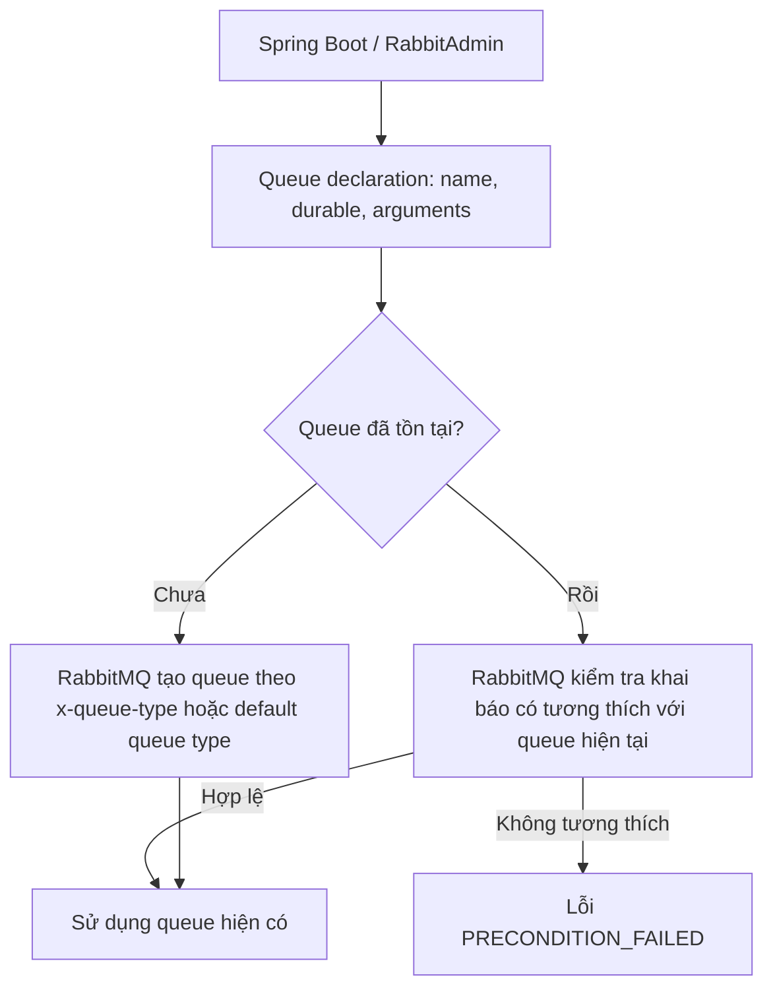
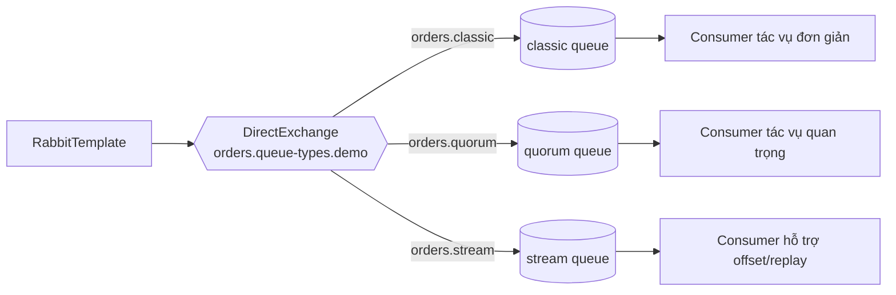

# Khai báo queue type bằng QueueBuilder hoặc đối số phù hợp

RabbitMQ có nhiều **loại queue (queue type)** với cách lưu trữ, sao chép và tiêu thụ message khác nhau. Trong ứng dụng **Spring AMQP**, cùng một `RabbitTemplate` hay `@RabbitListener` có thể làm việc với nhiều queue, nhưng điều đó **không có nghĩa** mọi loại queue cung cấp cùng khả năng bảo đảm dữ liệu, phát lại message hay mở rộng hệ thống.

Bài này thuộc chương **Các loại hàng đợi** của module **SPRING_AMQP**. Trọng tâm là cách khai báo queue bằng `QueueBuilder` hoặc đối số `x-queue-type`, chọn đúng giữa **classic**, **quorum** và **stream**, kiểm tra topology trên RabbitMQ và xử lý tình huống cần thay queue type. Kiến thức này giúp thiết kế luồng bất đồng bộ với exchange, queue, binding, `RabbitTemplate`, `@RabbitListener`, acknowledgement, retry, dead-letter và giám sát hệ thống một cách có chủ đích.

## 1. Queue type là gì và vì sao phải khai báo rõ?

Trong RabbitMQ, queue nhận message được định tuyến từ exchange và cung cấp message cho consumer. **Queue type** quyết định cấu trúc lưu trữ và một phần cơ chế phân phối, khả năng sao chép, độ bền và cách tiêu thụ message.

| Queue type | Mục đích điển hình | Tính chất cần nhớ |
| --- | --- | --- |
| **Classic** | Hàng đợi tác vụ thông thường, yêu cầu đơn giản và tương thích với mô hình AMQP 0-9-1 phổ biến | Cơ chế queue truyền thống; không coi classic queue là cơ chế đồng bộ bản sao HA kiểu quorum |
| **Quorum** | Work queue cần khả năng chịu lỗi node thông qua cơ chế đồng thuận, dữ liệu quan trọng | Dùng mô hình replica dựa trên Raft; cần quy hoạch cluster và đa số replica có thể hoạt động |
| **Stream** | Luồng sự kiện có lưu giữ và đọc lại; nhiều consumer đọc lịch sử theo vị trí | Message được lưu theo log và retention, việc đọc không có nghĩa xóa record như queue tác vụ thông thường |

**Không thể suy ra queue type từ tên queue**, ví dụ `orders.quorum` chỉ là tên do người viết đặt. Broker quyết định loại queue theo `x-queue-type` khi khai báo hoặc theo **default queue type** được cấu hình ở RabbitMQ/virtual host khi thiếu đối số này.

Đối số thường dùng khi khai báo queue:

```text
x-queue-type = "classic" | "quorum" | "stream"
```

Giá trị là chuỗi **phân biệt đúng cách viết** do RabbitMQ hiểu, không phải enum tự tạo từ tên class Spring. Đừng nhầm `x-queue-type` với `x-queue-mode` (tùy chọn liên quan classic queue ở các phiên bản RabbitMQ cũ) hoặc thuộc tính `durable`.

### Hai quyết định độc lập: tên queue và queue type

Ví dụ, `orders.process` là tên logic mà producer/consumer biết. Tại thời điểm tạo queue, broker có thể tạo loại `classic` hoặc `quorum` tùy cấu hình khai báo. Một queue đã tồn tại có type xác định; đổi Java bean mà giữ nguyên tên queue **không biến queue cũ sang loại mới**.



## 2. Chuẩn bị ứng dụng Spring AMQP

Với Maven và một dự án Spring Boot đã có parent hoặc BOM quản lý dependency:

```xml
<dependency>
    <groupId>org.springframework.boot</groupId>
    <artifactId>spring-boot-starter-amqp</artifactId>
</dependency>
```

Starter cung cấp các thành phần cần thiết để dùng `RabbitTemplate`, `@RabbitListener`, `Queue`, `Exchange` và `Binding`. Trong Gradle, dependency tương ứng là:

```groovy
implementation 'org.springframework.boot:spring-boot-starter-amqp'
```

Kết nối broker thử nghiệm, ví dụ `application-local.yml`:

```yaml
spring:
  rabbitmq:
    host: localhost
    port: 5672
    username: app_local
    password: local-demo-only
    virtual-host: orders_local
```

Các thông tin trên giả định broker local có sẵn tài khoản, virtual host và quyền phù hợp; **không phải cấu hình production**. Tách secrets và endpoint production khỏi mã nguồn. Phải xác định phiên bản RabbitMQ broker hỗ trợ queue type dự định sử dụng, và bảo đảm cluster có đủ node/dung lượng cho loại queue đó. Sự tồn tại của API `QueueBuilder` không thể thay thế tính năng do broker cung cấp.

## 3. Khai báo classic queue bằng QueueBuilder

Ví dụ queue xử lý email thông thường:

```java
import org.springframework.amqp.core.Queue;
import org.springframework.amqp.core.QueueBuilder;
import org.springframework.context.annotation.Bean;
import org.springframework.context.annotation.Configuration;

@Configuration
public class ClassicQueueConfig {

    @Bean
    public Queue emailClassicQueue() {
        return QueueBuilder
                .durable("email.jobs.classic")
                .withArgument("x-queue-type", "classic")
                .build();
    }
}
```

- `durable(name)`: queue được khai báo với thuộc tính `durable=true`, tức metadata của queue có thể tồn tại sau broker restart theo cơ chế hỗ trợ của RabbitMQ.
- `withArgument("x-queue-type", "classic")`: khai báo **rõ loại queue** để ứng dụng không bị thay đổi hành vi ngoài ý muốn nếu virtual host sử dụng default queue type khác.
- `build()`: tạo đối tượng `org.springframework.amqp.core.Queue` trong ứng dụng; **chưa tự mở kết nối RabbitMQ**.

Nếu bỏ `withArgument("x-queue-type", "classic")`, broker sẽ quyết định dựa trên cấu hình mặc định hiện hành. Điều này có thể chấp nhận được nếu dự án đã quản trị default queue type tập trung, nhưng phải ghi nhận quyết định và kiểm tra trên từng môi trường.

### Durable khác persistent message

Hãy phân biệt ba khái niệm:

1. **Durable queue**: khai báo queue có khả năng tồn tại qua khởi động lại.
2. **Persistent message**: delivery mode của message yêu cầu broker lưu bền vững theo cơ chế tương ứng.
3. **Publisher confirm**: producer được broker xác nhận việc publish theo cấu hình và cơ chế xác nhận.

Queue durable **không đủ** để suy ra mọi message luôn an toàn sau mất điện, node failure hoặc sự cố lưu trữ. Cần đánh giá kết hợp loại queue, cơ chế replication, publisher confirms và thiết kế phục hồi.

Với classic queue, ví dụ queue local dùng cho tác vụ tạm thời cũng có thể được tạo bằng `QueueBuilder.nonDurable("scratch.jobs").build()`. Tuy nhiên, **không áp dụng** cấu hình non-durable tùy tiện cho quorum/stream vì những loại này yêu cầu queue bền vững và có các ràng buộc riêng.

## 4. Khai báo quorum queue

**Quorum queue** hướng đến ứng dụng cần dữ liệu queue được sao chép giữa các thành viên bằng thuật toán đồng thuận Raft. Nó thích hợp cho những tác vụ quan trọng khi hạ tầng RabbitMQ là một cluster phù hợp. Một quorum queue trên một node đơn lẻ **không cung cấp khả năng chịu lỗi mất node**; muốn bảo đảm HA, phải có các replica trên những node thích hợp, bảo đảm đa số thành viên khả dụng.

### 4.1. Cách rõ ràng bằng x-queue-type

```java
import org.springframework.amqp.core.Queue;
import org.springframework.amqp.core.QueueBuilder;
import org.springframework.context.annotation.Bean;
import org.springframework.context.annotation.Configuration;

@Configuration
public class QuorumQueueConfig {

    @Bean
    public Queue paymentQuorumQueue() {
        return QueueBuilder.durable("payment.jobs.quorum")
                .withArgument("x-queue-type", "quorum")
                .build();
    }
}
```

Đoạn mã hoạt động theo cơ chế **AMQP queue declaration**: broker nhìn `x-queue-type=quorum` và tạo quorum queue nếu phiên bản, quyền và cấu hình cluster cho phép.

Một số phiên bản Spring AMQP có phương thức tiện ích:

```java
// Chỉ dùng khi phiên bản Spring AMQP của dự án hỗ trợ QueueBuilder.quorum().
Queue queue = QueueBuilder.durable("payment.jobs.quorum")
        .quorum()
        .build();
```

Phương thức `.quorum()` giúp khai báo dễ đọc hơn; về ý nghĩa cần đạt vẫn là **queue type quorum**. Nếu API của dự án không có phương thức này, dùng `.withArgument("x-queue-type", "quorum")` như ví dụ đầu. Tránh tự nâng riêng `spring-amqp`/RabbitMQ Java client chỉ vì muốn một helper method.

### 4.2. Lưu ý vận hành quorum

| Vấn đề | Ý nghĩa |
| --- | --- |
| **Replication** | Cần đủ node và phân bố replica hợp lý; đừng suy ra HA chỉ từ chữ `quorum` trong tên queue |
| **Durability** | Quorum queue phải được khai báo durable; retention và đảm bảo ghi phụ thuộc cơ chế broker, ack/confirm, cluster |
| **Poison message** | Redelivery nhiều lần có thể bị giới hạn bởi chính sách delivery limit tùy phiên bản broker; cần cấu hình retry/DLQ có chủ đích |
| **Hiệu năng** | Chi phí đồng thuận và replication có thể khác classic; benchmark theo workload thực tế |
| **Tính năng hỗ trợ** | Không giả định các tính năng đặc thù classic queue, ví dụ message priority, đều khả dụng trên quorum |

Khi dùng retry/requeue, kiểm tra phiên bản RabbitMQ, `delivery-limit`, đường dead-letter và số lần giao lại. Một lỗi nghiệp vụ luôn xảy ra không nên khiến message được trả về đầu hàng đợi vô hạn.

## 5. Khai báo stream queue khi cần phát lại sự kiện

**Stream queue** lưu message theo mô hình log có retention, cho phép nhiều consumer đọc tại các vị trí khác nhau. Khi consumer đọc thành công, record không mặc định bị xóa khỏi stream như một tác vụ trong work queue truyền thống. Đây là lựa chọn cho các luồng cần **replay**, fan-out số lượng lớn hoặc đọc sự kiện theo offset.

Khai báo stream queue từ Spring AMQP:

```java
import org.springframework.amqp.core.Queue;
import org.springframework.amqp.core.QueueBuilder;
import org.springframework.context.annotation.Bean;
import org.springframework.context.annotation.Configuration;

@Configuration
public class StreamQueueConfig {

    @Bean
    public Queue auditStreamQueue() {
        return QueueBuilder.durable("audit.events.stream")
                .withArgument("x-queue-type", "stream")
                .withArgument("x-max-age", "7D")
                .build();
    }
}
```

Trong đó, `x-max-age` là ví dụ **giới hạn lưu giữ theo thời gian** của stream (7 ngày) theo cú pháp RabbitMQ hỗ trợ; hãy kiểm tra phiên bản broker, đơn vị thời gian, chính sách retention và tài nguyên lưu trữ trước khi triển khai. Những đối số stream khác như giới hạn dung lượng hay kích thước segment chỉ nên thêm khi có yêu cầu và đã đối chiếu tài liệu của phiên bản server.

**Hai lớp API cần phân biệt:**

- Có thể **khai báo** stream queue qua `org.springframework.amqp.core.Queue` và AMQP queue declaration như ví dụ.
- Để **consume với semantics của stream**, theo dõi offset, đọc lại lịch sử và tận dụng đầy đủ tính năng stream, nên đánh giá **RabbitMQ Stream Java client** hoặc thành phần tích hợp **Spring Rabbit Stream** (`spring-rabbit-stream`) tương ứng. Một `@RabbitListener` dùng listener container AMQP thông thường không tự biến thành consumer hỗ trợ toàn bộ tính năng của stream.

Tùy cơ chế client/consumer sử dụng, việc chọn offset bắt đầu, lưu offset và xử lý record lặp lại cần được cấu hình rõ. **Đừng dùng stream như queue công việc với giả định mỗi ack sẽ xóa bản ghi.**

### Khi nào không nên dùng stream?

Nếu mục tiêu chỉ là gửi một công việc đến một consumer rồi bỏ message sau ack, không có yêu cầu đọc lại dữ liệu, classic hoặc quorum thường dễ vận hành hơn. Stream có chi phí quản lý offset, retention và dung lượng; chọn stream vì tên nghe “mới” không tạo thêm độ tin cậy cho nghiệp vụ.

## 6. Mẫu cấu hình tổng hợp với một exchange và ba queue type

Đoạn dưới đây tạo ba queue thử nghiệm với tên khác nhau. Dùng `DirectExchange` và ba routing key để mỗi kiểu queue nhận một luồng sự kiện riêng, giúp dễ kiểm chứng bằng `RabbitTemplate`. Ứng dụng thật **không bắt buộc** phải tạo cả ba loại queue cùng lúc.

```java
import org.springframework.amqp.core.Binding;
import org.springframework.amqp.core.BindingBuilder;
import org.springframework.amqp.core.DirectExchange;
import org.springframework.amqp.core.Queue;
import org.springframework.amqp.core.QueueBuilder;
import org.springframework.beans.factory.annotation.Qualifier;
import org.springframework.context.annotation.Bean;
import org.springframework.context.annotation.Configuration;

@Configuration
public class QueueTypesDemoTopology {
    public static final String EXCHANGE = "orders.queue-types.demo";
    public static final String CLASSIC = "orders.classic.demo";
    public static final String QUORUM = "orders.quorum.demo";
    public static final String STREAM = "orders.stream.demo";

    @Bean
    public DirectExchange typeDemoExchange() {
        return new DirectExchange(EXCHANGE, true, false);
    }

    @Bean
    public Queue classicQueue() {
        return QueueBuilder.durable(CLASSIC)
                .withArgument("x-queue-type", "classic")
                .build();
    }

    @Bean
    public Queue quorumQueue() {
        return QueueBuilder.durable(QUORUM)
                .withArgument("x-queue-type", "quorum")
                .build();
    }

    @Bean
    public Queue streamQueue() {
        return QueueBuilder.durable(STREAM)
                .withArgument("x-queue-type", "stream")
                .withArgument("x-max-age", "7D")
                .build();
    }

    @Bean
    public Binding classicBinding(
            @Qualifier("classicQueue") Queue queue,
            @Qualifier("typeDemoExchange") DirectExchange exchange) {
        return BindingBuilder.bind(queue).to(exchange).with("orders.classic");
    }

    @Bean
    public Binding quorumBinding(
            @Qualifier("quorumQueue") Queue queue,
            @Qualifier("typeDemoExchange") DirectExchange exchange) {
        return BindingBuilder.bind(queue).to(exchange).with("orders.quorum");
    }

    @Bean
    public Binding streamBinding(
            @Qualifier("streamQueue") Queue queue,
            @Qualifier("typeDemoExchange") DirectExchange exchange) {
        return BindingBuilder.bind(queue).to(exchange).with("orders.stream");
    }
}
```

Điểm cần hiểu: **Exchange và Binding quyết định message vào queue nào; `x-queue-type` quyết định queue đó vận hành ra sao.** Thay `DirectExchange` thành `TopicExchange` hoặc `FanoutExchange` không tự động đổi loại queue.



Nếu dùng broker local hoặc phiên bản server không hỗ trợ một loại queue, **chỉ khai báo loại queue cần thực hành** để tránh lỗi khai báo của một queue cản trở các phần còn lại. Trên RabbitMQ cluster, tính năng stream và các giới hạn phải được bật/hỗ trợ theo cấu hình thực tế.

## 7. Publish và consume: queue type thay đổi gì?

Một producer gửi một message qua exchange và routing key:

```java
import org.springframework.amqp.rabbit.core.RabbitTemplate;
import org.springframework.stereotype.Service;

@Service
public class QueueTypesDemoPublisher {
    private final RabbitTemplate rabbitTemplate;

    public QueueTypesDemoPublisher(RabbitTemplate rabbitTemplate) {
        this.rabbitTemplate = rabbitTemplate;
    }

    public void publishQuorumJob(String json) {
        rabbitTemplate.convertAndSend(
                QueueTypesDemoTopology.EXCHANGE,
                "orders.quorum",
                json);
    }
}
```

Một listener nhận từ quorum queue:

```java
import org.springframework.amqp.rabbit.annotation.RabbitListener;
import org.springframework.stereotype.Component;

@Component
public class QuorumJobConsumer {

    @RabbitListener(queues = QueueTypesDemoTopology.QUORUM)
    public void handle(String json) {
        // Validate payload, xử lý nghiệp vụ và ghi nhận eventId đã xử lý.
        process(json);
    }

    private void process(String json) {
        // Cài đặt xử lý nghiệp vụ thực tế.
    }
}
```

Mã `@RabbitListener` này dùng cơ chế listener Spring AMQP thông thường. Trong chế độ acknowledgement mặc định phù hợp, container có thể ack khi listener xử lý xong; chính sách nack/requeue và retry khi ném lỗi cần kiểm tra trong cấu hình thực tế. Với classic/quorum, lập trình viên vẫn phải thiết kế **idempotency** vì message có thể bị giao lại.

Chỉ riêng thao tác `RabbitTemplate.convertAndSend(...)` trả về bình thường **không chứng minh** message đến queue hay được consumer xử lý. Với yêu cầu giao nhận tin cậy, cấu hình publisher confirms, publisher returns khi cần quan sát unroutable message, và consumer acknowledgements phù hợp.

### Vì sao ví dụ không dùng cùng listener cho stream?

Stream queue không chỉ là một lựa chọn lưu trữ khác: consumer có thể cần xác định **offset** bắt đầu, quản lý vị trí đọc và chủ động replay. Nếu mục tiêu là thực hành stream semantics, dùng client/tích hợp dành cho RabbitMQ Streams cùng hướng dẫn của phiên bản Spring Rabbit/Broker đang chạy. Thử dùng `@RabbitListener` thông thường vào stream mà không xem đặc tính consumer có thể gây hiểu nhầm về xóa message, replay, offset và cách bảo đảm xử lý.

## 8. Kiểm tra queue type thực tế trên RabbitMQ

### 8.1. Dùng RabbitMQ Management

Trong RabbitMQ Management UI, chọn đúng virtual host, mở trang **Queues** và xem cột **Type** hoặc chi tiết queue. Với cấu hình mẫu, cần thấy:

| Queue | Type mong đợi | Durable | Ghi chú |
| --- | --- | --- | --- |
| `orders.classic.demo` | `classic` | Có | Work queue đơn giản |
| `orders.quorum.demo` | `quorum` | Có | Cần xem thêm replica/leader khi dùng cluster |
| `orders.stream.demo` | `stream` | Có | Cần xem retention và hành vi consumer |

Kiểm tra cả exchange `orders.queue-types.demo`, binding keys và quyền người dùng trên vhost. Nếu queue không được tạo, xem log Spring Boot và log broker trước khi kết luận loại queue không được hỗ trợ.

### 8.2. Dùng RabbitMQ CLI

Trên máy/container có `rabbitmqctl`, có thể chạy lệnh tương đương:

```bash
rabbitmqctl list_queues -p orders_local name type durable arguments messages_ready messages_unacknowledged consumers
```

Nếu RabbitMQ chạy trong container tên `spring-amqp-local`:

```bash
docker exec spring-amqp-local rabbitmqctl list_queues -p orders_local name type durable arguments messages_ready messages_unacknowledged consumers
```

Các trường CLI sẵn có có thể thay đổi theo phiên bản RabbitMQ; nếu lệnh báo trường không được hỗ trợ, xem `rabbitmqctl help list_queues` hoặc Management UI của chính broker. Đảm bảo tên vhost trong lệnh trùng với vhost ứng dụng kết nối.

### 8.3. Kiểm tra việc khai báo thực sự diễn ra

Spring Boot có thể auto-configure `RabbitAdmin`, giúp khai báo các bean `Queue`, `Exchange` và `Binding` khi có kết nối và các điều kiện phù hợp. Tuy nhiên, việc **tạo Java bean Queue không chứng minh queue đã tồn tại trên RabbitMQ**:

1. Xác nhận kết nối tới đúng host, port, credentials và virtual host.
2. Kiểm tra `RabbitAdmin`/declaration có được bật và thực thi hay không.
3. Kiểm tra user có quyền configure trên queue/exchange tương ứng không.
4. Xem queue type/arguments thực tế trong Management UI.
5. Gửi thử message có routing key phù hợp và xác minh bằng metrics/consumer test.

Không nên gộp kết quả “connection thành công”, “queue được khai báo” và “message được xử lý” thành một điều kiện duy nhất; đó là ba lớp kiểm chứng khác nhau.

## 9. Khi đổi queue type gây PRECONDITION_FAILED

Đây là lỗi quan trọng nhất khi quản lý queue type bằng code. Giả sử trước đây RabbitMQ đã có:

```text
queue name = payment.jobs
queue type = classic
```

Sau đó đội phát triển đổi cấu hình Spring:

```java
QueueBuilder.durable("payment.jobs")
        .withArgument("x-queue-type", "quorum")
        .build();
```

Khi ứng dụng khai báo lại cùng queue name nhưng type không khớp, RabbitMQ thường trả về lỗi `PRECONDITION_FAILED` vì queue type là thuộc tính **không thể chuyển đổi tại chỗ bằng redeclare**. Một số phiên bản/cấu hình broker có quy tắc đặc biệt liên quan default queue type và phép kiểm tra tương đương declaration; đừng dựa vào ngoại lệ này để thay đổi type.

### Quy trình chuyển từ classic sang quorum an toàn hơn

1. **Kiểm kê queue cũ**: số message, consumer, binding, TTL/DLX/policy, producer và yêu cầu thứ tự xử lý.
2. **Tạo queue mới tên khác**, ví dụ `payment.jobs.v2`, với `x-queue-type=quorum`; xác minh cluster có quorum replica phù hợp.
3. **Lập kế hoạch chuyển luồng publish**: cập nhật binding/routing và consumer, chủ động xử lý khoảng thời gian cả queue cũ lẫn mới cùng nhận message hoặc cần copy/backfill message.
4. **Xử lý backlog** của queue cũ theo kế hoạch; kiểm tra tác vụ có hoàn tất và idempotency bảo vệ xử lý trùng khi chuyển tiếp.
5. **Theo dõi kết quả** bằng confirms, ack, số message chưa xử lý, DLQ, lag và metric của cả hai queue.
6. **Chỉ xóa queue cũ sau khi đã xác minh** không còn dữ liệu hay consumer cần giữ. Xóa queue có thể làm mất message chưa tiêu thụ.

Nếu là production, quá trình migration cần phương án rollback, khả năng phát lại nguồn sự kiện khi có, và một giai đoạn giám sát trước khi xóa tài nguyên cũ. **Không xóa queue có dữ liệu chỉ để làm mất lỗi khởi động.**

## 10. Chọn queue type theo yêu cầu độ tin cậy và vận hành

| Yêu cầu | Gợi ý bắt đầu | Điều kiện phải đánh giá |
| --- | --- | --- |
| Xử lý tác vụ đơn giản, chi phí vận hành thấp | **Classic** | Broker đơn lẻ hay cluster, backup và khả năng chịu lỗi yêu cầu |
| Hàng đợi xử lý lệnh quan trọng, cần sao chép trên nhiều node | **Quorum** | Replica, majority, failover, publisher confirms, throughput và giới hạn redelivery |
| Event log cần giữ lịch sử và replay | **Stream** | Retention, dung lượng, offset, client phù hợp và cách khôi phục consumer |
| Một event gửi tới nhiều nhóm nghiệp vụ | **Exchange + nhiều queue** | Fanout/direct/topic quyết định routing; loại queue quyết định cách lưu/tiêu thụ của từng nhóm |
| Lỗi không thể xử lý cần cách ly | **Retry + DLX/DLQ** trên loại queue phù hợp | Poison message, delivery limit, chiến lược dead-letter và chính sách vận hành |

**Quorum không đồng nghĩa “exactly once”.** Consumer có thể xử lý DB xong nhưng chết trước khi ack, nên broker có thể giao lại. **Stream không đồng nghĩa “không mất message”.** Retention có thể loại record theo chính sách và client vẫn phải theo dõi offset/dữ liệu đã xử lý. **Classic không đồng nghĩa “không bền”.** Durable/persistence/confirm giúp tăng độ bền trong phạm vi phù hợp; cần lựa chọn dựa trên rủi ro, khả năng phục hồi và triển khai thực tế.

### Liên hệ với ack, retry, transaction và monitoring

- **Publisher confirms** phản ánh một mốc xác nhận từ broker sau publish; không thay thế xác nhận consumer xử lý nghiệp vụ.
- **Consumer ack/nack/requeue** áp dụng theo cơ chế queue/consumer đang dùng; retry vô hạn có thể tạo vòng lặp và làm backlog tăng. Với quorum, phải xem thêm delivery limit và cấu hình DLQ.
- **Dead-letter** cần cấu hình exchange, queue và policy/binding tương ứng; không được tạo tự động chỉ nhờ `QueueBuilder.durable(...).quorum()`.
- **Transaction** của RabbitMQ không tự bao gồm transaction database. Dùng idempotency, và cân nhắc outbox khi cần đảm bảo nhất quán giữa ghi DB và publish.
- **Quan sát** phải theo dõi type/arguments, số message ready/unacked, tốc độ publish/consume, DLQ, disk/memory và với quorum/stream là tình trạng replica/leader theo khả năng broker cung cấp.

## 11. Bài thực hành và câu hỏi tự kiểm tra

### Thực hành A — Xác nhận type ở broker

1. Chạy broker test hỗ trợ classic/quorum/stream; chọn vhost riêng để không tác động dữ liệu thật.
2. Khai báo từng queue bằng `QueueBuilder.durable(...).withArgument("x-queue-type", ...)`.
3. Bật ứng dụng Spring Boot và xác nhận ba queue xuất hiện trong Management UI.
4. Dùng CLI hoặc UI kiểm tra **Type** chứ không dựa vào hậu tố tên queue.
5. Publish vào classic/quorum qua các routing key đã định nghĩa; quan sát message `Ready`, `Unacked` và consumer.

### Thực hành B — Nhận biết lỗi type mismatch

1. Trong môi trường **test**, tạo `demo.mismatch` là classic queue.
2. Đổi định nghĩa Java của **cùng tên** thành quorum, rồi thử khai báo lại.
3. Đọc exception và broker log, nhận diện `PRECONDITION_FAILED` hoặc thông báo không tương đương declaration.
4. Khôi phục cấu hình hợp lệ, sau đó tạo `demo.mismatch.v2` theo type quorum để kiểm chứng cách migration với **tên mới**.

### Thực hành C — So sánh message tác vụ với stream replay

1. Gửi nhiều message có `eventId` khác nhau vào quorum queue và dùng consumer idempotent đọc, ack sau khi xử lý.
2. Gửi event vào stream queue, chọn công cụ/client hỗ trợ offset và đọc lại từ vị trí trước đó.
3. Quan sát: ack work queue gắn với trạng thái delivery; stream retention và offset quản lý lịch sử message theo mô hình khác.
4. Ghi lại sự khác biệt về yêu cầu ứng dụng, dung lượng lưu và khả năng replay.

### Tự kiểm tra

- Vì sao `QueueBuilder.durable("orders.q")` chưa nói rõ queue được tạo là classic hay quorum?
- `x-queue-type` được quyết định ở thời điểm nào? Vì sao redeclare cùng tên nhưng khác type có thể lỗi?
- Một quorum queue đặt trong broker một node duy nhất có chịu được sự cố mất node không?
- Vì sao stream queue cần nghĩ về offset và retention, còn classic/quorum work queue thường tập trung vào ack?
- Nếu cần nhiều nhóm tiêu thụ độc lập, loại exchange và số queue có vai trò gì khác với queue type?
- Khi nâng cấp loại queue, làm sao tránh mất backlog hoặc xử lý lặp trong giai đoạn chuyển tiếp?

**Ghi nhớ:** Trong Spring AMQP, hãy dùng `QueueBuilder` để thiết lập thuộc tính và `withArgument("x-queue-type", "quorum")` (hoặc giá trị `classic`, `stream` theo nhu cầu) để thể hiện **loại queue mong muốn**; sau đó xác minh **queue type thực tế ở RabbitMQ**. Chọn classic cho nhu cầu đơn giản, quorum khi cần cơ chế replication dựa trên đồng thuận, stream khi cần lưu lịch sử và replay. Queue type chỉ là một phần của thiết kế: để xử lý bất đồng bộ tin cậy còn phải kiểm chứng routing, publisher confirms, acknowledgement, retry/DLQ, idempotency, transaction boundary và quan sát hệ thống.
