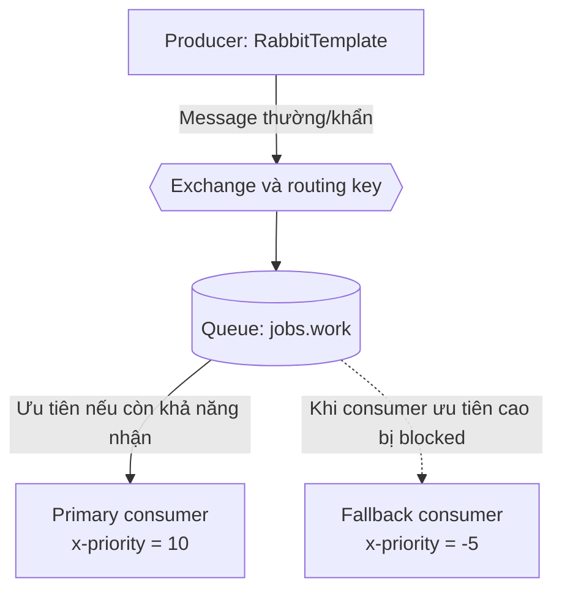
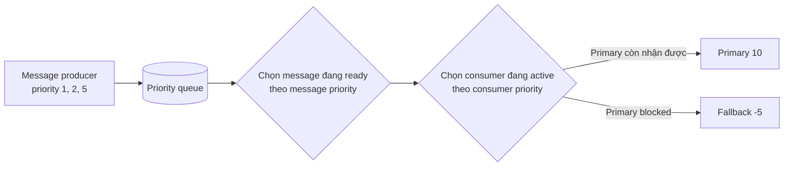
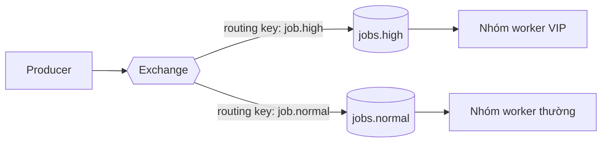

# Consumer priority và khác biệt với message priority

Trong RabbitMQ, từ **priority** được dùng cho hai cơ chế rất khác nhau:

- **Consumer priority**: RabbitMQ ưu tiên **consumer nào** sẽ nhận message tiếp theo từ cùng một queue.
- **Message priority**: RabbitMQ ưu tiên **message nào** đang chờ trong queue sẽ được đưa ra trước.

Nhầm lẫn hai cơ chế này rất dễ dẫn đến một thiết kế tưởng như “VIP được xử lý trước”, nhưng thực tế chỉ khiến một nhóm worker nhận nhiều việc hơn trong khi các message VIP vẫn đứng chờ. Trong chương **Các loại hàng đợi** của mô-đun **SPRING_AMQP**, chúng ta sẽ phân tích cách RabbitMQ chọn consumer, cách queue xếp message theo độ ưu tiên, tác động của `prefetch`, ACK và tính năng khác nhau giữa classic/quorum queue. Các ví dụ dùng Spring AMQP với `RabbitTemplate` và `@RabbitListener`.

Sau bài học, bạn có thể nhận biết đúng hai loại ưu tiên, cấu hình từng cơ chế, dự đoán giới hạn của chúng và chọn phương án phù hợp cho một luồng xử lý bất đồng bộ đáng tin cậy.

## 1. Ví dụ đặt vấn đề: hai nhóm worker, hai loại công việc

Một nền tảng đặt hàng có job gửi email xác nhận thường và job gửi thông báo khẩn. Đồng thời, hệ thống có hai nhóm worker:

- **Primary worker**: máy chủ ưu tiên xử lý trong giờ làm việc, có khả năng kết nối nhanh đến hệ thống email.
- **Fallback worker**: máy dự phòng hoặc nhóm tính phí cao, chỉ nên nhận việc khi primary đang bận hoặc không sẵn sàng.

Đây là **hai yêu cầu độc lập**:

1. “Primary nhận nhiều công việc hơn fallback nếu primary còn khả năng nhận” là bài toán **consumer priority**.
2. “Thông báo khẩn được xử lý trước email thường còn đang chờ trong queue” là bài toán **message priority**.

Có thể cần cả hai, chỉ một, hoặc không cần cơ chế nào.



Sơ đồ trên mới minh họa **consumer priority**. Nếu muốn ưu tiên loại công việc khẩn trong chính queue, cần thêm **message priority** được queue type hỗ trợ.

## 2. Bảng so sánh nhanh

| Khía cạnh | Consumer priority | Message priority |
| --- | --- | --- |
| Câu hỏi giải quyết | **Consumer nào** được broker giao message kế tiếp? | **Message nào** được broker giao trước trong tập đang chờ? |
| Gắn ở đâu? | **Subscription/consumer** đăng ký `basic.consume` | **Message properties** khi producer `basic.publish` |
| Thuộc tính giao thức AMQP 0.9.1 | Consumer argument `x-priority` | Basic property `priority` |
| Ai thường cấu hình? | Đội consumer, listener container | Producer định nghĩa độ quan trọng; đội vận hành quyết định queue hỗ trợ ra sao |
| Giá trị mặc định | Consumer không có `x-priority`: **0** | Message không có `priority`: tùy queue type/version |
| Giá trị lớn hơn | Consumer được ưu tiên nhận khi còn active | Message được ưu tiên dispatch theo cơ chế của queue type |
| Spring AMQP | `@RabbitListener(priority = "10")` hoặc consumer arguments | `MessageProperties.setPriority(5)` khi gửi với `RabbitTemplate` |
| Khai báo queue bổ sung? | **Không**, trên queue hỗ trợ consumer priority | **Classic:** cần `x-max-priority`. **Quorum:** cách hỗ trợ phụ thuộc phiên bản RabbitMQ |
| Có tác động đến exchange/binding? | Không | Không |
| Có bảo đảm job hoàn tất theo đúng thứ tự ưu tiên? | Không | Không, đặc biệt khi message đã in-flight hoặc nhiều consumer xử lý đồng thời |

Từ khóa cần ghi nhớ: **consumer priority chọn người nhận; message priority chọn công việc được gửi đến người nhận**.

## 3. Cơ chế consumer priority của RabbitMQ

### 3.1. RabbitMQ chọn consumer như thế nào?

Ở AMQP 0.9.1, khi đăng ký một consumer bằng `basic.consume`, client có thể truyền đối số:

```text
x-priority = 10
```

Quy tắc RabbitMQ:

- Số nguyên **càng lớn** thì consumer càng được ưu tiên; được phép dùng số dương, 0 hoặc số âm.
- Không khai báo `x-priority` thì consumer có độ ưu tiên **0**.
- Khi có nhiều consumer đang **active** trên cùng queue, broker ưu tiên giao message cho nhóm có priority cao nhất.
- Nếu có nhiều consumer **cùng priority cao nhất** và đều active, broker phân phối theo kiểu round-robin giữa chúng.
- Khi các consumer ưu tiên cao bị **blocked**, broker có thể giao message cho consumer ưu tiên thấp còn active; RabbitMQ không chờ vô hạn để một consumer cao hơn rảnh trở lại.

“Active” ở đây có nghĩa là **consumer có thể nhận message ngay** theo giới hạn giao nhận, không chỉ là tiến trình còn sống. Một consumer có thể chuyển qua lại giữa active và blocked rất nhanh.

### 3.2. Consumer blocked vì lý do gì?

Hai nguyên nhân điển hình:

1. **Đầy prefetch**: consumer đã có số message chưa ACK bằng giới hạn do `basic.qos` đặt. Ví dụ prefetch = 1, worker đang xử lý một message thì không nhận thêm delivery khác qua giới hạn đó.
2. **Nghẽn mạng/connection**: broker không thể đẩy thêm delivery tới consumer ngay lúc đó.

Đặt priority = 100 không giúp một worker có thêm CPU, không làm nó chạy nhanh hơn và không bắt buộc message nào đang xử lý phải bị tước đi.

Ví dụ với một queue có các message A–E đang chờ, primary priority 10, fallback priority -5, mỗi consumer có prefetch = 1:

| Thời điểm minh họa | Primary (10) | Fallback (-5) | Broker có thể làm gì? |
| --- | --- | --- | --- |
| t0 | Active, chưa nhận message | Active | Ưu tiên đưa A cho primary |
| t1 | Đang xử lý A, chưa ACK → blocked | Active | Giao B cho fallback |
| t2 | Vẫn blocked | Vừa ACK B và active | Có thể giao C cho fallback |
| t3 | Đã ACK A, active trở lại | Active | Ưu tiên đưa message tiếp theo cho primary |
| t4 | Primary mất connection | Active | Fallback có thể tiếp tục nhận các message đang chờ |

Các ký hiệu t0–t4 chỉ mô tả **một diễn biến có thể xảy ra**. Thứ tự delivery thực tế phụ thuộc thời điểm ACK, network và lịch xử lý. Khi primary nhanh đến mức luôn active, fallback có thể **không nhận được message nào** dù vẫn kết nối bình thường.

### 3.3. Không nên hiểu consumer priority là “chuyển quyền xử lý duy nhất”

Consumer priority thông thường **không tạo ra một active leader duy nhất có standby tuyệt đối**. Khi primary bận hết prefetch, fallback được phép nhận việc đồng thời.

Nếu nghiệp vụ cần **chỉ một consumer hoạt động tại một thời điểm**, hãy xem tính năng **Single Active Consumer (SAC)** của RabbitMQ. SAC và consumer priority có tương tác khác nhau giữa queue type:

- **Classic queue dùng SAC:** consumer active ban đầu được chọn theo cơ chế của SAC, không dùng priority làm tiêu chí chọn consumer đầu tiên.
- **Quorum queue dùng SAC từ RabbitMQ 4.0:** nếu consumer có priority cao hơn đăng ký, broker có thể chuyển active consumer sang nó sau khi các delivery đang xử lý được ACK theo quy trình.
- Không bật SAC chỉ để “consumer priority có tác dụng”; thông thường hai cơ chế giải quyết hai yêu cầu vận hành khác nhau.

**Chốt lại:** consumer priority thích hợp khi bạn muốn có nhóm xử lý ưu tiên và nhóm xử lý bổ sung lúc bận; SAC thích hợp khi cần một consumer active duy nhất.

## 4. Cấu hình consumer priority trong Spring AMQP

Spring AMQP hỗ trợ consumer priority cho RabbitMQ qua `@RabbitListener(priority = "...")`. Thuộc tính này được chuyển thành priority của **consumer endpoint**, không phải một trường trên message và không mặc định áp cho mọi listener container khác.

### 4.1. Queue và hai listener ưu tiên khác nhau

Trong môi trường thực hành, ta dùng một durable queue đã tồn tại hoặc được `RabbitAdmin` khai báo:

```java
import org.springframework.amqp.core.Queue;
import org.springframework.amqp.core.QueueBuilder;
import org.springframework.context.annotation.Bean;
import org.springframework.context.annotation.Configuration;

@Configuration(proxyBeanMethods = false)
class WorkQueueConfig {

    static final String WORK_QUEUE = "jobs.work";

    @Bean
    Queue workQueue() {
        return QueueBuilder.durable(WORK_QUEUE).build();
    }
}
```

Một worker có priority cao:

```java
import org.springframework.amqp.rabbit.annotation.RabbitListener;
import org.springframework.stereotype.Component;

@Component
class PrimaryJobWorker {

    @RabbitListener(
            id = "primaryJobs",
            queues = WorkQueueConfig.WORK_QUEUE,
            priority = "10")
    public void process(String jobId) throws InterruptedException {
        // Chỉ để mô phỏng job chạy chậm trong bài lab.
        Thread.sleep(1500);
        System.out.println("PRIMARY processed " + jobId);
    }
}
```

Worker dự phòng có priority thấp:

```java
import org.springframework.amqp.rabbit.annotation.RabbitListener;
import org.springframework.stereotype.Component;

@Component
class FallbackJobWorker {

    @RabbitListener(
            id = "fallbackJobs",
            queues = WorkQueueConfig.WORK_QUEUE,
            priority = "-5")
    public void process(String jobId) {
        System.out.println("FALLBACK processed " + jobId);
    }
}
```

Hai listener đăng ký **hai consumer cạnh tranh trên cùng một queue**. Nếu primary còn khả năng nhận, broker ưu tiên nó; fallback có thể nhận phần việc khi primary bận hoặc ngắt kết nối.

Trong ứng dụng Spring Boot dùng `SimpleRabbitListenerContainerFactory`, cấu hình prefetch thấp để thấy dễ hơn cơ chế blocked:

```yaml
spring:
  rabbitmq:
    listener:
      type: simple
      simple:
        prefetch: 1
        acknowledge-mode: auto
```

Ở `acknowledge-mode: auto`, Spring listener container thường ACK sau khi phương thức xử lý thành công. Nếu phương thức ném exception, hành vi reject/requeue phụ thuộc cấu hình retry/error handler và container. Không nên dùng `Thread.sleep` làm cách giới hạn lưu lượng trong ứng dụng thật; chỉ dùng để mô phỏng tác vụ bận trong bài lab.

**Ý nghĩa prefetch = 1:** mỗi consumer được giao tối đa một message chưa được ACK theo giới hạn prefetch của ví dụ. Nếu prefetch rất cao, primary có thể nhận sẵn một số lượng lớn message, khiến fallback ít có cơ hội nhận dù primary xử lý chậm. Do đó prefetch là yếu tố quan trọng khi đánh giá consumer priority.

### 4.2. Cấu hình qua listener container thay vì annotation

Khi tạo container thủ công, Spring AMQP cho phép chỉ định consumer arguments:

```java
SimpleMessageListenerContainer container =
        new SimpleMessageListenerContainer(connectionFactory);

container.setQueueNames("jobs.work");
container.setPrefetchCount(1);
container.setConcurrentConsumers(1);
container.setConsumerArguments(
        java.util.Map.of("x-priority", 10));

// Đồng thời phải cấu hình MessageListener phù hợp và quản lý
// vòng đời container; đoạn này chỉ minh họa consumer arguments.
```

Cần phân biệt:

- `x-priority` là **argument của `basic.consume`**, được gửi mỗi khi đăng ký consumer.
- `x-max-priority` là **argument khi khai báo classic queue**; nó không quyết định consumer được ưu tiên.
- `priority` trong `@RabbitListener` là thuộc tính endpoint; khi nhiều endpoint cần mức khác nhau, hãy đặt priority ở từng listener hoặc cấu hình container riêng.
- Tăng `concurrency` tạo nhiều consumer trên cùng queue; mỗi consumer thuộc endpoint có thể mang cùng mức priority. Cần cân nhắc số lượng consumer theo từng nhóm vì đó là số consumer thực sự có thể cùng nhận việc.

### 4.3. Dùng exchange, routing key và `RabbitTemplate`

Producer không cần biết worker nào đang được ưu tiên. Trong ví dụ có thể gửi qua **default exchange**:

```java
@Service
class JobPublisher {

    private final RabbitTemplate rabbitTemplate;

    JobPublisher(RabbitTemplate rabbitTemplate) {
        this.rabbitTemplate = rabbitTemplate;
    }

    void submit(String jobId) {
        rabbitTemplate.convertAndSend("", "jobs.work", jobId);
    }
}
```

Default exchange của RabbitMQ có cơ chế route qua tên queue; nếu hệ thống có nhiều loại sự kiện, bạn vẫn có thể dùng direct/topic exchange và binding như bình thường. Consumer priority chỉ bắt đầu có ý nghĩa **sau khi message đã vào queue**, không thay đổi exchange routing.

Ví dụ đầu ra có thể là:

```text
PRIMARY processed job-001
FALLBACK processed job-002
FALLBACK processed job-003
PRIMARY processed job-004
...
```

Đây là kết quả **minh họa**, không phải thứ tự được RabbitMQ cam kết cố định.

## 5. Message priority: broker ưu tiên công việc nào?

Khác với consumer priority, **message priority gắn trên từng message**. Trong AMQP 0.9.1, producer đặt trường `priority` của `BasicProperties`; Spring AMQP cung cấp `MessageProperties.setPriority(...)`.

Với classic queue, cần **khai báo queue ưu tiên** bằng `x-max-priority` để broker dùng giá trị này khi dispatch. Nếu queue classic không được cấu hình priority, việc producer đặt priority không tự biến nó thành priority queue.

### 5.1. Ví dụ classic queue với 5 mức priority

```java
import org.springframework.amqp.core.Queue;
import org.springframework.amqp.core.QueueBuilder;
import org.springframework.context.annotation.Bean;
import org.springframework.context.annotation.Configuration;

@Configuration(proxyBeanMethods = false)
class MessagePriorityQueueConfig {

    static final String QUEUE = "jobs.with-priority";

    @Bean
    Queue messagePriorityQueue() {
        return QueueBuilder.durable(QUEUE)
                .withArgument("x-queue-type", "classic")
                .maxPriority(5)
                .build();
    }
}
```

`maxPriority(5)` cấu hình `x-max-priority = 5` cho classic queue. Nên dùng số mức ưu tiên **ít**, ví dụ 3 hoặc 5; số mức lớn hơn tiêu tốn thêm tài nguyên trong classic queues.

Lưu ý nếu queue `jobs.with-priority` đã tồn tại mà không có `x-max-priority` hoặc dùng queue type khác, khai báo lại với tham số mới có thể gây `PRECONDITION_FAILED`. Không dùng cách đổi argument và restart app làm chiến lược migration production; hãy provision queue mới và chuyển routing/backlog có kiểm soát.

### 5.2. Publish với mức ưu tiên riêng cho từng message

```java
import org.springframework.amqp.rabbit.core.RabbitTemplate;
import org.springframework.stereotype.Service;

@Service
class PriorityJobPublisher {

    private final RabbitTemplate template;

    PriorityJobPublisher(RabbitTemplate template) {
        this.template = template;
    }

    void publish(String jobId, int priority) {
        if (priority < 0 || priority > 5) {
            throw new IllegalArgumentException("priority must be 0..5");
        }

        template.convertAndSend(
                "",
                MessagePriorityQueueConfig.QUEUE,
                jobId,
                message -> {
                    message.getMessageProperties().setPriority(priority);
                    return message;
                });
    }
}
```

Ví dụ:

```java
publisher.publish("daily-report", 1);
publisher.publish("weekly-summary", 2);
publisher.publish("fraud-alert", 5);
```

Nếu ba message đều **đang chờ trong priority queue** trước khi có consumer, broker có thể giao `fraud-alert` trước, tiếp đến `weekly-summary`, rồi `daily-report`. Trong thực tế, không nên suy ra thứ tự cố định khi consumer đã nhận sẵn các delivery, có retry, hoặc nhiều worker xử lý song song.

### 5.3. Vì sao message ưu tiên cao vẫn có thể đến sau?

Giả sử prefetch = 10:

1. Consumer nhận trước 10 message thường khi queue còn ít việc.
2. Cả 10 đã được broker gửi và **chưa ACK** (in-flight).
3. Producer mới gửi message ưu tiên cao.
4. Broker không thể “thu hồi” 10 delivery đã giao chỉ vì message mới quan trọng hơn.
5. Message ưu tiên cao phải chờ consumer ACK và giải phóng prefetch; khi có quyền dispatch message mới từ queue, broker mới áp dụng priority.

Vì vậy, để **quan sát tác dụng của message priority**, thí nghiệm cần:

- Tạm dừng consumer, publish nhiều message có priority khác nhau để tạo backlog.
- Khởi động consumer sau khi message đã vào queue.
- Dùng manual ACK hoặc container ACK sau xử lý và giữ prefetch tương đối thấp.
- So sánh **thứ tự broker giao message** với **thứ tự tác vụ thực sự hoàn tất**; hai đại lượng này có thể khác nhau.

**Message priority không bảo đảm thứ tự hoàn tất nghiệp vụ.** Ví dụ một message ưu tiên cao cần gọi dịch vụ bên ngoài 5 giây có thể hoàn tất sau message thường được xử lý trong 100 ms.

## 6. Sự khác biệt giữa classic queue và quorum queue theo phiên bản RabbitMQ

Hỗ trợ **consumer priority** tương đối ổn định trên RabbitMQ hiện đại, nhưng **message priority của quorum queue đã thay đổi đáng kể**. Không nên dùng kết luận từ tài liệu RabbitMQ 3.x cho RabbitMQ 4.3+.

| Queue type / phiên bản | Consumer priority | Message priority |
| --- | --- | --- |
| Classic queue | Hỗ trợ `x-priority` ở consumer | Cần `x-max-priority`, hỗ trợ mức priority theo khai báo |
| Quorum queue trước RabbitMQ 4.0 | Hỗ trợ consumer priority | Không hỗ trợ message priority theo mô hình priority queue |
| Quorum queue RabbitMQ 4.0–4.2 | Hỗ trợ consumer priority | Có hai lớp nội bộ **normal/high**, phân phối tương đối (thường mô tả tỷ lệ 2 high : 1 normal) |
| Quorum queue từ RabbitMQ 4.3 | Hỗ trợ consumer priority | **32 mức ưu tiên nghiêm ngặt**, từ `0` đến `31` |
| Stream | Mô hình consumer và lưu trữ khác | Không áp dụng trực tiếp cấu hình classic priority queue/Spring `@RabbitListener` |

### 6.1. Classic queue

- Với classic queue, `x-max-priority` quyết định số mức priority được broker quan tâm.
- Không có `priority` trên message thì priority mặc định là **0**.
- Nên dùng số mức ít vì RabbitMQ quản lý các sub-queue nội bộ và tiêu tốn thêm CPU/bộ nhớ khi tăng số mức.
- Mô hình ưu tiên có tính đến việc luân chuyển giữa các mức để tránh tình trạng mức thấp bị đói tài nguyên hoàn toàn theo cơ chế RabbitMQ hiện đại; không nên giả định mọi dispatch sẽ tuân thủ thứ tự tuyệt đối bất kể tải và prefetch.

### 6.2. Quorum queue từ RabbitMQ 4.3

- Có **32 mức `0..31`** và **không cần bật bằng `x-max-priority`**.
- `x-max-priority` **chỉ có ý nghĩa với classic queue**; quorum queue bỏ qua argument này.
- Message không có trường `priority` được coi là priority **4** trong quorum queue (khác mặc định 0 của classic queue).
- Message đặt priority ngoài vùng `0..31` được **clamp** về giới hạn phù hợp.
- Với **strict priority**, mức ưu tiên thấp có thể bị chờ rất lâu nếu mức cao liên tục xuất hiện; phải cân nhắc starvation.
- Những delivery được đưa lại vào queue qua reject/nack/return có quy tắc xử lý riêng trong quorum; không giả định mọi message requeue giữ thứ tự ưu tiên ban đầu.

### 6.3. Quorum queue trước 4.3

RabbitMQ 4.0 đến 4.2 không áp dụng 32 mức nghiêm ngặt như bản 4.3. Chúng gom message thành nhóm normal/high để chia lượt, giúp hạn chế starvation theo cách khác. Còn RabbitMQ trước 4.0 không cung cấp cơ chế message priority trên quorum queue.

**Bài học phiên bản:** trước khi thiết kế ưu tiên, cần biết **RabbitMQ đang chạy phiên bản nào** và **queue type thực tế là classic hay quorum**. Lệnh Spring AMQP tạo queue và cơ chế broker áp dụng priority là hai lớp khác nhau.

## 7. Kết hợp consumer priority và message priority

Hai cơ chế có thể được bật đồng thời, nhưng chúng không nhân hai priority thành một “điểm tổng”.

Giả sử queue `jobs.with-priority` đang chứa:

| Message | Message priority | Ý nghĩa nghiệp vụ |
| --- | ---: | --- |
| M1 | 1 | Báo cáo định kỳ |
| M2 | 5 | Cảnh báo gian lận |
| M3 | 2 | Email thông thường |

Và có hai consumer:

| Consumer | Consumer priority | Trạng thái |
| --- | ---: | --- |
| Primary | 10 | Active |
| Fallback | -5 | Active |

**Hai quyết định độc lập của broker:**

1. Queue dùng khả năng **message priority** để chọn message tiếp theo từ tập còn ready, ví dụ M2 trước M3, M1 trong mô hình ưu tiên phù hợp.
2. **Consumer priority** chọn consumer nào nhận delivery tiếp theo, ví dụ primary nếu active; fallback khi primary bị blocked.



Trong thực tế, broker tối ưu hóa dispatch và không nhất thiết chạy hai bước tuần tự đúng như hình; sơ đồ là **mô hình tư duy**. Cần phân biệt:

- Consumer priority **không quan tâm nội dung message là VIP hay thường**.
- Message priority **không chọn worker theo khả năng tính toán hoặc mức độ đắt/rẻ**.
- Một message quan trọng vẫn có thể được fallback nhận khi primary bận.
- Hai consumer đang xử lý song song có thể hoàn tất theo thứ tự khác với thứ tự broker gửi.
- Nhiều worker cùng priority cao nhận cạnh tranh; tăng concurrency có thể nâng throughput nhưng làm khó dự đoán thứ tự xử lý.

Nếu yêu cầu là **“chỉ primary được phép xử lý VIP”**, hai loại priority trên **không đủ**. Phải định tuyến VIP sang queue riêng hoặc có cơ chế phân quyền/nghiệp vụ khác.

## 8. Tình huống nên và không nên dùng

| Yêu cầu | Lựa chọn phù hợp | Lý do |
| --- | --- | --- |
| Ưu tiên dùng cụm worker giá rẻ, fallback vào cụm dự phòng khi quá tải | **Consumer priority** | Định hướng broker gửi phần lớn việc đến primary khi còn active |
| Trong cùng queue, sự kiện khẩn nên được dispatch trước việc thường còn chờ | **Message priority** | Ưu tiên message trong backlog; cần queue type/version hỗ trợ |
| Chỉ một worker được active, worker khác chờ failover | **Single Active Consumer** | Bảo đảm chế độ một consumer active; không đồng nghĩa consumer priority thường |
| VIP phải hoàn tất trước mọi job thường trong mọi tình huống | Cần thiết kế SLA, chia queue và giới hạn tài nguyên | Priority không thể thu hồi in-flight hoặc biến tác vụ dài thành ngắn |
| VIP và thường có SLA, retry, DLQ và hạn mức riêng | **Queue riêng theo lớp dịch vụ** | Tách tài nguyên và giám sát rõ hơn một queue nhiều mức priority |
| Cần đúng thứ tự nghiệp vụ theo một aggregate, ví dụ sự kiện của cùng order | Xử lý theo khóa/phiên bản và kiểm soát concurrency | Priority có thể phá thứ tự FIFO |
| Có hàng trăm mức ưu tiên nghiệp vụ | Tránh cấu hình số lượng lớn priority, nhóm thành ít lớp | Tăng phức tạp, resource overhead, khó dự đoán fairness |
| Ứng dụng nhỏ, không có backlog hoặc chưa đo được SLA | Không cần priority ngay | Priority ít mang lại lợi ích khi message được dispatch lập tức |

### 8.1. Một số giải pháp thay thế

**Tách queue cao/thấp** thường dễ vận hành hơn khi yêu cầu thực sự là bảo đảm năng lực cho lưu lượng quan trọng:



Cách này cho phép đặt concurrency, prefetch, DLQ, giới hạn backlog và alert riêng. Nếu muốn worker dự phòng xử lý cả hai queue, cần thiết kế rõ cơ chế tiêu thụ và bảo đảm SLA; không mặc định chỉ thêm consumer priority là có đủ cách ly năng lực.

**Quan trọng về latency:** message priority tốt nhất khi có backlog đủ để broker sắp thứ tự. Nếu message đến queue rỗng và được giao ngay, lợi ích của message priority gần như không thấy được.

## 9. Những tương tác đáng chú ý với ACK, retry, DLQ và giao dịch

Priority chỉ ảnh hưởng **quyết định dispatch**, không tự mang đến bảo đảm giao nhận. Hệ thống Spring AMQP vẫn cần thiết kế xử lý lỗi.

### 9.1. ACK và prefetch

- Với `AcknowledgeMode.AUTO`, Spring listener container ACK theo cơ chế khi listener hoàn thành thành công.
- Khi listener xử lý chậm, nhiều message có thể ở trạng thái `unacked`.
- Prefetch lớn có thể khiến **message priority cao phải chờ message thấp đã được giao**, còn consumer priority thấp không nhận được việc nếu nhóm cao vẫn có room để nhận.
- Prefetch quá thấp làm mất throughput với công việc nhanh và độ trễ mạng lớn. Cần đo trước khi tối ưu.

### 9.2. Redelivery có thể làm thay đổi thứ tự

Nếu consumer nhận message rồi gặp lỗi, RabbitMQ có thể requeue/redeliver theo cấu hình. Message bị giao lại có thể không xuất hiện đúng vị trí như khi publish ban đầu; behavior còn tùy queue type/version.

Hệ quả:

- Không lấy thứ tự delivery làm thứ tự commit nghiệp vụ nếu yêu cầu nghiêm ngặt.
- Cần `eventId` hoặc `idempotencyKey` để tránh tác dụng phụ lặp.
- Tránh vòng `requeue=true` vô hạn, vì ưu tiên cao có thể khiến poison message gây nghẽn nghiêm trọng.
- Thử nghiệm redelivery thực tế trên queue type/version đang dùng.

### 9.3. Retry và dead-letter

Message ưu tiên cao **không đồng nghĩa** phải retry vô hạn. Nên phân loại:

- **Lỗi tạm thời**: timeout/HTTP 503/rate limit; retry có giới hạn, delay/backoff phù hợp.
- **Lỗi không phục hồi bằng retry**: schema sai, dữ liệu vi phạm quy tắc; reject/dead-letter theo chính sách.
- **Poison message**: tác vụ liên tục gây lỗi; đưa vào luồng cách ly sau giới hạn được duyệt.

DLX/DLQ là topology riêng. Message đi vào DLQ không có nghĩa vẫn giữ nguyên SLA hay thứ tự xử lý cũ. Nếu replay vào priority queue, phải kiểm thử message properties và idempotency trước.

### 9.4. Publisher confirm và transaction

`RabbitTemplate.convertAndSend(...)` không có nghĩa consumer đã xử lý. Nếu yêu cầu tin cậy, cần publisher confirms/returns tương ứng và nếu publish dựa trên DB commit, cân nhắc transactional outbox. Các cơ chế này độc lập với priority.

Không nên dùng mức priority để thay thế deadline nghiệp vụ. Một việc khẩn có thể hết hạn ngay cả khi được ưu tiên: cần lưu `deadline`/`expiresAt` và kiểm tra trước khi thực hiện tác dụng phụ, kết hợp TTL khi phù hợp.

## 10. Cách thực hành để nhìn thấy khác biệt

Hãy chạy trên RabbitMQ mà bạn biết chính xác phiên bản/queue type. Dùng **queue riêng cho lab**; không đổi `x-max-priority` trên queue production đã có dữ liệu.

### Bài A — Consumer priority không thay message order

1. Tạo queue thường `jobs.work`.
2. Khởi chạy primary `@RabbitListener(priority="10")` và fallback `@RabbitListener(priority="-5")`, cùng lắng nghe queue.
3. Đặt prefetch = 1, primary giả lập xử lý chậm, fallback xử lý nhanh.
4. Publish một loạt job với **cùng message priority hoặc không đặt priority**.
5. Quan sát primary thường được giao trước khi còn active; fallback bắt đầu nhận khi primary bị blocked.
6. Tạm dừng primary, kiểm tra fallback tiếp tục; khởi động lại primary để quan sát tỷ lệ giao message.

**Mong đợi:** hai consumer có thể xử lý song song. Không suy ra điều này nghĩa là job khẩn được xử lý trước.

### Bài B — Message priority không thay consumer priority

1. Tạo một **classic queue mới** với `x-max-priority = 5` như mục 5.
2. Chưa khởi động consumer; gửi message thường priority 1, priority 2 và khẩn priority 5.
3. Khởi động **một consumer** prefetch = 1 để quan sát thứ tự delivery.
4. Đổi thứ tự publish nhưng giữ priority, quan sát nhóm priority ảnh hưởng lựa chọn message.
5. Lặp lại với classic queue **không có `x-max-priority`** để thấy khác biệt.
6. Thử bật consumer trước khi publish và ghi nhận trường hợp message được giao sớm khiến thứ tự hoàn tất không như mong đợi.

**Mong đợi:** khi backlog sẵn có, queue đã bật message priority có thể ưu tiên message cấp cao; không cần hai consumer với `x-priority` khác nhau.

### Bài C — So sánh quorum trên nhiều phiên bản

Nếu có sẵn môi trường thử nghiệm RabbitMQ 4.2 và 4.3:

1. Tạo quorum queue trên từng môi trường.
2. Publish messages với priority 0, 4, 10 và 31; đảm bảo backlog đã tồn tại.
3. Quan sát 4.2 gom thành các lớp priority nội bộ, trong khi 4.3 có 32 mức strict.
4. Dùng Management UI/metrics để xem độ dài backlog, thời gian chờ và phân bố mức priority nơi phiên bản hỗ trợ.
5. Kiểm tra `x-max-priority` không phải công tắc bật/tắt ưu tiên của quorum.
6. Lặp lại sau khi thêm redelivery/requeue để phát hiện giới hạn về thứ tự.

**Mong đợi:** chính queue type và phiên bản broker quyết định semantics, dù producer sử dụng cùng `MessageProperties.setPriority(...)`.

### Bài D — Kết hợp và kiểm soát starvation

1. Dùng queue ưu tiên có primary priority 10 và fallback -5.
2. Publish liên tục nhiều job priority cao cùng một ít job priority thấp.
3. Đo `p95/p99` latency riêng của từng lớp job, backlog theo lớp, tỷ lệ message về primary/fallback.
4. Thử giảm/tăng prefetch; đối chiếu throughput và độ trễ.
5. Đưa một job lỗi liên tục vào đường retry; xác nhận có giới hạn thử lại và DLQ.
6. Đề xuất khi nào nên thay một priority queue bằng hai queue dành riêng SLA.

**Không đánh giá bằng một lần chạy duy nhất:** lịch xử lý, trạng thái connection và việc ACK làm phân phối thực tế biến động.

## 11. Lỗi hiểu sai thường gặp

| Nhận định sai | Sửa lại thế nào? |
| --- | --- |
| “Đặt `@RabbitListener(priority="10")` làm message của nó thành VIP” | `priority` ở listener là **consumer priority**, không gắn mức ưu tiên lên message. |
| “Consumer priority cao sẽ luôn nhận 100% job” | Consumer thấp vẫn nhận khi các consumer cao bị blocked hoặc không sẵn sàng. |
| “Consumer priority là failover active/standby tuyệt đối” | Đây là ưu tiên dispatch khi active; dùng SAC nếu muốn một consumer active. |
| “Đặt `MessageProperties.priority=5` là đủ cho mọi queue” | Classic cần `x-max-priority`; quorum phụ thuộc phiên bản. |
| “Quorum không hỗ trợ message priority” | Điều này đã lỗi thời: RabbitMQ 4.0–4.2 có 2 lớp, 4.3+ có 32 mức strict. |
| “Quorum cần `x-max-priority=31`” | Quorum 4.3+ có 32 mức tự động; `x-max-priority` chỉ dành cho classic. |
| “Priority cao luôn hoàn tất trước job thường” | Message đã in-flight và thời gian xử lý/ACK làm thứ tự hoàn tất khác nhau. |
| “Priority giúp tránh cần retry/DLQ” | Retry, ACK, dead-letter và idempotency vẫn phải được thiết kế riêng. |
| “Nhiều mức priority càng tốt” | Quá nhiều mức làm tăng chi phí, phức tạp và nguy cơ starvation. |
| “Quan sát consumer active flag là biết nó đang blocked vì prefetch” | RabbitMQ không công bố trực tiếp mọi chuyển đổi active/blocked do prefetch trong management status; phải quan sát số unacked, tốc độ ACK, prefetch và log. |

## 12. Câu hỏi tự kiểm tra

1. Hai consumer `x-priority=10` và `x-priority=0` cùng nghe một queue. Khi nào consumer priority 0 có thể nhận message?
2. Vì sao một worker priority cao đang xử lý chậm làm worker thấp được giao thêm việc dù worker cao chưa chết?
3. `x-priority` thuộc `basic.consume` hay `basic.publish`?
4. Khai báo classic queue bằng `QueueBuilder.maxPriority(5)` làm thay đổi thứ tự chọn consumer hay chọn message?
5. Vì sao message priority 5 được gửi sau có thể hoàn tất sau message priority 1?
6. So sánh tác dụng của `prefetch=1` và `prefetch=100` đối với khả năng ưu tiên message/consumer.
7. RabbitMQ quorum queue 4.2 khác 4.3 thế nào về message priority?
8. Vì sao tăng consumer priority của primary không bảo đảm chỉ primary được phép xử lý job nhạy cảm?
9. Khi nào cần SAC, và SAC trên classic/quorum khác nhau thế nào khi có consumer priority?
10. Nếu job quan trọng có deadline 30 giây, tại sao vẫn cần kiểm tra deadline dù đã bật cả hai priority?

## 13. Ghi nhớ

**Consumer priority (`x-priority`)** là ưu tiên chọn **consumer** từ một queue: consumer mức cao nhận trước khi active, nhóm thấp nhận khi nhóm cao bị blocked. **Message priority (`priority`)** là ưu tiên chọn **message** từ queue: cần khả năng priority của queue type và chịu ảnh hưởng bởi prefetch/in-flight delivery. Classic queue dùng `x-max-priority`; quorum queue phải được hiểu theo phiên bản RabbitMQ, đặc biệt thay đổi từ 4.0 đến 4.3.

Dù dùng cơ chế nào, Spring AMQP vẫn cần quản lý `RabbitTemplate`/`@RabbitListener`, exchange/queue/binding, ACK, retry, DLQ, publisher confirms, idempotency và quan sát hệ thống. Hãy chọn priority dựa trên **SLA của từng nhóm message, năng lực worker, mức tải và đặc tính queue thực tế**, thay vì chỉ nhìn vào tên “priority”.

### Tài liệu tham khảo chính thức

- [RabbitMQ — Consumer Priorities](https://www.rabbitmq.com/docs/consumer-priority): cách đăng ký `x-priority`, định nghĩa active/blocked và round-robin.
- [RabbitMQ — Priority Support in Queues](https://www.rabbitmq.com/docs/priority): message priorities, prefetch, resource cost và giải pháp thay thế.
- [RabbitMQ — Quorum Queues](https://www.rabbitmq.com/docs/quorum-queues): consumer priority, message priority 4.3 và khác biệt queue type.
- [RabbitMQ — Consumers](https://www.rabbitmq.com/docs/consumers): single active consumer, hoạt động của consumer và khác biệt classic/quorum.
- [RabbitMQ 4.3 Highlights (23/04/2026)](https://www.rabbitmq.com/blog/2026/04/23/rabbitmq-4.3-release): xác nhận 32 mức strict priority cho quorum queues.
- [Spring AMQP — Asynchronous Consumer](https://docs.spring.io/spring-amqp/reference/amqp/receiving-messages/async-consumer.html): `SimpleMessageListenerContainer`, `x-priority` và prefetch.
- [Spring AMQP — `@RabbitListener` API](https://docs.spring.io/spring-amqp/docs/3.1.1/api/org/springframework/amqp/rabbit/annotation/RabbitListener.html): thuộc tính `priority` của listener endpoint.
