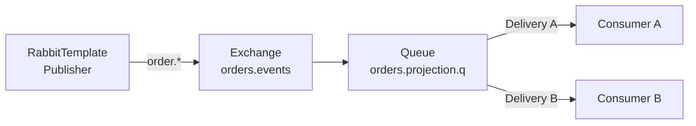
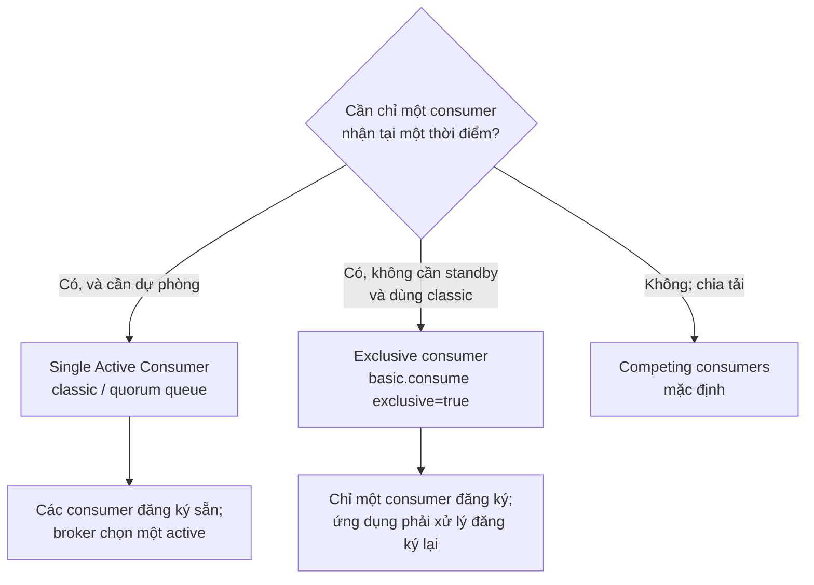
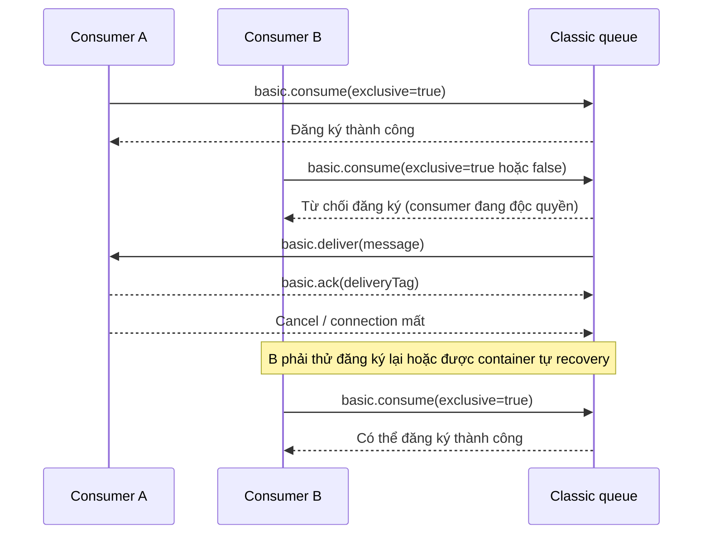
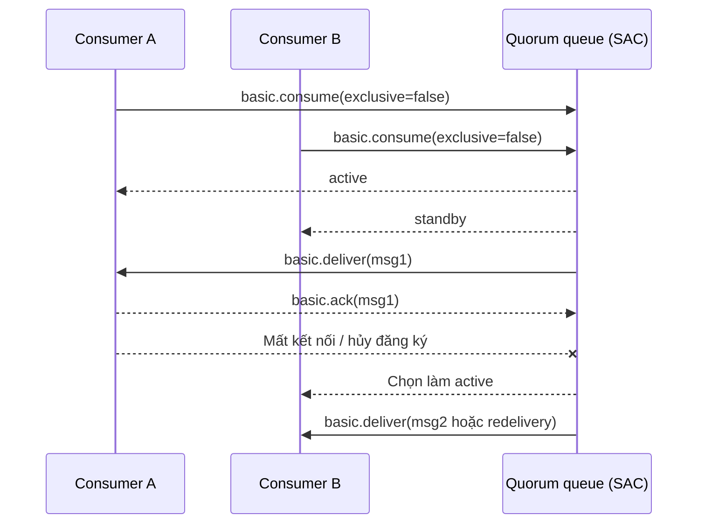

# Exclusive consumer và giới hạn theo queue type

Trong RabbitMQ, một queue thường có thể được nhiều consumer cùng đăng ký để chia sẻ công việc. Nhưng có những tác vụ cần **chỉ một consumer nhận message tại một thời điểm**: cập nhật trạng thái theo thứ tự, điều phối công việc tuần tự hoặc ngăn nhiều tiến trình cùng xử lý một luồng. AMQP 0-9-1 có cơ chế **exclusive consumer**, nhưng cơ chế này **không hoạt động giống nhau trên mọi queue type**.

Bài học thuộc chương **Các loại hàng đợi** của `SPRING_AMQP`. Ta sẽ sử dụng `RabbitTemplate`, `@RabbitListener`, exchange, queue và binding để phân biệt ba khái niệm hay bị gọi chung là “exclusive”: **exclusive consumer**, **exclusive queue** và **Single Active Consumer (SAC)**. Sau đó đối chiếu khả năng hỗ trợ của **classic**, **quorum** và **stream** queue, xử lý tình huống chuyển giao consumer, retry, acknowledgement và quan sát hoạt động trên RabbitMQ.

## 1. Tình huống đặt vấn đề: nhiều bản sao cùng đọc một queue

Giả sử dịch vụ `OrderProjection` nhận các message `order.created`, `order.paid` và `order.cancelled` từ queue `orders.projection.q`. Khi chạy hai bản sao của dịch vụ để tăng tính sẵn sàng, mặc định cả hai đều có thể đăng ký consumer trên cùng queue:



Đó là mô hình **competing consumers**: các consumer chia nhau các delivery từ **một queue**. Đây không phải cơ chế fanout một message đến tất cả consumer. Nếu logic projection cần xử lý tuần tự, phân phối đến nhiều consumer có thể làm thứ tự **hoàn thành xử lý** khác với thứ tự message đến queue.

Đặt `concurrency = 1` trong **một** Spring listener container chỉ giảm số consumer của container đó, **không ngăn một bản sao ứng dụng khác** cùng đăng ký với queue. Muốn broker áp đặt việc chỉ một consumer nhận message, cần tính năng phù hợp với queue type và yêu cầu dự phòng.

## 2. Ba khái niệm dễ nhầm

| Khái niệm | Cấu hình ở đâu? | Ý nghĩa | Vòng đời |
|---|---|---|---|
| **Exclusive consumer** | Cờ `exclusive=true` của lệnh AMQP 0-9-1 `basic.consume` (Spring: `@RabbitListener(exclusive = true)`). | Yêu cầu consumer đăng ký có quyền **tiêu thụ độc quyền** một classic queue; consumer khác không đăng ký thêm được khi nó đang giữ quyền. | Quyền độc quyền kết thúc khi consumer hủy đăng ký hoặc mất kết nối. |
| **Exclusive queue** | Thuộc tính `exclusive=true` của lệnh `queue.declare` (Spring: `Queue(..., exclusive=true, ...)`). | Queue bị ràng buộc với **connection đã khai báo nó**; connection khác không được truy cập các thao tác bị bảo vệ như consume/purge/delete. | Queue bị xóa khi connection khai báo đóng/mất; phù hợp trạng thái tạm thời. |
| **Single Active Consumer (SAC)** | Argument của queue `x-single-active-consumer=true` đối với classic/quorum qua AMQP 0-9-1. | Có thể đăng ký **nhiều** consumer nhưng broker chỉ giao message cho **một consumer active**; các consumer còn lại ở trạng thái standby. | Broker chọn consumer dự phòng khi consumer active mất hoặc hủy. |

Hai cờ `exclusive` đầu tiên cùng tên nhưng nằm trên **hai lệnh giao thức khác nhau**. Một queue có thể không exclusive nhưng có exclusive consumer; ngược lại, một exclusive queue được giới hạn theo connection nhưng vẫn là một đối tượng queue riêng. SAC là cơ chế thứ ba nhằm hỗ trợ **một consumer active và tự chuyển sang consumer khác**.



## 3. Exclusive consumer hoạt động thế nào trên classic queue?

Khi một consumer gửi `basic.consume` với `exclusive=true` đến **classic queue**, RabbitMQ chỉ chấp nhận nếu tại thời điểm đăng ký **chưa có consumer nào** trên queue đó. Nếu thành công, những yêu cầu đăng ký consumer khác vào cùng queue sẽ bị từ chối cho đến khi exclusive consumer hủy hoặc bị mất.



**Đặc điểm quan trọng:**

- Exclusivity chỉ hạn chế **consumer đăng ký nhận từ queue**; không ngăn publisher gửi message đến queue thông qua exchange/binding.
- Exclusive consumer áp dụng trên **toàn queue**, không chỉ trong một JVM hoặc một Spring application instance.
- Một container muốn đăng ký exclusive consumer phải có **concurrency = 1**. Không thể cấu hình nhiều consumer độc quyền đồng thời trong chính container đó.
- RabbitMQ **không duy trì danh sách standby** riêng cho exclusive consumer. Khi consumer active biến mất, ứng dụng hoặc listener container phải chủ động thử đăng ký lại. Nhiều bản sao cùng retry có thể cạnh tranh; ai đăng ký trước thì giữ quyền.
- Exclusive consumer **không thay thế** consumer acknowledgement. Message đang unacked có thể bị giao lại sau khi connection/channel mất, nên xử lý nghiệp vụ vẫn phải idempotent.

Nếu đã có **consumer thường** trên classic queue, một exclusive consumer đến sau cũng không thể chiếm quyền bằng cách đơn giản gửi `exclusive=true`. Cơ chế này không mang ý nghĩa *preemption* hay chuyển giao ưu tiên; nó chỉ kiểm soát việc đăng ký consumer.

## 4. Giới hạn theo classic, quorum và stream queue

| Khả năng | Classic queue | Quorum queue | Stream queue |
|---|---|---|---|
| Queue có thể đặt thuộc tính **exclusive** | **Có**, thường là queue tạm thời. | **Không**. | **Không**. |
| `basic.consume(exclusive=true)` cho **exclusive consumer** | **Hỗ trợ**. | **Không có tính độc quyền**: broker bỏ qua cờ `exclusive` đối với quorum. | **Không dùng như giải pháp exclusive consumer** qua AMQP 0-9-1. |
| **SAC** với queue argument `x-single-active-consumer=true` và AMQP 0-9-1 | **Có**. | **Có**. | **Không** qua cơ chế AMQP 0-9-1 này. |
| Cơ chế SAC riêng cho stream protocol | Không áp dụng kiểu stream. | Không áp dụng kiểu stream. | **Có**, dùng RabbitMQ Stream protocol với consumer **name** dùng chung. |
| Tính chất lưu trữ cơ bản | Queue truyền thống, không replicated theo cách quorum. | Queue durable, replicated theo quorum. | Log bền vững, replicated, consumer có thể đọc lại theo offset. |

### 4.1. Classic queue

Classic queue hỗ trợ cả exclusive queue lẫn exclusive consumer. Với nhu cầu một consumer tại một thời điểm và có tính sẵn sàng cao, **SAC thường phù hợp hơn** vì các consumer dự phòng có thể đăng ký trước và broker chuyển quyền active khi cần. Classic queue thường không cho bảo đảm sao chép dữ liệu như quorum, nên cần xem xét loại queue dựa trên yêu cầu bền vững, không chỉ dựa trên exclusivity.

### 4.2. Quorum queue

Quorum queue **không hỗ trợ exclusive queue** vì việc gắn vòng đời queue vào một connection trái với mục đích queue durable, replicated. RabbitMQ cũng **bỏ qua cờ `exclusive` trong `basic.consume`** đối với quorum queue. Do đó một `@RabbitListener(exclusive=true)` có thể tạo cảm giác consumer đã độc quyền, nhưng **không ngăn consumer khác cùng đăng ký** trên quorum queue.

Nếu cần chỉ một consumer nhận message tại một thời điểm với quorum queue, khai báo **Single Active Consumer** và chạy nhiều consumer bình thường (`exclusive=false`). Quorum queue có thể sử dụng consumer priority khi lựa chọn/chuyển active theo quy tắc của RabbitMQ; việc chuyển giao vẫn liên quan trạng thái acknowledgement của các message đang xử lý.

### 4.3. Stream queue

Stream lưu message theo cơ chế **log không phá hủy dữ liệu ngay khi đọc**, có offset và khả năng đọc lại. Nó không giống classic/quorum queue trong cách tiêu thụ. Stream queue không hỗ trợ exclusive queue; không được giả định rằng `@RabbitListener(exclusive=true)` tạo khóa độc quyền trên stream.

RabbitMQ có **Single Active Consumer dành riêng cho Stream protocol**: các consumer dùng cùng tên trong một nhóm có thể có một consumer active và những consumer khác chờ, với cơ chế bám offset/chuyển giao theo stream client. Cơ chế này **khác với** `x-single-active-consumer=true` dành cho classic/quorum qua AMQP 0-9-1. Nếu hệ thống cần xử lý stream theo nhóm, hãy dùng RabbitMQ Stream client (hoặc hỗ trợ stream tương ứng trong Spring AMQP) và cấu hình SAC theo API/protocol stream.

**Kết luận về khả năng tương thích:** Không chọn `exclusive=true` chỉ vì muốn một consumer cho mọi queue. **Queue type quyết định cơ chế broker thực sự hỗ trợ.**

## 5. Cấu hình exclusive consumer với Spring AMQP trên classic queue

Trong Spring Boot, thêm starter cho RabbitMQ AMQP 0-9-1 phù hợp với phiên bản Boot đang dùng; ứng dụng cần `ConnectionFactory`, broker và quyền khai báo queue. Ví dụ dùng `QueueBuilder` và `@RabbitListener`.

### 5.1. Khai báo classic queue, exchange và binding

```java
package com.example.orders;

import org.springframework.amqp.core.Binding;
import org.springframework.amqp.core.BindingBuilder;
import org.springframework.amqp.core.DirectExchange;
import org.springframework.amqp.core.Queue;
import org.springframework.amqp.core.QueueBuilder;
import org.springframework.context.annotation.Bean;
import org.springframework.context.annotation.Configuration;

@Configuration(proxyBeanMethods = false)
public class ExclusiveClassicTopology {

    public static final String EXCHANGE = "orders.events";
    public static final String QUEUE = "orders.exclusive.classic.q";
    public static final String KEY = "order.exclusive";

    @Bean
    public DirectExchange exclusiveOrdersExchange() {
        return new DirectExchange(EXCHANGE, true, false);
    }

    @Bean
    public Queue exclusiveOrdersQueue() {
        return QueueBuilder.durable(QUEUE)
                .withArgument("x-queue-type", "classic")
                .build();
    }

    @Bean
    public Binding exclusiveOrdersBinding(
            Queue exclusiveOrdersQueue,
            DirectExchange exclusiveOrdersExchange) {
        return BindingBuilder.bind(exclusiveOrdersQueue)
                .to(exclusiveOrdersExchange)
                .with(KEY);
    }
}
```

`x-queue-type=classic` làm rõ loại queue cần sử dụng, ngay cả khi virtual host có default queue type khác classic. **Đây là queue durable và không exclusive** (`exclusive=false` ở cấp queue). Ta sẽ yêu cầu độc quyền tại **consumer**, không phải ở phương thức khai báo queue.

Với cấu hình Spring Boot mặc định có `RabbitAdmin`, các bean `Queue`, `DirectExchange`, `Binding` có thể được khai báo lên RabbitMQ khi connection được thiết lập. Việc tạo bean Java tự nó chưa chứng minh broker đã tạo topology.

### 5.2. Đăng ký exclusive consumer bằng @RabbitListener

```java
package com.example.orders;

import org.springframework.amqp.rabbit.annotation.RabbitListener;
import org.springframework.stereotype.Component;

@Component
public class ExclusiveOrderConsumer {

    @RabbitListener(
            queues = ExclusiveClassicTopology.QUEUE,
            exclusive = true,
            concurrency = "1")
    public void onMessage(String payload) {
        // Ví dụ minh họa: thay bằng service xử lý và commit nghiệp vụ.
        System.out.println("Exclusive consumer received: " + payload);
    }
}
```

Spring AMQP chuyển yêu cầu `exclusive=true` thành đăng ký consumer độc quyền trên classic queue. `concurrency="1"` giữ **một consumer trong listener container**, đáp ứng ràng buộc của chế độ này. Các bản sao ứng dụng khác cố đăng ký consumer cùng queue có thể nhận lỗi đăng ký và listener container sẽ thử phục hồi theo cấu hình recovery/backoff của nó.

Publisher vẫn gửi message bình thường qua exchange:

```java
@Component
public class OrderPublisher {
    private final RabbitTemplate rabbitTemplate;

    public OrderPublisher(RabbitTemplate rabbitTemplate) {
        this.rabbitTemplate = rabbitTemplate;
    }

    public void send(String json) {
        rabbitTemplate.convertAndSend(
                ExclusiveClassicTopology.EXCHANGE,
                ExclusiveClassicTopology.KEY,
                json);
    }
}
```

Đoạn publisher cần imports `org.springframework.stereotype.Component` và `org.springframework.amqp.rabbit.core.RabbitTemplate`. Để kiểm tra khả năng giành quyền, chạy **hai ứng dụng** có listener cùng queue, mỗi ứng dụng một consumer độc quyền. Consumer đăng ký thành công trước sẽ nhận delivery; consumer còn lại bị từ chối đăng ký cho tới khi có thể retry thành công.

**Lưu ý vận hành:** hai process cùng cố khai báo một classic queue với các thuộc tính khác nhau sẽ phát sinh lỗi tương đương thuộc tính (`PRECONDITION_FAILED`). Cùng tên queue trên cùng virtual host không thể đổi từ classic sang quorum chỉ bằng cách đổi giá trị `x-queue-type` trong Java rồi restart ứng dụng; cần kế hoạch migration queue.

## 6. Khi cần dự phòng: Single Active Consumer trên classic hoặc quorum

Nếu mục tiêu là **tại mọi thời điểm chỉ một consumer nhận delivery, nhưng các consumer còn lại đã sẵn sàng tiếp quản**, dùng **SAC** thường phù hợp hơn. SAC là cấu hình **của queue**; consumer phải đăng ký **không exclusive** và có thể chạy nhiều bản sao ứng dụng.

### 6.1. Khai báo quorum queue có SAC bằng Spring bean

```java
package com.example.orders;

import org.springframework.amqp.core.Binding;
import org.springframework.amqp.core.BindingBuilder;
import org.springframework.amqp.core.DirectExchange;
import org.springframework.amqp.core.Queue;
import org.springframework.amqp.core.QueueBuilder;
import org.springframework.context.annotation.Bean;
import org.springframework.context.annotation.Configuration;

@Configuration(proxyBeanMethods = false)
public class QuorumSacTopology {

    public static final String EXCHANGE = "orders.sac.events";
    public static final String QUEUE = "orders.serial.quorum.q";
    public static final String KEY = "order.serial";

    @Bean
    public DirectExchange sacExchange() {
        return new DirectExchange(EXCHANGE, true, false);
    }

    @Bean
    public Queue sacQuorumQueue() {
        return QueueBuilder.durable(QUEUE)
                .withArgument("x-queue-type", "quorum")
                .withArgument("x-single-active-consumer", true)
                .build();
    }

    @Bean
    public Binding sacBinding(Queue sacQuorumQueue,
                              DirectExchange sacExchange) {
        return BindingBuilder.bind(sacQuorumQueue)
                .to(sacExchange)
                .with(KEY);
    }
}
```

Với **classic queue**, có thể giữ `x-single-active-consumer=true` nhưng đổi `x-queue-type` thành `classic`. Không dùng `exclusive=true` ở queue hoặc ở consumer trong hai cấu hình SAC này.

**Quan trọng:** `x-single-active-consumer` là argument **tại lúc tạo queue**, không thể bật/tắt bằng RabbitMQ policy động. Nếu queue đã tồn tại mà không có SAC, việc khai báo lại cùng tên với argument mới có thể gây lỗi `PRECONDITION_FAILED`; muốn thay đổi phải có lộ trình tạo queue mới/chuyển message và cutover phù hợp.

### 6.2. Consumer bình thường, để broker chọn active

```java
package com.example.orders;

import org.springframework.amqp.rabbit.annotation.RabbitListener;
import org.springframework.stereotype.Component;

@Component
public class SerialOrderConsumer {

    @RabbitListener(
            queues = QuorumSacTopology.QUEUE,
            concurrency = "1")
    public void onMessage(String payload) {
        System.out.println("SAC consumer received: " + payload);
    }
}
```

Chạy hai bản sao ứng dụng dùng chung queue `orders.serial.quorum.q`. Cả hai consumer có thể **đăng ký thành công**, nhưng RabbitMQ chỉ đánh dấu **một consumer active** và gửi message cho consumer đó. Nếu active ngừng hoặc mất kết nối, một consumer standby đã đăng ký sẽ được broker chọn để nhận tiếp.



SAC và exclusive consumer **không được kết hợp** cho một classic queue: một cơ chế đòi chỉ một consumer được đăng ký, cơ chế kia cần nhiều consumer để có standby. Với quorum queue, cờ exclusive của `basic.consume` bị bỏ qua, nên việc cố trộn hai khái niệm cũng không tạo thêm bảo đảm.

SAC kiểm soát **việc dispatch**, không biến toàn bộ luồng xử lý thành giao dịch đúng một lần. Khi consumer A xử lý DB xong nhưng mất kết nối trước khi gửi ACK, message có thể được giao lại cho B. Cần `eventId`, xử lý **idempotent**, transaction DB phù hợp, giới hạn retry và DLQ. Nếu yêu cầu thứ tự xử lý rất chặt, cân nhắc `prefetch=1`, một consumer active, kiểm soát requeue và không giả định việc xử lý lại không ảnh hưởng thứ tự nghiệp vụ.

## 7. Exclusive queue khác exclusive consumer như thế nào?

Ở cấp **queue**, thuộc tính `exclusive=true` gắn quyền sử dụng queue với **connection đã khai báo**; RabbitMQ xóa queue khi connection đó mất. Đây là lựa chọn cho callback queue hoặc trạng thái riêng của một client, **không phải** giải pháp leader election/consumer dự phòng cho công việc chung.

Ví dụ tạo một classic queue tạm thời có tên riêng của process:

```java
@Bean
Queue temporaryReplyQueue() {
    String name = "reply." + java.util.UUID.randomUUID();
    return new Queue(name, false, true, true);
    // false: durable; true: exclusive; true: autoDelete.
}
```

Đây là ví dụ **tên do ứng dụng tạo ngẫu nhiên**, không phải server-named queue. RabbitMQ cũng hỗ trợ server-generated queue name; cách này thường được khuyến nghị cho exclusive queue. Queue tạm ở trên chỉ thích hợp khi chính connection khai báo nó được dùng để tiêu thụ/kiểm soát queue. Nếu một connection khác cố consume hoặc thao tác cần quyền độc quyền, broker có thể trả lỗi `RESOURCE_LOCKED`.

Trong khi đó, `@RabbitListener(exclusive=true)` **không làm queue tự bị xóa** khi consumer dừng, miễn queue được khai báo durable/nonexclusive như ví dụ classic ở phần 5. Việc consumer ngắt và việc queue bị xóa là hai sự kiện rất khác nhau.

Nếu muốn một **queue chung, durable, phục vụ failover nhiều bản sao**, hãy khai báo queue nonexclusive và dùng SAC trên classic/quorum. Không khai báo `exclusive=true` cho quorum hoặc stream: đây là những loại queue thiết kế cho dữ liệu bền vững và không hỗ trợ thuộc tính exclusive queue.

## 8. Tình huống kiểm thử và quan sát

| Kịch bản | Kết quả mong đợi | Cách xác minh |
|---|---|---|
| **Classic**, hai listener đều `exclusive=true`, concurrency = 1 | Chỉ một listener đăng ký và nhận delivery; listener còn lại bị từ chối, có thể retry. | Xem log listener container, RabbitMQ Management UI → queue → Consumers. |
| Classic đã có một consumer thường, tiếp tục mở exclusive consumer | Exclusive consumer không thể giành quyền khi consumer cũ vẫn đăng ký. | Quan sát lỗi đăng ký và số consumer đang hoạt động. |
| **Quorum**, hai listener đều đặt `exclusive=true` nhưng queue **không có SAC** | Cờ exclusive không tạo độc quyền; nhiều consumer vẫn có thể cùng nhận message. | Kiểm tra số consumer và phân phối delivery của quorum queue. |
| **Quorum hoặc classic** có `x-single-active-consumer=true`, hai listener thường | Hai consumer có thể đăng ký; chỉ một active, consumer kia standby. | Quan sát `active` trong Management UI hoặc CLI, dừng active để xem chuyển giao. |
| Classic queue khai báo `exclusive=true`, thử consume từ connection khác | Truy cập bị từ chối theo quyền exclusive của queue. | Kiểm tra lỗi `RESOURCE_LOCKED`; đóng connection chủ sở hữu để thấy queue biến mất. |
| **Stream**, cố bật SAC bằng argument AMQP 0-9-1 như quorum | Không đạt SAC theo cách này; cần stream protocol. | Xem queue type và lựa chọn client/protocol. |

Lệnh kiểm tra có thể chạy trên máy quản trị RabbitMQ phù hợp vhost (ví dụ `/`):

```bash
rabbitmqctl -p / list_queues name type durable exclusive consumers
rabbitmqctl -p / list_consumers
```

Các trường và định dạng có thể khác theo phiên bản RabbitMQ. RabbitMQ Management UI cho phép xem queue type, số consumers, consumer tag và trạng thái **active** khi dùng SAC. Đừng chỉ nhìn `messages_ready=0`: nếu consumer ACK rất nhanh, queue có thể luôn trống dù đang hoạt động bình thường.

### Xử lý lỗi khi thử nghiệm

- **Không thấy tính độc quyền trên quorum:** kiểm tra `x-queue-type=quorum`; cờ `exclusive=true` của consumer không phải giải pháp. Chuyển sang SAC.
- **Spring báo concurrency không hợp lệ:** exclusive consumer yêu cầu concurrency = 1; kiểm tra `@RabbitListener(concurrency="1")` và cấu hình container factory.
- **Lỗi khi khai báo SAC:** queue cùng tên đã tồn tại không có `x-single-active-consumer`, hoặc thuộc tính queue khác với khai báo; so sánh arguments và migration.
- **Consumer standby không tự nhận:** bảo đảm dùng SAC trên queue; nếu chỉ đặt exclusive consumer thì ứng dụng phải xử lý retry đăng ký.
- **Đang giữ exclusive consumer nhưng vẫn có xử lý trùng:** kiểm tra khoảng hở giữa commit nghiệp vụ và ACK; dùng idempotency, phân loại lỗi, retry/DLX.
- **Dùng stream nhưng không có bảo đảm SAC:** kiểm tra client/protocol; không mang nguyên cài đặt AMQP 0-9-1 của classic/quorum sang stream.

## 9. Bài thực hành

**Bài 1 — classic exclusive consumer.** Tạo topology của phần 5 và chạy hai instance listener `ExclusiveOrderConsumer`. Gửi năm sự kiện bằng `RabbitTemplate`, so sánh consumer đăng ký thành công, consumer bị từ chối và log xử lý. Dừng instance đang sở hữu quyền, quan sát instance kia thử đăng ký lại theo recovery/backoff; ghi nhận khoảng trống khi chuyển quyền.

**Bài 2 — thử nghiệm sai trên quorum.** Tạo quorum queue với `x-queue-type=quorum` nhưng **không** đặt SAC; cho hai instance cùng đăng ký `@RabbitListener(exclusive=true)`. Dự đoán và kiểm chứng: cờ exclusive không hạn chế việc cả hai cùng nhận. Sau đó dùng một queue quorum **mới** có `x-single-active-consumer=true` và lặp lại với listener bình thường.

**Bài 3 — failover SAC.** Dùng queue ở phần 6, cho hai consumer hoạt động; ghi tên consumer active. Dừng instance active, quan sát broker chọn consumer còn lại. Gây lỗi xử lý đúng lúc giao message, xác minh redelivery có thể xảy ra và cần sử dụng `eventId` để tránh áp dụng nghiệp vụ hai lần.

**Bài 4 — phân biệt exclusive queue.** Tạo queue tạm bằng `temporaryReplyQueue`, thử kết nối thứ hai vào queue và quan sát lỗi. Đóng connection khai báo queue; xác minh queue bị xóa. So sánh với classic **durable nonexclusive queue** vẫn tồn tại sau khi exclusive consumer ngừng.

## 10. Câu hỏi tự đánh giá

1. **`@RabbitListener(concurrency="1")` có bảo đảm chỉ một consumer trên toàn RabbitMQ không?** Không. Nó chỉ hạn chế concurrency của listener/container được cấu hình; replica khác vẫn có thể kết nối.
2. **`@RabbitListener(exclusive=true)` có bảo đảm độc quyền trên quorum queue không?** Không. RabbitMQ bỏ qua cờ exclusive trên quorum; cần SAC nếu muốn một active consumer.
3. **Exclusive consumer dừng thì queue durable có bị xóa không?** Không chỉ vì consumer dừng. Đây là khác biệt với queue khai báo `exclusive=true`, bị ràng buộc vòng đời với declaring connection.
4. **SAC có cần nhiều consumer để hoạt động không?** Không bắt buộc; chỉ một consumer cũng chạy được. Nhưng khả năng **tự chuyển sang standby** chỉ có ý nghĩa khi đã có consumer khác đăng ký.
5. **Stream có thể dùng `x-single-active-consumer=true` từ Spring `QueueBuilder` giống quorum không?** Không. SAC của stream là cơ chế theo Stream protocol, cấu hình qua stream client và consumer name.
6. **SAC hoặc exclusive consumer có bảo đảm xử lý đúng một lần không?** Không. Vẫn phải xét ACK, redelivery, idempotency, transaction, retry/dead-letter và trạng thái producer confirm.

**Ghi nhớ:** `exclusive=true` của **consumer** chỉ thực sự giới hạn `basic.consume` trên **classic queue**; `exclusive=true` của **queue** tạo queue tạm thuộc một connection; **Single Active Consumer** phù hợp khi cần một consumer active cùng khả năng failover trên classic/quorum. Với **stream**, phải dùng cơ chế tương ứng của **RabbitMQ Stream protocol**. Khi chọn cơ chế, luôn bắt đầu từ queue type và yêu cầu vận hành của hệ thống.

### Tài liệu tham khảo

- RabbitMQ — [Consumers: Exclusivity và Single Active Consumer](https://www.rabbitmq.com/docs/consumers).
- RabbitMQ — [Quorum Queues: Feature Matrix](https://www.rabbitmq.com/docs/quorum-queues).
- RabbitMQ — [Queues: Exclusive Queues](https://www.rabbitmq.com/docs/queues).
- RabbitMQ — [Streams: Single Active Consumer cho stream](https://www.rabbitmq.com/docs/streams).
- Spring AMQP — [Message Listener Container Configuration](https://docs.spring.io/spring-amqp/reference/amqp/containerAttributes.html).
