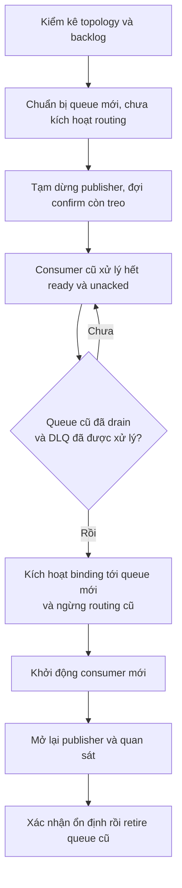
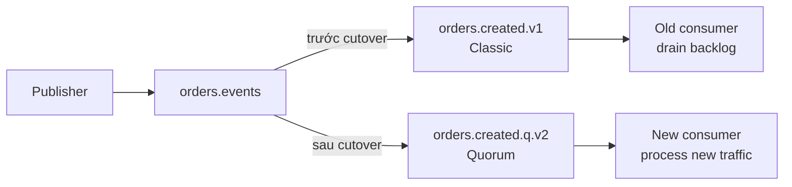

# Thay đổi queue type và kế hoạch chuyển dữ liệu trong RabbitMQ

Trong Spring AMQP, lập trình viên có thể tạo queue bằng `QueueBuilder`, gửi message bằng `RabbitTemplate` và nhận bằng `@RabbitListener`. Khi hệ thống phát triển, một queue ban đầu thuộc loại **classic** có thể không còn phù hợp: nghiệp vụ muốn chuyển sang **quorum** để tăng khả năng chịu lỗi, hoặc sang **stream** cho mô hình lưu giữ và đọc lại sự kiện. Việc thay đổi này là một bài toán **di chuyển dữ liệu và chuyển tuyến**, không đơn thuần là sửa thuộc tính Java.

Bài học thuộc chương **Các loại hàng đợi**, tập trung vào cách đánh giá sự khác biệt của queue type, chuẩn bị queue mới, chuyển luồng publish/consume, xử lý message còn tồn và kiểm chứng kết quả. Những kiến thức về exchange, binding, acknowledgement, retry, dead-letter, giao dịch và quan sát RabbitMQ đều được sử dụng để bảo đảm quá trình chuyển đổi có thể kiểm soát.

Sau bài này, bạn sẽ có thể:

- Giải thích vì sao không thể đổi kiểu của queue đang tồn tại chỉ bằng cách sửa `x-queue-type`.
- Lựa chọn chiến lược **dừng ghi rồi drain**, **chạy song song** hoặc **chuyển tiếp message có xác nhận** tùy ràng buộc nghiệp vụ.
- Phác thảo kế hoạch chuyển queue classic sang quorum trong Spring AMQP, có mốc chuyển tuyến và khả năng quay lui.
- Xử lý rủi ro mất message, giao trùng, sai thứ tự, dead-letter và sai lệch thuộc tính.
- Kiểm tra được điều kiện hoàn tất thay vì chỉ nhìn thấy queue mới đã được tạo.

## 1. Queue type là gì và vì sao cần chuyển đổi?

RabbitMQ hỗ trợ các queue type có ngữ nghĩa và khả năng vận hành khác nhau. Một số đặc điểm quan trọng:

| Queue type | Mô hình chính | Phù hợp khi | Điểm cần cân nhắc |
| --- | --- | --- | --- |
| **Classic queue** | Queue truyền thống; một bản queue được quản lý theo cơ chế classic hiện hành | Work queue đơn giản; tương thích với topology và tính năng ứng dụng đang dùng | Khả năng chịu lỗi, vị trí dữ liệu và yêu cầu HA cần đánh giá theo phiên bản RabbitMQ |
| **Quorum queue** | Queue dựa trên nhóm replica và thuật toán đồng thuận | Cần dữ liệu queue có tính sẵn sàng cao và khả năng chịu lỗi node trong điều kiện cụm đáp ứng quorum | Dùng thêm tài nguyên; yêu cầu cấu hình/giám sát replication, leader, xác nhận publish |
| **Stream** | Log message được lưu theo retention; consumer có thể đọc theo offset | Lưu trữ và phát lại nhiều sự kiện, nhiều consumer đọc theo tiến độ riêng | Khác mô hình xóa message sau ACK của work queue; API, retention và cách đọc cần thiết kế lại |

**Không có một queue type tối ưu cho mọi tác vụ.** Quorum queue không tự giải quyết tính idempotent, giao dịch với database hay giới hạn tài nguyên broker; stream cũng không phải một classic queue có thêm nút “replay”. Khi chọn loại mới, phải đối chiếu yêu cầu lưu trữ, thứ tự, replication, throughput, độ trễ và mô hình consumer.

Đặc biệt, với **classic → quorum**, nhiều ứng dụng vẫn sử dụng cùng mô hình AMQP 0-9-1: exchange, binding, publish, consume, ACK. Với **classic/quorum → stream**, thay đổi có thể rộng hơn: retention, vị trí offset, khả năng phát lại và client tương ứng cần được kiểm tra. Không nên giả định giữ nguyên listener mà có thể đạt đầy đủ ngữ nghĩa stream.

## 2. Vì sao không đổi queue type ngay trên queue cũ?

Loại queue được quyết định **khi RabbitMQ tạo queue**. RabbitMQ dùng tham số `x-queue-type` trong lệnh khai báo hoặc dùng **default queue type** nếu client không chỉ định. Ví dụ:

```java
import org.springframework.amqp.core.Queue;
import org.springframework.amqp.core.QueueBuilder;

// Queue mới thuộc loại quorum (trên RabbitMQ và Spring AMQP hỗ trợ)
Queue newQueue = QueueBuilder
        .durable("orders.created.q.v2")
        .quorum()
        .build();
```

Trong ví dụ, `.quorum()` biểu diễn yêu cầu khai báo quorum queue. Queue quorum phải có các thuộc tính tương thích với loại này, thường là **durable và không exclusive**.

Giả sử broker đã có queue `orders.created` loại classic. Nếu sửa code thành:

```java
Queue changed = QueueBuilder
        .durable("orders.created")
        .quorum()
        .build();
```

thì tên queue vẫn là `orders.created`, nhưng khai báo mới yêu cầu loại khác với queue đang tồn tại. RabbitMQ thông thường trả lỗi **`PRECONDITION_FAILED`** do thuộc tính không tương đương, và channel khai báo bị đóng. Một số phiên bản/cấu hình RabbitMQ có quy tắc riêng về kiểm tra tính tương đương của `x-queue-type` và default queue type, nhưng chúng **không chuyển dữ liệu queue đang tồn tại sang kiểu mới**.

**Kết luận thực hành:** không coi việc đổi `QueueBuilder` hoặc thay queue policy là thao tác chuyển kiểu tại chỗ. Cách an toàn, dễ kiểm soát nhất thường là **tạo queue mới với tên mới**, điều chỉnh binding/consumer và có kế hoạch xử lý backlog của queue cũ.

Nếu nhất thiết muốn giữ **đúng tên queue cũ**, trước tiên phải ngừng luồng dữ liệu, chuyển/tiêu thụ hết dữ liệu cần giữ, xóa queue cũ rồi khai báo lại theo loại mới. **Xóa queue sẽ xóa message còn nằm trong queue đó**; vì vậy đây là lựa chọn cần thủ tục chuyển đổi chặt chẽ, không phải cách sửa lỗi `PRECONDITION_FAILED` tùy tiện.

## 3. Những gì cần kiểm kê trước khi di chuyển

Trước khi viết cấu hình mới, lập một bảng hiện trạng cho **từng vhost và từng queue**. Không suy luận mọi thứ từ tên queue hay source code: queue thực tế trên broker có thể đã được tạo bởi bản triển khai cũ, công cụ vận hành hoặc policy.

| Nhóm thông tin | Cần ghi nhận | Vì sao quan trọng |
| --- | --- | --- |
| **Định danh** | Vhost, queue name, queue type hiện tại, owner | Tránh nhầm queue trùng tên ở vhost khác |
| **Topology** | Exchange, binding key, default exchange, publisher | Biết cách đổi tuyến mà không bỏ sót luồng publish |
| **Cấu hình** | Durable, auto-delete, exclusive, queue arguments, policies | Phát hiện thuộc tính không tương thích với loại mới |
| **Dữ liệu** | `messages_ready`, `messages_unacknowledged`, tốc độ publish/deliver/ack, tổng dung lượng | Ước lượng backlog và xác định khi nào drain xong |
| **Consumer** | `@RabbitListener` nào đang consume, concurrency, prefetch, thời gian xử lý | Phát hiện nguy cơ in-flight và thay đổi thứ tự |
| **Độ tin cậy** | Publisher confirms/returns, cơ chế ACK, retry, DLX/DLQ, TTL | Tránh mất message và thay đổi chính sách lỗi |
| **Hợp đồng dữ liệu** | Payload, headers, correlation ID, event ID, schema version | Giữ khả năng xử lý và khử trùng lặp |
| **Hạ tầng** | Dung lượng đĩa/RAM, số node, khả năng replica, monitoring | Bảo đảm loại queue mới chạy được trong cụm |

Ví dụ kiểm tra trên broker có quyền quản trị:

```bash
# Thay /orders bằng vhost thực tế
rabbitmqctl list_queues -p /orders name type messages_ready messages_unacknowledged consumers arguments
rabbitmqctl list_bindings -p /orders source_name destination_name routing_key
rabbitmqctl list_exchanges -p /orders name type durable
```

Hãy đối chiếu với RabbitMQ Management UI và policy hiệu lực. Với quorum queue, cần xem thêm tình trạng thành viên/leader và khả năng phục hồi của cụm. **Queue rỗng theo `messages_ready=0` chưa chắc đã drain xong**: vẫn có thể có message đang giao nhưng chưa ACK (`messages_unacknowledged > 0`).

### 3.1. Cần hiểu trước các khác biệt về chức năng

Không chỉ queue type mà một số tham số như message TTL, max-length, message priority, dead lettering, single-active-consumer, delivery limit, overflow hay giới hạn replica có thể được hỗ trợ hoặc hoạt động khác nhau giữa các loại queue và phiên bản RabbitMQ. Đừng sao chép toàn bộ arguments của classic queue vào quorum/stream mà chưa kiểm tra tương thích.

Ví dụ:

- Classic queue từng đặt các chính sách retry và DLX nhất định; khi sang quorum, cần xác nhận dead-letter strategy, delivery limit, hành vi redelivery và chính sách overflow.
- Nghiệp vụ cần **ưu tiên message** phải xác minh phiên bản broker và ngữ nghĩa ưu tiên của queue type mới.
- Nghiệp vụ cần giữ message lâu để nhiều nhóm consumer đọc lại nên xem xét mô hình **stream retention/offset**, thay vì cố ép cơ chế đó vào work queue.

Tính năng và giới hạn có thể thay đổi giữa các phiên bản RabbitMQ. Luôn xác minh với **tài liệu phiên bản đang triển khai**.

## 4. Ba chiến lược chuyển đổi phổ biến

Không phải mọi hệ thống đều cho phép ngừng publisher hoặc consumer. Có ba cách tiếp cận chính:

| Chiến lược | Ưu điểm | Rủi ro/giới hạn | Phù hợp |
| --- | --- | --- | --- |
| **A. Tạm dừng publish, drain queue cũ, rồi chuyển tuyến** | Dễ kiểm soát số message, thứ tự theo giai đoạn và thời điểm hoàn tất | Cần cửa sổ bảo trì hoặc nguồn dữ liệu có bộ đệm | Hệ thống có thể tạm dừng ghi |
| **B. Chuyển luồng publish mới sang queue mới, tiếp tục drain queue cũ** | Giảm thời gian ngừng publish; queue mới được dùng sớm | Hai queue cùng xử lý, có thể sai thứ tự giữa message cũ/mới; cần giám sát kỹ | Dữ liệu không yêu cầu thứ tự tuyệt đối |
| **C. Dùng worker/bridge chuyển message tồn từ queue cũ sang queue mới** | Di chuyển backlog mà không buộc consumer cũ xử lý hết nghiệp vụ trước | Có nguy cơ gửi trùng, thay đổi metadata, cần confirm và ACK có thứ tự | Cần chuyển message tồn về nơi lưu trữ mới |

Với các luồng nghiệp vụ quan trọng, **A là mốc tham chiếu dễ kiểm chứng nhất**. Nếu không thể dừng publish, phải thiết kế chuyển tuyến và xử lý rủi ro rõ ràng; RabbitMQ không cung cấp một giao dịch nguyên tử đơn giản để đổi toàn bộ binding, queue type và dữ liệu cũ trong một bước.

### 4.1. Chiến lược A: dừng publish và drain



Thứ tự cụ thể:

1. **Chuẩn bị:** tạo queue mới và consumer tương ứng; chưa đặt binding mới trùng routing key đang có traffic nếu chưa chủ động muốn tạo bản giao song song.
2. **Đóng nguồn ghi có kiểm soát:** dừng publisher ở entry point phù hợp, đợi các publish còn chờ confirm được xử lý và ghi nhận những lần có kết quả không rõ ràng.
3. **Drain queue cũ:** để consumer xử lý hết backlog; xác minh **`messages_ready=0` và `messages_unacknowledged=0`**, đồng thời xem các DLQ/lỗi retry đang tồn tại.
4. **Đổi tuyến:** tạo binding tới queue mới, bỏ binding tới queue cũ trong lúc publisher vẫn đang dừng. Kiểm tra topology thực tế.
5. **Mở lại luồng mới:** khởi động consumer mới, mở lại publisher, publish thông điệp thử và kiểm tra ACK, DLX/returns/confirm.
6. **Giữ queue cũ trong giai đoạn quan sát:** chỉ gỡ bỏ sau khi kết quả kiểm chứng đạt yêu cầu và có phê duyệt vận hành.

Cách này hỗ trợ phân tách rõ **message trước cutover** và **message sau cutover**. Nếu cần bảo toàn thứ tự nghiệp vụ tuyệt đối, còn phải xem concurrency, requeue và cách lưu dữ liệu trong consumer; việc drain thành công không tự bảo đảm mọi side effect được commit theo đúng thứ tự nếu consumer xử lý song song.

### 4.2. Chiến lược B: chuyển tuyến khi vẫn chạy



Trong chiến lược này, **publisher mới được định tuyến sang queue mới**, còn consumer cũ vẫn đọc message tồn. Hai nhóm consumer có thể xử lý đồng thời, nên một sự kiện mới có thể hoàn tất trước sự kiện cũ. Cách này chỉ phù hợp khi nghiệp vụ chấp nhận hành vi đó hoặc có khóa/số thứ tự để điều phối.

**Cửa sổ thay binding không nguyên tử:** khi thêm binding mới trước khi bỏ binding cũ, một publish có thể vào **cả hai queue**; khi bỏ binding cũ trước rồi mới thêm mới, publish trong khoảng hở có thể không được định tuyến tới queue nào. Không nên chạy hai lệnh liên tiếp giữa lúc traffic lớn mà mặc định chúng là một thao tác nguyên tử.

Các phương án giảm rủi ro gồm:

- Có một **khoảng tạm dừng cực ngắn** ở publisher chỉ để thay routing.
- Dùng một **routing key/exchange có phiên bản** và cho publisher chuyển đích theo một cấu hình/feature flag được kiểm soát; giữ tuyến cũ cho message cũ.
- Nếu phải để giai đoạn **dual routing**, chấp nhận và xử lý trùng theo event ID, đồng thời chỉ kết thúc khi các consumer đã thích ứng.

Một phương án khác là **dual publish** từ ứng dụng sang hai tuyến. Nó hữu ích trong một số tình huống nâng cấp, nhưng làm phát sinh hai lần gửi và hai kết quả confirm riêng biệt. Chỉ triển khai khi nghiệp vụ biết xử lý trường hợp một bên publish thành công còn bên kia thất bại; không xem dual publish là giao dịch nguyên tử.

### 4.3. Chiến lược C: bridge chuyển message còn tồn

Đôi khi không thể chờ consumer cũ hoàn thành xử lý nghiệp vụ, nhưng cần đưa message tồn sang loại queue mới. Khi đó viết một worker chuyển tiếp có kiểm soát:

```text
Nguồn: orders.created.v1            Đích: orders.created.q.v2

1. Consume một message từ queue nguồn với manual ACK.
2. Giữ payload và metadata cần thiết (event ID, content type,
   headers, correlation ID, thông tin thời gian nếu phù hợp).
3. Publish message vào queue đích hoặc exchange chuyển tiếp
   với routing được xác định chính xác.
4. Đợi publisher confirm; xử lý cả publisher return nếu mandatory.
5. Chỉ ACK message nguồn sau khi chắc chắn đã có kết quả
   publish hợp lệ theo tiêu chí của hệ thống.
6. Nếu thất bại hoặc không rõ kết quả, không ACK nguồn;
   đưa vào retry có giới hạn và để cơ chế idempotency xử lý
   khả năng cùng một message xuất hiện ở cả hai queue.
```

Nếu ứng dụng dùng **default exchange** `""` để publish tới queue đích bằng routing key là tên queue, phải kiểm tra queue đích tồn tại, user có quyền và cơ chế return được cấu hình; đây là lựa chọn để **chỉ định chính xác queue đích**, tránh vô tình phát lại qua binding hiện có tới cả queue cũ. Một exchange chuyển tiếp riêng cũng là lựa chọn tốt nếu topology phức tạp.

Không thể có transaction AMQP thông thường bảo đảm **consume–publish–ACK nguyên tử xuyên hai queue và các hệ thống bên ngoài**. Ví dụ bridge publish sang queue mới thành công nhưng chết trước ACK queue cũ, broker có thể redeliver message nguồn và gây **trùng ở đích**. Vì vậy event ID cùng cơ chế khử trùng lặp ở consumer đích là yêu cầu quan trọng.

Đối với dữ liệu lớn hoặc stream, cần đánh giá công cụ di chuyển tương thích, giới hạn thông lượng, retention và khả năng resume; không dùng một script “get và publish” tùy tiện trên production mà chưa kiểm tra các ngữ nghĩa trên.

## 5. Ví dụ Spring AMQP: chuẩn bị chuyển classic sang quorum

Giả sử ứng dụng có topic exchange `orders.events` và queue classic cũ `orders.created.v1`. Mục tiêu là queue quorum mới `orders.created.q.v2`. Publisher vẫn publish `order.created` vào exchange `orders.events`.

### 5.1. Chuẩn bị queue đích bằng QueueBuilder

```java
import org.springframework.amqp.core.Queue;
import org.springframework.amqp.core.QueueBuilder;
import org.springframework.context.annotation.Bean;
import org.springframework.context.annotation.Configuration;

@Configuration
public class OrderQueueMigrationConfig {

    public static final String EXCHANGE = "orders.events";
    public static final String OLD_QUEUE = "orders.created.v1";
    public static final String NEW_QUEUE = "orders.created.q.v2";
    public static final String ROUTING_KEY = "order.created";

    // Chỉ tạo queue mới, chưa tạo binding nhận traffic từ exchange
    @Bean
    public Queue ordersCreatedQuorumQueue() {
        return QueueBuilder.durable(NEW_QUEUE)
                .quorum()
                .build();
    }
}
```

Khi `RabbitAdmin` tự động khai báo các bean topology trong cấu hình Spring thông thường, queue đích được tạo. Lưu ý rằng ví dụ này **chưa có `Binding` của queue mới**, nên message đang publish theo routing key `order.created` vẫn đi theo các binding hiện tại của exchange; không chuyển sang queue mới chỉ vì nó đã tồn tại.

Nếu queue mới đã được tạo trước đó với loại khác, việc khai báo lại có thể gây `PRECONDITION_FAILED`. Đừng xóa queue để “chữa” lỗi trước khi xác minh dữ liệu và loại hiện có.

### 5.2. Chỉ khai báo binding mới tại mốc cutover

Khi publisher đã tạm dừng và điều kiện cutover được kiểm chứng, người vận hành hoặc quy trình chuyển đổi có thể chủ động khai báo binding mới bằng `AmqpAdmin`:

```java
import org.springframework.amqp.core.Binding;
import org.springframework.amqp.core.BindingBuilder;
import org.springframework.amqp.core.Queue;
import org.springframework.amqp.core.TopicExchange;
import org.springframework.amqp.core.AmqpAdmin;

public class OrderRoutingCutover {

    public void activateNewQueue(AmqpAdmin admin,
                                 Queue newQueue,
                                 TopicExchange ordersExchange) {
        Binding newBinding = BindingBuilder
                .bind(newQueue)
                .to(ordersExchange)
                .with("order.created");

        admin.declareBinding(newBinding);
    }
}
```

Đây là **minh họa thao tác**, không phải đoạn mã tự chạy khi Spring khởi động: `admin`, `newQueue` và `ordersExchange` phải là các đối tượng được cung cấp đúng từ cấu hình ứng dụng. Trong quá trình cutover, còn cần **gỡ binding cũ** bằng thao tác quản trị được kiểm soát và kiểm tra lại cả hai tuyến. Việc thực hiện trong khoảng publisher tạm dừng giúp tránh khoảng hở hoặc nhân đôi do hai binding cùng tồn tại.

Không nên đăng ký binding mới dưới dạng `@Bean` được tự động khai báo ngay từ giai đoạn chuẩn bị nếu mục tiêu là **chưa nhận traffic**. Cũng cần ngăn quá trình redeploy/auto-declare của bản ứng dụng cũ vô tình **tạo lại binding cũ** sau cutover.

### 5.3. Consumer mới và publisher

```java
import org.springframework.amqp.rabbit.annotation.RabbitListener;
import org.springframework.stereotype.Component;

@Component
public class OrderCreatedQuorumListener {

    @RabbitListener(queues = OrderQueueMigrationConfig.NEW_QUEUE)
    public void onCreated(String orderId) {
        // Xử lý nghiệp vụ idempotent theo event ID trong triển khai thực tế.
        System.out.println("New quorum queue received order " + orderId);
    }
}
```

```java
import org.springframework.amqp.rabbit.core.RabbitTemplate;
import org.springframework.stereotype.Service;

@Service
public class OrderPublisher {
    private final RabbitTemplate rabbitTemplate;

    public OrderPublisher(RabbitTemplate rabbitTemplate) {
        this.rabbitTemplate = rabbitTemplate;
    }

    public void created(String orderId) {
        rabbitTemplate.convertAndSend(
                OrderQueueMigrationConfig.EXCHANGE,
                OrderQueueMigrationConfig.ROUTING_KEY,
                orderId);
    }
}
```

Publisher **không cần đổi code** khi dùng cùng exchange/routing key; thứ quyết định queue nào nhận là binding tại thời điểm broker xử lý publish. Tuy vậy, chạy listener mới trước cutover chỉ có ý nghĩa khi queue đích đã tồn tại; và nếu giai đoạn chuyển đổi vẫn giữ nhiều binding cùng key đến hai queue, **cùng sự kiện sẽ có bản giao ở cả hai queue**.

Ví dụ dùng payload `String` để minh họa đường đi. Trong sản phẩm cần message có event ID/correlation ID, schema và xử lý idempotent; thay đổi queue type có thể liên quan đến cơ chế retry, DLX và giới hạn delivery.

### 5.4. Cấu hình kết nối

```yaml
spring:
  rabbitmq:
    host: ${RABBITMQ_HOST:localhost}
    port: ${RABBITMQ_PORT:5672}
    virtual-host: ${RABBITMQ_VHOST:/orders}
    username: ${RABBITMQ_USERNAME}
    password: ${RABBITMQ_PASSWORD}
    publisher-confirm-type: correlated
    publisher-returns: true
    template:
      mandatory: true
    listener:
      simple:
        acknowledge-mode: auto
```

Đây là cấu hình Spring Rabbit theo mô hình AMQP 0-9-1 cho những phiên bản Spring Boot hỗ trợ các properties tương ứng. Vhost phải tồn tại và user cần được cấp quyền theo vai trò. Việc bật confirm/returns tạo điều kiện nhận kết quả, nhưng **ứng dụng còn phải xử lý confirm callback/future và return** để quyết định retry, báo lỗi hoặc đánh dấu một event đã được broker tiếp nhận.

Spring listener mode `AUTO` nghĩa là container ACK sau xử lý thành công; nó **không phải** chế độ protocol `autoAck=true`. Khi chuyển queue type, hãy kiểm tra xử lý lỗi và requeue theo consumer mới.

## 6. Kế hoạch chuyển đổi chi tiết theo từng giai đoạn

Một kế hoạch an toàn cần xác định rõ **owner, tiêu chí đạt, phương án quay lui và mức chấp nhận downtime**. Bảng dưới đây áp dụng cho tình huống classic → quorum với một khoảng tạm dừng publish.

| Giai đoạn | Hành động | Điều kiện qua bước |
| --- | --- | --- |
| **0. Chuẩn bị** | Kiểm kê queue/binding, đo backlog, xác định SLA, kiểu message và hành vi retry/DLX | Có dữ liệu nền và danh sách phụ thuộc |
| **1. Dựng queue mới** | Tạo queue quorum tên mới, quyền, DLX, policies, giám sát | Queue type đúng; thành viên quorum khỏe; chưa nhận traffic chính |
| **2. Thử nghiệm độc lập** | Publish message thử qua đường riêng, kiểm tra consumer, ACK và failure | Message được xử lý chính xác; cơ chế lỗi đúng kỳ vọng |
| **3. Quiesce** | Tạm dừng producer và các job phát sự kiện; đợi publisher confirm đang treo | Không còn publish chưa giải quyết; xác định ranh giới dữ liệu |
| **4. Drain nguồn** | Tiếp tục xử lý queue cũ hoặc chuyển bằng bridge có confirm | `ready=0` và `unacked=0`; DLQ/retry được rà soát |
| **5. Chuyển tuyến** | Kích hoạt binding mới, vô hiệu binding cũ khi publisher đang dừng | Không có tuyến thừa/gap theo topology kiểm chứng |
| **6. Mở traffic** | Bật listener mới và publisher; theo dõi xác nhận, return, redelivery, backlog | Luồng mới hoạt động và tỷ lệ lỗi đạt ngưỡng cho phép |
| **7. Ổn định** | Theo dõi một khoảng đủ dài và so khớp event theo ID | Không còn message bị bỏ quên; không có sai lệch nghiệp vụ |
| **8. Dọn cũ** | Thu hồi consumer/binding cũ; xóa queue cũ **sau quyết định vận hành** | Có biên bản kiểm chứng và phương án khôi phục |

Nếu không thể dừng publish, thay giai đoạn 3–5 bằng kế hoạch **routing version** hoặc chuyển tuyến có phối hợp, kèm kiểm soát trùng và thứ tự như phần 4.2. Đừng sao chép bảng trên một cách máy móc nếu nguồn sự kiện không thể tạm dừng.

### 6.1. Thiết kế tiêu chí thành công cụ thể

Các điều kiện tối thiểu cần xác minh:

1. **Topology:** queue đích đúng vhost và type; có binding đích và không còn binding cũ ngoài ý muốn.
2. **Dữ liệu cũ:** queue cũ không còn ready/unacked; các DLQ/retry/delay queues đã được kiểm kê và xử lý theo kế hoạch.
3. **Dữ liệu mới:** message có event ID kiểm thử được gửi và xử lý đủ; publisher confirm và return được đối chiếu.
4. **Không mất nghiệp vụ:** số event nguồn và kết quả xử lý được đối soát theo ID, không chỉ so tổng message; duplicate được ghi nhận và xử lý.
5. **Tính sẵn sàng:** replica/quorum khỏe, mức đĩa và RAM đủ, khả năng failover đã được diễn tập phù hợp.
6. **Khả năng quan sát:** cảnh báo về backlog, unacked, redelivery, DLQ và consumer đã hoạt động.

Lưu ý **không thể chứng minh không mất dữ liệu chỉ bằng việc queue cũ rỗng**: một message có thể đã được ACK nhưng xử lý nghiệp vụ thất bại nếu consumer ACK sai thời điểm. Đối soát event ID và kết quả nghiệp vụ là phép kiểm tra mạnh hơn.

## 7. Rủi ro dữ liệu và cách xử lý

### 7.1. Mất message trong khoảng thay binding

Nếu một publisher vẫn gửi message khi đã xóa binding cũ nhưng chưa tạo binding mới, exchange có thể không tìm được queue đích. Message không được route có thể bị drop hoặc return tùy cấu hình. Để giảm nguy cơ:

- Tạm dừng publish và đợi confirm cho các message đang bay trước khi chỉnh tuyến.
- Bật `mandatory` và xử lý publisher returns khi phù hợp.
- Kiểm tra binding ngay trước khi mở traffic; không suy diễn thành công từ một lệnh quản trị đơn lẻ.

### 7.2. Một message xuất hiện ở cả hai queue

Trong giai đoạn cả queue cũ và mới cùng bind với routing key `order.created`, **mỗi queue** có thể nhận một bản message của cùng một lần publish. Đây là fan-out hợp lệ của exchange; nếu cả hai consumer cùng thực thi một nghiệp vụ sẽ sinh **double side effect** nếu ứng dụng không idempotent.

Dùng event ID ổn định và kiểm tra trạng thái xử lý trước khi ghi hóa đơn, gửi tiền hoặc cập nhật số dư. Một unique constraint, bảng xử lý event hoặc giao dịch dữ liệu phù hợp có thể giúp mỗi nghiệp vụ chỉ áp dụng tác động một lần.

### 7.3. Retry và thứ tự xử lý thay đổi

Khi chạy old/new consumer đồng thời, event mới có thể hoàn thành trước event cũ. Việc tăng concurrency hay redelivery cũng có thể đảo thứ tự xử lý, ngay cả bên trong một queue.

Nếu thứ tự nghiêm ngặt là bất biến của nghiệp vụ, ưu tiên dừng publish/drain hoàn toàn, hoặc dùng phân vùng theo khóa, sequence/version và cơ chế chặn xử lý theo tiến độ. Không dựa vào thời điểm RabbitMQ giao message để kết luận thứ tự commit database.

### 7.4. Xử lý dead-letter và delayed message

Một queue cũ có thể đã cấu hình DLX, TTL, delivery limit, policy hoặc một luồng retry vòng qua queue khác. Khi chuyển queue chính:

- Liệt kê cả **DLQ**, queue retry và exchange/binding phụ trợ.
- Xác định message còn nằm trong những nơi đó có được **re-publish về queue mới** hay không.
- Kiểm tra tên queue/exchange được hardcode trong policy và trong code recoverer.
- Đánh giá khác biệt dead-letter strategy, delivery limit và hành vi quorum queue trước khi áp dụng production.

Message trong DLQ **không tự được chuyển** chỉ vì queue chính đổi tên hoặc đổi loại. Một luồng retry cũ vẫn trỏ về queue cũ có thể khiến hệ thống tưởng cutover thành công nhưng sau đó message lỗi được đưa lại vào đường cũ.

### 7.5. Dung lượng và hiệu năng

Trong thời gian chạy song song, tổng dung lượng có thể **tăng** do message và replica của queue mới; dual routing có thể nhân số bản sao logic. Với quorum, theo dõi điều kiện quorum của cụm, số thành viên, leader, disk space, publish/confirm latency và độ trễ ACK.

Mọi vhost trong cùng broker/cluster vẫn có thể chia sẻ CPU, RAM, đĩa và mạng. Hãy đánh giá tải và năng lực hạ tầng trước khi đưa thêm queue mới vào production.

## 8. Kiểm chứng bằng thao tác quản trị và thử nghiệm

### 8.1. Kiểm tra trước, trong và sau cutover

```bash
# Kiểm tra loại queue và backlog trong cùng vhost
rabbitmqctl list_queues -p /orders name type messages_ready messages_unacknowledged consumers

# Kiểm tra topology để chắc chắn không có binding thừa
rabbitmqctl list_bindings -p /orders source_name destination_name routing_key

# Đối chiếu exchange, vhost và kiểu định tuyến
rabbitmqctl list_exchanges -p /orders name type durable
```

Với quyền phù hợp, dùng RabbitMQ Management UI để xem thêm details của queue, policies, leader và members nếu có. Trong từng giai đoạn, lưu lại snapshot số liệu để đối chiếu.

### 8.2. Bộ thử nghiệm thực tế nên có

| Tình huống | Cách thử | Kết quả cần quan sát |
| --- | --- | --- |
| Queue type đúng | Khai báo `orders.created.q.v2` và xem detail queue | Loại mới là quorum; cấu hình phù hợp |
| Route đúng sau cutover | Gửi event `order.created` từ publisher thử | Chỉ queue mới nhận theo topology dự kiến |
| Bridge an toàn | Giả lập bridge chết sau publish confirm nhưng trước ACK nguồn | Không mất message; consumer xử lý trùng theo event ID |
| Unroutable | Gửi key không có binding ở môi trường thử nghiệm, bật mandatory/return | Publisher ghi nhận return đúng thay vì tưởng đã vào queue |
| Consumer fail | Cho listener ném exception với chính sách retry rõ ràng | Redelivery/DLX đúng giới hạn; không ACK trước commit nghiệp vụ |
| Hỏng node | Thử failover trong cluster thử nghiệm có quorum | Ứng dụng kết nối lại; queue và dữ liệu phục hồi theo bảo đảm thực tế |
| Backlog cũ | Tạm ngừng consumer nguồn, kiểm tra `ready`/`unacked` | Không tuyên bố drain xong khi còn unacked |
| Rollback | Diễn tập quay về route cũ hoặc xử lý message mới sau cutover | Không mất hay xử lý lặp ngoài ngưỡng chấp nhận |

Sau khi publisher gửi một message, `RabbitTemplate.convertAndSend(...)` trả về bình thường **không đồng nghĩa** broker đã giữ bền vững hay consumer đã ACK. Đối chiếu publisher confirm, publisher return, consumer ACK, kết quả nghiệp vụ và event ID.

## 9. Quay lui và dọn dẹp

Một phương án rollback khả thi phụ thuộc **cutover đã tiến tới đâu**:

| Thời điểm | Hành động khả thi | Điều kiện |
| --- | --- | --- |
| Chưa tạo binding mới | Giữ nguyên đường cũ, hủy queue thử nếu đã xác minh rỗng | Chưa có dữ liệu hợp lệ đi vào queue mới |
| Đã chuyển binding nhưng chưa mở publisher | Khôi phục routing cũ khi publisher vẫn tạm dừng | Topology kiểm tra được; không có message chưa giải quyết |
| Publisher đã gửi message vào queue mới | Cần ngừng publish, kiểm kê backlog đích và quyết định drain/replay/bridge khi quay về | Không giả định chỉ đổi binding là đủ; message đã vào queue mới vẫn ở đó |
| Đã xóa queue cũ | Phải dựa trên kế hoạch khôi phục/nguồn sự kiện và những gì còn lưu | Không còn một queue cũ để rollback tức thì |

**Đừng xóa queue cũ chỉ vì thấy queue mới hoạt động.** Chờ đủ khoảng quan sát, so khớp dữ liệu nghiệp vụ, kiểm tra consumer/retry/DLQ cũ không còn trỏ tới queue cũ, rồi mới lên lịch dọn dẹp.

Ngược lại, cũng không nên giữ vô hạn hai topology cùng nhận một routing key. Sau khi ổn định, cần dọn binding cũ, loại bỏ các listener không dùng, và cập nhật tài liệu vận hành để không khởi động lại một bản ứng dụng cũ tự tái tạo đường routing ngoài ý muốn.

## 10. Checklist trước khi triển khai thực tế

- [ ] Xác định queue cũ: vhost, type, arguments, DLX/policy, backlog và consumer.
- [ ] Chọn queue type mới dựa trên yêu cầu thực tế; xác nhận tính năng và phiên bản RabbitMQ.
- [ ] Định nghĩa queue **tên mới** và phương án topology; không mong đợi thay `x-queue-type` tại chỗ.
- [ ] Chọn rõ chiến lược **pause/drain**, **parallel cutover** hay **bridge**.
- [ ] Xác định cách ngăn khoảng hở/bản sao khi thay routing; có mốc dừng publisher hoặc versioned route.
- [ ] Đảm bảo event ID/idempotency và xử lý publisher confirms/returns.
- [ ] Kiểm tra `messages_ready=0` **và** `messages_unacknowledged=0` khi đánh giá drain.
- [ ] Kiểm kê retry, DLX, DLQ, delay và hardcoded queue name.
- [ ] Đo năng lực cluster/quorum và chuẩn bị cảnh báo.
- [ ] Diễn tập tình huống lỗi, đối soát dữ liệu, lập kế hoạch quay lui và chỉ xóa queue cũ sau xác minh.

**Ghi nhớ:** Queue type trong RabbitMQ là quyết định ở thời điểm khai báo; thay classic bằng quorum hay stream đòi hỏi **kế hoạch chuyển tuyến và chuyển dữ liệu có kiểm chứng**. Spring AMQP giúp tạo queue mới qua `QueueBuilder` và tổ chức publisher/consumer bằng `RabbitTemplate`, `@RabbitListener`; nhưng khả năng không mất dữ liệu và không xử lý trùng đến từ sự phối hợp giữa publisher confirm, consumer ACK, retry/DLX, idempotency, đối soát và giám sát vận hành.

### Tài liệu tham khảo

- [RabbitMQ — Queues](https://www.rabbitmq.com/docs/queues)
- [RabbitMQ — Quorum Queues](https://www.rabbitmq.com/docs/quorum-queues)
- [RabbitMQ — Classic Queues](https://www.rabbitmq.com/docs/classic-queues)
- [RabbitMQ — Streams](https://www.rabbitmq.com/docs/streams)
- [RabbitMQ — Consumer Acknowledgements and Publisher Confirms](https://www.rabbitmq.com/docs/confirms)
- [RabbitMQ — Dead Letter Exchanges](https://www.rabbitmq.com/docs/dlx)
- [RabbitMQ — Policies](https://www.rabbitmq.com/docs/policies)
- [Spring AMQP — Configuring the Broker](https://docs.spring.io/spring-amqp/reference/amqp/broker-configuration.html)
- [Spring AMQP — Receiving Messages](https://docs.spring.io/spring-amqp/reference/amqp/receiving-messages.html)

