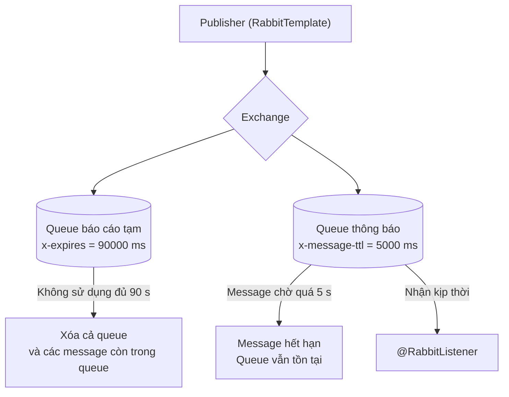
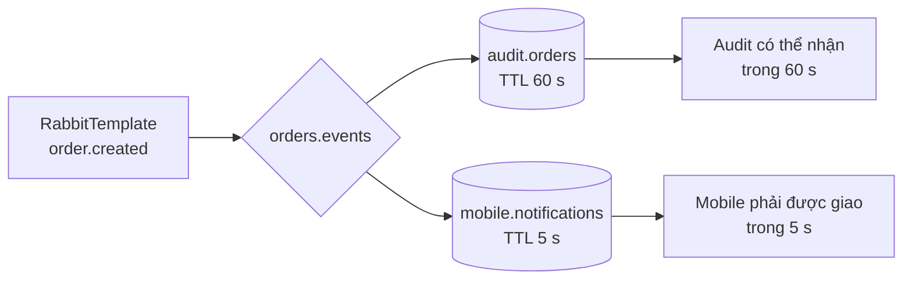
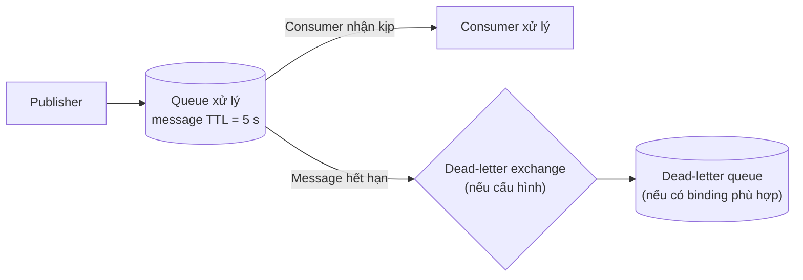

# Queue TTL và phân biệt hết hạn queue với hết hạn thông điệp

## Mục tiêu bài học

Trong **SPRING_AMQP**, ứng dụng thường gửi message bằng `RabbitTemplate`, định tuyến qua exchange, queue và binding rồi nhận bằng `@RabbitListener`. Đối với các luồng xử lý bất đồng bộ, không phải queue nào cũng cần tồn tại mãi mãi và không phải message nào cũng còn giá trị sau khi chờ quá lâu. RabbitMQ hỗ trợ hai loại thời hạn rất dễ nhầm:

- **Queue TTL**: giới hạn thời gian một **queue không được sử dụng** có thể tiếp tục tồn tại trước khi broker xóa queue.
- **Message TTL**: giới hạn thời gian một **message được phép chờ trong queue** trước khi hết hạn.

Sự khác biệt này ảnh hưởng trực tiếp đến việc dọn dẹp tài nguyên, mất message, thiết kế queue tạm, retry/dead-letter và cách quan sát broker. Sau bài học, bạn có thể:

1. Giải thích đúng `x-expires` / policy `expires` và điều kiện queue được xem là không sử dụng.
2. Phân biệt `x-message-ttl` / policy `message-ttl` với thuộc tính `expiration` trên từng message.
3. Khai báo các thời hạn bằng Spring AMQP, RabbitMQ policy và API publish của `RabbitTemplate`.
4. Dự đoán chính xác tài nguyên hoặc message nào biến mất trong các tình huống có consumer, có backlog, có nhiều queue nhận cùng một sự kiện.
5. Thiết kế phép thử đáng tin cậy và tránh dùng TTL như một bộ hẹn giờ xử lý chính xác.

> **Phạm vi:** Bài dùng thuật ngữ và cơ chế của **RabbitMQ** với AMQP 0-9-1. TTL là chính sách ở broker; ứng dụng Spring AMQP cung cấp cách khai báo và gửi message, nhưng không trực tiếp chạy một tác vụ xóa queue theo lịch trong tiến trình Java.

## 1. Nhìn nhanh: hết hạn queue và hết hạn message khác nhau ở đâu?

Giả sử hệ thống có một queue để nhận yêu cầu xuất báo cáo tạm thời và một queue chứa thông báo cần xử lý trong vòng vài giây:



| Câu hỏi | **Queue TTL** | **Message TTL** |
|---|---|---|
| Đối tượng hết hạn? | **Toàn bộ queue** | **Từng message** trong queue |
| Cấu hình bằng argument? | `x-expires` | `x-message-ttl` |
| Cấu hình bằng RabbitMQ policy? | `expires` | `message-ttl` |
| Có thuộc tính ngay trên mỗi message? | Không | Có: message property `expiration` |
| Thời gian tính từ đâu? | Từ lần queue được xem là **sử dụng** gần nhất theo quy tắc RabbitMQ | Từ thời gian message chờ trong **một queue** |
| Điều kiện hết hạn quan trọng | Queue không có consumer và không được redeclare / `basic.get` trong khoảng TTL | Message chưa được giao cho consumer trước khi thời hạn chờ kết thúc |
| Kết quả khi hết hạn | Queue bị xóa; các message còn trong queue mất theo | Message hết hạn bị loại khỏi queue; **queue vẫn tồn tại** |
| Có thể chuyển tới DLX? | Đừng dựa vào DLX để cứu message khi **cả queue bị xóa** | Message hết hạn có thể bị dead-letter nếu queue được cấu hình DLX hợp lệ |
| Trường hợp điển hình | Dọn queue tạm lâu không sử dụng | Loại bỏ thông báo, tác vụ hay dữ liệu đã lỗi thời |

**TTL tính bằng mili giây (ms)** ở những argument và policy này. Chẳng hạn `60000` là 60 giây; `300000` là 5 phút. Cần thống nhất đơn vị để tránh vô tình cấu hình thời gian ngắn hơn dự kiến hàng nghìn lần.

## 2. Queue TTL: `x-expires` và policy `expires`

### 2.1. Queue “không được sử dụng” nghĩa là gì?

RabbitMQ xét queue đủ điều kiện hết hạn nếu queue **không được sử dụng trong ít nhất khoảng thời gian TTL**. Về hành vi thực tế, một queue được xem là không sử dụng khi **đồng thời**:

- Không có consumer đăng ký tiêu thụ queue.
- Queue không được khai báo lại (redeclare) trong khoảng thời gian đó.
- Không có thao tác AMQP `basic.get` trên queue trong khoảng thời gian đó.

Sự hiện diện của consumer khiến queue được xem là đang sử dụng. Những lần redeclare hoặc `basic.get` cũng làm thay đổi thời điểm sử dụng gần nhất, vì vậy có thể ngăn queue hết hạn.

**Điểm dễ nhầm:** Việc **publisher gửi message vào queue** không phải là tiêu chí giữ queue sống theo định nghĩa “used” ở trên. Một queue có backlog vẫn có thể hết hạn nếu không có consumer, không được redeclare và không bị gọi `basic.get` trong đủ thời gian. Queue bị xóa thì những message còn trong queue cũng bị loại bỏ.

Ví dụ queue `lab.reply.temp` có `x-expires=90000`:

| Tình huống sau khi queue được khai báo | Queue có đủ điều kiện hết hạn sau khoảng 90 giây không? | Giải thích |
|---|---|---|
| Không consumer, không redeclare, không `basic.get` | **Có** | Queue không được sử dụng |
| Một `@RabbitListener` đang tiêu thụ từ queue | **Không** | Queue có consumer hoạt động |
| Không consumer nhưng ứng dụng redeclare queue mỗi 30 giây | **Không**, nếu việc redeclare tiếp tục thành công | Bộ đếm thời gian không sử dụng được làm mới |
| Không consumer nhưng polling bằng `basic.get` mỗi 20 giây | **Không**, khi các lượt get tiếp tục xảy ra | `basic.get` được tính là sử dụng |
| Không consumer, vẫn có message đến qua exchange | **Có thể có** | Việc publish vào queue không thay thế consumer/redeclare/`basic.get` |
| Queue còn chứa nhiều message nhưng không được sử dụng | **Có** | Có message trong queue không tự vô hiệu hóa queue TTL |

Việc xóa queue được broker thực hiện **sau khi đủ điều kiện**, không phải bảo đảm xóa chính xác tại mili giây thứ 90000. Nếu ứng dụng cần xử lý tác vụ tại một thời điểm chuẩn xác, queue TTL không phải công cụ hẹn giờ thích hợp.

### 2.2. Khai báo queue TTL bằng Spring AMQP

Trong Spring AMQP, có thể khai báo `Queue` với argument `x-expires`:

```java
import org.springframework.amqp.core.Queue;
import org.springframework.amqp.core.QueueBuilder;
import org.springframework.context.annotation.Bean;
import org.springframework.context.annotation.Configuration;

@Configuration
public class TemporaryQueueConfiguration {

    @Bean
    Queue temporaryReportQueue() {
        return QueueBuilder.durable("lab.reply.temp")
                .withArgument("x-expires", 90_000)
                .build();
    }
}
```

Ở đây, queue được khai báo **durable** nhưng vẫn có thể hết hạn vì `x-expires`. **Durable** chỉ mô tả khả năng tồn tại của định nghĩa queue qua restart của broker trong những điều kiện hỗ trợ; nó **không có nghĩa queue tồn tại vô thời hạn**. TTL là một chính sách vòng đời độc lập.

Spring AMQP cũng cung cấp API tiện ích cho một số argument thông dụng của `QueueBuilder`, ví dụ `expires(...)`. Viết `withArgument("x-expires", 90_000)` giúp nhìn rõ tên argument thực sự được gửi lên RabbitMQ.

Nếu dùng `@RabbitListener(queues = "lab.reply.temp")` và listener vẫn đang chạy, queue có consumer nên **không tự biến mất vì queue TTL**. Đây là lý do queue TTL thường hữu ích hơn với queue tạm không có consumer thường trực, hoặc queue chỉ được truy cập trong một giai đoạn nhất định.

### 2.3. Policy `expires` để quản lý tập trung

RabbitMQ policy cho phép áp dụng queue TTL theo **mẫu tên queue** mà không phải nhúng `x-expires` vào từng khai báo Java.

Ví dụ chạy trên máy/bên trong container có lệnh `rabbitmqctl`:

```bash
rabbitmqctl set_policy -p / --apply-to queues \
  lab-queue-expiry '^lab\.reply\.' \
  '{"expires":90000}'
```

Ý nghĩa:

- `lab-queue-expiry` là tên policy.
- `^lab\.reply\.` chọn các queue có tên bắt đầu bằng `lab.reply.`.
- `"expires":90000` cấu hình queue hết hạn sau 90 giây không sử dụng.
- `-p /` chỉ virtual host mặc định `/`; thay bằng virtual host thật khi cần.

Khi dùng RabbitMQ Management, cũng có thể tạo policy với pattern, apply-to và definition tương đương. Policy dễ thay đổi hơn so với sửa `x-arguments` được khai báo trực tiếp lúc queue được tạo; nhưng phải kiểm tra **chính sách thực sự đang áp dụng** lên queue đó.

**Về độ ưu tiên:** Client-supplied `x-arguments` và policy thông thường không phải hai bộ cấu hình cứ đặt cạnh nhau là tự cộng dồn. Với cùng một thuộc tính, argument do client khai báo thường có quyền ưu tiên hơn regular policy; operator policy có quy tắc riêng và có thể áp giới hạn nghiêm ngặt hơn. Đừng giả định đổi policy sẽ thay thế một giá trị `x-expires` đã đóng cứng trong ứng dụng.

### 2.4. So sánh queue TTL với `autoDelete` và `exclusive`

Ba cơ chế này đều có thể làm queue biến mất, nhưng điều kiện khác nhau:

| Cơ chế | Khi nào queue bị xóa? | Trường hợp sử dụng |
|---|---|---|
| `x-expires` | Queue không được sử dụng đủ thời gian đã cấu hình | Dọn queue tạm sau thời gian rảnh |
| `autoDelete=true` | Sau khi consumer cuối cùng hủy đăng ký, **nếu queue đã từng có consumer** | Queue sinh ra cho các phiên consumer tạm thời |
| `exclusive=true` | Khi kết nối sở hữu queue đóng | Queue chỉ dùng trong một kết nối, ví dụ nhiều kịch bản reply tạm |
| Xóa chủ động bằng admin | Khi ứng dụng/người vận hành gọi lệnh xóa | Quản trị vòng đời có kiểm soát |

Chẳng hạn, một queue `autoDelete=true` nhưng chưa từng có consumer không nhất thiết được xóa chỉ vì thời gian trôi qua. Queue TTL phù hợp hơn khi cần dọn queue **không được sử dụng** sau một khoảng thời gian định trước.

## 3. Message TTL: `x-message-ttl` và thuộc tính `expiration`

Message TTL quy định **thời gian một message có thể chờ trong queue**. Nếu message không được consumer nhận trước khi TTL hết, nó trở thành message hết hạn; broker loại khỏi queue theo cơ chế thực thi TTL.

### 3.1. TTL chung cho toàn bộ message của một queue

Với `x-message-ttl`, mọi message vào queue đều chịu cùng một giới hạn:

```java
import org.springframework.amqp.core.Queue;
import org.springframework.amqp.core.QueueBuilder;
import org.springframework.context.annotation.Bean;

@Bean
Queue shortLivedNotifications() {
    return QueueBuilder.durable("lab.notifications.short")
            .withArgument("x-message-ttl", 5_000)
            .build();
}
```

Trong ví dụ, một message chờ **quá 5 giây** trong queue sẽ hết hạn. Queue `lab.notifications.short` không bị xóa chỉ vì tất cả message trong đó đều hết hạn. Nếu consumer lấy message sau 1 giây và bắt đầu xử lý, TTL của queue **không tự hủy quá trình xử lý** khi thời gian xử lý vượt 5 giây.

Đối với RabbitMQ, TTL là thời hạn của message **khi còn chờ trong queue**, không phải deadline thực thi nghiệp vụ, timeout của HTTP request hay cơ chế thu hồi message đã giao cho consumer.

### 3.2. Policy `message-ttl`

Để áp dụng cùng một thời hạn cho nhiều queue có tên theo quy ước, cấu hình policy:

```bash
rabbitmqctl set_policy -p / --apply-to queues \
  lab-message-expiry '^lab\.notifications\.' \
  '{"message-ttl":5000}'
```

Policy trên áp dụng message TTL 5 giây lên các queue phù hợp với regex. Nếu cùng queue cũng cần queue TTL, có thể khai báo **cả hai thuộc tính trong một policy**:

```bash
rabbitmqctl set_policy -p / --apply-to queues \
  lab-combined-ttl '^lab\.temporary\.' \
  '{"expires":90000,"message-ttl":5000}'
```

Policy thông thường có quy tắc chọn theo độ ưu tiên; **đừng giả định nhiều regular policy độc lập cùng khớp một queue sẽ luôn được merge**. Nếu muốn kết hợp `expires` và `message-ttl` trên cùng nhóm queue, dùng một definition chứa đủ hai khóa hoặc thiết kế chính sách với mức ưu tiên rõ ràng.

### 3.3. TTL riêng cho từng message từ `RabbitTemplate`

Publisher có thể đặt AMQP message property **`expiration`** để một message cụ thể có thời hạn khác:

```java
import org.springframework.amqp.rabbit.core.RabbitTemplate;
import org.springframework.stereotype.Service;

@Service
public class NotificationPublisher {

    private final RabbitTemplate rabbitTemplate;

    public NotificationPublisher(RabbitTemplate rabbitTemplate) {
        this.rabbitTemplate = rabbitTemplate;
    }

    public void sendWithTtl(String queueName, String content) {
        rabbitTemplate.convertAndSend(
                "",             // default exchange
                queueName,      // routing key bằng tên queue
                content,
                message -> {
                    message.getMessageProperties().setExpiration("3000");
                    return message;
                });
    }
}
```

Giá trị `"3000"` là **chuỗi** biểu diễn số mili giây, tức 3 giây. Đây là message property được đặt khi publish, không phải field trên bean `Queue`. Đoạn code dùng default exchange để tập trung vào TTL; với exchange tùy biến, queue phải được bind bằng routing key thích hợp.

Nếu một message có `expiration = "3000"` và queue đặt `x-message-ttl = 5000`, thời hạn có hiệu lực là **giá trị ngắn hơn**, tức 3 giây. Nếu message không đặt expiration, queue vẫn có thể áp dụng `x-message-ttl`.

### 3.4. Một message được định tuyến tới hai queue

Giả sử topic exchange `orders.events` định tuyến cùng một sự kiện vào hai queue:

- `audit.orders` đặt `x-message-ttl = 60000` (60 giây).
- `mobile.notifications` đặt `x-message-ttl = 5000` (5 giây).



Mỗi queue có cách giữ và hết hạn bản sao message **riêng**. Bản sao trong `mobile.notifications` hết hạn sau 5 giây chờ không có nghĩa bản sao trong `audit.orders` cũng bị xóa. Nếu publisher đặt per-message `expiration = "3000"` thì cả hai bản sao đều chịu thời hạn ngắn hơn là 3 giây, trong điều kiện chúng vẫn còn chờ.

Đây là lợi ích và cũng là điều cần thiết kế cẩn thận khi một exchange phân phối message đến nhiều consumer với SLA khác nhau.

## 4. Một số khác biệt quan trọng về thời điểm hết hạn

### 4.1. Message hết hạn không đồng nghĩa xóa đúng mili giây

RabbitMQ có thể nhận biết message hết hạn trước khi message được giao, nhưng **việc loại bỏ vật lý hoặc dead-letter message hết hạn có thể không diễn ra đúng tức thì**. Đặc biệt với classic queue và TTL đặt theo từng message, một message hết hạn có thể còn nằm sau các message chưa hết hạn và chưa được xử lý ngay cho tới khi nó tiến đến đầu queue hoặc có hoạt động dọn dẹp phù hợp.

Vì vậy, bạn có thể tạm thời quan sát thấy message hết hạn vẫn góp mặt trong một số chỉ số queue. Không nên kết luận TTL không hoạt động chỉ vì chỉ số `Ready` chưa giảm ngay sau đúng số mili giây.

### 4.2. TTL không thu hồi message đã giao

Ví dụ:

1. Queue đặt `x-message-ttl=5000`.
2. Một message được consumer nhận sau 1 giây.
3. Consumer xử lý mất 20 giây rồi mới acknowledgement.

Message đó **không bị RabbitMQ cắt ngang xử lý chỉ vì quá 5 giây kể từ lúc enqueue**. TTL đánh vào việc message **chờ được giao**; muốn giới hạn thời gian xử lý cần cơ chế timeout/cancellation ở phía ứng dụng và thiết kế acknowledgement phù hợp.

### 4.3. Hết hạn message và dead-letter

Nếu queue được cấu hình **dead-letter exchange (DLX)**, message bị broker loại do TTL có thể được định tuyến sang DLX để phục vụ quan sát, điều tra hoặc một quy trình tiếp theo.



Ví dụ chỉ ra các argument có thể được cấu hình trên queue:

```java
@Bean
Queue ttlWithDlx() {
    return QueueBuilder.durable("lab.events.pending")
            .withArgument("x-message-ttl", 5_000)
            .withArgument("x-dead-letter-exchange", "lab.events.dlx")
            .withArgument("x-dead-letter-routing-key", "expired")
            .build();
}
```

Đoạn trên **chưa đủ topology hoàn chỉnh**: cần tạo exchange `lab.events.dlx` và bind một DLQ bằng routing key `expired`. Nếu không có DLX hợp lệ, message hết hạn không tự tìm đến một nơi lưu an toàn khác.

**Đừng nhầm queue expiration với message expiration:** Khi queue hết hạn vì `x-expires`, broker **xóa cả queue**; không được mặc định các message còn lại sẽ tự động đi qua DLX. Chỉ sử dụng `message-ttl` + DLX cho luồng cần xử lý sự kiện hết hạn của **từng message**.

### 4.4. Message TTL không phải một bộ lập lịch chuẩn xác

Một mô hình thường thấy là đặt message vào queue có TTL, rồi nhận message từ DLX để xử lý trễ. Cách này có thể đáp ứng một số bài toán trì hoãn tương đối, nhưng thời điểm message được dead-letter phụ thuộc cơ chế xử lý message hết hạn, loại queue và vị trí trong hàng đợi. Với TTL riêng từng message, các thời hạn khác nhau còn có thể gây hiệu ứng **head-of-line blocking**.

Nếu nghiệp vụ yêu cầu xử lý đúng thời gian hoặc cam kết trễ chặt chẽ, cần đánh giá lựa chọn lập lịch thích hợp thay vì coi TTL + DLX là bộ hẹn giờ chính xác đến mili giây.

## 5. Cấu hình Spring AMQP: khai báo cả hai TTL rõ ràng

Ví dụ dưới đây dùng **Spring Boot** với `spring-boot-starter-amqp`. Dependency Gradle Groovy DSL:

```groovy
dependencies {
    implementation 'org.springframework.boot:spring-boot-starter-amqp'
}
```

Maven tương đương:

```xml
<dependency>
    <groupId>org.springframework.boot</groupId>
    <artifactId>spring-boot-starter-amqp</artifactId>
</dependency>
```

Spring Boot parent/BOM hoặc Gradle dependency management nên chọn phiên bản Spring AMQP tương thích. Để học với broker local, cấu hình `src/main/resources/application.yml`:

```yaml
spring:
  rabbitmq:
    host: localhost
    port: 5672
    username: guest
    password: guest
    virtual-host: /
```

Tài khoản `guest/guest` chỉ phù hợp với môi trường thử nghiệm tại máy cục bộ; trong môi trường thật dùng tài khoản và secret phù hợp.

### 5.1. Hai queue có mục đích khác nhau

File `TtlTopologyConfig.java`:

```java
package com.example.amqp.ttl;

import org.springframework.amqp.core.Queue;
import org.springframework.amqp.core.QueueBuilder;
import org.springframework.context.annotation.Bean;
import org.springframework.context.annotation.Configuration;

@Configuration
public class TtlTopologyConfig {

    public static final String TEMP_QUEUE = "lab.reply.temporary";
    public static final String FRESH_QUEUE = "lab.notifications.fresh";

    // Queue không có consumer lâu hơn 90 giây có thể bị xóa.
    @Bean
    Queue temporaryQueue() {
        return QueueBuilder.durable(TEMP_QUEUE)
                .withArgument("x-expires", 90_000)
                .build();
    }

    // Message chờ trong queue quá 5 giây thì hết hạn;
    // bản thân queue không bị xóa do message TTL.
    @Bean
    Queue freshNotificationsQueue() {
        return QueueBuilder.durable(FRESH_QUEUE)
                .withArgument("x-message-ttl", 5_000)
                .build();
    }
}
```

Ở topology này:

- Cả hai queue **được khai báo durable**.
- Queue `lab.reply.temporary` có **queue TTL** nhưng message bên trong không mặc định có TTL riêng.
- Queue `lab.notifications.fresh` có **message TTL** nhưng không tự hết hạn vì không sử dụng.
- Không có listener trên hai queue để bạn dễ quan sát hành vi hết hạn. Nếu thêm listener thường trực vào queue tạm, kết quả thí nghiệm queue TTL sẽ khác.

### 5.2. Gửi message bằng `RabbitTemplate`

File `TtlDemoPublisher.java`:

```java
package com.example.amqp.ttl;

import org.springframework.amqp.rabbit.core.RabbitTemplate;
import org.springframework.stereotype.Service;

@Service
public class TtlDemoPublisher {

    private final RabbitTemplate rabbitTemplate;

    public TtlDemoPublisher(RabbitTemplate rabbitTemplate) {
        this.rabbitTemplate = rabbitTemplate;
    }

    public void publishInitialSamples() {
        rabbitTemplate.convertAndSend(
                "", TtlTopologyConfig.TEMP_QUEUE, "temporary payload");

        rabbitTemplate.convertAndSend(
                "", TtlTopologyConfig.FRESH_QUEUE, "fresh payload");
    }

    public void publishShorterLivedMessage() {
        rabbitTemplate.convertAndSend(
                "",
                TtlTopologyConfig.FRESH_QUEUE,
                "expires after 2 seconds",
                message -> {
                    message.getMessageProperties().setExpiration("2000");
                    return message;
                });
    }
}
```

RabbitMQ default exchange có tên `""` và tự bind queue với routing key bằng tên queue. Vì vậy hai lệnh trên đi vào queue cùng tên mà không cần tự tạo exchange/binding riêng trong ví dụ.

Bạn có thể gọi `publishInitialSamples()` và `publishShorterLivedMessage()` từ một `ApplicationRunner`, REST endpoint nội bộ hoặc thao tác thử nghiệm có kiểm soát. Ví dụ trigger một lần khi ứng dụng khởi động:

```java
import org.springframework.boot.ApplicationRunner;
import org.springframework.context.annotation.Bean;

@Bean
ApplicationRunner sendTtlSamples(TtlDemoPublisher publisher) {
    return args -> {
        publisher.publishInitialSamples();
        publisher.publishShorterLivedMessage();
    };
}
```

Phương thức `sendTtlSamples(...)` cần đặt **bên trong class `@Configuration` hoặc `@SpringBootApplication`**. Nếu bạn thêm nó vào `TtlTopologyConfig` đã có `@Configuration`, chỉ cần khai báo bean như trên.

Trong Spring Boot cấu hình thông dụng, `RabbitAdmin` tự khai báo các bean `Queue` đủ điều kiện khi kết nối được tạo. Có thể dùng `RabbitMQ Management` kiểm tra các argument thực tế. Việc gọi `RabbitTemplate` có thể kích hoạt connection; nếu đang có broker và permissions hợp lệ, topology được khai báo trước thao tác gửi/nhận.

### 5.3. Vì sao không thêm `@RabbitListener` vào queue hết hạn?

Đây là một cấu hình hợp lệ:

```java
@RabbitListener(queues = TtlTopologyConfig.TEMP_QUEUE)
public void handleTemporary(String payload) {
    // Xu ly message.
}
```

Nhưng khi listener container đã đăng ký consumer vào queue, RabbitMQ xem queue là **đang được sử dụng**. Queue có `x-expires=90000` sẽ **không hết hạn vì không sử dụng** trong lúc consumer vẫn gắn vào queue. Để thử queue expiration, không chạy listener trên queue đó và không gọi `basic.get` liên tục.

Ngược lại, thêm `@RabbitListener` vào queue có `x-message-ttl` không vô hiệu hóa message TTL: các message **đang chờ** vẫn có thể hết hạn nếu consumer không lấy kịp. Tuy nhiên, nếu consumer xử lý quá nhanh, bạn sẽ không thấy message hết hạn trong phép thử.

## 6. Kiểm chứng thực tế trên RabbitMQ

### 6.1. Chuẩn bị môi trường

Nếu máy đã có Docker, có thể khởi chạy RabbitMQ với plugin Management:

```bash
docker run -d --name rabbitmq-ttl-lab \
  -p 5672:5672 -p 15672:15672 \
  rabbitmq:4-management
```

Cổng `5672` dùng cho kết nối AMQP; `15672` dùng cho RabbitMQ Management ở `http://localhost:15672`. Nếu broker khác đã chiếm các cổng này, dùng broker có sẵn hoặc điều chỉnh cách kết nối; không khởi chạy trùng cổng.

### 6.2. Quan sát message TTL

1. Chạy Spring Boot application chứa `TtlTopologyConfig` và gửi một message vào `lab.notifications.fresh`.
2. **Không chạy consumer** đối với queue đó. Trên RabbitMQ Management, xác nhận queue có argument `x-message-ttl=5000`.
3. Quan sát message trong queue trước và sau khoảng 5 giây. Message đã hết hạn có thể được broker dọn muộn hơn thời điểm lý thuyết tùy queue type, cơ chế quét và vị trí message.
4. Kiểm tra rằng **queue `lab.notifications.fresh` vẫn tồn tại** sau khi message hết hạn.
5. Gửi thêm message với property `expiration="2000"`. Kết quả mong đợi là TTL 2 giây (ngắn hơn giới hạn 5 giây của queue), không phải 7 giây.

Để quan sát message expired chuyển tới DLQ, phải tạo thêm một DLX, DLQ và binding hợp lệ. Nếu queue chưa được cấu hình DLX, message hết hạn có thể bị loại bỏ mà không còn bản sao để đọc lại.

### 6.3. Quan sát queue TTL

1. Kiểm tra queue `lab.reply.temporary` đã được khai báo với `x-expires=90000`.
2. Đảm bảo queue **không có consumer**; không gọi `basic.get` và không redeclare queue trong thời gian thử.
3. Để ứng dụng không liên tục mở connection mới làm `RabbitAdmin` chạy lại vòng khai báo. Bạn có thể dừng ứng dụng sau khi gửi message thử; tránh khởi động lại ứng dụng trong khoảng thời gian đo.
4. Sau ít nhất 90 giây không được sử dụng, broker có thể xóa `lab.reply.temporary`. Việc broker thực hiện xóa có thể trễ hơn mốc lý thuyết.
5. Xác nhận rằng queue không còn trong danh sách quản trị. Bất kỳ message nào còn chờ trong queue cũng mất theo queue.

**Lưu ý Spring AMQP:** Nếu `RabbitAdmin` vẫn được bật và ứng dụng mở một **connection mới** sau khi queue đã hết hạn, admin có thể **khai báo lại queue** từ bean `Queue` trong application context. Vì vậy, queue có thể “xuất hiện trở lại” dù trước đó đã thực sự bị xóa theo TTL. Khi kiểm chứng, cần phân biệt queue chưa từng hết hạn với queue được tạo lại.

### 6.4. Xem trạng thái qua CLI

Trên host/container có `rabbitmqctl`:

```bash
rabbitmqctl list_queues -p / name consumers messages arguments
rabbitmqctl list_policies -p /
```

Đọc các thông tin:

- **`consumers`**: queue có consumer đăng ký hay không.
- **`messages`**: tổng số message broker đang theo dõi cho queue; giá trị này thay đổi theo TTL, delivery và acknowledgement.
- **`arguments`**: xác minh `x-expires`, `x-message-ttl` do client khai báo.
- **Policies**: kiểm tra definition, pattern, priority và phạm vi áp dụng.

Nhìn riêng `messages=0` **không đủ** để biết queue vừa bị xóa hay message hết hạn. Bạn phải đồng thời xem queue có còn tồn tại và cơ chế nào được cấu hình.

## 7. Thay đổi TTL trên queue đang tồn tại

Queue có thể đã được khai báo từ trước. Nếu bạn đổi:

```java
// Trước: 5000 ms
.withArgument("x-message-ttl", 5_000)

// Sau: 10000 ms
.withArgument("x-message-ttl", 10_000)
```

rồi khởi động lại ứng dụng trong khi queue cũ vẫn tồn tại, RabbitMQ có thể từ chối khai báo lại do **argument không tương thích**, ví dụ lỗi `PRECONDITION_FAILED`. Đó không phải lỗi cú pháp Java; broker không cho phép thay đổi tùy ý một số thuộc tính khai báo bằng cách redeclare cùng tên queue.

Trong vận hành, cần cân nhắc:

- **Nếu cần thay đổi TTL thường xuyên**, ưu tiên **policy** phù hợp thay vì hard-code `x-arguments`.
- Nếu queue đã có argument do ứng dụng khai báo, kiểm tra quy tắc **ưu tiên argument/policy** và xem effective arguments trên broker.
- Với thay đổi cấu trúc queue, lên kế hoạch **migration** thay vì xóa queue đang chứa message để hết lỗi.
- Thay đổi TTL có thể khiến các message đang tồn đọng trở nên hết hạn; theo dõi backlog và tác động tới consumer/DLX.

Ví dụ một policy có thể điều chỉnh bằng lệnh `set_policy` với definition mới, nhưng hiệu lực thực tế vẫn phụ thuộc policy nào được chọn và có argument khai báo từ client hay không.

## 8. Các hiểu lầm phổ biến

| Hiểu lầm | Giải thích đúng |
|---|---|
| “`x-expires=60000` nghĩa là message tồn tại tối đa 60 giây.” | `x-expires` là **queue TTL**: xóa queue sau thời gian không sử dụng. Dùng `x-message-ttl` hoặc `expiration` để giới hạn message. |
| “Queue có message thì không bao giờ hết hạn.” | Queue vẫn có thể hết hạn nếu không consumer/redeclare/`basic.get` theo quy tắc sử dụng. |
| “`@RabbitListener` chạy nên queue TTL sẽ tự dọn sau 60 giây.” | Listener đang hoạt động tạo consumer; queue thường được coi là đang sử dụng và không đủ điều kiện hết hạn. |
| “Queue durable chắc chắn không bị xóa vì TTL.” | Durable không vô hiệu hóa `x-expires`. |
| “Message hết hạn thì queue cũng biến mất.” | Message TTL loại message; **queue vẫn còn**. |
| “Message TTL tự chuyển tất cả message sang DLQ.” | Cần cấu hình DLX hợp lệ; nếu không message hết hạn có thể bị loại bỏ. |
| “Queue TTL xóa queue nhưng tự chuyển message còn lại sang DLQ.” | Không xem việc xóa queue theo TTL là dead-letter từng message. Message còn trong queue bị mất theo queue. |
| “TTL 5000 ms bảo đảm message bị xóa đúng tại mốc 5 giây.” | Việc loại bỏ vật lý/dead-letter có thể trễ; không dùng TTL làm đồng hồ chính xác. |
| “Message được consumer nhận sau 1 giây sẽ bị hủy giữa chừng ở giây 5.” | Message TTL quản lý thời gian chờ trong queue, không hủy việc xử lý đã giao. |
| “Đổi `x-message-ttl` trong bean rồi restart luôn cập nhật queue cũ.” | Broker có thể từ chối redeclare với argument không tương thích; cân nhắc policy/migration. |

## 9. Bài thực hành suy luận

Xét ba queue, không có DLX được cấu hình:

```text
Q1 = orders.temporary
    x-expires = 60000
    không có x-message-ttl

Q2 = notifications.fast
    x-message-ttl = 5000
    không có x-expires

Q3 = notifications.archive
    x-message-ttl = 30000
    không có x-expires
```

Giả sử tại thời điểm bắt đầu, các queue tồn tại trên broker; không có consumer trên Q1 và Q2.

| Kịch bản | Dự đoán |
|---|---|
| Q1 không được redeclare và không có `basic.get` trong 70 giây, dù chứa 10 message | **Q1 đủ điều kiện bị xóa**; các message còn lại mất theo queue. |
| Q1 có một consumer đăng ký liên tục trong 2 phút | **Q1 không hết hạn do không sử dụng** trong lúc consumer tồn tại. |
| Q2 có một message chờ 8 giây | Message đã hết hạn; broker sẽ loại nó theo cơ chế TTL, **Q2 vẫn tồn tại**. |
| Publisher gửi message vào Q2 với `expiration="2000"` | TTL có hiệu lực **2 giây**, ngắn hơn `x-message-ttl` 5 giây. |
| Cùng một message được định tuyến vào Q2 và Q3, không có expiration riêng | Bản sao ở Q2 chịu TTL 5 giây; bản sao ở Q3 chịu TTL 30 giây. |
| Consumer nhận message từ Q2 sau 1 giây, xử lý 20 giây | TTL không tự hủy xử lý đã được giao; kết quả còn phụ thuộc logic xử lý và ack. |
| Ứng dụng Spring restart và `RabbitAdmin` redeclare Q1 sau khi Q1 đã hết hạn | Q1 có thể được **tạo lại** với cùng tên; dữ liệu cũ không tự phục hồi. |

### Tự kiểm tra

**Câu 1.** Sự khác biệt giữa `x-expires=10000` và `x-message-ttl=10000` là gì?

**Đáp án:** Cả hai dùng mili giây nhưng `x-expires` áp lên **thời gian không sử dụng của queue**, còn `x-message-ttl` áp lên **thời gian chờ của từng message** trong queue.

**Câu 2.** Queue có `x-expires=30000`, publisher gửi message mới mỗi 5 giây nhưng không có consumer, không redeclare, không `basic.get`. Queue có chắc chắn được giữ lại nhờ những lần publish không?

**Đáp án:** Không. Publisher gửi message không được xem là thao tác sử dụng queue theo các tiêu chí queue TTL; queue vẫn có thể bị xóa sau đủ thời gian không sử dụng.

**Câu 3.** Queue có `x-message-ttl=8000`, message đặt `expiration="3000"`. TTL hiệu lực bằng bao nhiêu?

**Đáp án:** 3.000 ms, vì giới hạn ngắn hơn được áp dụng.

**Câu 4.** Thêm `@RabbitListener` thường trực vào queue có `x-expires` sẽ giúp queue sớm tự hết hạn hơn?

**Đáp án:** Không. Consumer đang đăng ký khiến queue được coi là đang sử dụng.

**Câu 5.** Vì sao queue vẫn có thể xuất hiện trên RabbitMQ Management sau một lần đã bị xóa vì hết hạn?

**Đáp án:** Ứng dụng hoặc `RabbitAdmin` có thể khai báo lại queue khi kết nối mới được tạo. Cần kiểm tra lịch sử kết nối và sự kiện khai báo để phân biệt.

## Ghi nhớ

- **Queue TTL = `x-expires` / policy `expires`**: broker xóa **queue không sử dụng**, kể cả khi queue còn chứa message.
- **Message TTL = `x-message-ttl` / policy `message-ttl` / message property `expiration`**: broker làm hết hạn **message đang chờ**, còn queue vẫn tồn tại.
- Queue TTL bị ảnh hưởng bởi sự tồn tại của consumer, redeclare và `basic.get`. **Publish vào queue không tự reset thời gian không sử dụng**.
- Message TTL tính theo thời gian message chờ trong từng queue; nếu có cả per-message và per-queue TTL, giới hạn **ngắn hơn** có hiệu lực.
- TTL không phải thời gian thực thi tối đa của `@RabbitListener`, không bảo đảm xóa đúng mili giây và không tự bảo đảm dead-letter an toàn.
- Khi tích hợp RabbitMQ với **Spring AMQP**, hãy tách rõ chính sách vòng đời tài nguyên, thời hạn dữ liệu và cơ chế giao nhận đáng tin cậy (publisher confirms, consumer acknowledgements, retry, DLX, giao dịch và giám sát).
