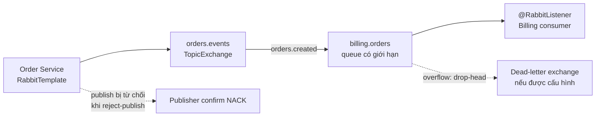
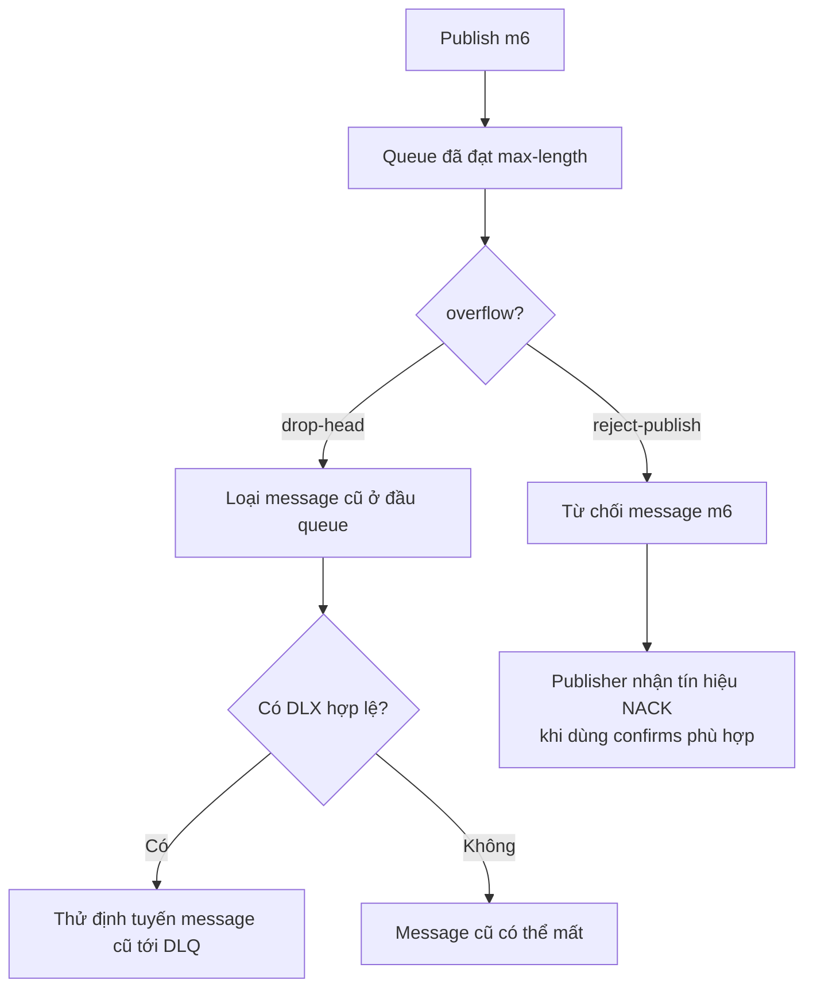
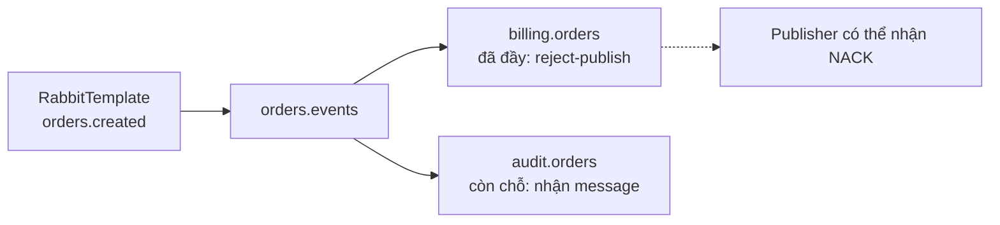
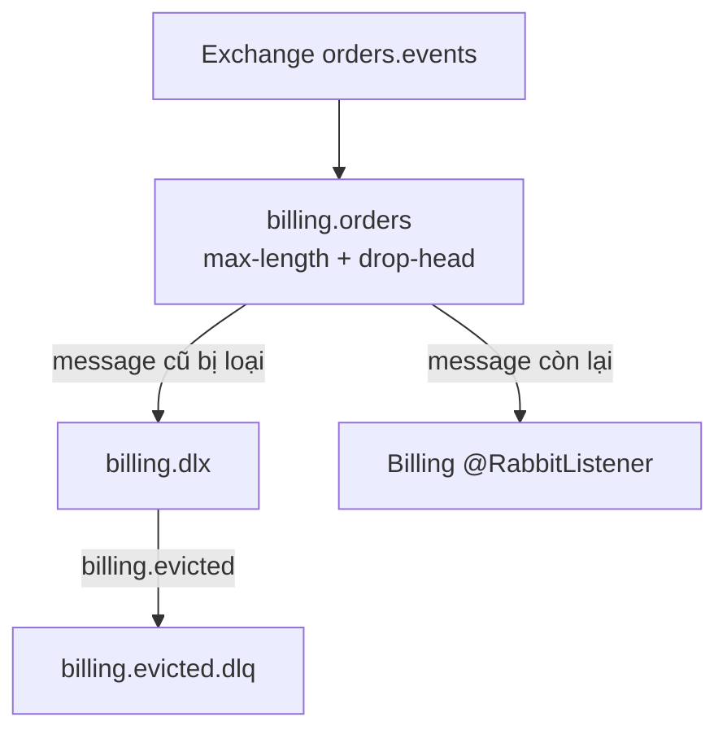

# Giới hạn số lượng thông điệp và tổng kích thước queue

## 1. Mục tiêu và tình huống thực tế

Trong hệ thống sử dụng **RabbitMQ và Spring AMQP**, producer có thể phát sinh message nhanh hơn tốc độ consumer xử lý. Chẳng hạn `Order Service` phát hàng nghìn sự kiện `orders.created` mỗi phút qua `RabbitTemplate`, nhưng `Billing Service` đang chậm vì database hoặc API thanh toán. Queue `billing.orders` sẽ tích tụ message, chiếm bộ nhớ, dung lượng đĩa và làm tăng độ trễ xử lý.

RabbitMQ cung cấp các **giới hạn độ dài queue** để kiểm soát số message chờ và tổng kích thước body của chúng:

- **`max-length`**: giới hạn theo **số lượng message** đang chờ trong queue.
- **`max-length-bytes`**: giới hạn theo **tổng số byte của body message** đang chờ.
- **`overflow`**: quyết định broker xử lý thế nào khi queue đạt giới hạn, chẳng hạn loại message cũ hoặc từ chối message mới.

Bài này thuộc chương **Chính sách hàng đợi** của module **SPRING_AMQP**. Nội dung nối tiếp mô hình exchange, queue, binding, `RabbitTemplate` và `@RabbitListener`; các phần về publisher confirm, retry, dead-letter, transaction và quan sát hệ thống được đặt trong bối cảnh một queue có giới hạn.

Sau bài học, bạn có thể:

1. Giải thích `max-length`, `max-length-bytes` và cách tính message `ready` so với `unacknowledged`.
2. Chọn hành vi `drop-head` hoặc `reject-publish` theo yêu cầu mất dữ liệu và khả năng phản hồi của producer.
3. Cấu hình giới hạn bằng **RabbitMQ policy** hoặc **queue x-arguments** trong Spring AMQP.
4. Hiểu tương tác giữa giới hạn queue, publisher confirms, consumer acknowledgements và dead-letter exchange (DLX).
5. Đọc các chỉ số queue để phát hiện backlog, tràn queue và hiện tượng message bị loại hoặc publish bị từ chối.
6. Ước tính giới hạn hợp lý và kiểm thử hành vi khi consumer bị chậm hoặc ngừng hoạt động.

## 2. Giới hạn queue nằm ở đâu trong chu trình truyền message?

Message được publisher gửi đến exchange, rồi định tuyến qua binding đến queue. Queue phân phối message cho consumer, thường theo cơ chế `basic.consume`. Trong Spring AMQP, `RabbitTemplate` thực hiện publish và listener container chạy các phương thức `@RabbitListener`.



Các giới hạn trên áp dụng cho **queue**, không áp dụng trực tiếp cho toàn exchange:

- Một exchange có thể route cùng message đến nhiều queue. Mỗi queue có policy giới hạn độc lập.
- Một queue có thể nhận message từ nhiều exchange và nhiều producer. Tất cả góp vào backlog của cùng queue.
- Một exchange không tìm được queue phù hợp là tình huống **unroutable**; xử lý bằng publisher returns hoặc alternate exchange, **khác** tình huống queue đã route được nhưng đạt giới hạn.
- Message đã vào queue rồi nhưng consumer xử lý lỗi có thể được requeue hoặc dead-letter. Đó là vấn đề **acknowledgement/retry**, không phải luôn là overflow.

### 2.1. Ready và unacknowledged không giống nhau

Các message trong queue thường được quan sát theo hai nhóm:

| Trạng thái | Ý nghĩa | Liên hệ với giới hạn độ dài |
| --- | --- | --- |
| **Ready** (`messages_ready`) | Message đang chờ được giao cho consumer | Được tính vào giới hạn số lượng và kích thước queue |
| **Unacknowledged** (`messages_unacknowledged`) | Message đã giao cho consumer nhưng broker đang chờ ack/nack | **Không tính** vào các giới hạn độ dài queue thông thường |
| **Total** (`messages`) | Tổng ready và unacknowledged trong phép đo quản trị thông dụng | Có thể lớn hơn `max-length` vì còn message đang xử lý |

Ví dụ: queue có `max-length = 1_000`, đang có 900 message ready và 250 message unacknowledged. Tổng quan sát được có thể là **1.150 message**, dù giới hạn configured chỉ là 1.000. Đây không nhất thiết là broker bỏ qua giới hạn: giới hạn nhắm vào các message **sẵn sàng trong queue**, không phải mọi message đang được consumer giữ.

Nếu connection của consumer mất, các delivery chưa ack có thể quay lại trạng thái ready; vì vậy hãy kiểm tra backlog sau reconnect và thiết kế consumer xử lý trùng.

> **Điểm cần nhớ:** `max-length` không phải giới hạn số request đang xử lý đồng thời. Muốn giới hạn message đang in-flight, cần xem thêm `prefetch`, listener concurrency và công suất downstream.

## 3. Hai giới hạn cơ bản: số lượng và tổng byte

### 3.1. `max-length`: giới hạn số message chờ

`max-length` là giá trị số nguyên biểu thị số message **ready** mà queue được thiết kế giữ ở một thời điểm theo policy/arguments.

Giả sử `billing.orders` có giới hạn 5 message và không có consumer:

```text
Queue: [m1][m2][m3][m4][m5]    (đạt max-length = 5)
Publish m6:
  - drop-head      -> loại m1, giữ [m2][m3][m4][m5][m6]
  - reject-publish -> không nhận m6 vào queue, giữ [m1]...[m5]
```

Ví dụ trên mô tả hành vi ở mức logic với các message có cùng ưu tiên và không có tương tác đồng thời. Trong hệ thống thực, thứ tự giao message còn chịu ảnh hưởng của loại queue, priority, requeue, nhiều consumer và các cơ chế khác.

Ưu điểm: dễ liên hệ với số giao dịch đang chờ. Hạn chế: **không kiểm soát được kích thước** nếu message có body khác nhau nhiều (ví dụ 1 KB so với 1 MB).

### 3.2. `max-length-bytes`: giới hạn tổng kích thước body

`max-length-bytes` giới hạn **tổng số byte của body các message ready** trong queue. Đây không phải phép đo chính xác cho toàn bộ dung lượng RAM/đĩa queue sử dụng: metadata, index, giao thức, lưu trữ và bản sao replication có chi phí riêng.

Ví dụ queue có ngưỡng **10 MiB**:

- 2.000 message × 2 KiB/body ≈ 3,91 MiB; chưa chạm giới hạn byte.
- 400 message × 32 KiB/body = 12,5 MiB; vượt giới hạn byte dù số message nhỏ.
- Nếu có cả `max-length = 10_000` và `max-length-bytes = 10 MiB`, **ngưỡng nào bị chạm trước sẽ kích hoạt hành vi overflow tương ứng**.

Không nên hiểu `max-length-bytes` là quota cứng ngăn mọi byte trên ổ đĩa vượt một con số tuyệt đối. Quota vật lý còn phụ thuộc dữ liệu nội bộ, loại queue, replication, lưu trữ của broker và đặc điểm xử lý đồng thời. Các message lớn hơn ngưỡng hoặc việc publish đồng thời cần được thử trên phiên bản broker và loại queue thực tế.

### 3.3. So sánh và chọn ngưỡng

| Thuộc tính | `max-length` | `max-length-bytes` |
| --- | --- | --- |
| Đơn vị | Số message | Byte body message |
| Trả lời câu hỏi | Đang chờ bao nhiêu sự kiện? | Payload đang chờ nặng khoảng bao nhiêu? |
| Điểm mạnh | Dễ tính backlog theo lưu lượng/latency | Ngăn payload lớn lấn át nhiều payload nhỏ |
| Điểm yếu | Một message lớn cũng chỉ tính là một | Không trực tiếp phản ánh số công việc nghiệp vụ |
| Khuyến nghị | Cân nhắc cùng tốc độ consumer | Cân nhắc cùng body size thực tế (trung bình, P95/P99) |

Với payload có kích thước biến động, nên dùng **cả hai ngưỡng** và kiểm tra tác động của ngưỡng chạm trước. Con số cần dựa trên SLO và thử tải, không lấy một mức mặc định chung cho mọi queue.

## 4. Khi đầy queue: overflow quyết định điều gì?

Giới hạn chỉ có ý nghĩa khi hiểu broker xử lý message mới ra sao. RabbitMQ có các lựa chọn overflow phổ biến sau (khả năng cụ thể tùy loại queue và phiên bản broker):

| Chế độ | Khi queue đạt ngưỡng | Ứng dụng phù hợp | Điều cần chú ý |
| --- | --- | --- | --- |
| **`drop-head`** (thường là mặc định) | Loại các message cũ ở đầu queue để nhường chỗ cho message mới | Telemetry/trạng thái mới nhất quan trọng hơn lịch sử; có khả năng chấp nhận mất message cũ | Nếu không có DLX thích hợp, message bị loại có thể mất; publisher của message mới không tự nhận NACK chỉ vì message cũ bị loại |
| **`reject-publish`** | Từ chối publish mới vào queue khi đạt giới hạn; với publisher confirms, broker phát tín hiệu NACK theo hành vi hỗ trợ | Nghiệp vụ cần giữ message đã xếp hàng; publisher có thể tạm dừng, backoff hoặc lưu ở outbox | Producer phải xử lý NACK và chặn retry vô hạn; routing tới nhiều queue có thể tạo kết quả khác nhau |
| **`reject-publish-dlx`** (khi broker/loại queue hỗ trợ) | Biến thể từ chối publish và xử lý message bị từ chối theo DLX | Trường hợp yêu cầu thu gom message bị từ chối nếu có hỗ trợ | Kiểm tra phiên bản, loại queue, cách publisher được thông báo và dead-letter semantics trước khi dùng |

**Không giả định mọi loại queue đều hỗ trợ mọi chế độ.** Classic queue và quorum queue có những khác biệt về xử lý overflow, replication và dead-letter. Kiểm tra tài liệu phiên bản RabbitMQ đang chạy, nhất là với `reject-publish-dlx` hoặc dead-lettering cần bảo đảm đặc biệt.

### 4.1. `drop-head` có phải tự động lưu vào DLQ không?

Không. Với `drop-head`, các message bị loại do giới hạn queue **có thể được dead-letter** nếu queue có dead-letter exchange phù hợp và broker xử lý điều kiện đó. Nếu không cấu hình DLX và đường binding đến queue nhận, các message bị loại có nguy cơ mất mà ứng dụng không khôi phục được.



Việc có DLX chưa tự đảm bảo message đến DLQ: phải có **exchange/binding/queue phù hợp** và xem chính sách dead-letter, quyền truy cập, loại queue cùng trạng thái broker. Đặc biệt với độ tin cậy cao, cần xem cơ chế dead-lettering và khả năng mất dữ liệu khi broker gặp lỗi.

### 4.2. `reject-publish` không đồng nghĩa tự retry

Khi broker từ chối message do queue đầy:

1. Publisher cần **phát hiện** sự từ chối, thường qua publisher confirm NACK.
2. Ứng dụng phải quyết định giữ ở outbox, retry có backoff, điều tiết upstream hoặc báo lỗi nghiệp vụ.
3. Retry tức thì liên tục vào cùng queue đang đầy sẽ tăng tải mà chưa giải quyết được nguyên nhân.
4. Khi một publish được route đến nhiều queue, **một queue có thể từ chối trong khi queue khác vẫn nhận**; ứng dụng có thể thấy NACK nhưng retry cùng message có khả năng gây duplicate ở những queue đã nhận.

Vì vậy, cần event ID và idempotency ở consumer khi thiết kế đường retry. Không diễn giải một NACK duy nhất thành bằng chứng chắc chắn rằng mọi queue đích đều chưa nhận message.

### 4.3. Không nhầm với TTL, DLX và alternate exchange

| Khả năng | Kích hoạt ở đâu? | Tác dụng chính |
| --- | --- | --- |
| `max-length`, `max-length-bytes` | Queue nhận thêm message, ngưỡng bị chạm | Giới hạn backlog ready |
| `message-ttl` | Message chờ quá thời hạn | Làm message hết hạn; có thể dead-letter |
| DLX | Message bị dead-letter từ queue vì reject/nack không requeue, TTL, giới hạn độ dài và các điều kiện hỗ trợ khác | Chuyển message bị loại theo cơ chế dead-letter |
| Alternate exchange | Exchange **không route được message đến bất kỳ queue nào** | Tìm đường định tuyến dự phòng cho message unroutable |
| Consumer prefetch | Broker phân phối message chưa được ack tới consumer | Giới hạn số message đang in-flight cho consumer |

Nếu một queue đã nhận message rồi nhưng không có consumer online, message vẫn ở queue và chịu chính sách giới hạn của queue. **Alternate exchange không được kích hoạt chỉ vì queue đầy, consumer offline hoặc listener chậm** nếu primary exchange đã route được message đến queue đó.

## 5. Cấu hình giới hạn bằng RabbitMQ policy

**RabbitMQ policy** là cách thường được ưu tiên để quản lý và điều chỉnh các giới hạn queue trong vận hành. Policy áp dụng theo pattern tên queue trên một vhost; bạn có thể thay ngưỡng mà không cần sửa khai báo queue trong source code và redeploy dịch vụ.

### 5.1. Policy giới hạn số lượng, kích thước và chế độ overflow

Ví dụ thiết lập cho queue tên chính xác `billing.orders` trong vhost `/`:

```bash
rabbitmqctl set_policy -p / --apply-to queues BILLING_QUEUE_LIMIT "^billing[.]orders$" '{"max-length":10000,"max-length-bytes":20971520,"overflow":"reject-publish"}'
```

Ý nghĩa:

- `BILLING_QUEUE_LIMIT` là tên policy.
- `^billing[.]orders$` là regex chỉ khớp queue `billing.orders`. Dấu chấm được viết `[.]` để nó là dấu chấm literal trong regex.
- `max-length: 10000` giới hạn 10.000 message ready.
- `max-length-bytes: 20971520` tương ứng 20 MiB body message.
- `overflow: reject-publish` chọn từ chối publish mới khi chạm ngưỡng thay vì loại message cũ.
- `--apply-to queues` và `-p /` xác định **loại tài nguyên và vhost** chính sách áp dụng.

**Chọn một nguồn cấu hình rõ ràng** cho các ngưỡng. Khi một giá trị vừa được khai báo trong queue x-arguments vừa được quy định bằng regular policy, client-provided argument thường có ưu tiên cao hơn policy cho cùng khóa; operator policy có quy tắc ràng buộc riêng, đặc biệt với giá trị số. Đừng giả định thay policy sẽ luôn ghi đè được queue đang có x-arguments.

### 5.2. Policy dùng `drop-head`

Ví dụ nếu queue lưu dữ liệu cập nhật trạng thái mà message mới quan trọng hơn message cũ:

```bash
rabbitmqctl set_policy -p / --apply-to queues STATUS_QUEUE_LIMIT "^devices[.]latest$" '{"max-length":5000,"max-length-bytes":10485760,"overflow":"drop-head"}'
```

Policy này mang **tính thay thế lựa chọn nghiệp vụ**, không phải mặc định phù hợp cho thanh toán/đơn hàng. Với `drop-head`, bạn có thể giữ thông điệp mới nhưng mất thông điệp cũ; cần đánh giá khả năng tái tạo dữ liệu và DLX.

### 5.3. Quan sát, sửa, gỡ policy

```bash
# Xem các policy đang khai báo trong vhost
rabbitmqctl -p / list_policies

# Kiểm tra queue và các message đang chờ
rabbitmqctl -p / list_queues name messages_ready messages_unacknowledged consumers

# Gỡ policy nếu được phép trong môi trường thử nghiệm
rabbitmqctl -p / clear_policy BILLING_QUEUE_LIMIT
```

Quản trị production thường nên thao tác qua công cụ quản lý cấu hình, IaC hoặc quy trình thay đổi có kiểm soát. CLI có thể khác tùy RabbitMQ release; dùng `rabbitmqctl help set_policy`, `help list_policies` và `help list_queues` để đối chiếu.

### 5.4. Thay policy khi queue đã có dữ liệu

Thay policy có thể làm thay đổi giới hạn của queue đang chạy. Ví dụ giảm `max-length` từ 10.000 xuống 2.000 trong khi queue đang có 8.000 message ready có thể khiến broker áp dụng hành vi overflow lên backlog. Nếu `drop-head`, hệ quả có thể là **loại các message cũ đang lưu**.

Trước khi thay ngưỡng:

1. Đọc queue depth, tốc độ vào/ra, các consumer và mức sử dụng broker hiện tại.
2. Xác định overflow mode, policy có hiệu lực và DLX có thực sự route được hay không.
3. Ước tính tác động tới message đang tồn và producer đang publish.
4. Kiểm thử trên môi trường gần giống production, rồi áp dụng theo quy trình thay đổi.
5. Quan sát publisher NACK, DLQ, queue depth và consumer latency ngay sau thay đổi.

## 6. Cấu hình bằng queue x-arguments trong Spring AMQP

Nếu topology được quản lý bởi ứng dụng và muốn đặt giới hạn **ngay từ lúc khai báo queue**, dùng `QueueBuilder` với các key x-arguments tương ứng:

| Broker policy key | Queue declaration argument |
| --- | --- |
| `max-length` | `x-max-length` |
| `max-length-bytes` | `x-max-length-bytes` |
| `overflow` | `x-overflow` |

Ví dụ:

```java
import org.springframework.amqp.core.Queue;
import org.springframework.amqp.core.QueueBuilder;
import org.springframework.context.annotation.Bean;
import org.springframework.context.annotation.Configuration;

@Configuration
public class BillingQueueArgumentsConfig {

    @Bean
    Queue billingOrders() {
        return QueueBuilder.durable("billing.orders")
                .withArgument("x-max-length", 10_000L)
                .withArgument("x-max-length-bytes", 20_971_520L)
                .withArgument("x-overflow", "reject-publish")
                .build();
    }
}
```

Các arguments được đưa vào khi client gửi `queue.declare`; broker giữ các thuộc tính queue cùng tài nguyên đã tạo. Với một queue đã tồn tại, việc khai báo lại cùng tên nhưng khác những thuộc tính/arguments có thể tạo lỗi `PRECONDITION_FAILED` (thường mã `406`), làm đóng channel khai báo. **Không xóa queue có dữ liệu chỉ để né lỗi.** Hãy đánh giá migration sang queue mới hoặc chuyển phần cấu hình có thể thay đổi sang policy.

Mẫu code `BillingQueueArgumentsConfig` là **phương án thay thế** cho cách dùng policy `BILLING_QUEUE_LIMIT`; không nên bật đồng thời hai nguồn trái nhau. Ngoài ra, nếu đã có `@Bean Queue` khác cùng tên trong ứng dụng, tránh tạo thêm bean khai báo mâu thuẫn.

### Khi nào nên dùng policy, khi nào dùng x-arguments?

| Yếu tố | RabbitMQ policy | Queue x-arguments |
| --- | --- | --- |
| Nguồn quản lý | Hạ tầng/vhost và quy trình vận hành | Cấu hình ứng dụng Spring AMQP |
| Thay đổi trong vận hành | Dễ thay qua policy mà không sửa source | Có thể cần thay code, xử lý redeclare/migration |
| Phạm vi áp dụng | Theo tên/regex, có thể ảnh hưởng nhiều queue | Theo queue được khai báo |
| Rủi ro | Pattern match sai hoặc ưu tiên policy không như dự kiến | Khó sửa thuộc tính trên queue đã tồn tại; lỗi mismatch |
| Dùng tốt khi | Cần tinh chỉnh backlog, phối hợp SRE/DevOps | Topology cố định, chủ sở hữu ứng dụng kiểm soát toàn bộ |

Thông thường **policy thích hợp hơn cho các ngưỡng vận hành** có thể phải đổi theo tải. Queue declaration nên tập trung vào cấu trúc ổn định như tên, durability, loại queue và binding. Dù chọn cách nào, cần thống nhất với team vận hành và kiểm tra cấu hình hiệu lực trên broker.

## 7. Spring AMQP: topology đầy đủ và consumer

Ví dụ sau dùng **policy** để đặt giới hạn; code Spring AMQP chỉ khai báo topology và xử lý message. Đây là cách giữ bài học tách biệt giữa cấu hình topology và cấu hình ngưỡng vận hành.

### 7.1. Dependency và Spring Boot configuration

```xml
<!-- Để Spring Boot BOM quản lý phiên bản tương thích -->
<dependency>
    <groupId>org.springframework.boot</groupId>
    <artifactId>spring-boot-starter-amqp</artifactId>
</dependency>
```

```yaml
spring:
  rabbitmq:
    host: ${RABBITMQ_HOST:localhost}
    port: ${RABBITMQ_PORT:5672}
    username: ${RABBITMQ_USERNAME:guest}
    password: ${RABBITMQ_PASSWORD:guest}
    virtual-host: ${RABBITMQ_VHOST:/}
    publisher-confirm-type: correlated
    publisher-returns: true
    template:
      mandatory: true
    listener:
      simple:
        acknowledge-mode: auto
        concurrency: 2
        max-concurrency: 4
        prefetch: 20
```

Đây là các property của **Spring Boot/Spring Rabbit cho AMQP 0-9-1**, không phải tên của RabbitMQ queue policy. `max-length` và `max-length-bytes` được thiết lập bằng policy phía broker như mục 5, hoặc x-arguments trong code như mục 6.

`acknowledge-mode: auto` có nghĩa **Spring listener container tự ack sau khi xử lý thành công**. Nó không phải chế độ `autoAck=true` của RabbitMQ Java client. `prefetch: 20` giới hạn số delivery chưa ack theo phạm vi cấu hình container/consumer; không biến queue limit 10.000 thành 20.

### 7.2. Khai báo exchange, queue và binding

```java
package example.messaging;

import org.springframework.amqp.core.Binding;
import org.springframework.amqp.core.BindingBuilder;
import org.springframework.amqp.core.Queue;
import org.springframework.amqp.core.QueueBuilder;
import org.springframework.amqp.core.TopicExchange;
import org.springframework.context.annotation.Bean;
import org.springframework.context.annotation.Configuration;

@Configuration
public class OrderMessagingTopology {
    public static final String EXCHANGE = "orders.events";
    public static final String QUEUE = "billing.orders";
    public static final String CREATED_KEY = "orders.created";

    @Bean
    public TopicExchange orderEventsExchange() {
        return new TopicExchange(EXCHANGE, true, false);
    }

    @Bean
    public Queue billingOrders() {
        // Các giới hạn backlog được đặt bằng RabbitMQ policy.
        return QueueBuilder.durable(QUEUE).build();
    }

    @Bean
    public Binding billingOrdersBinding(
            Queue billingOrders, TopicExchange orderEventsExchange) {
        return BindingBuilder.bind(billingOrders)
                .to(orderEventsExchange)
                .with(CREATED_KEY);
    }
}
```

Nếu `RabbitAdmin` tự khai báo được bật và người dùng RabbitMQ có đủ quyền, Spring có thể gửi các lệnh tạo exchange/queue/binding đến broker khi connection phù hợp được mở. Nhưng việc khai báo queue thành công **không chứng minh policy đã match đúng queue**: phải kiểm tra vhost, pattern và effective arguments/policy trên broker.

### 7.3. Publisher và listener

```java
package example.messaging;

import org.springframework.amqp.rabbit.core.RabbitTemplate;
import org.springframework.stereotype.Service;

@Service
public class OrderEventPublisher {
    private final RabbitTemplate rabbitTemplate;

    public OrderEventPublisher(RabbitTemplate rabbitTemplate) {
        this.rabbitTemplate = rabbitTemplate;
    }

    public void publishCreated(String eventId) {
        rabbitTemplate.convertAndSend(
                OrderMessagingTopology.EXCHANGE,
                OrderMessagingTopology.CREATED_KEY,
                eventId);
    }
}
```

```java
package example.messaging;

import org.springframework.amqp.rabbit.annotation.RabbitListener;
import org.springframework.stereotype.Component;

@Component
public class BillingConsumer {

    @RabbitListener(queues = OrderMessagingTopology.QUEUE)
    public void onCreated(String eventId) {
        // Ví dụ nghiệp vụ cần idempotency theo eventId.
        System.out.println("Handle event: " + eventId);
    }
}
```

Khi listener xử lý nhanh, backlog thường nhỏ. Khi listener chậm hoặc ngừng, `messages_ready` có thể tăng dần; đến ngưỡng policy, broker xử lý theo `overflow`.

**Kết nối giữa topology và policy:** producer gửi tới **exchange**; limit áp dụng cho queue mà exchange route tới. Nếu routing key không khớp binding thì message chưa vào queue này, và queue limit **không phải** nguyên nhân message không đến đích.

## 8. Publisher confirms: nhận biết `reject-publish` từ Spring

Nếu policy là `reject-publish`, producer cần phát hiện message bị broker từ chối do queue đầy. Spring AMQP hỗ trợ publisher confirms; có thể đăng ký callback trên `RabbitTemplate` để quan sát ACK/NACK.

```java
package example.messaging;

import org.springframework.amqp.rabbit.core.RabbitTemplate;
import org.springframework.stereotype.Component;

@Component
public class PublishConfirmObserver {

    public PublishConfirmObserver(RabbitTemplate template) {
        template.setConfirmCallback((correlationData, ack, cause) -> {
            if (ack) {
                // Broker xác nhận publish theo semantics của confirms.
                return;
            }
            // Đếm lỗi publish, log correlation ID và phân loại nguyên nhân.
            System.err.println("Publish was nacked: " + cause);
        });

        template.setReturnsCallback(returned -> {
            // Dùng khi message unroutable và mandatory được áp dụng.
            System.err.println("Unroutable routingKey="
                    + returned.getRoutingKey());
        });
    }
}
```

Trong môi trường thực tế, dùng logger/metrics, correlation data và cơ chế xử lý kết quả publish rõ ràng. `RabbitTemplate` chỉ có một callback của mỗi loại trên một instance; không để nhiều component cùng gán đè nhau. Với yêu cầu đảm bảo dữ liệu không mất, có thể lưu sự kiện vào **transactional outbox** trước khi publish và đánh dấu trạng thái sau khi xác nhận.

Phân biệt các tín hiệu:

| Tín hiệu | Nó giúp biết điều gì? | Nó **không** chứng minh điều gì? |
| --- | --- | --- |
| Publisher confirm ACK | Broker đã xử lý publish theo cơ chế confirms | Consumer đã xử lý xong hoặc mọi queue đích đều giữ message mãi |
| Publisher confirm NACK | Broker không thể xác nhận publish; khi dùng reject-publish có thể là message bị từ chối do overflow | Mọi queue trong trường hợp multi-route đều chưa nhận message |
| Publisher return với mandatory | Message không được route tới queue theo cơ chế return | Queue đang đầy là nguyên nhân, hoặc consumer đã xử lý |
| Consumer ACK | Delivery được xác nhận tại phía nhận theo ack mode | Producer tự động nhận được thông báo giao dịch database thành công |

**Đừng dùng publisher returns thay thế publisher confirms để theo dõi queue đầy.** Một message có thể **route hợp lệ** đến queue nhưng bị từ chối do `reject-publish`; đó không phải cùng loại lỗi với routing key không khớp binding.

### 8.1. Nếu publish đi đến nhiều queue thì sao?

Ví dụ `orders.events` là topic exchange và hai queue cùng bind `orders.created`:



Khi queue `billing.orders` từ chối nhưng `audit.orders` đã nhận, việc retry toàn bộ publish có thể tạo **message trùng ở audit.orders**. Chính sách retry phải tính đến khả năng một lần publish có kết quả khác nhau ở nhiều queue. Consumer idempotent và event ID ổn định giúp giảm tác hại.

### 8.2. Vì sao không chỉ bật retry vô hạn?

Retry ở client không làm consumer nhanh hơn hoặc tạo thêm dung lượng broker. Nếu queue vẫn đầy, một vòng retry nhanh sẽ tạo thêm pressure lên connection/channel và broker. Nên áp dụng **exponential backoff, jitter, retry budget, circuit breaker/backpressure** phù hợp, kết hợp giám sát và khả năng lưu message chờ ngoài broker nếu nghiệp vụ yêu cầu.

## 9. Dead-letter và queue limit: mất dữ liệu hay chuyển hướng?

Trong bài học SPRING_AMQP, dead-letter là một cơ chế bổ sung quan trọng cho **`drop-head`** khi bạn muốn theo dõi những message cũ bị loại.

### 9.1. Sơ đồ DLX cho message bị loại



Để có đường đi đó, cần:

1. Khai báo DLX, DLQ và binding đích.
2. Cấu hình DLX/routing key cho **queue nguồn** qua policy hoặc x-arguments.
3. Chọn `overflow: drop-head` cho queue nguồn nếu yêu cầu gửi message cũ sang DLX khi bị loại.
4. Xem cơ chế bảo đảm dead-letter theo loại queue/version; không giả định mọi sự cố broker đều giữ được message.
5. Theo dõi DLQ tăng và quy trình xử lý/redrive, tránh giữ message vô hạn.

### 9.2. Ví dụ Spring AMQP khai báo queue nguồn có DLX

Đây là **phương án minh họa khác** với `BillingQueueArgumentsConfig` của mục 6; không bật hai bean cùng tên queue với cấu hình mâu thuẫn:

```java
@Configuration
class LimitedQueueWithDlxConfig {

    @Bean
    Queue limitedQueue() {
        return QueueBuilder.durable("billing.orders")
                .deadLetterExchange("billing.dlx")
                .deadLetterRoutingKey("billing.evicted")
                .build();
    }

    @Bean
    DirectExchange deadLetterExchange() {
        return new DirectExchange("billing.dlx", true, false);
    }

    @Bean
    Queue evictedMessages() {
        return QueueBuilder.durable("billing.evicted.dlq").build();
    }

    @Bean
    Binding evictedMessagesBinding(
            Queue evictedMessages, DirectExchange deadLetterExchange) {
        return BindingBuilder.bind(evictedMessages)
                .to(deadLetterExchange)
                .with("billing.evicted");
    }
}
```

Với ví dụ này, cấu hình giới hạn/overflow có thể đặt bằng policy:

```bash
rabbitmqctl set_policy -p / --apply-to queues BILLING_DROP_OLD "^billing[.]orders$" '{"max-length":10000,"max-length-bytes":20971520,"overflow":"drop-head"}'
```

Để snippet Java tự biên dịch, các import được dùng là `org.springframework.context.annotation.*`, `org.springframework.amqp.core.Queue`, `QueueBuilder`, `DirectExchange`, `Binding` và `BindingBuilder` (trong một file thật, khai báo đủ import theo dự án). Nếu thay cách cấu hình queue `billing.orders` của mục 7, giữ một nguồn bean/cấu hình duy nhất.

**Lưu ý:** Cơ chế DLX cũng nhận các message do consumer reject/nack không requeue, TTL và một số trường hợp khác. Nếu cần phân biệt message bị loại vì overflow với message lỗi xử lý, đọc metadata dead-letter của broker (khi có), thiết kế riêng queue/chính sách hoặc gắn event metadata rõ ràng.

### 9.3. Với `reject-publish` có nên kỳ vọng message đến DLQ?

Không tự động. Trong `reject-publish` thông thường, **message mới bị từ chối ở bước enqueue**, không phải message cũ bị lấy ra khỏi queue để dead-letter như `drop-head`. Nếu cần lưu message mới bị từ chối, producer phải xử lý kết quả publish hoặc lựa chọn cơ chế hỗ trợ thích hợp, chẳng hạn một khả năng `reject-publish-dlx` trên broker/loại queue có hỗ trợ và đã thử nghiệm.

Do đó, **DLX không thay thế việc xử lý NACK** ở publisher. Trong hệ thống thanh toán, outbox và retry có kiểm soát thường quan trọng hơn việc dựa hoàn toàn vào DLQ cho message chưa được nhận.

## 10. Ước lượng giới hạn theo tải nghiệp vụ

Đặt ngưỡng quá thấp khiến message bị loại/từ chối thường xuyên; quá cao có thể che giấu consumer bị chậm và dồn áp lực lưu trữ lên broker.

### 10.1. Từ lưu lượng, thời gian tồn và body size

Có thể dùng các đại lượng:

- `R`: tốc độ message đến queue, đơn vị message/giây.
- `C`: tốc độ xử lý thực tế, message/giây.
- `T`: thời gian cần chịu được khi consumer ngừng hoặc bị chậm, giây.
- `S`: kích thước body trung bình hoặc percentile phù hợp, byte/message.

Khi consumer tạm dừng hoàn toàn, backlog ước tính là **N ≈ R × T** message; tổng byte body ước tính là **B ≈ N × S**.

Khi consumer vẫn hoạt động nhưng chậm hơn producer, backlog tăng xấp xỉ **N ≈ max(R − C, 0) × T** message.

Ví dụ queue nhận trung bình **200 message/giây**; cần chịu đựng **60 giây** consumer tạm dừng; mỗi body khoảng **2 KiB**:

- Backlog ước tính: 200 × 60 = **12.000 message**.
- Tổng body xấp xỉ: 12.000 × 2 KiB = **24.000 KiB** (khoảng 23,4 MiB).
- Một giả định cấu hình ban đầu có thể là `max-length = 15000` và `max-length-bytes = 33554432` (32 MiB), **nếu** broker còn đủ tài nguyên và nhóm đã lựa chọn được overflow phù hợp.

Con số trên chỉ mang tính minh họa; tải thực tế cần xem đỉnh lưu lượng, kích thước P95/P99, message headers, replication, độ trễ storage, thời gian cần recover và giới hạn tài nguyên toàn broker.

### 10.2. Kiểm tra quyết định với SLO

| Câu hỏi | Nếu câu trả lời là “có” |
| --- | --- |
| Mỗi message cần được xử lý và không được âm thầm mất? | Ưu tiên `reject-publish` + producer quan sát confirms + outbox/backpressure |
| Message mới thay thế hoàn toàn thông tin cũ? | Cân nhắc `drop-head`, nhưng phải xác minh điều kiện nghiệp vụ thật |
| Payload kích thước biến động mạnh? | Dùng thêm `max-length-bytes` và kiểm tra percentile body size |
| Có nhiều queue cùng bind một event? | Thiết kế idempotency vì retry publish có thể gây duplicate ở queue khác |
| Có thể chịu consumer gián đoạn hàng phút/giờ? | Tính ngưỡng theo tải đỉnh, kiểm tra storage/replication và phương án scale consumer |
| Fallback/DLQ cũng có thể đầy? | Đặt chính sách giám sát, retention và xử lý cho cả các queue phụ |
| Broker có quorum queues? | Kiểm tra đặc tính quota, replication, overflow và dead-lettering đúng phiên bản |

Không coi queue limit là biện pháp kiểm soát tải duy nhất. Cần kết hợp quản lý producer rate, consumer concurrency, prefetch, độ trễ downstream và kế hoạch mở rộng.

## 11. Quan sát và chẩn đoán khi queue đầy

### 11.1. Chỉ số nên theo dõi

| Metric / dấu hiệu | Ý nghĩa |
| --- | --- |
| `messages_ready` | Message đang chờ xử lý; số quan trọng để đánh giá ngưỡng `max-length` |
| `message_bytes_ready` (nếu môi trường cung cấp) | Tổng body/message byte được báo cho nhóm ready; đối chiếu ý nghĩa metric theo broker |
| `messages_unacknowledged` | Delivery đã trao cho consumer nhưng chưa ack; tăng cao có thể do xử lý chậm, prefetch lớn hoặc consumer kẹt |
| `messages` | Tổng message được hiển thị, thường gồm ready + unacked |
| Ingress / publish rate | Tốc độ message vào, so với tốc độ consumer xử lý |
| Deliver / ack rate | Tốc độ giao và hoàn thành xử lý |
| Publisher NACK / timeout confirm | Gợi ý publish bị từ chối hoặc lỗi khác; kết hợp broker logs để phân loại |
| Dead-letter queue depth | Theo dõi message bị loại do overflow, TTL, reject và các lý do khác |
| Disk/memory alarm, connections blocked | Broker có thể hạn chế publisher vì thiếu tài nguyên, độc lập với queue max-length |
| Consumer count và backlog age | Xác định consumer ngừng, xử lý chậm hoặc message tồn quá lâu |

Queue có `messages_ready` ổn định thấp không luôn có nghĩa hệ thống khỏe: nếu `messages_unacknowledged` tăng và thời gian xử lý kéo dài, các consumer có thể đang giữ nhiều message mà chưa hoàn thành. Theo dõi cả hai.

### 11.2. Lệnh kiểm tra trên broker thử nghiệm

```bash
# Danh sách queue và backlog trên vhost /
rabbitmqctl -p / list_queues name messages_ready messages_unacknowledged messages consumers

# Các chính sách trong vhost
rabbitmqctl -p / list_policies

# Có thể xem thêm arguments và bytes theo khả năng của phiên bản
rabbitmqctl -p / list_queues name arguments message_bytes_ready
```

Cần quyền phù hợp. Tên cột có thể thay đổi giữa các phiên bản RabbitMQ và loại queue; kiểm tra `rabbitmqctl help list_queues` hoặc dùng RabbitMQ Management UI, HTTP API hay hệ thống metrics được tổ chức triển khai. Quan sát **effective policy/queue arguments** bên cạnh số message.

### 11.3. Tình huống chẩn đoán

**Tình huống A: Ready gần giới hạn, producer bị NACK**

- Xác nhận queue đang dùng `reject-publish`, policy pattern và vhost đúng.
- Kiểm tra consumer hoạt động hay không, ack rate có thấp hơn publish rate không.
- Kiểm tra NACK được ghi kèm event ID; giữ message tại nguồn/outbox và áp dụng backoff có kiểm soát.
- Không lặp lại publish liên tục vào queue còn đầy.

**Tình huống B: Ready ổn định nhưng một số sự kiện cũ biến mất**

- Kiểm tra `drop-head` hoặc message TTL/expiration, queue arguments/policy và DLX.
- Kiểm tra liệu DLQ có nhận message bị loại hay không.
- Đối chiếu tốc độ vào/ra và sự kiện thay policy; không mặc định nguyên nhân là consumer ack.

**Tình huống C: Dashboard hiển thị tổng message lớn hơn `max-length`**

- So sánh `messages_ready` và `messages_unacknowledged`.
- Nhắc rằng queue limit thường tính message ready, không giới hạn trực tiếp in-flight.
- Kiểm tra consumer prefetch, concurrency và tình trạng connection nếu unacked tăng cao.

**Tình huống D: Giảm max-length nhưng message vẫn tích tụ**

- Kiểm tra policy áp dụng đúng vhost và queue pattern không.
- Kiểm tra queue có x-arguments trùng khóa ghi đè regular policy không.
- Xem broker có đang áp dụng giới hạn lên loại queue đang dùng không và có điều kiện concurrent/khác biệt implementation.
- Không xóa queue production để thử nghiệm. Nếu phải đổi thuộc tính không tương thích, lập kế hoạch migration.

## 12. Thực hành: quan sát hai overflow mode

Thực hiện trong RabbitMQ local/test với Spring Boot code ở mục 7. Bài lab cố tình giới hạn nhỏ để quan sát dễ hơn.

### Bước 1: Chuẩn bị queue và policy

Chạy broker thử nghiệm, khởi động Spring Boot, xác nhận `orders.events`, `billing.orders` và binding `orders.created` tồn tại. Tạm dừng listener Billing hoặc cấu hình một ứng dụng publisher riêng để queue không bị tiêu thụ ngay.

Đặt policy `drop-head` với giới hạn 5 message:

```bash
rabbitmqctl set_policy -p / --apply-to queues BILLING_TEST "^billing[.]orders$" '{"max-length":5,"overflow":"drop-head"}'
```

### Bước 2: Publish 8 message có ID rõ ràng

Gọi publisher liên tiếp với `event-01` đến `event-08`, sau đó xem số message ready và nhận message bằng consumer test.

Kỳ vọng ở điều kiện thử nghiệm đơn giản, không consumer cạnh tranh và message không bị loại bởi cơ chế khác: queue giữ **5 message mới hơn** sau khi broker loại các message cũ để nhường chỗ. Nếu có DLX route được, quan sát thêm queue dead-letter.

Đừng diễn giải bài lab này thành cam kết thứ tự tuyệt đối cho mọi cấu hình queue/priority/multi-consumer.

### Bước 3: Đổi sang `reject-publish`

Trong cùng môi trường test, đưa queue về trạng thái rỗng phù hợp, đổi policy:

```bash
rabbitmqctl set_policy -p / --apply-to queues BILLING_TEST "^billing[.]orders$" '{"max-length":5,"overflow":"reject-publish"}'
```

Publish lần lượt 8 message có correlation ID và bật publisher confirms. Quan sát:

- Queue có giới hạn 5 message ready (ở điều kiện bài lab).
- Các message vượt ngưỡng bị từ chối theo cơ chế `reject-publish`.
- Publisher confirm có thể báo NACK cho publish bị từ chối.
- Consumer xử lý xong một phần rồi publisher retry **có backoff** có thể tiếp tục gửi vào queue, nhưng phải tránh duplicate.

### Bước 4: Thử giới hạn byte

Giữ queue test ở trạng thái dễ quan sát; chọn `max-length` đủ lớn và `max-length-bytes` nhỏ (ví dụ 4 KiB) để kích hoạt do **kích thước body**. Gửi message có body nhỏ và message có body lớn, so sánh kết quả theo `drop-head`/`reject-publish`.

Chú ý: giới hạn byte liên quan body và cơ chế thực thi của broker; không đo chỉ bằng số ký tự Java `String.length()` vì mã hóa UTF-8 của chuỗi có thể chiếm nhiều byte hơn số ký tự.

### Bước 5: Thử với consumer in-flight

Cho listener hoạt động chậm hoặc giữ message chưa ack (trong lab), quan sát `messages_ready`, `messages_unacknowledged` và tổng `messages`. Dùng số liệu để giải thích vì sao tổng có thể lớn hơn `max-length`. Sau đó khôi phục listener và xác minh không xuất hiện lỗi xử lý trùng ngoài dự kiến.

### Bước 6: Dọn môi trường lab

Gỡ policy test và khôi phục cấu hình ban đầu:

```bash
rabbitmqctl -p / clear_policy BILLING_TEST
```

Chỉ dùng thao tác thay policy, dừng consumer hoặc loại message trong môi trường do bạn kiểm soát. Trên production, thay ngưỡng và overflow có thể gây ảnh hưởng trực tiếp đến dữ liệu tồn tại trong queue.

## 13. Checklist trước khi áp dụng trên production

- [ ] Đã xác nhận queue thuộc vhost, broker và loại queue nào.
- [ ] Đã biết tốc độ publish, ack, backlog và body size thực tế trong giờ cao điểm.
- [ ] Đã tính `max-length` và `max-length-bytes` theo SLO, có xét thời gian consumer gián đoạn.
- [ ] Đã quyết định **mất message cũ** hay **từ chối publish mới** phù hợp với nghiệp vụ.
- [ ] Đã kiểm tra hành vi overflow hỗ trợ bởi classic/quorum queue và phiên bản broker đang dùng.
- [ ] Đã xác định nguồn cấu hình chính: policy hoặc x-arguments, và kiểm tra precedence.
- [ ] Nếu dùng `drop-head`, đã kiểm tra DLX/binding và có kế hoạch cho message bị loại.
- [ ] Nếu dùng `reject-publish`, producer nhận confirms và có retry/backoff/outbox khi cần.
- [ ] Consumer xử lý idempotent, có thể chịu redelivery và duplicate từ retry publish.
- [ ] Metrics/alert theo dõi `ready`, `unacked`, publisher NACK, DLQ và broker alarms.
- [ ] Có integration test normal load, consumer offline, overflow và reconnect trước rollout.

## 14. Câu hỏi tự đánh giá

1. Queue có `max-length = 1000`, `messages_ready = 900` và `messages_unacknowledged = 250`. Vì sao tổng vẫn có thể là 1.150?
2. Khi body message dao động từ 1 KiB đến 200 KiB, chỉ đặt `max-length` có đủ để kiểm soát áp lực lưu trữ không? Vì sao?
3. Trong `drop-head`, message nào có thể bị loại khi queue đầy? Làm sao để có cơ hội giữ message bị loại ở DLQ?
4. Với `reject-publish`, publisher cần bật gì để quan sát broker từ chối publish? Vì sao `mandatory` và publisher returns không thay thế được?
5. Một message được route tới hai queue: một queue đầy và từ chối, queue kia nhận thành công. Điều gì có thể xảy ra nếu publisher retry toàn bộ message?
6. Vì sao giảm policy `max-length` trên queue đã có dữ liệu cần được đánh giá về nguy cơ mất message?
7. RabbitMQ policy `max-length` và queue argument `x-max-length` đều tồn tại nhưng khác số. Bạn sẽ kiểm tra giá trị nào đang có hiệu lực như thế nào?
8. Nếu hệ thống có nhiều message `unacknowledged` nhưng ít message `ready`, tăng queue limit có giải quyết được consumer xử lý chậm không?
9. Khi business event bắt buộc được xử lý, nên chọn `drop-head` hay `reject-publish`? Những cơ chế bổ sung nào cần có?
10. Hãy thiết kế một bài lab so sánh `max-length` và `max-length-bytes` bằng 10 message có kích thước khác nhau, rồi chỉ ra các metric cần thu thập.

**Ghi nhớ:** `max-length` và `max-length-bytes` là **giới hạn backlog message ready của từng queue**, còn `overflow` quyết định xử lý message khi ngưỡng bị chạm. Chính sách queue giúp bảo vệ broker nhưng không tự bảo đảm dữ liệu nghiệp vụ. Trong Spring AMQP, cần kết hợp topology đúng, publisher confirms, ack, retry/backoff, DLX, idempotency và quan sát queue metrics để xử lý bất đồng bộ đáng tin cậy.
