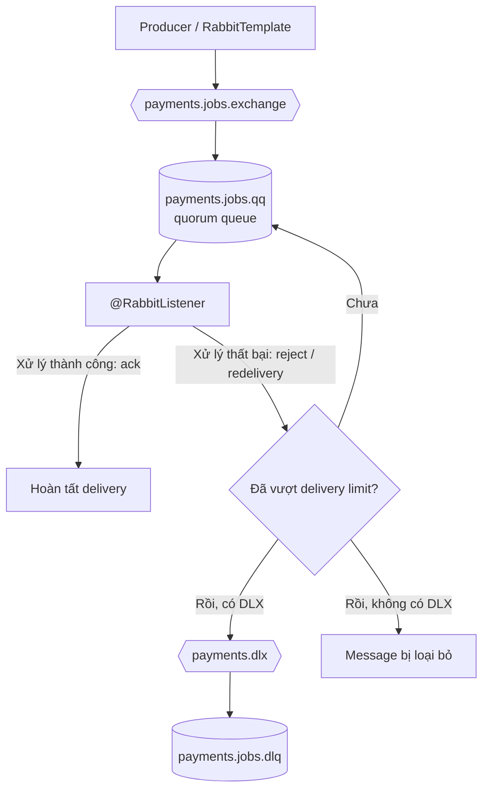

# Delivery limit của quorum queue và xử lý thông điệp gây lỗi

Một consumer RabbitMQ có thể gặp một message mà xử lý bao nhiêu lần cũng thất bại: dữ liệu không hợp lệ, phiên bản schema không tương thích, bản ghi nghiệp vụ đã bị xóa hoặc một lỗi lập trình lặp lại. Nếu listener cứ trả message về queue rồi nhận lại ngay, nó có thể tạo **vòng lặp redelivery** chiếm CPU, tăng tải broker và cản trở những message khác. Message như vậy thường được gọi là **poison message**.

Trong chương **Chính sách hàng đợi** của module **SPRING_AMQP**, bài này giải thích cơ chế **delivery limit của quorum queue** trên RabbitMQ, cách áp dụng chính sách tại broker, đưa message gây lỗi vào dead-letter queue (DLQ), và cách kết hợp với `RabbitTemplate`, `@RabbitListener`, acknowledgement, retry và giám sát. Mục tiêu là xử lý bất đồng bộ đáng tin cậy: lỗi phải được giới hạn, có thể quan sát và có đường khôi phục có kiểm soát.

## 1. Poison message là gì?

Một message trở thành vấn đề khi nó liên tục quay lại queue mà **không được xác nhận xử lý thành công**. Lỗi có thể do chính message hoặc môi trường thực thi.

| Tình huống | Loại lỗi thường gặp | Cách xử lý phù hợp |
| --- | --- | --- |
| Payload thiếu trường bắt buộc, sai schema | Gần như vĩnh viễn với phiên bản consumer hiện tại | Reject không requeue; cách ly vào DLQ để phân tích |
| Trạng thái nghiệp vụ không cho phép thao tác | Có thể vĩnh viễn hoặc cần bù trừ | Ghi nguyên nhân, quyết định loại bỏ/đưa DLQ theo quy tắc |
| HTTP API đối tác trả timeout vài lần | Tạm thời | Retry có giới hạn và **backoff**, sau đó chuyển hướng xử lý lỗi |
| Database tạm ngừng | Tạm thời ở quy mô hệ thống | Giảm tải, chờ khôi phục, tránh tạo vòng lặp requeue tức thời |
| Consumer bị kill trước khi ack | Lỗi tiến trình/kết nối | Broker có thể giao lại; cần idempotency và quan sát redelivery |
| Lỗi code luôn ném exception với một message | Lặp lại đến khi sửa code | Cách ly message, sửa lỗi và **replay có kiểm soát** |

Một lỗi tạm thời không nhất thiết là poison message. Điều quan trọng là **có chiến lược giới hạn và phân loại lỗi**. Nếu mọi exception đều được requeue ngay, một sự cố nhỏ có thể gây tải lớn và khó khắc phục.

### Vì sao quorum queue có delivery limit?

**Quorum queue** là loại queue bền vững và có khả năng replication theo cơ chế Raft khi chạy trên cluster phù hợp. RabbitMQ hỗ trợ *poison message handling* để hạn chế những lần giao thất bại lặp lại: broker theo dõi một bộ đếm của message và áp dụng **delivery limit**.



**Delivery limit là ngưỡng bảo vệ ở broker**, không phải cam kết mọi lỗi ứng dụng đều được retry đúng một số lần rồi chuyển DLQ. Việc bộ đếm tăng phụ thuộc phiên bản RabbitMQ và cách consumer ack/nack/reject; phần dưới phân biệt rõ.

## 2. Cơ chế delivery limit và khác biệt theo phiên bản RabbitMQ

### 2.1. Từ RabbitMQ 4.0: mặc định là 20

Với **quorum queue trong RabbitMQ 4.0 trở lên**, delivery limit mặc định là **20** nếu không có cấu hình override. Trong dòng RabbitMQ 3.x, mặc định trước đây không giới hạn. Khi số lần giao thất bại vượt giới hạn, RabbitMQ **dead-letter** message nếu queue có dead-letter exchange hợp lệ; nếu không, message có thể **bị loại bỏ**.

Ví dụ: chính sách `delivery-limit=3` giới hạn các lần giao thất bại được broker tính vào bộ đếm; không nên diễn giải cứng nhắc là “listener sẽ chạy đúng 3 lần”. Ngưỡng, số lần delivery hiển thị và lúc broker quyết định dead-letter còn phụ thuộc cơ chế settle message, trạng thái outstanding deliveries và broker version.

| Phiên bản broker | Hành vi cần nhớ |
| --- | --- |
| RabbitMQ 3.x (trước 4.0) | Delivery limit có thể cấu hình, nhưng mặc định trước đây không giới hạn |
| RabbitMQ 4.0–4.2 | Quorum queue mặc định giới hạn 20; requeue thường tác động đến bộ đếm giới hạn, kể cả nhiều trường hợp `basic.nack` |
| RabbitMQ 4.3 trở lên | Phân biệt số lần message được giao/nhận lại với số lần giao **thất bại thực sự**; `basic.nack` trả lại message không còn mặc nhiên làm tăng `delivery-count` |

Sự khác biệt ở **4.3** đặc biệt quan trọng khi thiết kế `@RabbitListener`: một ứng dụng trước đây dựa vào `basic.nack(requeue=true)` để cuối cùng chạm delivery limit có thể **không còn chạm ngưỡng đó** sau khi nâng cấp broker. Khi thay đổi phiên bản RabbitMQ, hãy kiểm tra lại đường ack/reject thực tế bằng integration test. Nguồn: [RabbitMQ Quorum Queues – Poison Message Handling](https://www.rabbitmq.com/docs/quorum-queues#poison-message-handling).

### 2.2. `x-delivery-count` và `x-acquired-count`

Quorum queue có thể cung cấp thông tin về các lần message được giao lại:

- **`x-delivery-count`**: phản ánh các lần giao thất bại được broker tính cho delivery limit. Header có thể **chưa xuất hiện ở delivery đầu tiên**.
- **`x-acquired-count`**: từ RabbitMQ **4.3**, theo dõi số lần message được cấp cho consumer, kể cả trường hợp trả lại không bị coi là failure. Đây là thông tin hữu ích khi chẩn đoán số lần message có thể đã được nhìn thấy.
- Thuộc tính **redelivered** của AMQP delivery chỉ báo message có được giao lại hay không; nó **không phải** tổng số lần retry và không thay thế các header trên.

Không dùng bộ đếm broker làm khóa nghiệp vụ hoặc xem nó là một `attemptId` toàn cục. Nếu consumer dùng retry trong bộ nhớ trước khi trả kết quả về broker, một delivery có thể chạy logic nhiều lần nhưng chưa làm tăng delivery count ở broker.

### 2.3. `basic.reject`, `basic.nack` và connection loss

Với **AMQP 0-9-1 của RabbitMQ 4.3 trở lên**:

| Hành động consumer | Message được quay lại queue? | Có tăng `delivery-count`? | Ghi chú |
| --- | --- | --- | --- |
| `basicAck(tag, false)` | Không | Không | Xác nhận đã xử lý; broker hoàn tất delivery |
| `basicReject(tag, true)` | Có | **Có** | Đánh dấu lần xử lý thất bại; có thể chạm delivery limit |
| `basicReject(tag, false)` | Không | Không cần chờ limit | Message được reject không requeue; sẽ dead-letter ngay nếu đã có DLX, nếu không thì bị loại |
| `basicNack(tag, false, true)` | Có | **Không** trên RabbitMQ 4.3+ | Trả lại message; không dựa vào delivery limit để chặn vòng lặp |
| `basicNack(tag, false, false)` | Không | Không cần chờ limit | Reject không requeue, có thể đi DLX ngay |
| Consumer mất kết nối khi còn delivery chưa ack | Có thể giao lại | **Có** trong trường hợp được xem là delivery thất bại | Tác động tới một hoặc nhiều unacked messages |

Trong RabbitMQ 4.2 trở về trước, cách tính với `basic.nack` khác; không dùng bảng 4.3 để suy ngược hành vi của broker cũ. Với cấu hình `prefetch > 1`, việc consumer crash có thể trả lại **một nhóm delivery chưa ack** và làm nhiều message tăng bộ đếm cùng lúc.

Với Spring AMQP, listener container có thể thực hiện `reject` hoặc `nack` thay cho code ứng dụng; hành vi phụ thuộc chế độ acknowledgement, phiên bản Spring AMQP, listener type và error handler. Vì thế, chỉ nhìn vào câu lệnh `throw new RuntimeException(...)` **chưa đủ kết luận** bộ đếm quorum queue sẽ tăng. Tài liệu Spring AMQP nêu thay đổi cách listener container settle lỗi ở những phiên bản mới; cần kiểm tra cả Spring AMQP và RabbitMQ thực tế: [Spring AMQP – Broker Delivery Limits](https://docs.spring.io/spring-amqp/reference/amqp/resilience-recovering-from-errors-and-broker-failures.html#broker-delivery-limits).

## 3. Delivery limit, client retry và DLQ khác nhau ra sao?

| Cơ chế | Ai quyết định? | Mục đích | Rủi ro khi hiểu sai |
| --- | --- | --- | --- |
| **Retry trong listener/client** | Spring Retry, error handler, code consumer | Thử lại tác vụ trước khi hoàn tất delivery hoặc theo một chu trình ứng dụng | Một delivery có thể gọi nghiệp vụ nhiều lần; không đồng nghĩa số lần broker redeliver |
| **Delivery limit** | RabbitMQ quorum queue | Giới hạn số lần giao thất bại **theo cách broker đếm** | Không phải mọi `nack` hoặc retry nội bộ đều tăng count |
| **Dead-letter exchange (DLX)** | Broker routing | Chuyển message không xử lý được qua một exchange khác | Nếu thiếu DLX/binding đích, message có thể bị mất |
| **Dead-letter queue (DLQ)** | Queue đích do hệ thống thiết kế | Giữ message để phân tích, sửa dữ liệu hoặc replay | Chỉ có DLQ chưa bảo đảm tự động thông báo hay khôi phục |
| **Idempotency** | Nghiệp vụ/DB | Chống xử lý trùng khi message được giao lại | Delivery limit không thay thế cơ chế chống trùng |

Hai hành trình xử lý lỗi phổ biến:

```text
A. Lỗi tạm thời: listener -> retry có backoff -> thành công -> ack
                                           -> hết retry -> reject -> DLQ

B. Lỗi cố hữu: listener -> reject(requeue=true) lặp lại
                             -> quorum delivery limit -> DLX -> DLQ
```

**Ưu tiên chiến lược A** khi có thể phân loại lỗi và chủ động đưa sang DLQ sau số lần thử hợp lý. Delivery limit là **lớp bảo vệ bổ sung** trước poison message hoặc consumer crash liên tục, không thay thế backoff. Nếu dùng requeue ngay, message có thể quay lại consumer rất nhanh, gây nóng CPU/queue ngay cả khi limit chỉ là 3 hoặc 5.

## 4. Tạo quorum queue và dead-letter topology bằng Spring AMQP

Ví dụ dùng Spring Boot với `spring-boot-starter-amqp` và broker RabbitMQ hỗ trợ quorum queue. Chỉ sử dụng trên virtual host **local/test** đã được cấp quyền, chẳng hạn `orders_local`.

Mục tiêu topology:

```text
payments.jobs.exchange --[payments.execute]--> payments.jobs.qq (quorum)
                                                     |
                                                     | delivery limit / reject
                                                     v
                                                  payments.dlx --[payments.poison]-->
                                                     payments.jobs.dlq (classic)
```

Tạo exchange, queue và binding:

```java
import org.springframework.amqp.core.Binding;
import org.springframework.amqp.core.BindingBuilder;
import org.springframework.amqp.core.DirectExchange;
import org.springframework.amqp.core.Queue;
import org.springframework.amqp.core.QueueBuilder;
import org.springframework.beans.factory.annotation.Qualifier;
import org.springframework.context.annotation.Bean;
import org.springframework.context.annotation.Configuration;

@Configuration
public class PaymentPoisonTopology {
    public static final String MAIN_EXCHANGE = "payments.jobs.exchange";
    public static final String MAIN_KEY = "payments.execute";
    public static final String WORK_QUEUE = "payments.jobs.qq";
    public static final String DLX = "payments.dlx";
    public static final String DL_KEY = "payments.poison";
    public static final String DLQ = "payments.jobs.dlq";

    @Bean
    public DirectExchange paymentExchange() {
        return new DirectExchange(MAIN_EXCHANGE, true, false);
    }

    @Bean
    public DirectExchange paymentDeadLetterExchange() {
        return new DirectExchange(DLX, true, false);
    }

    @Bean
    public Queue paymentWorkQueue() {
        return QueueBuilder.durable(WORK_QUEUE)
                .withArgument("x-queue-type", "quorum")
                .build();
    }

    @Bean
    public Queue paymentDeadLetterQueue() {
        return QueueBuilder.durable(DLQ)
                .withArgument("x-queue-type", "classic")
                .build();
    }

    @Bean
    public Binding paymentWorkBinding(
            @Qualifier("paymentWorkQueue") Queue queue,
            @Qualifier("paymentExchange") DirectExchange exchange) {
        return BindingBuilder.bind(queue).to(exchange).with(MAIN_KEY);
    }

    @Bean
    public Binding paymentDeadLetterBinding(
            @Qualifier("paymentDeadLetterQueue") Queue queue,
            @Qualifier("paymentDeadLetterExchange") DirectExchange exchange) {
        return BindingBuilder.bind(queue).to(exchange).with(DL_KEY);
    }
}
```

**Chủ ý:** `paymentWorkQueue()` chỉ khai báo **queue type quorum** trong code. Delivery limit và DLX sẽ được áp dụng qua **RabbitMQ policy** ở mục 5, giúp thay đổi chính sách vận hành mà không cần sửa `QueueBuilder`. Các bean Java không tự bảo đảm topology đã được khai báo: Spring `RabbitAdmin`, kết nối broker và quyền của user đều phải hoạt động. Kiểm tra exchange, queue và binding thực tế trên RabbitMQ Management.

## 5. Cấu hình delivery limit qua RabbitMQ policy

### 5.1. Policy là cách nên dùng cho cấu hình có thể thay đổi

Ví dụ trên broker **test**, đặt delivery limit là **3**, dead-letter đến `payments.dlx` với routing key `payments.poison`. Trên shell Bash có `rabbitmqctl`:

```bash
rabbitmqctl set_policy -p orders_local qq-payment-poison "^payments[.]jobs[.]qq$" '{"delivery-limit":3,"dead-letter-exchange":"payments.dlx","dead-letter-routing-key":"payments.poison"}' --priority 10 --apply-to "quorum_queues"
```

Nếu RabbitMQ chạy trong Docker container, có thể chạy lệnh này bên trong container broker bằng `docker exec` với cách escape phù hợp của shell. Trên Windows PowerShell, cú pháp trích dẫn JSON khác Bash; có thể dùng **Management UI** để tránh lỗi quote.

Trong RabbitMQ Management UI:

1. Vào **Admin → Policies** và chọn đúng virtual host `orders_local`.
2. Tạo policy tên `qq-payment-poison`, pattern `^payments[.]jobs[.]qq$`, áp dụng cho **quorum queues**.
3. Khai báo `delivery-limit = 3`, `dead-letter-exchange = payments.dlx`, `dead-letter-routing-key = payments.poison`.
4. Lưu policy; mở queue `payments.jobs.qq` để kiểm tra policy/arguments hiệu lực.
5. Xác minh exchange `payments.dlx` và binding đến `payments.jobs.dlq` đã tồn tại.

Policy dùng khóa **`delivery-limit`**, còn khai báo queue bằng AMQP argument dùng khóa **`x-delivery-limit`**. Đừng dùng nhầm `x-delivery-limit` trong JSON định nghĩa policy. Khi chỉnh policy, các quorum queue đang tồn tại có thể nhận thay đổi delivery limit mà không cần redeclare; hãy kiểm chứng theo phiên bản broker và cấu hình policy đang áp dụng.

**Lưu ý quyền:** Tài khoản ứng dụng phải có quyền cần thiết đối với queue và DLX; exchange đích phải tồn tại khi message được dead-letter. Nếu DLX thiếu hoặc không có binding phù hợp, message có thể không vào được DLQ, kể cả khi delivery limit đã hoạt động.

### 5.2. Phương án x-argument trong QueueBuilder

Với môi trường thử nghiệm đơn giản, có thể khai báo trực tiếp:

```java
Queue queue = QueueBuilder.durable("payments.jobs.qq")
        .withArgument("x-queue-type", "quorum")
        .withArgument("x-delivery-limit", 3)
        .withArgument("x-dead-letter-exchange", "payments.dlx")
        .withArgument("x-dead-letter-routing-key", "payments.poison")
        .build();
```

Trong những phiên bản Spring AMQP hỗ trợ helper `QueueBuilder.deliveryLimit(int)`, có thể dùng helper đó thay cho `.withArgument("x-delivery-limit", 3)`. Tuy nhiên, **không áp dụng đồng thời ví dụ này với policy mục 5.1 trên cùng queue** nếu mục tiêu là điều chỉnh chính sách bằng broker. Các `x-arguments` khai báo trực tiếp thường **ưu tiên hơn policy tương ứng** và khó thay đổi sau khi queue đã tạo; redeclare cùng tên nhưng khác arguments có thể gây `PRECONDITION_FAILED`. Với môi trường cần thay đổi limit/DLX, policy thường dễ vận hành hơn.

### 5.3. Không nên vô hiệu hóa bằng `-1`

Đặt `delivery-limit = -1` hoặc `x-delivery-limit = -1` có thể tắt giới hạn. Đây là phương án chỉ nên xem xét trong những tình huống tương thích đặc biệt và đã đánh giá đầy đủ. Khi không có limit, một poison message có thể quay lại mãi, tạo tải liên tục; việc tăng từ 3 lên 1000 cũng không sửa lỗi logic của consumer.

**Không dùng một con số cho mọi queue.** Giá trị phù hợp phụ thuộc chi phí xử lý, cơ chế backoff, SLA, tốc độ phục hồi, rủi ro trùng lặp và cách vận hành DLQ.

## 6. @RabbitListener: phân loại ack, reject và retry

Để hiểu một cách **chủ động** broker đếm lỗi, ví dụ demo sau dùng `ackMode="MANUAL"` và `Channel.basicReject`. Trên RabbitMQ **4.3+**, `basicReject(tag, true)` được ghi nhận là một lần delivery thất bại khi message được trả lại queue; đây là khác biệt đáng kể so với `basicNack`.

```java
import java.io.IOException;
import java.nio.charset.StandardCharsets;
import com.rabbitmq.client.Channel;
import org.slf4j.Logger;
import org.slf4j.LoggerFactory;
import org.springframework.amqp.core.Message;
import org.springframework.amqp.rabbit.annotation.RabbitListener;
import org.springframework.context.annotation.Profile;
import org.springframework.stereotype.Component;

@Component
@Profile("local")
public class PaymentPoisonDemoListener {
    private static final Logger log =
            LoggerFactory.getLogger(PaymentPoisonDemoListener.class);

    @RabbitListener(queues = PaymentPoisonTopology.WORK_QUEUE, ackMode = "MANUAL")
    public void consume(Message message, Channel channel) throws IOException {
        long tag = message.getMessageProperties().getDeliveryTag();
        String value = new String(message.getBody(), StandardCharsets.UTF_8);
        Object failures = message.getMessageProperties()
                .getHeaders().get("x-delivery-count");
        Object acquired = message.getMessageProperties()
                .getHeaders().get("x-acquired-count");

        log.info("Delivery tag={}, failureCount={}, acquiredCount={}",
                tag, failures, acquired);

        if ("TEST_POISON".equals(value)) {
            // CHỈ ĐỂ THỬ NGHIỆM: cố ý đánh dấu thất bại và requeue.
            channel.basicReject(tag, true);
            return;
        }

        if ("TEST_INVALID".equals(value)) {
            // Không retry dữ liệu sai: chuyển DLX/DLQ ngay nếu đã cấu hình.
            channel.basicReject(tag, false);
            return;
        }

        // Thực tế phải hoàn tất nghiệp vụ và ghi nhận idempotency trước khi ack.
        channel.basicAck(tag, false);
    }
}
```

Đây là **listener phục vụ minh họa, chỉ kích hoạt ở profile local**. Trường hợp `TEST_POISON` cố ý tạo vòng lặp rất nhanh để kiểm tra broker delivery limit; **không dùng cách requeue tức thời này cho lỗi tạm thời ở production**. Giữ test ngắn, có limit nhỏ và kiểm tra rằng DLX/DLQ đã sẵn sàng trước khi gửi.

Một producer demo có thể gửi message bằng:

```java
rabbitTemplate.convertAndSend(
        PaymentPoisonTopology.MAIN_EXCHANGE,
        PaymentPoisonTopology.MAIN_KEY,
        "TEST_POISON");
```

Khi queue được khai báo bằng `QueueBuilder.durable(...)` và producer dùng `RabbitTemplate`, việc publish qua exchange vẫn tuân theo **routing key/binding** thông thường. Quorum queue type không làm thay đổi nguyên tắc định tuyến message.

**Vì sao không chỉ dùng `throw new RuntimeException(...)`?** Khi để listener container tự settle lỗi (`AUTO`), nó có thể gọi `reject` hoặc `nack` khác nhau tùy Spring AMQP version và hoàn cảnh. Mẫu manual ack giúp thí nghiệm biết chính xác API được gọi. Trong ứng dụng thật, chọn `AUTO` hoặc `MANUAL` theo yêu cầu xử lý và kiểm thử hành vi error handler phù hợp; đừng trộn manual ack với cơ chế auto retry/ack mà chưa hiểu boundary.

### Mẫu xử lý production nên có

Một consumer nghiệp vụ nên:

1. **Validate và phân loại lỗi**: sai schema/vi phạm quy tắc khó sửa thì vào DLQ ngay; timeout khả năng khôi phục thì retry có giới hạn.
2. **Retry với backoff**: tránh `reject(requeue=true)` liên tục ở tốc độ cao; cân nhắc Spring Retry, delayed retry do broker hỗ trợ ở phiên bản phù hợp hoặc mô hình retry queue với TTL/DLX.
3. **Giới hạn tổng số lần thử** ở cấp ứng dụng: sau ngưỡng, ghi metadata và chuyển DLQ/quy trình điều tra. Đừng chỉ dựa vào một header có thể khác giữa broker versions.
4. **Ack sau khi nghiệp vụ an toàn**: nếu lưu DB thành công nhưng chết trước ack, message có thể được giao lại; dùng `eventId`/khóa nghiệp vụ để đảm bảo idempotency.
5. **Duy trì delivery limit như lớp bảo vệ cuối**: có DLX/DLQ và cảnh báo để lỗi không bị loại bỏ âm thầm.

Nếu sử dụng Spring AMQP listener với `defaultRequeueRejected=false` hoặc ném `AmqpRejectAndDontRequeueException`, các lỗi tương ứng có thể bị **reject không requeue và dead-letter ngay**, không chờ delivery limit. Trái lại, retry interceptor trong cùng một delivery có thể gọi nghiệp vụ vài lần mà broker chưa coi là redelivery. Phải tính hai giới hạn riêng khi quy hoạch số lần thực thi tổng thể.

## 7. Bước thực hành: chứng minh delivery limit với một message

### 7.1. Chuẩn bị

1. Chọn RabbitMQ **4.3 trở lên** nếu muốn kiểm tra trực tiếp sự khác biệt `basic.reject` / `basic.nack` như bảng mục 2; nếu broker là 4.0–4.2, đối chiếu bảng version và tài liệu tương ứng.
2. Khởi chạy ứng dụng Spring Boot với `local`, bảo đảm user có quyền trên vhost `orders_local`, queue `payments.jobs.qq` tồn tại và type là `quorum`.
3. Xác nhận exchange `payments.dlx` và queue `payments.jobs.dlq` có binding `payments.poison`; kiểm tra policy `delivery-limit=3` đang áp dụng.
4. Khởi động listener demo, đặt prefetch thấp (ví dụ 1) để quan sát dễ hơn. Chỉ chạy một consumer cho queue test để số lần giao lại dễ theo dõi.

### 7.2. Gửi và quan sát

Publish `TEST_POISON` tới `payments.jobs.exchange` với routing key `payments.execute`. Trong log ứng dụng, quan sát `x-delivery-count`, `x-acquired-count` (tùy broker) tăng theo ngữ nghĩa của phiên bản. Với RabbitMQ 4.3+, `basicReject(tag, true)` làm tăng failed delivery count; khi chạm giới hạn hiệu lực, broker ngừng giao lại và đưa message sang DLQ nếu routing dead-letter hoạt động.

Mở RabbitMQ Management UI, kiểm tra:

| Chỉ số | Kỳ vọng trong bài test |
| --- | --- |
| `payments.jobs.qq` có **type quorum** | Đúng; không chỉ dựa vào tên queue |
| Effective policy | `delivery-limit=3` và DLX `payments.dlx` |
| Log `x-delivery-count` | Có thể vắng ở delivery đầu; tăng khi có failed delivery được broker tính |
| Log `x-acquired-count` | Chỉ kỳ vọng ở RabbitMQ 4.3+ theo hỗ trợ thực tế |
| Queue nguồn | Message `TEST_POISON` ngừng lặp khi vượt limit |
| Queue `payments.jobs.dlq` | Có message lỗi, nếu DLX + binding + quyền đúng |
| Headers message trong DLQ | Có thể chứa `x-death` và thông tin reason liên quan delivery limit |

Sau đó publish `TEST_INVALID`. Nó được **reject với requeue=false**, thường đi DLQ **ngay**, cho thấy quy trình phân loại lỗi vĩnh viễn không nhất thiết đợi broker limit. Cuối cùng publish một message bình thường, kiểm tra listener ack thành công và queue nguồn không bị tồn dư do demo.

### 7.3. Thí nghiệm so sánh nack trong RabbitMQ 4.3+

Trong **môi trường test**, thay tạm `channel.basicReject(tag, true)` bằng `channel.basicNack(tag, false, true)` cho riêng payload `TEST_POISON`. Nếu broker đang chạy RabbitMQ 4.3+, thao tác này **không làm tăng `delivery-count`**, do đó message có thể tiếp tục được giao lại mà không chạm delivery limit. Dừng thí nghiệm sớm, khôi phục code `basicReject` và kiểm tra không còn vòng lặp.

Đây là nguyên nhân cần kiểm tra **cả broker và phiên bản Spring AMQP** trước khi nâng cấp: application code hoặc listener container có thể đổi hành vi `nack/reject`, còn delivery limit không bảo đảm tự bắt mọi trường hợp requeue.

## 8. Dead-letter không đồng nghĩa không mất dữ liệu

Khi một message vượt delivery limit mà queue **chưa có DLX**, RabbitMQ có thể loại bỏ message. Nếu có DLX nhưng exchange đích không tồn tại, routing key không có binding hoặc queue đích không chấp nhận message, dead-letter vẫn có nguy cơ thất bại.

Với quorum queue, RabbitMQ hỗ trợ **at-least-once dead-lettering** như một tính năng riêng, nhưng chế độ mặc định thường là **at-most-once**. Nếu ứng dụng cần giữ message lỗi an toàn hơn trong thời gian chuyển từ source queue sang DLQ, hãy đánh giá chế độ at-least-once với các điều kiện của phiên bản broker, đặc biệt:

- `dead-letter-strategy = at-least-once`.
- `overflow = reject-publish` thay vì `drop-head`.
- `dead-letter-exchange` và binding tới queue đích hợp lệ.
- Điều kiện feature flag/plugin, quota tài nguyên và các giới hạn của RabbitMQ được đáp ứng.

At-least-once dead-lettering có thể giữ message tại source queue cho tới khi nhận xác nhận từ queue đích, nhưng cũng tăng tiêu thụ tài nguyên và có thể phát sinh **bản sao trùng ở đích** khi retry chuyển tiếp. Nó **không** bảo đảm end-to-end exactly-once của nghiệp vụ. Nếu DLQ đầy hoặc không sẵn sàng, message lỗi có thể tích lũy ở source và ảnh hưởng khả năng tiếp nhận message mới; cần giới hạn và cảnh báo. Chi tiết: [RabbitMQ – Quorum Queues, Dead Lettering](https://www.rabbitmq.com/docs/quorum-queues#dead-lettering) và [RabbitMQ – Dead Letter Exchanges](https://www.rabbitmq.com/docs/dlx).

### Thiết kế DLQ có thể vận hành được

Đừng coi DLQ là “bãi đỗ” không ai xử lý. Một DLQ phù hợp nên:

- Lưu các thông tin **eventId**, nguồn message, exception category, timestamp, correlation ID và lịch sử dead-letter nếu có; tránh ghi dữ liệu cá nhân nhạy cảm trong log.
- Có metric về số message, tốc độ tăng, tuổi message lâu nhất và cảnh báo theo mức độ ảnh hưởng.
- Có quy trình xác minh và sửa lỗi trước khi **replay**, có giới hạn tốc độ và cơ chế chống trùng.
- Không tự route DLQ ngược về queue nguồn vô hạn; retry loop giữa DLQ và source có thể bỏ qua mục tiêu bảo vệ.
- Quy hoạch quyền người vận hành, thời gian giữ dữ liệu, backup và điều kiện xóa message đã giải quyết.

## 9. Phân biệt các giới hạn quan trọng

| Cấu hình | Áp dụng ở đâu? | Giới hạn cái gì? | Có thay delivery limit không? |
| --- | --- | --- | --- |
| `delivery-limit` | Policy quorum queue | Những lần giao **thất bại** được broker đếm | Chính delivery limit |
| `x-delivery-limit` | Queue argument lúc khai báo | Tương đương delivery limit nhưng khó đổi sau khi tạo queue | Có thể override policy |
| Spring Retry `maxAttempts` | Client/listener | Số lần thử logic theo retry interceptor | **Không** đồng nghĩa broker delivery count |
| `prefetch` | Consumer | Số delivery chưa ack có thể được cấp trước | Không; nhưng ảnh hưởng số unacked khi consumer crash |
| Message TTL | Queue/publisher/broker | Thời gian message được giữ trước khi hết hạn | Không; TTL hết hạn có thể dead-letter vì lý do khác |
| Queue length limit | Queue/policy | Số message/dung lượng được nhận hoặc lưu | Không; có thể loại/reject message theo overflow |
| `dead-letter-exchange` | Queue/policy | Exchange tiếp nhận message bị dead-letter | Không; quyết định **đích xử lý** khi vượt limit |
| `dead-letter-strategy` | Quorum queue policy | Mức bảo đảm của **chặng chuyển tiếp dead-letter** | Không; khác ngưỡng delivery |

**Đặc biệt:** `redelivered=true` là tín hiệu message đã được giao lại, nhưng không cho biết message đã “retry bao nhiêu lần trong code”. Consumer có thể xử lý DB thành công rồi mất kết nối trước ack, sau đó nhận lại cùng message. Vì vậy, **idempotency** vẫn cần thiết dù quorum queue đã cấu hình delivery limit và DLQ.

## 10. Chẩn đoán lỗi thường gặp

| Hiện tượng | Nguyên nhân nên kiểm tra | Hướng xử lý |
| --- | --- | --- |
| Message biến mất sau nhiều lần delivery | Quorum delivery limit hoạt động nhưng không có DLX hợp lệ | Xác minh effective policy, DLX, binding, quyền và log broker |
| Đã đặt limit 3 nhưng message vẫn quay lại mãi | Broker 4.3+ và consumer dùng `basic.nack(requeue=true)`; hoặc policy không áp dụng | Xem queue type, broker version, settle method thực tế và effective policy |
| Header `x-delivery-count` không có | Delivery đầu tiên hoặc broker chưa xem đó là failed delivery | Xem `redelivered`, `x-acquired-count` (4.3+) và thử lỗi có kiểm soát |
| Message vào DLQ ngay, không chờ limit | Consumer `reject/nack(requeue=false)` hoặc retry recoverer reject không requeue | Kiểm tra error handler và cơ chế nack/reject |
| DLQ trống dù source đã dead-letter | Sai dead-letter exchange, routing key, binding hoặc quyền | Kiểm tra topology trong cùng vhost và log broker |
| Sau consumer crash, nhiều message cùng bị ảnh hưởng | Prefetch lớn và nhiều delivery chưa ack bị trả lại | Kiểm tra prefetch, consumer concurrency, transaction, độ dài tác vụ |
| Quorum queue không khởi tạo được | Vhost/quyền, type không tương thích, cluster hoặc redeclare sai arguments | Kiểm tra `x-queue-type`, RabbitAdmin, version, `PRECONDITION_FAILED` |
| DLQ ngày càng tăng | Lỗi hệ thống chưa được xử lý hoặc có schema/logic sai | Cảnh báo, phân nhóm nguyên nhân, sửa lỗi và replay có kiểm soát |
| Nâng broker xong thay đổi đường đi poison message | Hành vi `nack`/delivery count thay đổi giữa 4.2 và 4.3 | Pin version trong test, viết lại test ack/reject và kiểm tra migration |

## 11. Checklist triển khai và bài tập

Trước khi áp dụng delivery limit lên một queue production:

- [ ] Xác nhận queue thực tế là **quorum**, RabbitMQ và Spring AMQP version cụ thể.
- [ ] Xác nhận effective `delivery-limit` qua policy/arguments; biết mặc định 20 trên RabbitMQ 4.0+.
- [ ] Có DLX, binding, DLQ và quyền đầy đủ; đã kiểm thử một message lỗi đến đích.
- [ ] Hiểu `basic.reject` và `basic.nack` khác nhau như thế nào trên RabbitMQ 4.3+.
- [ ] Có retry có giới hạn/backoff cho lỗi tạm thời và reject không requeue cho lỗi vĩnh viễn.
- [ ] Consumer xử lý trùng an toàn, có `eventId` hoặc khóa nghiệp vụ làm bằng chứng idempotency.
- [ ] Theo dõi `ready`, `unacked`, redelivery rate, DLQ depth và cảnh báo khi message lỗi tăng.
- [ ] Có quy trình replay/DLQ triage và rollback khi thay policy hoặc nâng broker.
- [ ] Đã thử consumer crash ở prefetch phù hợp để hiểu tác động lên nhiều unacked deliveries.

**Bài tập 1 – Thay đổi policy:** Từ `delivery-limit=3`, đổi sang 5 qua RabbitMQ policy trong test, xác nhận effective policy được cập nhật mà không cần sửa Java bean của queue. Quan sát thời điểm dead-letter của một message poison mới.

**Bài tập 2 – Phân loại lỗi:** Publish lần lượt `TEST_POISON`, `TEST_INVALID` và `TEST_OK`. Giải thích vì sao message đầu bị giới hạn qua các lần redelivery, message thứ hai có thể vào DLQ ngay, còn message cuối được ack.

**Bài tập 3 – Tương thích 4.2/4.3:** Trên môi trường thử nghiệm được kiểm soát, so sánh `basicReject(tag,true)` và `basicNack(tag,false,true)` khi chạy cùng một queue với các bản RabbitMQ phù hợp. Đối chiếu `x-delivery-count`, `x-acquired-count` và khả năng vào DLQ.

**Bài tập 4 – Khôi phục sự cố:** Tạo DLQ có một message lỗi, sửa nguyên nhân nghiệp vụ, sau đó replay **một bản** vào queue đích từ công cụ/ứng dụng vận hành có xác nhận. Kiểm tra kết quả DB không bị trùng nếu message đã từng xử lý một phần.

## 12. Tài liệu đối chiếu

- [RabbitMQ – Quorum Queues, Poison Message Handling](https://www.rabbitmq.com/docs/quorum-queues#poison-message-handling): mặc định delivery limit, cách đếm ở RabbitMQ 4.3+, chính sách và trường hợp vượt ngưỡng.
- [RabbitMQ – Dead Letter Exchanges](https://www.rabbitmq.com/docs/dlx): các nguyên nhân dead-letter, quy tắc routing và quyền.
- [RabbitMQ – Quorum Queues, At-least-once Dead Lettering](https://www.rabbitmq.com/docs/quorum-queues#dead-lettering): điều kiện, giới hạn và rủi ro bản sao trùng.
- [Spring AMQP – Resilience, Broker Delivery Limits](https://docs.spring.io/spring-amqp/reference/amqp/resilience-recovering-from-errors-and-broker-failures.html): retry/recoverer và cách listener container tương tác với delivery limit. Khi áp dụng, chọn **đúng phiên bản tài liệu** tương ứng với Spring AMQP được Spring Boot của dự án quản lý.

**Ghi nhớ:** Delivery limit là chính sách của **RabbitMQ quorum queue** để bảo vệ khỏi những lần giao thất bại lặp lại. Từ RabbitMQ 4.0, ngưỡng mặc định là 20; từ 4.3, `basic.nack` không còn làm tăng failed delivery count như `basic.reject`. Vì vậy, hãy xác minh đúng phiên bản và hành vi settle của `@RabbitListener`, triển khai **DLX/DLQ có quan sát**, dùng **retry có giới hạn và backoff**, đồng thời bảo vệ nghiệp vụ bằng **idempotency**. Chỉ như vậy cơ chế giới hạn mới góp phần tạo một hệ xử lý Spring AMQP bất đồng bộ đáng tin cậy.
