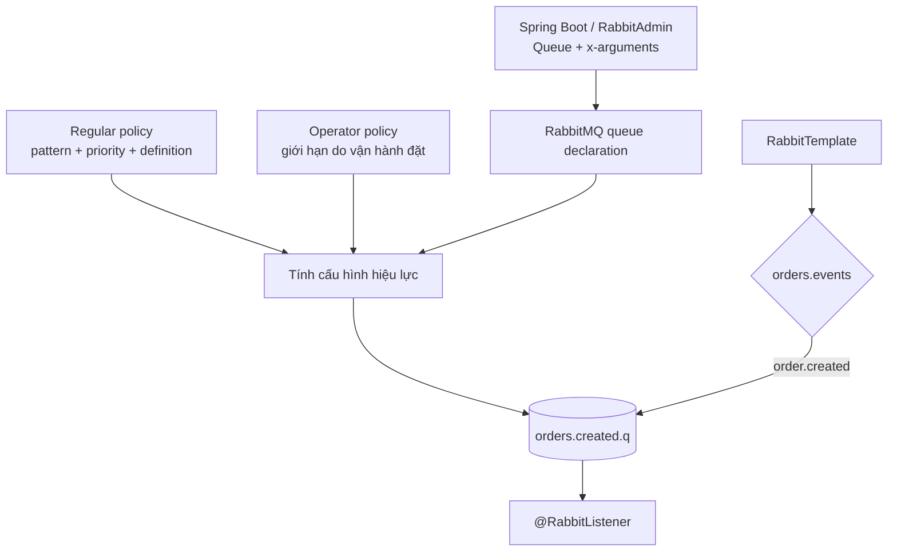
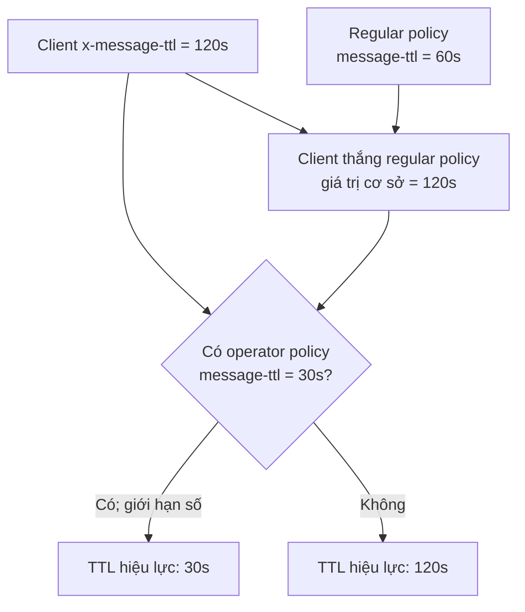
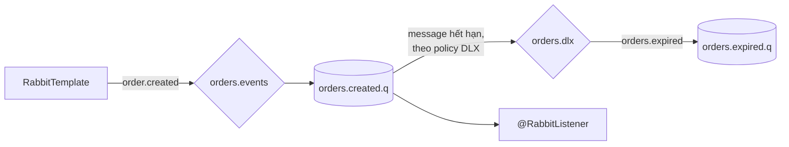
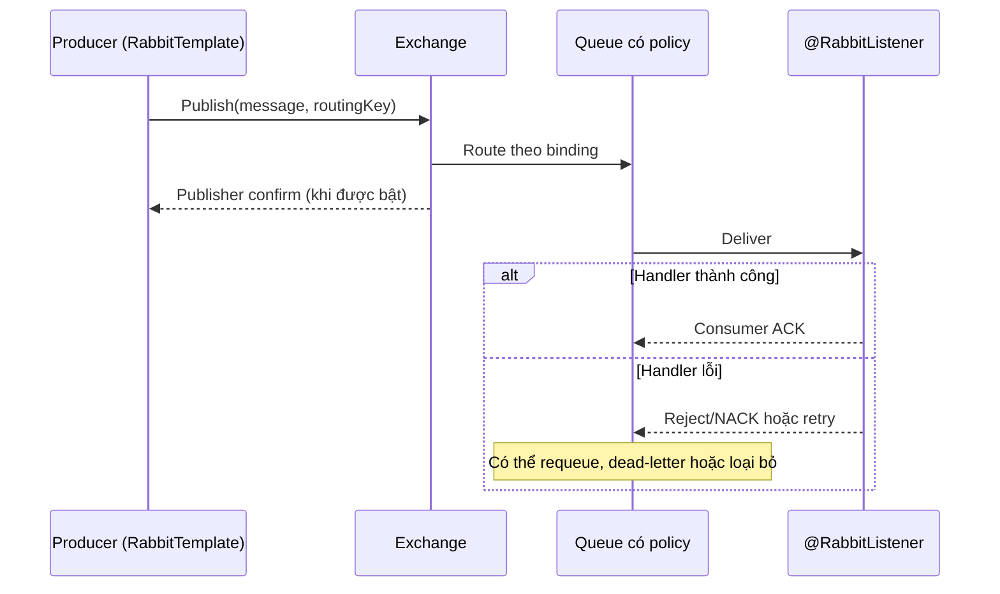

# Policy, operator policy và đối số x-arguments do ứng dụng khai báo

Khi tạo queue trong RabbitMQ, ứng dụng Spring AMQP có thể đặt các thuộc tính như thời gian sống của message, dead-letter exchange hay giới hạn chiều dài queue bằng **optional arguments** (thường gọi là `x-arguments`). Tuy nhiên, việc cố định mọi giới hạn trong mã Java khiến mỗi lần điều chỉnh vận hành có thể phải sửa code, triển khai lại và đôi khi phải xử lý xung đột khi khai báo queue đã tồn tại.

RabbitMQ cung cấp **policy** để quản lý nhiều thuộc tính từ phía broker và **operator policy** để người vận hành áp đặt các giới hạn bảo vệ hệ thống. Ba nguồn cấu hình này có thể cùng nhắm vào một queue, nên phải hiểu **thứ tự ưu tiên**, **phạm vi áp dụng** và **thuộc tính nào có thể thay đổi khi queue đã được tạo**.

Bài thuộc chương **Chính sách hàng đợi** của module **SPRING_AMQP**. Trong ví dụ thực hành, Spring Boot dùng `RabbitTemplate`, `@RabbitListener`, exchange, queue và binding để gửi/nhận thông điệp; RabbitMQ policy kiểm soát TTL, dead-letter và giới hạn queue. Các điểm về xác nhận giao nhận, retry, giao dịch và quan sát được đặt trong đúng vai trò của chúng, nhằm xây dựng xử lý bất đồng bộ đáng tin cậy.

Sau bài học, bạn có thể:

- Phân biệt cấu hình queue do ứng dụng khai báo với regular policy và operator policy.
- Đọc các tên cấu hình cùng nghĩa ở hai nơi: `x-message-ttl` trong Java và `message-ttl` trong policy.
- Dự đoán thuộc tính hiệu lực khi x-arguments, policy và operator policy xung đột.
- Dùng regex và priority để áp dụng policy có mục tiêu, tránh tác động nhầm queue.
- Khai báo topology Spring AMQP, thay đổi policy từ broker và quan sát ảnh hưởng.
- Chẩn đoán các lỗi phổ biến: queue redeclaration thất bại, message không dead-letter, TTL không như dự tính và sai vhost.

## 1. Vì sao RabbitMQ có nhiều tầng cấu hình queue?

Giả sử hệ thống quản lý đơn hàng phát sự kiện `order.created` vào queue `orders.created.q`. Đội phát triển muốn message tồn tại không quá hai phút; đội vận hành muốn có thể hạ xuống một phút lúc tải cao; quản trị cluster muốn áp đặt mức tối đa 50.000 message để tránh một queue chiếm hết tài nguyên.

Nếu chỉ dùng mã Java:

```java
@Bean
Queue createdQueue() {
    return QueueBuilder.durable("orders.created.q")
            .withArgument("x-message-ttl", 120_000)
            .withArgument("x-max-length", 50_000)
            .build();
}
```

thì các tham số này trở thành **arguments do client khai báo tại thời điểm tạo queue**. Chỉnh sửa chúng sau đó thường không đơn giản như sửa biến cấu hình: RabbitMQ có thể từ chối khai báo cùng tên queue với những thuộc tính không tương thích.

Một phương án linh hoạt hơn là tách trách nhiệm:

| Nguồn | Ai thường quản lý? | Mục đích |
|---|---|---|
| **Client x-arguments** | Nhóm phát triển ứng dụng | Các lựa chọn gắn trực tiếp với khai báo queue trong code |
| **Regular policy** | Nhóm sở hữu ứng dụng hoặc vận hành broker | Điều chỉnh các thuộc tính hỗ trợ policy theo tên tài nguyên |
| **Operator policy** | Quản trị nền tảng RabbitMQ | Giới hạn, bảo vệ tài nguyên và áp dụng quy tắc chung ở mức vận hành |

Ba nguồn đều tác động đến broker, nhưng **không phải ba tệp cấu hình của Spring Boot**. Một policy được lưu và quản lý trong RabbitMQ; ứng dụng chỉ cần tạo queue phù hợp và có quyền truy cập queue đó.



Sơ đồ thể hiện các nguồn ảnh hưởng đến **cấu hình hiệu lực của queue**. Đường đi của message vẫn là `producer → exchange → binding → queue → consumer`.

## 2. Client x-arguments: cấu hình ngay khi khai báo queue

Trong AMQP 0-9-1, khi khai báo queue, client gửi tên, các cờ như `durable`, `exclusive`, `auto-delete` và một bảng *arguments*. RabbitMQ dùng nhiều khóa tùy chọn có tiền tố `x-` trong bảng này.

Với Spring AMQP, có thể khai báo arguments qua `QueueBuilder`:

```java
import org.springframework.amqp.core.Queue;
import org.springframework.amqp.core.QueueBuilder;
import org.springframework.context.annotation.Bean;

@Bean
Queue ordersQueueWithArguments() {
    return QueueBuilder.durable("orders.args-example.q")
            .withArgument("x-message-ttl", 120_000)
            .withArgument("x-dead-letter-exchange", "orders.dlx")
            .withArgument("x-dead-letter-routing-key", "orders.expired")
            .build();
}
```

Ý nghĩa:

- `x-message-ttl`: thời gian sống tối đa của message trong queue theo đơn vị mili giây, theo các quy tắc TTL của RabbitMQ.
- `x-dead-letter-exchange`: exchange mà message đủ điều kiện dead-letter được chuyển tới.
- `x-dead-letter-routing-key`: routing key được dùng khi chuyển sang DLX; nếu không cấu hình, broker có quy tắc giữ routing key gốc theo trường hợp áp dụng.
- `x-max-length`: giới hạn số lượng message trong queue, có các sắc thái về thông điệp đang ở trạng thái ready/unacknowledged và hành vi overflow.

### 2.1. Ưu điểm và giới hạn

Ưu điểm của x-arguments là khai báo rõ một số lựa chọn ngay cùng topology; thuận tiện khi thuộc tính gắn chặt với bản chất queue và được kiểm soát bởi deployment ứng dụng.

Giới hạn cần lưu ý:

1. Nhiều optional arguments trở thành các thuộc tính có ràng buộc **declaration equivalence**. Khai báo lại queue cùng tên nhưng thay đổi argument có thể trả về lỗi `PRECONDITION_FAILED`.
2. Cài đặt cứng trong mã làm việc điều chỉnh TTL/DLX hoặc giới hạn trong môi trường vận hành khó linh hoạt.
3. Một số thuộc tính như **queue type** (`x-queue-type: quorum`) phải được quyết định theo cơ chế khai báo queue, không thể kỳ vọng dùng policy để chuyển trực tiếp queue classic đang có dữ liệu sang quorum.
4. Các optional arguments không phải đều hỗ trợ policy. Cần tra khả năng hỗ trợ của từng khóa và phiên bản RabbitMQ.

**Nguyên tắc:** khi một thuộc tính được RabbitMQ hỗ trợ thông qua policy và có nhu cầu thay đổi trong lúc vận hành, thường nên dùng policy. Những thuộc tính chỉ hợp lệ tại lúc khai báo vẫn cần được quản lý qua topology/deployment.

## 3. Regular policy: quản lý cấu hình từ phía RabbitMQ

**Regular policy** là một tài nguyên cấu hình trong một RabbitMQ **virtual host (vhost)**. Nó có ít nhất các thành phần:

| Thuộc tính | Ý nghĩa | Ví dụ |
|---|---|---|
| Name | Tên định danh policy trong vhost | `orders-retention` |
| Pattern | Biểu thức chính quy so khớp **tên** queue/exchange | `^orders[.]` |
| Apply-to | Loại tài nguyên áp dụng | `queues` |
| Priority | Độ ưu tiên khi nhiều policy cùng khớp | `10` |
| Definition | Tập các khóa và giá trị chính sách | `{"message-ttl":60000}` |

Ví dụ policy `^orders[.]` khớp những queue có tên bắt đầu bằng `orders.` như `orders.created.q`, `orders.cancelled.q` và `orders.retry.q`. Nó không kiểm tra routing key của message.

### 3.1. Tạo policy bằng rabbitmqctl

Trên máy/container có RabbitMQ CLI và quyền quản trị thích hợp, khai báo:

```bash
rabbitmqctl set_policy -p / --apply-to queues --priority 10 orders-retention '^orders[.]' '{"message-ttl":60000}'
```

Giải nghĩa:

- `-p /`: vhost mặc định trong ví dụ; môi trường khác phải dùng đúng vhost của ứng dụng.
- `--apply-to queues`: chỉ áp dụng cho queue, tránh tác động nhầm exchange.
- `--priority 10`: mức ưu tiên khi nhiều regular policy cùng so khớp.
- `orders-retention`: tên policy.
- `^orders[.]`: regex khớp những queue có tên bắt đầu bằng `orders.`.
- `{"message-ttl":60000}`: TTL 60 giây; khóa policy **không có tiền tố `x-`**.

> Cú pháp ví dụ trên dùng cách trích dẫn của shell Unix. Khi chạy từ PowerShell, CMD hoặc qua Docker exec, việc quote JSON phụ thuộc cách shell chuyển đối số. Kiểm tra chuỗi JSON nhận được trước khi cho rằng lỗi đến từ RabbitMQ.

Kiểm tra policy đã tồn tại:

```bash
rabbitmqctl list_policies -p /
```

Để xóa policy khi hoàn thành bài lab:

```bash
rabbitmqctl clear_policy -p / orders-retention
```

Xóa policy không xóa queue. Nó thay đổi nguồn cấu hình áp dụng; **hành vi của các message đã nằm trong queue có thể phụ thuộc thuộc tính, queue type và thời điểm policy thay đổi**.

### 3.2. Policy có thể thay đổi động, nhưng không phải mọi thứ đều tự điều chỉnh ngay

Đổi policy không yêu cầu sửa Java bean queue, nhưng không có nghĩa mọi thuộc tính đều được thay đổi ngay lập tức theo cùng một cơ chế. Ví dụ:

- TTL có quy tắc expiration và loại bỏ message riêng; thay đổi policy có thể khiến một số message đủ điều kiện hết hạn.
- Dead-letter cần một DLX tồn tại, binding đúng và đích đủ điều kiện nhận.
- Một số thuộc tính được cố định lúc khai báo queue hoặc chỉ có hiệu lực theo điều kiện riêng của từng queue type.
- Việc đặt policy không tự tạo queue, không tự tạo exchange/binding và không chữa lỗi kết nối hoặc quyền truy cập.

Khi thay đổi chính sách trên queue đang có nhiều message, cần hiểu khả năng chuyển message sang DLQ, loại bỏ message hoặc tăng tải broker trước khi áp dụng cho môi trường thật.

## 4. Khi nhiều regular policy cùng khớp: priority

Giả sử trong cùng vhost có hai regular policy:

| Policy | Pattern | Priority | Definition |
|---|---|---:|---|
| `all-orders` | `^orders[.]` | 10 | `{"message-ttl":60000}` |
| `created-orders` | `^orders[.]created[.]q$` | 20 | `{"max-length":10000}` |

Queue `orders.created.q` khớp **cả hai** pattern. RabbitMQ chọn **regular policy có priority cao hơn** (20) cho queue đó. **Không tự động trộn mọi definition của hai regular policy thành một cấu hình hợp nhất**.

Điều này dẫn đến một lỗi phổ biến: nhóm vận hành thêm policy priority cao chỉ định `max-length`, rồi tưởng rằng queue vẫn kế thừa `message-ttl` từ policy priority thấp. Cách làm đúng là đưa các khóa cần áp dụng đồng thời vào **cùng policy đang thắng** hoặc thiết kế lại pattern/priority.

Ví dụ:

```bash
rabbitmqctl set_policy -p / --apply-to queues --priority 20 created-orders '^orders[.]created[.]q$' '{"message-ttl":60000,"max-length":10000}'
```

Trong một nhóm policy cùng loại, hãy tránh tình huống hai policy có priority bằng nhau và pattern cùng khớp, vì lựa chọn policy hiệu lực có thể không phù hợp với kỳ vọng vận hành. Đặt priority và regex sao cho kết quả rõ ràng.

**Không nhầm priority của policy với thứ tự xử lý message.** Policy priority chỉ chọn định nghĩa cấu hình; nó không phải AMQP message priority.

## 5. Operator policy: hàng rào giới hạn do người vận hành áp đặt

**Operator policy** do người quản trị RabbitMQ sử dụng để giới hạn cách queue/exchange tiêu thụ tài nguyên hoặc để thực thi ràng buộc được broker hỗ trợ. Operator policy có tên, pattern, phạm vi, priority và definition tương tự regular policy, nhưng được xử lý ở **tầng thực thi giới hạn**.

Ví dụ, nền tảng có thể yêu cầu queue thuộc nhóm `orders.*` không giữ nhiều hơn 50.000 message:

```bash
rabbitmqctl set_operator_policy -p / --apply-to queues --priority 10 orders-guardrails '^orders[.]' '{"max-length":50000}'
```

Kiểm tra operator policies:

```bash
rabbitmqctl list_operator_policies -p /
```

Xóa policy minh họa khi kết thúc lab:

```bash
rabbitmqctl clear_operator_policy -p / orders-guardrails
```

Các lệnh cần quyền phù hợp. Một tài khoản ứng dụng chỉ có quyền publish/consume thông thường không nhất thiết được phép thay đổi policy/operator policy.

Operator policy **không phải cách tùy ý gắn mọi x-argument vào broker**. RabbitMQ chỉ hỗ trợ một tập khóa, loại resource và quy tắc tương ứng trong từng phiên bản. Đối với các giới hạn số được hỗ trợ, operator policy được thiết kế để đặt giới hạn bảo vệ, thường bằng cách chọn **giá trị nhỏ hơn/khắt khe hơn** so với phía client hoặc regular policy.

### 5.1. Vì sao operator policy quan trọng?

Ví dụ một team triển khai ứng dụng với `x-max-length: 1000000`. Chính sách thường của team là `max-length: 100000`. Nếu không có operator policy, x-argument do client đưa ra có thể thắng regular policy. Quản trị cluster muốn mọi queue trong nhóm này không vượt quá 50.000 message. Operator policy giúp thực thi giới hạn chung.

Điều này tạo ranh giới trách nhiệm:

- Nhóm ứng dụng quyết định đặc điểm nghiệp vụ và cấu hình phù hợp.
- Nhóm vận hành cho phép điều chỉnh tập trung với regular policy.
- Quản trị broker đặt giới hạn an toàn bằng operator policy đối với những khóa được hỗ trợ.

Không nên dùng operator policy để che đi cấu hình bất hợp lý của ứng dụng mà không thông báo: chênh lệch giữa giá trị mong muốn và giá trị có hiệu lực có thể khiến người phát triển hiểu sai vì sao message bị hết hạn, overflow hoặc dead-letter.

## 6. Thứ tự ưu tiên giữa x-arguments, regular policy và operator policy

Đây là điểm quan trọng nhất của bài.

### 6.1. Quy tắc tổng quát

1. Trong **các regular policy** khớp cùng resource, policy có priority cao hơn được chọn.
2. Trong **các operator policy** khớp resource, operator policy có priority cao hơn được chọn theo cơ chế riêng của loại policy này.
3. Nếu cùng một khóa được khai báo trong **client x-arguments** và **regular policy**, giá trị client thường **ưu tiên hơn** giá trị regular policy.
4. **Operator policy** có quyền áp đặt giới hạn lên cấu hình client/regular policy đối với các khóa hỗ trợ. Với các giá trị giới hạn dạng số, RabbitMQ áp dụng quy tắc bảo vệ tương ứng, thường lấy **giá trị nhỏ hơn**.
5. Khi không có x-argument hoặc policy nào đặt một khóa, cơ chế mặc định của RabbitMQ và các mặc định theo queue type/phiên bản được áp dụng.

Điều này là quy tắc về **cấu hình hiệu lực**, không bảo đảm rằng mọi khóa đều có mặt trong cả ba nguồn. Các khóa khác nhau có giới hạn hỗ trợ và khả năng thay đổi riêng.

### 6.2. Minh họa xung đột TTL

Giả sử RabbitMQ hỗ trợ `message-ttl` trong các cấu hình đang dùng. Queue `orders.created.q` có các yêu cầu sau:

| Nguồn | Khóa | Giá trị |
|---|---|---:|
| Client x-arguments | `x-message-ttl` | 120.000 ms |
| Regular policy | `message-ttl` | 60.000 ms |
| Operator policy | `message-ttl` | 30.000 ms |

Kết quả:

- **Chỉ có regular policy:** TTL 60 giây.
- **Client x-argument + regular policy:** TTL từ client là 120 giây (vì client thắng regular policy cho cùng khóa).
- **Cả ba:** operator policy áp đặt giới hạn 30 giây theo cơ chế số nhỏ hơn cho thuộc tính được hỗ trợ; TTL hiệu lực là 30 giây.



Đây là ví dụ cho **cùng một khóa**. Các khóa không xung đột vẫn có thể đến từ nguồn khác nhau: regular policy cấp DLX, client cấp queue argument riêng, operator policy áp đặt giới hạn độ dài. Do đó hãy kiểm tra **mỗi khóa hiệu lực** khi chẩn đoán.

### 6.3. Bảng quyết định nhanh

| Tình huống | Kết quả cần kỳ vọng |
|---|---|
| Không có x-argument; một regular policy khớp | Giá trị policy được áp dụng nếu khóa hỗ trợ |
| Có x-argument và regular policy cùng một khóa | Giá trị do client khai báo thường thắng |
| Hai regular policy cùng khớp | Chỉ policy ưu tiên cao hơn thắng; không trộn hai policy |
| Regular và operator policy cùng khớp | Operator policy áp ràng buộc được hỗ trợ |
| Client đặt giới hạn lớn, operator đặt giới hạn nhỏ | Giá trị hiệu lực có thể là giới hạn nhỏ hơn theo quy tắc của khóa số |
| Không một policy nào khớp queue | Dùng x-arguments của client và các giá trị mặc định |
| Operator policy đã xóa | Chỉ còn x-arguments, regular policy và mặc định; không phải lệnh tạo lại queue |
| Client đổi thuộc tính cần declaration equivalence trên queue đã tồn tại | Có thể bị broker từ chối; policy không tự giải quyết xung đột khai báo |

Cần đặc biệt tránh cách hiểu rằng **operator policy sẽ ghi đè giá trị cấu hình theo kiểu “last write wins” cho mọi khóa**. Một số giới hạn số được tính theo giá trị nhỏ hơn; một số khóa không hỗ trợ operator policy; thuộc tính không thể đổi sau khi tạo queue cần cơ chế migration riêng.

## 7. Bảng đối chiếu tên khóa: policy và x-arguments

Nhiều thuộc tính có tên khác nhau giữa bảng optional arguments của client và định nghĩa policy:

| Mục tiêu | Client x-argument | Regular policy definition | Lưu ý |
|---|---|---|---|
| TTL của message trong queue | `x-message-ttl` | `message-ttl` | Đơn vị mili giây |
| Hết hạn queue khi không được sử dụng theo điều kiện broker | `x-expires` | `expires` | **Queue TTL**, khác message TTL |
| Đặt dead-letter exchange | `x-dead-letter-exchange` | `dead-letter-exchange` | DLX phải tồn tại/có binding |
| Đổi routing key khi dead-letter | `x-dead-letter-routing-key` | `dead-letter-routing-key` | Phải khớp binding đích |
| Giới hạn số message trong queue | `x-max-length` | `max-length` | Kiểm tra hành vi overflow |
| Giới hạn dung lượng message của queue | `x-max-length-bytes` | `max-length-bytes` | Đơn vị byte |
| Cách ứng xử khi queue vượt giới hạn | `x-overflow` | `overflow` | Giá trị hỗ trợ phụ thuộc queue type |
| Giới hạn số lần delivery (tùy queue type/version) | `x-delivery-limit` | `delivery-limit` | Đặc biệt liên quan quorum queue |
| Queue type | `x-queue-type` | **Không dùng regular policy để chuyển loại queue** | Classic/quorum/stream có ràng buộc riêng |
| Single active consumer | `x-single-active-consumer` | **Không phải khóa policy chung** | Đặc điểm cần khai báo theo hỗ trợ của broker |

Không phải mọi khóa trên đều hỗ trợ **operator policy**; cũng không phải mọi queue type hỗ trợ cùng giá trị. Khi cấu hình tính năng quan trọng, cần xác nhận theo phiên bản RabbitMQ và queue type cụ thể.

### 7.1. Message TTL khác queue expiration

Hai khái niệm dễ nhầm:

- **Message TTL** (`message-ttl`): message có thời gian sống giới hạn **khi chờ trong queue**. Hết hạn theo điều kiện của broker có thể khiến nó bị loại bỏ hoặc dead-letter. Đây không phải timeout tối đa cho lời gọi Java ở consumer.
- **Queue expiration** (`expires`): queue bị xóa sau khi không còn được sử dụng theo điều kiện mà RabbitMQ định nghĩa; đây không phải cách xóa từng message quá hạn.

Ví dụ đặt `expires: 60000` không có nghĩa mọi message trong queue tự hết hạn sau một phút. Nó có thể khiến **chính queue** bị xóa khi đáp ứng điều kiện không sử dụng.

### 7.2. Queue type và immutable arguments

Một số thuộc tính cần chốt **ngay tại thời điểm tạo queue**. Ví dụ:

```java
QueueBuilder.durable("orders.important.q")
        .withArgument("x-queue-type", "quorum")
        .build();
```

Nếu `orders.important.q` đang tồn tại dưới dạng classic queue, việc sửa bean này hoặc áp policy không đồng nghĩa đã biến queue thành quorum queue. Muốn chuyển loại phải thiết kế migration, kiểm soát producer/consumer, chuyển hoặc phát lại message và xác minh dữ liệu.

Với các argument có yêu cầu tương đương khi khai báo, RabbitMQ cũng có thể trả lỗi nếu hai ứng dụng cùng tuyên bố khác nhau cho một queue. Đây là vấn đề ở **bước khai báo topology**, không phải xung đột priority thông thường của policy.

## 8. Thực hành Spring Boot: policy điều khiển TTL và dead-letter

Ví dụ sau cho thấy ứng dụng Spring AMQP **không gắn TTL/DLX cứng vào queue**. RabbitMQ policy được tạo riêng để kiểm soát thời gian lưu message. Đây là cách hữu ích khi cùng một mã triển khai ở các môi trường có yêu cầu lưu giữ khác nhau.

### 8.1. Chuẩn bị broker cho lab

Có thể chạy một RabbitMQ node có Management UI:

```bash
docker run -d --rm --name rabbitmq-policy-lab -p 5672:5672 -p 15672:15672 -e RABBITMQ_DEFAULT_USER=demo -e RABBITMQ_DEFAULT_PASS=demo-local-only rabbitmq:4-management
```

- AMQP: `localhost:5672`.
- RabbitMQ Management: `http://localhost:15672`.
- Tài khoản demo: `demo` / `demo-local-only` (chỉ dùng cho bài lab).

Để chạy `rabbitmqctl` trong container Docker, có thể gọi:

```bash
docker exec rabbitmq-policy-lab rabbitmqctl list_policies -p /
```

Các lệnh thao tác policy ở các phần tiếp theo có thể được đặt sau `docker exec rabbitmq-policy-lab`. Nếu container đã chạy broker khác, hãy điều chỉnh tên cho phù hợp.

### 8.2. Khởi tạo project Spring Boot

Khai báo dependency trong Gradle:

```groovy
dependencies {
    implementation 'org.springframework.boot:spring-boot-starter-amqp'
    implementation 'org.springframework.boot:spring-boot-starter-web'
}
```

Cấu hình `application.yml`:

```yaml
spring:
  rabbitmq:
    host: localhost
    port: 5672
    username: demo
    password: demo-local-only
    publisher-confirm-type: correlated
    publisher-returns: true
    template:
      mandatory: true
```

Spring Boot thông thường tự tạo connection factory, `RabbitTemplate`, `RabbitAdmin` và listener container factory khi đủ điều kiện classpath. `RabbitAdmin` khai báo queue/exchange/binding; **regular policy và operator policy vẫn là cấu hình ở RabbitMQ**, không được tạo tự động chỉ bằng những bean này.

### 8.3. Khai báo exchange, source queue và DLQ

Tạo file `PolicyLabTopology.java` trong package mà Spring Boot quét:

```java
import org.springframework.amqp.core.Binding;
import org.springframework.amqp.core.BindingBuilder;
import org.springframework.amqp.core.DirectExchange;
import org.springframework.amqp.core.Queue;
import org.springframework.amqp.core.QueueBuilder;
import org.springframework.beans.factory.annotation.Qualifier;
import org.springframework.context.annotation.Bean;
import org.springframework.context.annotation.Configuration;

@Configuration
public class PolicyLabTopology {
    public static final String MAIN_EXCHANGE = "orders.events";
    public static final String MAIN_QUEUE = "orders.created.q";
    public static final String ROUTING_KEY = "order.created";

    public static final String DLX = "orders.dlx";
    public static final String DEAD_QUEUE = "orders.expired.q";
    public static final String DEAD_ROUTING_KEY = "orders.expired";

    @Bean
    DirectExchange ordersExchange() {
        return new DirectExchange(MAIN_EXCHANGE, true, false);
    }

    @Bean
    DirectExchange deadLetterExchange() {
        return new DirectExchange(DLX, true, false);
    }

    @Bean
    Queue createdQueue() {
        // Không gắn x-message-ttl hoặc x-dead-letter-exchange ở đây.
        return QueueBuilder.durable(MAIN_QUEUE).build();
    }

    @Bean
    Queue expiredQueue() {
        return QueueBuilder.durable(DEAD_QUEUE).build();
    }

    @Bean
    Binding createdBinding(
            @Qualifier("createdQueue") Queue queue,
            @Qualifier("ordersExchange") DirectExchange exchange) {
        return BindingBuilder.bind(queue)
                .to(exchange)
                .with(ROUTING_KEY);
    }

    @Bean
    Binding deadLetterBinding(
            @Qualifier("expiredQueue") Queue queue,
            @Qualifier("deadLetterExchange") DirectExchange exchange) {
        return BindingBuilder.bind(queue)
                .to(exchange)
                .with(DEAD_ROUTING_KEY);
    }
}
```

Topology trên có hai đường đi:



**Lưu ý:** đây là topology cần thiết cho dead-letter; cấu hình DLX chưa xuất hiện ở queue vì sẽ được cấp qua policy. Nếu không có policy và message hết hạn không có đích DLX, không nên kỳ vọng tự động xuất hiện message tại `orders.expired.q`.

### 8.4. Gửi bằng RabbitTemplate

Tạo file `PolicyLabPublisher.java`:

```java
import org.springframework.amqp.rabbit.core.RabbitTemplate;
import org.springframework.stereotype.Service;

@Service
public class PolicyLabPublisher {
    private final RabbitTemplate rabbitTemplate;

    public PolicyLabPublisher(RabbitTemplate rabbitTemplate) {
        this.rabbitTemplate = rabbitTemplate;
    }

    public void publishCreated(String orderId) {
        rabbitTemplate.convertAndSend(
                PolicyLabTopology.MAIN_EXCHANGE,
                PolicyLabTopology.ROUTING_KEY,
                orderId
        );
    }
}
```

Tạo HTTP controller minh họa:

```java
import org.springframework.http.ResponseEntity;
import org.springframework.web.bind.annotation.PathVariable;
import org.springframework.web.bind.annotation.PostMapping;
import org.springframework.web.bind.annotation.RestController;

@RestController
public class PolicyLabController {
    private final PolicyLabPublisher publisher;

    public PolicyLabController(PolicyLabPublisher publisher) {
        this.publisher = publisher;
    }

    @PostMapping("/demo/orders/{id}/created")
    public ResponseEntity<Void> send(@PathVariable String id) {
        publisher.publishCreated(id);
        return ResponseEntity.accepted().build();
    }
}
```

### 8.5. Nhận message

Tạo một listener thông thường:

```java
import org.springframework.amqp.rabbit.annotation.RabbitListener;
import org.springframework.stereotype.Component;

@Component
public class PolicyLabListener {
    @RabbitListener(queues = PolicyLabTopology.MAIN_QUEUE)
    public void handle(String orderId) {
        System.out.println("Processing " + orderId);
    }
}
```

Listener chỉ đọc **main queue**; queue dead-letter trong bài lab không có listener nên bạn có thể nhìn thấy message tích lại sau khi expire. Nếu consumer chính xử lý quá nhanh, message sẽ được ACK và không còn trong queue để hết hạn. Để thử TTL, hãy tạm ngừng tiêu thụ main queue; có thể cấu hình listener không tự chạy cho lần thử riêng:

```yaml
spring:
  rabbitmq:
    listener:
      simple:
        auto-startup: false
```

Đoạn YAML trên là **phần bổ sung** vào `spring.rabbitmq` ở cấu hình trước, không phải file application.yml đầy đủ để ghi đè mọi thuộc tính. Khi dừng listener, controller/publisher vẫn có thể publish; listener không lấy message khỏi queue, giúp quan sát TTL và DLQ. Khôi phục `auto-startup: true` hoặc bỏ cấu hình sau khi thực hành.

### 8.6. Áp regular policy cho source queue

Quan trọng: regex trong bài chỉ chọn **source queue**, tránh tự áp TTL/DLX cho cả DLQ và tạo vòng lặp dead-letter.

```bash
docker exec rabbitmq-policy-lab rabbitmqctl set_policy -p / --apply-to queues --priority 10 orders-created-ttl '^orders[.]created[.]q$' '{"message-ttl":60000,"dead-letter-exchange":"orders.dlx","dead-letter-routing-key":"orders.expired"}'
```

Trong definition của policy:

- `message-ttl: 60000` giới hạn message chờ trong main queue là 60 giây.
- `dead-letter-exchange: orders.dlx` chỉ định exchange nhận message dead-letter.
- `dead-letter-routing-key: orders.expired` khớp binding dẫn tới queue `orders.expired.q`.

Không ghi các khóa `x-message-ttl` và `x-dead-letter-exchange` trong **definition JSON của policy**. Tiền tố `x-` dùng cho bảng arguments do client khai báo.

Sau khi ứng dụng đã tạo topology, kiểm tra:

```bash
docker exec rabbitmq-policy-lab rabbitmqctl list_policies -p /

docker exec rabbitmq-policy-lab rabbitmqctl list_queues -p / name arguments messages_ready messages_unacknowledged
```

Có thể quan sát trong Management UI: queue `orders.created.q` nên có policy áp dụng; `orders.expired.q` là đích DLQ. Khi listener không chạy, gửi message bằng endpoint:

```bash
curl -X POST http://localhost:8080/demo/orders/order-123/created
```

Đợi đủ điều kiện expiration theo cơ chế của broker rồi quan sát message rời source queue và xuất hiện trong DLQ. TTL không phải bộ hẹn giờ chính xác cho từng message đang được xử lý; message đã đến consumer và chưa ACK có hành vi khác message đang chờ trong queue. Khi dùng queue type khác nhau, thời điểm loại bỏ message hết hạn có thể khác nhau.

### 8.7. Thử thay đổi policy mà không đổi Java bean

Giảm thời gian TTL xuống 30 giây bằng cách cập nhật cùng policy:

```bash
docker exec rabbitmq-policy-lab rabbitmqctl set_policy -p / --apply-to queues --priority 10 orders-created-ttl '^orders[.]created[.]q$' '{"message-ttl":30000,"dead-letter-exchange":"orders.dlx","dead-letter-routing-key":"orders.expired"}'
```

Các ứng dụng vẫn dùng bean `QueueBuilder.durable(MAIN_QUEUE).build()`. Bạn không cần đổi bean topology chỉ vì giảm TTL policy.

Quan sát queue và DLQ sau khi thay đổi; không giả định mỗi message đã có sẵn trong queue đều phản ứng tức khắc như một scheduler riêng. Nếu bài lab không thấy kỳ vọng, kiểm tra đúng vhost, policy có khớp queue không, listener đã dừng chưa, DLX/binding có tồn tại không và broker có quyền ghi tới đích không.

## 9. Thí nghiệm riêng: x-argument thắng regular policy

Để thấy thứ tự ưu tiên mà **không thay đổi arguments của source queue đang tồn tại**, hãy dùng một queue thử nghiệm **mới**:

```java
@Bean
Queue clientArgsQueue() {
    return QueueBuilder.durable("orders.client-args.q")
            .withArgument("x-message-ttl", 120_000)
            .build();
}
```

Đây là **bean bổ sung** đặt trong lớp cấu hình được Spring quét. Policy minh họa dưới đây chọn chính queue mới:

```bash
docker exec rabbitmq-policy-lab rabbitmqctl set_policy -p / --apply-to queues --priority 10 client-args-ttl '^orders[.]client-args[.]q$' '{"message-ttl":60000}'
```

Dù regular policy muốn TTL 60 giây, queue client khai báo TTL 120 giây. Theo quy tắc **client optional argument thắng regular policy** với cùng khóa, TTL hiệu lực của queue này do client quyết định.

Đây chỉ là bài kiểm tra cấu hình hiệu lực; nếu muốn thực sự gửi message vào queue mới, cần binding và publisher tương ứng. Bạn có thể xem thông tin queue và policy trong Management UI để đối chiếu.

**Không thử nghiệm bằng cách thay đổi x-argument của một queue đã tồn tại mà chưa có kế hoạch:** redeclaration khác arguments có thể bị RabbitMQ từ chối. Tạo queue mới là cách an toàn hơn cho lab.

### 9.1. Thêm operator policy để ràng buộc giới hạn

Trong môi trường bạn có quyền quản trị broker, tạo operator policy cho queue thử nghiệm:

```bash
docker exec rabbitmq-policy-lab rabbitmqctl set_operator_policy -p / --apply-to queues --priority 10 client-ttl-cap '^orders[.]client-args[.]q$' '{"message-ttl":30000}'
```

Khi cả ba giá trị cùng tồn tại và thuộc tính được broker hỗ trợ như ví dụ, operator policy áp giới hạn TTL 30 giây so với x-argument 120 giây và regular policy 60 giây.

Bảng kiểm tra:

| Nguồn | TTL yêu cầu |
|---|---:|
| Client x-argument | 120 giây |
| Regular policy | 60 giây |
| Operator policy | 30 giây |
| **TTL hiệu lực** | **30 giây** |

Sau đó có thể loại bỏ cấu hình lab:

```bash
docker exec rabbitmq-policy-lab rabbitmqctl clear_operator_policy -p / client-ttl-cap

docker exec rabbitmq-policy-lab rabbitmqctl clear_policy -p / client-args-ttl
```

Khi operator policy không còn, TTL do client khai báo lại có hiệu lực đối với khóa này. Hãy xem **effective arguments/effective policy** trên Management UI hoặc công cụ chẩn đoán phù hợp, thay vì chỉ đọc YAML của ứng dụng.

## 10. Ranh giới giữa policy, dead-letter, retry và xác nhận

Policy có thể giúp **định tuyến message hết hạn, bị reject hoặc vượt giới hạn** sang DLX theo cấu hình. Nhưng policy không tự thiết kế luồng retry end-to-end, không tự xác nhận consumer đã xử lý thành công và không tạo transaction nguyên tử giữa RabbitMQ với database.

### 10.1. Ba chặng xác nhận



**Publisher confirm** xác nhận broker đã xử lý publish theo cơ chế của nó; **publisher return** giúp biết message không đến queue nào khi mandatory/return được cấu hình; **consumer ACK** cho biết consumer đã xác nhận delivery theo logic của listener.

Nếu ứng dụng chỉ gọi `convertAndSend(...)` và trả HTTP 202, không có nghĩa consumer đã hoàn thành và cũng chưa chắc đã quan sát được publisher confirm. Cần chọn cách theo dõi kết quả publish và xử lý các tình huống chưa xác định.

### 10.2. Dead-letter không đồng nghĩa retry hoàn chỉnh

Khi cấu hình `dead-letter-exchange` và `dead-letter-routing-key`, message có thể dead-letter vì hết TTL, bị reject với `requeue=false` hoặc một số điều kiện khác tùy queue type. Tuy nhiên:

- **DLX và DLQ phải tồn tại**, binding phải khớp.
- Nếu message bị requeue liên tục, policy TTL/DLX không tự giới hạn số lần xử lý.
- Một message độc hại (poison message) cần giới hạn retry, backoff và đường điều tra.
- Trên quorum queue, các cơ chế như delivery limit và chiến lược dead-letter có điều kiện hỗ trợ theo phiên bản.
- Khi đích DLX tạm không sẵn sàng, bảo đảm chuyển message phụ thuộc cấu hình/queue type/chiến lược dead-letter.

Với Spring AMQP, có thể thiết lập retry interceptor, recoverer hoặc dùng cơ chế reject/dead-letter phù hợp. Không nên ghép các chính sách tùy ý mà không chạy thử đầy đủ các nhánh thành công, thất bại và phục hồi.

### 10.3. Idempotency và outbox

Nếu listener ghi database thành công rồi mất kết nối trước ACK, message có thể được giao lại. Một queue có policy hoàn hảo vẫn không ngăn tác dụng phụ lặp. Consumer cần idempotency theo `eventId` và giao dịch database phù hợp.

Nếu producer commit dữ liệu rồi publish RabbitMQ thất bại, việc queue có TTL/DLX không bảo đảm event được phát. Transactional outbox giúp ghi thay đổi nghiệp vụ và bản ghi sự kiện trong **một transaction database**, sau đó publish có theo dõi confirm và xử lý gửi lại. Đây là vấn đề nhất quán giữa hai hệ thống, ngoài phạm vi quản lý thuộc tính queue.

## 11. Quản trị policy an toàn giữa nhiều môi trường

Một policy dùng regex có thể tác động đến rất nhiều queue ngay sau khi áp dụng. Hãy chọn pattern đủ cụ thể và xem trước danh sách queue bị ảnh hưởng.

Ví dụ:

| Pattern | Kết quả có thể khớp | Đánh giá |
|---|---|---|
| `.*` | Hầu như mọi tên queue trong phạm vi apply-to | Quá rộng cho policy TTL nghiệp vụ |
| `^orders[.]` | Mọi queue có tiền tố `orders.` | Dễ vô tình gồm queue retry/DLQ |
| `^orders[.]created[.]q$` | Chính xác `orders.created.q` | Tốt cho bài lab một queue |
| `^orders[.](created|cancelled)[.]q$` | Hai queue sự kiện được chỉ định | Hữu ích khi cùng chính sách |
| `[.]dlq$` | Mọi queue kết thúc bằng `.dlq` | Chỉ áp dụng nếu thực sự muốn quản lý DLQ |

**Đặc biệt lưu ý DLQ:** policy TTL hoặc dead-letter quá rộng có thể áp dụng cả source queue và DLQ, tạo vòng lặp không mong muốn hoặc khiến message cần điều tra biến mất. Hãy đặt tên queue, pattern và dead-letter routing key rõ ràng.

### 11.1. Quy trình thay đổi đề xuất

1. Xác định queue/vhost, owner và tác động nghiệp vụ.
2. Kiểm tra những regular và operator policy hiện đang khớp; đọc x-arguments của queue.
3. Đối chiếu xem khóa dự định thay đổi có hỗ trợ policy/operator policy cho queue type và RabbitMQ version đang dùng.
4. Xác định cấu hình hiệu lực khi có xung đột; không dựa vào một nguồn YAML riêng lẻ.
5. Chạy thử ở môi trường có cấu trúc queue, message size và backlog gần thực tế.
6. Áp dụng pattern/priority đủ hẹp, quan sát publish, delivery, TTL, dead-letter và resource usage.
7. Có quy trình rollback policy và xử lý message đã hết hạn hoặc đã dead-letter; rollback policy **không khôi phục message đã mất**.

### 11.2. Ai được phép đổi policy?

RabbitMQ phân biệt quyền trên tài nguyên trong vhost và quyền quản trị cấu hình. Người dùng ứng dụng thông thường có thể được cấp quyền configure/write/read cần thiết cho queue/exchange, nhưng **không vì thế mà mặc định được phép quản lý mọi policy/operator policy**. Operator policy là biện pháp kiểm soát của bên vận hành; cần phân quyền hạn chế và ghi nhận các lần thay đổi.

Với ứng dụng Spring Boot production, nên quản lý tài khoản broker và secrets qua cấu hình an toàn, tránh hard-code mật khẩu trong mã. Policy cũng cần được quản trị như hạ tầng: review, lịch sử thay đổi và khả năng khôi phục.

## 12. Chẩn đoán khi policy không có hiệu lực như mong đợi

| Hiện tượng | Nguyên nhân có thể | Bước kiểm tra |
|---|---|---|
| Đã tạo policy nhưng queue không đổi TTL | Regex không khớp tên, sai vhost hoặc client có `x-message-ttl` | Xem tên queue, vhost, arguments và policy hiệu lực |
| Hai policy cùng khớp nhưng thiếu một khóa | Policy priority cao thắng; các definition không tự trộn | Đối chiếu priority, đưa các khóa cần thiết vào policy đang thắng |
| Giá trị nhỏ hơn dự kiến dù đã cấu hình client | Operator policy đang áp giới hạn | Kiểm tra operator policies và tính giá trị hiệu lực |
| Khai báo queue từ Spring Boot báo `PRECONDITION_FAILED` | Bean khai báo arguments/flags không tương thích với queue hiện có | So sánh declaration thực tế; lên kế hoạch migration nếu cần |
| Message không tới DLQ khi hết TTL | Chưa có DLX, sai binding/routing key, quyền ghi hoặc chưa hết hạn theo semantics | Kiểm tra cả source queue, DLX và DLQ |
| Thêm policy khiến message biến mất | TTL/overflow được áp dụng, có thể loại bỏ message | Xem chính sách, queue metrics, DLQ và log |
| Message đã vào queue nhưng consumer không nhận | Listener không chạy, thiếu consumer, lỗi kết nối hoặc lỗi ACK | Kiểm tra consumer count, ready/unacked, listener errors |
| Sửa `x-queue-type` mà queue vẫn là classic | Type không được chuyển tại chỗ bằng policy | Kiểm tra queue type thực tế; migration queue |
| Policy bất ngờ áp lên DLQ | Pattern quá rộng | Thu hẹp regex bằng anchors và tên queue |
| Không chạy được `set_operator_policy` | Thiếu quyền hoặc khóa không được hỗ trợ | Kiểm tra quyền người dùng, phiên bản broker và khóa |
| Giá trị TTL hiển thị khác “thời gian message lưu thực tế” | TTL, hàng đợi chờ, xử lý consumer và thời điểm expiration khác nhau | Quan sát ready/unacked, thời gian message đến và DLX |

### 12.1. Đọc đúng thứ tự điều tra

Khi nhận báo cáo “message bị mất” hoặc “policy không chạy”, thử lần lượt:

```text
1. Đúng broker và vhost chưa?
2. Queue có tồn tại, tên và type chính xác không?
3. x-arguments được client khai báo là gì?
4. Regular policy nào khớp; priority bao nhiêu?
5. Operator policy nào khớp; có giới hạn số nào?
6. Effective arguments của queue ra sao?
7. Exchange, binding, DLX, DLQ tồn tại và đúng routing key không?
8. Publish confirm/return, consumer ACK, retry và log đang báo gì?
```

Cách này giúp tách **lỗi cấu hình queue** khỏi **lỗi định tuyến hoặc xử lý message**.

## 13. Bài tập thực hành

### Bài 1 — Thứ tự ưu tiên

Queue `orders.created.q` có client `x-message-ttl=90000`, regular policy `message-ttl=120000` và operator policy `message-ttl=45000`. Giá trị TTL hiệu lực là bao nhiêu theo cơ chế giới hạn số? Nếu loại bỏ operator policy thì kết quả thay đổi thế nào?

### Bài 2 — Hai regular policy cùng khớp

Policy A có pattern `^orders[.]`, priority 10 và definition `{"message-ttl":60000}`. Policy B có pattern `^orders[.]created[.]q$`, priority 20 và definition `{"max-length":10000}`. Queue `orders.created.q` có TTL từ policy A không? Nếu muốn cả hai thuộc tính cùng có hiệu lực, hãy đề xuất thay đổi.

### Bài 3 — Thiết kế regex an toàn

Hệ thống có các queue:

- `orders.created.q`
- `orders.cancelled.q`
- `orders.created.dlq`
- `orders.retry.q`
- `payments.created.q`

Viết regex để chỉ chọn hai queue sự kiện `orders.created.q` và `orders.cancelled.q`; giải thích vì sao pattern `^orders[.]` có thể gây vấn đề cho DLQ/retry.

### Bài 4 — Thực hành TTL và DLX

Chạy ví dụ ở mục 8, dừng listener và đặt policy TTL 30 giây với DLX. Gửi hai event, theo dõi messages ready ở queue nguồn và message ở DLQ sau expiration. Sau đó bỏ cấu hình DLX khỏi policy và kiểm tra tác động đối với message hết hạn mới.

### Bài 5 — Xung đột với Spring AMQP

Một service A tạo `orders.created.q` với `x-message-ttl=60000`, service B cố khai báo cùng queue với `x-message-ttl=120000`. Nếu broker trả `PRECONDITION_FAILED`, tại sao tăng priority của policy không giải quyết vấn đề? Hãy nêu phương án để hai service dùng chung queue ổn định hơn.

### Bài 6 — Tư duy vận hành

Đội ứng dụng đặt `x-max-length=1000000`, một regular policy đặt `max-length=100000`, operator policy đặt `max-length=50000`. Queue vượt quá giới hạn hiệu lực có thể xảy ra điều gì? Hãy xem xét thêm `overflow`, DLX, cảnh báo backlog và khả năng mất message.

### Bài 7 — Xác nhận giao nhận và dữ liệu trùng

Producer gửi message nhưng không nhận publisher confirm do lỗi mạng; consumer lại ghi database thành công nhưng mất ACK. Hai trường hợp có nguy cơ trùng ở đâu? Vì sao việc thêm operator policy hoặc giảm TTL không tự giải quyết được cả hai? Hãy thiết kế event ID, outbox và idempotent consumer.

## 14. Ghi nhớ cốt lõi

- **Client x-arguments** là optional arguments được ứng dụng gửi khi khai báo queue, thường có tiền tố `x-`.
- **Regular policy** chọn tài nguyên bằng regex/apply-to/priority và đặt những thuộc tính RabbitMQ hỗ trợ; priority cao hơn thắng giữa các regular policy cùng khớp.
- **Operator policy** là ràng buộc do vận hành đặt để bảo vệ broker; với nhiều giới hạn số, giá trị hiệu lực bị chặn theo quy tắc khắt khe hơn.
- **Xung đột cùng khóa:** client thường thắng regular policy, còn operator policy có thể áp đặt giới hạn đối với các khóa hỗ trợ. Không suy diễn rằng tất cả x-arguments đều có thể điều khiển bằng policy.
- **Policy không tự tạo topology:** exchange, queue, binding, dead-letter destination vẫn phải tồn tại và đúng tên.
- **Policy không tự tạo độ tin cậy end-to-end:** publisher confirm/return, consumer ACK, retry, dead-letter, idempotency, outbox và monitoring vẫn cần được thiết kế cùng nhau.

Khi hiểu rõ ba tầng cấu hình, bạn có thể dùng Spring AMQP để giữ mã nghiệp vụ ổn định, quản lý TTL/DLX và giới hạn tại RabbitMQ một cách linh hoạt, đồng thời biết nguồn nào thực sự quyết định hành vi của queue trong vận hành.
