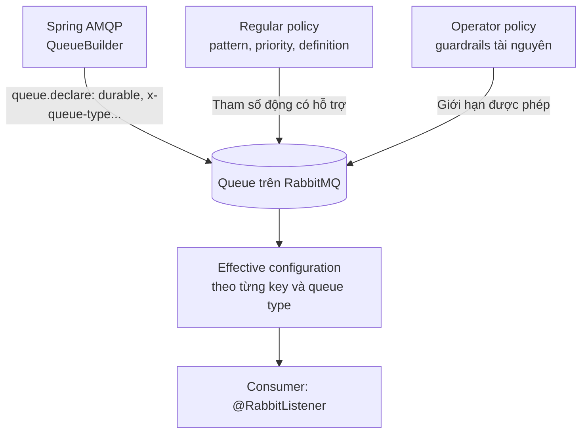
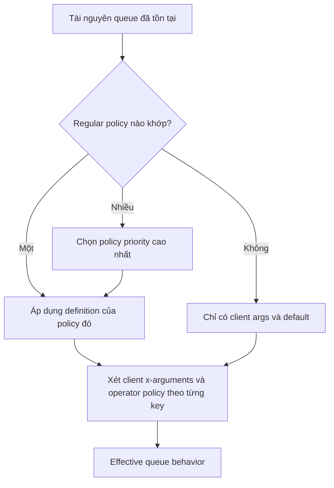
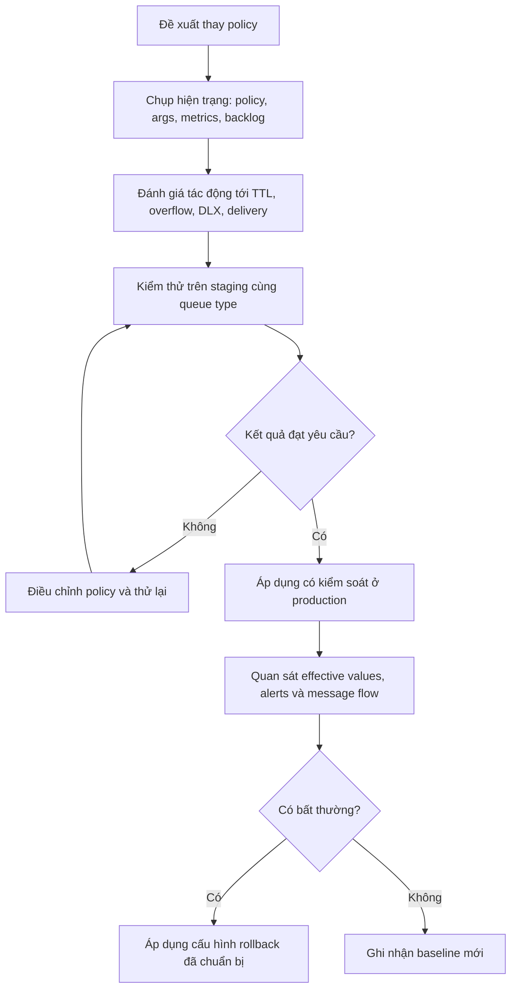

# Ưu tiên cấu hình có thể thay đổi và giới hạn của thuộc tính cố định

Trong RabbitMQ, **không phải mọi thuộc tính của queue đều có thể đổi sau khi tạo**. Ví dụ, giới hạn số message và thời gian sống của message thường được quản lý bằng **policy** để điều chỉnh trong lúc hệ thống chạy. Ngược lại, `durable`, `exclusive` và `x-queue-type` gắn với cách queue được khai báo; không thể biến một queue đã tồn tại thành loại khác chỉ bằng cách sửa một giá trị trong ứng dụng Spring AMQP.

Bài thuộc chương **Chính sách hàng đợi** của module **SPRING_AMQP**. Ta sẽ phân biệt cấu hình cố định và cấu hình có thể thay đổi, hiểu thứ tự ưu tiên của **client `x-arguments`**, **regular policies** và **operator policies**, rồi áp dụng khi tích hợp RabbitMQ bằng `QueueBuilder`, `RabbitTemplate`, `@RabbitListener`, exchange, queue và binding. Việc nắm rõ ranh giới này đặc biệt quan trọng khi triển khai TTL, giới hạn backlog, retry, dead-letter, giao dịch và quan sát hệ thống bất đồng bộ đáng tin cậy.

Sau bài học, bạn có thể:

- Chọn đúng nơi cấu hình: Java declaration, regular policy hay operator policy.
- Phân biệt **priority giữa các policy** với **precedence giữa các nguồn cấu hình**.
- Biết những thuộc tính nào chỉ chốt được khi tạo queue và khi nào cần migration.
- Khai báo một queue Spring AMQP với thuộc tính cố định, để TTL/DLX và giới hạn backlog cho policy.
- Tạo, thay đổi và kiểm chứng policy mà không cần sửa code ứng dụng khi tính năng cho phép.
- Dự đoán ảnh hưởng của policy tới message đang chờ, overflow, dead-letter, publisher confirms và listener.

> **Phạm vi:** Mẫu lệnh hướng tới RabbitMQ hỗ trợ cơ chế policies/operator policies và Spring Boot có `spring-boot-starter-amqp`. Danh sách policy keys và hành vi ở các queue type khác nhau có thể thay đổi giữa các phiên bản RabbitMQ; luôn đối chiếu tài liệu của **phiên bản broker đang vận hành**. Các ví dụ CLI chỉ dành cho môi trường thử nghiệm có quyền quản trị phù hợp.

## 1. Ba lớp cấu hình và một ranh giới quan trọng

RabbitMQ có hai nhóm thông tin khi khai báo queue:

1. **Các thuộc tính khai báo bắt buộc/cấu trúc**: tên, `durable`, `exclusive`, `autoDelete` và các thuộc tính tương đương.
2. **Optional arguments** (thường gọi là `x-arguments`): `x-queue-type`, `x-message-ttl`, `x-max-length`, `x-dead-letter-exchange`, `x-max-priority`... Mỗi argument có mức độ thay đổi khác nhau.

Các optional arguments có thể lấy từ:

- **Client-provided arguments**: ứng dụng Spring AMQP gửi ngay trong `queue.declare`. Ví dụ `QueueBuilder...withArgument("x-message-ttl", 60000)`.
- **Regular policy**: quản trị viên khai báo tập rules theo tên đối tượng và virtual host; RabbitMQ áp dụng các policy keys có hỗ trợ.
- **Operator policy**: giới hạn bảo vệ do người quản trị broker áp đặt trên một tập nhỏ những tham số được hỗ trợ, ví dụ trần TTL/queue length.



**Nguyên tắc lựa chọn:** Nếu một tham số có thể thay đổi qua policy và đội vận hành cần điều chỉnh nó sau deploy, hãy **ưu tiên policy**. Chỉ chốt bằng khai báo Java những thuộc tính mang tính định danh/cấu trúc hoặc yêu cầu không hỗ trợ policy.

### 1.1. Ma trận: cái gì thay đổi được?

| Thuộc tính | Ví dụ | Nơi cấu hình khuyến nghị | Có thể thay đổi bằng policy trên queue đang tồn tại? |
| --- | --- | --- | --- |
| Tên queue | `jobs.email.q` | Khi tạo queue; hợp đồng producer/consumer | **Không**. Đổi tên nghĩa là tạo queue khác. |
| `durable` | `true` | `QueueBuilder.durable(...)` | **Không**. |
| `exclusive` / `autoDelete` | `false` | Queue declaration | **Không** qua policy. |
| Queue type | `x-queue-type=classic/quorum` | Khi khai báo, hoặc default queue type của broker/vhost theo tính năng hỗ trợ | **Không**; queue type không thay tại chỗ. |
| Mức ưu tiên tối đa của classic queue | `x-max-priority=5` | Client argument khi tạo | **Không**. |
| Single active consumer | `x-single-active-consumer=true` | Client argument khi tạo | Không dùng regular policy để bật/tắt cho queue đã khai báo. |
| Message TTL của queue | `message-ttl=60000` | **Regular policy** | **Có**, theo queue type hỗ trợ; tác động tới backlog cần kiểm thử. |
| Queue expiration khi không dùng | `expires=1800000` | **Regular policy** | **Có**, với loại queue hỗ trợ. |
| Giới hạn số message hoặc dung lượng | `max-length=10000`, `max-length-bytes` | **Regular policy**, có thể thêm operator policy | **Có**, nhưng thay đổi có thể làm message bị loại/reject. |
| Dead-letter exchange/routing key | `dead-letter-exchange`, `dead-letter-routing-key` | **Regular policy** | **Có**, theo hỗ trợ của broker. |
| Overflow strategy | `overflow=reject-publish` | **Regular policy** | **Có**, theo loại queue và giới hạn phiên bản. |
| Quorum delivery limit | `delivery-limit` | Policy phù hợp quorum queue | Phụ thuộc tính năng và phiên bản broker; không áp dụng cho mọi loại queue. |

Bảng trên nói về **khả năng cấu hình**, không bảo đảm việc đổi policy sẽ không ảnh hưởng dữ liệu. Ví dụ giảm TTL có thể làm message tồn đọng hết hạn; giảm `max-length` có thể dẫn đến overflow ngay sau khi áp dụng.

## 2. Vì sao nên tách thuộc tính cố định và policy?

Giả sử một ứng dụng thông báo dùng queue `notifications.email.q`. Ban đầu nhóm vận hành cho message chờ tối đa 24 giờ. Sau đợt vận hành, nhóm quyết định giảm còn 2 giờ.

**Cách gắn cứng vào Java declaration:**

```java
@Bean
Queue emailQueue() {
    return QueueBuilder.durable("notifications.email.q")
            .withArgument("x-queue-type", "classic")
            .ttl(86_400_000)
            .build();
}
```

Ứng dụng gửi optional argument `x-message-ttl=86400000` khi khai báo. Khi nhóm sửa `ttl(...)` thành `7_200_000` rồi khởi động lại, broker có thể phản hồi **`PRECONDITION_FAILED - inequivalent arg`** do queue đã tồn tại với argument cũ. Tùy phiên bản và cách declaration equivalence được thực hiện, thay `x-arguments` của client không phải phương pháp an toàn để điều chỉnh trực tiếp queue production.

**Cách tách chính sách có thể thay đổi:**

```java
@Bean
Queue emailQueue() {
    return QueueBuilder.durable("notifications.email.q")
            .withArgument("x-queue-type", "classic")
            .build();
}
```

Ứng dụng chỉ chốt identity, durability và queue type. Broker áp dụng TTL từ regular policy, ví dụ `{"message-ttl":86400000}`, rồi người vận hành đổi policy thành `{"message-ttl":7200000}` mà không cần sửa Java code. Điều này làm giảm xung đột giữa lifecycle ứng dụng và quản trị queue.

**Để minh họa, hai đoạn `@Bean` là hai phương án thay thế**, không được đặt cạnh nhau trong cùng một Spring context.

### 2.1. Quy ước sở hữu phù hợp

| Loại quyết định | Đơn vị nên chịu trách nhiệm | Ví dụ |
| --- | --- | --- |
| Hợp đồng ứng dụng | Nhóm phát triển, có review kiến trúc | Queue name, exchange, routing key, queue type. |
| Hành vi động theo nghiệp vụ | Nhóm phát triển phối hợp vận hành | TTL, DLX, giới hạn hàng đợi, overflow. |
| Trần bảo vệ tài nguyên toàn vhost | Nhóm vận hành RabbitMQ | Operator policy về `max-length`, `message-ttl` khi phù hợp. |
| Quyền và an toàn hệ thống | Nhóm platform/security | Vhost, quyền configure/write/read, cấu hình broker. |

Spring AMQP **không có quyền tự quyết định** policy của broker chỉ vì có bean `Queue`. Việc tạo và cập nhật policy là chức năng quản trị RabbitMQ, thường đi qua CLI, Management UI hoặc API, với quyền tương ứng.

## 3. Regular policy: pattern, định nghĩa và priority

Một regular policy là một cấu hình **theo virtual host**, với các thành phần:

| Thuộc tính | Ý nghĩa |
| --- | --- |
| `name` | Tên policy do đội vận hành đặt. |
| `pattern` | Biểu thức chính quy (*regular expression*) khớp **tên** queue/exchange, không phải routing key. |
| `definition` | JSON map các **policy keys** và values. |
| `priority` | Số xác định policy nào thắng khi nhiều regular policies cùng khớp một tài nguyên. |
| `apply-to` | Giới hạn loại tài nguyên: queues, exchanges hoặc một số queue type cụ thể. |
| Vhost | Phạm vi tồn tại của policy; policy ở vhost A không áp dụng cho queue cùng tên ở vhost B. |

### 3.1. Tạo policy TTL bằng RabbitMQ CLI

Ví dụ dành cho môi trường thực hành, cú pháp Bash:

```bash
rabbitmqctl set_policy jobs-lifecycle \
  '^jobs\.' \
  '{"message-ttl":600000,"max-length":10000}' \
  --priority 10 \
  --apply-to queues
```

Với một queue `jobs.image.q` hoặc `jobs.email.q` trong **vhost mặc định** `/`, pattern `^jobs\.` khớp phần đầu tên; policy yêu cầu message TTL là 10 phút và giới hạn backlog tối đa 10.000 message. Lệnh chạy trên broker/nơi có `rabbitmqctl` và quyền quản trị. Trên Windows, cú pháp quote/escape JSON khác Bash; có thể dùng Management UI hoặc `rabbitmqadmin` tương ứng thay vì copy lệnh Bash trực tiếp vào PowerShell.

**Cần hiểu đúng các keys:** Trong client declaration dùng `x-message-ttl`, `x-max-length`, nhưng trong **policy definition** dùng `message-ttl` và `max-length` (không có `x-`). Một policy sai tên key có thể bị từ chối hoặc không có tác dụng như dự kiến.

Ví dụ một policy DLX (chỉ dùng khi exchange `jobs.dlx` đã được khai báo đúng và quyền phù hợp):

```bash
rabbitmqctl set_policy jobs-deadletter \
  '^jobs\.deadletter-demo\.' \
  '{"dead-letter-exchange":"jobs.dlx","dead-letter-routing-key":"job.failed"}' \
  --priority 20 \
  --apply-to queues
```

Tài nguyên không tồn tại vào lúc tạo policy cũng có thể được áp dụng policy khi được khai báo sau đó. Không cần có consumer đang hoạt động thì policy mới được gán.

### 3.2. Policy priority không phải ưu tiên message

Giả sử queue `jobs.email.q` khớp:

| Policy | Pattern | Priority | Definition |
| --- | --- | --- | --- |
| `jobs-default` | `^jobs\.` | 5 | `{"message-ttl":3600000,"max-length":50000}` |
| `jobs-email` | `^jobs\.email\.q$` | 15 | `{"message-ttl":600000}` |

**Chỉ regular policy có priority cao nhất (15) được chọn.** RabbitMQ **không tự gộp** `max-length` từ policy priority 5 vào policy priority 15. Muốn queue email vừa có TTL 10 phút vừa có max-length 50.000, hãy đưa **cả hai** keys vào definition của policy thắng.

Khi hai regular policies cùng khớp với **priority bằng nhau**, policy được chọn có thể không xác định. Không dựa vào thứ tự tạo hoặc pattern dài hơn; đặt priority duy nhất cho các nhóm chồng lấn hoặc thiết kế pattern không trùng.

**Đừng nhầm:** policy `priority` chỉ chọn **cấu hình thắng**, không làm message có độ ưu tiên cao hơn trong classic priority queue. Mức message priority được cấu hình bằng `x-max-priority` tại lúc tạo queue, một khái niệm khác.

### 3.3. Thay đổi policy khi hệ thống đang chạy

Có thể thay definition của một policy hiện tại bằng lệnh `set_policy` với **cùng tên** và đầy đủ JSON mới:

```bash
rabbitmqctl set_policy jobs-lifecycle \
  '^jobs\.' \
  '{"message-ttl":120000,"max-length":5000}' \
  --priority 10 \
  --apply-to queues
```

Thao tác này thay TTL từ 10 phút xuống 2 phút và max-length từ 10.000 xuống 5.000. Broker sẽ áp dụng cho các queue được match sau khi thay policy, thường nhanh nhưng có thể mất thời gian với nhiều đối tượng hoặc queue rất bận.

**Nguy cơ có thật:** giảm TTL khiến message đang chờ có thể hết hạn; giảm max-length có thể kích hoạt overflow. Cần quan sát sẵn backlog, rà soát business SLA và thử nghiệm trên môi trường tương tự trước khi thay policy production.



## 4. Precedence: nguồn nào quyết định giá trị cuối cùng?

Đây là điểm dễ gây nhầm lẫn nhất. Có **hai phép so sánh khác nhau**:

1. **Giữa các regular policies**: pattern nào khớp, policy nào có `priority` cao hơn? Chỉ **một** regular policy được chọn cho một queue/exchange.
2. **Giữa nhiều nguồn cấu hình cho cùng một key**: client `x-arguments`, regular policy được chọn, operator policy (nếu có). Quy tắc phụ thuộc loại key và queue type.

### 4.1. Client arguments và regular policy

Với **nhiều optional arguments**, giá trị do client truyền trong `queue.declare` có ưu tiên cao hơn regular policy. Ví dụ một queue đã được khai báo với:

```java
@Bean
Queue reportsQueue() {
    return QueueBuilder.durable("jobs.reports.q")
            .withArgument("x-queue-type", "classic")
            .withArgument("x-message-ttl", 300_000)
            .build();
}
```

Nếu sau đó regular policy cho nhóm `jobs.*` đặt `message-ttl=60000`, đừng mặc định queue này sẽ nhận TTL 60 giây. **Client argument TTL vẫn có thể chi phối effective value** (trừ khi có operator policy phù hợp). Vì vậy, muốn quản lý TTL qua policy, hãy **tránh khai báo thêm `x-message-ttl` trong ứng dụng**.

Tuy nhiên, không được khái quát rằng “client arguments luôn thắng mọi policy keys”. Có các **ngoại lệ theo tính năng**; chẳng hạn:

- Tài liệu RabbitMQ về **queue length** nêu trường hợp cả `x-max-length` và `max-length` được thiết lập thì giới hạn thấp hơn có hiệu lực.
- Với một số cài đặt **streams** hoặc `overflow` của quorum queue, quy tắc precedence có khác với default.
- Những keys không hỗ trợ policy, như `x-queue-type` và `x-max-priority`, không nằm trong phép so sánh này.

Khi hai nguồn cùng đặt một key, hãy tra tài liệu **riêng của tính năng trên đúng broker version** và kiểm tra effective configuration; cách dễ quản lý nhất vẫn là **để một nguồn chính sở hữu mỗi key**.

### 4.2. Operator policy đặt rào chắn

**Operator policy** là cơ chế để nhóm vận hành áp đặt các giới hạn tránh ứng dụng tiêu thụ quá nhiều tài nguyên. Không phải policy key nào cũng được dùng trong operator policy.

Ví dụ một operator policy giới hạn `max-length` của nhóm queue `jobs.*` tối đa 5.000 message:

```bash
rabbitmqctl set_operator_policy jobs-safety \
  '^jobs\.' \
  '{"max-length":5000}' \
  --priority 10 \
  --apply-to queues
```

Giả sử regular policy đặt `max-length=20000`, operator policy đặt `max-length=5000`, thì giá trị giới hạn hiệu lực là **5000**. Nếu ứng dụng/policy yêu cầu giới hạn **1000** (nghiêm ngặt hơn), operator policy thường cho phép giá trị thấp hơn đó. Với nhiều keys dạng số, quy tắc thường là chọn **giá trị bảo thủ hơn**, ví dụ giá trị nhỏ hơn đối với TTL, max-length và max-length-bytes. Với key không phải số như `overflow`, giá trị operator policy có thể quyết định trực tiếp.

**Operator policy không phải công cụ thay đổi các thuộc tính bất biến**. Nó không biến classic queue thành quorum queue; cũng không thêm/bớt những mức priority đã quyết định lúc khai báo.

### 4.3. Bảng diễn giải các tình huống

| Client `x-arguments` | Regular policy | Operator policy | Kết quả cần hiểu |
| --- | --- | --- | --- |
| Không có `x-message-ttl` | `message-ttl=60000` | Không có | Queue áp dụng TTL 60 giây nếu policy match và queue hỗ trợ. |
| `x-message-ttl=300000` | `message-ttl=60000` | Không có | Với precedence TTL thông thường, client argument chi phối; thay regular policy không cho kết quả dự định. |
| Không có `x-max-length` | `max-length=20000` | `max-length=5000` | Operator policy bảo vệ queue bằng giới hạn 5.000. |
| Không có `x-max-length` | `max-length=1000` | `max-length=5000` | Giới hạn 1.000 được giữ vì nghiêm ngặt hơn. |
| `x-max-length=1000` | `max-length=20000` | Không có | Theo tài liệu queue length của RabbitMQ, mức giới hạn thấp hơn được chọn. |
| `x-queue-type=classic` | Cố gắng đặt type bằng policy | Không áp dụng | Queue type phải quyết định lúc tạo; policy không đổi queue type. |
| `x-max-priority=5` | Cố gắng thay số priority bằng policy | Không áp dụng | Số cấp priority của classic queue không thay bằng policy. |

Các con số trên chỉ là **ví dụ về effective values**. Trong hệ thống thật, luôn ghi nhận cả **queue arguments** và **effective policy/operator policy**, vì các keys và queue type có thể có quy tắc ngoại lệ theo phiên bản RabbitMQ.

### 4.4. Operator policy được giới hạn vào những keys nào?

Trong các dòng RabbitMQ hiện đại, các keys operator policy phổ biến trên classic/quorum queues gồm:

| Key | Mục đích | Ghi chú |
| --- | --- | --- |
| `message-ttl` | Giới hạn thời gian message lưu trong queue. | Cần xét ảnh hưởng tới message tồn đọng. |
| `expires` | Giới hạn thời gian queue không được sử dụng. | Phù hợp với queue tạm ở các queue type hỗ trợ. |
| `max-length` | Giới hạn số message đang chờ theo semantics queue type. | Có thể dẫn đến overflow/drop/reject. |
| `max-length-bytes` | Giới hạn dung lượng phần thân message. | Không phải tổng bộ nhớ broker. |
| `overflow` | Chọn hành vi khi đạt giới hạn. | Giá trị hợp lệ/phạm vi hỗ trợ thay đổi theo queue type. |
| `delivery-limit` | Giới hạn số lần giao lại trên quorum queue. | Không áp dụng chung cho classic queue. |

Không đưa tùy ý `dead-letter-exchange`, `x-queue-type` hoặc `x-max-priority` vào operator policy rồi kỳ vọng RabbitMQ chấp nhận. **Regular policy** có tập keys rộng hơn; operator policy cố ý giới hạn để tránh thay đổi semantics của ứng dụng ngoài dự kiến.

## 5. Thuộc tính cố định: điều gì không thể đổi sau declaration?

Các thuộc tính thiết lập lúc tạo queue thường gắn với bản chất của resource:

| Thuộc tính | Vì sao phải quyết định trước? | Nếu muốn đổi |
| --- | --- | --- |
| Queue name | Đó là định danh mà consumer/publisher/binding tham chiếu. | Tạo queue mới và chuyển hướng routing/consumer. |
| `durable` | Quy định vòng đời và lưu trữ định nghĩa queue. | Tạo queue mới với durability mong muốn. |
| `exclusive` | Gắn quyền sử dụng queue với connection khai báo. | Tạo queue mới; không đổi bằng policy. |
| `autoDelete` | Quy định điều kiện tự xóa theo vòng đời consumer. | Tạo queue mới; xem kỹ dữ liệu cũ. |
| `x-queue-type` | Quy định cấu trúc queue, storage và cơ chế hoạt động. | Chuyển từ classic sang quorum/stream bằng migration. |
| `x-max-priority` | Cấu trúc mức ưu tiên của classic priority queue. | Tạo queue mới theo số mức mới. |
| `x-single-active-consumer` | Chế độ chọn một consumer active của queue. | Xem như cấu hình cần chốt lúc tạo; thay bằng migration có kiểm soát nếu cần. |

RabbitMQ so sánh thuộc tính khi nhiều client cùng declare một queue. Nếu có sự khác biệt không tương đương, broker có thể đóng channel với lỗi `PRECONDITION_FAILED` (mã AMQP thường là `406`).

Ví dụ:

```java
// Lần đầu:
QueueBuilder.durable("jobs.image.q")
        .withArgument("x-queue-type", "classic")
        .build();

// Lần sau, cùng tên nhưng muốn đổi queue type:
QueueBuilder.durable("jobs.image.q")
        .withArgument("x-queue-type", "quorum")
        .build();
```

Hai khai báo này **không phải là thao tác upgrade queue**. Với queue hiện hữu, việc đổi queue type yêu cầu kế hoạch chuyển đổi thực tế. Một số broker có cơ chế default queue type hoặc cấu hình nới lỏng kiểm tra tương đương trong tình huống hẹp; **không nên dựa vào ngoại lệ đó để thực hiện migration production**.

### 5.1. Quorum queue không chỉ là classic queue + `x-queue-type`

Quorum queue dùng cơ chế replication/quorum và có đặc điểm khác về xác nhận, overflow, redelivery, dead-letter và tài nguyên. Không mặc định rằng:

- Một argument hỗ trợ trên classic cũng được quorum hỗ trợ;
- Queue đang có message sẽ tự chuyển dữ liệu khi đổi type;
- Policy dùng cho classic sẽ có hiệu lực hoặc semantics giống nhau trên quorum.

Khi đổi queue type, cần thử nghiệm gửi/nhận bằng `RabbitTemplate`, `@RabbitListener`, ACK/NACK, DLQ, retry và tình huống mất kết nối trên broker mục tiêu.

## 6. Thiết kế topology Spring AMQP để policy có thể vận hành độc lập

Giả sử hệ thống xử lý ảnh có luồng gửi job `image.resize`. Ứng dụng sở hữu queue type, tên exchange, routing key, binding; đội vận hành sở hữu TTL, backlog limit và DLX qua policy.

```mermaid
flowchart LR
    P[Spring producer] -->|image.resize| EX[Direct exchange<br/>jobs.commands.x]
    EX -->|image.resize| Q[(jobs.image.q<br/>quorum queue)]
    Q --> L[@RabbitListener worker]
    Q -->|dead lettering theo policy| DX[jobs.dlx]
    DX -->|image.failed| DQ[(jobs.image.dead.q)]
```

### 6.1. Java configuration chỉ chốt topology

```java
import org.springframework.amqp.core.Binding;
import org.springframework.amqp.core.BindingBuilder;
import org.springframework.amqp.core.DirectExchange;
import org.springframework.amqp.core.ExchangeBuilder;
import org.springframework.amqp.core.Queue;
import org.springframework.amqp.core.QueueBuilder;
import org.springframework.beans.factory.annotation.Qualifier;
import org.springframework.context.annotation.Bean;
import org.springframework.context.annotation.Configuration;

@Configuration
public class JobTopologyConfig {
    @Bean
    DirectExchange jobCommandsExchange() {
        return ExchangeBuilder.directExchange("jobs.commands.x")
                .durable(true)
                .build();
    }

    @Bean
    Queue jobImageQueue() {
        return QueueBuilder.durable("jobs.image.q")
                .withArgument("x-queue-type", "quorum")
                // Không hard-code x-message-ttl, x-max-length,
                // x-dead-letter-exchange nếu muốn policy quản lý.
                .build();
    }

    @Bean
    Binding jobImageBinding(
            @Qualifier("jobImageQueue") Queue queue,
            @Qualifier("jobCommandsExchange") DirectExchange exchange) {
        return BindingBuilder.bind(queue).to(exchange)
                .with("image.resize");
    }

    @Bean
    DirectExchange jobDeadLetterExchange() {
        return ExchangeBuilder.directExchange("jobs.dlx")
                .durable(true)
                .build();
    }

    @Bean
    Queue jobDeadLetterQueue() {
        return QueueBuilder.durable("jobs.image.dead.q")
                .withArgument("x-queue-type", "quorum")
                .build();
    }

    @Bean
    Binding jobDeadLetterBinding(
            @Qualifier("jobDeadLetterQueue") Queue queue,
            @Qualifier("jobDeadLetterExchange") DirectExchange exchange) {
        return BindingBuilder.bind(queue).to(exchange)
                .with("image.failed");
    }
}
```

**Ranh giới trách nhiệm:** Bean `Queue` tạo khai báo queue chính; regular policy đặt TTL/DLX và các tham số động. `RabbitAdmin` thường hỗ trợ tự khai báo các bean queue/exchange/binding khi Spring AMQP có kết nối và quyền phù hợp. Policy được tạo riêng trên broker bằng công cụ vận hành; bean Java ở trên **không tự tạo policy**.

### 6.2. Policy cho queue chính

Ở môi trường test riêng, tạo policy này **trước hoặc sau khi queue được declare** đều được. Pattern được neo chính xác tên queue để tránh ảnh hưởng DLQ:

```bash
rabbitmqctl set_policy image-jobs \
  '^jobs\.image\.q$' \
  '{"message-ttl":600000,"max-length":10000,"dead-letter-exchange":"jobs.dlx","dead-letter-routing-key":"image.failed"}' \
  --priority 20 \
  --apply-to queues
```

Lưu ý các giá trị:

- `message-ttl=600000` là 10 phút, tính bằng milliseconds.
- `max-length=10000` đặt giới hạn số lượng theo semantics queue type.
- `dead-letter-exchange` là tên exchange **đã tồn tại** hoặc phải được tạo đúng thời điểm sử dụng.
- `dead-letter-routing-key` đặt key chuyển message vào DLQ.

Pattern `^jobs\.image\.q$` không khớp `jobs.image.dead.q` nên policy tránh vô tình thiết lập DLX lên queue chết, tạo vòng chuyển dead-letter.

### 6.3. Producer và consumer không cần biết policy được lưu ở đâu

```java
import org.springframework.amqp.rabbit.core.RabbitTemplate;
import org.springframework.stereotype.Service;

@Service
class ResizeJobPublisher {
    private final RabbitTemplate template;

    ResizeJobPublisher(RabbitTemplate template) {
        this.template = template;
    }

    public void submit(String imageId) {
        template.convertAndSend(
                "jobs.commands.x", "image.resize", imageId);
    }
}
```

```java
import org.springframework.amqp.rabbit.annotation.RabbitListener;
import org.springframework.stereotype.Component;

@Component
class ResizeJobListener {
    @RabbitListener(queues = "jobs.image.q")
    public void handle(String imageId) {
        // Demo: tìm dữ liệu ảnh theo imageId, xử lý có idempotency.
        System.out.println("Resize image: " + imageId);
    }
}
```

Đối với ứng dụng thật, hãy dùng message schema và ID nghiệp vụ để tránh xử lý trùng; khi listener lỗi, hành vi retry, ACK/NACK và requeue vẫn phải được cấu hình **riêng**. Việc đặt DLX policy không có nghĩa mọi exception tự động vào DLQ.

## 7. Chính sách động vẫn có thể làm thay đổi hành vi nghiệp vụ

Policy giúp điều chỉnh cấu hình mà không cần deploy lại Java code, nhưng **dynamic không đồng nghĩa vô hại**. Một giá trị mới có thể làm mất message còn trong queue, thay đổi cách broker xác nhận publish hoặc tác động đến các consumer đang chạy.

### 7.1. Thay message TTL trên queue đã có backlog

Giả sử `jobs.image.q` có 8.000 message đang chờ, một phần đã nằm trong queue 7 phút. Policy cũ đặt TTL 10 phút, policy mới giảm còn 2 phút.

Khi policy mới có hiệu lực, các message đã chờ quá lâu có thể được đánh dấu hết hạn và bị loại bỏ hoặc dead-letter theo cấu hình. **Không đảm bảo tất cả message hết hạn được dọn khỏi bộ nhớ/đĩa ngay lập tức**:

- RabbitMQ có thể xử lý expiration khi message đạt vị trí thích hợp trong queue hoặc khi queue được thông báo có policy thay đổi.
- Hành vi phụ thuộc queue type, loại TTL (per-message/per-queue) và phiên bản broker.
- Các message hết hạn có thể còn xuất hiện tạm thời trong số liệu queue dù không được giao cho consumer.

Nếu việc không xử lý đủ một tác vụ là nghiêm trọng, việc giảm TTL phải được đánh giá như **thay đổi quy tắc giữ dữ liệu**, có kế hoạch quan sát và xử lý backlog.

**Phân biệt:** `message-ttl` đặt thời hạn giữ *message* trong queue; `expires` đặt thời hạn tự xóa *queue không được sử dụng* khi đáp ứng điều kiện broker. Không áp dụng `expires` tùy tiện lên queue chứa công việc cần được bảo toàn.

### 7.2. Giảm `max-length` và chọn overflow

Giả sử queue đang có 7.000 message ready nhưng đội vận hành giảm giới hạn từ 10.000 xuống 5.000. Broker phải xử lý trạng thái vượt giới hạn theo policy/queue type.

| Overflow strategy | Tác động khái quát | Cần lưu ý |
| --- | --- | --- |
| `drop-head` | Loại hoặc dead-letter các message cũ ở đầu queue để dành chỗ cho message mới. | Có nguy cơ mất công việc cũ nếu không có DLX/cơ chế phục hồi. |
| `reject-publish` | Từ chối những publish mới khi queue đạt giới hạn. | Cần publisher confirms và xử lý NACK tại producer. |
| `reject-publish-dlx` | Từ chối publish và dead-letter message mới theo khả năng queue type. | Hỗ trợ và semantics khác nhau theo phiên bản/queue type. |

Nếu publish tới **nhiều queue**, một queue từ chối vì overflow không đồng nghĩa các queue khác cũng từ chối. Producer có thể nhận NACK trong khi message vẫn đã vào một số queue khác. Vì vậy, chiến lược retry của publisher phải cân nhắc idempotency và trường hợp nhận không đồng đều giữa các subscriber.

Ví dụ một policy riêng cho queue thực hành cố tình dùng `reject-publish`:

```bash
rabbitmqctl set_policy bounded-test \
  '^lab\.bounded\.q$' \
  '{"max-length":100,"overflow":"reject-publish"}' \
  --priority 30 \
  --apply-to queues
```

Thử nghiệm cần bật publisher confirms và có logic quan sát confirm callback để biết publish đã bị từ chối. Không dùng overflow như một cách “giảm tải miễn phí” nếu không chấp nhận được việc từ chối message.

### 7.3. Đổi dead-letter exchange và retry

Một regular policy có thể đổi `dead-letter-exchange` cho một nhóm queue hỗ trợ tính năng này. Tuy nhiên, nếu queue đã khai báo `x-dead-letter-exchange` từ code và client arguments đang được ưu tiên, policy mới có thể **không thay đổi đích thực tế** như đội vận hành kỳ vọng.

Ngay cả khi policy được áp dụng đúng, cần:

1. Tạo exchange và binding đích trước khi định tuyến dead-letter.
2. Xác minh queue loại nào được phép dùng cấu hình đó và có quyền phù hợp.
3. Kiểm tra listener xử lý lỗi theo `requeue` nào; message requeue liên tục sẽ chưa chắc đi tới DLX.
4. Tránh chu kỳ DLX đưa message qua lại giữa nhiều queue mà không có điểm dừng.
5. Bảo đảm có monitoring, alarm, quy trình điều tra và replay DLQ có kiểm soát.

**Thay policy không tự tạo một giao dịch nguyên tử xuyên producer, broker, consumer và database.** Publisher confirms, consumer ACK và transaction nghiệp vụ vẫn cần được giải quyết độc lập.

## 8. Kiểm tra effective policy thay vì chỉ xem file cấu hình

Một policy tồn tại trên broker **chưa chắc** áp dụng lên queue mà bạn quan tâm. Nguyên nhân có thể là sai vhost, pattern, apply-to, priority hoặc client arguments/operator policy đang chi phối.

### 8.1. Kiểm tra policy theo virtual host

Lệnh trong tài liệu RabbitMQ cho vhost mặc định:

```bash
rabbitmqctl --vhost "/" list_policies --formatter=pretty_table
```

Với `rabbitmqadmin` phiên bản hỗ trợ nhóm lệnh `policies`:

```bash
rabbitmqadmin --vhost "/" policies list_in
```

Kiểm tra một tên queue cụ thể với RabbitMQ Admin CLI v2:

```bash
rabbitmqadmin --vhost "/" policies list_matching_object \
  --name "jobs.image.q" \
  --type "queues"
```

Tại RabbitMQ Management UI, có thể xem **Admin → Policies** để đọc regular/operator policies, rồi xem **Queues and Streams → queue đang xét** để kiểm tra arguments và policy gắn với queue. Tên menu có thể khác theo phiên bản management plugin.

### 8.2. Checklist điều tra giá trị hiệu lực

| Cần kiểm tra | Vì sao? |
| --- | --- |
| Vhost của queue và policy | Hai vhost khác nhau có thể có queue cùng tên nhưng policy độc lập. |
| Regex `pattern` | Pattern khớp **tên queue**, không khớp message routing key. |
| `apply-to` | Policy có thể dành riêng cho exchanges hoặc loại queue khác. |
| Policy `priority` | Policy có priority cao hơn có thể thay policy bạn đang sửa. |
| Toàn bộ `definition` | Policy thắng chỉ áp dụng các keys có mặt trong definition của nó. |
| Client `x-arguments` | TTL/DLX hard-code có thể giữ giá trị khác với policy. |
| Operator policy | Các rào chắn tài nguyên có thể chặn giá trị vượt mức. |
| Queue type và broker version | Không phải key nào cũng hỗ trợ như nhau trên classic/quorum/stream. |
| Queue metrics và log | Policy mới có thực sự tác động lên backlog, TTL, overflow, DLQ không? |

**Ví dụ phân tích:** Có policy `jobs-lifecycle` với `message-ttl=60000` và bạn vẫn thấy message quá 60 giây trên dashboard. Không vội kết luận RabbitMQ bỏ qua policy. Kiểm tra queue được policy nào match, TTL có bị client argument ghi đè, message đang ở vị trí nào trong queue, cách broker xử lý expiration và liệu thống kê đã cập nhật hay chưa.

## 9. Quy trình thay đổi policy an toàn trong môi trường thật

Một thay đổi đơn giản như giảm TTL cũng có thể ảnh hưởng dữ liệu. Với queue quan trọng, nên quản trị policy như một phần của cấu hình hạ tầng có version control và review.



Trước khi triển khai, ghi lại những thông tin sau:

| Hạng mục | Ví dụ |
| --- | --- |
| Queue/nhóm queue chịu ảnh hưởng | `^jobs\.image\.q$` thay vì `.*` |
| Version broker / queue type | RabbitMQ thuộc release line cụ thể; queue `quorum` |
| Current effective values | `message-ttl=600000`, `max-length=10000` |
| Desired values | `message-ttl=300000`, `max-length=8000` |
| Backlog và tốc độ vào/ra | `ready=4000`, `unacked=150`, publish/ACK rates |
| Rủi ro | Một số message hiện tại có thể hết hạn sau thay đổi |
| Cơ chế giám sát | DLQ count, publisher NACK, consumer errors, queue depth |
| Rollback | Toàn bộ policy definition, priority, pattern và apply-to cũ |

### 9.1. Rollback policy không phải khôi phục message đã mất

Nếu giảm TTL từ 10 phút xuống 2 phút khiến 1.000 message hết hạn, sau đó đặt TTL trở lại 10 phút **không khôi phục** 1.000 message đã bị loại bỏ. Điều tương tự áp dụng khi overflow làm drop message.

Do đó rollback cần đi kèm phương án nghiệp vụ nếu dữ liệu quan trọng: nguồn dữ liệu gốc để tái tạo công việc, dead-letter queue, event log, transactional outbox hoặc audit record. Không hứa hẹn rollback policy tự động đảo ngược mọi tác dụng.

### 9.2. Khi nào phải migration thay vì đổi policy?

Ví dụ queue `orders.commands.q` hiện là classic và yêu cầu mới cần khả năng chịu lỗi node của quorum queue. Đây là thay đổi **queue type**, không phải tham số động:

1. Khai báo queue mới `orders.commands.quorum.q` với `x-queue-type=quorum`.
2. Thiết kế routing mới, xác định cách chuyển publisher và consumer sang queue mới.
3. Đảm bảo xử lý message còn ở queue cũ, kiểm soát ID chống xử lý trùng nếu có giai đoạn chạy song song.
4. Kiểm tra ACK, retry, DLX, consumer recovery và broker failure trên queue mới.
5. Theo dõi backlog đến khi có thể giải phóng queue cũ an toàn.

Đừng thay `QueueBuilder` cùng tên từ classic sang quorum rồi xóa queue cũ khi gặp `PRECONDITION_FAILED`: có thể mất công việc chưa ACK hoặc gây downtime.

## 10. Các lỗi thường gặp và cách tìm nguyên nhân

| Hiện tượng | Khả năng cao | Bước kiểm tra |
| --- | --- | --- |
| Sửa policy nhưng TTL không đổi | Client `x-message-ttl` vẫn có hiệu lực, hoặc policy không match. | Kiểm tra arguments, pattern, priority, vhost và effective policy. |
| Policy cho `jobs.*` không tác động queue cần thiết | Regex pattern viết sai hoặc nhầm với routing key. | Kiểm tra regex; dùng `^jobs\.` cho prefix, `^jobs\.image\.q$` cho một tên. |
| Một policy không có `max-length` như mong muốn | Một regular policy priority cao hơn đang thắng. | Liệt kê policies và gộp keys cần thiết vào policy thắng. |
| Cấu hình bằng operator policy không hợp lệ | Operator policy không hỗ trợ key đó. | Đối chiếu danh sách keys theo queue type và broker version. |
| Policy báo áp dụng nhưng broker reject khi declare | Ứng dụng đổi thuộc tính cố định hoặc client argument không tương đương. | Xem lỗi `PRECONDITION_FAILED`, so sánh khai báo queue thực tế. |
| Queue đột ngột ít message hơn | TTL ngắn, `max-length` giảm hoặc overflow drop. | Kiểm tra thay đổi policy, DLX và số liệu expired/dead-letter. |
| Publish bị NACK sau khi đặt max-length | `overflow=reject-publish` hoặc ràng buộc queue. | Kiểm tra confirm callback, ready count và chính sách overflow. |
| Message lỗi không vào DLQ | Listener requeue, binding DLX sai, thiếu quyền hoặc nguồn cấu hình đang ghi đè. | Kiểm tra ACK/NACK/requeue, effective DLX và queue đích. |
| Policy dùng đúng tên nhưng không ảnh hưởng | Tạo ở sai vhost hoặc `apply-to` không phù hợp. | So sánh vhost/queue type, pattern và danh sách matching policies. |
| Update policy chậm thể hiện trong metrics | Broker cần thời gian áp dụng, queue rất bận hoặc thống kê cập nhật chậm. | Đọc log, metrics, quan sát thêm và xác minh effective configuration. |

## 11. Bài thực hành

Chỉ thử với vhost/queue dành riêng cho thực hành. Các thay đổi TTL, overflow và queue expiration có thể xóa hoặc từ chối message; không dùng queue nghiệp vụ đang có dữ liệu quan trọng.

### Bài 1 — Để policy quản lý TTL

Tạo queue `lab.policy.email.q` bằng `QueueBuilder.durable(...)` nhưng **không đặt `x-message-ttl`**. Dùng `rabbitmqctl set_policy` tạo policy với pattern `^lab\.policy\.email\.q$` và `message-ttl=60000`. Publish message qua `RabbitTemplate`, tạm dừng consumer và quan sát TTL theo cơ chế broker. Đổi policy thành TTL 10.000 ms mà không sửa Java code. Ghi lại effective policy và backlog.

### Bài 2 — Chứng minh client argument gây khó khi thay TTL

Trong môi trường riêng, tạo queue khác `lab.policy.hardcoded.q` với `x-message-ttl=120000` ngay trong `QueueBuilder`. Tạo regular policy đặt `message-ttl=30000`. Quan sát giá trị hiệu lực theo broker đang dùng. Thử đổi policy và giải thích vì sao một tham số đã hard-code ở client có thể ngăn đội vận hành thực hiện thay đổi như dự kiến.

### Bài 3 — Policy priority

Tạo hai policy cùng match một queue: policy A priority 5 có `message-ttl` và `max-length`, policy B priority 10 chỉ có `message-ttl`. Xác minh policy B thắng và key `max-length` từ A **không tự gộp** vào B. Sửa definition B để chứa cả hai keys; kiểm chứng lại.

### Bài 4 — Operator policy đặt giới hạn

Trong môi trường thực hành có quyền quản trị, tạo regular policy `max-length=10000` rồi operator policy `max-length=2000` cho cùng queue. Kiểm tra effective limit. Thay regular policy thành `max-length=1000` và giải thích vì sao giới hạn thấp hơn vẫn có thể được áp dụng. Quan sát tác động lên backlog để hiểu đây là rào chắn tài nguyên, không phải lựa chọn ưu tiên message.

### Bài 5 — Các thuộc tính không thay được

Khai báo queue `lab.policy.classic.q` với `x-queue-type=classic`. Trong nhánh mã thí nghiệm, thử khai báo cùng tên với `x-queue-type=quorum`. Phân tích `PRECONDITION_FAILED` và lập kế hoạch tạo queue mới. Không xóa queue cũ khi còn message; chỉ dọn tài nguyên của bài lab theo quy trình.

### Bài 6 — Overflow và publisher confirm

Tạo queue riêng `lab.bounded.q`, policy `max-length=5`, `overflow=reject-publish`. Tạm dừng consumer, gửi 10 message có ID khác nhau. Bật publisher confirms và callback để nhận biết publish bị từ chối. So sánh số message ready với số lần publish thành công; giải thích vì sao ứng dụng cần xử lý NACK và có ID chống trùng khi retry.

### Bài 7 — Đổi DLX an toàn

Tạo exchange DLX và DLQ, regular policy trỏ dead-letter đến tài nguyên đã khai báo. Đưa một message lỗi vào luồng retry/reject có `requeue=false`, quan sát DLQ. Sau đó đổi policy đến DLX thử nghiệm khác và xác minh routing thực sự thay đổi. Chú ý queue nào đã khai báo `x-dead-letter-exchange` có thể chịu precedence khác queue chỉ dùng policy.

### Câu hỏi ôn tập

1. Khác nhau giữa `priority` của regular policy và `x-max-priority` của classic queue?
2. Hai regular policies cùng match một queue nhưng priority khác nhau: broker có tự gộp tất cả keys không?
3. Vì sao nên tránh hard-code TTL và DLX trong `QueueBuilder` khi cần thay đổi runtime?
4. Operator policy có cho phép đổi queue type từ classic thành quorum không?
5. Với max-length, vì sao cần xem cả queue arguments, regular policy, operator policy và tài liệu của tính năng?
6. Việc giảm message TTL có ảnh hưởng message cũ trong queue hay chỉ message mới?
7. Nếu rollback TTL sau khi một số message đã hết hạn, những message đó có tự xuất hiện lại không?
8. Khi gặp `PRECONDITION_FAILED` sau nâng cấp ứng dụng, vì sao xóa queue ngay có thể gây mất dữ liệu?
9. Tại sao một policy áp dụng đúng nhưng consumer vẫn không nhận message vào DLQ?
10. Vì sao policy đổi được khi chạy nhưng vẫn cần staging test và theo dõi metrics?

## 12. Tài liệu chính thức

- [RabbitMQ — Policies](https://www.rabbitmq.com/docs/policies): regular/operator policies, matching, priority, precedence, cách cập nhật và quản trị theo vhost.
- [RabbitMQ — Queues](https://www.rabbitmq.com/docs/queues): khai báo queue, mutable/immutable optional arguments, queue type, precedence.
- [RabbitMQ — Time-to-Live and Expiration](https://www.rabbitmq.com/docs/ttl): `message-ttl`, `expires` và lưu ý khi áp TTL lên queue có backlog.
- [RabbitMQ — Queue Length Limit](https://www.rabbitmq.com/docs/maxlength): `max-length`, `max-length-bytes`, overflow, ảnh hưởng tới publisher.
- [RabbitMQ — Dead Letter Exchanges](https://www.rabbitmq.com/docs/dlx): lựa chọn DLX qua policies và cơ chế dead-letter.
- [RabbitMQ — Quorum Queues](https://www.rabbitmq.com/docs/quorum-queues): các khác biệt với classic queue và những giới hạn khi chuyển queue type.
- [Spring AMQP — Configuring the Broker](https://docs.spring.io/spring-amqp/reference/amqp/broker-configuration.html): `QueueBuilder`, `RabbitAdmin`, exchange và binding declarations.
- [Spring AMQP — Publisher Confirms and Returns](https://docs.spring.io/spring-amqp/reference/amqp/template.html#template-confirms): cách theo dõi publish khi dùng `RabbitTemplate`.

**Ghi nhớ:** Hãy xem queue declaration là nơi chốt **cấu trúc**, regular policy là công cụ quản lý **hành vi có thể điều chỉnh**, và operator policy là nơi áp đặt **rào chắn vận hành** trên các keys được hỗ trợ. Vì mỗi nguồn có precedence khác nhau, hãy xác minh **effective configuration** theo từng key và queue type. Thay đổi policy không thể biến một thuộc tính cố định thành mutable; khi cần đổi queue type, durability hay số mức priority, hãy lập kế hoạch migration với bảo vệ backlog, ACK, retry, DLQ và giám sát đầy đủ.
