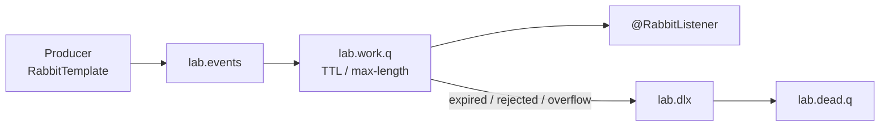

# Đánh giá tác động của TTL, giới hạn và chính sách lên dữ liệu đang lưu

## 1. Tình huống thực tế: backlog đã có trước khi đổi cấu hình

Giả sử một hệ thống đặt hàng dùng **Spring AMQP** để xử lý bất đồng bộ:

- Order Service phát message bằng `RabbitTemplate` tới exchange.
- RabbitMQ chuyển message qua binding vào queue `orders.process.q`.
- Worker xử lý từng message bằng `@RabbitListener` và gửi acknowledgement.
- Worker gặp lỗi trong 30 phút, queue tích lũy **50.000 công việc chưa xử lý**.

Đội vận hành muốn bảo vệ broker nên đặt **TTL 5 phút** và **giới hạn 10.000 message**. Đây không chỉ là thay ngưỡng cấu hình: một số message đã tồn tại có thể hết hạn, bị loại khỏi queue hoặc được chuyển vào dead-letter queue (DLQ). Đổi policy trở lại không nhất thiết phục hồi được dữ liệu.

Bài học thuộc chương **Chính sách hàng đợi** của module **SPRING_AMQP**. Trọng tâm là **đánh giá tác động của TTL, giới hạn và policy lên dữ liệu đã lưu**, phân biệt cơ chế nào áp cho classic/quorum work queue, cơ chế nào áp cho stream, và thiết kế thay đổi an toàn.

Sau bài này, bạn có thể:

1. Giải thích `message-ttl`, `expires`, `max-length`, `max-length-bytes`, `overflow`, dead-lettering và stream retention.
2. Dự đoán tác động của **thêm, giảm, tăng hoặc xóa policy** trên backlog có sẵn.
3. Phân biệt **client arguments**, **regular policies** và **operator policies**, cùng nguyên tắc precedence.
4. Dùng `RabbitTemplate`, `@RabbitListener` và RabbitMQ Management UI để kiểm chứng kết quả.
5. Lập kế hoạch rollback và phục hồi khi message bị loại hoặc stream hết retention.

## 2. Bản đồ các cơ chế quản lý vòng đời dữ liệu

| Cơ chế | Đối tượng tác động | Kết quả tiềm ẩn | Có thể ảnh hưởng message đã lưu? |
| --- | --- | --- | --- |
| Per-message TTL (`expiration`) | Một message riêng | Message hết hạn khi ở queue quá thời gian cho phép | Có |
| Per-queue message TTL (`message-ttl`, `x-message-ttl`) | Các message trong queue | Message hết hạn, bị loại hoặc dead-letter | **Có, kể cả backlog cũ** |
| Queue expiration (`expires`, `x-expires`) | **Toàn bộ queue** không được sử dụng đủ lâu | Queue bị xóa cùng message đang chờ | **Có, có thể mất cả backlog** |
| Queue length (`max-length`) | Số message **ready** của work queue | Loại message cũ hoặc từ chối publish mới theo `overflow` | Có |
| Queue length bytes (`max-length-bytes`) | Tổng dung lượng nội dung message ready | Giới hạn backlog theo kích thước | Có |
| Overflow (`drop-head`, `reject-publish`) | Hành vi khi chạm max-length | Chọn hy sinh message cũ hay từ chối message mới | Có |
| Dead-letter exchange (DLX) | Message bị dead-letter vì nguyên nhân được hỗ trợ | Chuyển message tới exchange khác nếu topology cho phép | Tại **thời điểm** dead-letter |
| Stream retention (`max-age`, `max-length-bytes` theo tính năng stream) | Các segment dữ liệu trong stream | Xóa lịch sử cũ, offset có thể không còn đọc lại được | Có |

Ba điều quan trọng:

- **Durable queue** không đồng nghĩa message sống vô thời hạn; policy có thể loại message cũ.
- **Publisher confirm** không chứng minh consumer đã xử lý thành công; **consumer ack** và **publisher confirm** là hai tín hiệu khác nhau.
- **Rollback policy** thay đổi giới hạn cho tương lai; nó **không tự hồi sinh** message đã expired, drop, hoặc stream segment đã bị dọn.

## 3. Message TTL: hết tuổi thì sao?

### 3.1. TTL đặt ở queue

RabbitMQ có hai cách thường gặp để đặt TTL của message trong queue:

- Khi ứng dụng khai báo queue bằng argument `x-message-ttl`.
- Khi vận hành áp regular policy với key `message-ttl`.

Đơn vị của cả hai là **mili giây**. Ví dụ giá trị 300.000 nghĩa là 5 phút.

Spring AMQP có thể khai báo trực tiếp:

```java
@Bean
Queue temporaryQueue() {
    return QueueBuilder.durable("orders.temporary.q")
            .ttl(300_000)
            .build();
}
```

Hoặc, nếu queue không khai báo sẵn argument xung đột, đội vận hành áp policy:

```bash
rabbitmqctl set_policy --apply-to queues short-ttl \
  '^orders\.temporary\.q$' \
  '{"message-ttl":300000}'
```

Message đã nằm quá TTL **không còn đủ điều kiện được giao bình thường**. Broker có thể loại hoặc dead-letter message hết hạn nếu DLX được cấu hình.

**Hết hạn không có nghĩa được dọn ngay chính xác từng mili giây.** RabbitMQ có thể xử lý message expired tại đầu queue hoặc trong quá trình dọn dẹp thích hợp; thời điểm thay đổi số Ready, dung lượng disk hay DLQ phụ thuộc queue type và trạng thái broker.

### 3.2. TTL riêng cho từng message

Producer có thể gửi thuộc tính `expiration` bằng `MessagePostProcessor`:

```java
rabbitTemplate.convertAndSend(
        "orders.events",
        "orders.created",
        "order-1001",
        message -> {
            message.getMessageProperties().setExpiration("15000");
            return message;
        }
);
```

`"15000"` là chuỗi biểu diễn **15.000 mili giây** của AMQP 0-9-1 message property. Nếu đồng thời queue có TTL 60 giây, message vẫn phải đáp ứng giới hạn 15 giây. Nếu message có TTL 2 phút nhưng queue TTL 30 giây, giới hạn hiệu lực là 30 giây.

| Per-message TTL | Queue TTL | Thời gian tối đa theo TTL |
| --- | --- | --- |
| 15 giây | 60 giây | 15 giây |
| 2 phút | 30 giây | 30 giây |
| Không đặt | 45 giây | 45 giây |

Khi một message được exchange định tuyến thành **hai bản sao ở hai queue**, mỗi queue có thể áp TTL khác nhau. Một queue hết hạn message không đồng nghĩa bản sao ở queue còn lại cũng phải hết hạn.

### 3.3. Áp TTL lên backlog có sẵn

Giả sử tại **10:10**, queue có các message:

| ID | Thời gian enqueue | Tuổi tại 10:10 |
| --- | --- | --- |
| `m1` | 10:00 | 10 phút |
| `m2` | 10:04 | 6 phút |
| `m3` | 10:08 | 2 phút |
| `m4` | 10:09:30 | 30 giây |

Nếu lúc 10:10 thêm policy `{"message-ttl":300000}`:

- `m1` và `m2` đã vượt quá 5 phút và thuộc diện expired.
- `m3` và `m4` chưa quá tuổi.
- Backlog không được tính lại thời gian sống từ mốc **10:10** như thể mọi message vừa được enqueue.

```text
10:00      10:04        10:08    10:09:30  10:10
  m1         m2           m3        m4       |
  |----------|------------|---------|--------|--> thời gian
                                           Áp TTL = 5 phút
                                           m1/m2 quá tuổi
```

Khi áp policy, số Ready có thể không giảm ngay tại thời điểm câu lệnh trả về. Nếu cần bảo đảm không mất việc quan trọng, hãy **đo tuổi backlog trước khi giảm TTL** và kiểm tra dead-letter topology.

### 3.4. Nới hoặc xóa TTL có phục hồi message cũ?

Không. Message đã bị loại khỏi queue hoặc chuyển vào DLQ **không tự quay lại** khi bạn tăng TTL lên 1 giờ hoặc xóa policy. Thay đổi có thể ảnh hưởng **message còn tồn tại**, và vẫn phải tuân các TTL riêng của message hoặc policy/operator cap khác.

Điều này cũng đúng với rollback: **rollback cấu hình khác phục hồi dữ liệu**.

## 4. Queue expiration: xóa queue, không chỉ xóa message

`x-expires` (client argument) hoặc `expires` (policy key) mô tả thời gian một queue có thể **không được sử dụng** trước khi broker xóa chính queue đó. Đây là **queue expiration**, không phải message TTL.

Ví dụ policy:

```json
{"expires":600000}
```

600.000 ms = 10 phút. RabbitMQ định nghĩa trạng thái “unused” dựa trên các điều kiện như không có consumer và các hoạt động truy cập/redeclare nhất định; chỉ có message nằm chờ **không bảo đảm** queue được coi là đang sử dụng.

Nếu queue bị xóa, message còn chờ trong queue cũng mất khỏi queue. Từ đó producer có thể gửi vào exchange nhưng không còn queue nào nhận được message.

| Yêu cầu | Cơ chế nên xem xét |
| --- | --- |
| Job quá 10 phút thì không còn hợp lệ | `message-ttl` |
| Queue tạm không có ai sử dụng sẽ tự dọn sau 1 giờ | `expires` |
| Event lịch sử cần giữ 7 ngày để replay | Stream retention |

Không dùng `expires` cho một queue công việc quan trọng có thể tạm ngừng consumer nhiều giờ mà chưa đánh giá nguy cơ queue cùng backlog bị xóa.

## 5. Max-length và max-length-bytes: giới hạn phần nào của backlog?

### 5.1. Ready khác Unacked

Classic/quorum work queue phân biệt:

- **Ready**: message đang chờ broker giao consumer.
- **Unacked**: đã được giao nhưng chưa nhận consumer acknowledgement.

Giới hạn `max-length` đối với work queue tính số **message ready**; không nên dùng riêng tổng Ready + Unacked để kết luận queue đã vi phạm ngưỡng. Ví dụ max-length = 100, Ready = 100 và Unacked = 50 thì tổng 150 không nhất thiết có nghĩa chính sách bị lỗi.

`max-length-bytes` ràng buộc dung lượng message ready theo cơ chế broker, hữu ích khi kích thước payload biến động mạnh. Một queue có 100 message 1 MB khác hẳn 100 message 1 KB.

Các giới hạn logic này không thay thế việc giám sát disk, memory, metadata và chi phí replication.

### 5.2. Overflow = drop-head

Với hành vi `drop-head`, khi queue đạt giới hạn và có message mới, broker có thể **loại những message cũ ở đầu queue** để nhường chỗ.

```text
max-length = 3
READY trước:  [A, B, C]    A cũ nhất
Publish D
READY sau:    [B, C, D]    A bị drop hoặc dead-letter
```

Khi thay policy từ max-length 10.000 xuống 3 trên queue **đã chứa dữ liệu**, các message cũ có nguy cơ bị loại khi broker áp dụng giới hạn. Cách và thời điểm điều chỉnh backlog phụ thuộc queue type/trạng thái; kiểm tra trước và sau cả các lần publish mới.

**Sai lầm nghiệp vụ:** job cũ không nhất thiết kém quan trọng hơn job mới. Nếu là yêu cầu thu tiền, `drop-head` có thể khiến công việc chưa xử lý bị mất.

### 5.3. Overflow = reject-publish

Với `overflow=reject-publish`, broker cố gắng giữ message đang chờ và **từ chối publish mới** khi giới hạn đã đạt.

```text
max-length = 3, overflow = reject-publish
READY: [A, B, C]
Publish D -> broker có thể từ chối D
READY: [A, B, C]
```

Producer phải xử lý tín hiệu thất bại. Khi dùng **publisher confirms**, broker có thể trả **nack** với publish bị từ chối vì overflow. Gọi `RabbitTemplate.convertAndSend(...)` trả về không đồng nghĩa publish đã được confirm, nên cần code/callback theo dõi confirm và chiến lược retry/backoff/outbox.

Một publish có thể được định tuyến tới nhiều queue; phải đánh giá hành vi khi **một queue đầy còn queue khác không đầy**, thay vì chỉ suy luận từ một queue.

### 5.4. Khi giảm giới hạn theo bytes

Queue đang có nhiều payload lớn có thể vượt `max-length-bytes` trước cả `max-length`. Nếu giảm giới hạn từ 1 GB xuống 100 MB, phần backlog sẵn có có nguy cơ bị drop/dead-letter theo overflow mode; với `reject-publish`, publish mới có thể bị từ chối trong khi queue còn đầy.

Không nên giả định mọi thay đổi max-length có hiệu lực tức thì đối với từng message đang nằm trong queue. Theo dõi Ready, Unacked, bytes và kết quả publisher trong quá trình broker thi hành chính sách.

## 6. Dead-letter exchange: message bị loại có được giữ lại không?

**Dead-letter exchange (DLX)** nhận message bị dead-letter vì một số nguyên nhân như:

- Hết TTL.
- Consumer reject/nack với `requeue=false`.
- Queue vượt giới hạn khi cơ chế dead-letter áp dụng.
- Một số điều kiện đặc thù của quorum queue, ví dụ vượt delivery limit.



Ví dụ regular policy cho work queue:

```json
{
  "message-ttl": 300000,
  "dead-letter-exchange": "lab.dlx",
  "dead-letter-routing-key": "lab.dead"
}
```

**DLX là exchange chứ không phải nơi lưu message.** Phải có exchange `lab.dlx`, binding phù hợp và một queue đích như `lab.dead.q`. Nếu thiếu hoặc không route được, không nên giả định message đã được giữ an toàn.

Các header dead-letter như `x-death` có thể giúp điều tra nguyên nhân và số lần dead-letter. Bản thân DLQ cũng cần giới hạn/retention hợp lý; nếu DLQ áp TTL quá ngắn thì các message cần điều tra lại có thể bị xóa.

**Quorum queue** có các chiến lược dead-letter an toàn hơn khi cấu hình điều kiện phù hợp, bao gồm tùy chọn at-least-once; không mặc định mọi luồng dead-letter của mọi queue đều có bảo đảm giống nhau.

## 7. Regular policy, operator policy và client arguments

### 7.1. Khác nhau về quyền điều khiển

| Cách đặt | Ví dụ | Hệ quả |
| --- | --- | --- |
| Client argument khi khai báo | `QueueBuilder.durable("x").ttl(600000)` | Ứng dụng đưa argument `x-message-ttl` vào khai báo queue |
| Regular policy | `{"message-ttl":30000}` | Broker quản lý nhiều queue theo tên, có thể thay động các thuộc tính được hỗ trợ |
| Operator policy | Ngưỡng giới hạn do vận hành quản lý | Cung cấp ràng buộc bắt buộc ngoài đề nghị của ứng dụng |

Thông thường **client argument được ưu tiên hơn regular policy** cho cùng thuộc tính; **operator policy** có quyền áp giới hạn cao hơn. Với các ngưỡng số, RabbitMQ thường dùng **giá trị thấp hơn** giữa operator cap và giá trị ứng dụng/policy yêu cầu.

Ví dụ: code khai báo `x-message-ttl=600000`; thêm regular policy `message-ttl=30000` chưa chắc làm queue chuyển về TTL 30 giây vì argument khai báo có thể được ưu tiên.

Đó là lý do lab ở phần sau **không hardcode TTL/max-length** vào queue: để regular policy điều khiển mà không có argument xung đột.

### 7.2. Regex và priority quyết định queue nào được áp

Ví dụ:

```bash
rabbitmqctl set_policy --priority 10 --apply-to queues \
  lab-ttl '^lab\.work\.q$' '{"message-ttl":30000}'
```

- `^lab\.work\.q$` khớp đúng queue tên `lab.work.q`.
- `--priority 10` quy định độ ưu tiên giữa những regular policy cùng khớp.
- `--apply-to queues` giới hạn loại đối tượng.
- Policy JSON dùng `message-ttl`, còn queue argument dùng `x-message-ttl`.

Nếu có nhiều regular policy khớp một queue, đừng mặc định chúng luôn được ghép tất cả lại. Xem priority và giá trị hiệu lực. Tránh regex rộng `.*` khi thao tác trên production vì có thể ảnh hưởng hàng trăm queue cùng lúc.

### 7.3. Không phải queue argument nào cũng sửa được khi redeclare

Một số thuộc tính như queue type cần định nghĩa khi queue được tạo. Đổi `x-queue-type` từ classic sang quorum/stream bằng cách redeclare cùng tên có thể dẫn đến `PRECONDITION_FAILED`, chứ không chuyển dữ liệu cũ tự động.

Các thay đổi hỗ trợ qua policy có thể thực thi khi queue đã tồn tại, nhưng **áp thành công không chứng minh không mất dữ liệu**. Đặc biệt, export RabbitMQ definitions chỉ lưu topology/chính sách, **không phải bản backup payload message** trong queue.

## 8. Bảng dự đoán tác động khi thay policy trên dữ liệu hiện hữu

| Thay đổi | Backlog đang lưu | Message mới | Rollback policy khôi phục dữ liệu? |
| --- | --- | --- | --- |
| Giảm `message-ttl` từ 1 giờ xuống 5 phút | Các message đã quá 5 phút có thể expire/dead-letter | Chịu TTL ngắn hơn | **Không**, nếu message đã bị dọn |
| Tăng `message-ttl` | Message còn sống có thể tồn tại lâu hơn, nếu không có TTL khác chặt hơn | Có thể chờ lâu hơn | Không hồi sinh message đã mất |
| Giảm `max-length` với `drop-head` | Message cũ ở đầu queue có nguy cơ bị drop/dead-letter | Message mới có thể chiếm chỗ | Không |
| Chuyển sang `reject-publish` | Mục đích giữ backlog cũ, không phục hồi message đã drop | Có thể nhận nack khi queue đầy | Không |
| Giảm `max-length-bytes` | Dữ liệu cũ có thể bị giới hạn theo overflow | Message lớn dễ bị từ chối/drop hơn | Không |
| Thêm DLX | Các message dead-letter **sau khi** cấu hình có hiệu lực có thể được route sang DLQ | Không trực tiếp thay đổi body message | Không kéo lại message đã bị xóa trước đó |
| Thêm `expires` ngắn | Cả queue và backlog có nguy cơ bị xóa khi unused | Có thể không còn queue đích | Không |
| Giảm stream retention | Segment lịch sử có thể bị dọn, offset cũ không còn đọc lại | Event mới vẫn append theo tính năng stream | Không |

Bảng này cho thấy **đánh giá policy phải dựa trên dữ liệu đang nằm trong broker**, không chỉ đọc JSON mới.

## 9. Thực hành với Spring Boot và RabbitMQ

Mục tiêu của lab là **tạo backlog trước, áp policy sau**, quan sát message thay đổi. Chạy trên RabbitMQ local, không thực hiện các thao tác giảm TTL/limit của lab trên dữ liệu production.

### 9.1. Chạy RabbitMQ

```bash
docker run -d --name rabbitmq-policy-lab \
  -p 5672:5672 -p 15672:15672 rabbitmq:4-management
```

RabbitMQ Management UI: `http://localhost:15672`; thông tin đăng nhập local mặc định thường là `guest/guest`. Nếu broker đã chạy tại cổng tương ứng, sử dụng broker hiện có và không mở container thứ hai.

Lệnh `rabbitmqctl` ở bài viết được trình bày theo **Bash/Linux**. Trên Windows PowerShell, cú pháp quoting JSON có thể khác; dùng mục **Admin → Policies** trong Management UI để nhập cùng pattern và JSON sẽ dễ hơn.

### 9.2. Thêm Spring AMQP starter

Trong dự án Spring Boot Maven (Java 17+):

```xml
<dependency>
    <groupId>org.springframework.boot</groupId>
    <artifactId>spring-boot-starter-amqp</artifactId>
</dependency>
```

Tạo `application.yml`:

```yaml
spring:
  rabbitmq:
    host: localhost
    port: 5672
    username: guest
    password: guest
    publisher-confirm-type: correlated
    publisher-returns: true
    template:
      mandatory: true
    listener:
      simple:
        acknowledge-mode: auto

lab:
  seed: false
  consume: false
```

`lab.seed` bật gửi dữ liệu thử; `lab.consume` bật consumer. Ta mặc định **tắt listener** để queue giữ message và cho phép thử chính sách trên backlog. Publisher confirms được bật nhưng ứng dụng demo chưa xử lý confirm; các lần từ chối publish cần quan sát và xử lý trong hệ thống thật.

### 9.3. Khai báo exchange, queue và DLQ

Tạo `PolicyLabConfig.java`:

```java
package com.example.policylab;

import org.springframework.amqp.core.Binding;
import org.springframework.amqp.core.BindingBuilder;
import org.springframework.amqp.core.DirectExchange;
import org.springframework.amqp.core.Queue;
import org.springframework.amqp.core.QueueBuilder;
import org.springframework.beans.factory.annotation.Qualifier;
import org.springframework.context.annotation.Bean;
import org.springframework.context.annotation.Configuration;

@Configuration
public class PolicyLabConfig {

    public static final String EXCHANGE = "lab.events";
    public static final String QUEUE = "lab.work.q";
    public static final String ROUTING_KEY = "lab.event";
    public static final String DLX = "lab.dlx";
    public static final String DLQ = "lab.dead.q";
    public static final String DEAD_KEY = "lab.dead";

    @Bean
    DirectExchange mainExchange() {
        return new DirectExchange(EXCHANGE);
    }

    @Bean
    DirectExchange deadLetterExchange() {
        return new DirectExchange(DLX);
    }

    @Bean
    Queue mainQueue() {
        return QueueBuilder.durable(QUEUE).build();
    }

    @Bean
    Queue deadQueue() {
        return QueueBuilder.durable(DLQ).build();
    }

    @Bean
    Binding mainBinding(
            @Qualifier("mainQueue") Queue queue,
            @Qualifier("mainExchange") DirectExchange exchange) {
        return BindingBuilder.bind(queue).to(exchange).with(ROUTING_KEY);
    }

    @Bean
    Binding deadBinding(
            @Qualifier("deadQueue") Queue queue,
            @Qualifier("deadLetterExchange") DirectExchange exchange) {
        return BindingBuilder.bind(queue).to(exchange).with(DEAD_KEY);
    }
}
```

`RabbitAdmin` (trong cấu hình Spring Boot thông dụng) có thể khai báo các bean topology lên broker. Queue chính **không có TTL/max-length/DLX được hardcode**, để chúng ta điều khiển qua regular policy. Nếu queue cùng tên đã tồn tại với thuộc tính không tương thích, cần dùng topology mới hoặc migration thích hợp.

### 9.4. Producer gửi 10 message và listener tắt theo cấu hình

Tạo `PolicyLabPublisher.java`:

```java
package com.example.policylab;

import org.springframework.amqp.rabbit.core.RabbitTemplate;
import org.springframework.beans.factory.annotation.Value;
import org.springframework.boot.context.event.ApplicationReadyEvent;
import org.springframework.context.event.EventListener;
import org.springframework.stereotype.Component;

@Component
public class PolicyLabPublisher {

    private final RabbitTemplate rabbitTemplate;

    @Value("${lab.seed:false}")
    private boolean seed;

    public PolicyLabPublisher(RabbitTemplate rabbitTemplate) {
        this.rabbitTemplate = rabbitTemplate;
    }

    @EventListener(ApplicationReadyEvent.class)
    public void onReady() {
        if (!seed) {
            return;
        }

        for (int i = 1; i <= 10; i++) {
            String id = "job-" + i;
            rabbitTemplate.convertAndSend(
                    PolicyLabConfig.EXCHANGE,
                    PolicyLabConfig.ROUTING_KEY,
                    id
            );
            System.out.println("[PUBLISH] " + id);
        }
    }
}
```

Tạo `PolicyLabConsumer.java`:

```java
package com.example.policylab;

import org.springframework.amqp.rabbit.annotation.RabbitListener;
import org.springframework.stereotype.Component;

@Component
public class PolicyLabConsumer {

    @RabbitListener(
        queues = PolicyLabConfig.QUEUE,
        autoStartup = "${lab.consume:false}"
    )
    public void onJob(String id) {
        System.out.println("[CONSUMER] " + id);
    }
}
```

Tạo `PolicyLabApplication.java`:

```java
package com.example.policylab;

import org.springframework.boot.SpringApplication;
import org.springframework.boot.autoconfigure.SpringBootApplication;

@SpringBootApplication
public class PolicyLabApplication {

    public static void main(String[] args) {
        SpringApplication.run(PolicyLabApplication.class, args);
    }
}
```

Ứng dụng chỉ publish khi `lab.seed=true`. Listener chỉ bắt đầu nhận khi `lab.consume=true`. Khi listener ở chế độ `AUTO`, Spring AMQP ack sau khi phương thức xử lý thành công; nếu lỗi hoặc mất kết nối, delivery có thể được giao lại.

Ví dụ khởi động JAR đã build (đổi `app.jar` thành tên file thực tế):

```bash
java -jar app.jar --lab.seed=true --lab.consume=false
```

Để chỉ bật consumer và không phát thêm message:

```bash
java -jar app.jar --lab.seed=false --lab.consume=true
```

### 9.5. Thí nghiệm A: áp TTL sau khi đã có backlog

1. Chạy ứng dụng ở chế độ seed nhưng không consume, kiểm tra `lab.work.q` có **10 message Ready**; dừng ứng dụng, giữ RabbitMQ chạy.
2. Chờ hơn **5 giây** kể từ khi enqueue.
3. Áp policy `message-ttl=5000` cùng DLX:

```bash
docker exec rabbitmq-policy-lab rabbitmqctl set_policy \
  --apply-to queues lab-ttl \
  '^lab\.work\.q$' \
  '{"message-ttl":5000,"dead-letter-exchange":"lab.dlx","dead-letter-routing-key":"lab.dead"}'
```

Quan sát `lab.work.q` và `lab.dead.q` trong Management UI. Các message đã đợi lâu hơn 5 giây thuộc diện hết hạn; chúng có thể bị dead-letter khi broker xử lý expiration. Không nên áp kỳ vọng số Ready và DLQ thay đổi đúng tức thì.

Dùng lệnh kiểm tra:

```bash
docker exec rabbitmq-policy-lab rabbitmqctl list_policies
docker exec rabbitmq-policy-lab rabbitmqctl list_queues \
  name messages_ready messages_unacknowledged consumers
```

Gỡ policy:

```bash
docker exec rabbitmq-policy-lab rabbitmqctl clear_policy lab-ttl
```

**Kết luận:** message đã ở queue từ trước **không được tính tuổi lại từ ngày policy được áp**. Xóa policy sau khi message expired không làm message tự quay về.

### 9.6. Thí nghiệm B: giảm max-length xuống 3

Nạp lại **10 message Ready** để bắt đầu thí nghiệm độc lập; consumer tiếp tục tắt và policy TTL đã được gỡ. Tạo policy:

```bash
docker exec rabbitmq-policy-lab rabbitmqctl set_policy \
  --apply-to queues lab-overflow \
  '^lab\.work\.q$' \
  '{"max-length":3,"overflow":"drop-head","dead-letter-exchange":"lab.dlx","dead-letter-routing-key":"lab.dead"}'
```

Quan sát queue chính **ngay sau khi áp policy và sau khi có publish mới**. Khi cơ chế giới hạn thực thi, backlog cũ có nguy cơ bị cắt ở đầu queue. Trong trường hợp 10 job được publish theo thứ tự và chưa có consumer, ta thường muốn kiểm chứng **các job mới nhất** còn ở queue chính; job cũ được drop hoặc dead-letter tùy cấu hình broker.

Cần so sánh ID message trong queue chính và DLQ. Chỉ nhìn “Ready giảm từ 10 xuống 3” **không chứng minh** mọi message khác đã được bảo toàn ở DLQ.

### 9.7. Thí nghiệm C: chuyển overflow thành reject-publish

Cập nhật cùng policy:

```bash
docker exec rabbitmq-policy-lab rabbitmqctl set_policy \
  --apply-to queues lab-overflow \
  '^lab\.work\.q$' \
  '{"max-length":3,"overflow":"reject-publish","dead-letter-exchange":"lab.dlx","dead-letter-routing-key":"lab.dead"}'
```

Khi queue đã đầy, gửi thêm message. Kiểm tra message mới có bị **nack theo publisher confirms** hay không; queue cũ có được giữ lại không. Đừng chỉ xem log `[PUBLISH]` vì lệnh publish trả về không có nghĩa broker đã chấp nhận message.

Ứng dụng production cần xử lý confirm/return đúng cách, lưu message chưa publish được và retry có backoff khi bị từ chối.

Gỡ policy sau thử nghiệm:

```bash
docker exec rabbitmq-policy-lab rabbitmqctl clear_policy lab-overflow
```

### 9.8. Thí nghiệm D: bật consumer

Khởi chạy với `lab.seed=false` và `lab.consume=true`. Quan sát:

- Log `[CONSUMER]` cho các message còn trong queue chính.
- Ready và Unacked thay đổi theo tốc độ xử lý.
- Consumer ack diễn ra sau khi listener xử lý thành công.
- Message đã expired/drop **không tự có mặt** để consumer nhận lại.

**Chú ý lab:** chạy seed nhiều lần tạo thêm nhiều message; dùng ID/đợt thử riêng và reset queue thử nghiệm có chủ đích để không nhầm dữ liệu giữa các lần kiểm tra.

## 10. Stream retention khác TTL của work queue

Stream lưu message như **append-only log**. Consumer đọc theo **offset**; việc đọc xong không khiến từng log entry bị xóa ngay. Broker dọn dữ liệu cũ theo các ngưỡng **retention** của stream, thường liên quan tuổi (`max-age`) và dung lượng (`max-length-bytes`).

```text
Trước khi giảm retention:
  offset    10   11   12   13   14   15
  record:  [A]  [B]  [C]  [D]  [E]  [F]
            ^
        Consumer Audit đang đọc từ 10

Sau khi các segment cũ bị dọn:
  offset                 13   14   15
  record:               [D]  [E]  [F]
  Consumer Audit không còn đọc lại được 10..12.
```

Giảm retention từ **7 ngày xuống 1 ngày** trên stream đang có dữ liệu có thể khiến **consumer lag** mất lịch sử chưa kịp xử lý. Tăng retention trở lại **không tái tạo các segment đã bị dọn**.

Retention thường được dọn theo **segment**, vì vậy đừng mong một record hết tuổi được xóa đúng tại mốc thời gian từng mili giây.

**Không dùng** mô hình `x-message-ttl`, DLX và ack/xóa từng message của work queue để mô tả native stream. Khi muốn tận dụng offset, replay và retention, dùng RabbitMQ Stream client hoặc `RabbitStreamTemplate`/stream listener của Spring Rabbit Stream theo yêu cầu.

## 11. Tác động riêng theo loại queue

| Câu hỏi | Classic queue | Quorum queue | Stream |
| --- | --- | --- | --- |
| Message hết TTL | Hỗ trợ TTL work queue | Hỗ trợ TTL phù hợp quorum | Dùng retention, không đồng nhất với work queue TTL |
| Queue length giới hạn | Có, xét Ready | Có, theo tính năng/quy tắc quorum | Retention theo dữ liệu log, không phải drop-head Ready truyền thống |
| Dead-letter | Hỗ trợ theo cấu hình DLX | Hỗ trợ; có các chiến lược an toàn riêng tùy điều kiện | Không sử dụng DLX giống mô hình work queue |
| Sau khi consumer hoàn thành | Ack hoàn tất delivery và message có thể được dọn | Tương tự work queue | Offset tiến lên nhưng record còn đến khi hết retention |
| Có thể replay message đã xử lý? | Không phải mục tiêu tự nhiên | Không phải mục tiêu tự nhiên | Có, nếu offset vẫn nằm trong dữ liệu retention |
| Rủi ro khi giảm ngưỡng | Job cũ expire/drop hoặc queue bị xóa | Job cũ expire/drop, thêm đặc thù replication/delivery limit | Consumer chậm mất offset lịch sử |

Chọn policy phải dựa trên **loại queue thực tế**. Một cấu hình hợp lệ cho classic chưa chắc có cùng ngữ nghĩa hoặc được hỗ trợ cho quorum/stream.

## 12. Quy trình đánh giá thay đổi policy trên production

### Trước khi đổi

1. **Xác định dữ liệu đang lưu:** queue type, số Ready/Unacked, tuổi message cũ nhất, tốc độ publish/consume, message ID, dung lượng và DLQ.
2. **Xác định SLA:** job có thể bị loại sau 5 phút không? Message cũ hay mới quan trọng hơn? Có cần replay lâu dài?
3. **Đọc cấu hình thực có hiệu lực:** arguments, policy khớp regex, priority, operator policy, vhost và broker version.
4. **Phân tích hậu quả backlog:** nếu áp TTL nhỏ hơn tuổi queue, bao nhiêu message có thể expired? Nếu giảm max-length, loại hay reject theo mode nào?
5. **Chuẩn bị đường xử lý lỗi:** DLX có hoạt động, binding tới DLQ chính xác, DLQ có đủ dung lượng/retention và có quy trình điều tra không?
6. **Diễn tập với dữ liệu gần thực tế:** áp policy trên queue thử nghiệm đã có backlog rồi so trước/sau bằng ID, không chỉ queue depth.

### Khi đổi

1. Dùng regex thật hẹp, ví dụ `'^orders\.process\.q$'`, tránh `'.*'`.
2. Thay một nhóm tham số có chủ đích, ghi thời điểm/giá trị cũ và mới.
3. Theo dõi **publisher confirms, returns, queue Ready/Unacked, dead-letter rates, disk/memory alarm**.
4. Quan sát cả message đang lưu và publish mới; không xem việc CLI trả thành công là xác nhận dữ liệu đã an toàn.
5. Với stream, theo dõi **offset sớm nhất còn giữ**, offset của consumer và thời gian lag.
6. Dừng rollout nếu tỷ lệ drop/dead-letter/nack vượt mức có thể chấp nhận.

### Sau khi đổi

- Ghi nhận số message expired, overflow, dead-letter, reject và tổng lượng công việc thực tế được hoàn tất.
- Kiểm tra hành vi của `@RabbitListener`, retry có giới hạn, DLQ, idempotency và các transaction nghiệp vụ liên quan.
- Cập nhật alert/runbook theo ngưỡng mới.
- Giữ rõ kế hoạch **phục hồi dữ liệu** nếu cần. Khôi phục policy **không** khôi phục message đã bị xóa; việc import definitions chỉ phục hồi topology, không phải nội dung message.

## 13. Các tình huống tự kiểm tra

### Tình huống A — TTL mới làm backlog “biến mất”

Queue có 3 message lần lượt **12, 7 và 1 phút tuổi**. Thêm policy TTL 5 phút khi không có argument/policy chặt hơn. Kết quả dự đoán: hai message đầu đã quá TTL và có thể bị expire/dead-letter; message thứ ba chưa vượt ngưỡng. Giảm Ready không chứng minh DLQ đã lưu đủ hai message.

### Tình huống B — Max-length cắt mất lệnh thanh toán

`payments.q` có `[P1, P2, P3]`, max-length = 3 và overflow = drop-head. Publish P4 có thể làm P1 bị loại. Với nghiệp vụ thanh toán, cần xem xét từ chối publish có kiểm soát, publisher confirm, outbox và idempotency, thay vì bỏ lệnh cũ.

### Tình huống C — Từ chối publish nhưng API vẫn log thành công

Queue đầy và overflow = reject-publish. Ứng dụng log ngay sau `convertAndSend`. Log đó không đủ xác minh message đã vào queue: phải kiểm tra publisher confirm, có thể nhận nack, và lưu lại message cần retry.

### Tình huống D — Queue tự biến mất

Queue không được sử dụng đủ lâu, có `expires`, nhưng vẫn chứa 200 job. Broker có thể xóa cả queue và backlog nếu điều kiện unused thỏa. **Message TTL** mới là cơ chế thích hợp nếu chỉ muốn giới hạn tuổi job.

### Tình huống E — Đổi regular policy nhưng TTL không thay

Code khai báo `x-message-ttl=600000`. Vận hành thêm policy `message-ttl=30000` nhưng TTL vẫn theo argument cũ. Cần kiểm tra precedence; thay đổi regular policy không nhất thiết thắng client argument.

### Tình huống F — Stream mất lịch sử

Consumer Audit lag 48 giờ; retention giảm từ 7 ngày còn 24 giờ. Khi segment cũ bị dọn, Audit có thể không còn đọc dữ liệu trước offset giữ lại. Không thể khôi phục bằng cách tăng retention, cần nguồn lưu dữ liệu bổ sung.

## 14. Những hiểu nhầm cần tránh

| Ngộ nhận | Cách hiểu đúng |
| --- | --- |
| “TTL bắt đầu tính từ lúc thêm policy.” | Với message tồn tại sẵn, tuổi enqueue cũng quan trọng. |
| “Hết TTL là message biến mất khỏi metric ngay lập tức.” | Expiration/dọn dữ liệu có thể không diễn ra đúng tức thì. |
| “Xóa TTL policy thì message expired quay lại.” | Message đã bị loại không được hồi phục tự động. |
| “`expires` chỉ xóa message cũ.” | `expires` có thể xóa **toàn bộ queue** khi unused. |
| “Max-length là Ready + Unacked.” | Work queue length limit chủ yếu dựa trên **Ready**. |
| “Drop-head luôn vô hại vì broker giữ message mới.” | Message cũ chưa xử lý có thể quan trọng hơn message mới. |
| “Reject-publish tự ném lỗi đồng bộ khi gọi `convertAndSend`.” | Cần theo dõi publisher confirms/nack và xử lý kết quả. |
| “Có DLX nghĩa message bị drop chắc chắn vào DLQ.” | Cần exchange, routing/binding, queue đích và bảo đảm dead-letter phù hợp. |
| “Regular policy luôn ghi đè cấu hình ứng dụng.” | Client arguments có thể được ưu tiên; còn operator policy đặt giới hạn riêng. |
| “Giảm retention stream chỉ ảnh hưởng event mới.” | Lịch sử đang lưu và các consumer lag có thể bị ảnh hưởng. |
| “Import lại definitions sẽ khôi phục message.” | Definitions không phải bản backup payload. |

## 15. Tổng kết

Khi đánh giá thay đổi TTL, giới hạn và policy, luôn hỏi **“Broker đang giữ những dữ liệu nào, chúng đã tồn tại bao lâu, và chính sách mới sẽ xử lý chúng thế nào?”**

- **Message TTL** có thể làm expired cả message đã enqueue từ trước.
- **Queue expiration** có thể xóa queue cùng backlog.
- **Max-length** và **overflow** quyết định có nguy cơ drop message cũ hay reject publish mới.
- **DLX** là đường chuyển message khi dead-letter, cần topology và giám sát tương ứng.
- **Regular/operator policy** có precedence, priority và phạm vi match cần kiểm tra.
- **Stream retention** quyết định cửa sổ lịch sử còn replay được, kể cả đối với consumer chưa theo kịp.

Dù dùng classic, quorum hay stream, một hệ thống bất đồng bộ đáng tin cậy phải kết hợp **publisher confirms/returns, consumer ack/offset, retry, dead-letter, idempotency, transaction/outbox và observability**. Đặc biệt, **rollback policy chỉ quay lại cấu hình; dữ liệu đã bị loại cần nguồn phục hồi riêng**.

### Tài liệu tham khảo chính thức

- [RabbitMQ — Time-To-Live and Expiration](https://www.rabbitmq.com/docs/ttl)
- [RabbitMQ — Queue Length Limit](https://www.rabbitmq.com/docs/maxlength)
- [RabbitMQ — Policies and Operator Policies](https://www.rabbitmq.com/docs/policies)
- [RabbitMQ — Dead Letter Exchanges](https://www.rabbitmq.com/docs/dlx)
- [RabbitMQ — Classic Queues](https://www.rabbitmq.com/docs/classic-queues)
- [RabbitMQ — Quorum Queues](https://www.rabbitmq.com/docs/quorum-queues)
- [RabbitMQ — Streams](https://www.rabbitmq.com/docs/streams)
- [RabbitMQ — Consumer Acknowledgements and Publisher Confirms](https://www.rabbitmq.com/docs/confirms)
- [Spring AMQP Reference](https://docs.spring.io/spring-amqp/reference/)
