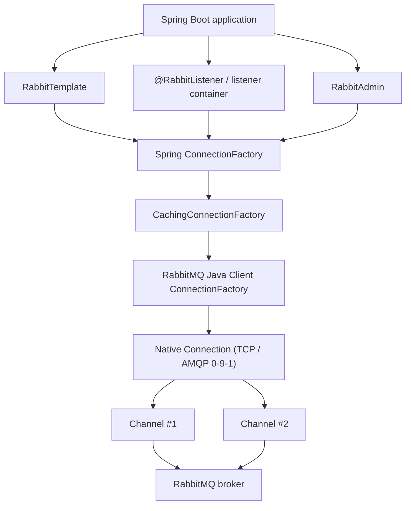
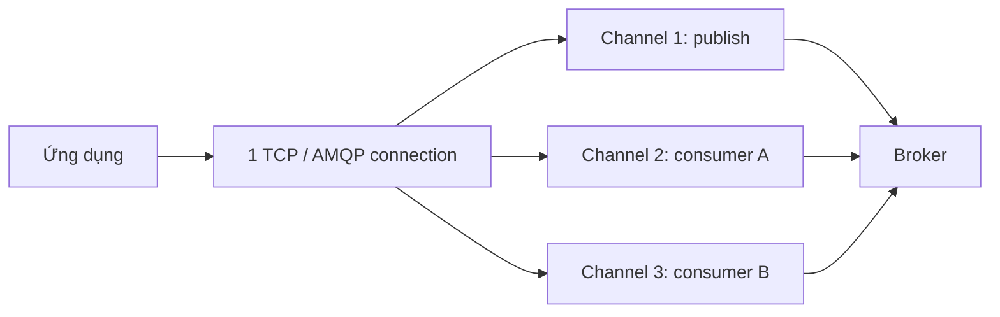
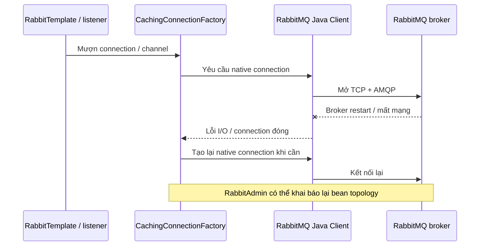

# Spring ConnectionFactory và RabbitMQ Java Client ConnectionFactory

Khi lập trình Spring AMQP, bạn sẽ gặp **hai kiểu có tên `ConnectionFactory`**: một lớp thuộc thư viện Java chính thức của RabbitMQ và một interface thuộc Spring AMQP. Chúng cùng tham gia kết nối đến broker nhưng **không cùng package, không cùng kiểu dữ liệu và không hoán đổi trực tiếp cho nhau**. Phân biệt hai lớp giúp tránh lỗi import, cấu hình sai `RabbitTemplate` hoặc `@RabbitListener`, tạo quá nhiều kết nối và xung đột cơ chế khôi phục.

Bài thuộc chương **Kết nối và channel** của module **SPRING_AMQP**. Chủ đề đặt nền móng cho việc gửi message bằng `RabbitTemplate`, nhận qua `@RabbitListener`, khai báo exchange/queue/binding và xây các luồng bất đồng bộ có publisher confirm, consumer acknowledgement, retry, dead-letter, transaction và quan sát hệ thống.

## 1. Hai ConnectionFactory ở hai tầng

| Tiêu chí | RabbitMQ Java Client | Spring AMQP |
|---|---|---|
| Tên đầy đủ | `com.rabbitmq.client.ConnectionFactory` | `org.springframework.amqp.rabbit.connection.ConnectionFactory` |
| Loại | Class của thư viện `amqp-client` | Interface của module `spring-rabbit` |
| Nhiệm vụ | Tạo kết nối AMQP 0-9-1 thực tế, cấu hình host/port, vhost, tài khoản, TLS, timeout, heartbeat và các tùy chọn native. | Cung cấp kết nối cho thành phần Spring; triển khai cụ thể còn quản lý/cache connection, channel và vòng đời của chúng. |
| Lấy kết nối | `newConnection()` | `createConnection()` |
| Kiểu connection trả về | `com.rabbitmq.client.Connection` | `org.springframework.amqp.rabbit.connection.Connection` (wrapper cho native connection) |
| Channel được dùng cuối cùng | `com.rabbitmq.client.Channel` | `createChannel(boolean transactional)` trả về `com.rabbitmq.client.Channel` |
| Dùng ở đâu? | Ứng dụng Java Client thuần, hoặc cấu hình tầng dưới cho Spring. | `RabbitTemplate`, `RabbitAdmin`, listener container, các tích hợp Spring. |
| Lựa chọn phổ biến | `com.rabbitmq.client.ConnectionFactory` | `CachingConnectionFactory`, ngoài ra có `PooledChannelConnectionFactory`, `ThreadChannelConnectionFactory` |

**Điểm cần ghi nhớ:** constructor của `RabbitTemplate` nhận **Spring `ConnectionFactory`**, chẳng hạn `CachingConnectionFactory`. Truyền trực tiếp `com.rabbitmq.client.ConnectionFactory` sẽ báo lỗi không tương thích kiểu. Nếu cần tùy chỉnh native client, hãy **bọc native factory** trong Spring factory.



Một `CachingConnectionFactory` thực chất dựa trên RabbitMQ Java Client để mở kết nối với broker. Spring bổ sung vòng đời, quản lý/caching channel, hỗ trợ các thành phần Spring và cơ chế recovery của framework. Ngược lại, native factory **không tự tạo Spring bean, `RabbitTemplate` hoặc listener container**.

## 2. Connection và channel: hiểu trước khi chọn factory

**AMQP connection** là kết nối TCP lâu sống với broker, có xác thực, virtual host, heartbeat và bộ xử lý I/O. **AMQP channel** là một phiên giao tiếp logic chạy trên connection; publish, consume, ACK/NACK, publisher confirms và nhiều thao tác topology được thực hiện trên channel.

| Connection | Channel |
|---|---|
| Mở qua `ConnectionFactory.newConnection()` ở Java Client hoặc do Spring quản lý. | Mở từ connection qua `createChannel()` / `createChannel(false)`. |
| Có chi phí TCP/TLS, xác thực, socket và I/O thread. | Nhẹ hơn TCP connection nhưng vẫn chiếm tài nguyên ở cả client lẫn RabbitMQ. |
| Một connection có thể phục vụ nhiều channel. | Delivery tag, publisher confirm sequence number, trạng thái transaction có phạm vi trên channel. |
| Mất connection thường làm toàn bộ channel trên đó không còn sử dụng được. | Một lỗi cấp channel có thể đóng channel mà không nhất thiết đóng toàn bộ connection. |



**Không mở một connection mới cho mỗi message.** Cách này làm tăng số socket, chi phí bắt tay, tải broker và độ trễ. Cũng **không dùng chung một instance `com.rabbitmq.client.Channel` để nhiều thread cùng publish đồng thời** nếu không có cơ chế đồng bộ phù hợp: RabbitMQ Java Client khuyến cáo tránh dùng channel chung giữa nhiều thread vì có thể interleave frame, gây lỗi giao thức hoặc publisher confirm sai lệch. `RabbitTemplate` kết hợp với Spring connection factory thường giải quyết việc mượn/trả channel cho luồng gọi thông thường.

## 3. Spring Boot: đa số trường hợp chỉ cần cấu hình một factory

Với một broker hoặc một virtual host, Spring Boot thường auto-configure `CachingConnectionFactory` khi có starter RabbitMQ AMQP 0-9-1. Ở Spring Boot 3.x, starter điển hình là `spring-boot-starter-amqp`; ở Spring Boot 4.x là `spring-boot-starter-rabbitmq`. Hãy dùng starter đúng với phiên bản Boot trong dự án.

Ví dụ dependency Maven cho **Spring Boot 3.x**:

```xml
<dependency>
    <groupId>org.springframework.boot</groupId>
    <artifactId>spring-boot-starter-amqp</artifactId>
</dependency>
```

Cấu hình cho RabbitMQ chạy cục bộ:

```yaml
# src/main/resources/application.yml
spring:
  rabbitmq:
    host: localhost
    port: 5672
    username: guest
    password: guest
    virtual-host: /
    requested-heartbeat: 30s
    connection-timeout: 5s
    cache:
      channel:
        size: 25
```

`spring.rabbitmq.requested-heartbeat` là thời gian heartbeat đề nghị cho kết nối; `connection-timeout` là giới hạn thiết lập kết nối TCP, **không phải** thời gian cho consumer xử lý một message. RabbitMQ mặc định thường chỉ cho tài khoản `guest` đăng nhập qua loopback, vì vậy cấu hình này dành cho môi trường phát triển.

Publisher dùng `RabbitTemplate` do Spring quản lý:

```java
package com.example.orders;

import org.springframework.amqp.rabbit.core.RabbitTemplate;
import org.springframework.stereotype.Service;

@Service
public class OrderEventPublisher {
    private final RabbitTemplate rabbitTemplate;

    public OrderEventPublisher(RabbitTemplate rabbitTemplate) {
        this.rabbitTemplate = rabbitTemplate;
    }

    public void publish(String payload) {
        rabbitTemplate.convertAndSend(
                "orders.events", "order.created", payload);
    }
}
```

Consumer nhận từ queue:

```java
package com.example.orders;

import org.springframework.amqp.rabbit.annotation.RabbitListener;
import org.springframework.stereotype.Component;

@Component
public class OrderEventConsumer {

    @RabbitListener(queues = "orders.created.q")
    public void consume(String payload) {
        System.out.println("Received: " + payload);
    }
}
```

Để chạy được hai đoạn code, exchange `orders.events`, queue `orders.created.q` và binding key `order.created` phải tồn tại trong virtual host đang kết nối. Có thể khai báo bằng các bean `DirectExchange`, `Queue`, `Binding` để `RabbitAdmin` khai báo trên broker. **Chỉ cấu hình connection factory không tự tạo một topology bất kỳ.**

## 4. Tạo Spring CachingConnectionFactory thủ công

Khi cần quản lý bean Spring factory thay vì dựa vào auto-configuration, có thể cấu hình trực tiếp:

```java
package com.example.orders.config;

import org.springframework.amqp.rabbit.connection.CachingConnectionFactory;
import org.springframework.context.annotation.Bean;
import org.springframework.context.annotation.Configuration;

@Configuration(proxyBeanMethods = false)
public class RabbitConnectionsConfig {

    @Bean
    public CachingConnectionFactory connectionFactory() {
        CachingConnectionFactory factory =
                new CachingConnectionFactory("localhost", 5672);
        factory.setUsername("guest");
        factory.setPassword("guest");
        factory.setVirtualHost("/");
        factory.setChannelCacheSize(25);
        factory.setConnectionNameStrategy(cf -> "orders-service");
        return factory;
    }
}
```

Kiểu trả về là một triển khai của **Spring `ConnectionFactory`**. Tên kết nối từ `setConnectionNameStrategy(...)` có thể xuất hiện trong RabbitMQ Management UI để phân biệt ứng dụng và môi trường; tên này phục vụ giám sát, không phải ID kỹ thuật duy nhất cho HTTP API.

Khi ứng dụng tự cung cấp Spring factory bean, Spring Boot thường bỏ qua việc tự tạo factory mặc định. Các cấu hình `spring.rabbitmq.*` có thể không tự động áp lên bean được tạo thủ công theo cách ví dụ trên; hãy cấu hình đầy đủ credentials, vhost, TLS, timeout và caching qua properties của ứng dụng thực tế.

**Không dùng mật khẩu hardcode khi triển khai thật.** Sử dụng Spring configuration properties, biến môi trường hoặc secret manager. Đồng thời, không bật nhiều bean `connectionFactory` trùng tên từ nhiều lớp cấu hình mẫu; mỗi ví dụ ở bài này là một **cách cấu hình thay thế**.

## 5. Tùy chỉnh RabbitMQ Java Client rồi bọc bằng Spring

Một số yêu cầu cần điều chỉnh sâu native client, ví dụ connection timeout, heartbeat, TLS, socket hoặc client properties. Khi đó, **tạo `com.rabbitmq.client.ConnectionFactory` trước**, rồi truyền vào constructor của `CachingConnectionFactory`. Dùng tên đầy đủ của native class để tránh lỗi import.

```java
package com.example.orders.config;

import org.springframework.amqp.rabbit.connection.CachingConnectionFactory;
import org.springframework.context.annotation.Bean;
import org.springframework.context.annotation.Configuration;

@Configuration(proxyBeanMethods = false)
public class NativeRabbitBridgeConfig {

    @Bean
    public CachingConnectionFactory connectionFactory() {
        // Native: com.rabbitmq.client.ConnectionFactory.
        com.rabbitmq.client.ConnectionFactory nativeFactory =
                new com.rabbitmq.client.ConnectionFactory();
        nativeFactory.setHost("localhost");
        nativeFactory.setPort(5672);
        nativeFactory.setUsername("guest");
        nativeFactory.setPassword("guest");
        nativeFactory.setVirtualHost("/");
        nativeFactory.setRequestedHeartbeat(30);  // đơn vị: giây
        nativeFactory.setConnectionTimeout(5_000); // đơn vị: mili giây
        nativeFactory.setAutomaticRecoveryEnabled(false);

        // Spring: org.springframework.amqp.rabbit.connection.ConnectionFactory.
        CachingConnectionFactory springFactory =
                new CachingConnectionFactory(nativeFactory);
        springFactory.setChannelCacheSize(25);
        springFactory.setConnectionNameStrategy(cf -> "orders-native-bridge");
        return springFactory;
    }
}
```

Đây là một **cấu hình thay thế** phần 4, không đặt hai class ví dụ cùng lúc vào một ứng dụng với cùng bean name. Từ đây, Spring có factory hợp lệ để tiêm cho `RabbitTemplate`, listener container hoặc `RabbitAdmin`. Các thành phần đó vẫn được Spring quản lý, dù kết nối vật lý được mở bằng factory của Java Client ở tầng dưới.

Lệnh `setAutomaticRecoveryEnabled(false)` được ghi rõ để người học hiểu **Spring sở hữu recovery** của các connection này. Các phiên bản Spring AMQP hiện đại tự vô hiệu hóa native auto recovery trong `CachingConnectionFactory`, song không nên bật lại thủ công vì có thể tạo hai cơ chế phục hồi chồng chéo. Nếu bạn thực sự dùng Java Client **ngoài Spring**, cơ chế native recovery có quy tắc riêng được mô tả ở phần 8.

Một tình huống đặc biệt là nhiều vhost hoặc broker: có thể tạo hai Spring factory từ hai native factory khác nhau, nhưng cần gắn đúng `@Qualifier` cho từng `RabbitTemplate`, `RabbitAdmin` và listener container. **Chọn factory kết nối không tự chọn admin khai báo tài nguyên**; cấu hình topology cũng phải gắn đúng broker/vhost.

## 6. Dùng RabbitMQ Java Client thuần thì khác gì?

Đối với ứng dụng Java thuần không dùng Spring, `com.rabbitmq.client.ConnectionFactory` là đối tượng chính. Bạn phải tự mở/đóng connection, channel và tổ chức publisher, consumer, acknowledgement, publisher confirms, recovery:

```java
import com.rabbitmq.client.Channel;
import com.rabbitmq.client.Connection;
import com.rabbitmq.client.ConnectionFactory;
import com.rabbitmq.client.MessageProperties;
import java.nio.charset.StandardCharsets;

public class PlainRabbitPublisher {
    public static void main(String[] args) throws Exception {
        ConnectionFactory factory = new ConnectionFactory();
        factory.setHost("localhost");
        factory.setUsername("guest");
        factory.setPassword("guest");

        try (Connection connection = factory.newConnection();
             Channel channel = connection.createChannel()) {

            // Chỉ dùng tạo topology trong môi trường thử nghiệm.
            channel.exchangeDeclare("orders.events", "direct", true);
            channel.queueDeclare(
                    "orders.created.q", true, false, false, null);
            channel.queueBind(
                    "orders.created.q", "orders.events", "order.created");

            byte[] body = "order-created:1001"
                    .getBytes(StandardCharsets.UTF_8);
            channel.basicPublish(
                    "orders.events", "order.created",
                    MessageProperties.PERSISTENT_TEXT_PLAIN, body);
        }
    }
}
```

Trong ví dụ Java thuần, `newConnection()` trả về `com.rabbitmq.client.Connection`, `createChannel()` trả về `com.rabbitmq.client.Channel`, và `try-with-resources` đóng các tài nguyên **vật lý** sau khi chạy xong. Ví dụ chỉ mô phỏng **một chương trình ngắn**; không nên dùng cùng cấu trúc mở connection/channel mới cho **mỗi message** trong service lâu sống.

Trong Spring, bạn thường **không cần** gọi các API đó trong nghiệp vụ: `RabbitTemplate` và listener container mượn kết nối/channel từ Spring factory. Nếu cần thao tác bằng native `Channel` trong một số tình huống đặc biệt, hãy dùng cơ chế quản lý channel được Spring hỗ trợ và hoàn trả đúng cách thay vì tự tạo connection bằng native factory ở giữa business method.

**Gửi thành công một lời gọi không đồng nghĩa broker đã xác nhận message.** Cả `basicPublish(...)` lẫn `RabbitTemplate.convertAndSend(...)` đều cần chiến lược publisher confirm/returns phù hợp nếu nghiệp vụ đòi hỏi biết trạng thái phát message. Message persistent cũng không thay thế yêu cầu queue durable, binding đúng và cơ chế xử lý sự cố.

## 7. Cache connection/channel của Spring: hiểu chính xác tham số

`CachingConnectionFactory` có hai chế độ chính:

| Chế độ | Hoạt động | Gợi ý |
|---|---|---|
| `CacheMode.CHANNEL` (mặc định) | Thường có **một connection dùng chung**; mượn và trả channel vào cache. Channel transactional/non-transactional có cache riêng. | Phù hợp phần lớn `RabbitTemplate` và listener container. |
| `CacheMode.CONNECTION` | Mỗi lần `createConnection()` có thể dùng một connection khác hoặc lấy connection nhàn rỗi từ cache; channel cũng có cache. | Dành cho các nhu cầu kết nối đặc biệt. Không phù hợp với `RabbitAdmin` tự khai báo topology theo cơ chế mặc định. |

### 7.1. `channelCacheSize` là số channel nhàn rỗi giữ lại

Mặc định, `setChannelCacheSize(25)` chỉ đặt số channel **idle có thể giữ trong cache**, **không mặc nhiên giới hạn số channel đang mở đồng thời**. Khi tải tăng, Spring có thể mở thêm channel ngoài cache, rồi đóng những channel vượt quá chỗ trống khi trả về.

Nếu cần giới hạn số channel mượn đồng thời, dùng `setChannelCheckoutTimeout(...)` **lớn hơn 0**. Khi đã dùng hết số channel cho phép và không có channel rảnh, request có thể phải đợi đến hạn. Hết hạn có thể phát sinh `AmqpTimeoutException`. Giá trị timeout quá nhỏ có thể gây lỗi dưới tải đột biến; nên đo concurrency và thời gian xử lý thực tế.

```java
CachingConnectionFactory factory =
        new CachingConnectionFactory("localhost");
factory.setChannelCacheSize(25);           // kích thước cache
factory.setChannelCheckoutTimeout(2_000);  // mili giây
```

Trong `CacheMode.CONNECTION`, `setConnectionCacheSize(...)` chỉ điều chỉnh số **connection nhàn rỗi** giữ lại và không tự tạo trần tổng số connection. Nếu cần giới hạn số connection hoạt động trong mode này, xem `setConnectionLimit(...)`. Không nên bật mode này chỉ để “tăng tốc” khi chưa có bằng chứng hiệu năng.

### 7.2. Ai chịu trách nhiệm đóng channel?

Khi dùng `RabbitTemplate` và listener container, Spring quản lý việc sử dụng và hoàn trả channel; không cần tự gọi `close()` trong từng business method. Khi tự mượn channel từ `CachingConnectionFactory`, bạn vẫn phải đóng/hoàn trả theo hợp đồng Spring để nó được đưa về cache nếu còn chỗ. `Channel.close()` trên wrapper do Spring cấp có thể là **đóng logic**; nó khác việc đóng ngay channel vật lý của Java Client.

Một số dấu hiệu cần quan sát khi tuning:

- Số connection và channel đang mở trong RabbitMQ Management UI.
- Channel idle và high-water mark trong `CachingConnectionFactory.getCacheProperties()` hoặc qua cơ chế metrics/JMX phù hợp.
- Lỗi `AmqpResourceNotAvailableException` khi broker đã đạt giới hạn channel, hoặc `AmqpTimeoutException` khi chờ channel quá hạn.
- Connection blocked/unblocked khi broker thiếu bộ nhớ hoặc disk space; việc blocked có thể ảnh hưởng publisher và consumer dùng chung connection.

Với publisher và consumer trong cùng ứng dụng, có những trường hợp cần **kết nối publisher riêng** để giảm ảnh hưởng của broker resource alarm lên consumer. Đây là lựa chọn kiến trúc sau khi đo vận hành; cần cân nhắc thêm transaction và cách dùng publisher confirms.

## 8. Recovery: không bật hai tầng tự phục hồi cùng lúc

RabbitMQ Java Client có khả năng tự phục hồi connection, channel, consumer và topology khi dùng **trực tiếp**. Nhưng cơ chế này không phải phương án xử lý cho mọi lỗi: kết nối ban đầu thất bại cần ứng dụng xử lý, cấu hình sai credentials không tự sửa, và channel đóng do lỗi giao thức/ngữ nghĩa cũng không tự phục hồi chỉ bằng reconnect.

Spring AMQP có cơ chế phục hồi riêng đối với connection/channel do framework quản lý. `RabbitAdmin` có thể **khai báo lại các bean** `Queue`, `Exchange` và `Binding` khi một connection mới được thiết lập sau sự cố. Vì vậy, trong `CachingConnectionFactory` không nên kích hoạt lại native `automaticRecoveryEnabled=true`: Spring và client có thể cạnh tranh điều khiển cùng connection và sinh lỗi trong khoảng chuyển trạng thái.



Đường phục hồi kết nối **không đảm bảo exactly-once processing**:

1. Publisher đã gửi nhưng mất kết nối trước khi nhận publisher confirm: không biết broker đã nhận hay chưa; gửi lại có thể tạo message trùng.
2. Consumer đã commit DB nhưng mất kết nối trước khi `basicAck`: broker có thể giao lại message khi consumer hồi phục.
3. Queue/exchange/binding được tái khai báo không có nghĩa các message từng publish đều được lưu bền vững; còn phụ thuộc loại queue, durability, persistence và trạng thái broker.

Để hệ thống đáng tin cậy cần kết hợp publisher confirms, returns khi unroutable, consumer ACK/NACK, retry có giới hạn, DLX/DLQ, transaction và **idempotency** (ví dụ lưu `eventId` với unique constraint). Khi cập nhật DB và phát message cần nhất quán, cân nhắc transactional outbox.

Nếu sử dụng Java Client thuần **không qua Spring**, có thể dùng cơ chế automatic recovery của client theo hướng dẫn RabbitMQ. Nhưng cũng cần xử lý publisher confirm, trạng thái message chưa xác định và tránh tự triển khai topology recovery trùng lặp với native recovery.

## 9. Lỗi thường gặp và cách chẩn đoán

| Dấu hiệu | Nguyên nhân có thể | Cách xử lý |
|---|---|---|
| `RabbitTemplate` không nhận `ConnectionFactory` ở constructor | Đang import `com.rabbitmq.client.ConnectionFactory` thay vì Spring interface. | Dùng `org.springframework.amqp.rabbit.connection.ConnectionFactory` hoặc `CachingConnectionFactory`. |
| IDE báo `ConnectionFactory` ambiguous | Import hai class/interface cùng tên. | Giữ một import và dùng tên đầy đủ cho lớp còn lại. |
| Mỗi lần gửi message lại mở TCP connection | Tạo native `ConnectionFactory` và gọi `newConnection()` trong từng request. | Tái sử dụng Spring factory và `RabbitTemplate`; không tự kết nối trong business method. |
| Lỗi channel bất thường khi nhiều thread publish | Dùng chung native `Channel` không an toàn giữa các thread. | Dùng `RabbitTemplate`/channel cache hoặc channel per thread với lifecycle thích hợp. |
| Lỗi hết channel hoặc `AmqpTimeoutException` | Quá giới hạn broker, checkout timeout, tải cao hoặc rò rỉ channel. | Quan sát cache stats, số channel mở, thời gian xử lý; trả channel đúng cách, điều chỉnh có cơ sở. |
| `@RabbitListener` không tìm thấy queue | Sai virtual host, sai tên queue hoặc chưa khai báo topology trên broker. | Kiểm tra vhost, `RabbitAdmin`, exchange/queue/binding và quyền tài khoản. |
| Khai báo queue dẫn đến `PRECONDITION_FAILED` | Queue cùng tên đã tồn tại với thuộc tính khác (durable, arguments, queue type...). | So sánh topology trên broker; thực hiện migration có kế hoạch, không xóa queue dữ liệu thật tùy tiện. |
| Kết nối không ổn định sau broker restart | Bật đồng thời native client recovery và Spring recovery, hoặc cấu hình backoff/timeout chưa phù hợp. | Để Spring quản lý recovery trên `CachingConnectionFactory`; xem log kết nối và listener container. |
| RabbitMQ trả `ACCESS_REFUSED` | Sai tài khoản, mật khẩu, vhost hoặc quyền configure/write/read. | Kiểm tra credentials, quyền và security policy của broker. |
| Publisher bị blocked, consumer dường như không tiến triển | Broker phát resource alarm, các bên dùng chung connection có thể bị ảnh hưởng. | Theo dõi blocked connections, bộ nhớ/disk và cân nhắc tách kết nối publisher/consumer phù hợp. |

### Quan sát thực tế trong RabbitMQ Management UI

Khi chạy ứng dụng với `CachingConnectionFactory` mặc định, hãy mở RabbitMQ Management UI (ví dụ `http://localhost:15672` khi Management plugin và cổng đã được bật), sau đó xem **Connections** và **Channels**. Tên connection do `setConnectionNameStrategy` tạo giúp đối chiếu với application instance. Số channel có thể tăng khi workload tăng nhưng thường không cần một connection vật lý riêng cho mỗi publish.

Có thể kiểm tra trên máy có quyền thực thi `rabbitmqctl`:

```bash
rabbitmqctl list_connections name user vhost channels state
rabbitmqctl list_channels connection number consumer_count messages_unacknowledged
```

Tên các trường hỗ trợ có thể thay đổi theo phiên bản RabbitMQ; khi lệnh báo trường không tồn tại, dùng `rabbitmqctl help list_connections` hoặc `rabbitmqctl help list_channels` để xem thông tin tương ứng. Chỉ số channel/connection cần đọc cùng với tốc độ publish, consume, confirm, ACK/NACK và các chỉ số resource alarm, không nên suy diễn độ tin cậy chỉ từ một số lượng connection thấp.

## 10. Bài thực hành

**Bài 1 — phân biệt import.** Tạo biến kiểu `com.rabbitmq.client.ConnectionFactory` rồi thử truyền trực tiếp vào `new RabbitTemplate(...)`. Giải thích lỗi không tương thích kiểu. Sau đó bọc bằng `new CachingConnectionFactory(nativeFactory)` và quan sát vì sao có thể truyền vào `RabbitTemplate`.

**Bài 2 — Java Client so với Spring.** Dùng chương trình Java thuần ở phần 6 gửi một message `order.created`. Dùng `RabbitTemplate` gửi message tương tự đến cùng exchange. Xác nhận chúng đến queue đích khi binding tồn tại, sau đó so sánh ai sở hữu vòng đời connection/channel trong hai cách.

**Bài 3 — kiểm tra connection reuse.** Chạy ứng dụng Spring gửi 100 message trong môi trường test và quan sát tab **Connections** và **Channels**. Dự đoán vì sao số connection không tăng tương ứng 100 lần. Thử tăng số publisher concurrent; giải thích vì sao số channel có thể tăng trong khi connection vẫn được dùng chung.

**Bài 4 — cache và giới hạn.** Cấu hình `channelCacheSize=2`, rồi thử nhiều thao tác publish đồng thời; quan sát số channel. Đặt `channelCheckoutTimeout > 0`, thử lại và giải thích điều kiện xuất hiện timeout. Không đặt tải lớn trên broker dùng chung/production.

**Bài 5 — khôi phục khi mất kết nối.** Chạy listener trên một queue durable và restart RabbitMQ trong môi trường test. Quan sát Spring tái kết nối và `RabbitAdmin` khai báo lại các bean topology cần thiết. Mô phỏng ngắt kết nối trước publisher confirm hoặc consumer ACK; xác minh vì sao cần idempotency thay vì giả định message chỉ xử lý một lần.

**Bài 6 — thay đổi virtual host.** Chỉ đổi `virtual-host` của Spring factory sang một vhost khác. Kiểm tra exchange, queue và binding đang tồn tại trong vhost đó; giải thích tại sao connection tới vhost mới **không tự chuyển dữ liệu** từ vhost cũ.

## 11. Tự kiểm tra

1. **Hai `ConnectionFactory` có chung kiểu không?** Không. Một bên là class native RabbitMQ, một bên là interface Spring; `CachingConnectionFactory` bọc native client.
2. **`RabbitTemplate` nhận factory nào?** Spring `ConnectionFactory`, thường là `CachingConnectionFactory`.
3. **Spring `createConnection()` trả về gì?** `org.springframework.amqp.rabbit.connection.Connection`, là wrapper quản lý connection native.
4. **Một TCP connection có thể có nhiều channel không?** Có. Channel là luồng giao tiếp logic chạy trên connection.
5. **`channelCacheSize=25` có luôn giới hạn tổng channel đang sử dụng là 25 không?** Không. Theo mặc định nó quản lý số channel nhàn rỗi giữ lại; giới hạn mượn channel có liên quan đến `channelCheckoutTimeout > 0`.
6. **Có nên bật native recovery cho factory mà Spring đang quản lý không?** Không nên. Spring có cơ chế phục hồi riêng và `RabbitAdmin` có thể khai báo lại tài nguyên.
7. **Tạo `ConnectionFactory` có đồng nghĩa exchange, queue và binding đã tồn tại không?** Không. Phải khai báo topology qua `RabbitAdmin`/API phù hợp.
8. **Kết nối khôi phục có bảo đảm mọi message được xử lý đúng một lần không?** Không. Cần publisher confirms, consumer acknowledgement, retry có giới hạn và idempotent consumer.

**Ghi nhớ:** `com.rabbitmq.client.ConnectionFactory` là **factory tầng giao thức** tạo connection AMQP thực tế; `org.springframework.amqp.rabbit.connection.ConnectionFactory` là **hợp đồng kết nối của Spring**; `CachingConnectionFactory` là triển khai phổ biến giúp quản lý kết nối và tái sử dụng channel. Khi viết ứng dụng Spring AMQP, hãy để `RabbitTemplate`, `@RabbitListener` và `RabbitAdmin` dùng **Spring factory**, đồng thời dùng native factory ở tầng dưới chỉ khi thật sự cần tùy chỉnh chi tiết client.

### Tài liệu tham khảo

- Spring AMQP — [Connection and Resource Management](https://docs.spring.io/spring-amqp/reference/amqp/connections.html).
- Spring AMQP — [RabbitTemplate](https://docs.spring.io/spring-amqp/reference/amqp/template.html).
- RabbitMQ — [Java Client API Guide](https://www.rabbitmq.com/client-libraries/java-api-guide).
- Spring Boot — [Common Application Properties](https://docs.spring.io/spring-boot/reference/appendix/application-properties/index.html).
