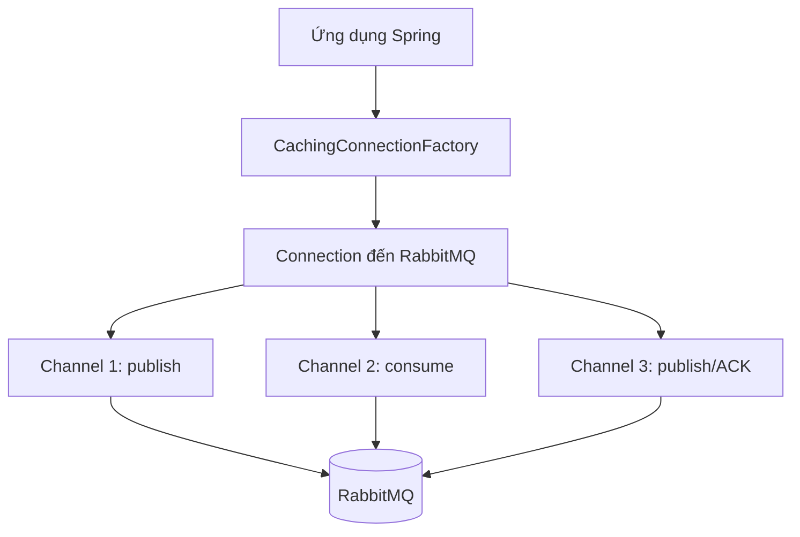
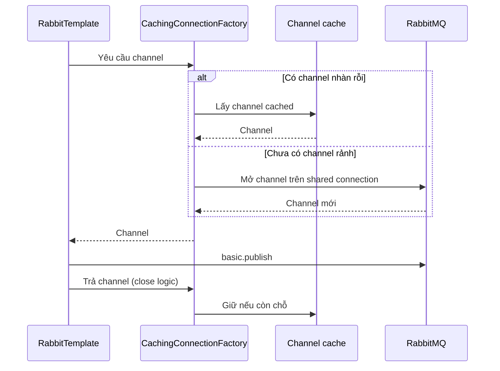
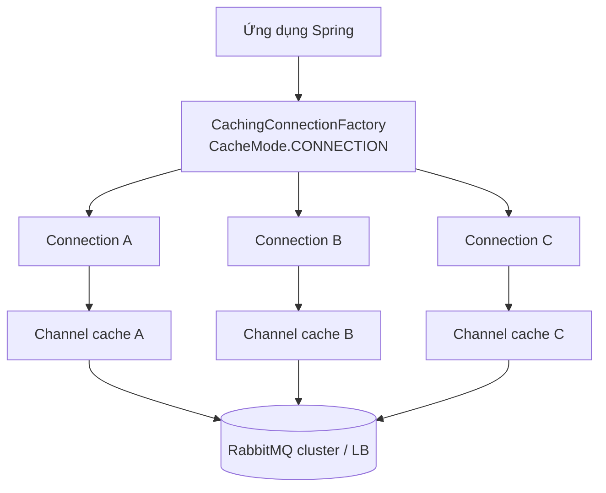

# CacheMode.CHANNEL so với CacheMode.CONNECTION

**Chương:** Kết nối và channel

**Phạm vi:** Spring AMQP (`spring-rabbit`) kết nối RabbitMQ bằng `CachingConnectionFactory`.

Khi tích hợp RabbitMQ với Spring AMQP, một ứng dụng có thể có nhiều luồng gọi `RabbitTemplate` và nhiều `@RabbitListener` cùng chạy. Nếu mở mới một TCP connection và AMQP channel cho từng thao tác, ứng dụng tốn thêm thời gian thiết lập kết nối, tài nguyên broker và số luồng xử lý I/O. `CachingConnectionFactory` giúp tái sử dụng tài nguyên, nhưng **nó có hai chế độ cache phục vụ nhu cầu khác nhau**:

- **`CacheMode.CHANNEL`** (mặc định): tái sử dụng các **channel** trên một **connection dùng chung**.
- **`CacheMode.CONNECTION`**: tái sử dụng cả **connection** và các **channel riêng của từng connection**.

Bài học giải thích cơ chế, cách lựa chọn, cấu hình, ảnh hưởng đến `RabbitAdmin`, tài nguyên hệ thống, publisher confirms, listener và vận hành thực tế. Sau bài học, bạn có thể đọc đúng các tham số `channelCacheSize`, `connectionCacheSize`, `connectionLimit`, `channelCheckoutTimeout` và chẩn đoán khi ứng dụng bị chậm vì cạn channel/connection.

> Đây là các API phía RabbitMQ/AMQP 0.9.1 của `spring-rabbit`. Không áp dụng nguyên xi `CacheMode` của `CachingConnectionFactory` cho client AMQP 1.0 tổng quát.

## 1. Phân biệt connection và channel trước khi xem cache

RabbitMQ dùng **TCP connection** cho kết nối giữa client với broker, sau đó mở một hoặc nhiều **AMQP channel** bên trong connection. Channel là một phiên giao tiếp logic, cho phép publish, consume, ACK, declare và các thao tác AMQP khác.

| Đối tượng | Vai trò | Đặc tính |
| --- | --- | --- |
| **TCP/AMQP connection** | Kết nối mạng tới một node RabbitMQ; thực hiện xác thực, heartbeat, quản lý socket | Thiết lập và duy trì tốn tài nguyên hơn channel; khi mất connection, các channel trên đó cũng mất |
| **AMQP channel** | Luồng giao tiếp logic bên trong connection | Nhẹ hơn connection; lỗi cấp channel có thể đóng riêng channel mà không đóng toàn bộ connection |
| **Spring `ConnectionFactory`** | Tạo/cấp đối tượng connection cho `RabbitTemplate`, listener và admin | Có nhiều implementation; ở đây xét `CachingConnectionFactory` |
| **`CachingConnectionFactory`** | Quản lý vòng đời và cache connection/channel | `CacheMode` quyết định có tái sử dụng connection theo cơ chế pool/cache hay dùng chung một connection |

Một channel **không được dùng đồng thời tùy ý bởi nhiều thread**. Framework cấp và quản lý channel thích hợp cho từng hoạt động; nếu tự viết mã truy cập RabbitMQ Java Client trực tiếp, cần bảo đảm không chia sẻ channel không an toàn giữa các thread.



Sơ đồ cho thấy **một connection có thể chứa nhiều channel**, không phải mỗi consumer/producer bắt buộc có một TCP connection riêng.

## 2. Bảng so sánh hai `CacheMode`

| Tiêu chí | `CacheMode.CHANNEL` | `CacheMode.CONNECTION` |
| --- | --- | --- |
| Kết nối vật lý thông thường | Một connection chia sẻ qua proxy của factory; ngoại lệ có thể có nếu dùng publishing connection riêng | Nhiều connection được tạo theo nhu cầu và có thể được tái sử dụng |
| Tài nguyên được cache | Channel, chia cache theo transactional và non-transactional | Connection nhàn rỗi **và** channel riêng trên từng connection |
| `createConnection()` | Thường trả về proxy trỏ tới shared connection | Cấp connection nhàn rỗi hoặc tạo mới khi cần |
| `connection.close()` | Không đồng nghĩa đóng TCP connection đang dùng chung | Đưa connection vào cache nếu có chỗ; nếu vượt cache hoặc không thể tái dùng thì đóng |
| `channel.close()` | Trả channel về cache khi hợp lệ và còn chỗ; có thể đóng vật lý nếu cache đầy | Tương tự, nhưng thuộc cache của connection tương ứng |
| `channelCacheSize` | Số channel nhàn rỗi tối đa được giữ; có thể thành giới hạn checkout | Số channel nhàn rỗi tối đa **trên mỗi connection**; cũng có thể bị giới hạn checkout |
| `connectionCacheSize` | Không phải nút điều chỉnh số shared connection | Số connection **nhàn rỗi** tối đa được giữ; không phải tổng connection tối đa |
| `connectionLimit` | Không nhằm giới hạn số connection ở shared mode | Giới hạn tổng số connection khi được cấu hình |
| Topology auto-declaration bằng `RabbitAdmin` | Hỗ trợ cơ chế Spring tự khai báo và khai báo lại | **Không hỗ trợ tự động khai báo topology** bằng `RabbitAdmin` |
| Chi phí broker/client | Ít socket/TCP connection, thường tiết kiệm | Nhiều connection, nhiều heartbeat, socket và tài nguyên I/O |
| Dùng khi | Phần lớn ứng dụng chỉ cần publish/consume thông thường | Có nhu cầu kết nối riêng, ví dụ thử phân phối connection giữa các node trong cluster/qua load balancer |

**Điểm quyết định:** tăng `channelCacheSize` ở chế độ `CHANNEL` không có nghĩa “mở thêm TCP connection”; còn tăng `connectionCacheSize` ở `CONNECTION` không có nghĩa “giới hạn tối đa số connection”.

## 3. `CacheMode.CHANNEL` hoạt động ra sao?

Đây là **chế độ mặc định** của `CachingConnectionFactory` và là điểm xuất phát phù hợp cho phần lớn ứng dụng Spring AMQP.

### 3.1. Vòng đời một channel

1. `RabbitTemplate` hoặc listener cần dùng channel.
2. Factory tìm channel đang nhàn rỗi trong cache tương ứng; nếu chưa có, tạo một channel mới trên connection chia sẻ.
3. Trong lúc xử lý, channel được sử dụng cho publish, consume, ACK hoặc thao tác tương ứng.
4. Khi hoạt động kết thúc và framework “đóng” channel, cache quyết định giữ lại channel để tái sử dụng hay đóng vật lý nếu không còn chỗ.
5. Trong lần tiếp theo, channel đã cache được cấp lại, tránh overhead tạo channel mới.



`RabbitTemplate` trả tài nguyên theo vòng đời framework; tránh giữ một channel để tái sử dụng tùy tiện giữa nhiều thread.

### 3.2. Hai cache channel khác nhau

Spring AMQP phân biệt channel:

- **Non-transactional**: dùng cho phần lớn publish/consume không mở AMQP transaction.
- **Transactional**: dùng với cơ chế giao dịch AMQP khi ứng dụng yêu cầu.

Thống kê cache phản ánh hai nhóm này bằng `idleChannelsNotTx`, `idleChannelsTx` và các giá trị high-water. Không nên cộng hai số đó rồi giả định tất cả channel là một tập dùng chung; từng loại có đường sử dụng khác nhau.

### 3.3. `channelCacheSize` không mặc nhiên là giới hạn số channel đang mở

Theo tài liệu Spring AMQP, giá trị mặc định của `channelCacheSize` trong nhánh hiện đại là **25**. Ý nghĩa cơ bản là **số lượng channel nhàn rỗi tối đa được giữ để tái sử dụng**.

Giả sử:

```text
CacheMode.CHANNEL
channelCacheSize      = 10
channelCheckoutTimeout = 0 (mặc định)
30 request publish cùng lúc cần 30 channel.
```

Ở tình huống trên, factory có thể tạo đến **30 channel đang dùng đồng thời** (trong giới hạn của RabbitMQ); khi được trả về, cache có thể giữ khoảng **10 channel nhàn rỗi**, phần dư được đóng vật lý. Vì thế `channelCacheSize=10` **không tự giới hạn throughput/concurrency ở 10**.

Nếu đặt `channelCheckoutTimeout > 0`, cùng `channelCacheSize=10`, factory chuyển sang chế độ giới hạn số channel có thể checkout **trên mỗi connection**. Khi đã đủ 10 channel đang sử dụng, yêu cầu mới phải đợi có channel được trả về; nếu quá thời gian chờ sẽ gặp `AmqpTimeoutException`.

Lưu ý: khi đưa một hạn mức nhỏ vào môi trường có nhiều listener giữ channel lâu dài, có thể làm cạn slot dành cho publisher.

## 4. `CacheMode.CONNECTION` hoạt động ra sao?

Ở chế độ này, mỗi lần gọi `createConnection()` có thể lấy một connection đang nhàn rỗi từ cache hoặc mở một connection mới. Các channel được tạo từ connection đó lại có cache riêng. Khi trả connection về, nó được giữ trong cache nếu hợp lệ và còn chỗ.



### 4.1. `connectionCacheSize`: giữ tối đa bao nhiêu connection *nhàn rỗi*?

Giả sử:

```text
CacheMode.CONNECTION
connectionCacheSize = 3
connectionLimit     = chưa thiết lập giới hạn hữu hạn
6 tác vụ đồng thời cùng cần một connection.
```

Factory có thể cấp **6 connection** nếu cần và hệ thống cho phép. Khi chúng được trả về, cache chỉ giữ tối đa **3 connection nhàn rỗi**; phần vượt ngưỡng có thể bị đóng. Đây là behavior **cache**, không phải giới hạn đồng thời.

Điều này giải thích vì sao màn hình RabbitMQ có thể từng ghi nhận nhiều connection hơn `connectionCacheSize`, ngay cả khi ứng dụng hoạt động đúng.

### 4.2. `connectionLimit` mới là giới hạn tổng số connection

Nếu muốn kiểm soát tài nguyên, đặt `connectionLimit` trên factory:

```text
CacheMode.CONNECTION
connectionCacheSize    = 3
connectionLimit        = 5
channelCheckoutTimeout = 2000 ms
```

Khi đang có đủ **5 connection** được cấp và không còn connection rảnh, yêu cầu mới phải đợi một connection được trả lại. Nếu không có trong khoảng timeout, factory có thể ném `AmqpTimeoutException`.

`channelCheckoutTimeout` mang tên liên quan đến channel nhưng **cũng được dùng làm thời gian đợi connection** khi bật `connectionLimit` ở mode `CONNECTION`. Cần đọc chính xác hành vi này; đừng dự đoán chỉ từ tên property.

### 4.3. Vì sao cần nhiều connection?

Các trường hợp có thể xem xét:

- **Kết nối đến cluster qua load balancer**: connection khác nhau *có thể* đi đến các node khác nhau, giúp cô lập một phần sự cố hoặc phân bổ tải, tùy cách phân giải địa chỉ và cấu hình LB.
- **Một ứng dụng có nhu cầu kết nối độc lập thật sự**: ví dụ các thành phần thuê connection theo đơn vị công việc, thay vì chia chung một connection vật lý.
- **Theo dõi/giới hạn số connection được dùng**: có thể áp dụng `connectionLimit` và cache nhàn rỗi theo mức tải.

Đổi sang `CONNECTION` **không bảo đảm** tự cân bằng đều giữa các node. Nếu mọi connection tới cùng một địa chỉ cố định, hoặc LB gắn session vào một node, các connection có thể vẫn đi cùng đích. Cần quan sát node và connection trên RabbitMQ Management UI.

### 4.4. Chi phí đi kèm

Mỗi connection mới kéo theo TCP socket, xác thực, heartbeat, state ở broker và tài nguyên I/O phía client. Với nhiều connection, RabbitMQ Java client có thể dùng nhiều thread để quản lý I/O; nên cân nhắc cấu hình executor dùng chung khi phù hợp.

Một ứng dụng chỉ publish vài trăm message/giây không nhất thiết cần nhiều TCP connection. Thêm connection quá sớm có thể **tăng** độ phức tạp giám sát, tài nguyên và rủi ro lúc startup.

## 5. Cấu hình với Java

### 5.1. Cấu hình `CHANNEL` dùng chung

Ví dụ bên dưới minh họa các thuộc tính cần quan tâm, với queue/exchange/binding được khai báo qua `RabbitAdmin` hoặc hạ tầng tương ứng:

```java
import org.springframework.amqp.rabbit.connection.CachingConnectionFactory;
import org.springframework.amqp.rabbit.connection.CachingConnectionFactory.CacheMode;
import org.springframework.context.annotation.Bean;
import org.springframework.context.annotation.Configuration;

@Configuration(proxyBeanMethods = false)
class RabbitChannelCacheConfig {

    @Bean
    CachingConnectionFactory rabbitConnectionFactory() {
        CachingConnectionFactory cf =
                new CachingConnectionFactory("localhost");

        cf.setPort(5672);
        cf.setUsername("app");
        cf.setPassword("use-a-secret-manager");
        cf.setCacheMode(CacheMode.CHANNEL); // Mặc định
        cf.setChannelCacheSize(50);

        // Giới hạn số channel checkout nếu thật sự cần backpressure:
        // cf.setChannelCheckoutTimeout(2_000L);

        return cf;
    }
}
```

**Đây là ví dụ cấu hình để đọc API**, không nên đưa mật khẩu thật vào mã nguồn. Với Spring Boot, thông thường để Boot cung cấp factory rồi cấu hình qua `application.yml` sẽ thuận tiện hơn; tránh tự tạo bean khi không có lý do.

### 5.2. Cấu hình `CONNECTION` và giới hạn tài nguyên

```java
import org.springframework.amqp.rabbit.connection.CachingConnectionFactory;
import org.springframework.amqp.rabbit.connection.CachingConnectionFactory.CacheMode;
import org.springframework.context.annotation.Bean;
import org.springframework.context.annotation.Configuration;

@Configuration(proxyBeanMethods = false)
class RabbitConnectionCacheConfig {

    @Bean
    CachingConnectionFactory rabbitConnectionFactory() {
        CachingConnectionFactory cf =
                new CachingConnectionFactory("localhost");

        cf.setPort(5672);
        cf.setUsername("app");
        cf.setPassword("use-a-secret-manager");

        cf.setCacheMode(CacheMode.CONNECTION);
        cf.setConnectionCacheSize(3); // Tối đa 3 connection nhàn rỗi
        cf.setConnectionLimit(5);     // Tối đa 5 connection được mở
        cf.setChannelCacheSize(25);   // Cache channel trên từng connection
        cf.setChannelCheckoutTimeout(2_000L); // Đợi khi chạm giới hạn

        return cf;
    }
}
```

**Cảnh báo:** `CacheMode.CONNECTION` không tương thích với cơ chế `RabbitAdmin` **tự động khai báo** queues/exchanges/bindings. Nếu chuyển mode ở môi trường có `@RabbitListener` và các bean `Queue`/`Exchange`/`Binding`, phải provision topology **trước** qua IaC hoặc một cơ chế quản trị tách biệt được hỗ trợ. Đừng chỉ thay cache mode rồi giả định queue sẽ xuất hiện khi service khởi động.

## 6. Cấu hình với Spring Boot

Với các phiên bản Spring Boot cung cấp cấu hình RabbitMQ qua `spring.rabbitmq.*`, cách dùng thường gặp:

### 6.1. Mặc định `CHANNEL`

```yaml
spring:
  rabbitmq:
    host: localhost
    port: 5672
    cache:
      connection:
        mode: channel
      channel:
        size: 50
        checkout-timeout: 0s
```

Ở đây `checkout-timeout: 0s` giữ hành vi **không giới hạn tổng số channel bằng cache size**. Giá trị `size` chỉ kiểm soát số channel nhàn rỗi được cache.

Nếu cần giới hạn checkout, có thể đặt `checkout-timeout: 2s` sau khi đã đo concurrency và số channel được các listener giữ lâu dài.

### 6.2. Bật `CONNECTION`

```yaml
spring:
  rabbitmq:
    host: localhost
    port: 5672
    cache:
      connection:
        mode: connection
        size: 3
      channel:
        size: 25
        checkout-timeout: 2s
    dynamic: false
```

`spring.rabbitmq.cache.connection.size=3` ở đây **không phải hard limit**. Nếu cần hard limit, dùng `CachingConnectionFactory#setConnectionLimit(int)` hoặc customization thích hợp với phiên bản Boot; không tự giả định Boot có property `spring.rabbitmq.cache.connection.limit` nếu chưa kiểm tra metadata của phiên bản.

`spring.rabbitmq.dynamic=false` ngăn Spring Boot tự tạo `AmqpAdmin` trong các nhánh Boot hỗ trợ property; **nó không tự tắt một `RabbitAdmin` bean do ứng dụng tự khai báo**. Khi `CONNECTION`, cần kiểm tra cả các bean admin thủ công.

> Mẫu YAML này minh họa cho luồng `spring-rabbit` với AMQP 0.9.1. Với các phiên bản Spring Boot có nhiều starter AMQP/RabbitMQ, hãy kiểm tra starter và version dependency thực tế; cùng tên “AMQP” không đủ để kết luận đây là generic AMQP 1.0 hay RabbitMQ classic.

## 7. Tác động đến `RabbitTemplate`, `@RabbitListener` và `RabbitAdmin`

### 7.1. Producer: `RabbitTemplate`

`RabbitTemplate` mượn channel từ connection factory khi publish và trả lại theo cơ chế framework sau thao tác. `CHANNEL` thường đủ vì một connection có thể có nhiều channel.

```java
import org.springframework.amqp.rabbit.core.RabbitTemplate;
import org.springframework.stereotype.Service;

@Service
class OrderEventPublisher {

    private final RabbitTemplate template;

    OrderEventPublisher(RabbitTemplate template) {
        this.template = template;
    }

    void publish(String orderId) {
        template.convertAndSend(
                "orders.events",
                "order.confirmed",
                orderId);
    }
}
```

Cache mode **không thay đổi routing**: message vẫn cần đúng exchange, binding, queue và quyền publish. `convertAndSend()` hoàn thành không có nghĩa consumer đã xử lý. Nếu cần độ tin cậy, bật publisher confirms/returns phù hợp và theo dõi callback.

**Ghi chú:** Spring AMQP còn cho phép cấu hình **publisher connection riêng** để tránh publisher bị ảnh hưởng bởi một số tình huống connection blocked của consumer/shared traffic. Đây là quyết định **tách mục đích kết nối**, khác với việc chỉ đổi `CacheMode.CONNECTION`.

### 7.2. Consumer: `@RabbitListener`

Một listener giữ consumer channel hoạt động trong suốt vòng đời subscription, chứ không trả channel về cache sau từng message giống tác vụ publish ngắn:

```java
import org.springframework.amqp.rabbit.annotation.RabbitListener;
import org.springframework.stereotype.Component;

@Component
class OrderConfirmedConsumer {

    @RabbitListener(queues = "orders.confirmed.q")
    void consume(String orderId) {
        // Xử lý idempotent. ACK/requeue do listener container điều phối.
    }
}
```

Hệ quả:

- Cấu hình listener `concurrency` và `prefetch` tác động mạnh đến số channel/consumer đang hoạt động và lượng message unacked.
- Không tính channel dành cho listener là “nhàn rỗi có thể mượn tự do” khi thiết lập `channelCheckoutTimeout`.
- `connectionCacheSize` không phải cách tăng số consumer; muốn tăng throughput cần xem số consumer, xử lý nghiệp vụ, database/API downstream, prefetch và giới hạn broker.
- Listener đang xử lý lâu làm ACK chậm; cache mode không giải quyết logic retry, DLQ hay idempotency.

### 7.3. Auto-declaration: khác biệt dễ gây lỗi nhất

`RabbitAdmin` có thể tạo và khai báo lại exchange/queue/binding khi một connection mới được tạo hoặc khôi phục, theo cơ chế của Spring AMQP.

- **`CHANNEL`:** tương thích với cơ chế auto declaration và recovery do `RabbitAdmin` quản lý.
- **`CONNECTION`:** **không hỗ trợ cơ chế auto declaration của `RabbitAdmin`** theo tài liệu chính thức. Ứng dụng chuyển mode cần có quy trình provision topology chủ động và kiểm tra startup phù hợp.
- Khi môi trường production có IaC quản lý broker, giữ app runtime chỉ có quyền publish/consume và kiểm thử rõ việc topology tồn tại trước khi khởi động listener.

Đừng hiểu “không hỗ trợ auto-declare” là “RabbitMQ không cho phép tạo queue trong mode CONNECTION”. Broker vẫn có các thao tác quản trị; giới hạn này thuộc **cơ chế tự động khai báo gắn với lifecycle của factory/admin**, không phải tính năng định tuyến của AMQP.

## 8. Cache mode không thay thế tính tin cậy của message

Mục tiêu của caching là giảm overhead tài nguyên, **không tạo thêm bảo đảm giao nhận**.

| Yêu cầu | Cơ chế thích hợp | Quan hệ với cache mode |
| --- | --- | --- |
| Message đến đúng queue | Exchange + binding + routing key, publisher returns khi áp dụng | Không tự thay đổi khi chuyển `CHANNEL`/`CONNECTION` |
| Producer biết broker xác nhận publish | Publisher confirms, ví dụ `ConfirmType.CORRELATED` | Cần cấu hình đúng confirm callback; cache mode không tự xác nhận |
| Consumer chỉ ACK khi xử lý xong | Listener container/manual acknowledgment | Không phụ thuộc trực tiếp vào cache mode |
| Hạn chế xử lý trùng | Idempotency bằng eventId/unique key | Connection mất có thể gây redelivery ở cả hai mode |
| Lỗi tạm thời/vĩnh viễn | Retry có giới hạn, dead-letter routing/DLQ | Không được thay thế bằng retry mượn connection/channel liên tục |
| DB commit và phát message nhất quán | Transactional outbox hoặc đối soát phù hợp | AMQP transaction không tự gộp với database transaction |
| Quan sát độ trễ end-to-end | Metrics, traceId, publisher confirm/return, queue age | Cache metrics chỉ giải thích một phần hiệu năng |

Nếu một shared connection bị mất ở `CHANNEL`, nhiều channel trên đó cùng chịu ảnh hưởng. `CONNECTION` có thể giảm phạm vi ảnh hưởng của một số lỗi ở cấp connection nếu các hoạt động đã phân bố trên nhiều kết nối; nhưng broker failure, lỗi mạng chung hoặc thiếu idempotency vẫn gây rủi ro ở cả hai mode.

**Transaction lưu ý:** `CachingConnectionFactory` giữ hai nhóm cache channel transactional/non-transactional; bật `channelTransacted` hoặc Spring transaction cần thiết kế nhất quán với nghiệp vụ. Channel cache chỉ ảnh hưởng vòng đời vật lý, không biến commit database và publish RabbitMQ thành một giao dịch nguyên tử xuyên hai hệ thống.

## 9. Cách sizing dựa trên dữ liệu thực tế

Không có kích thước cache lý tưởng cho mọi hệ thống. Hãy bắt đầu từ workload.

### 9.1. Ví dụ `CHANNEL` với 40 publish đồng thời

Giả sử có tối đa **40 thread** đồng thời publish trong một khoảng ngắn, mỗi lần dùng một channel (mô hình đơn giản hóa).

| Cấu hình | Điều có thể xảy ra |
| --- | --- |
| `channelCacheSize=10`, timeout = 0 | Factory có thể tạo hơn 10 channel; khi trả về, chỉ giữ khoảng 10 idle; nhiều channel bị tạo/đóng nếu tải lặp lại |
| `channelCacheSize=50`, timeout = 0 | Có thể giữ nhiều channel hơn để tái sử dụng, giảm churn khi tải lại cao |
| `channelCacheSize=10`, timeout = 2 giây | Chỉ tối đa 10 channel checkout cùng lúc trên connection; 30 yêu cầu khác chờ hoặc timeout |
| `channelCacheSize=50`, timeout = 2 giây | Cho phép số checkout lớn hơn, nhưng cần xét giới hạn channel của broker và số listener đang dùng |

**Tính toán chỉ là ví dụ:** số channel thực phụ thuộc `RabbitTemplate`, listener, publisher callbacks, connection factory bổ sung, loại giao dịch và mức concurrency. Dùng số liệu high-water mark để điều chỉnh.

### 9.2. Ví dụ `CONNECTION` với 8 tác vụ giữ connection

```text
connectionCacheSize = 3
connectionLimit     = 5
checkoutTimeout     = 2s

8 tác vụ cùng muốn giữ riêng một connection.
- Tối đa 5 connection được phép mở.
- 3 tác vụ còn lại đợi connection được trả.
- Nếu không có connection trong 2 giây: có thể timeout.
- Khi hết tải, tối đa 3 connection nhàn rỗi được giữ lại.
```

Khi một connection được trả lại, nó có thể giữ channel trong cache của nó. Đặt `channelCacheSize=25` không có nghĩa toàn hệ thống chỉ giữ tối đa 25 channel; trong mode `CONNECTION`, số channel idle có thể phân tán trên nhiều connection.

### 9.3. Khi nào nên tăng cache?

Những tín hiệu hữu ích:

- Có nhiều lần tạo/đóng channel liên tục khi tải tăng, độ trễ publish tăng.
- `idleChannelsNotTxHighWater` hoặc `idleChannelsTxHighWater` thường chạm mức cache cho phép.
- Lỗi thiếu channel/connection hoặc `AmqpTimeoutException` xảy ra khi bật checkout timeout/connection limit.
- Tỷ lệ connection churn, heartbeat và socket tăng trong `CONNECTION`.
- Kích thước backlog tăng nhưng channel không phải bottleneck: cần xác định lại nút thắt của consumer, DB hay broker trước khi tăng cache.

**Không tăng cache chỉ vì queue backlog lớn:** có thể vấn đề nằm ở consumer throughput, dependency ngoài, thiết kế retry hoặc broker resource alarm.

## 10. Quan sát bằng `getCacheProperties()` và RabbitMQ Management UI

`CachingConnectionFactory#getCacheProperties()` trả về các thống kê runtime hữu ích:

```java
import org.springframework.amqp.rabbit.connection.CachingConnectionFactory;
import org.springframework.stereotype.Component;

@Component
class RabbitCacheDiagnostics {

    private final CachingConnectionFactory factory;

    RabbitCacheDiagnostics(CachingConnectionFactory factory) {
        this.factory = factory;
    }

    void report() {
        factory.getCacheProperties().forEach((key, value) ->
                System.out.println(key + " = " + value));
    }
}
```

**Lưu ý:** ví dụ giả định context có bean `CachingConnectionFactory` để inject; nếu ứng dụng dùng interface hoặc factory kiểu khác, cần điều chỉnh injection. Không nên in metrics liên tục với tần suất cao hay để lộ thông tin kết nối nhạy cảm trong production.

### 10.1. Các trường cần xem ở `CHANNEL`

| Trường | Ý nghĩa |
| --- | --- |
| `cacheMode` | Chế độ hiện tại |
| `connectionName`, `localPort` | Dùng để nối dữ liệu JVM với connection hiển thị trên RabbitMQ |
| `channelCacheSize` | Số channel idle tối đa được giữ |
| `idleChannelsNotTx`, `idleChannelsTx` | Số channel đang nhàn rỗi, theo loại giao dịch |
| `idleChannelsNotTxHighWater`, `idleChannelsTxHighWater` | Đỉnh cao lịch sử của số channel idle trong cache |

High-water mark là **đỉnh channel nhàn rỗi**, không phải trực tiếp số message/giây hay số consumer. Cần đối chiếu với thống kê channel thực tế trên broker để hiểu chính xác tải.

### 10.2. Các trường bổ sung ở `CONNECTION`

| Trường | Ý nghĩa |
| --- | --- |
| `openConnections` | Số đối tượng connection đại diện cho kết nối tới broker |
| `connectionCacheSize` | Mức tối đa connection idle muốn giữ |
| `idleConnections`, `idleConnectionsHighWater` | Số connection idle hiện tại và đỉnh |
| `idleChannelsTx:<localPort>`, `idleChannelsNotTx:<localPort>` | Channel idle theo từng connection |
| `connectionName:<localPort>` | Giúp định danh từng connection trên RabbitMQ |

RabbitMQ Management UI cho biết số connection/channel thực tế, node, trạng thái, đóng/mở channel và tải. Đối chiếu bằng `localPort` và tên connection khi có thể.

### 10.3. Bộ chỉ số tối thiểu cho hệ thống bất đồng bộ

Ngoài cache metrics, nên theo dõi:

- Publisher confirmations, returned messages, lỗi publish và thời gian publish.
- Queue ready/unacked, tốc độ publish/ACK, thời gian message chờ.
- Consumer count, prefetch, concurrency, retry, DLQ.
- Kết nối bị đóng, `channel_max`/connection limit của broker, socket/file descriptor, memory/disk alarm.
- Tỷ lệ xử lý lỗi và độ trễ end-to-end của từng loại nghiệp vụ.

Cache mode có thể ảnh hưởng footprint và hiệu năng, nhưng chỉ các chỉ số nghiệp vụ mới cho biết hệ thống có đáp ứng SLA hay không.

## 11. Những lỗi hiểu sai thường gặp

| Nhận định sai hoặc triệu chứng | Cách hiểu/khắc phục |
| --- | --- |
| “`channelCacheSize=10` nghĩa là luôn có đúng 10 channel” | Cache phát triển theo nhu cầu, không pre-create đủ 10; nếu checkout timeout = 0, số channel đang dùng có thể lớn hơn 10 |
| “`connectionCacheSize=3` giới hạn 3 TCP connection” | Chỉ giới hạn connection idle; muốn chặn tổng dùng `connectionLimit` |
| “Bật `CONNECTION` giúp throughput luôn cao hơn” | Nhiều TCP connection tốn tài nguyên; chỉ có lợi khi workload thực sự cần |
| “Chuyển `CONNECTION` nhưng `RabbitAdmin` vẫn auto-declare queue” | Auto-declaration không được hỗ trợ ở mode này; provision topology chủ động |
| “`channelCheckoutTimeout` chỉ ảnh hưởng channel” | Khi dùng `CONNECTION` + `connectionLimit`, timeout cũng áp dụng lúc chờ connection nhàn rỗi |
| “`connection.close()` luôn đóng socket ngay” | `CachingConnectionFactory` có thể trả proxy/connection về cache; `destroy()`/shutdown là vòng đời riêng |
| “Mỗi `@RabbitListener` cần một connection” | Nhiều listener có thể dùng nhiều channel trên một connection ở `CHANNEL` |
| “Số channel lớn nghĩa là broker route sai” | Routing, publisher confirms, TTL, DLQ là vấn đề độc lập với số channel |
| “Thêm connection giúp retry message đáng tin cậy” | Retry, ACK, DLQ, idempotency và outbox phải được thiết kế riêng |
| “Có cache thì không cần đóng channel khi dùng native API” | Channel tự mượn phải được trả đúng vòng đời (đóng logic) để cache có thể tái sử dụng |

## 12. Bài thực hành so sánh hai chế độ

**Điều kiện:** ứng dụng Spring Boot có `spring-rabbit`, RabbitMQ chạy local/test, một exchange `orders.events` và queue `orders.confirmed.q` đã được liên kết đúng routing key `order.confirmed`. Có thể dùng profile local và `RabbitAdmin` để tạo topology khi chạy `CHANNEL`, hoặc provision từ trước bằng management/IaC để so sánh cả hai mode.

### Bài A — Quan sát `CHANNEL`

1. Đặt `mode: channel`, `channel.size: 5` và `checkout-timeout: 0s`.
2. Tạo producer `RabbitTemplate` gửi từng đợt message qua `orders.events`.
3. Quan sát `getCacheProperties()` trước/sau đợt tải và tab Connections/Channels trên RabbitMQ Management UI.
4. Thử đồng thời nhiều yêu cầu publish hơn 5, ghi nhận số channel từng hoạt động và số channel idle còn cache.
5. Tăng `channel.size` lên 20, lặp lại và so sánh churn channel/latency.

**Mong đợi:** một shared connection theo mode mặc định; số channel có thể tăng theo tải dù cache chỉ giữ tối đa 5 idle.

### Bài B — Giới hạn checkout channel

1. Giữ `CHANNEL`, `channel.size: 5`.
2. Đặt `checkout-timeout: 500ms` và tạo tải cần hơn 5 channel dùng đồng thời.
3. Quan sát tác vụ phải đợi, và khả năng `AmqpTimeoutException` khi không có channel trả kịp.
4. Tăng timeout hoặc điều chỉnh cache size theo mức concurrency đã đo.
5. Bảo đảm thử nghiệm không có channel rò rỉ do mã native quên đóng.

**Mong đợi:** `channelCacheSize` khi có timeout dương trở thành hạn mức checkout, nên cấu hình quá nhỏ có thể gây backpressure hoặc lỗi.

### Bài C — Quan sát `CONNECTION`

1. Provision topology từ trước, tắt `RabbitAdmin` auto-declaration.
2. Đặt `mode: connection`, `connection.size: 2`.
3. Viết tác vụ test gọi `createConnection()` giữ connection trong một khoảng thời gian rồi `close()`.
4. Chạy nhiều tác vụ song song, xem `openConnections` và `idleConnections`.
5. Đặt `connectionLimit=3` bằng Java customization, `channelCheckoutTimeout=500ms`, rồi tăng concurrency để quan sát wait/timeout.
6. So sánh chi phí connection và số thread giữa `CONNECTION` với `CHANNEL`.

**Mong đợi:** `connection.size=2` chỉ điều khiển idle cache; `connectionLimit=3` mới giới hạn tổng số connection. Đừng tạo connection thủ công trong business code chỉ để làm điều này; đó là thao tác đo/diễn tập.

### Bài D — Kiểm thử broker failure và tính tin cậy

1. Đang có producer và `@RabbitListener` hoạt động, tạm ngắt kết nối broker ở môi trường thử nghiệm.
2. Quan sát connection/channel listener events, cơ chế reconnect và các retry.
3. Kiểm tra message pending/ACK, publisher confirms/returns và redelivery sau recovery.
4. Thử cùng kịch bản trên cả hai mode, nhưng trong `CONNECTION` topology phải có trước.
5. Đối chiếu số message publish thành công, số message hoàn tất tác dụng phụ, số message DLQ.
6. Kết luận mode nào phù hợp với SLA và mức tải đo được, không dựa vào một lần thử.

**Tiêu chí hoàn thành:** giải thích chính xác ý nghĩa từng cache-size/timeout/limit; xác định lý do auto-declare thất bại trong `CONNECTION`; biết theo dõi connection/channel thực tế; không nhầm hiệu năng cache với bảo đảm message được xử lý.

## 13. Checklist quyết định cấu hình production

Trước khi đổi cache mode trong production, trả lời được:

1. Tải đồng thời gồm bao nhiêu publisher và consumer? Có channel giữ lâu dài do listener hoặc RPC không?
2. Broker hiện đang dùng bao nhiêu connection/channel; node nào chịu tải; có chạm giới hạn server không?
3. Cache high-water và channel/connection churn có phải nút thắt đã đo được không?
4. Queue/exchange/binding do `RabbitAdmin` hay IaC quản lý? Nếu đang auto-declare, lý do đổi sang `CONNECTION` có đủ mạnh để thiết kế lại provisioning không?
5. Có publisher confirms/returns, retry, DLQ và cơ chế idempotency/outbox chưa?
6. Khi bật `channelCheckoutTimeout`/`connectionLimit`, service sẽ xử lý timeout như thế nào? Có retry/backoff và cảnh báo hợp lý không?
7. Kế hoạch rollback, giám sát sau rollout và tác động của thay đổi lên startup/recovery đã được diễn tập chưa?

## 14. Kết luận

`CacheMode.CHANNEL` và `CacheMode.CONNECTION` là hai cách **tái sử dụng tài nguyên kết nối**, không phải hai kiểu queue hay hai chiến lược routing:

- **Chọn `CHANNEL` làm mặc định** cho phần lớn ứng dụng Spring AMQP: một shared connection, cache channel, phù hợp với cơ chế `RabbitAdmin` auto-declaration/recovery.
- **Chỉ chọn `CONNECTION` khi có yêu cầu đa kết nối rõ ràng**: nhiều connection được tạo theo nhu cầu, cache connection idle và các channel trên từng connection, có thể đặt `connectionLimit`; cần quản lý topology chủ động vì không hỗ trợ `RabbitAdmin` auto-declaration.

Giữ riêng các quyết định về `RabbitTemplate`/`@RabbitListener`, exchange, queue, binding, ACK, publisher confirms, retry, dead-letter, giao dịch và giám sát. Cache có thể giảm overhead nhưng **không thay thế thiết kế xử lý message đáng tin cậy**.

### Tài liệu tham khảo

- [Spring AMQP Reference — Connection and Resource Management](https://docs.spring.io/spring-amqp/reference/amqp/connections.html): cache modes, giới hạn channel/connection, thống kê cache, auto declaration và recovery.
- [Spring AMQP API — CachingConnectionFactory](https://docs.spring.io/spring-amqp/docs/3.2.x/api/org/springframework/amqp/rabbit/connection/CachingConnectionFactory.html): `CacheMode`, `setChannelCacheSize`, `setConnectionCacheSize`, `setConnectionLimit`, `setChannelCheckoutTimeout`.
- [Spring AMQP Reference — Configuring the Broker](https://docs.spring.io/spring-amqp/reference/amqp/broker-configuration.html): `RabbitAdmin` và khai báo exchange/queue/binding.
- [Spring Boot — Common Application Properties](https://docs.spring.io/spring-boot/4.1/appendix/application-properties/index.html): `spring.rabbitmq.cache.channel.*` và `spring.rabbitmq.cache.connection.*`.
- [RabbitMQ — Connections](https://www.rabbitmq.com/docs/connections): quản lý connection, tài nguyên và lifecycle.
- [RabbitMQ — Channels](https://www.rabbitmq.com/docs/channels): phân biệt channel/connection, lifecycle và rủi ro chia sẻ channel giữa nhiều thread.
