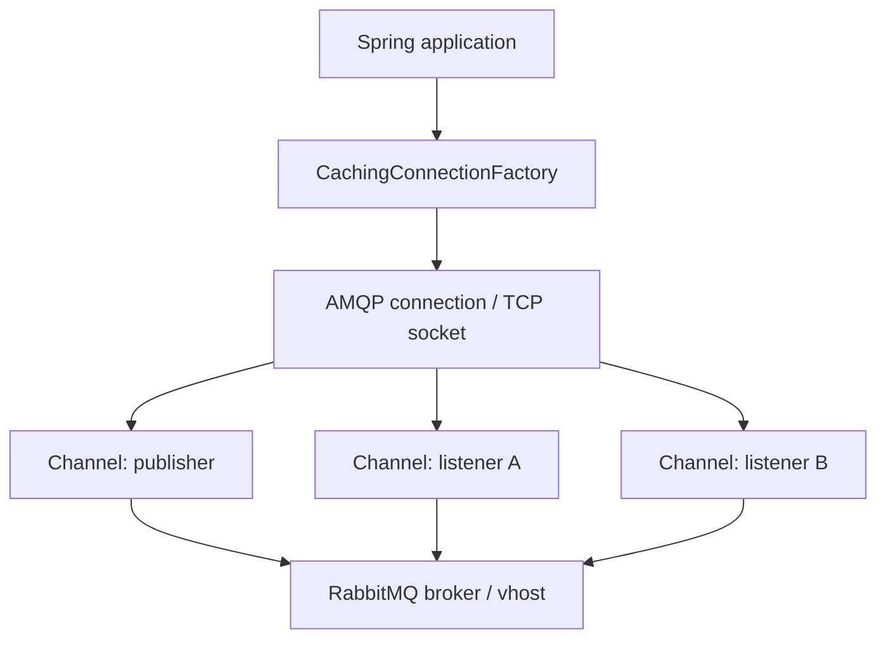

# channelCheckoutTimeout, connectionLimit và thời gian chờ tài nguyên trong Spring AMQP

Trong ứng dụng tích hợp **RabbitMQ bằng Spring AMQP**, `RabbitTemplate` gửi message và `@RabbitListener` nhận message thông qua các **connection** và **channel**. Những đối tượng này có chi phí tạo và duy trì. Khi số luồng gửi/nhận tăng đột biến, ứng dụng có thể phải **chờ mượn channel hoặc connection**; chờ quá lâu gây timeout, còn tạo vô hạn có thể làm cạn tài nguyên của broker.

Chương **Kết nối và channel** giới thiệu hai cấu hình quan trọng của `CachingConnectionFactory`: **`channelCheckoutTimeout`** và **`connectionLimit`**. Chúng cần được hiểu cùng với `cacheMode`, `channelCacheSize`, `connectionCacheSize` và mức đồng thời của publisher/consumer.

Sau bài này, bạn có thể:

- Phân biệt giới hạn **channel đang được sử dụng** với số channel giữ lại để tái sử dụng.
- Giải thích khi nào `channelCheckoutTimeout` khiến một thread chờ, khi nào xảy ra timeout và cấu hình nào quyết định giới hạn.
- Xác định `connectionLimit` chỉ có tác dụng khi `CacheMode.CONNECTION` và cách thời gian chờ được áp dụng khi hết connection.
- Cấu hình Spring Boot/Spring AMQP, theo dõi pool và xử lý quá tải mà không gây mất message hoặc retry không kiểm soát.
- Phân biệt timeout **chờ tài nguyên client** với timeout mạng, RPC, publisher confirm và cơ chế RabbitMQ chặn kết nối.

## 1. Connection, channel và cache nằm ở đâu?

RabbitMQ AMQP 0-9-1 sử dụng **connection** (kết nối TCP, có thể chạy qua TLS) và **channel** (luồng logic được ghép bên trong connection). Exchange, queue và binding thuộc virtual host của connection. Publisher và consumer thường sử dụng các channel để publish, consume và xác nhận message.



**`CachingConnectionFactory`** của Spring AMQP giúp tái sử dụng connection/channel thay vì tạo mới mỗi lần gọi `RabbitTemplate`. Việc gọi `close()` trên proxy channel/connection do cache quản lý thường **trả tài nguyên về cache** để tái sử dụng; ứng dụng không nên chủ động đóng underlying connection hoặc tự giữ channel lâu dài nếu đang dùng API `RabbitTemplate`.

Hai mô hình sử dụng cache:

| Chế độ | Cách vận hành ở mức khái niệm | Khi nào nên cân nhắc |
| --- | --- | --- |
| **`CacheMode.CHANNEL`** | Một connection được chia sẻ bởi các hoạt động của factory, các channel được lấy và trả về cache. Đây là chế độ phổ biến/mặc định. | Phần lớn ứng dụng gửi và nhận message qua Spring Rabbit |
| **`CacheMode.CONNECTION`** | Factory có cache **nhiều connection**; ứng dụng có thể mượn/trả connection và dùng channel trên mỗi connection. | Nhu cầu đặc biệt cần nhiều connection vật lý hoặc phân tách lưu lượng |

Một ứng dụng có thể có nhiều `ConnectionFactory` độc lập, ví dụ một factory dành riêng cho publisher. Khi đó các giới hạn ở đây là **theo từng factory**, không phải hạn mức tổng cho mọi kết nối đến RabbitMQ. Broker còn có hạn mức tài nguyên riêng, nên không thể lấy `connectionLimit` của một factory làm giới hạn toàn hệ thống.

## 2. Đừng nhầm kích thước cache với giới hạn tài nguyên

Ở chế độ `CacheMode.CHANNEL`, thuộc tính `channelCacheSize` có **hai ý nghĩa tùy `channelCheckoutTimeout`**:

| Cấu hình | Vai trò của `channelCacheSize` | Khi đang có nhiều thao tác hơn kích thước cache |
| --- | --- | --- |
| `channelCheckoutTimeout = 0` (mặc định thông dụng) | Chủ yếu là **số channel nhàn rỗi tối đa được giữ lại để tái sử dụng** | Factory có thể tạo thêm channel đang hoạt động; không chặn việc tạo chỉ vì đã vượt kích thước cache |
| `channelCheckoutTimeout > 0` | Trở thành **giới hạn số channel đang mở trên một connection** trong cơ chế cache channel | Nếu đạt giới hạn, thread chờ đến khi có channel được trả về hoặc hết timeout |

Vì vậy, một cấu hình `channelCacheSize=10` **không mặc nhiên có nghĩa hệ thống chỉ tạo tối đa 10 channel**. Chỉ khi bật timeout chờ channel với giá trị dương trong chế độ phù hợp, giới hạn đó mới được dùng để hạn chế số channel đồng thời.

**Ví dụ:** factory ở chế độ CHANNEL có `channelCacheSize=3`, `channelCheckoutTimeout=2000 ms`. Ba channel đang được các thao tác sử dụng:

```mermaid
sequenceDiagram
    participant T4 as Thread D
    participant CF as CachingConnectionFactory
    participant POOL as Channel pool
    T4->>CF: Mượn channel thứ tư
    CF->>POOL: Có channel nhàn rỗi?
    POOL-->>CF: Không; đã đạt giới hạn 3
    Note over T4,POOL: Chờ tối đa 2 giây
    alt Một thao tác trả channel trước hạn
        POOL-->>CF: Channel đã được trả
        CF-->>T4: Cấp channel và tiếp tục publish
    else Không có channel trước hạn
        CF-->>T4: Timeout chờ tài nguyên
    end
```

- Nếu một trong ba thao tác hoàn tất và trả channel trong khoảng chờ, thao tác thứ tư có thể tiếp tục.
- Nếu không có channel sẵn trước hạn, Spring có thể ném **`AmqpTimeoutException`** (hoặc exception bao ngoài liên quan, tùy lời gọi/phiên bản) khi checkout thất bại.
- Timeout phát sinh **trước hoặc trong lúc tìm tài nguyên để thực hiện thao tác AMQP**, không chứng minh message đã được broker nhận hay chưa; phải xem log và ranh giới thao tác cụ thể.

Bật giới hạn có lợi khi muốn kiểm soát mức sử dụng tài nguyên, nhưng đặt quá nhỏ có thể khiến publisher bị chặn bởi channel do listener hoặc transaction giữ lâu.

## 3. channelCheckoutTimeout: ý nghĩa và phạm vi

`channelCheckoutTimeout` là **thời gian tối đa chờ lấy tài nguyên từ `CachingConnectionFactory` khi giới hạn được kích hoạt**. Đơn vị trong API Java là **mili giây**; trong Spring Boot properties có thể dùng định dạng duration, ví dụ `2s` nếu phiên bản Boot hỗ trợ.

Điểm đáng lưu ý:

1. **`0` có ý nghĩa cấu hình**, không phải “chờ vô hạn”. Trong `CacheMode.CHANNEL`, giá trị 0 khiến `channelCacheSize` chủ yếu hoạt động như kích thước cache thay vì giới hạn số channel mở.
2. **Giá trị dương** cho phép chờ tài nguyên trong khoảng hữu hạn. Việc này giúp thực hiện *backpressure* ở phía client khi tăng concurrency.
3. **Chờ channel không phải chờ ACK từ consumer.** `RabbitTemplate` có thể cần channel để gửi; khi broker đã nhận message, xác nhận publish và việc consumer xử lý là các bước khác.
4. Một listener giữ channel cho vòng đời tiêu thụ; khi tăng số consumer, cần tính nhu cầu channel lâu dài cùng với publisher và các công việc quản trị.
5. Việc chờ không bảo đảm **thứ tự công bằng tuyệt đối** giữa mọi thread đang tranh chấp; phải đo độ trễ dưới tải thực tế.

### 3.1. Chọn khoảng chờ như thế nào?

Không có một con số đúng cho mọi hệ thống. Cần bắt đầu từ **SLA của lời gọi gửi message**, thời gian mỗi thao tác giữ channel, tốc độ publish, concurrency của listener và phần tài nguyên dự phòng.

Ví dụ một API đồng bộ chỉ có ngân sách 500 ms để trả lời: đặt checkout timeout 10 giây có thể khiến nhiều request bị treo quá lâu, dù broker vẫn khỏe. Ngược lại, đặt 20 ms trong đợt cao điểm có thể tạo lỗi tạm thời không cần thiết nếu channel thường được trả trong vài trăm mili giây.

Một cấu hình thử nghiệm `2s` hoặc `3s` chỉ nên xem là **điểm bắt đầu để đo**, không phải giá trị mặc định được khuyến nghị cho mọi hệ thống.

### 3.2. Vì sao timeout có thể tăng đột ngột?

- Tăng `@RabbitListener` concurrency làm nhiều channel bận lâu.
- Nhiều producer đồng thời gọi `RabbitTemplate`, đặc biệt khi thao tác sử dụng cùng channel trong một scope dài.
- Dùng transaction AMQP hoặc `RabbitTemplate.invoke(...)` có thể kéo dài thời gian giữ channel.
- Channel bị giữ bởi code trực tiếp sử dụng API thấp hơn và không được giải phóng đúng vòng đời.
- Factory dùng chung cho tác vụ nền, request web, listener và publisher nhưng giới hạn thấp.

Không nên chỉ tăng timeout để che tình trạng cạn tài nguyên kéo dài. Phải xác định **kênh bị chiếm bởi tác vụ nào** và xem mức sử dụng connection/channel thực tế trên broker.

## 4. connectionLimit: giới hạn connection trong CacheMode.CONNECTION

`connectionLimit` có ý nghĩa khi **`CachingConnectionFactory` sử dụng `CacheMode.CONNECTION`**. Chế độ này quản lý một nhóm connection; cấu hình khác liên quan là `connectionCacheSize`.

| Thuộc tính | Vai trò trong `CacheMode.CONNECTION` |
| --- | --- |
| `connectionCacheSize` | Số lượng connection **nhàn rỗi** mà factory hướng tới việc giữ lại trong cache để tái sử dụng; **không phải** mặc nhiên là giới hạn connection đang mở |
| `connectionLimit` | Giới hạn số connection được phép mở/duy trì bởi factory trong chế độ CONNECTION |
| `channelCheckoutTimeout` | Thời gian chờ connection nhàn rỗi khi đạt `connectionLimit` và chưa thể tạo connection mới |
| `channelCacheSize` | Số channel nhàn rỗi được cache **trên mỗi connection**, theo cơ chế cache channel tương ứng |

Giả sử:

- `cacheMode=CONNECTION`
- `connectionCacheSize=2`
- `connectionLimit=4`
- `channelCheckoutTimeout=3000 ms`

Nếu bốn connection đã được mượn và chưa connection nào được trả, thao tác cần connection thứ năm **chờ tối đa ba giây**. Nếu một connection được trả kịp thời, thao tác có thể lấy lại nó; nếu không, timeout chờ tài nguyên xảy ra.

Lưu ý **`connectionCacheSize=2` không có nghĩa connection thứ ba bị từ chối**. Kích thước cache và giới hạn tổng có vai trò khác nhau.

### 4.1. connectionLimit không giới hạn mọi connection của broker

Trong chế độ `CacheMode.CHANNEL`, `connectionLimit` **không phải** tham số điều khiển số channel. Nó cũng không giới hạn connection do những ứng dụng/factory khác mở, bao gồm một publisher factory riêng, công cụ quản trị và các service khác.

Ngoài ra, `connectionLimit` là giới hạn ở **client factory**. RabbitMQ có thể áp dụng thêm giới hạn ở broker/vhost/user, hoặc từ chối connection do cấu hình và tình trạng hạ tầng. Hai cơ chế cần được theo dõi riêng.

### 4.2. Những đánh đổi của chế độ CONNECTION

Chế độ CONNECTION cho phép sử dụng nhiều TCP connection nhưng làm tăng chi phí connection handshake, heartbeat, socket và số connection mà broker phải theo dõi. Nó **không mặc nhiên tăng throughput** của một publisher hay giúp mọi consumer chạy nhanh hơn.

**Lưu ý về `RabbitAdmin`:** với `CacheMode.CONNECTION`, cơ chế *tự động khai báo* exchange/queue/binding bằng `RabbitAdmin` không được hỗ trợ theo cách tương tự mode CHANNEL trong tài liệu Spring AMQP. Nếu cần dùng mode này, hãy thiết kế việc khai báo topology bằng công cụ quản trị, quy trình hạ tầng hoặc thao tác tường minh được kiểm soát; đừng giả định rằng chỉ đăng ký bean `Queue`, `Exchange` và `Binding` sẽ luôn khai báo thành công.

Đối với đa số ứng dụng dùng `RabbitTemplate` và `@RabbitListener`, **`CacheMode.CHANNEL` là điểm khởi đầu phù hợp hơn**. Chỉ chuyển sang CONNECTION khi có nhu cầu đo đạc/kiến trúc rõ ràng.

## 5. Cấu hình Spring Boot cho hai mô hình

Các ví dụ dưới đây sử dụng nhóm properties `spring.rabbitmq.cache.*` trong Spring Boot dành cho Spring Rabbit/AMQP 0-9-1. Tên và khả năng hỗ trợ cụ thể phải đối chiếu với metadata cấu hình của **phiên bản Spring Boot đang chạy**.

### 5.1. Phương án A: giới hạn số channel

```yaml
# application.yml - ví dụ cho CacheMode.CHANNEL
spring:
  rabbitmq:
    host: ${RABBITMQ_HOST:localhost}
    port: ${RABBITMQ_PORT:5672}
    virtual-host: ${RABBITMQ_VHOST:/jobs}
    username: ${RABBITMQ_USERNAME}
    password: ${RABBITMQ_PASSWORD}
    cache:
      connection:
        mode: channel
      channel:
        size: 16
        checkout-timeout: 2s
    listener:
      simple:
        concurrency: 4
        max-concurrency: 8
        prefetch: 20
```

Cách đọc:

- `cache.connection.mode: channel`: dùng mô hình một connection chia sẻ và cache channel.
- `cache.channel.size: 16` cùng `checkout-timeout: 2s`: giới hạn số channel có thể checkout đồng thời trên connection theo cơ chế channel cache, thời gian chờ tối đa hai giây khi hết channel.
- `listener.simple.concurrency: 4` và `max-concurrency: 8`: container có thể chạy nhiều consumer; cần **dành tài nguyên** cho chúng và publisher.
- `prefetch: 20`: giới hạn số delivery chưa được ACK mà consumer có thể được giao theo chính sách container/broker; **không phải** số channel.

Nếu dùng `@RabbitListener` trên nhiều queue, nhiều listener container hoặc tách publisher factory, số channel thực tế có thể khác với phép ước tính đơn giản. Cần đo tại ứng dụng và RabbitMQ Management.

Không nên sao chép giá trị `16` mà không tính số listener. Nếu 16 channel đều bị giữ bởi consumer hoặc các thao tác dài, publisher gửi message sẽ phải chờ đến lúc có channel sẵn; việc tăng `max-concurrency` có thể làm lỗi timeout nặng hơn.

### 5.2. Phương án B: giới hạn số connection

```yaml
# application.yml - ví dụ thay thế: CacheMode.CONNECTION
spring:
  rabbitmq:
    host: ${RABBITMQ_HOST:localhost}
    port: ${RABBITMQ_PORT:5672}
    virtual-host: ${RABBITMQ_VHOST:/jobs}
    username: ${RABBITMQ_USERNAME}
    password: ${RABBITMQ_PASSWORD}
    cache:
      connection:
        mode: connection
        size: 2
        limit: 4
      channel:
        size: 8
        checkout-timeout: 3s
```

Đây là **cấu hình thay thế**, không phải cấu hình cộng thêm với phương án A:

- `connection.mode: connection` mở chế độ cache nhiều connection.
- `connection.size: 2` thiết lập kích thước cache connection.
- `connection.limit: 4` giới hạn số connection mà factory được mở.
- `channel.checkout-timeout: 3s` là khoảng chờ tài nguyên khi hết connection được phép mở trong mode này.
- `channel.size: 8` quản lý số channel được cache trên mỗi connection; không biến `connectionLimit=4` thành “tổng cộng 32 channel” cứng cho mọi tình huống.

Khi dùng phương án này, phải chủ động thiết kế vòng đời khai báo topology; kiểm tra xem hệ thống đã tạo exchange, queue, binding **trước khi publisher/consumer chạy** hay chưa.

### 5.3. Cấu hình bằng Java khi không dùng properties

```java
import org.springframework.amqp.rabbit.connection.CachingConnectionFactory;

CachingConnectionFactory factory =
        new CachingConnectionFactory("localhost");

factory.setUsername("app_user");
// Ví dụ minh họa; lấy password từ secret trong ứng dụng thật.
factory.setPassword("replace-with-secret");

factory.setCacheMode(CachingConnectionFactory.CacheMode.CHANNEL);
factory.setChannelCacheSize(16);
factory.setChannelCheckoutTimeout(2_000); // milliseconds
```

Hoặc thay ba dòng cuối bằng một cấu hình CONNECTION:

```java
factory.setCacheMode(CachingConnectionFactory.CacheMode.CONNECTION);
factory.setConnectionCacheSize(2);
factory.setConnectionLimit(4);
factory.setChannelCacheSize(8);
factory.setChannelCheckoutTimeout(3_000); // milliseconds
```

Hai đoạn Java minh họa **hai cách cấu hình thay thế**, không phải yêu cầu thiết lập liên tiếp cả hai. Với Spring Boot tự cấu hình `CachingConnectionFactory`, ưu tiên cấu hình bằng properties; không tạo thêm một factory tùy ý nếu chưa xác định rõ factory nào được `RabbitTemplate` và listener container sử dụng.

## 6. Ví dụ publisher, listener và áp lực channel

Một topology thử nghiệm đơn giản gồm exchange `jobs.events`, queue `jobs.processing` và binding `job.created`:

```java
import org.springframework.amqp.core.Binding;
import org.springframework.amqp.core.BindingBuilder;
import org.springframework.amqp.core.Queue;
import org.springframework.amqp.core.QueueBuilder;
import org.springframework.amqp.core.TopicExchange;
import org.springframework.context.annotation.Bean;
import org.springframework.context.annotation.Configuration;

@Configuration
public class JobMessagingConfig {
    @Bean
    public TopicExchange jobsExchange() {
        return new TopicExchange("jobs.events", true, false);
    }

    @Bean
    public Queue jobsQueue() {
        return QueueBuilder.durable("jobs.processing").build();
    }

    @Bean
    public Binding jobsBinding(Queue jobsQueue, TopicExchange jobsExchange) {
        return BindingBuilder.bind(jobsQueue)
                .to(jobsExchange)
                .with("job.created");
    }
}
```

Publisher:

```java
import org.springframework.amqp.rabbit.core.RabbitTemplate;
import org.springframework.stereotype.Service;

@Service
public class JobPublisher {
    private final RabbitTemplate rabbitTemplate;

    public JobPublisher(RabbitTemplate rabbitTemplate) {
        this.rabbitTemplate = rabbitTemplate;
    }

    public void publish(String jobId) {
        rabbitTemplate.convertAndSend("jobs.events", "job.created", jobId);
    }
}
```

Consumer:

```java
import org.springframework.amqp.rabbit.annotation.RabbitListener;
import org.springframework.stereotype.Component;

@Component
public class JobConsumer {
    @RabbitListener(queues = "jobs.processing")
    public void handle(String jobId) {
        // Thực hiện nghiệp vụ thật với cơ chế idempotency.
        System.out.println("Process job " + jobId);
    }
}
```

Để khảo sát tình trạng thiếu channel, có thể đồng thời tăng lưu lượng publish và `listener.simple.concurrency` trong **môi trường thử nghiệm** đã bật giới hạn channel. Quan sát độ trễ của `publish(...)`, exception checkout, số channel trên broker và số message đang chờ trong queue.

**Quan hệ cần phân biệt:**

- Một consumer `@RabbitListener` thường chiếm channel trong thời gian đang hoạt động.
- Một lời gọi `RabbitTemplate.convertAndSend(...)` cần channel để publish; Spring quản lý việc mượn và trả tài nguyên theo vòng đời thao tác.
- Nếu channel đã đạt giới hạn và chưa được trả về, publisher có thể bị chặn **trước khi thực hiện publish**.
- Nếu message đã đến queue nhưng consumer chậm, vấn đề thể hiện ở **backlog, unacked, throughput**, không nhất thiết ở checkout timeout.
- Nếu publisher nhận confirm chậm, cần phân tích cơ chế publisher confirm và tình trạng broker, không quy mọi độ trễ cho channel pool.

Trong Spring AMQP, chọn dùng channel giao dịch, `RabbitTemplate.invoke(...)` hoặc các luồng quản lý transaction có thể kéo dài thời gian giữ tài nguyên. Vì vậy phải đo **thời gian checkout** và **thời gian thực hiện operation** riêng khi tìm nguyên nhân.

## 7. Phân biệt các loại timeout quan trọng

Tên các timeout trong hệ thống messaging dễ gây nhầm:

| Thời gian chờ | Chờ điều gì? | Ví dụ bối cảnh |
| --- | --- | --- |
| **`channelCheckoutTimeout`** | Channel hoặc connection nhàn rỗi từ `CachingConnectionFactory` khi cơ chế giới hạn tương ứng được bật | Client thiếu tài nguyên để bắt đầu thao tác |
| **`connectionTimeout`** của client/network | Thiết lập kết nối mạng tới RabbitMQ | Broker không truy cập được hoặc mạng lỗi |
| **Handshake timeout / heartbeat** | Bắt tay protocol và phát hiện kết nối lỗi | Kết nối TCP tồn tại nhưng giao tiếp AMQP không hoàn thành hoặc peer mất phản hồi |
| **`RabbitTemplate.replyTimeout`** | Reply cho thao tác request–reply/RPC | Publisher gửi request nhưng không có reply trong hạn |
| **Publisher confirm timeout/chờ future** | Broker xác nhận lần publish khi ứng dụng chủ động chờ confirm | Tìm hiểu kết quả publish, không phải checkout channel |
| **Consumer ACK / retry backoff** | Xử lý và xác nhận delivery, hoặc đợi lần thử lại | Consumer lỗi hoặc xử lý lâu |
| **Blocked connection** do resource alarm của RabbitMQ | Broker hạn chế publisher khi thiếu RAM/đĩa | Publish có thể bị chặn dù client còn channel |

Một ví dụ để đọc log: **`AmqpTimeoutException` khi checkout channel** không phải dấu hiệu RabbitMQ đã nhận message nhưng không ACK. Nếu thao tác chưa có channel thì có thể chưa publish; nếu exception xuất hiện sau một chuỗi thao tác, cần xác định chính xác bước thất bại trước khi retry.

Một tình huống khác: **RabbitMQ memory/disk alarm** có thể làm broker chặn publisher connection, dù `CachingConnectionFactory` còn nhiều channel nhàn rỗi. Khi đó tăng `channelCacheSize` hoặc `connectionLimit` khó giải quyết vấn đề; cần xử lý tài nguyên broker và backlog.

## 8. Chẩn đoán nghẽn tài nguyên theo từng lớp

Khi thấy timeout hoặc throughput giảm, nên đi từ điểm phát sinh lỗi rồi đối chiếu với thông tin trên cả ứng dụng và broker.

### 8.1. Quan sát trạng thái cache phía Spring

`CachingConnectionFactory` cung cấp thông tin chẩn đoán qua `getCacheProperties()`. Có thể đọc giá trị này tại chỗ hoặc đưa vào hệ thống metrics theo cách phù hợp.

```java
import org.springframework.amqp.rabbit.connection.CachingConnectionFactory;
import org.springframework.stereotype.Component;

@Component
public class RabbitCacheInspector {
    private final CachingConnectionFactory factory;

    public RabbitCacheInspector(CachingConnectionFactory factory) {
        this.factory = factory;
    }

    public void logSnapshot() {
        System.out.println(factory.getCacheProperties());
    }
}
```

Đây là ví dụ quan sát thủ công, **không nên in liên tục dữ liệu nhạy cảm hoặc spam log**. Tùy `CacheMode` và phiên bản Spring AMQP, thuộc tính cache trả về có thể khác nhau; đối chiếu với số liệu broker để hiểu số connection/channel đang dùng và đang nhàn rỗi.

Nếu dự án có Micrometer/Actuator hoặc hệ thống quan sát riêng, hãy bổ sung các chỉ số về số lần/độ trễ checkout, timeout, số thao tác gửi đồng thời, độ trễ publish confirm và lỗi consumer. Không suy diễn rằng mỗi phiên bản Spring Boot đều có sẵn cùng tên metric cho channel cache.

### 8.2. Quan sát tại RabbitMQ

Trong môi trường có quyền quản trị, một số lệnh hữu ích:

```bash
# Xem connection hiện có; cột channels cho thấy số channel trên connection
rabbitmqctl list_connections name user vhost state channels

# Xem channel và số consumer tương ứng
rabbitmqctl list_channels connection number consumer_count messages_unacknowledged

# Quan sát backlog và consumer theo queue
rabbitmqctl list_queues -p /jobs name messages_ready messages_unacknowledged consumers
```

RabbitMQ Management UI còn cho phép xem số connection, channel, thông lượng publish/deliver/ack, memory/disk alarms và trạng thái blocked connection. Nếu chỉ quan sát cache phía Java mà không nhìn broker, rất dễ nhầm lỗi **client pool** với hạn mức server hoặc lượng message chưa ACK.

### 8.3. Bảng chẩn đoán nhanh

| Triệu chứng | Khả năng nguyên nhân | Việc cần kiểm tra |
| --- | --- | --- |
| Publisher thỉnh thoảng lỗi checkout timeout khi tăng tải | `channelCacheSize` giới hạn quá thấp so với số channel đồng thời | Cache mode, channel checkout timeout, listener concurrency, scope của operation |
| Dùng CONNECTION mode, số lời gọi đồng thời vượt `connectionLimit` | Hết connection được phép mượn | `connectionCacheSize`, `connectionLimit`, thời gian trả connection |
| Broker có rất nhiều channel dù `channelCacheSize` nhỏ | Cache chưa đặt hard limit do timeout bằng 0 hoặc có nhiều factory/connection | `channelCheckoutTimeout`, số factory, số listener |
| Gửi chậm dù còn channel nhàn rỗi | Publisher confirm chậm, broker bị blocked, mạng/IO hoặc hạ tầng quá tải | Trạng thái broker, publisher confirm, memory/disk alarms |
| Queue có nhiều `messages_unacknowledged` | Consumer xử lý chậm hoặc prefetch cao | Listener latency, concurrency, ACK, retry, transaction |
| Kết nối tới broker bị từ chối | Broker quá tải, giới hạn kết nối/quyền/vhost hoặc lỗi mạng | Connection logs, broker limits, user/vhost và connectivity |
| Sau đổi mode, queue/binding không tự khai báo | Sử dụng CONNECTION mode mà chưa thiết kế khai báo topology | RabbitAdmin, quy trình khai báo và trạng thái queue thực tế |
| Timeout xảy ra lúc broker vẫn khỏe | Code giữ channel/connection quá lâu hoặc pool giới hạn thấp | Thread dump, phạm vi transaction/invoke, số checkout đồng thời |

Lưu ý các ứng dụng có thể dùng nhiều `ConnectionFactory` (chẳng hạn publisher connection riêng); nếu vậy phải phân tích **đúng instance** gây lỗi. Một factory đủ tài nguyên không chứng minh factory kia cũng còn channel.

## 9. Điều chỉnh giới hạn theo nhu cầu xử lý bất đồng bộ

Có thể thực hiện theo trình tự:

1. **Đo mức đồng thời cơ sở:** bao nhiêu listener consumer, bao nhiêu lời gọi publish đồng thời, thời gian xử lý trung bình và đỉnh; có bao nhiêu factory.
2. **Xác định giới hạn cần kiểm soát:** dùng `CacheMode.CHANNEL` nếu mục tiêu chính là kiểm soát channel trên connection chia sẻ; chỉ dùng `CacheMode.CONNECTION` và `connectionLimit` nếu thực sự cần quản lý nhiều connection.
3. **Đặt giá trị thử nghiệm có dự phòng:** `channelCacheSize` cần tính consumer channel lâu dài, publisher và admin/transaction channel. `channelCheckoutTimeout` phải nằm trong ngân sách độ trễ của lời gọi.
4. **Kiểm thử tải và tình huống xấu:** tăng số request đồng thời, mô phỏng listener chậm, khởi động lại broker hoặc tạm mất mạng; theo dõi timeout, throughput, hàng đợi và trạng thái kết nối.
5. **Đặt chính sách phản ứng khi checkout timeout:** giới hạn retry, backoff, circuit breaker hoặc trả lỗi có thể retry tùy nghiệp vụ; tránh retry nóng làm áp lực tài nguyên tăng.
6. **Theo dõi sau triển khai:** đo channel count, connection count, queue depth, publisher confirms, ACK, redelivery, DLQ và cảnh báo broker.

### 9.1. Suy luận sức chứa đơn giản

Giả sử cùng một factory dùng CACHE CHANNEL, có:

- 6 consumer đang hoạt động và mỗi consumer giữ một channel.
- Tối đa 5 thao tác publish cần channel tại cùng thời điểm.
- Thỉnh thoảng một thao tác quản trị hoặc transaction cần thêm channel.

Khi `channelCheckoutTimeout > 0`, đặt `channelCacheSize=8` rõ ràng có thể dẫn tới tranh chấp: 6 channel cho consumer để lại rất ít khả năng cho publisher. Mức `12` hoặc cao hơn có thể là điểm xuất phát để đo, nhưng **không phải công thức cố định**, vì kiến trúc listener/publisher có thể dùng connection factory khác nhau và cơ chế container có đặc điểm riêng.

Không nên đặt cứng toàn bộ hệ thống bằng một phép cộng rồi bỏ qua đo đạc thực tế. Mục tiêu là có khoảng dự phòng cho thay đổi traffic và thời gian giữ channel, trong giới hạn mà broker có thể chịu.

### 9.2. Checkout timeout và độ tin cậy message

Giới hạn channel/connection giúp tránh bùng nổ tài nguyên, nhưng **không thay thế cơ chế xác nhận giao nhận**:

- Publisher gửi qua `RabbitTemplate` vẫn cần **publisher confirm** nếu muốn biết broker đã nhận trách nhiệm cho lần publish.
- Publisher có thể cần **publisher return** cho message không định tuyến được; confirm ACK không chứng minh mọi queue dự kiến đã nhận.
- Consumer dùng `@RabbitListener` cần ACK/NACK và retry/DLQ đúng cách.
- Khi operation timeout và caller retry, phải cân nhắc **kết quả không rõ ràng** ở những bước đã có publish; dùng event ID và idempotency.
- Transaction AMQP không tự tạo tính nguyên tử với database; nếu cần đảm bảo sau commit DB chắc chắn có message, cân nhắc transactional outbox.

Một checkout timeout được xử lý không đúng cách có thể làm API trả lỗi, rồi client retry và tạo **hai sự kiện nghiệp vụ** nếu cơ chế tạo event không có khóa idempotency.

## 10. Checklist thực hành

- [ ] Xác định `CachingConnectionFactory` đang dùng `CacheMode.CHANNEL` hay `CacheMode.CONNECTION`.
- [ ] Phân biệt `channelCacheSize`/`connectionCacheSize` với giới hạn thực tế khi có timeout hoặc `connectionLimit`.
- [ ] Nếu giới hạn channel trong CHANNEL mode, đặt `channelCheckoutTimeout` **lớn hơn 0** và đo thời gian giữ channel.
- [ ] Nếu giới hạn connection trong CONNECTION mode, đặt `connectionLimit` rõ ràng và kiểm tra thời gian chờ connection.
- [ ] Tính nhu cầu tài nguyên của listener, publisher, admin và các transaction; không chỉ đếm request HTTP.
- [ ] Không đánh đồng checkout timeout với network timeout, reply timeout, publisher confirm hoặc broker blocked connection.
- [ ] Kiểm tra khai báo exchange/queue/binding sau khi đổi cache mode, nhất là CONNECTION mode.
- [ ] Quan sát cả `getCacheProperties()` phía Spring và connections/channels/queue metrics phía RabbitMQ.
- [ ] Đặt giới hạn retry/backoff cho lỗi tạm thời; xử lý message bằng idempotency khi có thể gửi/nhận trùng.
- [ ] Kiểm thử quá tải và phục hồi trước khi tăng concurrency hoặc đưa giới hạn mới vào production.

**Ghi nhớ:** `channelCheckoutTimeout` là thời gian chờ lấy tài nguyên và trong `CacheMode.CHANNEL`, giá trị dương còn kích hoạt giới hạn tổng channel theo `channelCacheSize`. `connectionLimit` là giới hạn connection của `CacheMode.CONNECTION`, nơi thời gian chờ resource cũng sử dụng `channelCheckoutTimeout` khi đã hết connection được phép mở. Các giới hạn này bảo vệ tài nguyên client nhưng phải được đặt cùng concurrency, xác nhận giao nhận, retry và quan sát để hệ thống RabbitMQ/Spring AMQP vận hành tin cậy.

### Tài liệu tham khảo

- [Spring AMQP Reference — Connections and Resource Management](https://docs.spring.io/spring-amqp/reference/amqp/connections.html)
- [Spring AMQP API — CachingConnectionFactory](https://docs.spring.io/spring-amqp/api/org/springframework/amqp/rabbit/connection/CachingConnectionFactory.html)
- [Spring Boot — AMQP and RabbitMQ Configuration](https://docs.spring.io/spring-boot/reference/messaging/amqp.html)
- [RabbitMQ — Connections](https://www.rabbitmq.com/docs/connections)
- [RabbitMQ — Channels](https://www.rabbitmq.com/docs/channels)
- [RabbitMQ — Consumer Acknowledgements and Publisher Confirms](https://www.rabbitmq.com/docs/confirms)
- [RabbitMQ — Memory and Disk Alarms](https://www.rabbitmq.com/docs/alarms)

